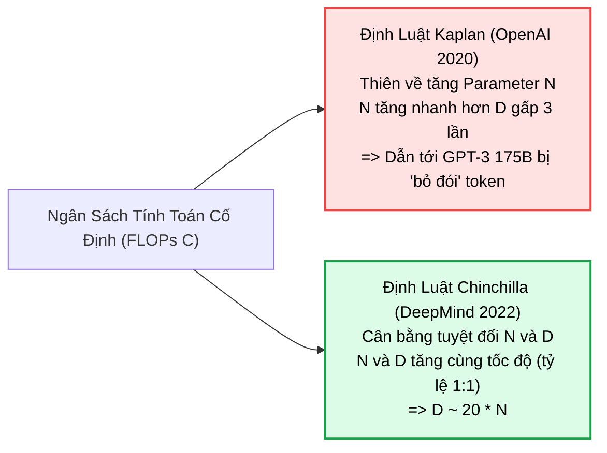
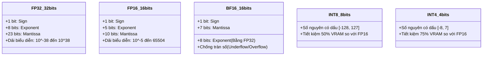
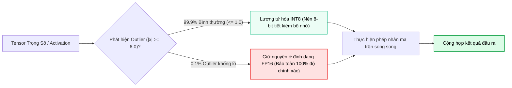

# ⚖️ ĐỊNH LUẬT TỶ LỆ & KỸ THUẬT LƯỢNG TỬ HÓA MÔ HÌNH
## Từ Định Luật Chinchilla Đến Các Thuật Toán Nén Trọng Số INT8, INT4, GPTQ, AWQ & GGUF

---

## 📑 MỤC LỤC
1. [Nghịch Lý Quy Mô & Các Định Luật Tỷ Lệ (Scaling Laws)](#1-nghịch-lý-quy-mô--các-định-luật-tỷ-lệ-scaling-laws)
   * [1.1. Sai Lầm Của Định Luật Kaplan (OpenAI 2020)](#11-sai-lầm-của-định-luật-kaplan-openai-2020)
   * [1.2. Cuộc Cách Mạng Chinchilla (Hoffmann et al., DeepMind 2022)](#12-cuộc-cách-mạng-chinchilla-hoffmann-et-al-deepmind-2022)
   * [1.3. Xu Hướng Hiện Đại: "Inference-Optimal" Over-training (LLaMA Series)](#13-xu-hướng-hiện-đại-inference-optimal-over-training-llama-series)
2. [Toán Học Của Kỹ Thuật Lượng Tử Hóa (Quantization Mathematics)](#2-toán-học-của-kỹ-thuật-lượng-tử-hóa-quantization-mathematics)
   * [2.1. Phân Loại Định Dạng Số: FP32, FP16, BF16 vs INT8, INT4](#21-phân-loại-định-dạng-số-fp32-fp16-bf16-vs-int8-int4)
   * [2.2. Phép Ánh Xạ Tuyến Tính Affine Quantization](#22-phép-ánh-xạ-tuyến-tính-affine-quantization)
   * [2.3. Hiểm Họa Outlier Features Trong Các Mô Hình Lớn](#23-hiểm-họa-outlier-features-trong-các-mô-hình-lớn)
3. [Các Giải Thuật Lượng Tử Hóa Trọng Số Tiên Tiến](#3-các-giải-thuật-lượng-tử-hóa-trọng-số-tiên-tiến)
   * [3.1. LLM.int8() (Vector-wise Quantization & Outlier Decomposition)](#31-llmint8-vector-wise-quantization--outlier-decomposition)
   * [3.2. GPTQ (Optimal Brain Surgeon & Inverse Hessian Matrix)](#32-gptq-optimal-brain-surgeon--inverse-hessian-matrix)
   * [3.3. AWQ (Activation-Aware Weight Quantization)](#33-awq-activation-aware-weight-quantization)
4. [Hạ Tầng Local LLM Cho AI Agents: Định Dạng GGUF & llama.cpp](#4-hạ-tầng-local-llm-cho-ai-agents-định-dạng-gguf--llamacpp)
   * [4.1. Bảng Đánh Đổi Các Mức K-Quants (Q4_K_M vs Q5_K_M vs Q8_0)](#41-bảng-đánh-đổi-các-mức-k-quants-q4_k_m-vs-q5_k_m-vs-q8_0)
   * [4.2. Công Thức Tính Toán Dung Lượng VRAM Thực Tế Cho Agent](#42-công-thức-tính-toán-dung-lượng-vram-thực-tế-cho-agent)
5. [Thực Chiến: Lượng Tử Hóa Mô Hình Bằng Python (PyTorch & BitsAndBytes)](#5-thực-chiến-lượng-tử-hóa-mô-hình-bằng-python-pytorch--bitsandbytes)
6. [Bản Đồ Liên Kết Hệ Thống & Tài Liệu Tham Khảo](#6-bản-đồ-liên-kết-hệ-thống--tài-liệu-tham-khảo)

---

## 1. NGHỊCH LÝ QUY MÔ & CÁC ĐỊNH LUẬT TỶ LỆ (SCALING LAWS)

Trong kỷ nguyên học sâu, một trong những câu hỏi trị giá hàng tỷ USD của các phòng lab AI là: **Khi có một ngân sách tính toán (Compute Budget) cố định, chúng ta nên đầu tư vào việc tăng kích thước mô hình (Số lượng tham số $N$) hay tăng kích thước dữ liệu huấn luyện (Số lượng tokens $D$)?**



---

### 1.1. Sai Lầm Của Định Luật Kaplan (OpenAI 2020)

Năm 2020, Jared Kaplan và các nhà nghiên cứu tại OpenAI công bố bài báo *"Scaling Laws for Neural Language Models"*. Họ đưa ra kết luận:
* Hàm mất mát (Cross-entropy Loss) suy giảm theo định luật lũy thừa (Power Law) đối với số lượng tham số $N$, kích thước dữ liệu $D$, và tổng năng lực tính toán $C$.
* **Sai lầm cốt tử:** Kaplan et al. cho rằng hiệu năng của mô hình phụ thuộc nhiều hơn vào số lượng tham số $N$ so với số lượng dữ liệu $D$. Khi ngân sách compute tăng lên, họ khuyến nghị tăng số lượng tham số $N \propto C^{0.73}$ và chỉ tăng số lượng tokens $D \propto C^{0.27}$.
* **Hậu quả thực tiễn:** Điều này dẫn tới sự ra đời của **GPT-3 (175 tỷ tham số)** nhưng chỉ được huấn luyện trên **300 tỷ tokens** (tỷ lệ chỉ $1.7\text{ tokens}$ cho mỗi tham số). Mô hình có kích thước khổng lồ nhưng bị "đói dữ liệu" (Severely Undertrained).

---

### 1.2. Cuộc Cách Mạng Chinchilla (Hoffmann et al., DeepMind 2022)

Năm 2022, Jordan Hoffmann và nhóm nghiên cứu DeepMind công bố bài báo lịch sử *"Training Compute-Optimal Large Language Models"*, chứng minh rằng các mô hình ngôn ngữ lớn thời điểm đó (bao gồm GPT-3, Megatron-Turing 530B, và Gopher 280B) đều bị lãng phí tham số trầm trọng.

#### Hàm Mất Mát Chinchilla (The Chinchilla Loss Function):

DeepMind mô hình hóa hàm mất mát thông qua phương trình:

$$
L(N, D) = E + \frac{A}{N^\alpha} + \frac{B}{D^\beta}
$$

Trong đó:
* $E$: Mất mát bất khả quy (Irreducible loss của ngôn ngữ tự nhiên).
* $A / N^\alpha$: Lượng mất mát do giới hạn dung lượng tham số của mô hình.
* $B / D^\beta$: Lượng mất mát do giới hạn kích thước tập dữ liệu huấn luyện.
* Thực nghiệm đo lường trên hơn $400$ mô hình cho ra các số mũ: $\alpha \approx 0.34$, $\beta \approx 0.28$.

#### Ràng Buộc Năng Lượng Tính Toán (Compute Constraint):
Tổng số phép tính dấu phẩy động (FLOPs) cần thiết để huấn luyện một mô hình Transformer chuẩn được xấp xỉ bởi công thức:

$$
C \approx 6 N D
$$

*Trong đó:* Mỗi token cần khoảng $2N$ FLOPs cho Forward Pass và $4N$ FLOPs cho Backward Pass.

Áp dụng phương pháp nhân tử Lagrange để cực tiểu hóa hàm mất mát $L(N, D)$ dưới ràng buộc $C = 6ND$:

$$
N_{\text{optimal}} \propto C^a, \quad D_{\text{optimal}} \propto C^b \quad \text{with } a = \frac{\beta}{\alpha + \beta} \approx 0.5, \quad b = \frac{\alpha}{\alpha + \beta} \approx 0.5
$$

> [!important] Quy Tắc Ngón Tay Cái Chinchilla (Chinchilla Rule of Thumb)
> Để đạt trạng thái tối ưu về mặt chi phí tính toán (Compute-Optimal):
> 1. Kích thước mô hình $N$ và số lượng dữ liệu $D$ **bắt buộc phải tăng trưởng với tốc độ bằng nhau (tỷ lệ $1:1$)**.
> 2. Cứ mỗi **$1$ tham số** mô hình cần ít nhất xấp xỉ **$20\text{ tokens}$** huấn luyện chất lượng cao ($D \approx 20 \times N$).

#### Minh chứng Chinchilla 70B:
DeepMind đã huấn luyện mô hình **Chinchilla với 70 tỷ tham số trên 1.4 nghìn tỷ (Trillion) tokens** (đúng tỷ lệ $1:20$). Kết quả: Chinchilla 70B **đè bẹp hoàn toàn Gopher 280B và GPT-3 175B** trên tất cả các bài đánh giá học thuật MMLU, BIG-bench, trong khi kích thước mô hình chỉ bằng $1/4$, giúp giảm mạnh chi phí phần cứng phục vụ suy luận.

---

### 1.3. Xu Hướng Hiện Đại: "Inference-Optimal" Over-training (LLaMA Series)

Định luật Chinchilla chỉ tối ưu hóa cho **chi phí huấn luyện (Training Compute)**. Nhưng trong thực tế triển khai các hệ thống tác tử AI, một mô hình sau khi huấn luyện sẽ được gọi suy luận (Inference) hàng tỷ lần bởi người dùng và các vòng lặp Agent Loops.

Meta AI nhận ra rằng: **Chi phí huấn luyện chỉ trả một lần, còn chi phí suy luận phải trả mãi mãi.**
* Do đó, họ cố tình "huấn luyện vượt ngưỡng tối ưu" (Over-training):
  * **LLaMA-1 / LLaMA-2 (7B):** Huấn luyện trên $1\text{T} - 2\text{T tokens}$ (tỷ lệ gấp 7 đến 14 lần tiêu chuẩn Chinchilla).
  * **LLaMA-3 (8B):** Huấn luyện trên **15 nghìn tỷ tokens** (tỷ lệ gấp hơn $90$ lần Chinchilla!).
* **Kết quả:** Mô hình 8B nhỏ gọn, có thể chạy mượt mà trên một chiếc laptop cá nhân hoặc card đồ họa tầm trung, nhưng sở hữu tri thức và năng lực nhận thức tương đương các mô hình $70\text{B}$ đời trước.

---

## 2. TOÁN HỌC CỦA KỸ THUẬT LƯỢNG TỬ HÓA (QUANTIZATION MATHEMATICS)

Dù LLaMA-3 8B rất nhỏ gọn, nó vẫn có $8\times 10^9$ tham số. Nếu lưu trữ ở định dạng chuẩn nửa chính xác (16-bit Float - FP16 / BF16):

$$
\text{VRAM}_{\text{weights}} = 8 \times 10^9 \text{ params} \times 2 \text{ bytes} \approx 16 \text{ GB}
$$

Để chạy mô hình này cùng với Cửa sổ ngữ cảnh lớn trong các vòng lặp Agent, một card đồ họa phổ thông 8GB hay 12GB VRAM sẽ lập tức báo lỗi **Out of Memory (OOM)**. **Lượng tử hóa (Quantization)** là kỹ thuật toán học giải cứu phần cứng.

---

### 2.1. Phân Loại Định Dạng Số: FP32, FP16, BF16 vs INT8, INT4



---

### 2.2. Phép Ánh Xạ Tuyến Tính Affine Quantization

Lượng tử hóa là quá trình ánh xạ một tập hợp số thực liên tục $x \in [\alpha, \beta]$ sang một tập số nguyên rời rạc $q \in [q_{\text{min}}, q_{\text{max}}]$.

#### Công thức lượng tử hóa (Quantize):

$$
q = \text{clip}\left(\text{round}\left(\frac{x}{S}\right) + Z, \quad q_{\text{min}}, \quad q_{\text{max}}\right)
$$

#### Công thức giải lượng tử hóa (Dequantize):

$$
\hat{x} = S \times (q - Z)
$$

Trong đó:
* $S \in \mathbb{R}^+$ là **Hệ số tỷ lệ (Scale Factor)**:
  $$
  S = \frac{\beta - \alpha}{q_{\text{max}} - q_{\text{min}}}
  $$
* $Z \in \mathbb{Z}$ là **Điểm gốc không (Zero-Point)**: Đảm bảo số thực $0.0$ được ánh xạ chính xác tuyệt đối vào một số nguyên (rất quan trọng cho các hàm kích hoạt có padding số 0).

#### Phân biệt Lượng tử hóa Đối xứng vs Bất đối xứng:
* **Symmetric Quantization (Đối xứng):** Buộc khoảng giá trị thực đối xứng quanh số $0$ ($[-\alpha, \alpha]$). Khi đó $Z = 0$, công thức tính toán trên phần cứng GPU cực kỳ đơn giản và nhanh chóng:
  $$
  S = \frac{\max(|x|)}{q_{\text{max}}}, \quad q = \text{clip}\left(\text{round}\left(\frac{x}{S}\right)\right)
  $$
* **Asymmetric Quantization (Bất đối xứng):** Cho phép khoảng giá trị lệch tự do ($[\alpha, \beta]$). Độ chính xác cao hơn nhưng tính toán phức tạp hơn vì phải mang theo giá trị bù $Z$.

---

### 2.3. Hiểm Họa Outlier Features Trong Các Mô Hình Lớn

Năm 2022, Tim Dettmers và cộng sự phát hiện một hiện tượng kỳ lạ: Khi mô hình vượt qua ngưỡng kích thước **6.7 tỷ tham số**, các thuật toán lượng tử hóa INT8 truyền thống bỗng nhiên khiến độ mất mát (**Perplexity**) nổ tung, mô hình mất hoàn toàn khả năng tư duy ngôn ngữ.

> [!warning] Hiện Tượng Outlier Features (Kênh Ngoại Lai)
> Ở các tầng sâu của LLM lớn, có khoảng **$0.1\%$ số chiều đặc trưng** xuất hiện các giá trị biên độ khổng lồ ($|x| \ge 6.0$, thậm chí lên tới $100.0$), trong khi $99.9\%$ giá trị còn lại chỉ dao động trong khoảng $[-1.0, 1.0]$.
> 
> Nếu áp dụng $S = \frac{\max(|x|)}{127}$ với $\max = 100$, thì hệ số scale $S \approx 0.787$. Toàn bộ $99.9\%$ các số thực nhỏ nằm trong khoảng $[-0.5, 0.5]$ sẽ bị làm tròn thành số nguyên **$0$**! Hệ thống mất sạch các thông tin ngữ nghĩa vi mô.



---

## 3. CÁC GIẢI THUẬT LƯỢNG TỬ HÓA TRỌNG SỐ TIÊN TIẾN

### 3.1. LLM.int8() (Vector-wise Quantization & Outlier Decomposition)
* Công bố bởi Dettmers et al. (NeurIPS 2022).
* **Cơ chế:** Tự động phát hiện các cột vector có chứa Outlier features. Tách riêng các cột này để tính toán ma trận ở định dạng nguyên bản FP16, trong khi toàn bộ các vector thông thường còn lại được ép xuống INT8.
* **Kết quả:** Lần đầu tiên chạy được các mô hình khổng lồ như OPT-175B hay BLOOM-176B trên một máy chủ GPU duy nhất mà **không làm suy giảm bất kỳ phần trăm độ chính xác nào**.

---

### 3.2. GPTQ (Optimal Brain Surgeon & Inverse Hessian Matrix)
* Công bố bởi Frantar et al. (ICLR 2023).
* **Mục tiêu:** Nén trực tiếp trọng số mô hình xuống **$4\text{ bits}$ hoặc $3\text{ bits}$ (Weight-Only Quantization)**.
* **Toán học cốt lõi:** Dựa trên thuật toán giải phẫu nơ-ron *Optimal Brain Surgeon (OBS)*. Khi chúng ta lượng tử hóa một cột trọng số $w_q$, sai số làm tròn $w_q - w$ sẽ được **bù trừ sang các trọng số chưa bị lượng tử hóa còn lại** thông qua ma trận nghịch đảo Hessian $H^{-1} = (2 X X^T)^{-1}$:

$$
\Delta w = - \frac{w_q - \text{quant}(w_q)}{[H^{-1}]_{qq}} \cdot H^{-1}_{:, q}
$$

* **Hiệu năng:** Cho phép nén LLaMA-65B xuống kích thước chưa đầy $35\text{ GB}$ chỉ trong 4 giờ chạy trên một GPU duy nhất, với độ suy giảm perplexity gần như bằng $0$.

---

### 3.3. AWQ (Activation-Aware Weight Quantization)
* Công bố bởi Ji Lin, Song Han và cộng sự tại MIT (MLSys 2024).
* **Phát hiện nền tảng:** Không phải mọi trọng số trong mạng nơ-ron đều có vai trò như nhau. Những trọng số kết nối với các kênh **Activation có biên độ lớn nhất** là những trọng số mang tính sống còn đối với trí thông minh của mô hình (chiếm khoảng $1\%$).
* **Giải pháp:** Thay vì lượng tử hóa mù quáng mọi trọng số:
  1. Xác định $1\%$ trọng số quan trọng nhất (Salient Weights) thông qua quan sát phân phối Activation từ tập dữ liệu chuẩn độ nhỏ (Calibration set).
  2. Áp dụng phép nhân tỷ lệ (Per-channel Scaling) để bảo vệ $1\%$ trọng số này không bị sai số làm tròn khi ép xuống INT4.
* **Ưu điểm vượt trội:** Nhanh hơn GPTQ, không yêu cầu tính nghịch đảo Hessian phức tạp, và duy trì năng lực suy luận xuất sắc trên các bài toán Agentic Reasoning.

---

## 4. HẠ TẦNG LOCAL LLM CHO AI AGENTS: ĐỊNH DẠNG GGUF & LLAMA.CPP

Khi xây dựng các tác tử AI chạy cục bộ (Local Agents) để đảm bảo tính riêng tư dữ liệu theo nguyên tắc [Context Quarantine](../../03-building-agents/01-harness-and-memory/03_context_management.md), **GGUF** và **llama.cpp** là tiêu chuẩn công nghiệp thống trị.

### 4.1. Bảng Đánh Đổi Các Mức K-Quants (Q4_K_M vs Q5_K_M vs Q8_0)

llama.cpp áp dụng kỹ thuật **k-quants** (chia trọng số thành các block nhỏ gồm 256 phần tử, lượng tử hóa thang đo scale ở một cấp và lượng tử hóa trọng số ở một cấp khác).

| Định Dạng Quantize | Số Bit Trung Bình | Kích Thước File (LLaMA-3 8B) | Mức Độ Mất Mát Perplexity | Khuyến Nghị Sử Dụng Cho AI Agent |
| :--- | :--- | :--- | :--- | :--- |
| **FP16** | 16.0 bits | 16.0 GB | $0.00$ (Chuẩn gốc) | Dành cho máy chủ GPU chuyên dụng (A100/H100) |
| **Q8_0** | 8.5 bits | 8.5 GB | $< 0.005$ (Không đáng kể) | Hoàn hảo cho máy tính có 16GB VRAM, độ chính xác tuyệt đối |
| **Q5_K_M** | 5.5 bits | 5.7 GB | $\approx 0.03$ (Rất thấp) | **Điểm vàng (Sweet Spot)**: Cân bằng lý tưởng giữa tốc độ và tư duy |
| **Q4_K_M** | 4.5 bits | 4.9 GB | $\approx 0.08$ (Chấp nhận được) | **Phổ biến nhất**: Chạy mượt mà trên laptop có 8GB RAM/VRAM |
| **Q3_K_S** | 3.4 bits | 3.9 GB | $> 0.35$ (Bắt đầu suy giảm) | Chỉ dùng khi phần cứng cực kỳ hạn hẹp |
| **Q2_K** | 2.6 bits | 3.0 GB | Rất cao (Mô hình bị "ngáo") | Không nên dùng cho các tác vụ tác tử tự trị |

---

### 4.2. Công Thức Tính Toán Dung Lượng VRAM Thực Tế Cho Agent

Một sai lầm kinh điển của lập trình viên là: *"Mô hình Q4 nặng 5 GB thì máy 6 GB VRAM là đủ chạy"*. Trong thực tế, mô hình sẽ bị văng (Crash) ngay khi hội thoại dài ra!

Tổng dung lượng VRAM cần thiết để vận hành một Agent được tính theo công thức:

$$
\text{VRAM}_{\text{total}} = \text{VRAM}_{\text{weights}} + \text{VRAM}_{\text{KV-Cache}} + \text{VRAM}_{\text{CUDA-overhead}}
$$

#### 1. Bộ nhớ trọng số mô hình:
$$
\text{VRAM}_{\text{weights}} \approx \text{Parameters (B)} \times \frac{\text{Bits}}{8} \times 1.15 \text{ (Metadata overhead)}
$$

#### 2. Bộ nhớ Cửa sổ ngữ cảnh (KV-Cache):
Đối với kiến trúc GQA với $n_{\text{layers}}$ tầng, $n_{\text{kv\_heads}}$ đầu, số chiều $d_{\text{head}}$, độ dài ngữ cảnh $L$ tokens, lưu dưới dạng FP16 ($2\text{ bytes}$):

$$
\text{VRAM}_{\text{KV-Cache}} = 2 \times 2 \times n_{\text{layers}} \times n_{\text{kv\_heads}} \times d_{\text{head}} \times L \quad (\text{bytes})
$$

*Ví dụ thực tế LLaMA-3 8B với $L = 32{,}000$ tokens:*
* $n_{\text{layers}} = 32$, $n_{\text{kv\_heads}} = 8$, $d_{\text{head}} = 128$.
* $\text{VRAM}_{\text{KV}} = 4 \times 32 \times 8 \times 128 \times 32{,}000 = 4{,}194{,}304{,}000 \text{ bytes} \approx \mathbf{4.2 \text{ GB}}$!

> [!important] Quy Tắc Ngân Sách Phần Cứng Cho Agent
> Để chạy một mô hình 8B (Q4_K_M) với Cửa sổ ngữ cảnh $32\text{K}$ tokens:
> * $\text{VRAM}_{\text{total}} = 5.0\text{ GB (Weights)} + 4.2\text{ GB (KV-Cache)} + 1.0\text{ GB (CUDA)} \approx \mathbf{10.2 \text{ GB VRAM}}$
> 
> Do đó, bắt buộc phải có card đồ họa tối thiểu **$12\text{ GB}$ (như RTX 3060 12GB hoặc RTX 4070)** hoặc Apple Silicon Unified Memory từ **$16\text{ GB}$ trở lên**.

---

## 5. THỰC CHIẾN: LƯỢNG TỬ HÓA MÔ HÌNH BẰNG PYTHON (PYTORCH & BITSANDBYTES)

Dưới đây là mã nguồn Python minh họa việc tải và lượng tử hóa một mô hình ngôn ngữ trực tiếp xuống **4-bit (NF4 - NormalFloat4)** sử dụng thư viện `bitsandbytes` và `transformers`:

```python
"""
Quantization Hands-on Demo
Sử dụng BitsAndBytes để nén mô hình xuống 4-bit NF4 (QLoRA standard).
"""
import torch
from transformers import AutoModelForCausalLM, AutoTokenizer, BitsAndBytesConfig

def load_quantized_model(model_id: str = "meta-llama/Meta-Llama-3-8B-Instruct"):
    print(f"📦 Đang cấu hình lượng tử hóa 4-bit cho: {model_id}")

    # 1. Thiết lập cấu hình 4-bit Quantization chuẩn hiện đại
    bnb_config = BitsAndBytesConfig(
        load_in_4bit=True,
        bnb_4bit_quant_type="nf4",               # Sử dụng phân phối NormalFloat4
        bnb_4bit_use_double_quant=True,          # Lượng tử hóa kép (Double Quantize Scale)
        bnb_4bit_compute_dtype=torch.bfloat16    # Tính toán trung gian ở bfloat16
    )

    # 2. Tải Tokenizer
    tokenizer = AutoTokenizer.from_pretrained(model_id)

    # 3. Tải mô hình với cấu hình nén
    # Mô hình tự động được ánh xạ vào GPU với dung lượng nén ~5.5 GB thay vì 16 GB
    model = AutoModelForCausalLM.from_pretrained(
        model_id,
        quantization_config=bnb_config,
        device_map="auto"
    )

    print("✅ Đã nén và nạp mô hình vào GPU thành công!")
    return model, tokenizer

def calculate_memory_footprint(model):
    """Tính toán dung lượng bộ nhớ thực tế mô hình đang chiếm dụng."""
    mem_bytes = model.get_memory_footprint()
    mem_gb = mem_bytes / (1024 ** 3)
    print(f"📊 Dung lượng VRAM mô hình thực tế: {mem_gb:.2f} GB")
    return mem_gb

if __name__ == "__main__":
    # Minh họa tính toán tiết kiệm bộ nhớ trên lý thuyết
    params_count = 8.03 * (10 ** 9) # 8.03 tỷ tham số
    fp16_size = (params_count * 2) / (1024 ** 3)
    int4_size = (params_count * 0.5) / (1024 ** 3)

    print("=== SO SÁNH DUNG LƯỢNG BỘ NHỚ LÝ THUYẾT ===")
    print(f"Bản gốc FP16 (16-bit): {fp16_size:.2f} GB VRAM")
    print(f"Bản nén INT4 (4-bit):   {int4_size:.2f} GB VRAM (Tiết kiệm 75% VRAM!)")
```

---

## 6. BẢN ĐỒ LIÊN KẾT HỆ THỐNG & TÀI LIỆU THAM KHẢO

* 🔙 **Nền tảng tiền đề:**
  * [Bản Chất Mô Hình Ngôn Ngữ Lớn (LLM Internals)](./01_what_are_large_language_models.md): Cơ chế Pre-training và quy mô tham số.
  * [Giải Phẫu Toán Học Transformer](./02_transformer_math_deep_dive.md): Cấu trúc Attention, KV-Cache và cơ chế RoPE mở rộng ngữ cảnh.
* 🔜 **Ứng dụng vào hệ thống Agent thực tế:**
  * [Kiến Trúc AI Harness](../../03-building-agents/01-harness-and-memory/02_harness_architecture.md): Tích hợp các mô hình Local GGUF/AWQ vào bộ khung tác tử.
  * [Quản Trị Cửa Sổ Ngữ Cảnh](../../03-building-agents/01-harness-and-memory/03_context_management.md): Tính toán ngân sách Token và kiểm soát bộ nhớ KV-Cache.
* 📚 **Tài liệu học thuật tham chiếu (ArXiv Citations):**
  * Kaplan et al. (2020). *Scaling Laws for Neural Language Models*. [arXiv:2001.08361](https://arxiv.org/abs/2001.08361)
  * Hoffmann et al. (2022). *Training Compute-Optimal Large Language Models (Chinchilla)*. [arXiv:2203.15556](https://arxiv.org/abs/2203.15556)
  * Dettmers et al. (2022). *LLM.int8(): 8-bit Matrix Multiplication for Transformers at Scale*. [arXiv:2208.07339](https://arxiv.org/abs/2208.07339)
  * Frantar et al. (2022). *GPTQ: Accurate Post-Training Quantization for Generative Pre-trained Transformers*. [arXiv:2210.17323](https://arxiv.org/abs/2210.17323)
  * Lin et al. (2023). *AWQ: Activation-aware Weight Quantization for LLM Compression and Acceleration*. [arXiv:2306.00978](https://arxiv.org/abs/2306.00978)
