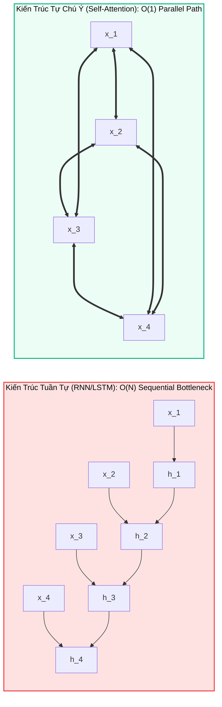
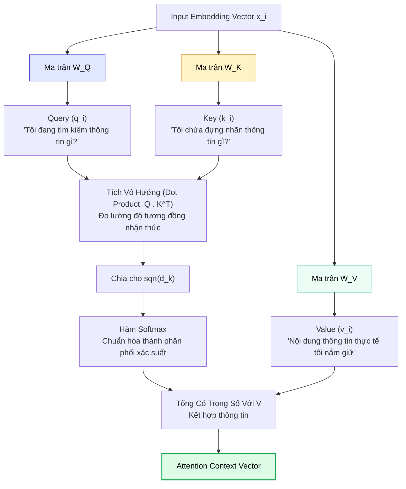
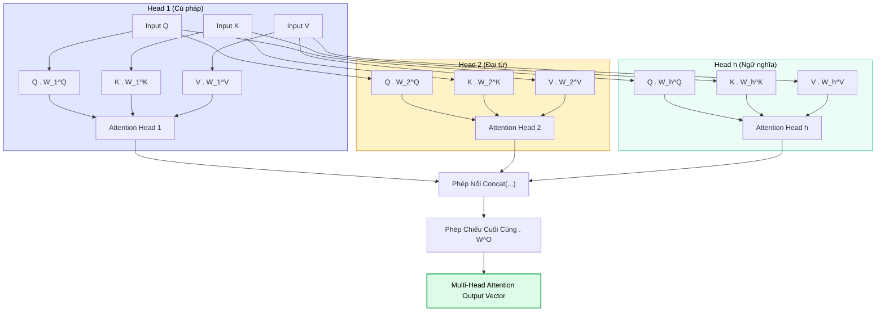
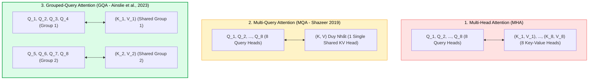
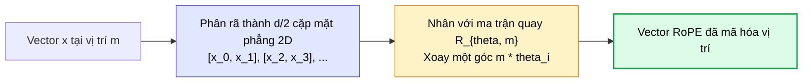
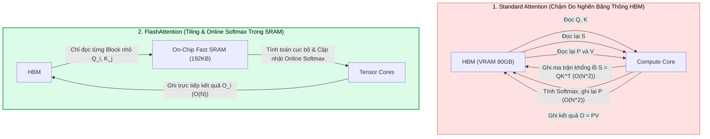
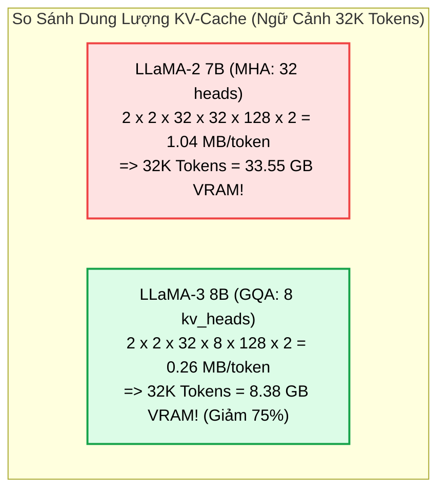

# 🔬 GIẢI PHẪU TOÁN HỌC CỦA TRANSFORMER
## Vi Tích Phân Của Scaled Dot-Product, Đại Số Tuyến Tính Multi-Head Attention & Cơ Chế Mã Hóa Vị Trí RoPE

---

## 📑 MỤC LỤC
1. [Bản Chất Của Cơ Chế Attention: Từ RNN Sang Self-Attention](#1-bản-chất-của-cơ-chế-attention-từ-rnn-sang-self-attention)
2. [Vi Tích Phân Của Scaled Dot-Product Attention](#2-vi-tích-phân-của-scaled-dot-product-attention)
   * [2.1. Khái Niệm Không Gian Query, Key, Value](#21-khái-niệm-không-gian-query-key-value)
   * [2.2. Chứng Minh Toán Học: Tại Sao Bắt Buộc Phải Chia Cho $\sqrt{d_k}$?](#22-chứng-minh-toán-học-tại-sao-bắt-buộc-phải-chia-cho-sqrtd_k)
   * [2.3. Khảo Sát Đạo Hàm Softmax & Nguy Cơ Bão Hòa Gradient](#23-khảo-sát-đạo-hàm-softmax--nguy-cơ-bão-hòa-gradient)
3. [Đại Số Tuyến Tính Của Multi-Head Attention (MHA)](#3-đại-số-tuyến-tính-của-multi-head-attention-mha)
   * [3.1. Phép Chiếu Không Gian Con (Subspace Projections)](#31-phép-chiếu-không-gian-con-subspace-projections)
   * [3.2. Tiến Hóa Cấu Trúc: MHA vs MQA vs GQA (Grouped-Query Attention)](#32-tiến-hóa-cấu-trúc-mha-vs-mqa-vs-gqa-grouped-query-attention)
4. [Cơ Chế Mã Hóa Vị Trí Hiện Đại: Rotary Position Embedding (RoPE)](#4-cơ-chế-mã-hóa-vị-trí-hiện-đại-rotary-position-embedding-rope)
   * [4.1. Giới Hạn Của Mã Hóa Vị Trí Cổ Điển (Absolute vs Relative PE)](#41-giới-hạn-của-mã-hóa-vị-trí-cổ-điển-absolute-vs-relative-pe)
   * [4.2. Bản Chất Hình Học Của RoPE: Phép Quay Trên Mặt Phẳng Phức](#42-bản-chất-hình-học-của-rope-phép-quay-trên-mặt-phẳng-phức)
   * [4.3. Kỹ Thuật Ngoại Suy Cửa Sổ Ngữ Cảnh Hàng Triệu Tokens (RoPE Scaling)](#43-kỹ-thuật-ngoại-suy-cửa-sổ-ngữ-cảnh-hàng-triệu-tokens-rope-scaling)
5. [Độ Phức Tạp Tính Toán, FlashAttention & Toán Học KV-Cache](#5-độ-phức-tạp-tính-toán-flashattention--toán-học-kv-cache)
   * [5.1. Điểm Nghẽn IO-Awareness & Phân Cấp Bộ Nhớ GPU](#51-điểm-nghẽn-io-awareness--phân-cấp-bộ-nhớ-gpu)
   * [5.2. Thuật Toán Online Softmax & Cơ Chế Tiling Của FlashAttention](#52-thuật-toán-online-softmax--cơ-chế-tiling-của-flashattention)
   * [5.3. Toán Học Định Lượng Dung Lượng KV-Cache (KV-Cache Sizing Mathematics)](#53-toán-học-định-lượng-dung-lượng-kv-cache-kv-cache-sizing-mathematics)
   * [5.4. Giải Thuật PagedAttention (vLLM) & Triệt Tiêu Phân Mảnh Bộ Nhớ Ảo](#54-giải-thuật-pagedattention-vllm--triệt-tiêu-phân-mảnh-bộ-nhớ-ảo)
6. [Thực Chiến: Triển Khai Scaled Dot-Product & RoPE Bằng PyTorch](#6-thực-chiến-triển-khai-scaled-dot-product--rope-bằng-pytorch)
7. [Bản Đồ Liên Kết Hệ Thống & Tài Liệu Tham Khảo](#7-bản-đồ-liên-kết-hệ-thống--tài-liệu-tham-khảo)

---

## 1. BẢN CHẤT CỦA CƠ CHẾ ATTENTION: TỪ RNN SANG SELF-ATTENTION

Trước khi bài báo lịch sử *"Attention Is All You Need"* (Vaswani et al., 2017) ra đời, lĩnh vực xử lý ngôn ngữ tự nhiên (NLP) bị thống trị bởi các kiến trúc tuần tự như **Recurrent Neural Networks (RNN)** và **Long Short-Term Memory (LSTM)** như đã khảo sát tại [[neural_networks_and_classifications|Bản đồ phân loại mạng nơ-ron]].



### Hai Tử Huyệt Của Mô Hình Tuần Tự (RNN):
1. **Điểm Nghẽn Tính Toán Tuần Tự ($\mathcal{O}(N)$ Sequential Bottleneck):** Trạng thái ẩn $h_t = f(h_{t-1}, x_t)$ bắt buộc phải chờ trạng thái $h_{t-1}$ hoàn tất. Điều này hoàn toàn triệt tiêu khả năng tính toán song song quy mô lớn trên hàng nghìn chip GPU.
2. **Sự Suy Giảm Thông Tin Tầm Xa (Vanishing Gradients & Memory Bottleneck):** Toàn bộ ngữ cảnh của một câu văn dài $100$ từ bị ép phải nén vào một vector cố định có kích thước giới hạn $h_t$. Các từ ở đầu câu dần bị xóa nhòa khi đến cuối câu.

**Self-Attention** giải quyết triệt để vấn đề này bằng cách thiết lập **đường dẫn kết nối trực tiếp có độ dài $\mathcal{O}(1)$ giữa mọi cặp từ** trong chuỗi, bất kể khoảng cách địa lý giữa chúng là bao xa.

---

## 2. VI TÍCH PHÂN CỦA SCALED DOT-PRODUCT ATTENTION

### 2.1. Khái Niệm Không Gian Query, Key, Value

Cơ chế Attention mô phỏng lại hệ thống **Truy vấn - Khóa - Giá trị** trong khoa học thông tin (Information Retrieval):



Công thức toán học kinh điển:

$$
\text{Attention}(Q, K, V) = \text{softmax}\left(\frac{QK^T}{\sqrt{d_k}}\right)V
$$

Trong đó:
* $Q \in \mathbb{R}^{N \times d_k}$: Ma trận chứa $N$ vector truy vấn, mỗi vector có số chiều $d_k$.
* $K \in \mathbb{R}^{M \times d_k}$: Ma trận chứa $M$ vector khóa, mỗi vector có số chiều $d_k$.
* $V \in \mathbb{R}^{M \times d_v}$: Ma trận chứa $M$ vector giá trị, mỗi vector có số chiều $d_v$.
* Ma trận $A = \frac{QK^T}{\sqrt{d_k}} \in \mathbb{R}^{N \times M}$ là ma trận điểm tương quan (Attention Logits).

---

### 2.2. Chứng Minh Toán Học: Tại Sao Bắt Buộc Phải Chia Cho $\sqrt{d_k}$?

Đây là câu hỏi phỏng vấn học thuật chuyên sâu phổ biến nhất về Transformer: **Tại sao Vaswani et al. lại đưa hệ số tỷ lệ $\frac{1}{\sqrt{d_k}}$ vào công thức? Điều gì sẽ xảy ra nếu không chia?**

#### Bước 1: Thiết lập giả định xác suất thống kê
Giả sử các phần tử của vector truy vấn $q \in \mathbb{R}^{d_k}$ và vector khóa $k \in \mathbb{R}^{d_k}$ là các biến ngẫu nhiên độc lập cùng phân phối (i.i.d), có kỳ vọng bằng $0$ và phương sai bằng $1$:

$$
\mathbb{E}[q_i] = 0, \quad \text{Var}(q_i) = 1 \quad (\forall i \in \{1, \dots, d_k\})
$$

$$
\mathbb{E}[k_i] = 0, \quad \text{Var}(k_i) = 1 \quad (\forall i \in \{1, \dots, d_k\})
$$

Giả sử $q_i$ và $k_i$ hoàn toàn độc lập với nhau.

#### Bước 2: Tính kỳ vọng của tích vô hướng $z = q \cdot k$
Tích vô hướng giữa hai vector được định nghĩa:

$$
z = q \cdot k = \sum_{i=1}^{d_k} q_i k_i
$$

Kỳ vọng toán học của $z$:

$$
\mathbb{E}[z] = \mathbb{E}\left[\sum_{i=1}^{d_k} q_i k_i\right] = \sum_{i=1}^{d_k} \mathbb{E}[q_i k_i] = \sum_{i=1}^{d_k} \mathbb{E}[q_i]\mathbb{E}[k_i] = \sum_{i=1}^{d_k} 0 \cdot 0 = 0
$$

#### Bước 3: Tính phương sai của tích vô hướng $z$
Do các biến thành phần độc lập:

$$
\text{Var}(z) = \text{Var}\left(\sum_{i=1}^{d_k} q_i k_i\right) = \sum_{i=1}^{d_k} \text{Var}(q_i k_i)
$$

Ta áp dụng công thức phương sai của tích hai biến ngẫu nhiên độc lập:

$$
\text{Var}(X Y) = \mathbb{E}[X^2 Y^2] - (\mathbb{E}[XY])^2 = \mathbb{E}[X^2]\mathbb{E}[Y^2] - (\mathbb{E}[X]\mathbb{E}[Y])^2
$$

Vì $\mathbb{E}[q_i] = 0 \implies \text{Var}(q_i) = \mathbb{E}[q_i^2] = 1$, tương tự $\mathbb{E}[k_i^2] = 1$:

$$
\text{Var}(q_i k_i) = \mathbb{E}[q_i^2]\mathbb{E}[k_i^2] - 0 = 1 \cdot 1 = 1
$$

Do đó:

$$
\text{Var}(z) = \sum_{i=1}^{d_k} 1 = d_k
$$

Độ lệch chuẩn của tích vô hướng:

$$
\sigma_z = \sqrt{\text{Var}(z)} = \sqrt{d_k}
$$

> [!important] Hệ Quả Toán Học Cốt Tử
> Khi số chiều $d_k$ tăng lên (ví dụ trong các mô hình lớn, $d_k = 64, 128$ hoặc $256$):
> * Giá trị của $z = q \cdot k$ sẽ dao động rất mạnh, với độ lệch chuẩn lên tới $\sqrt{64} = 8$ hoặc $\sqrt{128} \approx 11.31$.
> * Một số phần tử trong ma trận $QK^T$ sẽ nhận giá trị dương cực lớn (ví dụ $+30$), trong khi các phần tử khác nhận giá trị âm cực lớn (ví dụ $-30$).

---

### 2.3. Khảo Sát Đạo Hàm Softmax & Nguy Cơ Bão Hòa Gradient

Điều gì xảy ra khi chúng ta đưa các giá trị cực lớn vào hàm **Softmax**?

Hàm Softmax chuyển đổi vector đầu vào $z = [z_1, z_2, \dots, z_M]^T$ thành vector xác suất $S = [S_1, S_2, \dots, S_M]^T$:

$$
S_i = \frac{e^{z_i}}{\sum_{j=1}^M e^{z_j}}
$$

Đạo hàm riêng của phần tử $S_i$ theo phần tử đầu vào $z_j$:

$$
\frac{\partial S_i}{\partial z_j} = S_i (\delta_{ij} - S_j)
$$

Trong đó $\delta_{ij}$ là ký hiệu Kronecker delta ($\delta_{ij} = 1$ nếu $i=j$, ngược lại $\delta_{ij} = 0$).

#### Hai kịch bản bão hòa:
1. Nếu $z_i \gg z_j$ ($\forall j \neq i$), khi đó $S_i \to 1$ và $S_j \to 0$:
   $$
   \frac{\partial S_i}{\partial z_i} = S_i (1 - S_i) \approx 1 \cdot (1 - 1) = 0
   $$
2. Đối với các phần tử $j \neq i$:
   $$
   \frac{\partial S_i}{\partial z_j} = - S_i S_j \approx - 1 \cdot 0 = 0
   $$

> [!warning] Hiện Tượng "Chết Gradient" (Vanishing Gradients)
> Khi $d_k$ lớn mà không chia cho $\sqrt{d_k}$, hàm Softmax sẽ biến thành một hàm xấp xỉ **One-Hot Argmax**: Duy nhất một phần tử nhận xác suất $1.0$, tất cả phần tử còn lại nhận $0.0$.
> 
> Tại các điểm cực trị này, **toàn bộ ma trận đạo hàm Jacobian của Softmax tiệm cận về 0**. Khi thực hiện lan truyền ngược (Backpropagation), gradient của hàm mất mát bị triệt tiêu hoàn toàn, khiến các trọng số $W_Q, W_K, W_V$ không thể học được bất kỳ thông tin nào!

Bằng cách chia cho $\sqrt{d_k}$, biến ngẫu nhiên mới:

$$
z_{\text{scaled}} = \frac{q \cdot k}{\sqrt{d_k}} \implies \text{Var}(z_{\text{scaled}}) = \frac{\text{Var}(q \cdot k)}{(\sqrt{d_k})^2} = \frac{d_k}{d_k} = 1
$$

Phương sai được chuẩn hóa về đúng $1$, giúp các giá trị đầu vào của Softmax nằm gọn trong vùng có độ dốc (gradient slope) lý tưởng, đảm bảo quá trình huấn luyện hội tụ ổn định và tốc độ cao.

---

## 3. ĐẠI SỐ TUYẾN TÍNH CỦA MULTI-HEAD ATTENTION (MHA)

### 3.1. Phép Chiếu Không Gian Con (Subspace Projections)

Một đầu Attention duy nhất (Single Head) chỉ có thể tính toán một phân phối chú ý duy nhất tại một thời điểm. Tuy nhiên, ngôn ngữ con người đồng thời chứa đựng nhiều tầng liên kết phức tạp:
* **Quan hệ cú pháp:** Động từ liên kết với Chủ ngữ.
* **Quan hệ đồng tham chiếu (Coreference):** Đại từ nhân xưng *"nó"* trỏ tới danh từ *"con mèo"*.
* **Quan hệ ngữ nghĩa:** Từ *"ngân hàng"* liên kết với *"lãi suất"* hay *"bờ sông"*.

Để mô hình học được nhiều không gian biểu diễn song song, **Multi-Head Attention (MHA)** chia không gian $d_{\text{model}}$ thành $h$ không gian con (Heads), mỗi đầu có số chiều $d_k = d_v = \frac{d_{\text{model}}}{h}$:

$$
\text{MHA}(Q, K, V) = \text{Concat}(\text{head}_1, \text{head}_2, \dots, \text{head}_h) W^O
$$

Trong đó mỗi đầu chú ý được tính độc lập:

$$
\text{head}_i = \text{Attention}\left(Q W_i^Q, K W_i^K, V W_i^V\right)
$$

Kích thước của các ma trận trọng số:
* $W_i^Q \in \mathbb{R}^{d_{\text{model}} \times d_k}$
* $W_i^K \in \mathbb{R}^{d_{\text{model}} \times d_k}$
* $W_i^V \in \mathbb{R}^{d_{\text{model}} \times d_v}$
* $W^O \in \mathbb{R}^{(h \cdot d_v) \times d_{\text{model}}}$



---

### 3.2. Tiến Hóa Cấu Trúc: MHA vs MQA vs GQA (Grouped-Query Attention)

Trong quá trình suy luận (Inference), mô hình Autoregressive (như GPT hay LLaMA) phải lưu lại toàn bộ các vector $K$ và $V$ của các token trước đó vào bộ nhớ GPU để tránh tính toán lại. Đây chính là **KV-Cache**.

Khi Cửa sổ ngữ cảnh mở rộng lên $32\text{K}$, $128\text{K}$ hay $1\text{M}$ tokens, dung lượng KV-Cache của MHA truyền thống vượt quá dung lượng VRAM của GPU, tạo nên "bức tường bộ nhớ" (Memory Wall).



| Tiêu Chí So Sánh | Multi-Head Attention (MHA) | Multi-Query Attention (MQA) | Grouped-Query Attention (GQA) |
| :--- | :--- | :--- | :--- |
| **Tỷ lệ Heads (Query : KV)** | $1 : 1$ (Ví dụ 32 Q Heads, 32 KV Heads) | $H : 1$ (32 Q Heads, chỉ có 1 KV Head duy nhất) | $H : G$ (32 Q Heads, chia thành 8 nhóm $\implies$ 8 KV Heads) |
| **Dung lượng KV-Cache** | $100\%$ (Rất lớn, dễ nghẽn VRAM) | **$1/H$** ($\approx 3\%$ - Tiết kiệm tối đa) | **$G/H$** ($\approx 25\%$ - Rất tối ưu) |
| **Băng thông bộ nhớ** | Tiêu tốn băng thông cao nhất | Rất thấp, tốc độ sinh từ cực nhanh | Tối ưu cân bằng hoàn hảo |
| **Chất lượng mô hình** | Cao nhất (chuẩn mực lý thuyết) | Suy giảm nhẹ trên các bài toán suy luận phức tạp | **Tương đương MHA** nhưng nhanh gấp 4 lần |
| **Mô hình ứng dụng** | GPT-3, Transformer gốc (2017) | Falcon, StarCoder | **LLaMA-2/3 (70B), Mistral-7B, Qwen-2.5** |

---

## 4. CƠ CHẾ MÃ HÓA VỊ TRÍ HIỆN ĐẠI: ROTARY POSITION EMBEDDING (ROPE)

### 4.1. Giới Hạn Của Mã Hóa Vị Trí Cổ Điển (Absolute vs Relative PE)

Bản chất của phép toán Self-Attention là **hoán vị bất biến (Permutation Invariant)**: Nếu chúng ta xáo trộn thứ tự các từ trong câu, giá trị Attention không đổi. Do đó, mô hình bắt buộc phải được "tiêm" thông tin về thứ tự từ.

* **Sinusoidal Absolute Positional Encoding (Vaswani et al., 2017):**
  Cộng một vector sóng hình sin/cosin trực tiếp vào embedding của từ:
  $$
  x_m = e_m + P_m
  $$
  *Nhược điểm:* Khi độ dài chuỗi trong quá trình suy luận vượt quá độ dài tối đa lúc huấn luyện ($m > L_{\text{max}}$), mô hình hoàn toàn mất phương hướng vì chưa từng thấy các giá trị sóng tại tọa độ đó (**Kém khả năng ngoại suy - Poor Extrapolation**).

---

### 4.2. Bản Chất Hình Học Của RoPE: Phép Quay Trên Mặt Phẳng Phức

Công bố bởi Jianlin Su và cộng sự (2021) trong bài báo *"RoFormer: Enhanced Transformer with Rotary Position Embedding"*, **RoPE** đã tạo nên một cuộc cách mạng thay đổi hoàn toàn cách các LLM hiện đại xử lý vị trí.

> [!important] Ý Tưởng Cốt Lõi Của RoPE
> Thay vì **cộng** vector vị trí vào vector từ, RoPE thực hiện **xoay** vector Query và Key trong không gian 2D theo một góc tỷ lệ thuận với vị trí của từ trong câu!
> 
> Tích vô hướng giữa Query ở vị trí $m$ và Key ở vị trí $n$ sẽ **tự động chỉ phụ thuộc vào khoảng cách tương đối $(m - n)$**, bảo toàn trọn vẹn mối quan hệ ngữ pháp tương đối.



#### Biểu diễn toán học trong không gian 2 chiều:
Xem xét một vector 2 chiều $x = [x_1, x_2]^T$, ta biểu diễn nó dưới dạng số phức $x = x_1 + i x_2$.
Để mã hóa vị trí $m$, ta nhân số phức này với toán tử quay Euler $e^{i m \theta}$:

$$
R_{\Theta, m} x = x \cdot e^{i m \theta} = (x_1 + i x_2)(\cos(m\theta) + i \sin(m\theta))
$$

Chuyển về dạng ma trận trực giao 2 chiều:

$$
R_{\Theta, m} = \begin{pmatrix} \cos(m\theta) & -\sin(m\theta) \\ \sin(m\theta) & \cos(m\theta) \end{pmatrix}
$$

#### Tính chất bảo toàn khoảng cách tương đối:
Khi tính tích vô hướng giữa Query tại vị trí $m$ và Key tại vị trí $n$:

$$
\langle R_{\Theta, m} q, R_{\Theta, n} k \rangle = (R_{\Theta, m} q)^T (R_{\Theta, n} k) = q^T R_{\Theta, m}^T R_{\Theta, n} k
$$

Do tính chất của ma trận quay trực giao: $R_{\Theta, m}^T = R_{\Theta, -m}$, ta có:

$$
R_{\Theta, m}^T R_{\Theta, n} = R_{\Theta, -m} R_{\Theta, n} = R_{\Theta, n - m}
$$

Do đó:

$$
\langle R_{\Theta, m} q, R_{\Theta, n} k \rangle = q^T R_{\Theta, n - m} k = g(q, k, n - m)
$$

Tích vô hướng giữa hai từ chỉ phụ thuộc duy nhất vào **khoảng cách tương đối $n - m$**, hoàn toàn độc lập với vị trí tuyệt đối của chúng trong văn bản!

---

### 4.3. Kỹ Thuật Ngoại Suy Cửa Sổ Ngữ Cảnh Hàng Triệu Tokens (RoPE Scaling)

Tần số góc $\theta_i$ của RoPE được tính theo công thức:

$$
\theta_i = b^{-2(i-1)/d}, \quad i \in \left\{1, 2, \dots, \frac{d}{2}\right\}
$$

Với cơ số gốc $b = 10{,}000$.

Khi muốn mở rộng Cửa sổ ngữ cảnh từ $4\text{K}$ lên $128\text{K}$ tokens (gấp 32 lần) mà không cần huấn luyện lại từ đầu:
1. **Linear RoPE Scaling (Position Interpolation):** Chia vị trí $m$ cho hệ số tỷ lệ $\alpha = 32$. Góc quay mới là $\frac{m}{\alpha}\theta_i$. Nhược điểm: làm mờ các mối liên kết cục bộ giữa các từ đứng cạnh nhau.
2. **NTK-Aware RoPE Scaling (Neural Tangent Kernel):** Thay vì chia vị trí, ta mở rộng cơ số tần số:
   $$
   b_{\text{new}} = b \cdot \alpha^{\frac{d}{d-2}}
   $$
   Giữ nguyên tần số cao cho các từ liền kề (đảm bảo độ sắc nét ngữ pháp) và chỉ nén tần số thấp cho các từ ở xa. Đây chính là bí mật toán học giúp các dòng mô hình LLaMA-3 hay Qwen xử lý mượt mà tài liệu dài hàng trăm trang sách!

---

## 5. ĐỘ PHỨC TẠP TÍNH TOÁN, FLASHATTENTION & TOÁN HỌC KV-CACHE

Một điểm yếu cố hữu của cơ chế Self-Attention chuẩn (Standard Scaled Dot-Product Attention) nằm ở ma trận tương quan $S = QK^T$:
* **Độ phức tạp tính toán:** $\mathcal{O}(N^2 \cdot d)$
* **Độ phức tạp bộ nhớ (Memory Complexity):** $\mathcal{O}(N^2)$ để lưu ma trận Attention Weights kích thước $N \times N$.

Khi $N = 4{,}000$, $N^2 = 16{,}000{,}000$ phần tử.  
Khi $N = 128{,}000$, $N^2 \approx 1.63 \times 10^{10}$ phần tử $\implies$ Tiêu tốn hơn **65 GB VRAM** chỉ để lưu trữ ma trận điểm số trung gian này!

---

### 5.1. Điểm Nghẽn IO-Awareness & Phân Cấp Bộ Nhớ GPU

Trong kiến trúc GPU hiện đại (NVIDIA A100 / H100), tốc độ tính toán (FLOPs) tăng nhanh gấp hàng chục lần so với tốc độ đọc/ghi dữ liệu từ bộ nhớ chính (Memory Bandwidth):
* **High Bandwidth Memory (HBM / VRAM):** Dung lượng lớn ($40\text{GB} - 80\text{GB}$), nhưng băng thông đọc/ghi bị giới hạn ($\approx 1.5 - 3.3\text{ TB/s}$).
* **Static RAM (SRAM / Shared Memory On-Chip):** Nằm trực tiếp bên trong từng Streaming Multiprocessor (SM), tốc độ cực nhanh ($\approx 19\text{ TB/s}$), nhưng dung lượng cực kỳ hạn chế (chỉ khoảng $192\text{KB} - 228\text{KB}$ mỗi SM).



---

### 5.2. Thuật Toán Online Softmax & Cơ Chế Tiling Của FlashAttention

Để tính Attention mà **không bao giờ phải lưu ma trận $N \times N$ xuống HBM**, Tri Dao et al. (2022, 2023) đã kết hợp kỹ thuật **Tiling** (chia ma trận thành các khối nhỏ vừa khít SRAM) với thuật toán **Online Softmax** (Milakov & Gimelshein, 2018).

#### Vấn đề của Softmax thông thường:
Để tính $\text{softmax}(\mathbf{x})$ cho vector $\mathbf{x} = [x_1, \dots, x_N]$, ta cần 3 lượt duyệt qua bộ nhớ:
1. Tìm $m = \max_i x_i$ để tránh tràn số (*Numerical Stability*).
2. Tính tổng mẫu số $d = \sum_{i=1}^N e^{x_i - m}$.
3. Tính từng phần tử $P_i = \frac{e^{x_i - m}}{d}$.

#### Công thức cập nhật lũy kế Online Softmax:
Giả sử ta chia vector $\mathbf{x}$ thành 2 block liên tiếp: $\mathbf{x}^{(1)}$ và $\mathbf{x}^{(2)}$. Đặt $m^{(1)} = \max(\mathbf{x}^{(1)})$ và $d^{(1)} = \sum e^{x_i^{(1)} - m^{(1)}}$.  
Khi tiếp nhận block thứ hai $\mathbf{x}^{(2)}$ với $m^{(2)} = \max(\mathbf{x}^{(2)})$ và $d^{(2)} = \sum e^{x_i^{(2)} - m^{(2)}}$, ta có thể cập nhật giá trị mới **ngay lập tức** mà không cần xem lại block cũ:

$$
m_{\text{new}} = \max\left(m^{(1)}, m^{(2)}\right)
$$

$$
d_{\text{new}} = d^{(1)} \cdot e^{m^{(1)} - m_{\text{new}}} + d^{(2)} \cdot e^{m^{(2)} - m_{\text{new}}}
$$

Khi áp dụng vào tính toán tích $O = PV$, giá trị đầu ra $O$ tại mỗi bước cập nhật khối được điều chỉnh theo tỷ lệ:

$$
O_{\text{new}} = O^{(1)} \cdot \left(\frac{d^{(1)} \cdot e^{m^{(1)} - m_{\text{new}}}}{d_{\text{new}}}\right) + O^{(2)} \cdot \left(\frac{d^{(2)} \cdot e^{m^{(2)} - m_{\text{new}}}}{d_{\text{new}}}\right)
$$

> [!note] Giải thích Khối: FlashAttention Tiling Engine
> * **Đầu vào:** Ma trận $Q \in \mathbb{R}^{N \times d}$, $K \in \mathbb{R}^{N \times d}$, $V \in \mathbb{R}^{N \times d}$ nằm trên HBM.
> * **Cơ chế Tiling:**
>   - Chia $Q$ thành các khối $Q_i$ kích thước $B_r \times d$.
>   - Chia $K, V$ thành các khối $K_j, V_j$ kích thước $B_c \times d$.
>   - Nạp từng cặp $(Q_i, K_j, V_j)$ vào SRAM. Tính điểm attention cục bộ, cập nhật $m_{\text{new}}, d_{\text{new}}$, tích lũy trực tiếp vào vector đầu ra $O_i$, rồi giải phóng SRAM ngay lập tức.
> * **Đầu ra:** Ma trận $O \in \mathbb{R}^{N \times d}$ chính xác tuyệt đối (Exact Attention) với chi phí bộ nhớ phụ chỉ là $\mathcal{O}(N)$ thay vì $\mathcal{O}(N^2)$.

---

### 5.3. Toán Học Định Lượng Dung Lượng KV-Cache (KV-Cache Sizing Mathematics)

Trong giai đoạn sinh token tuần tự (Autoregressive Generation / Decode Phase) của AI Agent, để tránh phải tính lại vector Key và Value của các token trước đó, hệ thống lưu giữ toàn bộ tensor $K$ và $V$ trong bộ nhớ GPU—được gọi là **KV-Cache**.

#### Công thức tổng quát tính dung lượng VRAM của KV-Cache:

$$
\text{Memory}_{\text{KV-Cache}} \text{ (Bytes)} = 2 \times 2 \times n_{\text{layers}} \times n_{\text{kv\_heads}} \times d_{\text{head}} \times N_{\text{tokens}} \times \text{dtype\_bytes}
$$

Trong đó:
* Số $2$ đầu tiên: Đại diện cho 2 ma trận (Key và Value).
* Số $2$ thứ hai: Hệ số cho số chiều thực tế.
* $n_{\text{layers}}$: Số tầng Transformer của mô hình.
* $n_{\text{kv\_heads}}$: Số lượng head chú ý dành cho Key và Value (trong MHA: $n_{\text{kv\_heads}} = n_{\text{heads}}$; trong GQA: $n_{\text{kv\_heads}} \ll n_{\text{heads}}$).
* $d_{\text{head}}$: Kích thước của mỗi attention head (thường là $128$).
* $N_{\text{tokens}}$: Số lượng tokens trong cửa sổ ngữ cảnh.
* $\text{dtype\_bytes}$: Số byte của kiểu dữ liệu (FP16/BF16 = 2 bytes, FP8 = 1 byte, INT4 = 0.5 bytes).



#### Bảng đối chiếu định lượng dung lượng KV-Cache trên các mô hình phổ biến:

| Mô Hình | Kiến Trúc Attention | Số Tầng ($L$) | $n_{\text{kv\_heads}}$ | Dung Lượng Mỗi Token (Bytes) | Kích Thước KV-Cache (8K Tokens) | Kích Thước KV-Cache (128K Tokens) |
| :--- | :--- | :---: | :---: | :---: | :---: | :---: |
| **LLaMA-2 7B** | Multi-Head (MHA) | 32 | 32 | $1{,}048{,}576$ B ($1.05\text{MB}$) | **$8.39\text{ GB}$** | $134.2\text{ GB}$ *(Tràn GPU A100)* |
| **LLaMA-3 8B** | Grouped-Query (GQA) | 32 | 8 | $262{,}144$ B ($0.26\text{MB}$) | **$2.10\text{ GB}$** | **$33.55\text{ GB}$** *(Chạy vừa 1 A100)* |
| **LLaMA-3 70B** | Grouped-Query (GQA) | 80 | 8 | $655{,}360$ B ($0.66\text{MB}$) | **$5.24\text{ GB}$** | **$83.88\text{ GB}$** *(Yêu cầu 2x A100 80GB)* |
| **Mistral 7B** | Sliding Window (GQA) | 32 | 8 (Window 4K) | $262{,}144$ B (Cố định 4K) | **$1.05\text{ GB}$** | **$1.05\text{ GB}$** *(Không tăng theo N!)* |

---

### 5.4. Giải Thuật PagedAttention (vLLM) & Triệt Tiêu Phân Mảnh Bộ Nhớ Ảo

Mặc dù GQA giúp giảm kích thước KV-Cache, trong môi trường phục vụ đa tác tử (Multi-Agent Serving), hệ thống gặp phải thảm họa **Phân Mảnh Bộ Nhớ (Memory Fragmentation)**:
* **Cơ chế cấp phát mảng liền kề (Contiguous Allocation):** Framework phải cấp phát trước một mảng bộ nhớ liền kề tối đa (ví dụ 8K tokens) cho mỗi request.
* **Lãng phí:** Hầu hết các câu hỏi chỉ dài 500 tokens, khiến $80\%$ lượng VRAM dự phòng bị lãng phí do **Phân mảnh nội vi (Internal Fragmentation)**.

Kwon et al. (UC Berkeley, 2023) đã công bố giải thuật **PagedAttention** trong hệ thống **vLLM**:
* Lấy cảm hứng trực tiếp từ cơ chế **Phân trang bộ nhớ ảo (Virtual Memory Paging)** của Hệ điều hành.
* Chia KV-Cache của chuỗi token thành các khối vật lý không liên tục (**Physical Blocks**, mỗi block chứa 16 tokens).
* Duy trì một **Bảng Phân Trang (Block Table)** ánh xạ từ địa chỉ logic sang địa chỉ vật lý rời rạc trong VRAM.
* **Kết quả:** Giảm lãng phí bộ nhớ VRAM từ $>70\%$ xuống **$< 4\%$**, cho phép một GPU duy nhất phục vụ đồng thời số lượng Agent gấp **$2\times - 4\times$** so với trước đây!

---

---

## 6. THỰC CHIẾN: TRIỂN KHAI SCALED DOT-PRODUCT & ROPE BẰNG PYTORCH

Dưới đây là mã nguồn PyTorch minh họa đầy đủ công thức Scaled Dot-Product Attention (có kiểm chứng hệ số $\sqrt{d_k}$) và phép quay vector Rotary Position Embedding (RoPE):

```python
"""
Transformer Math Deep Dive: PyTorch Implementation
Triển khai Scaled Dot-Product Attention và Rotary Position Embedding (RoPE).
"""
import torch
import torch.nn as nn
import math

class ScaledDotProductAttention(nn.Module):
    """Triển khai Scaled Dot-Product Attention chuẩn hóa."""
    def __init__(self, dropout: float = 0.0):
        super().__init__()
        self.dropout = nn.Dropout(dropout)

    def forward(self, q: torch.Tensor, k: torch.Tensor, v: torch.Tensor, mask: torch.Tensor = None):
        # q, k: [batch_size, num_heads, seq_len, d_k]
        # v:    [batch_size, num_heads, seq_len, d_v]
        d_k = q.size(-1)

        # 1. Tính tích vô hướng Q . K^T
        # scores: [batch_size, num_heads, seq_len, seq_len]
        scores = torch.matmul(q, k.transpose(-2, -1))

        # 2. CHIA CHO CĂN BẬC HAI CỦA d_k ĐỂ BẢO TOÀN PHƯƠNG SAI = 1
        scores = scores / math.sqrt(d_k)

        # 3. Áp dụng Mask (nếu có, ví dụ Causal Mask trong Decoder)
        if mask is not None:
            scores = scores.masked_fill(mask == 0, -1e9)

        # 4. Tính xác suất Softmax và Dropout
        attn_weights = torch.softmax(scores, dim=-1)
        attn_weights = self.dropout(attn_weights)

        # 5. Nhân với Value để ra vector ngữ cảnh cuối cùng
        output = torch.matmul(attn_weights, v)
        return output, attn_weights


class RotaryEmbedding(nn.Module):
    """Triển khai Rotary Position Embedding (RoPE) trên không gian số phức."""
    def __init__(self, dim: int, max_seq_len: int = 4096, base: float = 10000.0):
        super().__init__()
        self.dim = dim
        # Tính toán các tần số góc theta_i = base^(-2(i-1)/dim)
        theta = 1.0 / (base ** (torch.arange(0, dim, 2).float() / dim))
        self.register_buffer("theta", theta)

        # Tạo bảng sin, cos sẵn cho toàn bộ chiều dài ngữ cảnh
        t = torch.arange(max_seq_len, dtype=torch.float32)
        freqs = torch.outer(t, self.theta) # [max_seq_len, dim // 2]
        
        # Biểu diễn dưới dạng vector quay phức: e^(i * m * theta)
        freqs_cis = torch.polar(torch.ones_like(freqs), freqs)
        self.register_buffer("freqs_cis", freqs_cis)

    def forward(self, x: torch.Tensor):
        # x: [batch_size, seq_len, num_heads, head_dim]
        # Chuyển đổi x sang không gian số phức 2 chiều
        seq_len = x.shape[1]
        x_complex = torch.view_as_complex(x.float().reshape(*x.shape[:-1], -1, 2))
        
        # Cắt lấy tần số tương ứng với seq_len hiện tại
        freqs_cis = self.freqs_cis[:seq_len].unsqueeze(0).unsqueeze(2)
        
        # Thực hiện PHÉP XOAY trên mặt phẳng phức: x * e^(i * m * theta)
        x_rotated = x_complex * freqs_cis
        
        # Chuyển ngược lại về không gian số thực
        x_out = torch.view_as_real(x_rotated).flatten(-2)
        return x_out.type_as(x)


# === THỰC NGHIỆM ĐO LƯỜNG TÍNH ĐÚNG ĐẮN TOÁN HỌC ===
if __name__ == "__main__":
    torch.manual_seed(42)
    batch_size, seq_len, num_heads, d_k = 2, 4, 8, 64

    # 1. Kiểm chứng Attention
    q = torch.randn(batch_size, num_heads, seq_len, d_k)
    k = torch.randn(batch_size, num_heads, seq_len, d_k)
    v = torch.randn(batch_size, num_heads, seq_len, d_k)

    attention = ScaledDotProductAttention()
    out, weights = attention(q, k, v)
    print("✅ [Attention Output Shape]:", out.shape)
    print("✅ [Attention Weights Sum]:", weights.sum(dim=-1)[0, 0].tolist(), "(Tổng luôn bằng 1.0)")

    # 2. Kiểm chứng RoPE
    rope = RotaryEmbedding(dim=d_k, max_seq_len=1024)
    q_rotated = rope(q)
    print("✅ [RoPE Rotated Q Shape]:", q_rotated.shape)
```

---

## 7. BẢN ĐỒ LIÊN KẾT HỆ THỐNG & TÀI LIỆU THAM KHẢO

* 🔙 **Nền tảng tiền đề:**
  * [[neural_networks_and_classifications|Mạng Nơ-ron & Bản Đồ Phân Loại Kiến Trúc]]: Khảo sát các tầng Dense, Forward Pass, Backpropagation và Activation Functions.
  * [[what_are_large_language_models|Bản Chất Mô Hình Ngôn Ngữ Lớn (LLM Internals)]]: Cơ chế Autoregressive Next-Token Prediction và quá trình Pre-training.
* 🔜 **Bài học tiếp theo:**
  * [[05_scaling_laws_and_quantization|Định Luật Tỷ Lệ Chinchilla & Lượng Tử Hóa Mô Hình]]: Khảo sát tối ưu hóa tham số và nén mô hình để chạy trên phần cứng cá nhân.
* 📚 **Tài liệu học thuật tham chiếu (ArXiv Citations):**
  * Vaswani et al. (2017). *Attention Is All You Need*. [arXiv:1706.03762](https://arxiv.org/abs/1706.03762)
  * Su et al. (2021). *RoFormer: Enhanced Transformer with Rotary Position Embedding*. [arXiv:2104.09864](https://arxiv.org/abs/2104.09864)
  * Ainslie et al. (2023). *GQA: Training Generalized Multi-Query Transformer Models from Multi-Head Checkpoints*. [arXiv:2305.13245](https://arxiv.org/abs/2305.13245)
  * Dao et al. (2022). *FlashAttention: Fast and Memory-Efficient Exact Attention with IO-Awareness*. [arXiv:2205.14135](https://arxiv.org/abs/2205.14135)
