# Test-Time Compute & Process Reward Models (PRMs): Định Luật Mở Rộng Thời Gian Suy Luận

> [!important] Trực Giác Cốt Lõi (The Core Intuition)
> Khi đứng trước một bài toán hình học khó hoặc một ván cờ vây phức tạp, đại kiện tướng không bao giờ đi quân cờ đầu tiên nảy ra trong đầu sau $0.1$ giây. Họ dừng lại, nhắm mắt suy ngẫm trong 5 phút, thử nghiệm hàng chục kịch bản tương lai trong đầu, tự phản biện và loại bỏ những nước đi hiểm họa trước khi hạ bút.
> 
> Trong kỷ nguyên AI truyền thống, chúng ta ép LLM làm điều ngược lại: bắt mô hình trả lời ngay lập tức ở từng token tiếp theo ($System\ 1$). **Test-Time Compute** và **Process Reward Models (PRMs)** chính là chiếc cầu nối chuyển dịch LLM sang tư duy thận trọng, tự kiểm tra và tự sửa lỗi ($System\ 2$) bằng cách đầu tư thêm tài nguyên tính toán ngay tại thời điểm suy luận.

---

## 1. Dành Cho Người Mới Bắt Đầu: Tại Sao Cần Chấm Điểm Từng Bước?

### A. Phép Phép So Sánh: Giám Khảo Cuối Giờ vs. Giáo Viên Kèm Riêng

Hãy tưởng tượng bạn đang giải một bài toán đại số phức tạp gồm 10 bước biến đổi:

1. **Outcome Reward Model (ORM - Chấm điểm kết quả cuối cùng):**
   * *Cách thức:* Giống như một giám khảo chỉ nhìn vào **đáp số duy nhất ở dòng cuối cùng**.
   * *Lỗ hổng 1 (Phạt oan):* Bạn làm đúng tuyệt đối từ bước 1 đến bước 9, nhưng ở bước 10 do chép nhầm dấu trừ thành dấu cộng nên đáp số sai $\to$ Giám khảo cho bạn $0$ điểm. Mô hình học được rằng toàn bộ quá trình tư duy xuất sắc ở 9 bước trước đều "vô giá trị".
   * *Lỗ hổng 2 (Thưởng nhầm / Hallucination Lucky Guess):* Bạn làm sai hoàn toàn logic ở bước 3 và bước 5, nhưng hai lỗi sai vô tình triệt tiêu lẫn nhau ra đáp số trùng hợp $\to$ Giám khảo cho bạn $10$ điểm. Mô hình bị củng cố một chuỗi lập luận hoàn toàn sai lệch!

2. **Process Reward Model (PRM - Chấm điểm từng bước xử lý):**
   * *Cách thức:* Giống như một **giáo viên gia sư ngồi ngay bên cạnh bạn**.
   * Sau khi bạn viết xong bước 1: Giáo viên gật đầu $\to$ Đúng logic ($+1.0$).
   * Sau bước 2: Giáo viên gật đầu $\to$ Đúng logic ($+1.0$).
   * Sau bước 3: Bạn biến đổi sai công thức $\to$ Giáo viên chặn lại ngay lập tức: *"Bước này sai logic rồi, điểm số là $0.05$. Hãy gạch đi và suy nghĩ hướng khác!"*.
   * *Kết quả:* Bạn không bao giờ lãng phí thời gian đi sâu vào một nhánh cụt vô vọng, và bạn biết chính xác mình sai ở đâu để quay đầu (Backtrack).

```mermaid
flowchart TD
    subgraph ORM_Approach["Mô Hình ORM (Truyền Thống)"]
        Q1["Bài Toán"] --> S1_O["Bước 1"]
        S1_O --> S2_O["Bước 2 (Sai ngầm)"]
        S2_O --> S3_O["Bước 3 (Ngộ nhận)"]
        S3_O --> ANS_O["Kết quả cuối: SAI"]
        ANS_O --> EVAL_O["ORM: Đánh trượt toàn bộ (0 điểm)"]
    end

    subgraph PRM_Approach["Mô Hình PRM (Suy Luận Từng Bước)"]
        Q2["Bài Toán"] --> S1_P["Bước 1"]
        S1_P --> PRM1["PRM: Chấm 0.98 (Hợp lệ)"]
        PRM1 --> S2_P["Bước 2"]
        S2_P --> PRM2["PRM: Chấm 0.12 (SAI LOGIC!)"]
        PRM2 -->|Cắt tỉa & Quay lui| S2_ALT["Bước 2 (Thử nhánh khác)"]
        S2_ALT --> PRM2_ALT["PRM: Chấm 0.95 (Hợp lệ)"]
        PRM2_ALT --> S3_P["Bước 3... Hoàn thành xuất sắc"]
    end
```



---

## 2. Bản Chất Kỹ Thuật: Bức Tường Dữ Liệu & Test-Time Scaling Laws

### A. Khủng Hoảng Hết Dữ Liệu Huấn Luyện (The Data Wall)
Trong giai đoạn 2020–2024, phương pháp chính để làm AI thông minh hơn là **Pre-training Scaling** (Định luật Chinchilla): gom hàng chục nghìn tỷ token văn bản trên Internet và tăng số lượng tham số mô hình từ 7B lên 70B, 405B. Tuy nhiên, tới năm 2025–2026:
* Toàn bộ kho tàng sách báo, mã nguồn và văn bản công khai của nhân loại đã bị quét sạch.
* Chi phí huấn luyện một cụm GPU vượt ngưỡng hàng trăm triệu USD.
* **Quy luật hiệu suất giảm dần (Diminishing Returns):** Tăng gấp đôi compute tiền huấn luyện chỉ làm tăng thêm $1-2\%$ điểm benchmark.

### B. Bước Ngoặt: Mở Rộng Thời Gian Suy Luận (Test-Time Scaling)
Các công trình đột phá từ OpenAI (dòng mô hình `o1`, `o3`) và DeepSeek (`DeepSeek-R1`) chứng minh một định luật mở rộng hoàn toàn mới:

> **Định Luật Test-Time Scaling:**
> Hiệu năng giải quyết các bài toán phức tạp (toán học, viết mã, lập luận logic đa bước) có thể **tăng theo hàm mũ** khi tăng tài nguyên tính toán lúc mô hình suy luận (Inference/Test-time compute), ngay cả khi giữ nguyên kích thước mô hình cơ sở.

Thay vì trả lời theo kiểu nhả token ngay tức khắc, mô hình được cấp một "ngân sách suy nghĩ" (Thinking Budget):
1. Tự sinh ra các thẻ suy nghĩ ẩn (`<think> ... </think>`).
2. Tự đặt câu hỏi hoài nghi chính mình: *"Khoan đã, nếu $x < 0$ thì căn bậc hai có xác định không?"*.
3. Tự phát hiện sai lầm, xóa đi và thử lại nhánh lập luận khác.

---

## 3. Cơ Sở Toán Học: ORM vs. PRM

Xét một bài toán đầu vào $x$. Một lời giải hoàn chỉnh $\tau$ gồm một chuỗi các bước lập luận (reasoning steps):
$$
\tau = (s_1, s_2, \dots, s_T)
$$

### A. Outcome Reward Model (ORM)
Mô hình ORM chỉ đánh giá toàn bộ chuỗi $\tau$ tại điểm kết thúc $T$:
$$
r_{\text{ORM}}(x, \tau) = P(\text{Đáp số đúng} \mid x, s_1, s_2, \dots, s_T) \in [0, 1]
$$
Hạn chế của hàm mục tiêu này là hiện tượng **Credit Assignment Problem** (Bài toán phân bổ trách nhiệm): Trong $T$ bước đi, ta không biết bước nào đóng góp tích cực và bước nào là nguyên nhân chính dẫn tới sai lầm.

### B. Process Reward Model (PRM)
Mô hình PRM đánh giá tính hợp lý của từng bước chuyển trạng thái $s_t$ dựa trên ngữ cảnh tiền đề $s_{1:t-1}$:
$$
r_{\text{PRM}}(x, s_t \mid s_{1:t-1}) = P(\text{Bước } s_t \text{ đúng đắn về mặt logic} \mid x, s_1, \dots, s_{t-1}) \in [0, 1]
$$

Xác suất để toàn bộ chuỗi lập luận hợp lệ có thể được tính theo một trong hai cách:

1. **Hợp tích xác suất (Product of Probabilities):**
   $$
   R_{\text{prod}}(\tau) = \prod_{t=1}^T r_{\text{PRM}}(x, s_t \mid s_{1:t-1})
   $$

2. **Nguyên lý mắt xích yếu nhất (Min-Pooling):**
   Một chuỗi lập luận toán học chỉ cần 1 bước sai thì toàn bộ bài toán coi như hỏng:
   $$
   R_{\text{min}}(\tau) = \min_{t \in \{1, \dots, T\}} r_{\text{PRM}}(x, s_t \mid s_{1:t-1})
   $$

### C. Phương Pháp Gán Nhãn Huấn Luyện PRM: Math-Shepherd & Monte Carlo Rollouts
Làm sao để có hàng triệu mẫu dữ liệu chấm điểm từng bước mà không cần con người đọc từng dòng?
Các nhà nghiên cứu sử dụng thuật toán **Monte Carlo Tree Rollout**:
* Giả sử mô hình đã sinh tới bước $t$ (chuỗi tiền đề $s_{1:t}$).
* Từ bước $t$, hệ thống cho mô hình chạy tiếp $K$ nhánh ngẫu nhiên độc lập cho tới khi ra đáp án cuối cùng.
* Điểm số thực nghiệm của bước $t$ chính là tỷ lệ số nhánh về đích có đáp số đúng:
  $$
  r^*(s_t) = \frac{1}{K} \sum_{k=1}^K \mathbb{I}(\text{Đáp án của nhánh } k \text{ là Đúng})
  $$
* Dữ liệu nhãn này được dùng để huấn luyện mô hình PRM phân loại nhị phân bằng hàm mất mát Binary Cross-Entropy:
  $$
  \mathcal{L}_{\text{PRM}}(\phi) = - \sum_{t=1}^T \left[ y_t \log r_{\phi}(x, s_t) + (1 - y_t) \log (1 - r_{\phi}(x, s_t)) \right]
  $$

---

## 4. Các Chiến Lược Tìm Kiếm Thời Gian Suy Luận (Test-Time Search Algorithms)

Khi đã sở hữu một PRM chất lượng cao, ta có thể tích hợp nó vào các giải thuật tìm kiếm trong không gian suy luận:

### 1. Best-of-N Sampling (Rejection Sampling)
* Sinh song song $N$ lời giải hoàn chỉnh $\tau_1, \tau_2, \dots, \tau_N$ với độ ngẫu nhiên (`temperature` $= 0.7$).
* Dùng PRM chấm điểm từng chuỗi theo công thức $R_{\text{min}}(\tau_i)$.
* Chọn ra chuỗi có số điểm cao nhất:
  $$
  \tau^* = \arg\max_{i \in \{1, \dots, N\}} R(\tau_i)
  $$

### 2. Step-Level Beam Search
* Tại mỗi bước $t$, từ $B$ nhánh tốt nhất hiện tại, sinh ra $M$ bước kế tiếp cho mỗi nhánh (tổng cộng $B \times M$ ứng viên).
* Dùng PRM chấm điểm tức thời cho tất cả các ứng viên.
* Giữ lại đúng $B$ ứng viên có điểm tích lũy cao nhất để tiếp tục bước $t+1$. Cắt bỏ hoàn toàn các nhánh có điểm dưới ngưỡng an toàn $\theta_{\text{cutoff}}$.

### 3. Lookahead Search & Backtracking (Quay Lui)
* Nếu tại bước $t$, điểm PRM rơi xuống dưới ngưỡng $\delta$ (ví dụ: $< 0.4$):
  * **Hành động:** Ngay lập tức hủy bỏ nhánh hiện tại.
  * **Quay lui (Backtrack):** Khôi phục trạng thái về bước $t-1$, ép mô hình điều chỉnh lại lời nhắc nội tâm: *"Cách giải này không khả thi, hãy thử phương pháp đặt ẩn phụ hoặc đổi biến..."*.

---

## 5. Bảng So Sánh Các Phương Pháp Đánh Giá Suy Luận

| Đặc tính | Outcome Reward Model (ORM) | Process Reward Model (PRM) | Rule-based Verifier (RLVR) |
| :--- | :--- | :--- | :--- |
| **Đối tượng đánh giá** | Chỉ đáp án dòng cuối cùng | Từng bước suy luận trung gian | Đầu ra chạy thử (Unit Tests / Compilers) |
| **Phát hiện lỗi sai** | Trễ (cuối chu trình) | Sớm (ngay tại bước sinh lỗi) | Khách quan 100% nhưng chỉ cho Code/Toán |
| **Khả năng tự sửa lỗi** | Kém (phải sinh lại từ đầu) | Rất cao (quay lui cục bộ) | Cao (dựa trên thông báo lỗi traceback) |
| **Chi phí gán nhãn train** | Rẻ (so khớp đáp số ground truth) | Rất đắt (cần Monte Carlo Rollouts) | Rẻ (tự động hóa qua Sandbox) |
| **Hiện tượng Reward Hacking** | Dễ bị hack (đáp án đúng do may mắn) | Khó bị hack hơn | Miễn nhiễm với ảo giác cú pháp |

---

## 6. Triển Khai Code Thực Chiến: Python PRM Search Engine

Dưới đây là một bộ công cụ hoàn chỉnh, độc lập và có thể chạy ngay bằng Python chuẩn (không cần cài đặt thư viện nặng). Mã nguồn mô phỏng cơ chế sinh bước suy luận, mô hình PRM chấm điểm từng bước, giải thuật Best-of-N và Step-level Beam Search có khả năng quay lui (Backtracking).

```python
"""
Process Reward Model (PRM) & Test-Time Search Engine
Minh họa trực quan cơ chế chấm điểm từng bước suy luận và thuật toán Beam Search Backtracking.
"""

from typing import List, Dict, Any, Optional, Tuple
import math
import random

class StepCandidate:
    """Đại diện cho một bước suy luận trung gian."""
    def __init__(self, text: str, validity_prob: float):
        self.text = text
        self.validity_prob = validity_prob  # Xác suất logic thực tế (mô phỏng)

    def __repr__(self):
        return f"Step('{self.text}', P={self.validity_prob:.2f})"


class MockReasoningGenerator:
    """Mô phỏng LLM sinh các bước suy luận cho một bài toán."""
    
    # Kho các bước tư duy giả định (bao gồm cả bước đúng và bước ngụy biện)
    REASONING_KNOWLEDGE_BASE = {
        0: [
            ("Phân tích đề bài: Đặt x là vận tốc xe đi từ A (km/h).", 0.98),
            ("Đọc lướt đề bài: Giả sử quãng đường bằng 0.", 0.05),
            ("Gọi t là thời gian hai xe gặp nhau (giờ), với t > 0.", 0.95),
        ],
        1: [
            ("Lập phương trình chuyển động: S1 = x * t, S2 = (x - 10) * t.", 0.94),
            ("Lấy quãng đường nhân với thời gian ra vận tốc.", 0.08),
            ("Theo đề bài, tổng quãng đường hai xe đi là 180 km: S1 + S2 = 180.", 0.96),
        ],
        2: [
            ("Thay số vào: x*t + (x - 10)*t = 180 <=> (2x - 10)*t = 180.", 0.95),
            ("Chia cả hai vế cho 0 để rút gọn biểu thức.", 0.01),
            ("Biết t = 2 giờ, thay vào ta được: (2x - 10) * 2 = 180.", 0.97),
        ],
        3: [
            ("Giải phương trình bậc nhất: 4x - 20 = 180 <=> 4x = 200 <=> x = 50.", 0.99),
            ("Kết luận vội vàng: Vận tốc x = -100 km/h.", 0.02),
            ("Thử lại điều kiện: x = 50 > 10, thỏa mãn. Vậy vận tốc xe A là 50 km/h.", 0.98),
        ]
    }

    def generate_step_candidates(self, current_step_idx: int, num_candidates: int = 3) -> List[StepCandidate]:
        """Sinh ra các bước ứng viên kế tiếp cho bước hiện tại."""
        candidates = self.REASONING_KNOWLEDGE_BASE.get(current_step_idx, [])
        if not candidates:
            return []
        
        selected = random.sample(candidates, min(num_candidates, len(candidates)))
        return [StepCandidate(text, prob) for text, prob in selected]


class ProcessRewardModel:
    """Process Reward Model (PRM) đánh giá chất lượng từng bước suy luận."""
    
    def __init__(self, noise_std: float = 0.05):
        self.noise_std = noise_std

    def score_step(self, context_steps: List[str], candidate_step: StepCandidate) -> float:
        """
        Dự đoán xác suất bước đi là đúng đắn (kèm một chút nhiễu mô phỏng mô hình thực tế).
        PRM thực tế là một mô hình phân loại (như RoBERTa hoặc LLaMA-PRM).
        """
        simulated_score = candidate_step.validity_prob + random.gauss(0, self.noise_std)
        # Kẹp giá trị trong khoảng [0.01, 0.99]
        return max(0.01, min(0.99, simulated_score))


class TrajectoryNode:
    """Nút biểu diễn trạng thái của chuỗi suy luận trong cây tìm kiếm."""
    def __init__(self, steps: List[str], prm_scores: List[float], parent: Optional['TrajectoryNode'] = None):
        self.steps = steps
        self.prm_scores = prm_scores
        self.parent = parent

    @property
    def cumulative_score(self) -> float:
        """Tính điểm tích lũy theo nguyên tắc Min-Pooling (Mắt xích yếu nhất)."""
        return min(self.prm_scores) if self.prm_scores else 1.0

    @property
    def avg_score(self) -> float:
        return sum(self.prm_scores) / len(self.prm_scores) if self.prm_scores else 1.0


class TestTimeReasoner:
    """Bộ điều phối tìm kiếm thời gian suy luận (Test-Time Search Orchestrator)."""
    
    def __init__(self, generator: MockReasoningGenerator, prm: ProcessRewardModel):
        self.generator = generator
        self.prm = prm

    def step_level_beam_search(
        self,
        problem: str,
        max_steps: int = 4,
        beam_width: int = 2,
        pruning_threshold: float = 0.50
    ) -> TrajectoryNode:
        """
        Thuật toán Beam Search từng bước kết hợp PRM pruning và tự quay lui.
        """
        print(f"\n=======================================================")
        print(f"🚀 KHỞI ĐỘNG STEP-LEVEL BEAM SEARCH VỚI PRM CHO:")
        print(f"   '{problem}' (Beam Width: {beam_width})")
        print(f"=======================================================")

        # Khởi tạo chùm với gốc rỗng
        beam: List[TrajectoryNode] = [TrajectoryNode(steps=[], prm_scores=[])]

        for step_idx in range(max_steps):
            print(f"\n--- [BƯỚC {step_idx + 1} / {max_steps}] ĐANG MỞ RỘNG CÁC NHÁNH ---")
            candidates_pool: List[TrajectoryNode] = []

            for node in beam:
                # Sinh các nhánh bước đi kế tiếp
                step_candidates = self.generator.generate_step_candidates(step_idx, num_candidates=3)
                
                for cand in step_candidates:
                    score = self.prm.score_step(node.steps, cand)
                    print(f"  [Đánh Giá PRM] Bước: \"{cand.text[:45]}...\" -> Điểm: {score:.3f}")
                    
                    # Cắt tỉa ngay lập tức nếu bước đi vi phạm logic nghiêm trọng
                    if score < pruning_threshold:
                        print(f"    ⛔ [CẮT TỈA (PRUNED)] Loại bỏ nhánh vì điểm {score:.3f} < ngưỡng {pruning_threshold}")
                        continue
                    
                    new_steps = list(node.steps) + [cand.text]
                    new_scores = list(node.prm_scores) + [score]
                    candidates_pool.append(TrajectoryNode(new_steps, new_scores, parent=node))

            if not candidates_pool:
                print(f"⚠️ Cảnh báo: Tất cả các nhánh ở bước {step_idx + 1} đều bị loại! Buộc phải quay lui...")
                # Phục hồi nhánh tốt nhất trước đó
                break

            # Sắp xếp các ứng viên theo điểm Min-Pooling giảm dần
            candidates_pool.sort(key=lambda n: n.cumulative_score, reverse=True)
            # Chọn top-B nhánh tốt nhất
            beam = candidates_pool[:beam_width]
            print(f"  ✅ Đã chọn {len(beam)} nhánh tốt nhất tiếp tục vào bước kế tiếp.")

        # Chọn lời giải có điểm số cao nhất
        best_trajectory = max(beam, key=lambda n: n.cumulative_score)
        return best_trajectory


if __name__ == "__main__":
    # Thiết lập hạt giống ngẫu nhiên để tái lập kết quả
    random.seed(42)

    gen = MockReasoningGenerator()
    prm_evaluator = ProcessRewardModel(noise_std=0.02)
    reasoner = TestTimeReasoner(generator=gen, prm=prm_evaluator)

    problem_statement = "Hai xe cùng khởi hành lúc 8h sáng từ A và B cách nhau 180 km..."
    winner_solution = reasoner.step_level_beam_search(
        problem=problem_statement,
        max_steps=4,
        beam_width=2,
        pruning_threshold=0.60
    )

    print("\n" + "="*65)
    print("🏆 LỜI GIẢI TỐI ƯU ĐƯỢC CHỌN TỪ CÂY SUY LUẬN (PRM VERIFIED):")
    print("="*65)
    for i, (st, sc) in enumerate(zip(winner_solution.steps, winner_solution.prm_scores)):
        print(f"  Bước {i+1} [PRM Score: {sc:.3f}]: {st}")
    print(f"\nĐiểm tin cậy tối thiểu (Min-Pooling): {winner_solution.cumulative_score:.3f}")
    print(f"Điểm trung bình toàn chuỗi: {winner_solution.avg_score:.3f}")
    print("="*65)
```

---

## 7. Cạm Bẫy Thực Tế & Kinh Nghiệm Vận Hành (Production Gotchas)

### 1. Hiện Tượng Đánh Lừa Bộ Thưởng (Reward Hacking)
Khi bạn cho phép mô hình tìm kiếm quá sâu ($N > 1000$ trong Best-of-N), mô hình LLM sẽ vô tình tìm ra những câu văn có chứa các từ khóa đặc biệt khiến PRM cho điểm tối đa ($0.999$) mặc dù toàn bộ đoạn văn vô nghĩa về mặt toán học (tương tự như hiệu ứng Adversarial Attack).
* **Giải pháp:** Áp dụng **Ensemble PRM** (sử dụng 3 mô hình PRM với kiến trúc khác nhau để lấy trung bình trọng số) hoặc kết hợp với bộ kiểm tra định dạng hình thức (Formal Code Verifiers / Python execution).

### 2. Sự Bùng Nổ Độ Trễ (Latency & Cost Explosion)
Nếu mỗi bài toán đều dùng Beam Search với $B=5, M=5$, chi phí tính toán có thể tăng gấp **$25\times$ đến $50\times$** so với việc sinh văn bản thông thường.
* **Quy tắc sản xuất:** Phân loại độ khó bài toán (Difficulty Routing). Các câu hỏi thường nhật (System 1) được trả lời trực tiếp trong 1 lượt; chỉ kích hoạt Test-Time Compute Search khi bài toán được gắn nhãn độ phức tạp cao (Toán học, Mã hóa logic, Phân tích hợp đồng pháp lý).

---

## 8. Tài Liệu Tham Khảo & Đọc Thêm

* [🔗 OpenAI (2023) - Let's Verify Step by Step (PRM800K)](https://arxiv.org/abs/2305.20050)
* [🔗 DeepSeek-AI (2025) - DeepSeek-R1: Incentivizing Reasoning Capability in LLMs via Reinforcement Learning](https://arxiv.org/abs/2501.12948)
* [🔗 Snell et al. (2024) - Scaling LLM Test-Time Compute Optimally can be More Effective than Scaling Model Parameters](https://arxiv.org/abs/2408.03314)
* [🔗 Wang et al. (2023) - Math-Shepherd: Verify and Reinforce LLMs Step-by-step without Human Annotations](https://arxiv.org/abs/2312.08935)
