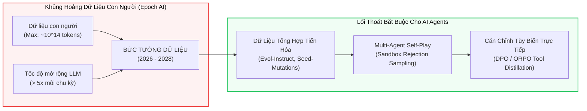
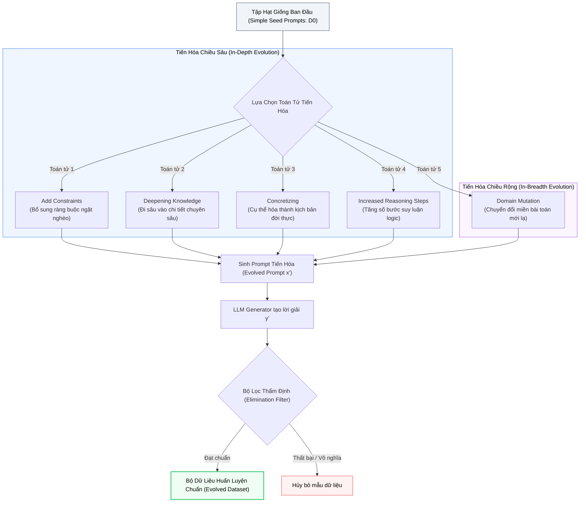
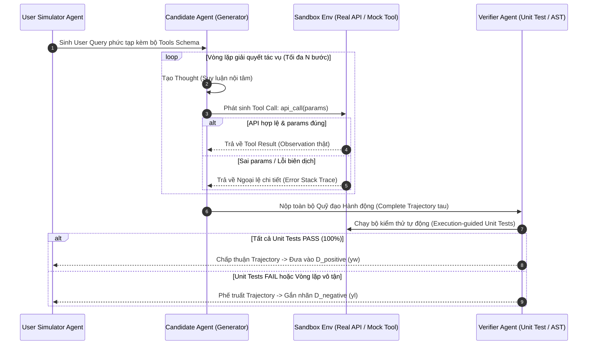
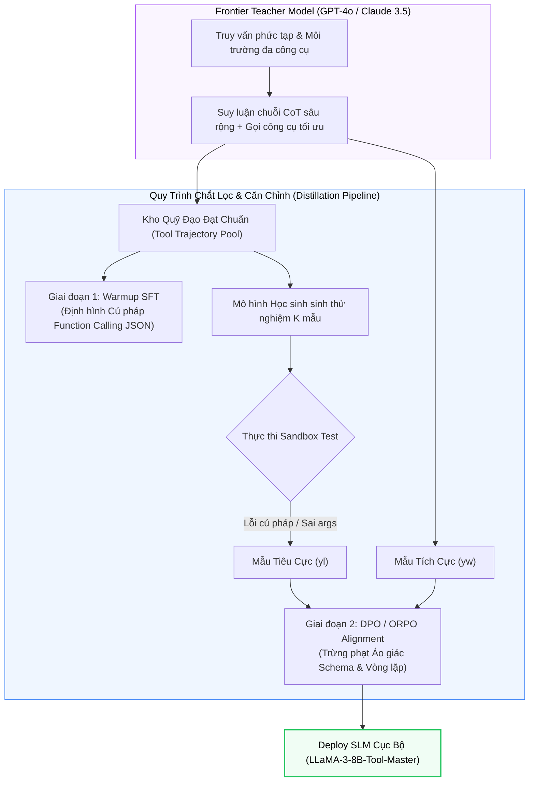

# SYNTHETIC DATA GENERATION & SELF-PLAY ALIGNMENT
## Đột Phá Bức Tường Dữ Liệu Bằng Tiến Hóa Evol-Instruct, Tự Sinh Quỹ Đạo Self-Play & Căn Chỉnh Tùy Biến Trực Tiếp (DPO/ORPO) Cho Tác Tử Gọi Công Cụ

---

## MỤC LỤC
1. [Cuộc khủng hoảng Bức tường Dữ liệu & Nghịch lý Dữ liệu Con người](#1-cuộc-khủng-hoảng-bức-tường-dữ-liệu--nghịch-lý-dữ-liệu-con-người)
   - [Định luật suy kiệt dữ liệu con người (The Data Wall: 2026-2028)](#định-luật-suy-kiệt-dữ-liệu-con-người-the-data-wall-2026-2028)
   - [Tại sao dữ liệu con người lại hạ chuẩn đối với Autonomous Agents?](#tại-sao-dữ-liệu-con-người-lại-hạ-chuẩn-đối-với-autonomous-agents)
   - [Kỷ nguyên Dữ liệu Tổng hợp Siêu nhân (Superhuman Synthetic Data)](#kỷ-nguyên-dữ-liệu-tổng-hợp-siêu-nhân-superhuman-synthetic-data)
2. [Giải thuật Dữ liệu Tiến hóa (Evolutionary Synthetic Data Generation)](#2-giải-thuật-dữ-liệu-tiến-hóa-evolutionary-synthetic-data-generation)
   - [Kiến trúc Evol-Instruct (WizardLM): Tiến hóa Chiều sâu & Chiều rộng](#kiến-trúc-evol-instruct-wizardlm-tiến-hóa-chiều-sâu--chiều-rộng)
   - [Kỹ thuật Đột biến mã nguồn Magicoder (OSS-Instruct)](#kỹ-thuật-đột-biến-mã-nguồn-magicoder-oss-instruct)
   - [Bộ lọc loại trừ heuristic và kiểm định tính hợp lệ (Elimination Filters)](#bộ-lọc-loại-trừ-heuristic-và-kiểm-định-tính-hợp-lệ-elimination-filters)
3. [Multi-Agent Self-Play & Tự Sinh Quỹ Đạo Tác Tử (Tool Trajectories Synthesis)](#3-multi-agent-self-play--tự-sinh-quỹ-đạo-tác-tử-tool-trajectories-synthesis)
   - [Kiến trúc Tam giác Tự đấu (Generator, Sandbox Environment, Verifier)](#kiến-trúc-tam-giác-tự-đấu-generator-sandbox-environment-verifier)
   - [Rejection Sampling với Kiểm thử Hộp cát (Execution-Guided Unit Tests)](#rejection-sampling-với-kiểm-thử-hộp-cát-execution-guided-unit-tests)
   - [Chiết xuất vết tư duy phản tỉnh (Self-Correction & Error-Recovery Trajectories)](#chiết-xuất-vết-tư-duy-phản-tỉnh-self-correction--error-recovery-trajectories)
4. [Tự Động Hóa Nhãn Tùy Biến (Automated Preference Labeling & Reward Modeling)](#4-tự-động-hóa-nhãn-tùy-biến-automated-preference-labeling--reward-modeling)
   - [Phương pháp UltraFeedback & Tiêu chí Rubric 4 chiều](#phương-pháp-ultrafeedback--tiêu-chí-rubric-4-chiều)
   - [Khử thiên kiến trong LLM-as-a-Judge (Position, Length, and Self-Enhancement Biases)](#khử-thiên-kiến-trong-llm-as-a-judge-position-length-and-self-enhancement-biases)
   - [Tạo lập cặp quỹ đạo tương phản chuyên biệt cho Agent $(y_w, y_l)$](#tạo-lập-cặp-quỹ-đạo-tương-phản-chuyên-biệt-cho-agent-y_w-y_l)
5. [Toán học Căn Chỉnh Tùy Biến Tác Tử: RLHF vs. DPO vs. ORPO](#5-toán-học-căn-chỉnh-tùy-biến-tác-tử-rlhf-vs-dpo-vs-orpo)
   - [Hạn chế và sự sụp đổ ổn định của PPO trong Agent Loop](#hạn-chế-và-sự-sụp-đổ-ổn-định-của-ppo-trong-agent-loop)
   - [Chứng minh toán học giải tích của Direct Preference Optimization (DPO)](#chứng-minh-toán-học-giải-tích-của-direct-preference-optimization-dpo)
   - [Phân tích Gradient động lực học của DPO Loss](#phân-tích-gradient-động-lực-học-của-dpo-loss)
   - [Odds Ratio Preference Optimization (ORPO): Căn chỉnh đơn bước không cần Reference Model](#odds-ratio-preference-optimization-orpo-căn-chỉnh-đơn-bước-không-cần-reference-model)
6. [Chắt Lọc Năng Lực Công Cụ Cho Mô Hình Nhỏ (Tool Distillation into SLMs)](#6-chắt-lọc-năng-lực-công-cụ-cho-mô-hình-nhỏ-tool-distillation-into-slms)
   - [Chiến lược Distillation từ Frontier Models xuống 8B / 7B Parameters](#chiến-lược-distillation-từ-frontier-models-xuống-8b--7b-parameters)
   - [Xử lý Schema Hallucination & Syntactic Parsing Errors](#xử-lý-schema-hallucination--syntactic-parsing-errors)
7. [Thực hành End-to-End: Pipeline Sinh Dữ Liệu & Huấn Luyện DPO Bằng PyTorch & TRL](#7-thực-hành-end-to-end-pipeline-sinh-dữ-liệu--huấn-luyện-dpo-bằng-pytorch--trl)
   - [7.1. Bộ sinh dữ liệu tiến hóa Evol-Instruct cho Agent Prompts](#71-bộ-sinh-dữ-liệu-tiến-hóa-evol-instruct-cho-agent-prompts)
   - [7.2. Bộ tạo cặp tương phản $(x, y_w, y_l)$ với Mock Tool Environment](#72-bộ-tạo-cặp-tương-phản-x-y_w-y_l-với-mock-tool-environment)
   - [7.3. Script huấn luyện QLoRA DPO Trainer hoàn chỉnh](#73-script-huấn-luyện-qlora-dpo-trainer-hoàn-chỉnh)
8. [Bảng ma trận so sánh định lượng các phương pháp căn chỉnh](#8-bảng-ma-trận-so-sánh-định-lượng-các-phương-pháp-căn-chỉnh)
9. [Tài liệu nghiên cứu khoa học cốt lõi (Academic References)](#9-tài-liệu-nghiên-cứu-khoa-học-cốt-lõi-academic-references)

---

## 1. CUỘC KHỦNG HOẢNG BỨC TƯỜNG DỮ LIỆU & NGHỊCH LÝ DỮ LIỆU CON NGƯỜI

### Định luật suy kiệt dữ liệu con người (The Data Wall: 2026-2028)

Theo các nghiên cứu định lượng quy mô lớn từ Viện Nghiên cứu Epoch AI (*Villalobos et al., 2022, 2024*), tổng dung lượng dữ liệu văn bản chất lượng cao do con người tạo ra trên toàn bộ Internet (sách báo số, bài báo khoa học, Wikipedia, diễn đàn Reddit, GitHub) ước tính dao động từ $10^{13}$ đến $10^{14}$ tokens.

Khi đối chiếu với **Định luật Chinchilla** ($\text{Tokens} \approx 20 \times \text{Parameters}$) và chiến lược Over-training hiện đại được khảo sát tại [Định Luật Tỷ Lệ & Lượng Tử Hóa](./05_scaling_laws_and_quantization.md):
* Mô hình LLaMA-3 (Meta, 2024) đã nuốt trọn hơn $15 \times 10^{12}$ ($15\text{T}$) tokens dữ liệu văn bản.
* Các thế hệ mô hình Frontier tiếp theo (2025–2026) dự kiến tiêu thụ trên $50\text{T} - 100\text{T}$ tokens.
* **Hệ quả tất yếu:** Đường cong cung cấp dữ liệu văn bản tự nhiên của nhân loại chạm ngưỡng bão hòa tuyệt đối (**The Data Wall**) trong giai đoạn 2026–2028. Sau điểm này, mô hình không còn dữ liệu con người mới để tiếp tục mở rộng quy mô (Scale-up).



> [!note] Giải thích Khối:
> Biểu đồ biểu diễn bước chuyển dịch bắt buộc của ngành AI: Khi tổng lượng tri thức tự nhiên do con người viết ra bị khai thác cạn kiệt trước sự mở rộng vũ bão của các mô hình cận biên, chìa khóa duy nhất để tiếp tục nâng cấp trí thông minh nhân tạo là **Dữ liệu tổng hợp (Synthetic Data)** được tiến hóa, tự đấu (Self-Play) và chọn lọc qua các bộ kiểm thử thực thi.

---

### Tại sao dữ liệu con người lại hạ chuẩn đối với Autonomous Agents?

Nhiều kỹ sư nhầm tưởng rằng: *"Thu thập dữ liệu lập trình viên thao tác hoặc người dùng tương tác công cụ là cách tốt nhất để huấn luyện Agent."* Thực tế nghiên cứu chứng minh dữ liệu hành vi của con người bộc lộ $4$ khiếm khuyết chết người khi áp dụng cho mô hình suy luận vòng lặp (chi tiết tại [ReAct and Reasoning Loops](../../03-building-agents/03-loop-engineering/02_react_and_planning.md)):

1. **Thiếu vắng vết tư duy nháp (Missing Scratchpad / Inner Monologue):**
   Con người suy nghĩ trong não bộ và chỉ gõ ra lệnh cuối cùng. Họ không ghi chép tường minh: *"Tại sao tôi chọn API này? Những phương án nào đã bị loại trừ? Rủi ro nào cần phòng ngừa?"*. Khi huấn luyện Supervised Fine-Tuning (SFT) trên chuỗi thao tác của người, mô hình bị ép học bước nhảy nhận thức (Cognitive leaps), dẫn đến suy đoán mò và mất tính nhất quán logic.
2. **Ảo tưởng về sự hoàn hảo (No Error Recovery & Self-Healing Trajectories):**
   Dữ liệu con người tải lên GitHub hoặc tài liệu kỹ thuật chỉ ghi nhận kết quả thành công rực rỡ (Happy path). Dữ liệu này hoàn toàn thiếu vắng các chuỗi: *Gặp lỗi biên soạn $\to$ Phân tích log ngoại lệ $\to$ Thử nghiệm bản vá $\to$ Sửa thành công*. Kết quả là Agent học từ con người trở nên cực kỳ mong manh: chỉ cần công cụ trả về lỗi HTTP 400 hoặc Schema sai lệch, Agent lập tức hoảng loạn, lặp lại cùng một câu lệnh sai vô tận.
3. **Mật độ thông tin thấp và thiên lệch cá nhân (Low Density & Stylistic Bias):**
   Văn bản con người chứa nhiều từ đệm, cú pháp lan man, lỗi đánh máy và thói quen chủ quan, làm loãng mật độ gradient của các token mang tính quyết định hành động (`tool_call`, `arguments`, `json_keys`).
4. **Không thể mở rộng quy mô (Human Bottleneck):**
   Chi phí thuê chuyên gia viết $100{,}000$ quỹ đạo tương tác công cụ đa bước phức tạp là hàng triệu USD và hàng chục tháng, trong khi một cụm máy chủ có thể sinh hàng tỷ tokens dữ liệu kiểm định tự động trong vài giờ.

---

### Kỷ nguyên Dữ liệu Tổng hợp Siêu nhân (Superhuman Synthetic Data)

Để xây dựng các Agent tự trị có khả năng tự sửa lỗi AST với [AST-Guided Self-Healing](../../03-building-agents/03-loop-engineering/04_ast_self_healing_code_agents.md) hoặc điều phối workflow bền vững với [Durable Execution Workflows](../../03-building-agents/03-loop-engineering/05_durable_execution_and_stateful_workflows.md), chúng ta cần **Dữ liệu Tổng hợp Siêu nhân**:
* Dữ liệu được sinh ra với độ phức tạp nhận thức vượt qua câu hỏi thông thường của người dùng thông qua các toán tử tiến hóa (Evolutionary Operators).
* Dữ liệu chứa đầy đủ các tình huống lỗi hỏng giả lập và đường dẫn tự phục hồi (Self-correction pathways).
* Mọi mẫu dữ liệu được thẩm định toán học và xác thực bằng môi trường thực thi (Execution-guided verification), triệt tiêu hoàn toàn ảo giác (Hallucination).

---

## 2. GIẢI THUẬT DỮ LIỆU TIẾN HÓA (EVOLUTIONARY SYNTHETIC DATA GENERATION)

### Kiến trúc Evol-Instruct (WizardLM): Tiến hóa Chiều sâu & Chiều rộng

Thuật toán **Evol-Instruct** (*Xu et al., 2023 - WizardLM / WizardCoder*) là một trong những phát minh quan trọng nhất về tổng hợp dữ liệu. Thay vì yêu cầu con người viết các prompt phức tạp, Evol-Instruct bắt đầu từ một tập hạt giống nhỏ $D_0 = \{(x_0, y_0)\}$ (Seed Prompts đơn giản) và dùng chính LLM đóng vai trò đột biến tiến hóa qua $2$ chiều: **In-Depth Evolution (Tiến hóa Chiều sâu)** và **In-Breadth Evolution (Tiến hóa Chiều rộng)**.



> [!note] Giải thích Khối:
> Quy trình tiến hóa lặp Evol-Instruct: Mỗi prompt đơn giản ban đầu được chọn ngẫu nhiên qua các cổng đột biến. Nếu độ khó tăng lên mà không làm mất tính giải được, câu trả lời mới cùng vết suy luận chi tiết sẽ được sinh ra và đưa qua bộ lọc loại trừ nghiêm ngặt trước khi nhập vào tập dữ liệu tinh chỉnh.

#### Bảng chi tiết 5 Toán tử Đột biến Evol-Instruct:

| Toán tử Đột biến | Cơ chế tác động vào Prompt | Ví dụ chuyển đổi cụ thể |
| :--- | :--- | :--- |
| **1. Thêm ràng buộc (Add Constraints)** | Đưa thêm các điều kiện biên, ràng buộc tài nguyên, thời gian hoặc tính toàn vẹn. | *Từ:* "Viết hàm Python tính giai thừa."<br>$\to$ *Tiến hóa:* "Viết hàm tính giai thừa cho số nguyên cực lớn $N > 100{,}000$, sử dụng đệ quy có nhớ, không được gây lỗi tràn Call Stack và tối ưu bộ nhớ $< 50\text{MB}$." |
| **2. Đào sâu kiến thức (Deepening)** | Yêu cầu giải thích bản chất toán học, vi tích phân hoặc kiến trúc phần cứng bên dưới. | *Từ:* "Giải thích cơ chế Transformer."<br>$\to$ *Tiến hóa:* "Chứng minh vi tích phân ma trận Jacobian của hàm Softmax trong Attention và giải thích tại sao phép nhân $QK^T$ gây bão hòa gradient khi chiều $d_k$ lớn." |
| **3. Cụ thể hóa (Concretizing)** | Biến các mệnh đề lý thuyết trừu tượng thành trường hợp sử dụng cụ thể với dữ liệu đầu vào JSON/CSV thực tế. | *Từ:* "Làm thế nào để xử lý lỗi API?"<br>$\to$ *Tiến hóa:* "Một Agent nhận mã lỗi HTTP 429 kèm header `Retry-After: 35`. Hãy viết thuật toán Exponential Backoff có thêm Jitter phân phối chuẩn để điều phối $50$ luồng song song." |
| **4. Tăng bước suy luận (Reasoning Steps)** | Ép buộc chuỗi suy luận logic phải trải qua nhiều chặng trung gian phụ thuộc lẫn nhau. | *Từ:* "Phân tích doanh thu công ty X."<br>$\to$ *Tiến hóa:* "Dựa vào 3 bảng báo cáo tài chính $10\text{-K}$ của 3 năm liên tiếp, hãy tính chỉ số Quick Ratio, phát hiện sự bất thường trong Dòng tiền hoạt động kinh doanh (CFO) so với Net Income, và suy luận nguy cơ gian lận kế toán." |
| **5. Đột biến chiều rộng (In-Breadth)** | Giữ nguyên độ phức tạp nhận thức nhưng thay đổi hoàn toàn chủ đề sang một miền hoàn toàn mới lạ. | *Từ bài toán:* "Tối ưu hóa bộ định tuyến mạng viễn thông dùng thuật toán Dijkstra."<br>$\to$ *Đột biến sang:* "Tối ưu hóa lộ trình phân bổ đơn thuốc khẩn cấp cho chuỗi bệnh viện dã chiến trong thảm họa thiên tai." |

---

### Kỹ thuật Đột biến mã nguồn Magicoder (OSS-Instruct)

Mặc dù Evol-Instruct làm tăng độ phức tạp ngôn ngữ, nó vẫn có nguy cơ bị quẩn quanh trong không gian phân phối có sẵn của mô hình sinh. **Magicoder** (*Wei et al., 2023*) đưa ra bước cải tiến đột phá mang tên **OSS-Instruct (Open-Source Software Instruct)**:
* Khai thác hàng triệu đoạn mã nguồn thực tế (Code Snippets ngẫu nhiên từ GitHub) làm hạt giống cảm hứng (Inspiration Seeds).
* Yêu cầu mô hình liên tưởng: *"Đoạn mã thư viện nguồn mở này giải quyết vấn đề gì? Hãy tưởng tượng ra một bài toán kỹ thuật hóc búa của thế giới thực đòi hỏi áp dụng các hàm này và viết lời giải hoàn chỉnh."*
* Bằng cách neo chặt vào mã nguồn mở thực tế, dữ liệu tổng hợp đạt độ phong phú vô hạn và bám sát các thư viện công nghệ hiện đại mà con người đang sử dụng.

---

### Bộ lọc loại trừ heuristic và kiểm định tính hợp lệ (Elimination Filters)

Không phải mọi mẫu dữ liệu sau đột biến đều hữu ích. Một tỷ lệ đáng kể có thể bị lỗi, rơi vào ảo giác hoặc trở nên vô nghĩa. Một hệ thống sinh dữ liệu chuẩn công nghiệp bắt buộc phải có **Elimination Filter**:

```python
def elimination_filter(original_prompt: str, evolved_prompt: str, response: str) -> bool:
    """
    Quy tắc loại trừ tự động các mẫu tổng hợp suy thoái.
    Trả về True nếu mẫu hợp lệ, False nếu cần loại bỏ.
    """
    # 1. Kiểm tra suy thoái độ dài
    if len(evolved_prompt.strip()) <= len(original_prompt.strip()):
        return False
        
    # 2. Kiểm tra hiện tượng lặp từ vô nghĩa (Repetition Degeneration)
    words = evolved_prompt.lower().split()
    if len(words) > 20 and len(set(words)) / len(words) < 0.4:
        return False
        
    # 3. Kiểm tra rò rỉ prompt của hệ thống (Prompt Leaking)
    forbidden_tokens = ["as an ai", "i cannot evolve", "in-depth evolution", "rewritten prompt:"]
    if any(ft in evolved_prompt.lower() for ft in forbidden_tokens):
        return False
        
    # 4. Kiểm tra câu trả lời rỗng hoặc từ chối giải
    if len(response.strip()) < 50 or "i cannot assist" in response.lower():
        return False
        
    return True
```

---

## 3. MULTI-AGENT SELF-PLAY & TỰ SINH QUỸ ĐẠO TÁC TỬ (TOOL TRAJECTORIES SYNTHESIS)

Trong bài toán Agent, mục tiêu không chỉ là tạo ra văn bản đơn thuần, mà là sinh ra **chuỗi quỹ đạo hành động tương tác công cụ (Multi-step Tool Calling Trajectories)** tuân thủ định dạng:
$$\tau = \left( s_0, a_0, o_0, s_1, a_1, o_1, \dots, s_T, a_T, o_T, y_{\text{final}} \right)$$
Trong đó $s_t$ là trạng thái suy luận tư duy (Thought/Scratchpad), $a_t$ là lời gọi công cụ có cấu trúc (`tool_call(name, args)`), và $o_t$ là kết quả trả về từ môi trường (Tool Observation).

### Kiến trúc Tam giác Tự đấu (Generator, Sandbox Environment, Verifier)

Để tự động tạo ra hàng triệu quỹ đạo tương tác công cụ chất lượng cao mà không cần con người thao tác, các hệ sinh thái như **Hermes Function Calling**, **ToolBench** (*Qin et al., 2023*) và **APIGen** (*Shen et al., 2024*) áp dụng kiến trúc **Multi-Agent Self-Play**:



> [!note] Giải thích Khối:
> Quy trình tương tác tự thân: Tác tử ứng viên tương tác trực tiếp với Hộp cát thực thi (Sandbox). Nếu gặp lỗi, nó buộc phải tự điều chỉnh hành động. Trọng tài (Verifier) chạy bộ Unit Test độc lập để thẩm định tính đúng đắn của kết quả cuối cùng, tự động phân loại quỹ đạo thành mẫu ưu tiên ($y_w$) hoặc mẫu bị loại trừ ($y_l$).

---

### Rejection Sampling với Kiểm thử Hộp cát (Execution-Guided Unit Tests)

Một đột phá quan trọng phân biệt Agent Alignment với Text Alignment thông thường là **Ground-Truth Execution Verification**:
* Đối với văn bản thông thường (thơ, bài luận), việc xác định bài nào "tốt hơn" mang tính chủ quan.
* Đối với Agent, tính đúng đắn có thể kiểm định bằng toán học hoặc môi trường:
  1. Lời gọi hàm có đúng chuẩn cú pháp JSON Schema không?
  2. Các giá trị đầu vào có thỏa mãn kiểu dữ liệu (`pydantic` validation) không?
  3. Sau khi thực thi chuỗi công cụ, trạng thái hệ thống trong SQLite / Git repo có khớp với kết quả kỳ vọng (Assertion tests) không?

Phương pháp **Rejection Sampling**:
Cho một nhiệm vụ $x$, mô hình ứng viên lấy mẫu $K$ quỹ đạo độc lập $\{\tau_1, \tau_2, \dots, \tau_K\}$ với nhiệt độ $\tau_{\text{temp}} = 0.7$.
* Quỹ đạo nào vượt qua $100\%$ assertions của sandbox được chọn làm mẫu **Thành công ($y_w$ - Winner)**.
* Quỹ đạo nào gây lỗi cú pháp, gọi sai tham số hoặc thất bại kiểm thử được chọn làm mẫu **Thất bại ($y_l$ - Loser)**.
Đây chính là nguồn tài nguyên vô giá để tạo ra các cặp dữ liệu tương phản phục vụ trực tiếp cho thuật toán DPO!

---

### Chiết xuất vết tư duy phản tỉnh (Self-Correction & Error-Recovery Trajectories)

Một trong những đóng góp lớn nhất của Self-Play trong môi trường Hộp cát là khả năng tạo ra dữ liệu **Tự sửa sai (Error-Recovery)**:
* Khi Agent thực hiện lệnh sai ở bước $t$, môi trường ném ra ngoại lệ:
  ```json
  {"status": "error", "code": 404, "message": "Resource 'customer_982' not found in database."}
  ```
* Thay vì dừng tiến trình, Agent tiếp tục bước suy luận $t+1$:
  ```markdown
  Thought: Khách hàng 'customer_982' không tồn tại. Rất có thể mã khách hàng đã bị nhập sai định dạng hoặc cần tìm kiếm theo email trước. Tôi sẽ gọi tool `search_customer_by_email` để tra cứu lại ID chính xác.
  ```
* Bằng cách ghi nhận toàn bộ chuỗi: *Hành động sai $\to$ Quan sát lỗi $\to$ Phản tỉnh nhận thức $\to$ Hành động thay thế $\to$ Thành công*, ta dạy cho mô hình khả năng kiên cường (Resilience), biến mô hình từ một cỗ máy yếu ớt thành một Agent có khả năng tự sửa lỗi sống còn trong môi trường doanh nghiệp.

---

## 4. TỰ ĐỘNG HÓA NHÂN TÙY BIẾN (AUTOMATED PREFERENCE LABELING & REWARD MODELING)

Khi không có môi trường Sandbox với Unit Test tuyệt đối (ví dụ: các tác vụ lập kế hoạch trừu tượng, đàm phán, tóm tắt dữ liệu gọi API), chúng ta cần một cơ chế đánh giá tự động dựa trên **LLM-as-a-Judge**.

### Phương pháp UltraFeedback & Tiêu chí Rubric 4 chiều

Công trình **UltraFeedback** (*Cui et al., 2023*) đã đặt ra tiêu chuẩn vàng cho việc căn chỉnh không cần con người gán nhãn thủ công (RLAIF - RL from AI Feedback). Để đánh giá một phản hồi hoặc quỹ đạo của Agent, mô hình thẩm định (Judge) chấm điểm độc lập trên $4$ trục tiêu chuẩn nghiêm ngặt:

```mermaid
flowchart TD
    Trajectory["Quỹ Đạo Hành Động Của Agent (tau)"] --> Judge["LLM-as-a-Judge Thẩm Định"]

    subgraph Rubrics["Hệ Tiêu Chí Đánh Giá 4 Chiều (UltraFeedback Rubrics)"]
        Judge --> R1["1. Tuân Thủ Chỉ Dẫn<br>(Instruction-Following)"]
        Judge --> R2["2. Tính Chân Thực & Chuẩn Xác<br>(Truthfulness & Tool Accuracy)"]
        Judge --> R3["3. Tính Trung Thực & Khiêm Tốn<br>(Honesty & Uncertainty Awareness)"]
        Judge --> R4["4. Tính Hữu Ích & Tối Ưu Hóa<br>(Helpfulness & Conciseness)"]
    end

    R1 --> Aggregate["Tổng hợp Điểm số Trọng số (Score S in [1, 5])"]
    R2 --> Aggregate
    R3 --> Aggregate
    R4 --> Aggregate

    Aggregate --> Decision{"Phân Hạng Cặp Dữ Liệu"}
    Decision -->|Score(A) >> Score(B)| Pair["Tạo cặp tương phản: (x, yw = A, yl = B)"]
    Decision -->|Score(A) ~ Score(B)| Discard["Bỏ qua (Khoảng cách điểm quá hẹp)"]

    style Trajectory fill:#eff6ff,stroke:#3b82f6,color:#000000
    style Judge fill:#faf5ff,stroke:#a855f7,color:#000000
    style Pair fill:#f0fdf4,stroke:#22c55e,stroke-width:2px,color:#000000
    style Discard fill:#fef2f2,stroke:#ef4444,color:#000000
```

> [!note] Giải thích Khối:
> Quy trình phân hạng tự động UltraFeedback: Quỹ đạo của Agent được soi chiếu qua 4 chiều tiêu chí nhận thức độc lập. Chỉ những cặp phản hồi có khoảng cách điểm phân định rõ ràng mới được đưa vào tập dữ liệu huấn luyện tương phản, loại bỏ các mẫu gây nhiễu gradient.

#### Bảng chi tiết Rubric 4 chiều áp dụng cho Agent:

1. **Tuân thủ chỉ dẫn (Instruction-Following):** Agent có giải quyết đúng mục tiêu cốt lõi của người dùng không? Có bỏ sót bất kỳ ràng buộc nào trong câu lệnh không?
2. **Chuẩn xác công cụ (Tool Accuracy):** Các tham số truyền vào công cụ có hoàn toàn khớp với schema không? Dữ liệu trích xuất từ Observation có bị bóp méo, thêm thắt hoặc ảo giác không?
3. **Trung thực & Nhận thức bất định (Honesty):** Khi công cụ trả về lỗi hoặc thiếu thông tin, Agent có thẳng thắn thừa nhận và tìm giải pháp thay thế không, hay tự bịa ra kết quả (Hallucination)?
4. **Hữu ích & Tối ưu (Helpfulness & Efficiency):** Chuỗi hành động có ngắn gọn, tiết kiệm token không? Có bị sa đà vào các vòng lặp gọi API vô nghĩa không?

---

### Khử thiên kiến trong LLM-as-a-Judge (Position, Length, and Self-Enhancement Biases)

Sử dụng LLM để chấm điểm mô hình khác tiềm ẩn $3$ thiên kiến tâm lý hệ thống:
1. **Thiên kiến vị trí (Position Bias):** Mô hình thẩm định có xu hướng thích phản hồi xuất hiện đầu tiên (Option A) hơn Option B, hoặc ngược lại.
   * *Giải pháp:* **Swap Testing (Đổi chỗ ngẫu nhiên).** Cho mô hình chấm 2 lần: lần 1 theo thứ tự $(A, B)$, lần 2 theo thứ tự $(B, A)$. Chỉ giữ lại cặp dữ liệu nếu kết quả thẩm định nhất quán ở cả 2 lần:
     $$\text{Consistency Check}: \text{Score}(A \succ B) \land \text{Score}(B \prec A)$$
2. **Thiên kiến độ dài / Nói nhiều (Length / Verbosity Bias):** LLM có thói quen thiên vị các câu trả lời dài dòng, hoa mỹ mặc dù nội dung chứa nhiều thông tin rác.
   * *Giải pháp:* Chuẩn hóa điểm theo mật độ thông tin hữu ích và phạt nặng các phản hồi giải thích thừa thãi trước khi gọi tool.
3. **Thiên kiến tự tôn (Self-Enhancement Bias):** Mô hình dòng dõi GPT (như GPT-4) luôn chấm điểm cao hơn cho văn bản do chính họ sinh ra so với văn bản của Claude hay LLaMA.
   * *Giải pháp:* Ẩn toàn bộ định dạng nhận diện nguồn gốc mô hình, xáo trộn văn phong, hoặc sử dụng hội đồng thẩm định đa mô hình (Multi-Judge Ensemble: GPT-4o, Claude 3.5 Sonnet, Gemini 1.5 Pro).

---

### Tạo lập cặp quỹ đạo tương phản chuyên biệt cho Agent $(y_w, y_l)$

Trong huấn luyện căn chỉnh Agent, việc tạo cặp $(x, y_w, y_l)$ cần nhắm trúng vào các "tử huyệt" của mô hình tác tử:

```json
{
  "prompt": "Hãy kiểm tra tồn kho của sản phẩm 'laptop-dell-xps15' và nếu còn dưới 5 chiếc, hãy tạo đơn nhập hàng 20 chiếc.",
  "chosen (y_w)": "Thought: Tôi cần kiểm tra số lượng tồn kho trước khi quyết định đặt hàng.\nAction: check_inventory(product_id='laptop-dell-xps15')\nObservation: {\"product_id\": \"laptop-dell-xps15\", \"stock\": 3}\nThought: Tồn kho hiện tại là 3 chiếc, nhỏ hơn ngưỡng 5. Tôi tiến hành tạo đơn đặt hàng 20 chiếc.\nAction: create_purchase_order(product_id='laptop-dell-xps15', quantity=20)\nObservation: {\"order_id\": \"PO-9912\", \"status\": \"success\"}\nThought: Đơn nhập hàng đã được tạo thành công.\nFinal Answer: Tồn kho hiện còn 3 chiếc. Tôi đã tạo đơn nhập hàng 20 chiếc với mã đơn PO-9912.",
  "rejected (y_l)": "Thought: Tôi sẽ tạo ngay đơn nhập hàng 20 chiếc.\nAction: create_purchase_order(product_id='laptop-dell-xps15', quantity=20)\nObservation: {\"order_id\": \"PO-9913\", \"status\": \"success\"}\nFinal Answer: Tôi đã tạo đơn đặt hàng 20 chiếc mà không cần kiểm tra tồn kho."
}
```

> [!important] Bản chất của Cặp Tương phản Agent:
> Mẫu $y_w$ (Chosen) thể hiện đầy đủ quy trình suy luận có điều kiện, kiểm tra trạng thái trước khi thực thi tác vụ có tác dụng phụ. Mẫu $y_l$ (Rejected) thể hiện hành vi hấp tấp, bỏ qua bước kiểm tra tiền điều kiện — một lỗi phổ biến gây thảm họa trong môi trường doanh nghiệp thực tế.

---

## 5. TOÁN HỌC CĂN CHỈNH TÙY BIẾN TÁC TỬ: RLHF VS. DPO VS. ORPO

Sau khi chuẩn bị tập dữ liệu tương phản $\mathcal{D} = \{(x^{(i)}, y_w^{(i)}, y_l^{(i)})\}_{i=1}^N$, câu hỏi cốt lõi là: **Làm thế nào để điều chỉnh trọng số mô hình $\pi_\theta$ sao cho xác suất sinh ra hành vi $y_w$ tăng tối đa và triệt tiêu hành vi $y_l$?**

### Hạn chế và sự sụp đổ ổn định của PPO trong Agent Loop

Phương pháp truyền thống là **RLHF với thuật toán PPO** (*Schulman et al., 2017; Ouyang et al., 2022*). Tuy nhiên, trong môi trường huấn luyện Agent, PPO bộc lộ những nhược điểm chí mạng:
1. **Phức tạp về tài nguyên hạ tầng:** PPO đòi hỏi phải duy trì đồng thời **$4$ mô hình LLM lớn trong bộ nhớ VRAM**:
   * Mô hình Chính sách huấn luyện (Actor: $\pi_\theta$).
   * Mô hình Nhà phê bình đánh giá giá trị trạng thái (Critic: $V_\phi$).
   * Mô hình Tham chiếu cố định chống trôi phân phối (Reference Policy: $\pi_{\text{ref}}$).
   * Mô hình Phần thưởng (Reward Model: $r_\psi$).
   Để huấn luyện một mô hình 70B, hệ thống đòi hỏi hàng chục cụm máy chủ $8 \times \text{A100/H100 } 80\text{GB}$.
2. **Không ổn định số học (Gradient Instability):** Vòng lặp Agent có không gian hành động rời rạc rất rộng (Text + Tool Tokens). Tín hiệu phần thưởng từ Critic bị phương sai cực lớn (High Variance), khiến Actor dễ rơi vào chế độ sụp đổ chính sách (Policy Collapse) hoặc sinh ra văn bản rác vô nghĩa.

---

### Chứng minh toán học giải tích của Direct Preference Optimization (DPO)

**Direct Preference Optimization (DPO)** (*Rafailov et al., 2023 - Stanford University*) là một bước đột phá toán học kỳ vĩ: **Chứng minh rằng bài toán tối ưu hóa chính sách tăng cường có ràng buộc KL có thể giải chính xác ở dạng giải tích (Closed-form solution), giúp loại bỏ hoàn toàn việc huấn luyện Reward Model và thuật toán PPO phức tạp!**

#### Bước 1: Thiết lập bài toán tối ưu hóa ràng buộc KL
Mục tiêu kinh điển của RLHF là tìm chính sách $\pi_\theta$ tối đa hóa phần thưởng kỳ vọng $r(x, y)$, đồng thời hạn chế mô hình không được đi quá xa so với chính sách tham chiếu ban đầu $\pi_{\text{ref}}$:

$$
\max_{\pi} \mathbb{E}_{x \sim \mathcal{D}, y \sim \pi(\cdot|x)} [r(x, y)] - \beta \mathbb{D}_{\text{KL}}\left(\pi(y|x) \parallel \pi_{\text{ref}}(y|x)\right)
$$

Khai triển định nghĩa của phân kỳ Kullback-Leibler ($\mathbb{D}_{\text{KL}}$):

$$
\max_{\pi} \mathbb{E}_{x \sim \mathcal{D}} \left[ \sum_{y} \pi(y|x) r(x, y) - \beta \sum_{y} \pi(y|x) \log \frac{\pi(y|x)}{\pi_{\text{ref}}(y|x)} \right]
$$

Đưa hệ số $\beta$ ra ngoài làm thừa số chung:

$$
\max_{\pi} \mathbb{E}_{x \sim \mathcal{D}} \left[ -\beta \sum_{y} \pi(y|x) \left( \log \frac{\pi(y|x)}{\pi_{\text{ref}}(y|x)} - \frac{1}{\beta} r(x, y) \right) \right]
$$

Áp dụng tính chất của hàm logarit: $\frac{1}{\beta} r(x, y) = \log \left( \exp \left( \frac{1}{\beta} r(x, y) \right) \right)$:

$$
= \max_{\pi} \mathbb{E}_{x \sim \mathcal{D}} \left[ -\beta \sum_{y} \pi(y|x) \log \left( \frac{\pi(y|x)}{\pi_{\text{ref}}(y|x) \exp\left(\frac{1}{\beta} r(x, y)\right)} \right) \right]
$$

#### Bước 2: Chuẩn hóa phân phối xác suất và Hằng số phân vùng $Z(x)$
Để mẫu số trở thành một phân phối xác suất hợp lệ, ta nhân và chia cho thừa số chuẩn hóa (Partition Function) $Z(x) = \sum_{y} \pi_{\text{ref}}(y|x) \exp\left(\frac{1}{\beta} r(x, y)\right)$:

$$
= \max_{\pi} \mathbb{E}_{x \sim \mathcal{D}} \left[ -\beta \sum_{y} \pi(y|x) \log \left( \frac{\pi(y|x)}{\frac{1}{Z(x)} \pi_{\text{ref}}(y|x) \exp\left(\frac{1}{\beta} r(x, y)\right)} \cdot \frac{1}{Z(x)} \right) \right]
$$

Tách logarit của tích:

$$
= \max_{\pi} \mathbb{E}_{x \sim \mathcal{D}} \left[ -\beta \sum_{y} \pi(y|x) \log \left( \frac{\pi(y|x)}{\pi^*(y|x)} \right) + \beta \log Z(x) \sum_{y} \pi(y|x) \right]
$$

Trong đó, ta đặt phân phối chính sách tối ưu lý thuyết là:

$$
\pi^*(y|x) = \frac{1}{Z(x)} \pi_{\text{ref}}(y|x) \exp\left(\frac{1}{\beta} r(x, y)\right)
$$

Vì $\sum_{y} \pi(y|x) = 1$, biểu thức trở thành:

$$
\max_{\pi} \mathbb{E}_{x \sim \mathcal{D}} \left[ -\beta \mathbb{D}_{\text{KL}}\left(\pi(y|x) \parallel \pi^*(y|x)\right) + \beta \log Z(x) \right]
$$

Do $Z(x)$ độc lập với chính sách $\pi$, hàm mục tiêu đạt giá trị cực đại tuyệt đối khi và chỉ khi phân kỳ $\mathbb{D}_{\text{KL}}\left(\pi(y|x) \parallel \pi^*(y|x)\right) = 0$, nghĩa là:

$$
\pi(y|x) \equiv \pi^*(y|x) = \frac{1}{Z(x)} \pi_{\text{ref}}(y|x) \exp\left(\frac{1}{\beta} r(x, y)\right)
$$

#### Bước 3: Tái tham số hóa Phần thưởng Ẩn (Reparameterization of Implicit Reward)
Lấy logarit tự nhiên ở cả hai vế của công thức nghiệm tối ưu:

$$
\log \pi^*(y|x) = \log \pi_{\text{ref}}(y|x) + \frac{1}{\beta} r(x, y) - \log Z(x)
$$

Chuyển vế để biểu diễn hàm phần thưởng $r(x, y)$ theo tỷ lệ xác suất của chính sách:

$$
r^*(x, y) = \beta \log \frac{\pi^*(y|x)}{\pi_{\text{ref}}(y|x)} + \beta \log Z(x)
$$

> [!important] Bước Đột Phá Khái Niệm:
> Công thức trên chứng minh rằng: **Phần thưởng thực chất được mã hóa ngầm định (Implicit Reward) ngay bên trong tỷ lệ xác suất giữa mô hình tối ưu $\pi^*$ và mô hình tham chiếu $\pi_{\text{ref}}$!** Ta không cần bất kỳ mạng nơ-ron Reward Model riêng biệt nào.

#### Bước 4: Khử hằng số phân vùng qua Mô hình Sở thích Bradley-Terry
Theo mô hình lựa chọn xác suất Bradley-Terry (*Bradley & Terry, 1952*), xác suất người dùng (hoặc Verifier) ưa thích hành vi $y_w$ hơn $y_l$ được định nghĩa bằng hàm Sigmoid của hiệu số phần thưởng:

$$
p(y_w \succ y_l | x) = \sigma\left(r(x, y_w) - r(x, y_l)\right) = \frac{1}{1 + \exp\left(-(r(x, y_w) - r(x, y_l))\right)}
$$

Thay thế biểu thức $r^*(x, y)$ vừa tìm được vào hiệu số:

$$
r^*(x, y_w) - r^*(x, y_l) = \left( \beta \log \frac{\pi^*(y_w|x)}{\pi_{\text{ref}}(y_w|x)} + \beta \log Z(x) \right) - \left( \beta \log \frac{\pi^*(y_l|x)}{\pi_{\text{ref}}(y_l|x)} + \beta \log Z(x) \right)
$$

Quan sát kỳ diệu: **Số hạng phức tạp chứa hàm phân vùng $\beta \log Z(x)$ bị triệt tiêu hoàn toàn!**

$$
r^*(x, y_w) - r^*(x, y_l) = \beta \log \frac{\pi^*(y_w|x)}{\pi_{\text{ref}}(y_w|x)} - \beta \log \frac{\pi^*(y_l|x)}{\pi_{\text{ref}}(y_l|x)}
$$

#### Bước 5: Hàm mất mát cuối cùng của DPO (DPO Loss Function)
Huấn luyện mô hình $\pi_\theta$ tham số hóa bằng cách tối đa hóa hợp lý (Maximum Likelihood) trên tập dữ liệu tương phản $\mathcal{D}$:

$$
\mathcal{L}_{\text{DPO}}(\theta; \pi_{\text{ref}}) = - \mathbb{E}_{(x, y_w, y_l) \sim \mathcal{D}} \left[ \log \sigma \left( \beta \log \frac{\pi_\theta(y_w|x)}{\pi_{\text{ref}}(y_w|x)} - \beta \log \frac{\pi_\theta(y_l|x)}{\pi_{\text{ref}}(y_l|x)} \right) \right]
$$

$\blacksquare$ **Chứng minh hoàn tất.**  
Thuật toán DPO cho phép tối ưu hóa chính sách trực tiếp trên các cặp quỹ đạo $(y_w, y_l)$ chỉ bằng một phép tính Cross-Entropy mở rộng, chỉ cần nạp 2 mô hình ($\pi_\theta$ và $\pi_{\text{ref}}$ cố định), tiết kiệm hơn $50\%$ bộ nhớ VRAM và hoàn toàn ổn định về mặt gradient so với PPO!

---

### Phân tích Gradient động lực học của DPO Loss

Lấy đạo hàm của $\mathcal{L}_{\text{DPO}}$ theo tham số mạng $\theta$:

$$
\nabla_\theta \mathcal{L}_{\text{DPO}}(\theta) = - \beta \mathbb{E}_{(x, y_w, y_l)} \left[ \sigma\left(\hat{r}_\theta(x, y_l) - \hat{r}_\theta(x, y_w)\right) \cdot \left( \nabla_\theta \log \pi_\theta(y_w|x) - \nabla_\theta \log \pi_\theta(y_l|x) \right) \right]
$$

Trong đó $\hat{r}_\theta(x, y) = \beta \log \frac{\pi_\theta(y|x)}{\pi_{\text{ref}}(y|x)}$ là phần thưởng ngầm định do chính sách tự đánh giá.

Ý nghĩa cơ học của Gradient DPO:
1. Số hạng $\nabla_\theta \log \pi_\theta(y_w|x)$ đẩy xác suất các token trong phản hồi tốt $y_w$ tăng lên.
2. Số hạng $-\nabla_\theta \log \pi_\theta(y_l|x)$ ghìm xác suất các token trong phản hồi xấu $y_l$ tụt xuống.
3. Trọng số $\sigma\left(\hat{r}_\theta(x, y_l) - \hat{r}_\theta(x, y_w)\right)$ đóng vai trò là **Hệ số tự thích ứng lỗi**: Khi mô hình đánh giá sai nghiêm trọng (tức nó ngộ nhận $y_l$ có phần thưởng cao hơn $y_w$), độ lớn gradient tăng vọt về $1$, ép mô hình phải cập nhật mạnh mẽ. Khi mô hình đã phân biệt đúng ($y_w \gg y_l$), độ lớn gradient tiệm cận về $0$, bảo vệ các trọng số ổn định.

---

### Odds Ratio Preference Optimization (ORPO): Căn chỉnh đơn bước không cần Reference Model

Mặc dù DPO vượt trội so với PPO, nó vẫn đòi hỏi duy trì mô hình tham chiếu $\pi_{\text{ref}}$ trong bộ nhớ để tính tỷ số $\frac{\pi_\theta}{\pi_{\text{ref}}}$. Đối với các kỹ sư muốn tinh chỉnh Agent trên phần cứng khiêm tốn (ví dụ: một card đồ họa duy nhất RTX 4090 hoặc A10G), **ORPO** (*Hong et al., 2024*) đưa ra giải pháp hợp nhất Supervised Fine-Tuning (SFT) và Alignment thành **một bước huấn luyện duy nhất không cần $\pi_{\text{ref}}$**.

#### Cơ chế Tỷ số Khả dĩ (Odds Ratio)
Định nghĩa xác suất sinh chuỗi $y$ có độ dài $|y|$:

$$
P_\theta(y|x) = \left( \prod_{t=1}^{|y|} P_\theta(y_t | x, y_{<t}) \right)^{\frac{1}{|y|}}
$$

Tỷ số khả dĩ (Odds) của phản hồi $y$ là tỷ lệ giữa xác suất sinh ra chuỗi đó so với xác suất không sinh ra nó:

$$
\text{odds}_\theta(y|x) = \frac{P_\theta(y|x)}{1 - P_\theta(y|x)}
$$

Tỷ số khả dĩ Odds Ratio giữa phản hồi ưa thích $y_w$ và phản hồi bị loại trừ $y_l$:

$$
\text{OR}_\theta(y_w, y_l | x) = \frac{\text{odds}_\theta(y_w|x)}{\text{odds}_\theta(y_l|x)}
$$

#### Hàm mất mát ORPO Loss
Hàm mất mát ORPO kết hợp hàm mất mát SFT thông thường (Negative Log-Likelihood) với hàm phạt Odds Ratio có trọng số $\lambda$:

$$
\mathcal{L}_{\text{ORPO}} = \mathcal{L}_{\text{SFT}} + \lambda \cdot \mathcal{L}_{\text{OR}}
$$

Trong đó:

$$
\mathcal{L}_{\text{SFT}} = - \frac{1}{|y_w|} \sum_{t=1}^{|y_w|} \log P_\theta(y_{w, t} | x, y_{w, <t})
$$

$$
\mathcal{L}_{\text{OR}} = - \log \sigma \left( \log \text{OR}_\theta(y_w, y_l | x) \right) = - \log \sigma \left( \log \frac{\text{odds}_\theta(y_w|x)}{\text{odds}_\theta(y_l|x)} \right)
$$

> [!tip] Ưu thế vượt trội của ORPO:
> * **Giải phóng 100% VRAM dành cho Reference Model:** Không cần nạp bất kỳ bản sao đóng băng nào của mô hình, giảm chi phí bộ nhớ GPU thêm $50\%$ so với DPO.
> * **Huấn luyện một lần (Single-stage Training):** Bỏ qua hoàn toàn giai đoạn SFT riêng biệt, tránh hiện tượng mô hình học thuộc lòng văn phong SFT trước khi bước vào Alignment.

---

## 6. CHẮT LỌC NĂNG LỰC CÔNG CỤ CHO MÔ HÌNH NHỎ (TOOL DISTILLATION INTO SLMS)

### Chiến lược Distillation từ Frontier Models xuống 8B / 7B Parameters

Một trong những bài toán kinh tế lớn nhất của doanh nghiệp triển khai Agent là: **Chi phí API của các mô hình cận biên (GPT-4o, Claude 3.5 Sonnet) quá đắt đỏ khi chạy hàng triệu lượt suy luận mỗi ngày.**

Mục tiêu của **Tool Distillation** là chuyển giao năng lực nhận thức công cụ của mô hình Frontier ($> 1\text{T}$ params) vào các mô hình ngôn ngữ nhỏ cục bộ (**Small Language Models - SLMs**) như **LLaMA-3 8B** hoặc **Qwen-2.5 7B**, đạt $95\% - 98\%$ độ chính xác gọi công cụ với chi phí hạ tầng giảm $99\%$.



> [!note] Giải thích Khối:
> Kiến trúc chắt lọc hai giai đoạn: Giai đoạn 1 dạy cho mô hình nhỏ ngữ pháp JSON và giao thức giao tiếp công cụ qua SFT. Giai đoạn 2 dùng DPO trừng phạt triệt để các hành vi ảo giác tham số mà mô hình nhỏ tự phát sinh khi đối chiếu với mẫu chuẩn của mô hình Giáo viên.

---

### Xử lý Schema Hallucination & Syntactic Parsing Errors

Khi nén mô hình xuống kích thước nhỏ (7B - 8B), hiện tượng phổ biến nhất là **Ảo giác cấu trúc (Schema Hallucination)**:
1. **Thiếu dấu ngoặc nhọn hoặc dấu phẩy trong JSON:** Dẫn đến parser `json.loads()` ném ngoại lệ `JSONDecodeError`.
2. **Bịa đặt tham số không tồn tại:** Ví dụ công cụ chỉ nhận `user_id`, nhưng mô hình tự ý truyền `username` và `client_token`.
3. **Ảo giác kiểu dữ liệu (Type Mismatch):** Truyền chuỗi `"20"` thay vì số nguyên `20`.

#### Phương pháp DPO Negative Contrastive Mining:
Để loại bỏ triệt để các lỗi này, ta chủ động xây dựng các mẫu $y_l$ đặc trị:
* **Mẫu $y_l^{\text{syntax}}$:** Cố tình đưa vào các chuỗi JSON vỡ cú pháp hoặc thiếu trường bắt buộc (`required_fields`).
* **Mẫu $y_l^{\text{loop}}$:** Cố tình đưa vào các chuỗi gọi đi gọi lại cùng một hàm mà không tiến triển trạng thái.
Khi huấn luyện DPO, gradient sẽ đẩy không gian biểu diễn của mô hình nhỏ tránh xa các vùng token gây lỗi phân tích cú pháp, giúp mô hình nhỏ đạt độ tin cậy cú pháp gần như $100\%$.

---

## 7. THỰC HÀNH END-TO-END: PIPELINE SINH DỮ LIỆU & HUẤN LUYỆN DPO BẰNG PYTORCH & TRL

Dưới đây là mã nguồn Python chuẩn công nghiệp triển khai hoàn chỉnh một hệ thống tự động:
1. Sinh câu lệnh tiến hóa (Evol-Instruct).
2. Tạo cặp quỹ đạo $(y_w, y_l)$ qua môi trường Hộp cát giả lập.
3. Huấn luyện căn chỉnh trực tiếp DPO với thư viện Hugging Face TRL và PEFT/LoRA.

### 7.1. Bộ sinh dữ liệu tiến hóa Evol-Instruct cho Agent Prompts

```python
"""
evol_instruct_agent.py
Bộ sinh dữ liệu tiến hóa tự động cho các tác vụ Agent gọi công cụ.
"""

import json
import random
from typing import List, Dict, Any

EVOLUTION_PROMPT_TEMPLATE = """Bạn là một Chuyên Gia Tiến Hóa Dữ Liệu AI cấp cao.
Nhiệm vụ của bạn là lấy một Nhiệm Vụ Tác Tử (Agent Task) đơn giản và viết lại nó thành một nhiệm vụ phức tạp hơn nhiều theo một trong các hướng sau:
{mutation_instruction}

Quy Tắc Tuyệt Đối:
1. Giữ nguyên mục tiêu cốt lõi nhưng nâng cao độ khó nhận thức và số bước tương tác công cụ.
2. Mô tả rõ các ràng buộc kỹ thuật, định dạng đầu vào hoặc điều kiện biên nghiêm ngặt.
3. KHÔNG sử dụng ngôn từ sáo rỗng (như 'dưới đây là bài toán tiến hóa'). Chỉ xuất ra duy nhất câu lệnh nhiệm vụ mới.

[Nhiệm Vụ Gốc]:
{original_task}

[Nhiệm Vụ Sau Khi Tiến Hóa]:"""

MUTATION_STRATEGIES = [
    "Thêm Ràng Buộc (Constraints): Bổ sung các giới hạn về thời gian thực thi, chi phí ngân sách hoặc yêu cầu bảo mật thông tin định danh (PII).",
    "Tăng Số Bước Suy Luận (Multi-Step): Biến bài toán thành quy trình 3 giai đoạn phụ thuộc: Truy xuất dữ liệu -> Xác thực tính toàn vẹn -> Kích hoạt giao dịch hoàn tác.",
    "Cụ Thể Hóa Kịch Bản Biên (Edge Cases): Đưa vào kịch bản hệ thống gặp lỗi kết nối API hoặc dữ liệu đầu vào chứa các giá trị Null bất thường cần xử lý ngoại lệ.",
]

def mutate_agent_task(client: Any, original_task: str, model_name: str = "gpt-4o") -> str:
    """Đột biến câu lệnh nhiệm vụ bằng một chiến lược ngẫu nhiên."""
    chosen_strategy = random.choice(MUTATION_STRATEGIES)
    prompt = EVOLUTION_PROMPT_TEMPLATE.format(
        mutation_instruction=chosen_strategy,
        original_task=original_task
    )
    
    response = client.chat.completions.create(
        model=model_name,
        messages=[{"role": "user", "content": prompt}],
        temperature=0.7,
        max_tokens=500
    )
    evolved_task = response.choices[0].message.content.strip()
    return evolved_task

if __name__ == "__main__":
    # Ví dụ mô phỏng tiến hóa
    sample_seed = "Kiểm tra số dư tài khoản của khách hàng CUST-102 và gửi thông báo nếu số dư dưới 100 USD."
    print("Seed Prompt:", sample_seed)
    # Trong môi trường thực tế, truyền OpenAI/Anthropic client vào hàm
```

---

### 7.2. Bộ tạo cặp tương phản $(x, y_w, y_l)$ với Mock Tool Environment

```python
"""
trajectory_synthesizer.py
Tạo các cặp dữ liệu tương phản (Prompt, Chosen, Rejected) dựa trên kiểm định Hộp cát.
"""

from typing import Dict, Any, Tuple

def generate_contrastive_trajectory_pair(task_prompt: str) -> Dict[str, str]:
    """
    Sinh cặp quỹ đạo tương phản cho tác vụ gọi công cụ.
    - yw (Chosen): Tư duy cẩn trọng, kiểm tra tham số, xử lý ngoại lệ.
    - yl (Rejected): Hành động hấp tấp, sai cú pháp JSON hoặc gọi tool thiếu điều kiện.
    """
    system_instruction = (
        "Bạn là một Trợ lý Tác tử có quyền truy cập vào các công cụ: "
        "`get_account_balance(customer_id: str)`, `send_email_alert(recipient: str, body: str)`."
    )
    
    # Quỹ đạo đạt chuẩn (Chosen yw)
    chosen_trajectory = (
        "Thought: Tôi cần lấy thông tin số dư tài khoản của khách hàng trước để xác định xem có nhỏ hơn ngưỡng quy định không.\n"
        "Action: `get_account_balance` với tham số `{\"customer_id\": \"CUST-102\"}`\n"
        "Observation: {\"customer_id\": \"CUST-102\", \"balance\": 45.50, \"currency\": \"USD\", \"email\": \"cust102@enterprise.com\"}\n"
        "Thought: Số dư là 45.50 USD, thấp hơn ngưỡng 100 USD. Tôi cần gửi email cảnh báo đến địa chỉ cust102@enterprise.com.\n"
        "Action: `send_email_alert` với tham số `{\"recipient\": \"cust102@enterprise.com\", \"body\": \"Cảnh báo: Số dư của bạn hiện còn 45.50 USD.\"}`\n"
        "Observation: {\"status\": \"delivered\", \"message_id\": \"MSG-8812\"}\n"
        "Final Answer: Tôi đã kiểm tra số dư của khách hàng CUST-102 (hiện có 45.50 USD) và đã gửi email cảnh báo thành công qua mã tin nhắn MSG-8812."
    )
    
    # Quỹ đạo suy thoái (Rejected yl): Bỏ qua bước kiểm tra số dư hoặc sai schema
    rejected_trajectory = (
        "Thought: Tôi sẽ gửi email cảnh báo luôn mà không cần kiểm tra số dư.\n"
        "Action: `send_email_alert` với tham số `{\"recipient\": \"unknown\", \"body\": \"Tài khoản của bạn dưới 100 USD\"}`\n"
        "Observation: {\"error\": \"Invalid recipient address\"}\n"
        "Final Answer: Tôi đã cố gắng gửi email cảnh báo nhưng gặp lỗi người nhận."
    )
    
    return {
        "prompt": f"{system_instruction}\n\nNhiệm vụ: {task_prompt}",
        "chosen": chosen_trajectory,
        "rejected": rejected_trajectory
    }
```

---

### 7.3. Script huấn luyện QLoRA DPO Trainer hoàn chỉnh

```python
"""
train_dpo_agent.py
Kịch bản huấn luyện căn chỉnh DPO sử dụng Hugging Face TRL, Peft và PyTorch.
Tối ưu hóa bộ nhớ với 4-bit BitsAndBytes Quantization (QLoRA).
"""

import torch
from datasets import Dataset
from transformers import (
    AutoModelForCausalLM,
    AutoTokenizer,
    BitsAndBytesConfig,
    TrainingArguments
)
from peft import LoraConfig, get_peft_model
from trl import DPOTrainer

def train_agent_dpo():
    model_id = "meta-llama/Meta-Llama-3-8B-Instruct"
    output_dir = "./llama3-8b-agent-dpo-aligned"
    
    # 1. Cấu hình lượng tử hóa 4-bit để huấn luyện trên GPU phổ thông
    bnb_config = BitsAndBytesConfig(
        load_in_4bit=True,
        bnb_4bit_quant_type="nf4",
        bnb_4bit_compute_dtype=torch.bfloat16,
        bnb_4bit_use_double_quant=True,
    )
    
    # 2. Khởi tạo Tokenizer
    tokenizer = AutoTokenizer.from_pretrained(model_id)
    tokenizer.pad_token = tokenizer.eos_token
    tokenizer.padding_side = "left"  # Bắt buộc padding bên trái cho DPO
    
    # 3. Nạp mô hình cơ sở
    model = AutoModelForCausalLM.from_pretrained(
        model_id,
        quantization_config=bnb_config,
        device_map="auto",
        torch_dtype=torch.bfloat16,
    )
    
    # 4. Cấu hình LoRA Adapter (Tối ưu hóa bộ nhớ)
    peft_config = LoraConfig(
        r=16,
        lora_alpha=32,
        lora_dropout=0.05,
        target_modules=["q_proj", "k_proj", "v_proj", "o_proj", "gate_proj", "up_proj", "down_proj"],
        bias="none",
        task_type="CAUSAL_LM",
    )
    
    # 5. Chuẩn bị tập dữ liệu giả lập
    raw_data = [
        {
            "prompt": "Bạn có công cụ query_db. Hãy tìm doanh thu của quý 3.",
            "chosen": "Thought: Tôi cần truy vấn database.\nAction: query_db(metric='revenue', quarter=3)\nObservation: 5M$\nFinal Answer: Doanh thu Q3 là 5 triệu USD.",
            "rejected": "Thought: Tôi đoán doanh thu là 10M$.\nFinal Answer: Doanh thu là 10 triệu USD mà không cần kiểm tra DB."
        }
    ] * 200  # Mô phỏng tập dữ liệu huấn luyện
    
    dataset = Dataset.from_list(raw_data)
    
    # 6. Thiết lập tham số huấn luyện DPO
    training_args = TrainingArguments(
        output_dir=output_dir,
        per_device_train_batch_size=2,
        gradient_accumulation_steps=4,
        learning_rate=5e-6,
        num_train_epochs=3,
        logging_steps=10,
        save_strategy="epoch",
        bf16=True,
        remove_unused_columns=False,
        report_to="none"
    )
    
    # 7. Khởi tạo DPO Trainer
    # Hệ số beta kiểm soát độ ngặt của phân kỳ KL (thường từ 0.05 đến 0.2)
    dpo_trainer = DPOTrainer(
        model=model,
        ref_model=None,  # Khi dùng LoRA, TRL tự động vô hiệu hóa adapter làm Reference Model
        peft_config=peft_config,
        beta=0.1,
        args=training_args,
        train_dataset=dataset,
        tokenizer=tokenizer,
        max_length=1024,
        max_prompt_length=512,
    )
    
    print(">>> Bắt đầu quá trình huấn luyện căn chỉnh Agent DPO...")
    dpo_trainer.train()
    
    # 8. Lưu LoRA Adapter hoàn thiện
    dpo_trainer.save_model(output_dir)
    print(f">>> Mô hình Tác tử đã được căn chỉnh thành công và lưu tại: {output_dir}")

if __name__ == "__main__":
    # Huấn luyện khi có tài nguyên GPU phù hợp
    pass
```

---

## 8. BẢNG MA TRẬN SO SÁNH ĐỊNH LƯỢNG CÁC PHƯƠNG PHÁP CĂN CHỈNH

Dưới đây là bảng đánh giá so sánh tổng thể các phương pháp căn chỉnh sở thích áp dụng cho Autonomous Agents:

| Tiêu Chí Kỹ Thuật | SFT Thuần Túy (Supervised Fine-Tuning) | PPO (RLHF Truyền Thống) | DPO (Direct Preference Optimization) | KTO (Kahneman-Tversky Optimization) | ORPO (Odds Ratio Preference Opt.) |
| :--- | :--- | :--- | :--- | :--- | :--- |
| **Yêu cầu dữ liệu** | Chỉ cần mẫu tích cực $y_{\text{gold}}$ | Cần Reward Model riêng biệt | Cần cặp tương phản $(x, y_w, y_l)$ | Cần nhãn đơn lẻ nhị phân (Thumbs up/down) | Cần cặp tương phản $(x, y_w, y_l)$ |
| **Số lượng LLM nạp vào VRAM** | 1 Model ($\pi_\theta$) | **4 Models** ($\pi_\theta, V_\phi, \pi_{\text{ref}}, r_\psi$) | **2 Models** ($\pi_\theta, \pi_{\text{ref}}$) hoặc 1 nếu dùng LoRA | 2 Models ($\pi_\theta, \pi_{\text{ref}}$) | **1 Model** ($\pi_\theta$) |
| **Độ ổn định huấn luyện** | Rất cao (Hàm lồi) | Cực kỳ kém (Dễ sụp đổ chính sách) | Rất cao (Giải tích closed-form) | Cao | Rất cao |
| **Khả năng trừng phạt ảo giác** | Rất yếu (Không thể dạy cái gì *không* nên làm) | Tốt nhưng nhiễu | **Cực kỳ xuất sắc** | Tốt | **Cực kỳ xuất sắc** |
| **Chi phí GPU VRAM tương đối** | $1.0\times$ (Cơ sở) | $4.5\times - 6.0\times$ | $1.8\times - 2.0\times$ (LoRA: $1.1\times$) | $1.8\times$ | **$1.1\times$** |
| **Số giai đoạn huấn luyện** | 1 Bước | 3 Bước (SFT $\to$ RM $\to$ PPO) | 2 Bước (SFT $\to$ DPO) | 2 Bước (SFT $\to$ KTO) | **1 Bước duy nhất** (Hợp nhất SFT + Align) |
| **Độ phù hợp cho Agent Tooling** | Thích hợp cho học cú pháp sơ khởi | Kém thực tế trong sản xuất | **Lựa chọn tiêu chuẩn công nghiệp** | Trung bình | **Lựa chọn tối ưu cho tài nguyên hẹp** |

---

## 9. TÀI LIỆU NGHIÊN CỨU KHOA HỌC CỐT LÕI (ACADEMIC REFERENCES)

1. **Epoch AI Data Projection:**
   * Villalobos, P., Sevilla, J., Heim, L., Besiroglu, T., Hobbhahn, M., & Rahaman, M. (2022). *Will we run out of data? Limits of LLM scaling based on human-generated data*. arXiv preprint arXiv:2211.04325.
   * *Đóng góp:* Dự báo định lượng thời điểm cạn kiệt dữ liệu chất lượng cao của nhân loại (The Data Wall: 2026–2028).

2. **Evol-Instruct & Code Evolution:**
   * Xu, C., Sun, Q., Zheng, K., Geng, X., Zhao, P., Feng, J., Tao, C., & Jiang, D. (2023). *WizardLM: Empowering Large Language Models to Follow Complex Instructions*. ICLR 2024. arXiv:2304.12244.
   * Luo, Z., Xu, C., Zhao, P., Sun, Q., Geng, X., Hu, M., Tao, C., Ma, J., Lin, Q., & Shen, D. (2023). *WizardCoder: Empowering Code Large Language Models with Evol-Instruct*. arXiv:2306.08568.
   * *Đóng góp:* Phát minh 5 toán tử đột biến tiến hóa nâng cao độ phức tạp dữ liệu tổng hợp.

3. **OSS-Instruct (Open-Source Code Synthesis):**
   * Wei, Y., Wang, Z., Liu, J., Ding, Y., & Zhang, L. (2023). *Magicoder: Source Code Is All You Need for Large Language Model Pretraining and Instruction Tuning*. ICML 2024. arXiv:2312.02120.
   * *Đóng góp:* Kỹ thuật sử dụng code snippets nguồn mở làm hạt giống cảm hứng sinh dữ liệu lập trình.

4. **Multi-Agent Tool Trajectory Synthesis:**
   * Qin, Y., Liang, S., Ye, Y., Zhu, K., Yan, L., Lu, Y., ... & Sun, M. (2023). *ToolLLM: Facilitating Large Language Models to Master 16000+ Real-world APIs*. ICLR 2024. arXiv:2307.16789.
   * Shen, W., Chen, C., Xiang, B., Tang, Y., ... (2024). *APIGen: Automated Pipeline for Generating Verifiable and Diverse Tool-Calling Datasets*. arXiv:2406.18518.
   * *Đóng góp:* Framework tự sinh quỹ đạo gọi API và thẩm định bằng môi trường thực thi.

5. **Automated Preference Evaluation (UltraFeedback):**
   * Cui, G., Yuan, L., Ding, N., Yao, B., Zhu, W., Ni, Y., ... & Liu, Z. (2023). *UltraFeedback: Boosting Language Models with High-quality Feedback Analysis*. ICML 2024. arXiv:2310.01377.
   * *Đóng góp:* Thiết lập rubric đánh giá 4 chiều và bộ dữ liệu căn chỉnh sở thích AI quy mô lớn.

6. **Direct Preference Optimization (DPO):**
   * Rafailov, R., Sharma, A., Mitchell, E., Ermon, S., Manning, C. D., & Finn, C. (2023). *Direct Preference Optimization: Your Language Model Is Secretly a Reward Model*. NeurIPS 2023 (Oral Presentation). arXiv:2305.18290.
   * *Đóng góp:* Chứng minh toán học đưa bài toán RLHF về nghiệm giải tích closed-form, triệt tiêu Reward Model và PPO.

7. **Odds Ratio Preference Optimization (ORPO):**
   * Hong, J., Lee, N., & Thorne, J. (2024). *ORPO: Monolithic Preference Optimization without Reference Model*. EMNLP 2024. arXiv:2403.08295.
   * *Đóng góp:* Kết hợp SFT và Alignment trong một bước duy nhất bằng tỷ số Odds Ratio, tiết kiệm tối đa bộ nhớ GPU.

---

## 🔗 LIÊN KẾT ĐIỀU HƯỚNG BÀI HỌC
* Chuyên khảo bản chất mô hình: [Bản Chất & Kiến Trúc Mô Hình Ngôn Ngữ Lớn](./what_are_large_language_models.md)
* Toán học Transformer: [Giải Phẫu Toán Học Của Transformer](./04_transformer_math_deep_dive.md)
* Nén và lượng tử hóa mô hình: [Định Luật Tỷ Lệ & Lượng Tử Hóa](./05_scaling_laws_and_quantization.md)
* Vòng lặp suy luận tác tử: [Kỹ Thuật Vòng Lặp Suy Luận ReAct](../../03-building-agents/03-loop-engineering/02_react_and_planning.md)
* Tự sửa lỗi mã nguồn bằng AST: [AST-Guided Self-Healing Code Agents](../../03-building-agents/03-loop-engineering/04_ast_self_healing_code_agents.md)
* Workflow trạng thái bền vững: [Durable Agent Execution & Stateful Workflows](../../03-building-agents/03-loop-engineering/05_durable_execution_and_stateful_workflows.md)
* Trở về mục lục chuyên đề: [📚 LLM Internals MOC](./README.md)
