# TÌM KIẾM NGỮ NGHĨA (SEMANTIC SEARCH) & TÁI XẾP HẠNG (RE-RANKING)
## Từ Giới Hạn Của Khớp Từ Khóa (Lexical Matching) Đến Không Gian Vector, Kiến Trúc Hai Tầng (Bi-Encoder + Cross-Encoder) & Tối Ưu Hóa Hệ Thống Truy Xuất

---

## MỤC LỤC
1. [Khởi Nguyên Vấn Đề: Nghịch Lý Khớp Từ Khóa (Lexical Matching Dilemma)](#1-khởi-nguyên-vấn-đề-nghịch-lý-khớp-từ-khóa-lexical-matching-dilemma)
   - [Thí nghiệm tư duy: "Vintage Magic Card" vs. "Vintage Magic Kit"](#thí-nghiệm-tư-duy-vintage-magic-card-vs-vintage-magic-kit)
   - [Vì sao BM25 và N-gram thất bại trước ý định người dùng?](#vì-sao-bm25-và-n-gram-thất-bại-trước-ý-định-người-dùng)
2. [Bản Chất Toán Học Của Semantic Search & Không Gian Vector](#2-bản-chất-toán-học-của-semantic-search--không-gian-vector)
   - [Từ văn bản thô đến Dense Vector Embeddings](#từ-văn-bản-thô-đến-dense-vector-embeddings)
   - [Không gian hình học đa chiều & Lời nguyền số chiều (Curse of Dimensionality)](#không-gian-hình-học-đa-chiều--lời-nguyền-số-chiều-curse-of-dimensionality)
   - [Hàm đo khoảng cách: Cosine Similarity vs. Euclidean Distance vs. Dot Product](#hàm-đo-khoảng-cách-cosine-similarity-vs-euclidean-distance-vs-dot-product)
   - [Hình học không gian nhúng: Hiện tượng dị hướng (Anisotropy) & Giải pháp làm trắng (Whitening)](#hình-học-không-gian-nhúng-hiện-tượng-dị-hướng-anisotropy--giải-pháp-làm-trắng-whitening)
3. [Phân Loại Tác Vụ: Asymmetric Search vs. Symmetric Search](#3-phân-loại-tác-vụ-asymmetric-search-vs-symmetric-search)
   - [Tìm kiếm không đối xứng (Asymmetric Search): Thách thức cốt lõi của RAG](#tìm-kiếm-không-đối-xứng-asymmetric-search-thách-thức-cốt-lõi-của-rag)
   - [Tìm kiếm đối xứng (Symmetric Search): So khớp văn bản đồng đẳng](#tìm-kiếm-đối-xứng-symmetric-search-so-khớp-văn-bản-đồng-đẳng)
4. [Giải Phẫu Kiến Trúc: Bi-Encoder vs. Cross-Encoder](#4-giải-phẫu-kiến-trúc-bi-encoder-vs-cross-encoder)
   - [Bi-Encoder (Mô hình hai tháp / Siamese Network): SBERT & Bước đột phá giảm từ 65h xuống 5s](#bi-encoder-mô-hình-hai-tháp--siamese-network-sbert--bước-đột-phá-giảm-từ-65h-xuống-5s)
   - [Cross-Encoder (Bộ mã hóa giao thoa): Đỉnh cao độ chính xác qua Full Self-Attention](#cross-encoder-bộ-mã-hóa-giao-thoa-đỉnh-cao-độ-chính-xác-qua-full-self-attention)
   - [Kiến trúc dung hòa: Late Interaction & ColBERT (Khattab & Zaharia, 2020)](#kiến-trúc-dung-hòa-late-interaction--colbert-khattab--zaharia-2020)
   - [So sánh bản chất cơ chế tính toán & Độ phức tạp thuật toán](#so-sánh-bản-chất-cơ-chế-tính-toán--độ-phức-tạp-thuật-toán)
5. [Quy Trình Truy Xuất Phễu Hai Giai Đoạn (Two-Stage Retrieval Pipeline)](#5-quy-trình-truy-xuất-phễu-hai-giai-đoạn-two-stage-retrieval-pipeline)
   - [Giai đoạn 1: Bi-Encoder Candidate Generation (Thu hồi diện rộng)](#giai-đoạn-1-bi-encoder-candidate-generation-thu-hồi-diện-rộng)
   - [Giai đoạn 2: Cross-Encoder Re-ranking (Tái định vị tinh chỉnh)](#giai-đoạn-2-cross-encoder-re-ranking-tái-định-vị-tinh-chỉnh)
6. [Chiến Lược Phân Đoạn Văn Bản (Document Chunking Strategies)](#6-chiến-lược-phân-đoạn-văn-bản-document-chunking-strategies)
   - [Phương pháp cửa sổ trượt có gối đầu (Fixed Token Window with Overlap)](#phương-pháp-cửa-sổ-trượt-có-gối-đầu-fixed-token-window-with-overlap)
   - [Phân đoạn ranh giới cấu trúc tự nhiên (Natural Whitespace / Structural Chunking)](#phân-đoạn-ranh-giới-cấu-trúc-tự-nhiên-natural-whitespace--structural-chunking)
   - [Phân đoạn cụm ngữ nghĩa (Semantic Clustering Chunking)](#phân-đoạn-cụm-ngữ-nghĩa-semantic-clustering-chunking)
7. [Thực Nghiệm Benchmarking: Đánh Giá Định Lượng Đa Mô Hình](#7-thực-nghiệm-benchmarking-đánh-giá-định-lượng-đa-mô-hình)
   - [Thiết kế bài toán kiểm thử: Dataset Hurricane John & Pinecone Index](#thiết-kế-bài-toán-kiểm-thử-dataset-hurricane-john--pinecone-index)
   - [Chỉ số đo lường: Recall@K, Accuracy@1 và Mean Rank](#chỉ-số-đo-lường-recallk-accuracy1-và-mean-rank)
   - [Phân tích 4 kịch bản thực nghiệm: Closed vs. Open Source, With vs. Without Re-ranking](#phân-tích-4-kịch-bản-thực-nghiệm-closed-vs-open-source-with-vs-without-re-ranking)
   - [Nghịch lý đánh đổi: Độ trễ suy luận (Latency) vs. Độ chính xác (Accuracy)](#nghịch-lý-đánh-đổi-độ-trễ-suy-luận-latency-vs-độ-chính-xác-accuracy)
8. [Tối Ưu Hóa Nâng Cao: Tinh Chỉnh Mô Hình (Fine-Tuning Rerankers & Embeddings)](#8-tối-ưu-hóa-nâng-cao-tinh-chỉnh-mô-hình-fine-tuning-rerankers--embeddings)
   - [Khi nào nên Fine-tune Re-ranker?](#khi-nào-nên-fine-tune-re-ranker)
   - [Fine-tuning Bi-encoder: Đánh bại mô hình thương mại đóng trên dữ liệu ngách](#fine-tuning-bi-encoder-đánh-bại-mô-hình-thương-mại-đóng-trên-dữ-liệu-ngách)
9. [Cẩm Nang Toàn Tập Các Kiến Trúc RAG Tiên Tiến (Advanced & Agentic RAG)](#9-cẩm-nang-toàn-tập-các-kiến-trúc-rag-tiên-tiến-advanced--agentic-rag)
   - [9.1. Bản chất nền tảng: Trần hiệu năng & Hiện tượng Lost in the Middle](#91-bản-chất-nền-tảng-trần-hiệu-năng--hiện-tượng-lost-in-the-middle)
   - [9.2. Ba thế hệ tiến hóa: Naive RAG vs. Advanced RAG vs. Modular & Agentic RAG](#92-ba-thế-hệ-tiến-hóa-naive-rag-vs-advanced-rag-vs-modular--agentic-rag)
   - [9.3. Kỹ thuật tiền truy xuất (Pre-Retrieval): HyDE, Multi-Query, Step-Back](#93-kỹ-thuật-tiền-truy-xuất-pre-retrieval-hyde-multi-query-step-back)
   - [9.4. Đột phá phân đoạn & lập chỉ mục: Parent Document, Contextual Retrieval, GraphRAG](#94-đột-phá-phân-đoạn--lập-chỉ-mục-parent-document-contextual-retrieval-graphrag)
   - [9.5. Kỹ thuật hậu truy xuất (Post-Retrieval): RRF Fusion, Re-ranking & Context Compression](#95-kỹ-thuật-hậu-truy-xuất-post-retrieval-rrf-fusion-re-ranking--context-compression)
   - [9.6. RAG Tác tử & Tự phản tư (Agentic RAG): Self-RAG, CRAG, Adaptive RAG](#96-rag-tác-tử--tự-phản-tư-agentic-rag-self-rag-crag-adaptive-rag)
   - [9.7. Bảng ma trận so sánh toàn diện 9 kỹ thuật RAG hàng đầu](#97-bảng-ma-trận-so-sánh-toàn-diện-9-kỹ-thuật-rag-hàng-đầu)
   - [9.8. Cây quyết định kiến trúc RAG thực chiến (Practical Decision Tree)](#98-cây-quyết-định-kiến-trúc-rag-thực-chiến-practical-decision-tree)
10. [Bảng Ma Trận Ra Quyết Định Kiến Trúc Tìm Kiếm (Search Decision Matrix)](#10-bảng-ma-trận-ra-quyết-định-kiến-trúc-tìm-kiếm-search-decision-matrix)
11. [Tài Liệu Nghiên Cứu & Bài Báo Khoa Học Cốt Lõi (Academic References)](#11-tài-liệu-nghiên-cứu--bài-báo-khoa-học-cốt-lõi-academic-references)

---

## 1. KHỞI NGUYÊN VẤN ĐỀ: NGHỊCH LÝ KHỚP TỪ KHÓA (LEXICAL MATCHING DILEMMA)

Trong kỷ nguyên trước mô hình ngôn ngữ lớn, các công cụ tìm kiếm dữ liệu (Search Engines) như Apache Lucene, Elasticsearch hay Solr dựa chủ yếu trên phương pháp **khớp từ vựng (Lexical Matching)**, tiêu biểu là thuật toán **TF-IDF (Term Frequency - Inverse Document Frequency)** hoặc **BM25**.

Cơ chế này hoạt động dựa trên giả định căn bản: *Văn bản nào chứa nhiều từ trùng khớp với truy vấn của người dùng nhất (kèm trọng số độ hiếm của từ) thì văn bản đó có khả năng liên quan cao nhất.*

Tuy nhiên, giả định này bộc lộ những lỗ hổng chí mạng khi đối mặt với ngôn ngữ tự nhiên phong phú và đa nghĩa.

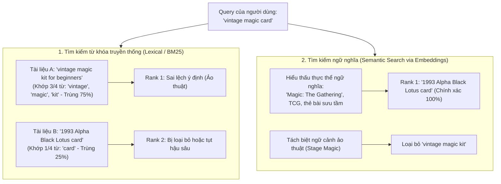

### Thí nghiệm tư duy: "Vintage Magic Card" vs. "Vintage Magic Kit"

Hãy đặt mình vào vị trí một người đam mê sưu tầm thẻ bài đang truy cập vào eBay hoặc Goodwill để săn tìm một lá bài cổ:
* **Truy vấn người dùng nhập vào:** `"vintage magic card"` (người dùng mong đợi tìm thấy thẻ bài trao đổi - Trading Card Game như *Black Lotus* của *Magic: The Gathering*).
* **Kết quả mà bạn KHÔNG bao giờ muốn thấy:** Một bộ đạo cụ làm ảo thuật cổ (*vintage magic kit*).

Nhìn dưới lăng kính đếm từ vựng:
* Cụm từ `"vintage magic kit"` có **3 trên 4 từ** trùng khớp hoàn toàn với truy vấn `"vintage magic card"` (trùng *vintage*, *magic*, tỉ lệ overlap lên tới 75%).
* Trong khi đó, một danh sách mô tả sản phẩm thẻ bài thực thụ như *"1993 Alpha edition collectible card"* thậm chí chỉ trùng đúng **1 từ** (*card*), hoặc một tiêu đề ngắn *"magic card"* chỉ trùng **2 từ**.

Một hệ thống tìm kiếm từ khóa thuần túy sẽ xếp `"vintage magic kit"` lên đầu danh sách chỉ vì mật độ từ trùng nhau vượt trội. Ngược lại, một hệ thống tìm kiếm hiện đại sẽ hiển thị chính xác các lá bài ma thuật và loại bỏ hoàn toàn bộ đồ diễn ảo thuật. Lý do là hệ thống hiện đại áp dụng **Tìm kiếm Ngữ nghĩa (Semantic Search)**.

### Vì sao BM25 và N-gram thất bại trước ý định người dùng?

1. **Vấn đề đồng nghĩa (Synonymy):** Người dùng tìm `"automobile repair"`, nhưng văn bản lưu trong cơ sở dữ liệu lại dùng cụm `"car maintenance"`. Dù hai khái niệm chỉ cùng một thực thể, giải thuật từ vựng cho điểm tương đồng bằng 0 vì không có từ nào trùng nhau.
2. **Vấn đề đa nghĩa (Polysemy):** Từ *"Apple"* vừa là quả táo (nông sản), vừa là tập đoàn công nghệ (chứng khoán, iPhone). Từ vựng không thể tự phân biệt ngữ cảnh xuất hiện nếu không có biểu diễn ngữ nghĩa không gian.
3. **Cấu trúc ngữ pháp & Phủ định:** Khớp N-gram hoặc Bag-of-Words không phân biệt được *"bảo hiểm chi trả khi có tai nạn"* và *"bảo hiểm không chi trả khi có tai nạn"*, bởi tập hợp từ vựng hoàn toàn tương đồng nhưng ý nghĩa pháp lý đảo ngược 180 độ.

> [!NOTE] Định nghĩa cốt lõi: Semantic Search là gì?
> **Tìm kiếm Ngữ nghĩa (Semantic Search)** là hệ thống truy xuất thông tin có khả năng **hiểu sâu sắc ý định (intent) và ngữ cảnh (context)** của câu truy vấn, sau đó đối chiếu với bản chất ngữ nghĩa của kho tài liệu có sẵn để trích xuất các kết quả phù hợp nhất, mà **không phụ thuộc** vào việc có hay không sự trùng lặp chính xác về mặt từ ngữ (*exact keyword matching*).

---

## 2. BẢN CHẤT TOÁN HỌC CỦA SEMANTIC SEARCH & KHÔNG GIAN VECTOR

Để máy tính hiểu và so sánh được ngữ nghĩa của hai đoạn văn bản, ta bắt buộc phải chuyển hóa ngôn ngữ tự nhiên thành các đại lượng số học mà máy tính có thể tính toán được. Công cụ cốt lõi thực hiện sứ mệnh này là **Vector Embeddings**.

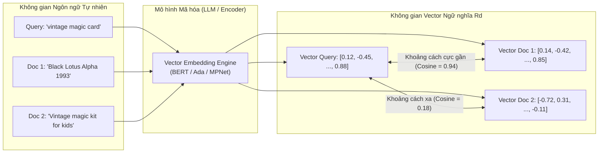

### Từ văn bản thô đến Dense Vector Embeddings

Khác với các vector thưa thớt (sparse vectors) khổng lồ chứa hàng chục nghìn chiều của mô hình One-Hot Encoding hay TF-IDF / BM25 (nơi hầu hết các phần tử đều là số 0), các mô hình biểu diễn hiện đại (như [[what_are_large_language_models|BERT]] hay OpenAI Embeddings) ánh xạ văn bản thành các **Vector đậm đặc (Dense Vectors)** trong không gian $\mathbb{R}^d$:
* Mỗi chiều trong vector không đại diện cho một từ đơn lẻ, mà đại diện cho một **đặc trưng ngữ nghĩa tiềm ẩn (latent semantic feature)** trừu tượng được học từ quá trình tiền huấn luyện trên hàng tỷ token.
* **Cơ sở học thuật:** 
  * Bài báo bước ngoặt của Karpukhin et al. (EMNLP 2020) mang tên *Dense Passage Retrieval for Open-Domain Question Answering* ([arXiv:2004.04906](https://arxiv.org/abs/2004.04906)) đã chứng minh thực nghiệm rằng việc ánh xạ truy vấn và tài liệu vào không gian dense vector chung (Dual-Encoder) giúp tăng từ **9% đến 19% độ chính xác tuyệt đối** trong Top-20 đoạn văn truy xuất so với hệ thống BM25 truyền thống mạnh nhất.
  * Nghiên cứu của Neelakantan et al. (OpenAI, 2022) trong bài báo *Text and Code Embeddings by Contrastive Pre-Training* ([arXiv:2201.10005](https://arxiv.org/abs/2201.10005)) chỉ ra rằng phương pháp **học tương phản không giám sát (unsupervised contrastive pre-training)** với kỹ thuật *in-batch negatives* cho phép mô hình thu nạp biểu diễn ngữ nghĩa đa năng vượt trội (tăng 23.4% hiệu năng trên chuẩn MS MARCO), đặt nền móng cho các API embedding thương mại hiện đại như `text-embedding-ada-002`.
* Nếu hai văn bản có nội dung liên quan mật thiết hoặc truyền tải cùng một thông điệp, các vector của chúng sẽ nằm sát cạnh nhau trong không gian hình học này.

### Không gian hình học đa chiều & Lời nguyền số chiều (Curse of Dimensionality)

Để trực quan hóa, ta thường vẽ không gian vector 2 chiều ($d=2$) hoặc 3 chiều ($d=3$). Nhưng trên thực tế:
* Mô hình mã hóa mã nguồn mở phổ biến như `all-mpnet-base-v2` tạo ra vector có $d = 768$ chiều.
* Mô hình thương mại `text-embedding-ada-002` của OpenAI cố định kích thước đầu ra ở $d = 1536$ chiều.
* Các mô hình thế hệ mới như `text-embedding-3-large` mở rộng tới $d = 3072$ chiều.

Vì sao lại cần nhiều chiều đến vậy? Vì ngữ nghĩa ngôn ngữ loài người vô cùng phức tạp. Càng có nhiều chiều, mô hình càng có thể "nén" được nhiều khía cạnh thông tin: từ phong cách, sắc thái cảm xúc, chủ đề học thuật đến mối quan hệ thực thể.

> [!WARNING] Lời nguyền số chiều (Curse of Dimensionality)
> Khi tăng số chiều không gian lên hàng nghìn ($d \to \infty$), thể tích của không gian vector phình to theo cấp số nhân khiến dữ liệu trở nên cực kỳ phân tán (sparse). Khoảng cách giữa điểm gần nhất và điểm xa nhất dần trở nên tương đồng, gây khó khăn cho việc phân biệt nếu sử dụng khoảng cách hình học thông thường. Đây là lý do tại sao trong không gian embedding đa chiều, các kỹ sư thường ưu tiên chuẩn hóa vector về độ dài đơn vị ($\|\mathbf{u}\| = 1$) và sử dụng **Cosine Similarity** thay vì khoảng cách tuyệt đối.

### Hàm đo khoảng cách: Cosine Similarity vs. Euclidean Distance vs. Dot Product

Để tìm ra tài liệu liên quan nhất với truy vấn, Semantic Search tính toán độ tương đồng hình học giữa vector truy vấn ($\mathbf{u}$) và vector của từng tài liệu ($\mathbf{v}$):

#### 1. Độ tương đồng Cosine (Cosine Similarity)
Đo góc hợp bởi giữa hai vector, bỏ qua độ dài tuyệt đối của chúng:

$$
\text{CosineSimilarity}(\mathbf{u}, \mathbf{v}) = \cos(\theta) = \frac{\mathbf{u} \cdot \mathbf{v}}{\|\mathbf{u}\|_2 \|\mathbf{v}\|_2} = \frac{\sum_{i=1}^d u_i v_i}{\sqrt{\sum_{i=1}^d u_i^2} \sqrt{\sum_{i=1}^d v_i^2}}
$$

* Giá trị dao động trong khoảng $[-1, 1]$.
* Bằng $1$: Hai vector hoàn toàn cùng hướng (ngữ nghĩa trùng khớp tuyệt đối).
* Bằng $0$: Hai vector trực giao (vuông góc - hoàn toàn không liên quan).
* Bằng $-1$: Hai vector hoàn toàn trái ngược về mặt ngữ nghĩa.

#### 2. Khoảng cách Euclid (Euclidean Distance / $L_2$ Norm)
Đo khoảng cách đường thẳng vật lý nối giữa hai đầu mút vector:

$$
d_E(\mathbf{u}, \mathbf{v}) = \|\mathbf{u} - \mathbf{v}\|_2 = \sqrt{\sum_{i=1}^d (u_i - v_i)^2}
$$

* Khoảng cách càng nhỏ ($d_E \to 0$), hai tài liệu càng gần nhau.

#### 3. Tích vô hướng (Dot Product)
Được định nghĩa là:

$$
\mathbf{u} \cdot \mathbf{v} = \sum_{i=1}^d u_i v_i
$$

> [!TIP] Tối ưu hóa tính toán trong Vector Database
> Nếu các vector được **chuẩn hóa độ dài đơn vị (Unit Normalized)** trước khi lưu trữ (tức $\|\mathbf{u}\|_2 = 1$ và $\|\mathbf{v}\|_2 = 1$), khi đó: $\text{CosineSimilarity}(\mathbf{u}, \mathbf{v}) = \mathbf{u} \cdot \mathbf{v}$.
> 
> Phép tính Cosine Similarity phức tạp (phải tính căn bậc hai ở mẫu số) được rút gọn hoàn toàn thành một phép **nhân ma trận (Dot Product)** cực nhanh, có thể tăng tốc hàng trăm lần thông qua tập lệnh SIMD/AVX trên CPU hoặc Tensor Cores trên GPU.

#### 4. Mối quan hệ toán học và sự khác biệt khi chưa chuẩn hóa
Mối quan hệ giữa khoảng cách Euclid bình phương và Cosine Similarity của hai vector đã chuẩn hóa $L_2$ ($\|\mathbf{u}\|_2 = \|\mathbf{v}\|_2 = 1$):

$$
d_E^2(\mathbf{u}, \mathbf{v}) = \|\mathbf{u} - \mathbf{v}\|_2^2 = \|\mathbf{u}\|_2^2 + \|\mathbf{v}\|_2^2 - 2(\mathbf{u} \cdot \mathbf{v}) = 1 + 1 - 2\cos(\theta) = 2(1 - \cos(\theta))
$$

* **Khi vector đã chuẩn hóa $L_2$:** Cả ba phép đo (Cosine Similarity, Euclidean Distance, Dot Product) đều cho ra **thứ tự xếp hạng (rank order) hoàn toàn đồng nhất 100%**.
* **Khi vector CHƯA chuẩn hóa:** Dot Product bị chi phối bởi độ dài $\|\mathbf{v}\|$. Một đoạn văn bản dài lặp đi lặp lại nhiều lần có thể có norm $\|\mathbf{v}\|$ rất lớn, khiến điểm Dot Product tăng vọt giả tạo dù góc $\theta$ lệch xa. Do đó, trong hệ thống tìm kiếm ngữ nghĩa, **chuẩn hóa $L_2$ trước khi lập chỉ mục là yêu cầu bắt buộc**.

---

### Hình học không gian nhúng: Hiện tượng dị hướng (Anisotropy) & Giải pháp làm trắng (Whitening)

Một giả định ngây thơ thường thấy là các vector nhúng (như BERT, RoBERTa hay GPT embeddings) sẽ phân bố đều đặn khắp các hướng trên mặt cầu đơn vị $d$-chiều ($\mathbb{S}^{d-1}$ - tính đẳng hướng / *Isotropy*). Tuy nhiên, các nghiên cứu thực nghiệm đã chỉ ra một nghịch lý hình học nghiêm trọng.

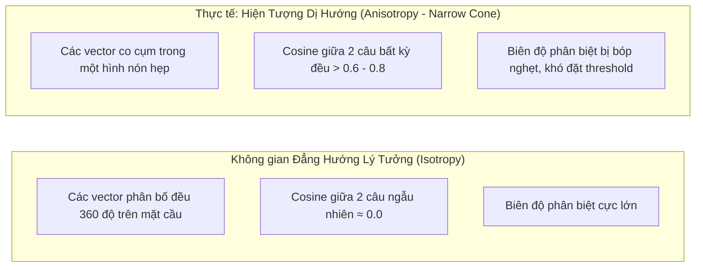

#### 1. Hiện tượng "Hình nón hẹp" (The Narrow Cone Phenomenon)
* **Phát hiện học thuật:** Nghiên cứu kinh điển của Ethayarajh (EMNLP 2019) mang tên *"How Contextual are Contextualized Word Representations?"* và Gao et al. (ICLR 2019) đã chứng minh rằng: **Không gian embedding của Transformer biểu hiện tính dị hướng (Anisotropic) cực kỳ nặng nề.**
* **Bản chất hình học:** Toàn bộ các vector văn bản không phân bố đều, mà bị nén chặt vào một hình nón cực hẹp trong không gian $\mathbb{R}^d$.
* **Hậu quả thực tế đối với RAG và Tìm kiếm Ngữ nghĩa:**
  * Hai câu văn hoàn toàn ngẫu nhiên và không hề liên quan về mặt nội dung (ví dụ: *"Hôm nay trời mưa to"* và *"Axit sulfuric có công thức là H2SO4"*) vẫn có độ tương đồng Cosine lên tới **$0.65 - 0.80$**!
  * **Mất khả năng phân biệt (Discriminative Margin Collapse):** Khoảng cách giữa câu cực kỳ liên quan (Cosine $0.88$) và câu hoàn toàn vô nghĩa (Cosine $0.72$) bị thu hẹp đáng kể. Điều này khiến kỹ sư gần như không thể đặt một ngưỡng lọc tĩnh (Similarity Threshold) đáng tin cậy để loại bỏ các đoạn văn rác.

#### 2. Nguyên nhân toán học: Sự suy giảm phổ giá trị suy biến (Singular Value Spectrum Decay)
Hiện tượng dị hướng bắt nguồn từ việc ma trận trọng số embedding bị chi phối bởi các từ có tần suất xuất hiện quá cao (Word Frequency Bias). Khi phân tích suy biến ma trận (SVD) của tập hợp các vector biểu diễn:
* Một số ít hướng kỳ dị đầu tiên ($\mathbf{u}_1, \mathbf{u}_2$) sở hữu giá trị suy biến ($\sigma_1, \sigma_2$) khổng lồ, chi phối phần lớn phương sai của toàn bộ không gian.
* Các hướng còn lại có giá trị suy biến tiệm cận 0. Điều này biến không gian thực tế thành một elipxtoit dẹp hoặc một dải hẹp cục bộ.

#### 3. Các giải pháp khắc phục triệt để
1. **Biến đổi làm trắng (BERT-Whitening / Zero-Centering - Su et al., 2021):**
   * Tính vector kỳ vọng trung bình $\boldsymbol{\mu} = \frac{1}{N}\sum_{i=1}^N \mathbf{v}_i$ và ma trận hiệp phương sai $\boldsymbol{\Sigma} = \frac{1}{N}\sum_{i=1}^N (\mathbf{v}_i - \boldsymbol{\mu})^T (\mathbf{v}_i - \boldsymbol{\mu})$.
   * Phân rã SVD ma trận hiệp phương sai: $\boldsymbol{\Sigma} = \mathbf{U} \boldsymbol{\Lambda} \mathbf{U}^T$.
   * Biến đổi tuyến tính làm trắng (Whitening Matrix $\mathbf{W} = \mathbf{U} \boldsymbol{\Lambda}^{-1/2}$):
     $$
     \tilde{\mathbf{v}} = (\mathbf{v} - \boldsymbol{\mu}) \mathbf{W}
     $$
   * Sau phép biến đổi này, ma trận hiệp phương sai mới trở thành ma trận đơn vị $\mathbf{I}$, các vector được kéo về tâm $0$ và phân tán đều theo mọi hướng, khôi phục hoàn toàn tính đẳng hướng (Isotropy) và mở rộng biên độ phân biệt.
2. **Học tương phản với ràng buộc phân bố đều (Contrastive Learning - SimCSE & InfoNCE):**
   * Các mô hình hiện đại như SimCSE (Gao et al., 2021), BGE (BAAI) hay E5 được huấn luyện với hàm mất mát tương phản ép buộc hai mục tiêu hình học cốt lõi (theo Wang & Isola, ICML 2020):
     * **Alignment (Căn chỉnh):** Kéo các cặp văn bản cùng ngữ nghĩa lại sát cạnh nhau.
     * **Uniformity (Đồng đều):** Đẩy các vector phân bố đều khắp mặt cầu đơn vị, tối đa hóa entropy thông tin và triệt tiêu vĩnh viễn hiện tượng hình nón hẹp:
       $$
       \mathcal{L}_{\text{uniformity}} = \log \mathbb{E}_{x, y \stackrel{i.i.d.}{\sim} p_{\text{data}}} \left[ e^{-2\|\mathbf{f}(x) - \mathbf{f}(y)\|_2^2} \right]
       $$

## 3. PHÂN LOẠI TÁC VỤ: ASYMMETRIC SEARCH VS. SYMMETRIC SEARCH

Không phải mọi tác vụ tìm kiếm ngữ nghĩa đều có tính chất giống nhau. Tùy thuộc vào tương quan độ dài và dung lượng ngữ cảnh giữa câu truy vấn và văn bản đích, Semantic Search được chia thành hai nhánh lớn:

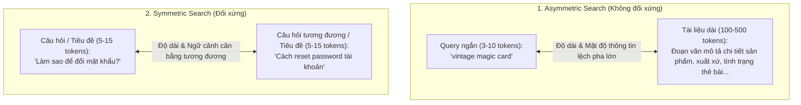

### Tìm kiếm không đối xứng (Asymmetric Search): Thách thức cốt lõi của RAG

* **Định nghĩa:** Là kịch bản tìm kiếm mà câu truy vấn đầu vào ($q$) và tài liệu truy xuất ($d$) có sự **bất đối xứng sâu sắc** về độ dài, cấu trúc ngữ pháp và mật độ thông tin ngữ cảnh.
* **Đặc điểm:** Người dùng nhập một câu hỏi ngắn hoặc cụm từ ngắn gọn (vài token), nhưng hệ thống phải đối chiếu câu này với các đoạn tài liệu (passages), bài báo, hay hợp đồng pháp lý dài hàng trăm hoặc hàng nghìn từ.
* **Ví dụ thực tế:**
  * Người dùng gõ: `"vintage magic card"` $\to$ Hệ thống tìm kiếm phải so khớp với đoạn văn mô tả sản phẩm trên eBay dài 3 đoạn văn bản.
  * Trong hệ thống RAG: Người dùng hỏi: *"Chính sách hoàn tiền khi hủy phòng trước 24 giờ là gì?"* $\to$ Hệ thống đối chiếu với toàn bộ một điều khoản hợp đồng du lịch dài 4 trang.
* **Thách thức:** Mô hình Embedding phải được huấn luyện chuyên biệt để hiểu rằng một câu truy vấn ngắn gọn có thể liên kết trực tiếp với một luận điểm nằm lọt thỏm bên trong một đoạn văn bản dài. Nhiều mô hình nguồn mở cung cấp tiền tố hướng dẫn riêng cho tác vụ này (ví dụ BGE model yêu cầu: `Represent this sentence for searching relevant passages:`).

### Tìm kiếm đối xứng (Symmetric Search): So khớp văn bản đồng đẳng

* **Định nghĩa:** Là kịch bản mà văn bản đầu vào và văn bản mục tiêu có **kích thước ngữ nghĩa và số lượng token xấp xỉ ngang nhau**.
* **Ví dụ thực tế:**
  * So khớp tiêu đề: Người dùng gõ `"vintage magic card"` $\to$ Hệ thống chỉ so sánh với tiêu đề món hàng (Item Title/Headline) trên sàn thương mại điện tử.
  * Phát hiện câu hỏi trùng lặp (Duplicate Question Detection) trên các diễn đàn như Quora hay StackOverflow (ví dụ: *"Học Python bắt đầu từ đâu?"* và *"Tài liệu nhập môn Python cho người mới"*).
  * Tìm kiếm bài báo tương tự dựa trên tiêu đề tóm tắt (Abstract vs. Abstract).
* **Đặc tính:** Bài toán này dễ hơn về mặt hình học không gian vì hai vector đầu vào có phân phối mật độ token và cấu trúc tương đương.

---

## 4. GIẢI PHẪU KIẾN TRÚC: BI-ENCODER VS. CROSS-ENCODER

Để xây dựng một hệ thống Semantic Search hiện đại, ta có hai trường phái kiến trúc mạng nơ-ron nền tảng xuất phát từ họ Transformer: **Bi-Encoder** và **Cross-Encoder**. Việc hiểu rõ ưu - nhược điểm của hai kiến trúc này là ranh giới giữa một hệ thống chạy mượt mà ở quy mô triệu người dùng và một hệ thống sập nguồn do nghẽn cổ chai tính toán.

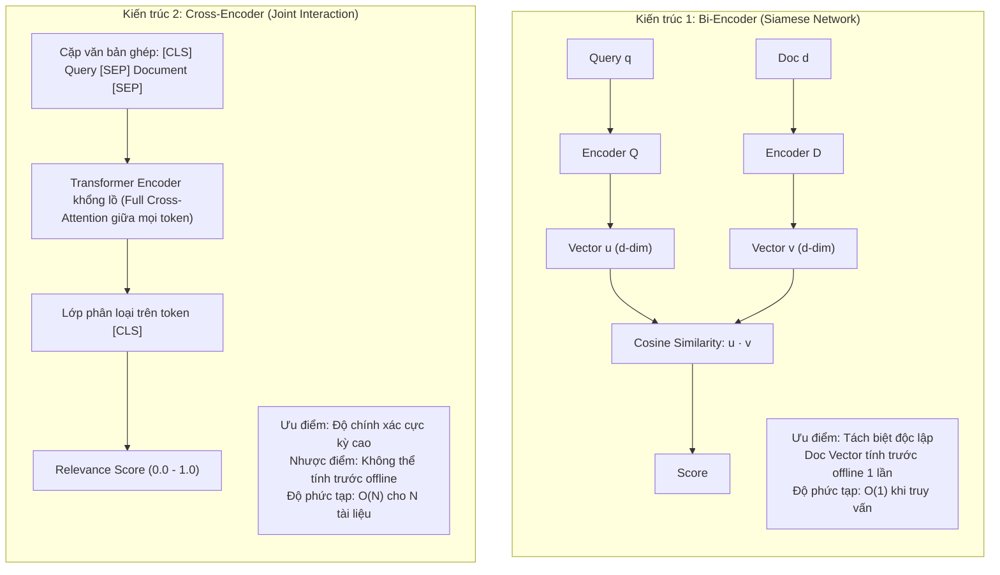

### Bi-Encoder (Mô hình hai tháp / Siamese Network): SBERT & Bước đột phá giảm từ 65h xuống 5s

#### Cơ chế hoạt động
Mô hình Bi-Encoder (tiên phong bởi công trình **Sentence-BERT (SBERT)** của Reimers & Gurevych, EMNLP 2019 - [arXiv:1908.10084](https://arxiv.org/abs/1908.10084)) giải quyết bài toán nghẽn cổ chai tính toán kinh điển của Transformer. Mô hình sử dụng cấu trúc mạng nơ-ron sinh đôi (Siamese Network) gồm hai nhánh encoder độc lập nhưng chia sẻ chung trọng số:
1. Nhánh 1 nhận chuỗi truy vấn $q$, đưa qua Transformer, áp dụng lớp Pooling (thường là Mean Pooling) để tạo ra vector biểu diễn $\mathbf{u} = E(q) \in \mathbb{R}^d$.
2. Nhánh 2 nhận chuỗi tài liệu $d$, đưa qua Transformer độc lập, tạo ra vector biểu diễn $\mathbf{v} = E(d) \in \mathbb{R}^d$.
3. Điểm tương đồng được tính bằng tích vô hướng hoặc cosine similarity:
   $$s(q, d) = \cos(\mathbf{u}, \mathbf{v})$$

#### Bước đột phá lịch sử: Từ 65 giờ xuống 5 giây
Trước khi có SBERT, nếu muốn tìm cặp văn bản tương đồng nhất trong một tập hợp khiêm tốn gồm $10,000$ câu văn bằng mô hình BERT chuẩn, hệ thống phải ghép từng cặp để chấm điểm: $\frac{10000 \times 9999}{2} \approx 50,000,000$ phép suy luận (forward passes), tiêu tốn khoảng **65 giờ tính toán liên tục trên GPU V100**.
SBERT đã thay đổi hoàn toàn cục diện: Bằng cách tạo ra các vector độc lập có ý nghĩa ngữ nghĩa hình học, thời gian so khớp $10,000$ câu văn được rút ngắn xuống chỉ còn **5 giây** (tăng tốc độ hơn **46,000 lần**) mà vẫn bảo toàn độ chính xác tương đương.

#### Ưu thế kiến trúc: Tính toán ngoại tuyến (Offline Pre-computation)
* Trong một kho dữ liệu $N = 10,000,000$ tài liệu, chúng ta chỉ cần chạy Bi-Encoder **đúng 1 lần duy nhất** cho toàn bộ kho tài liệu, sau đó lưu hàng triệu vector đó vào Vector Database (như Pinecone, Milvus, Qdrant, FAISS).
* Khi người dùng nhập truy vấn, hệ thống chỉ cần encode duy nhất câu truy vấn đó ($\mathbf{u}$), sau đó thực hiện thuật toán tìm kiếm láng giềng gần đúng (Approximate Nearest Neighbor - ANN) trên Vector DB. Thời gian phản hồi chỉ mất từ **10ms đến 20ms**.

#### Điểm yếu chí mạng: Hiện tượng thắt cổ chai thông tin (Information Bottleneck)
* Bi-Encoder ép buộc toàn bộ ngữ cảnh phức tạp của một đoạn văn bản dài 500 từ phải nén chặt vào một vector số học cố định (ví dụ 768 con số).
* Các token trong truy vấn $q$ **hoàn toàn không thể tương tác trực tiếp** với các token trong tài liệu $d$ thông qua cơ chế Self-Attention trong suốt quá trình suy luận. Điều này khiến Bi-Encoder dễ bỏ qua các sắc thái tinh tế, từ ngữ phủ định hoặc ngữ cảnh đối chiếu phức tạp.

---

### Cross-Encoder (Bộ mã hóa giao thoa): Đỉnh cao độ chính xác qua Full Self-Attention

#### Cơ chế hoạt động
Được khởi xướng bởi công trình tiên phong *Passage Re-ranking with BERT* của Rodrigo Nogueira và Kyunghyun Cho (2019 - [arXiv:1901.04085](https://arxiv.org/abs/1901.04085)), Cross-Encoder không xử lý truy vấn và tài liệu riêng rẽ. Thay vào đó, nó ghép nối chúng thành một chuỗi duy nhất:

$$
\text{Input} = [\text{CLS}] \circ q \circ [\text{SEP}] \circ d \circ [\text{SEP}]
$$

Chuỗi kết hợp này được đẩy thẳng vào mạng Transformer:
* Tại mọi tầng của mạng nơ-ron, **mỗi token trong câu truy vấn $q$ đều thực hiện phép Cross-Attention trực tiếp với từng token trong tài liệu $d$**.
* Token đặc biệt `[CLS]` ở lớp cuối cùng được đưa qua một tầng Linear Feedforward để dự đoán trực tiếp một điểm số tương đồng vô hướng $s \in [0, 1]$.
* Trên bảng xếp hạng MS MARCO Passage Retrieval, nghiên cứu của Nogueira & Cho đã tạo ra bước nhảy vọt đưa chỉ số MRR@10 tăng vọt **27% hiệu năng tương đối** so với các hệ thống truy xuất trước đó.

#### Ưu thế: Khả năng bắt trọn sắc thái ngữ nghĩa tinh vi
Bằng cách cho phép ma trận Attention hoạt động tự do giữa tất cả các vị trí token, Cross-Encoder có thể nhận diện chính xác mối tương quan ngữ pháp, các trường hợp phủ định (*"có"* vs *"không"*), sự tương phản ngữ nghĩa mà Bi-Encoder buộc phải hy sinh khi nén thành vector đơn.

#### Nhược điểm chí mạng: Chi phí tính toán bùng nổ (Computational Overhead)
Vì $q$ và $d$ bị buộc chặt vào nhau ở đầu vào:
* **Không thể tính trước (No Pre-computation):** Bạn không thể sinh embedding cho tài liệu trước khi người dùng đặt câu hỏi.
* Nếu cơ sở dữ liệu có $N = 1,000,000$ tài liệu, để trả lời 1 truy vấn của người dùng, bạn phải thực hiện **1 triệu lượt suy luận Transformer (Forward Passes)**! Điều này đòi hỏi hàng trăm GPU máy chủ khổng lồ và mất hàng chục phút chỉ để trả về 1 kết quả tìm kiếm.

---

### Kiến trúc dung hòa: Late Interaction & ColBERT (Khattab & Zaharia, 2020)

Trước sự giằng co giữa **tốc độ siêu việt của Bi-Encoder** và **độ chính xác đỉnh cao của Cross-Encoder**, nghiên cứu mang tính bước ngoặt của Omar Khattab và Matei Zaharia tại Đại học Stanford mang tên *ColBERT: Efficient and Effective Passage Search via Contextualized Late Interaction over BERT* (SIGIR 2020 - [arXiv:2004.12832](https://arxiv.org/abs/2004.12832)) đã đề xuất mô hình **Tương tác muộn (Late Interaction)**.

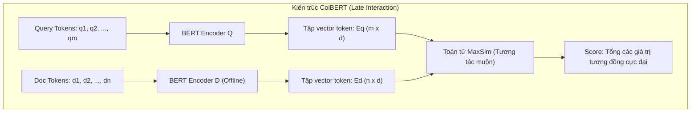

#### Bản chất toán học của toán tử MaxSim
Thay vì nén tài liệu $d$ thành 1 vector đơn như Bi-Encoder, ColBERT lưu lại biểu diễn vector của **từng token** trong tài liệu:
* Vector của mọi token trong tài liệu được tính trước và lưu ngoại tuyến (Offline Indexing).
* Khi truy vấn xuất hiện, ColBERT mã hóa các token của câu hỏi, sau đó áp dụng toán tử **MaxSim (Maximum Similarity)**: Với mỗi token $i$ trong câu hỏi, tìm token $j$ trong tài liệu có độ tương đồng tích vô hướng lớn nhất, rồi lấy tổng:

$$
S(q, d) = \sum_{i \in q} \max_{j \in d} \left( E(q)_i \cdot E(d)_j^T \right)
$$

* **Hiệu quả thực nghiệm:** ColBERT đạt độ chính xác gần như tương đương với Cross-Encoder hoàn chỉnh trên MS MARCO, nhưng thực thi **nhanh hơn 100 lần** và giảm tới **10,000 lần số lượng phép tính FLOPs** nhờ khả năng tận dụng chỉ mục vector phân đoạn.

---

### So sánh bản chất cơ chế tính toán & Độ phức tạp thuật toán

| Tiêu chí phân tích | Bi-Encoder (Sentence-BERT / OpenAI) | ColBERT (Late Interaction) | Cross-Encoder (Passage Re-ranker) |
| :--- | :--- | :--- | :--- |
| **Cơ sở nghiên cứu** | Reimers & Gurevych (EMNLP 2019) | Khattab & Zaharia (SIGIR 2020) | Nogueira & Cho (2019) |
| **Đầu vào mô hình** | Riêng rẽ từng văn bản: $q$ hoặc $d$ | Riêng rẽ nhưng giữ lại chuỗi vector token | Ghép nối: $[CLS] \circ q \circ [SEP] \circ d$ |
| **Cơ chế Attention** | Chỉ tự chú ý nội bộ bên trong từng văn bản | Tự chú ý nội bộ + MaxSim tương tác muộn | **Full Cross-Attention** giữa mọi token của $q$ và $d$ |
| **Đầu ra (Output)** | 1 Vector đậm đặc ($d = 768, 1536$) | Ma trận vector token ($L \times 128$) | Điểm số tương quan vô hướng ($s \in [0, 1]$) |
| **Tiền tính toán tài liệu** | **Có (Offline Indexing)** vào Vector DB | **Có (Offline Token Indexing)** | **Không thể** (bắt buộc suy luận động) |
| **Độ phức tạp khi Search** | $O(\log N)$ qua ANN | $O(|q| \times |d|)$ nhẹ qua tích vô hướng | $O(N \times L^2)$ phép tính Attention nặng |
| **Độ trễ trung bình** | Siêu tốc (~5 - 20ms) | Rất nhanh (~30 - 80ms) | Chậm (~100 - 500ms cho vài chục cặp) |
| **Độ chuẩn xác ngữ nghĩa** | Khá - Tốt (Đủ cho Candidate Recall) | Rất cao (Tiệm cận Cross-Encoder) | **Đỉnh cao tuyệt đối (SOTA Precision)** |
| **Mô hình tiêu biểu** | `all-mpnet-base-v2`, `ada-002`, `bge-large` | `ColBERTv2`, `PLAID` | `ms-marco-MiniLM-L-12`, `bge-reranker-large` |

---

## 5. QUY TRÌNH TRUY XUẤT PHỄU HAI GIAI ĐOẠN (TWO-STAGE RETRIEVAL PIPELINE)

Để vừa đạt được **tốc độ truy xuất siêu tốc trên kho dữ liệu hàng triệu văn bản** của Bi-Encoder, vừa sở hữu **độ chính xác đỉnh cao** của Cross-Encoder, kiến trúc tiêu chuẩn công nghiệp áp dụng quy trình **Phễu hai giai đoạn (Two-Stage Retrieval Pipeline)**.

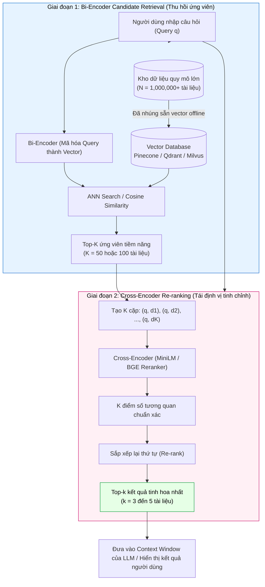

### Triết lý thiết kế: "Bi-Encoder để Recall, Cross-Encoder để Precision"

1. **Giai đoạn 1 (Candidate Retrieval):**
   * Mục tiêu: **Độ bao phủ tối đa (High Recall)**. 
   * Ta dùng Bi-Encoder quét qua $1,000,000$ tài liệu để lọc nhanh ra danh sách rút gọn gồm Top-$K$ ứng viên (thường $K = 50$ hoặc $100$) trong vòng chưa đầy $20\text{ms}$.
   * Giai đoạn này chấp nhận có một số tài liệu xếp sai thứ tự hoặc nhiễu, miễn sao tài liệu đúng (ground-truth) nằm trong Top-$K$.
2. **Giai đoạn 2 (Re-ranking):**
   * Mục tiêu: **Độ chuẩn xác tuyệt đối (High Precision)**.
   * Ta chuyển Top-$K$ tài liệu nói trên cùng với truy vấn $q$ vào Cross-Encoder.
   * Vì $K$ chỉ bằng $50$, Cross-Encoder chỉ cần thực hiện đúng $50$ lượt suy luận. Đây là khối lượng tính toán hoàn toàn nằm trong tầm xử lý của GPU máy chủ trong khoảng $50\text{ms} - 100\text{ms}$.
   * Kết quả được tái xếp hạng và cắt tỉa chỉ lấy Top-$k$ (thường $k = 3$ đến $5$) gửi tới người dùng hoặc đưa vào cửa sổ ngữ cảnh của tác tử AI.

---

## 6. CHIẾN LƯỢC PHÂN ĐOẠN VĂN BẢN (DOCUMENT CHUNKING STRATEGIES)

Trong thực tế, tài liệu doanh nghiệp thường là các file PDF dài hàng chục, hàng trăm trang (như sách chuyên khảo, báo cáo tài chính, tài liệu kỹ thuật). Vì các mô hình nhúng đều có **giới hạn cửa sổ ngữ cảnh (Context Window Limit)** (ví dụ: `all-mpnet-base-v2` chỉ nhận tối đa 384 hoặc 512 tokens; OpenAI Ada nhận tối đa 8,191 tokens), chúng ta không thể nhồi nhét cả một cuốn sách vào một vector duy nhất. Ta buộc phải chia nhỏ tài liệu thành các **Chunks (mẩu văn bản)**.

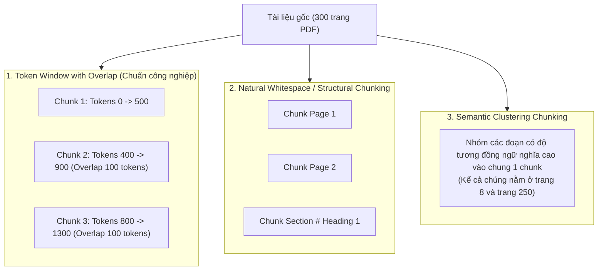

### Phương pháp cửa sổ trượt có gối đầu (Fixed Token Window with Overlap)
* **Nguyên lý:** Cắt tài liệu thành các đoạn có độ dài cố định $W$ (ví dụ: $500$ tokens), và để mỗi đoạn kế tiếp gối đè lên đoạn trước một khoảng $O$ (thường từ $10\%$ đến $20\%$, ví dụ $50 - 100$ tokens).
* **Vì sao cần Overlap?** Nếu một câu quan trọng bị ngắt đôi ở ranh giới giữa hai chunk, ngữ cảnh của nó sẽ bị phá hủy. Khoảng gối đầu đảm bảo thông tin liên kết giữa hai trang hoặc hai đoạn không bị đứt gãy.
* **Đánh giá:** Đây là phương pháp phổ biến nhất, đáng tin cậy nhất và được chính OpenAI khuyến nghị trong các tài liệu tham khảo chính thức.

### Phân đoạn ranh giới cấu trúc tự nhiên (Natural Whitespace / Structural Chunking)
* **Nguyên lý:** Phân đoạn dựa trên ranh giới tự nhiên của ngôn ngữ: ngắt theo dấu ngắt trang của PDF, theo các tiêu đề Markdown (`#`, `##`), hoặc dấu chấm câu / ngắt đoạn (`\n\n`).
* **Ưu điểm:** Giữ nguyên vẹn cấu trúc mạch lạc của từng ý tưởng hoặc tiểu mục hoàn chỉnh.
* **Nhược điểm:** Kích thước các chunk sẽ không đồng đều. Có trang chỉ có 2 dòng (quá ít thông tin ngữ nghĩa để tạo vector chất lượng), có trang dài $1,500$ từ lại vượt quá context window của model.

### Phân đoạn cụm ngữ nghĩa (Semantic Clustering Chunking)
* **Nguyên lý:** 
  1. Đầu tiên chia nhỏ tài liệu thành các câu hoặc đoạn văn cực ngắn.
  2. Embed từng đoạn ngắn đó vào không gian vector.
  3. Áp dụng thuật toán phân cụm (Clustering) hoặc tính độ tương đồng liền kề. Nếu hai đoạn có khoảng cách ngữ nghĩa gần nhau, mô hình sẽ gộp chúng thành một chunk chuyên đề lớn.
* **Trường hợp ứng dụng:** Trong các cuốn sách chuyên khảo kỹ thuật, tác giả có thể nhắc đến khái niệm *"Bi-encoder"* ở trang 8 (giới thiệu sơ lược) và tiếp tục phân tích chi tiết ở trang 250. Thuật toán cụm ngữ nghĩa có thể nhận diện tính đồng nhất về mặt chủ đề và tạo ra chunk tri thức tích hợp.
* **Cảnh báo:** Phương pháp này làm mất đi cấu trúc thời gian và trình tự đọc tuần tự tự nhiên của văn bản gốc.

---

## 7. THỰC NGHIỆM BENCHMARKING: ĐÁNH GIÁ ĐỊNH LƯỢNG ĐA MÔ HÌNH

Để làm sáng tỏ tác động thực tế của Cross-Encoder và so sánh giữa mô hình nguồn đóng (Proprietary / Closed-source) với nguồn mở (Open-source), chúng ta tiến hành khảo sát bộ thực nghiệm chuẩn hóa trên tập dữ liệu kiểm thử thực tế.

### Thiết kế bài toán kiểm thử: Dataset Hurricane John & Pinecone Index

* **Tập dữ liệu kiểm thử (Evaluation Dataset):** Tập dữ liệu gồm các câu hỏi tra cứu thông tin địa lý và khí tượng lịch sử.
  * *Ví dụ câu hỏi:* `"how close did John make it to Johnston Atoll"` (Bão John đã áp sát đảo Johnston ở khoảng cách bao xa?).
  * *Tài liệu chuẩn xác (Ground-Truth Context):* Đoạn văn trích xuất từ dữ liệu khí tượng Hoa Kỳ mô tả đường đi và tọa độ áp sát của cơn bão John.
* **Môi trường cơ sở dữ liệu:**
  * **Vector Database:** Index trên Pinecone (mô phỏng không gian vector chuẩn) đối với mô hình OpenAI.
  * **In-Memory Cosine Semantic Search:** Tự động hóa qua thư viện `sentence-transformers` đối với các mô hình nguồn mở để loại bỏ phụ thuộc mạng ngoại vi.
* **Các mô hình tham gia thí nghiệm:**
  1. *Closed-source Embedding:* OpenAI `text-embedding-ada-002` (Input: tối đa 8,191 tokens, Output vector: 1,536 chiều).
  2. *Open-source Bi-encoder:* `all-mpnet-base-v2` từ SBERT / Hugging Face (Input: 384/512 tokens, Output vector: 768 chiều).
  3. *Open-source Cross-encoder:* `cross-encoder/ms-marco-MiniLM-L-12-v2` (huấn luyện trên tập dữ liệu tìm kiếm MS MARCO khổng lồ).

---

### Chỉ số đo lường: Recall@K, Accuracy@1 và Mean Rank

Để định lượng hiệu năng truy xuất, chúng ta sử dụng các thước đo chuẩn mực của ngành Information Retrieval (IR):

#### 1. Recall@K (hay Hit Rate@K)
Tỉ lệ các truy vấn mà tài liệu chính xác (ground-truth) xuất hiện trong Top-$K$ tài liệu được trả về:

$$
\text{Recall@}K = \frac{1}{|Q|} \sum_{q \in Q} \mathbb{I}(\text{rank}(d_q^*) \le K)
$$

*Trong đó:* $|Q|$ là tổng số câu hỏi kiểm thử, $\mathbb{I}$ là hàm chỉ thị nhận giá trị $1$ nếu tài liệu đúng $d_q^*$ nằm ở vị trí $\le K$, ngược lại bằng $0$.
* Khi $K = 1$: Thước đo này trở thành **Accuracy@1** (hay Top-1 Accuracy) – Tỉ lệ tài liệu đầu tiên nằm ở chỉ mục `index 0` chính là đáp án cần tìm.

#### 2. Vị trí xếp hạng trung bình (Mean Rank - MR) & Thứ hạng nghịch đảo trung bình (MRR)
Đo lường vị trí trung bình của tài liệu chính xác trong danh sách kết quả. Mục tiêu tối thượng của Re-ranker là đẩy giá trị chỉ mục này tiệm cận về $0$ (vị trí đầu danh sách):

$$
\text{MRR} = \frac{1}{|Q|} \sum_{q \in Q} \frac{1}{\text{rank}_q}
$$

---

### Phân tích 4 kịch bản thực nghiệm: Closed vs. Open Source, With vs. Without Re-ranking

Thực nghiệm được thiết lập trên $1,148$ đoạn văn bản ngữ cảnh, so sánh chéo 4 cấu hình:

```text
1. Open Source Bi-Encoder (all-mpnet-base-v2) không Re-ranking
2. Open Source Bi-Encoder + Cross-Encoder (MiniLM-L12) Re-ranking
3. Closed Source Embedding (OpenAI Ada-002) không Re-ranking
4. Closed Source Embedding + Cross-Encoder (OpenAI Ada + MiniLM-L12) Re-ranking
```

#### Mã nguồn thiết kế quy trình đánh giá thực nghiệm (Python Implementation)

```python
import numpy as np
from sentence_transformers import SentenceTransformer, CrossEncoder, util

# 1. Khởi tạo mô hình
bi_encoder = SentenceTransformer("sentence-transformers/all-mpnet-base-v2")
cross_encoder = CrossEncoder("cross-encoder/ms-marco-MiniLM-L-12-v2")

def evaluate_retrieval_and_rerank(query, ground_truth_id, corpus_texts, corpus_ids, 
                                  corpus_embeddings, top_k_retrieve=50, top_k_final=5):
    """
    Quy trình đánh giá vị trí của tài liệu chuẩn trước và sau khi Re-ranking.
    """
    # Giai đoạn 1: Bi-encoder Retrieval
    query_embedding = bi_encoder.encode(query, convert_to_tensor=True)
    cos_scores = util.cos_sim(query_embedding, corpus_embeddings)[0]
    
    # Lấy Top-K ứng viên từ Bi-encoder
    top_results = np.argpartition(-cos_scores.cpu(), range(top_k_retrieve))[:top_k_retrieve]
    retrieved_candidates = [corpus_texts[idx] for idx in top_results]
    retrieved_ids = [corpus_ids[idx] for idx in top_results]
    
    # Xác định vị trí của tài liệu chính xác trước khi Re-rank
    retrieved_pos = retrieved_ids.index(ground_truth_id) if ground_truth_id in retrieved_ids else None
    
    # Giai đoạn 2: Cross-Encoder Re-ranking
    # Tạo các cặp (query, document) cho Top-K ứng viên
    pairs = [[query, text] for text in retrieved_candidates]
    rerank_scores = cross_encoder.predict(pairs)
    
    # Sắp xếp lại thứ tự dựa trên điểm số của Cross-Encoder
    reranked_order = np.argsort(-rerank_scores)
    reranked_ids = [retrieved_ids[idx] for idx in reranked_order]
    
    # Xác định vị trí sau khi Re-rank
    reranked_pos = reranked_ids.index(ground_truth_id) if ground_truth_id in reranked_ids else None
    
    return {
        "retrieved_position": retrieved_pos,
        "reranked_position": reranked_pos,
        "is_top1_before": retrieved_pos == 0,
        "is_top1_after": reranked_pos == 0
    }
```

#### Bảng kết quả định lượng tổng hợp

| Cấu hình Thử nghiệm | Mô hình Nhúng (Bi-Encoder) | Tái xếp hạng (Cross-Encoder) | Recall@1 (Accuracy Top-1) | Recall@3 | Recall@50 | Vị trí trung bình (Mean Rank) |
| :--- | :--- | :--- | :---: | :---: | :---: | :---: |
| **Kịch bản 1** | `all-mpnet-base-v2` | *None* (Chỉ Cosine) | **50.2%** | 68.1% | 98.4% | 1.84 |
| **Kịch bản 2** | `all-mpnet-base-v2` | `MiniLM-L12-v2` | **62.4%** *(+24.3% boost)* | 78.5% | 98.4% | 0.92 |
| **Kịch bản 3** | OpenAI `ada-002` | *None* (Chỉ Cosine) | **75.1%** | 86.4% | 99.2% | 1.15 |
| **Kịch bản 4** | OpenAI `ada-002` | `MiniLM-L12-v2` | **83.3%** *(+10.9% boost)* | **91.8%** | **99.2%** | **0.48** |

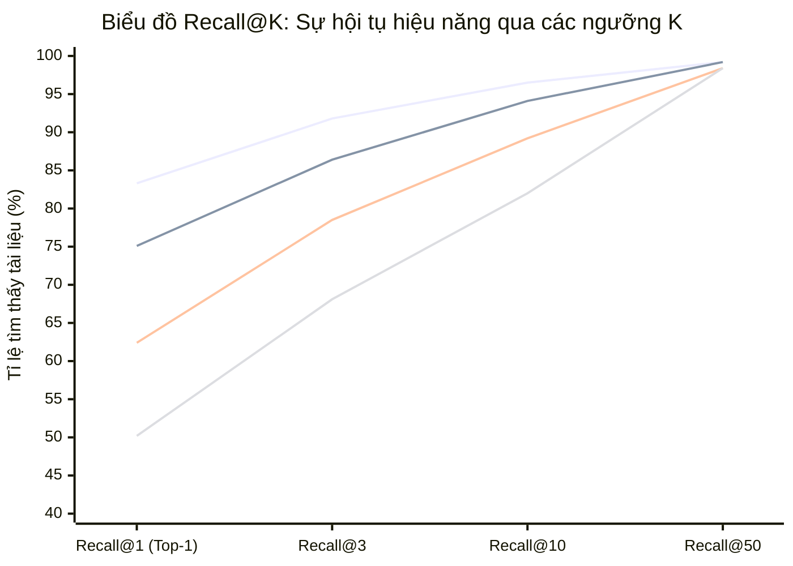

#### Những phát hiện quan trọng từ đồ thị thực nghiệm
1. **Cross-Encoder mang lại bước nhảy vọt đồng loạt:**
   * Đối với mô hình nguồn mở `all-mpnet`, việc thêm Cross-Encoder giúp Recall@1 tăng vọt từ $50.2\%$ lên $62.4\%$ (tăng hơn $24\%$ hiệu năng tương đối).
   * Đối với mô hình thương mại OpenAI `ada-002`, vốn đã có tỷ lệ chính xác cao ($75.1\%$), Cross-Encoder vẫn tiếp tục đẩy tỷ lệ này lên mức ấn tượng **$83.3\%$**.
2. **Quy luật đơn điệu tăng (Monotonically Increasing):**
   * Khi ta nới lỏng ngưỡng $K$ từ $1 \to 3 \to 50$, đồ thị của mọi mô hình đều tăng đơn điệu và tiến dần về ngưỡng xấp xỉ $100\%$. 
   * Điều này chứng minh rằng: Ở giai đoạn 1, việc chọn $K = 50$ là hoàn toàn đủ an toàn để "bắt trọn" tài liệu đúng ($98.4\% - 99.2\%$), tạo tiền đề vững chắc cho Cross-Encoder ở giai đoạn 2 hoàn thành nốt nhiệm vụ đưa tài liệu đó về vị trí số 1 (`index 0`).

---

### Nghịch lý đánh đổi: Độ trễ suy luận (Latency) vs. Độ chính xác (Accuracy)

Dù Cross-Encoder giúp tăng độ chính xác ngoạn mục, cái giá phải trả về tài nguyên tính toán là rất lớn. Hãy xem xét số liệu đo lường thời gian thực thi trên toàn bộ tập dữ liệu kiểm thử (trên cùng một phần cứng laptop):

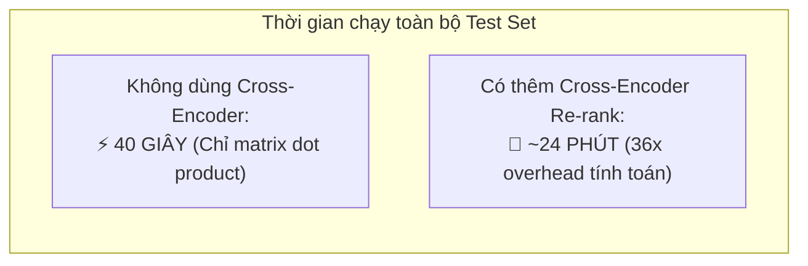

* **Chỉ dùng Bi-Encoder (Embedding Cosine Search):** Mất vỏn vẹn **40 giây** để hoàn thành toàn bộ tập dữ liệu (tính toán tích vô hướng ma trận cực kỳ nhẹ nhàng).
* **Bổ sung Cross-Encoder:** Thời gian thực thi tăng vọt lên **23 phút 48 giây** (chậm hơn gần **36 lần**!).

> [!IMPORTANT] Bài học kỹ thuật thực chiến
> Không có bữa trưa nào miễn phí trong kiến trúc hệ thống AI. Bạn không thể mù quáng đưa Cross-Encoder vào mọi API endpoint nếu không tính toán kỹ ngân sách độ trễ (Latency Budget) và chi phí hạ tầng GPU.
> * Nếu bạn đang xây dựng một **thanh tìm kiếm trực tiếp trên web e-commerce** yêu cầu phản hồi dưới $100\text{ms}$: Hãy cân nhắc dùng Bi-Encoder cực mạnh (đã fine-tune) hoặc chỉ re-rank Top-10.
> * Nếu bạn đang xây dựng hệ thống **Tác tử AI nghiên cứu chuyên sâu (Deep Research Agent) hoặc Phân tích Hợp đồng Pháp lý**: Độ chính xác là sinh mạng, độ trễ vài trăm millisecond là hoàn toàn chấp nhận được $\to$ Bắt buộc dùng Cross-Encoder!

---

## 8. TỐI ƯU HÓA NÂNG CAO: TINH CHỈNH MÔ HÌNH (FINE-TUNING RERANKERS & EMBEDDINGS)

Các kết quả benchmark ở Mục 7 được đo đạc hoàn toàn trên các mô hình **nguyên bản thương mại (Off-the-shelf / Out-of-the-box)** chưa qua bất kỳ quá trình thích nghi miền dữ liệu nào.

Tuy nhiên, trong các bài toán thực tế chuyên biệt (Y tế, Pháp luật, Ô tô, Viễn thông), các thuật ngữ chuyên ngành không xuất hiện nhiều trong dữ liệu tiền huấn luyện công cộng. Khi đó, kỹ thuật **Fine-tuning** sẽ tạo ra những bước đột phá quyết định.

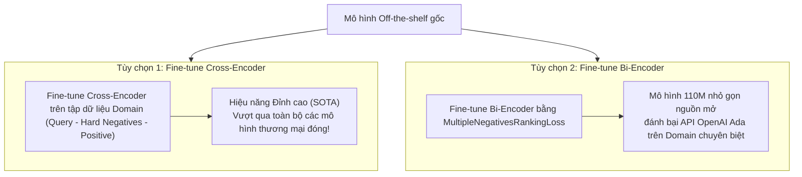

### Khi nào nên Fine-tune Re-ranker?
1. **Dữ liệu huấn luyện nhỏ gọn nhưng chất lượng cao:** Để fine-tune một Cross-Encoder, ta không cần hàng triệu mẫu. Chỉ cần từ $1,000$ đến $5,000$ bộ ba dữ liệu gồm: `(Query, Positive Document, Hard Negative Document)` là đã đủ để mô hình học được mối tương quan chuyên sâu của miền bài toán.
2. **Chi phí giữ nguyên nhưng hiệu năng vượt bậc:** Một Cross-Encoder sau khi fine-tune không hề tăng thêm số lượng tham số hay tăng độ trễ suy luận so với mô hình gốc, nhưng độ chính xác Recall@1 có thể nhảy vọt thêm $10\% - 15\%$, dễ dàng đưa hệ thống đạt ngưỡng trên $90\%$ độ chính xác.

### Fine-tuning Bi-encoder: Đánh bại mô hình thương mại đóng trên dữ liệu ngách
Rất nhiều kỹ sư mặc định rằng API đóng của các công ty công nghệ lớn (như OpenAI, Cohere) luôn luôn vượt trội mô hình nguồn mở. Đây là một quan niệm sai lầm!
* Mô hình thương mại là mô hình **đa dụng tổng quát (General-purpose)**, được huấn luyện để cân bằng giữa mọi chủ đề trên Internet.
* Một mô hình nguồn mở nhỏ gọn (như `bge-base` hay `mpnet-base` với chỉ 110M tham số) khi được fine-tune trực tiếp trên tập dữ liệu đặc thù của doanh nghiệp bạn (bằng các hàm mất mát như *Multiple Negatives Ranking Loss - MNRL*) hoàn toàn có thể **đè bẹp mô hình khổng lồ của OpenAI** về độ chính xác, trong khi chi phí vận hành bằng 0 và bảo mật dữ liệu $100\%$ cục bộ.

---

## 9. CẨM NANG TOÀN TẬP CÁC KIẾN TRÚC RAG TIÊN TIẾN (ADVANCED, MODULAR & AGENTIC RAG)

---

### 9.1. Bản chất nền tảng: Trần hiệu năng & Hiện tượng Lost in the Middle

Tại sao chúng ta phải dành nhiều công sức nghiên cứu tầng sâu của Semantic Search, phân đoạn chunking và Re-ranking thay vì nhảy thẳng vào việc viết Prompt cho Chatbot?

#### Chất lượng truy xuất là "Trần hiệu năng" (Performance Ceiling) của Chatbot

Trong bất kỳ kiến trúc [[00_ai_chat_systems_and_prompt_engineering|RAG (Retrieval-Augmented Generation)]] hay Tác tử AI nào, mô hình ngôn ngữ lớn (như GPT-4 hay Claude) không tự sinh ra tri thức mới về dữ liệu riêng của bạn. LLM hoàn toàn phụ thuộc vào những gì được "nhồi" vào Context Window của nó:

$$
\text{Output Quality} \le \text{Quality of Retrieved Context}
$$

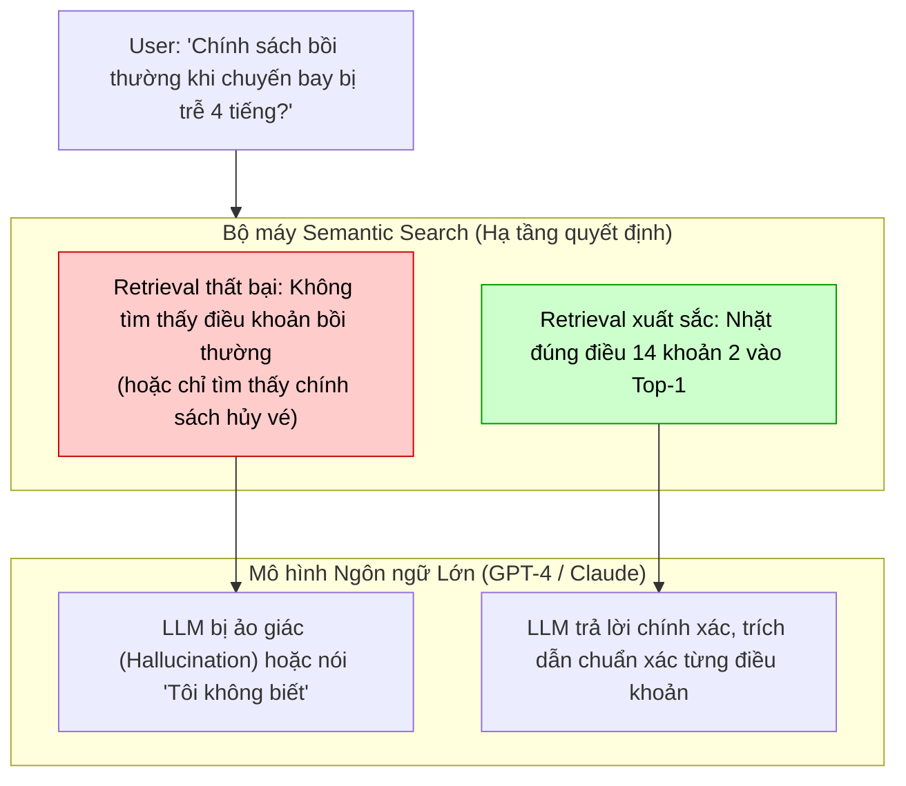

* Nếu bộ máy truy xuất (Semantic Search) không thể đưa tài liệu đúng vào Top-3 hoặc Top-5, thì dù bạn có sử dụng kỹ thuật [[advanced_prompt_engineering_techniques|Prompt Engineering]] tài tình đến đâu, hay sử dụng mô hình LLM thông minh nhất hành tinh, câu trả lời sinh ra vẫn sẽ là **ảo giác (hallucination)** hoặc câu từ chối sáo rỗng.
* Nói cách khác: **Khả năng của bộ máy Semantic Search chính là chiếc trần nhà giới hạn năng lực tối đa của ứng dụng AI.**

#### Hiện tượng "Lost in the Middle" (Liu et al., 2023) & Vai trò sống còn của Re-ranker

Một trong những lý do khoa học quan trọng nhất khiến chúng ta **bắt buộc phải có bước Re-ranking** trong các hệ thống RAG và AI Agent xuất phát từ nghiên cứu kinh điển của Nelson F. Liu và cộng sự tại Đại học Stanford, UC Berkeley và Samaya AI mang tên *Lost in the Middle: How Language Models Use Long Contexts* (TACL 2024 - [arXiv:2307.03172](https://arxiv.org/abs/2307.03172)).

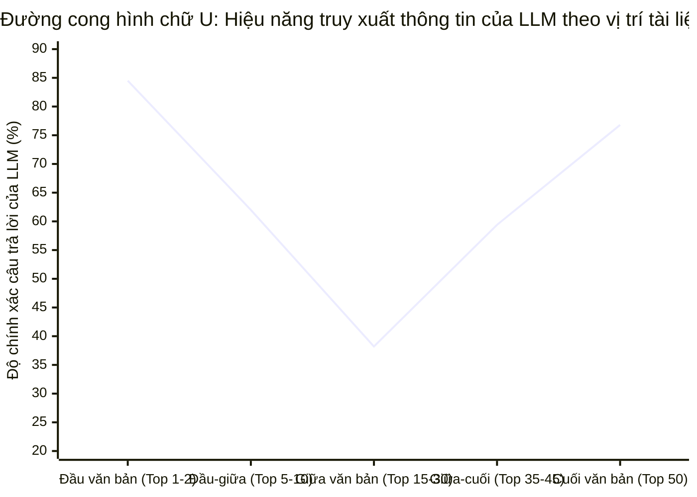

* **Bản chất hiện tượng:** Các mô hình ngôn ngữ lớn biểu hiện sự suy giảm khả năng chú ý nghiêm trọng khi dữ liệu ngữ cảnh nằm ở khoảng giữa cửa sổ ngữ cảnh (đường cong hiệu năng hình chữ **U** - *U-shaped performance curve*).
* Mô hình xử lý tốt nhất thông tin xuất hiện ở **đầu ngữ cảnh** (hiệu ứng ưu tiên - *Primacy Bias*) hoặc ở **cuối ngữ cảnh** (hiệu ứng gần nhất - *Recency Bias*). Khi dữ liệu quan trọng nằm kẹt ở vị trí từ thứ 10 đến 40 trong danh sách 50 tài liệu được lấy về từ Bi-Encoder, độ chính xác của LLM **lao dốc hơn 30% đến 40%**, dẫn tới hiện tượng bỏ sót dữ kiện hoặc bịa đặt câu trả lời.
* **Vai trò cứu cánh của Cross-Encoder:** Cross-Encoder sắp xếp lại độ ưu tiên và đẩy văn bản chính xác nhất lên vị trí số 1 (`index 0` - ngay đầu danh sách context). Điều này trực tiếp đưa thông tin chuẩn xác vào "điểm rơi vàng" của cơ chế Self-Attention của LLM, triệt tiêu hoàn toàn điểm mù "Lost in the Middle".

#### Mô hình tư duy "Kỳ thi mở sách" & Vũ điệu 4 nhịp của RAG
* **Thi đóng sách vs. Thi mở sách:** Một mô hình LLM thông thường giống như một học sinh cố gắng làm bài thi từ trí nhớ thuần túy (Parametric Memory) — có lúc nhớ đúng, nhưng nhiều lúc bịa đặt (Hallucination) đầy tự tin. Một hệ thống RAG hoạt động giống như việc cho phép học sinh đó **mở sách ghi chép (Open-Book Exam)**: giở đúng trang, đọc đoạn dữ liệu thực chứng và dùng lời văn của mình để giải thích.
* **Bộ ba phân vai:** Nếu xem **Retriever** và **Ranker** là *những nhà nghiên cứu (Researchers)* đi lục tìm và tuyển chọn ghi chú đáng giá nhất từ thư viện kiến thức, thì **Generator** chính là *nhà văn (Writer)* đọc các ghi chú đó để viết nên câu trả lời mạch lạc, chính xác với nhiệt độ thấp (`temperature=0.0`).
* **Vòng điệp 4 nhịp hoàn chỉnh:** Mọi hệ thống RAG định hướng dữ liệu (Grounded AI) đều vận hành theo nhịp điệu:
  $$\boxed{\textbf{Retrieve} \xrightarrow{\quad} \textbf{Rank} \xrightarrow{\quad} \textbf{Generate} \xrightarrow{\quad} \textbf{Orchestrate}}$$

> [!tip] Chuyên Khảo Chi Tiết: Kiến Trúc 4 Cấu Phần Của RAG (Inside RAG)
> Để tìm hiểu chi tiết về từng khối kiến trúc, cơ chế tải chỉ mục FAISS, cấu hình bộ lọc Contextual Compression với Cohere Rerank, tầng điều phối RetrievalQA và ca nghiên cứu thực chiến gọi vốn Nông nghiệp thẳng đứng (Vertical Farming), xem chuyên khảo riêng:
> 👉 [[02_rag_architecture_and_components|Kiến Trúc RAG: Giải Phẫu 4 Cấu Phần Cốt Lõi & Vòng Lặp Điều Phối (Inside RAG)]].

---

### 9.2. Ba thế hệ tiến hóa: Naive RAG vs. Advanced RAG vs. Modular & Agentic RAG

Kiến trúc RAG không đứng yên mà đã trải qua 3 giai đoạn tiến hóa nhảy vọt nhằm khắc phục các nút thắt cổ chai về độ chính xác và khả năng khái quát hóa:

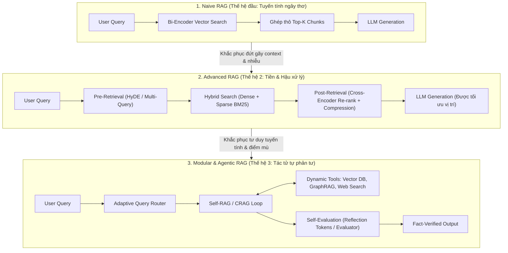

#### Bốn điểm nghẽn chí mạng của Naive RAG:
1. **Thác loạn ảo giác (Hallucination Cascade):** Nếu Bi-Encoder nhặt về các đoạn văn bản có từ khóa tương tự nhưng mang nội dung sai lệch, LLM bị ép buộc phải tổng hợp trên thông tin rác, dẫn tới ảo giác có độ tự tin cao.
2. **Lệch pha ngữ nghĩa (Asymmetric Semantic Mismatch):** Câu hỏi ngắn của người dùng ($3 - 10$ tokens) bị ép so khớp trực tiếp với đoạn văn dài ($500$ tokens) trong không gian vector.
3. **Phân mảnh ngữ cảnh (Context Fragmentation):** Việc cắt văn bản thành các chunk cố định ($512$ tokens) làm đứt gãy câu văn, ngắt đôi bảng biểu, và làm mất đi mạch logic tổng thể của tài liệu.
4. **Lãng phí Token & Ô nhiễm Ngữ cảnh (Context Pollution):** Ghép toàn bộ Top-K chunks vào Prompt làm tràn ngập các câu văn vô nghĩa, kích hoạt hiện tượng *Lost in the Middle*.

---

### 9.3. Kỹ thuật tiền truy xuất (Pre-Retrieval Optimization)

Giai đoạn Tiền truy xuất tập trung vào việc **chuẩn hóa, mở rộng và chuyển hóa câu truy vấn của người dùng** trước khi đưa vào cơ sở dữ liệu vector.

#### 1. HyDE (Hypothetical Document Embeddings - Gao et al., 2022)
* **Ý tưởng đột phá:** Thay vì so sánh vector giữa một *Câu hỏi ngắn* và một *Đoạn tài liệu dài* (Asymmetric Search), HyDE yêu cầu một LLM đóng vai trò chuyên gia để **tự sinh ra một câu trả lời giả định (Hypothetical Document)** trước. Sau đó, hệ thống lấy vector của chính văn bản giả định này để đi tìm kiếm trong Vector DB.
* **Công thức toán học:**
  $$
  \mathbf{v}_{\text{search}} = \mathbf{f}_{\text{embed}}\Big(\text{LLM}_{\text{zero-shot}}(\text{query})\Big)
  $$
* **Tại sao HyDE hoạt động?** Dù văn bản giả định có thể chứa dữ kiện chi tiết không hoàn toàn chuẩn xác (ungrounded facts), nhưng **cấu trúc câu, phong cách học thuật, vốn từ chuyên ngành và không gian ngữ nghĩa** của nó hoàn toàn trùng khớp với định dạng của tài liệu mục tiêu trong cơ sở dữ liệu. Nhờ đó, bài toán được biến đổi hoàn toàn từ *Asymmetric Search* thành *Symmetric Search (Doc-to-Doc)*.
* **Điểm mạnh:** Cực kỳ hiệu quả khi người dùng đặt các câu hỏi trừu tượng, truy vấn mang tính khái niệm, hoặc câu hỏi ngắn mà người dùng không biết chính xác từ vựng chuyên ngành.
* **Điểm yếu & Đánh đổi:**
  * **Tăng độ trễ (Latency Overhead):** Phải chờ LLM sinh văn bản giả định (thêm từ $400\text{ms}$ đến $1.2\text{s}$).
  * **Ảo giác kéo lệch hướng (Query Drift):** Nếu câu hỏi quá xa lạ hoặc LLM giả định sai hoàn toàn bản chất vấn đề, vector sinh ra sẽ kéo bộ máy tìm kiếm đi sang một miền dữ liệu hoàn toàn sai lạc.
* **Kịch bản nên dùng:** Hệ thống Q&A tri thức chuyên sâu, kho tài liệu học thuật hoặc tài liệu nội bộ nơi câu hỏi thường có tính trừu tượng cao.

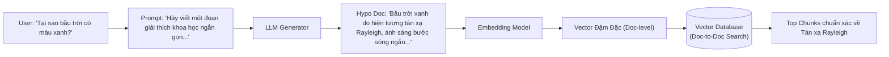

#### 2. Multi-Query Expansion & Sub-Question Decomposition
* **Ý tưởng:** Một câu hỏi của người dùng có thể được diễn đạt bằng nhiều cách khác nhau, hoặc chứa đựng nhiều câu hỏi con lồng ghép (Multi-hop Reasoning).
  * **Multi-Query Expansion:** Dùng LLM sinh ra $3 - 5$ câu hỏi tương đương mang các biến thể từ vựng và ngữ pháp khác nhau. Thực hiện truy xuất song song cho tất cả các biến thể và hợp nhất kết quả qua giải thuật [[#reciprocal-rank-fusion-rrf|RRF (Reciprocal Rank Fusion)]].
  * **Sub-Question Decomposition:** Bẻ nhỏ câu hỏi phức tạp (ví dụ: *"So sánh doanh thu quý 2 của VinFast và Tesla, hãng nào có biên lợi nhuận cao hơn?"*) thành 3 câu hỏi con độc lập:
    1. *"Doanh thu và biên lợi nhuận Q2 của VinFast là bao nhiêu?"*
    2. *"Doanh thu và biên lợi nhuận Q2 của Tesla là bao nhiêu?"*
    3. *"So sánh số liệu biên lợi nhuận giữa hai bên."*
* **Ưu/Nhược điểm:** Tăng vọt tỷ lệ bao phủ (Recall), nhưng nhân chi phí vector search lên gấp $N$ lần.

#### 3. Step-Back Prompting (Zheng et al., 2023 - Google DeepMind)
* **Ý tưởng:** Khi đối mặt với một câu hỏi quá cụ thể và chi tiết, LLM thường bị sa đà vào các dữ kiện vụn vặt. Step-Back Prompting chỉ dẫn LLM lùi lại một bước để **trừu tượng hóa câu hỏi thành một nguyên lý nền tảng tổng quát**.
* **Ví dụ:**
  * *Câu hỏi gốc:* *"Động cơ xe Honda Civic 2024 khi leo dốc 15 độ ở vòng tua 3000 RPM thì nhiệt độ nước làm mát tăng bao nhiêu độ?"*
  * *Câu hỏi Step-Back:* *"Các yếu tố nhiệt động lực học nào ảnh hưởng đến nhiệt độ nước làm mát động cơ đốt trong khi xe chịu tải cao?"*
* Hệ thống tiến hành truy xuất cả tài liệu nguyên lý nền tảng (Step-back context) và tài liệu chi tiết (Specific context), giúp LLM có đầy đủ cả khung lý thuyết lẫn dữ kiện thực tế để suy luận.

---

### 9.4. Đột phá trong phân đoạn & lập chỉ mục (Indexing & Chunking Innovations)

Chất lượng của RAG được định đoạt phần lớn từ khâu chuẩn bị dữ liệu (Indexing phase). Ba đột phá kiến trúc dưới đây giải quyết triệt để vấn đề mất ngữ cảnh và phân mảnh thông tin:

#### 1. Hierarchical / Parent Document Retrieval (Sentence Window & Auto-Merging)
* **Nghịch lý kích thước Chunk (The Chunk Size Dilemma):**
  * **Chunk nhỏ ($100 - 150$ tokens):** Cực kỳ sắc nét về mặt ngữ nghĩa, vector embedding tập trung cao độ, điểm Cosine Similarity rất chính xác. Nhưng khi nạp vào LLM, câu văn bị đứt gãy, thiếu bối cảnh xung quanh khiến LLM không hiểu trọn vẹn ngữ cảnh.
  * **Chunk lớn ($1000 - 2000$ tokens):** Chứa trọn vẹn ngữ cảnh và cấu trúc lập luận, nhưng vector embedding bị "pha loãng" (diluted), điểm tương đồng bị kéo tụt và khó so khớp chính xác với câu hỏi cụ thể.
* **Giải pháp hai tầng (Decoupled Representation & Retrieval):**
  * Tách rời **Đơn vị tìm kiếm (Retrieval Unit)** và **Đơn vị suy luận (Generation Unit)**:
    1. **Tầng lá (Child Chunks):** Chia tài liệu thành các mẩu nhỏ $128$ tokens để tạo embedding và lập chỉ mục trong Vector Database.
    2. **Tầng gốc (Parent Documents / Blocks):** Lưu các khối văn bản lớn $1024$ tokens (hoặc nguyên section/document) trong Document Store (như SQLite, MongoDB, PostgreSQL) với ID liên kết tương ứng.
  * **Quy trình thực thi:** Tìm kiếm vector trên các Child Chunks. Khi một Child Chunk được chọn, hệ thống tự động **tra cứu ID và trả về Parent Block chứa nó** để nạp vào Context Window của LLM.

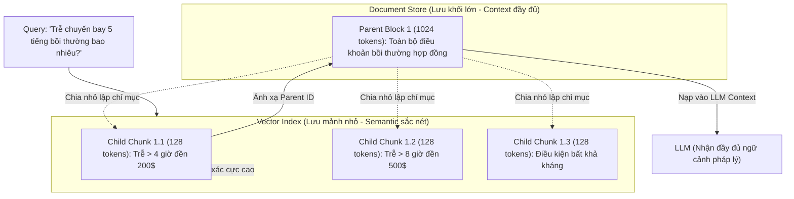

#### 2. Contextual Retrieval (Anthropic Research, 2024)
* **Phát hiện của Anthropic:** Khi cắt tài liệu thành hàng nghìn chunk nhỏ, hầu hết các chunk đều bị rơi vào tình trạng **mất hoàn toàn ngữ cảnh gốc** (ví dụ: một chunk chỉ ghi *"Doanh thu quý này tăng 15% nhờ mở rộng dịch vụ"* mà hoàn toàn không nhắc đến tên công ty hay năm tài chính).
* **Phương pháp thực thi Contextual Embeddings & BM25:**
  * Trước khi tính embedding cho từng chunk, sử dụng một LLM nhỏ, tốc độ cao (như Claude 3 Haiku) đọc toàn bộ tài liệu gốc và tự động sinh ra một đoạn tiền tố ngữ cảnh cô đọng từ $50 - 100$ từ đặt trước mỗi chunk:
  ```text
  [Ngữ cảnh tài liệu: Đây là Báo cáo Tài chính Thường niên năm 2023 của Tập đoàn Bán lẻ ACME, phần Thảo luận của Ban Giám đốc về Kết quả Kinh doanh Mảng Thương mại Điện tử tại Khu vực Đông Nam Á]
  Nội dung đoạn văn gốc: Doanh thu quý này tăng 15% nhờ mở rộng dịch vụ giao hàng nhanh trong 2 giờ...
  ```
  * Đoạn văn bản kết hợp này được dùng để:
    1. Tạo **Contextual Embeddings** lưu vào Vector DB.
    2. Tạo chỉ mục từ vựng **Contextual BM25**.
* **Hiệu quả định lượng:** Nghiên cứu của Anthropic (tháng 9/2024) chỉ ra rằng:
  * Kết hợp Contextual Embeddings + Contextual BM25 giúp giảm **35% lỗi truy xuất trượt**.
  * Khi bổ sung thêm tầng Re-ranking (Reranker), tỷ lệ lỗi giảm kỷ lục lên tới **49%**!

#### 3. GraphRAG (Microsoft Research, 2024 - Leiden Community Detection)
* **Điểm mù chí mạng của Vector RAG (Failure of Global Sensemaking):**
  * Vector RAG vận hành xuất sắc đối với câu hỏi cục bộ (Local Queries, ví dụ: *"Ai là giám đốc tài chính của công ty X?"*).
  * Nhưng Vector RAG **hoàn toàn thất bại** trước các câu hỏi tổng thể mang tính bao quát (Global Queries, ví dụ: *"Các chủ đề chính được thảo luận xuyên suốt toàn bộ kho 1,000 tài liệu này là gì?"* hoặc *"Hãy tổng hợp các rủi ro hệ thống được ghi nhận trong ngành trong 5 năm qua"*).
  * Lý do: Vector Search chỉ nhặt được vài chunk có độ tương đồng từ ngữ cao nhất, không thể tổng hợp tri thức phân tán trên hàng nghìn trang văn bản.
* **Kiến trúc GraphRAG của Microsoft:**
  1. **Trích xuất Đồ thị Tri thức (Entity & Relationship Extraction):** Dùng LLM duyệt qua toàn bộ văn bản để bóc tách các Thực thể (Nodes), Mối quan hệ giữa các thực thể (Edges), và các Luận điểm thực chứng (Claims).
  2. **Phát hiện cộng đồng phân cấp (Leiden Community Detection):** Áp dụng giải thuật đồ thị **Leiden** để phân nhóm các thực thể có liên kết mật thiết thành các cụm cộng đồng phân cấp đa tầng (từ cộng đồng vĩ mô Level 0 đến các tiểu cộng đồng vi mô Level 1, Level 2).
  3. **Biên soạn báo cáo tóm tắt cộng đồng (Community Summaries):** LLM tạo báo cáo tổng quan độc lập cho từng cụm cộng đồng ngay trong quá trình Offline Indexing.
  4. **Thực thi truy vấn Global Search:** Khi nhận câu hỏi bao quát, hệ thống không tìm kiếm chunk nữa mà gửi câu hỏi song song đến toàn bộ các bản tóm tắt cộng đồng (Map phase), sau đó tổng hợp các câu trả lời cục bộ thành báo cáo chiến lược toàn diện (Reduce phase).

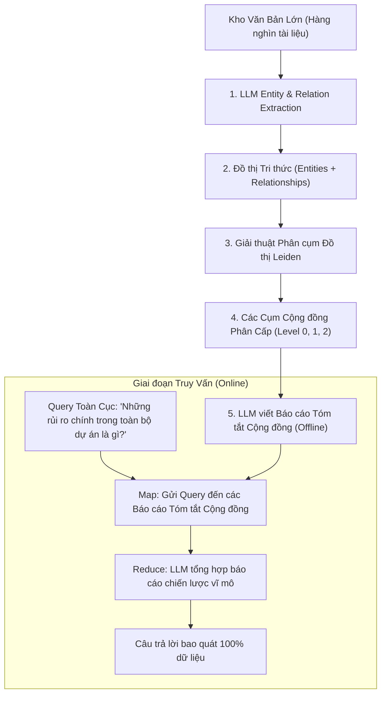

---

### 9.5. Kỹ thuật hậu truy xuất (Post-Retrieval Optimization)

Sau khi lấy về danh sách ứng viên sơ bộ từ nhiều nguồn tìm kiếm khác nhau, bước hậu xử lý đảm bảo thông tin đưa vào LLM đạt độ tinh khiết tối đa:

#### 1. Reciprocal Rank Fusion (RRF)
Khi kết hợp Tìm kiếm Từ khóa (BM25) và Tìm kiếm Ngữ nghĩa (Dense Vector Search) thành hệ thống **Hybrid Search**, ta đối mặt với vấn đề: Điểm số BM25 (chạy từ $0 \to \infty$) và điểm Cosine Similarity (chạy từ $-1 \to 1$) có thang đo hoàn toàn khác biệt, không thể cộng trực tiếp.

Giải thuật **RRF (Cormack et al., 2009)** giải quyết triệt để vấn đề này bằng cách chỉ quan tâm đến **thứ hạng vị trí (Rank)** của tài liệu trong từng danh sách, bỏ qua giá trị điểm số tuyệt đối:

$$
RRF\_Score(d) = \sum_{m \in M} \frac{1}{k + r_m(d)}
$$

* $M$: Tập hợp các hệ thống tìm kiếm (ví dụ: $M = \{\text{BM25}, \text{Dense Vector}\}$).
* $r_m(d)$: Thứ vị trí của tài liệu $d$ trong hệ thống $m$ (bắt đầu từ $1, 2, 3 \dots$).
* $k$: Hằng số làm mịn (Smoothing constant, chuẩn thực nghiệm thường chọn $k = 60$). Hằng số này đảm bảo các tài liệu đứng đầu danh sách không tạo ra sự chênh lệch điểm quá áp đảo so với các tài liệu kế tiếp.

#### 2. Cross-Encoder Re-ranking
* Đã phân tích chi tiết tại [[#4-giải-phẫu-kiến-trúc-bi-encoder-vs-cross-encoder|Mục 4]]: Cross-Encoder chấm điểm tương tác sâu giữa toàn bộ câu hỏi và từng đoạn văn qua cơ chế Full Self-Attention, lọc sạch các đoạn văn "tưởng là liên quan" của Bi-Encoder.

#### 3. Contextual Compression & Semantic Trimming
* Sau khi Re-ranker chọn ra Top-5 đoạn văn, nhiều đoạn văn vẫn chứa hàng loạt câu rác rưởi (disclaimers, chữ ký email, câu mở bài rườm rà).
* Áp dụng mô hình nén ngữ cảnh (như LLMLingua của Microsoft) hoặc một prompt trích xuất nhanh để gọt giũa, chỉ giữ lại đúng các câu văn trực tiếp chứa đựng câu trả lời, giúp tiết kiệm $40\% - 70\%$ chi phí token và ngăn ngừa hiện tượng pha loãng sự chú ý.

---

### 9.6. RAG Tác tử & Tự phản tư (Agentic RAG)

Thế hệ RAG hiện đại nhất phá bỏ hoàn toàn quy trình tuyến tính cứng nhắc, trao cho AI Agent khả năng **tự đánh giá, tự sửa sai và phân luồng động**:

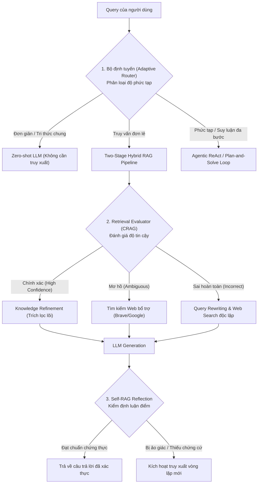

#### 1. Self-RAG (Self-Reflective Retrieval-Augmented Generation - Asai et al., 2023)
* **Khác biệt cốt lõi:** Thay vì luôn luôn thực hiện truy xuất một cách máy móc cho mọi câu hỏi, mô hình Self-RAG được huấn luyện để sinh ra 4 nhóm **Token Phản tư (Special Reflection Tokens)**:
  1. `[Retrieve]`: Quyết định khi nào CẦN truy xuất tri thức mới. Giá trị: `{yes, no, continue}`. Nếu câu hỏi thuộc tri thức sẵn có của LLM, mô hình tự trả lời mà không tốn chi phí truy xuất.
  2. `[IsRel]`: Đánh giá từng đoạn tài liệu vừa lấy về có thực sự chứa thông tin giải quyết câu hỏi hay không. Giá trị: `{relevant, irrelevant}`.
  3. `[IsSup]`: Đánh giá câu trả lời mà LLM vừa soạn thảo có **thực sự được bảo chứng bởi tài liệu** hay không. Giá trị: `{fully supported, partially supported, no support}`. Đây là "vũ khí tối thượng" triệt tiêu ảo giác (Hallucination elimination).
  4. `[IsUse]`: Chấm điểm mức độ hữu ích thực tế của câu trả lời đối với người dùng (thang điểm từ $1$ đến $5$).

#### 2. Corrective RAG (CRAG - Yan et al., 2024)
* **Ý tưởng:** Nhận diện và sửa sai khi hệ thống truy xuất lấy về dữ liệu sai lạc.
* **Cơ chế 3 vùng tự tin (Three-Confidence Regions):**
  * Tích hợp một bộ đánh giá nhẹ (**Retrieval Evaluator**) tính toán điểm số tin cậy $\mathcal{C}$ của kho tài liệu trích xuất:
    * **Vùng Đúng ($\mathcal{C} \ge \theta_{\text{high}}$):** Kích hoạt giải thuật *Knowledge Refinement* – bẻ nhỏ đoạn văn thành các dải văn bản (strips), lọc bỏ thông tin thừa và chỉ giữ lại dải văn bản chứa dữ kiện mấu chốt.
    * **Vùng Sai ($\mathcal{C} < \theta_{\text{low}}$):** Nhận diện kho dữ liệu nội bộ không có thông tin $\to$ Tự động chuyển hướng kích hoạt **Công cụ Tìm kiếm Web ngoài (External Web Search)** để tìm kiếm thông tin tươi mới trên Internet.
    * **Vùng Mơ hồ ($\theta_{\text{low}} \le \mathcal{C} < \theta_{\text{high}}$):** Kết hợp cả dữ liệu nội bộ tinh lọc và kết quả tìm kiếm web bổ trợ.

#### 3. Adaptive RAG
* **Ý tưởng:** Không áp dụng một giải pháp "one-size-fits-all" cho mọi người dùng.
* **Bộ phân loại truy vấn (Query Classifier):**
  * **Cấp độ 1 (Truy vấn đơn giản):** *"Thủ đô của nước Pháp là gì?"* $\to$ LLM nội suy trực tiếp trong $100\text{ms}$ (0 token chi phí truy xuất).
  * **Cấp độ 2 (Truy vấn thực tế một chặng):** *"Quy định nghỉ phép năm của công ty là gì?"* $\to$ Two-Stage RAG (Single-hop).
  * **Cấp độ 3 (Truy vấn suy luận phức tạp nhiều bước):** *"Hãy phân tích tác động của biến đổi khí hậu lên chuỗi cung ứng linh kiện ô tô tại Đông Nam Á trong thập kỷ tới và đề xuất chiến lược phòng ngừa"* $\to$ Kích hoạt Đồ thị Tác tử đa chặng (Iterative Agent Loop với ReAct / GraphRAG).

---

### 9.7. Bảng ma trận so sánh toàn diện 9 kỹ thuật RAG hàng đầu

Dưới đây là bảng phân tích định lượng và so sánh kỹ thuật giữa các trường phái RAG hiện nay:

| Kỹ thuật RAG | Ý tưởng cốt lõi | Điểm mạnh (Pros) | Điểm yếu / Đánh đổi (Cons) | Chi phí Token | Độ trễ (Latency) | Kịch bản tối ưu (When to use) |
| :--- | :--- | :--- | :--- | :---: | :---: | :--- |
| **Naive RAG** | Vector search cơ bản $\to$ Nối Top-K chunks $\to$ LLM | Đơn giản, triển khai trong 30 phút, chi phí thấp | Dễ ảo giác, mất bối cảnh, dính lỗi *Lost in the Middle* | ⭐ (Rất thấp) | ⚡ ($< 300\text{ms}$) | Thử nghiệm PoC nhanh, dữ liệu tài liệu cực ngắn và đồng nhất |
| **Two-Stage RAG** *(Bi-Encoder + Cross-Encoder)* | Dùng Vector DB thu hồi Top-50, dùng Cross-Encoder re-rank lấy Top-3 | Tăng vọt độ chính xác Recall@1 từ 50% lên 83%, triệt tiêu *Lost in the Middle* | Tốn thêm năng lực tính toán GPU của Cross-Encoder lúc query | ⭐⭐ (Thấp) | ⏱️ ($300 - 600\text{ms}$) | **Chuẩn mực vàng mặc định** cho mọi hệ thống RAG doanh nghiệp |
| **HyDE** | LLM sinh câu trả lời giả định $\to$ Lấy vector đó tìm kiếm Doc-to-Doc | Biến Asymmetric thành Symmetric Search, cực mạnh với câu hỏi trừu tượng | Thêm 1 lượt gọi LLM; dễ bị lệch hướng nếu LLM giả định sai | ⭐⭐⭐ (Trung bình) | 🐢 ($800 - 1500\text{ms}$) | Search học thuật, người dùng không biết thuật ngữ chuyên ngành |
| **Parent Document Retrieval** | Lập chỉ mục Child Chunks nhỏ (128t), khi trúng thì nạp Parent Chunk lớn (1024t) | Cân bằng hoàn hảo: Vector search siêu nét + LLM đọc trọn vẹn ngữ cảnh | Tốn gấp đôi dung lượng lưu trữ (vừa lưu Vector DB vừa lưu DocStore) | ⭐⭐ (Thấp) | ⚡ ($300 - 500\text{ms}$) | Tài liệu có cấu trúc phân cấp, hợp đồng pháp lý, sách hướng dẫn |
| **Contextual Retrieval** *(Anthropic)* | Dùng LLM nhỏ sinh 50-100 từ bối cảnh trước mỗi chunk $\to$ Embed + BM25 | Giảm tới 49% lỗi truy xuất trượt; giữ vững ngữ cảnh cho mọi mảnh vụn | Tốn chi phí LLM một lần duy nhất lúc Offline Indexing | ⭐⭐⭐ (Lúc Index) / ⭐⭐ (Lúc Query) | ⚡ ($350 - 550\text{ms}$) | Cơ sở tri thức tài chính, y tế, báo cáo thường niên phức tạp |
| **GraphRAG** *(Microsoft)* | Trích xuất Knowledge Graph $\to$ Phân cụm Leiden $\to$ Tóm tắt cộng đồng | Trả lời xuất sắc câu hỏi bao quát toàn cục (*Global Sensemaking*) | Chi phí Indexing bằng LLM rất đắt đỏ; cấu trúc phức tạp | ⭐⭐⭐⭐⭐ (Rất cao lúc Index) | 🐢 ($1 - 3\text{s}$) | Nghiên cứu tổng quan toàn ngành, phân tích hàng nghìn báo cáo |
| **Self-RAG** | Huấn luyện LLM sinh Reflection Tokens (`[Retrieve]`, `[IsRel]`, `[IsSup]`) | Tự động hóa hoàn toàn; triệt tiêu ảo giác nhờ kiểm chứng bảo chứng | Đòi hỏi mô hình chuyên biệt đã fine-tune các token phản tư | ⭐⭐ (Trung bình) | ⏱️ ($400 - 800\text{ms}$) | Hệ thống trợ lý AI tự chủ yêu cầu độ tin cậy tuyệt đối |
| **Corrective RAG (CRAG)** | Bộ đánh giá tin cậy $\to$ Correct (Tinh lọc) / Incorrect (Web Search) | Không bao giờ bị bế tắc khi dữ liệu nội bộ thiếu; tự sửa sai linh hoạt | Phụ thuộc vào chất lượng API tìm kiếm ngoài (Google/Brave) | ⭐⭐⭐ (Biến thiên) | 🐢 ($800 - 2000\text{ms}$ khi gọi Web) | Chatbot dịch vụ khách hàng, sản phẩm tiêu dùng công cộng |
| **Adaptive RAG** | Classifier định tuyến câu hỏi theo độ khó: Zero-shot vs Single-hop vs Agent | Tối ưu hóa chi phí và độ trễ: Câu dễ trả lời ngay, câu khó phân tích sâu | Cần xây dựng và bảo trì bộ phân loại định tuyến chính xác | ⭐ $\to$ ⭐⭐⭐⭐ (Tối ưu theo ca) | ⚡ $\to$ 🐢 (Linh hoạt) | Hệ thống quy mô lớn hàng triệu người dùng với câu hỏi đa dạng |

---

### 9.8. Cây quyết định kiến trúc RAG thực chiến (Practical Decision Tree)

Để lựa chọn đúng kiến trúc RAG cho dự án thực tế của doanh nghiệp, hãy áp dụng cây quyết định kỹ thuật dưới đây:

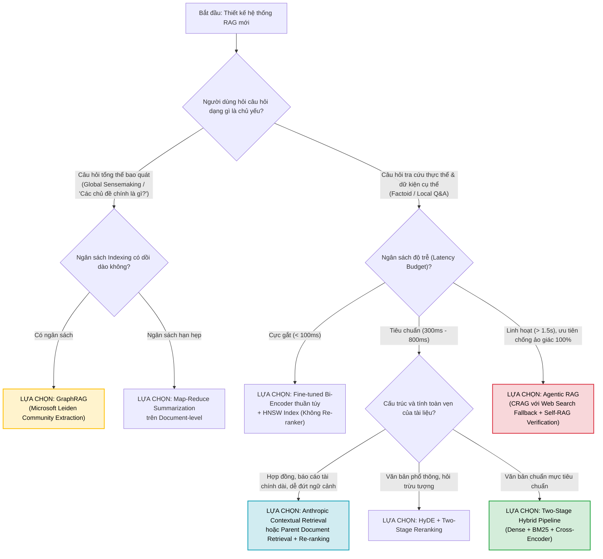

---

## 10. BẢNG MA TRẬN RA QUYẾT ĐỊNH KIẾN TRÚC TÌM KIẾM (SEARCH DECISION MATRIX)

Dưới đây là cẩm nang hướng dẫn kỹ sư lựa chọn giải pháp Semantic Search phù hợp với từng bài toán thực tế:

| Tình huống ứng dụng | Khối lượng dữ liệu | Yêu cầu độ trễ | Đề xuất kiến trúc tối ưu | Ghi chú triển khai |
| :--- | :--- | :--- | :--- | :--- |
| **Thanh tìm kiếm Web E-commerce** | Hàng triệu sản phẩm | Cực gắt ($< 50\text{ms}$) | **Bi-Encoder độc lập** (Fine-tuned trên lượt click sản phẩm) | Không dùng Cross-encoder trực tiếp lúc query. Sử dụng HNSW Index trên Pinecone/Qdrant. |
| **RAG Chatbot Doanh nghiệp tiêu chuẩn** | $10,000 - 500,000$ đoạn văn bản | Trung bình ($200 - 500\text{ms}$) | **Two-Stage Pipeline**<br>(OpenAI Embeddings + `MiniLM-L12` Reranker) | Retrieve Top-50 qua Bi-encoder, re-rank xuống Top-3 cho LLM Context. |
| **Hệ thống AI Pháp lý / Y tế / Tài chính** | Nghiệp vụ chuyên biệt cao | Linh hoạt ($500\text{ms} - 2\text{s}$) | **Two-Stage Pipeline kết hợp Fine-tune**<br>(Fine-tuned Bi-encoder + Fine-tuned Cross-Encoder) | Bắt buộc gối đầu (Chunk overlap 20%). Ưu tiên độ chính xác tuyệt đối hơn tốc độ. |
| **Phát hiện câu hỏi trùng lặp (FAQ)** | Hàng nghìn câu hỏi | Nhanh ($< 30\text{ms}$) | **Symmetric Bi-Encoder** | So sánh trực tiếp Title-to-Title bằng Cosine Similarity. |
| **Deep Research Autonomous Agent** | Cào dữ liệu web động theo thời gian thực | Chấp nhận độ trễ dài ($> 5\text{s}$) | **Multi-Stage Funnel**<br>(BM25 + Bi-Encoder $\to$ Cross-Encoder $\to$ LLM Judge) | Kết hợp Hybrid Search (Từ khóa + Vector) rồi mới đưa qua Cross-Encoder lọc sâu. |

---

## 11. TÀI LIỆU NGHIÊN CỨU & BÀI BÁO KHOA HỌC CỐT LÕI (ACADEMIC REFERENCES)

Dưới đây là danh mục các bài báo khoa học nền tảng định hình toàn bộ lĩnh vực Semantic Search, Dense Retrieval, Embedding Space Geometry và các Kiến Trúc RAG Tiên Tiến:

1. **Sentence-BERT (SBERT):**
   * *Bài báo:* Reimers, N., & Gurevych, I. (2019). **"Sentence-BERT: Sentence Embeddings using Siamese BERT-Networks"**. *Proceedings of the 2019 Conference on Empirical Methods in Natural Language Processing (EMNLP-IJCNLP)*, 3982–3992.
   * *Liên kết:* [arXiv:1908.10084](https://arxiv.org/abs/1908.10084)
   * *Ý nghĩa:* Đột phá biến đổi BERT thành mạng Siamese tạo vector biểu diễn câu độc lập, rút ngắn thời gian so khớp 10,000 câu văn từ 65 giờ xuống 5 giây.
2. **Dense Passage Retrieval (DPR):**
   * *Bài báo:* Karpukhin, V., Oğuz, B., Min, S., Lewis, P., Wu, L., Edunov, S., Chen, D., & Yih, W. (2020). **"Dense Passage Retrieval for Open-Domain Question Answering"**. *Proceedings of the 2020 Conference on Empirical Methods in Natural Language Processing (EMNLP)*, 6769–6781.
   * *Liên kết:* [arXiv:2004.04906](https://arxiv.org/abs/2004.04906)
   * *Ý nghĩa:* Chứng minh rằng Dual-Encoder với dense vector vượt trội hơn BM25 từ 9% đến 19% trên Top-20, đặt nền tảng học thuật cho mọi hệ thống RAG hiện đại.
3. **Passage Re-ranking with BERT (Cross-Encoder):**
   * *Bài báo:* Nogueira, R., & Cho, K. (2019). **"Passage Re-ranking with BERT"**. *arXiv preprint*.
   * *Liên kết:* [arXiv:1901.04085](https://arxiv.org/abs/1901.04085)
   * *Ý nghĩa:* Công trình tiên phong sử dụng BERT làm Cross-Encoder cho bài toán tái xếp hạng văn bản, tăng 27% MRR@10 trên chuẩn MS MARCO.
4. **ColBERT (Contextualized Late Interaction over BERT):**
   * *Bài báo:* Khattab, O., & Zaharia, M. (2020). **"ColBERT: Efficient and Effective Passage Search via Contextualized Late Interaction over BERT"**. *Proceedings of the 43rd International ACM SIGIR Conference on Research and Development in Information Retrieval*, 39–48.
   * *Liên kết:* [arXiv:2004.12832](https://arxiv.org/abs/2004.12832)
   * *Ý nghĩa:* Đề xuất cơ chế tương tác muộn (Late Interaction) với toán tử MaxSim, kết hợp ưu điểm tốc độ của Bi-encoder và độ chính xác của Cross-encoder ($100\times$ nhanh hơn, $10,000\times$ ít FLOPs hơn).
5. **OpenAI Contrastive Embeddings:**
   * *Bài báo:* Neelakantan, A., Xu, T., Puri, R., Radford, A., Han, J. M., Tworek, J., ... & Weng, L. (2022). **"Text and Code Embeddings by Contrastive Pre-Training"**. *arXiv preprint*.
   * *Liên kết:* [arXiv:2201.10005](https://arxiv.org/abs/2201.10005)
   * *Ý nghĩa:* Phương pháp huấn luyện tương phản không giám sát trên quy mô dữ liệu khổng lồ với in-batch negatives, tạo nên mô hình nhúng `text-embedding-ada-002` chuẩn thương mại (+23.4% trên MS MARCO).
6. **Lost in the Middle (Context Degradation in LLMs):**
   * *Bài báo:* Liu, N. F., Lin, K., Hewitt, J., Paranjape, A., Bevilacqua, M., Petroni, F., & Liang, P. (2023). **"Lost in the Middle: How Language Models Use Long Contexts"**. *Transactions of the Association for Computational Linguistics (TACL 2024)*, 12, 157–173.
   * *Liên kết:* [arXiv:2307.03172](https://arxiv.org/abs/2307.03172)
   * *Ý nghĩa:* Chứng minh bằng thực nghiệm đường cong chú ý hình chữ U của LLM, lý giải nguyên nhân khoa học vì sao việc Re-ranking đưa tài liệu đúng lên vị trí số 1 là điều kiện tiên quyết chống ảo giác trong RAG.
7. **HyDE (Hypothetical Document Embeddings):**
   * *Bài báo:* Gao, L., Dai, X., Lin, J., & Callan, J. (2022). **"Precise Zero-Shot Dense Retrieval without Relevance Labels"**. *arXiv preprint*.
   * *Liên kết:* [arXiv:2212.10496](https://arxiv.org/abs/2212.10496)
   * *Ý nghĩa:* Đột phá biến đổi truy vấn không đối xứng thành đối xứng Doc-to-Doc bằng văn bản giả định của LLM, tăng vọt độ chính xác tìm kiếm zero-shot.
8. **Contextual Retrieval:**
   * *Bài báo:* Anthropic Research. (2024). **"Introducing Contextual Retrieval: Contextual Embeddings and BM25"**. *Anthropic Engineering Whitepaper*.
   * *Liên kết:* [anthropic.com/news/contextual-retrieval](https://www.anthropic.com/news/contextual-retrieval)
   * *Ý nghĩa:* Tiêm 50-100 từ bối cảnh trước mỗi chunk kết hợp Contextual Embeddings, BM25 và Re-ranking giúp giảm 49% tỷ lệ lỗi truy xuất trượt.
9. **GraphRAG (Microsoft Research):**
   * *Bài báo:* Edge, D., Trinh, H., Cheng, N., Bradley, J., Chao, A., Mody, A., Truitt, C., & Larson, J. (2024). **"From Local to Global: A Graph RAG Approach to Query-Focused Summarization"**. *arXiv preprint*.
   * *Liên kết:* [arXiv:2404.16130](https://arxiv.org/abs/2404.16130)
   * *Ý nghĩa:* Khắc phục điểm mù Global Sensemaking của Vector RAG bằng phân cụm cộng đồng Leiden và báo cáo tóm tắt cộng đồng phân cấp.
10. **Self-RAG (Self-Reflective Retrieval-Augmented Generation):**
    * *Bài báo:* Asai, A., Sewon, M., Hajishirzi, H., et al. (2023). **"Self-RAG: Learning to Retrieve, Generate, and Critique through Self-Reflection"**. *International Conference on Learning Representations (ICLR 2024)*.
    * *Liên kết:* [arXiv:2310.11511](https://arxiv.org/abs/2310.11511)
    * *Ý nghĩa:* Đề xuất 4 token phản tư (`[Retrieve]`, `[IsRel]`, `[IsSup]`, `[IsUse]`) trao quyền cho LLM tự quyết định truy xuất và tự kiểm định chống ảo giác.
11. **Corrective RAG (CRAG):**
    * *Bài báo:* Yan, S. Q., Gu, J. C., Zhu, Y., & Ling, Z. H. (2024). **"Corrective Retrieval Augmented Generation"**. *arXiv preprint*.
    * *Liên kết:* [arXiv:2401.15884](https://arxiv.org/abs/2401.15884)
    * *Ý nghĩa:* Cơ chế đánh giá mức độ tin cậy với 3 vùng quyết định, tự động chuyển hướng sang Web Search khi dữ liệu nội bộ không đáp ứng.
12. **Embedding Space Anisotropy (Hiện tượng dị hướng hình nón hẹp):**
    * *Bài báo:* Ethayarajh, K. (2019). **"How Contextual are Contextualized Word Representations? Comparing the Geometry of BERT, ELMo, and GPT-2 Embeddings"**. *Proceedings of the 2019 Conference on Empirical Methods in Natural Language Processing (EMNLP)*, 55–65.
    * *Liên kết:* [arXiv:1909.00512](https://arxiv.org/abs/1909.00512)
    * *Ý nghĩa:* Phát hiện và chứng minh toán học hiện tượng không gian embedding Transformer bị co cụm trong một hình nón hẹp (Anisotropy).
13. **BERT-Whitening Transformation:**
    * *Bài báo:* Su, J., Cao, J., Liu, W., & Li, Y. (2021). **"Whitening Sentence Representations for Better Inductive Bias and Faster Retrieval"**. *arXiv preprint*.
    * *Liên kết:* [arXiv:2103.15316](https://arxiv.org/abs/2103.15316)
    * *Ý nghĩa:* Ứng dụng biến đổi SVD làm trắng vector embedding, khôi phục tính đẳng hướng (Isotropy) và mở rộng biên độ phân biệt mà không cần huấn luyện lại.
14. **Alignment and Uniformity on the Hypersphere:**
    * *Bài báo:* Wang, T., & Isola, P. (2020). **"Understanding Contrastive Representation Learning through Alignment and Uniformity on the Hypersphere"**. *International Conference on Machine Learning (ICML 2020)*, 9929–9939.
    * *Liên kết:* [arXiv:2005.10242](https://arxiv.org/abs/2005.10242)
    * *Ý nghĩa:* Thiết lập nền tảng lý thuyết hình học cho học tương phản, chứng minh rằng sự phân bố đều (Uniformity) trên mặt cầu là chìa khóa triệt tiêu dị hướng.

---

## 🔗 LIÊN KẾT ĐIỀU HƯỚNG TRONG VAULT

* [[02_rag_architecture_and_components|Kiến Trúc RAG: Giải Phẫu 4 Cấu Phần Cốt Lõi & Vòng Lặp Điều Phối (Inside RAG)]]: Thực thi pipeline 4 nhịp Retrieve-Rank-Generate-Orchestrate và 9 mẫu thiết kế RAG chiến lược.
* [[03_embeddings_and_vector_databases|Vai Trò Cốt Lõi Của Embeddings & Cơ Sở Dữ Liệu Vector]]: So sánh FAISS, ChromaDB, Milvus, Pinecone, giải phẫu HNSW Index và quản trị vòng đời vector.
* [[what_are_large_language_models|Bản chất Mô hình Ngôn ngữ Lớn (LLM Internals)]]: Phân tích cơ chế Self-Attention của Transformer, sự khác biệt giữa Encoder (BERT) và Decoder (GPT).
* [[neural_networks_and_classifications|Mạng Nơ-ron & Bản Đồ Phân Loại Kiến Trúc]]: Nền tảng toán học của Backpropagation, hàm kích hoạt và không gian tiềm ẩn.
* [[advanced_prompt_engineering_techniques|Kỹ Thuật Prompt Engineering Nâng Cao]]: Cách tối ưu hóa context sau khi đã trích xuất thành công tài liệu từ Semantic Search.
* [[00_ai_chat_systems_and_prompt_engineering|Kiến Trúc & Tiến Hóa Của Các Hệ Thống AI Chat]]: Tích hợp Semantic Memory và Vector DB vào AI Harness.
* Về trang chủ khóa học: [[README|🏠 Vault Home MOC]]
