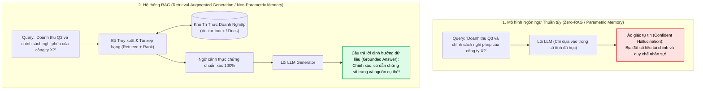
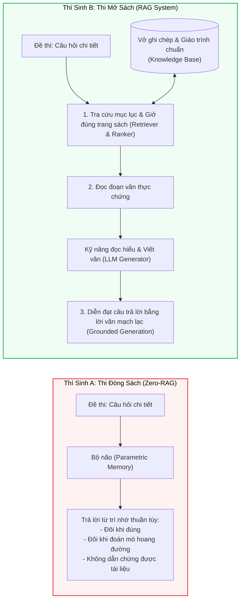
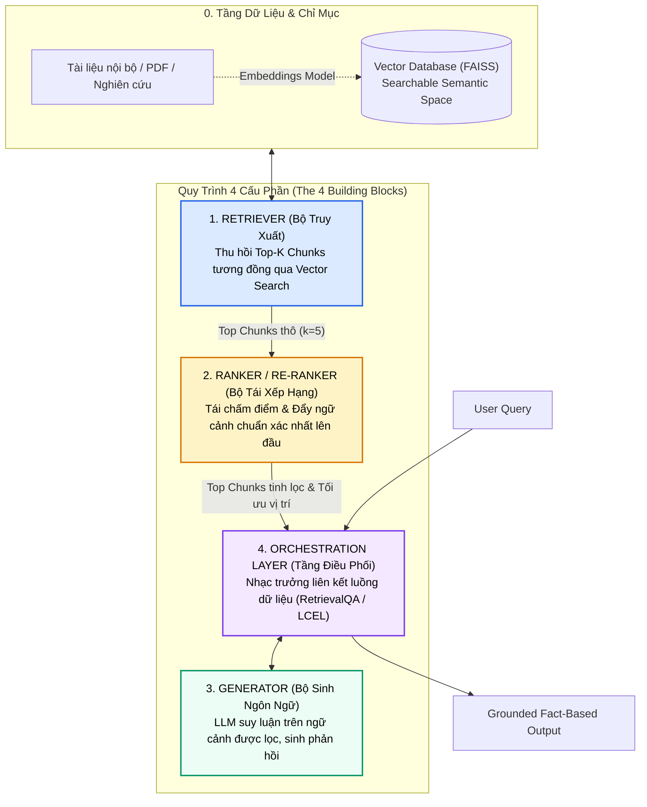
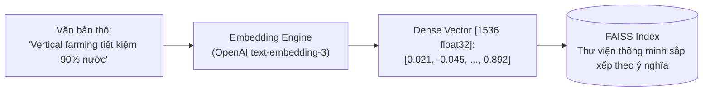
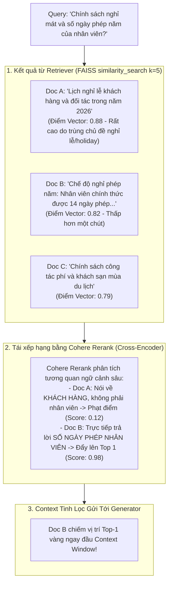
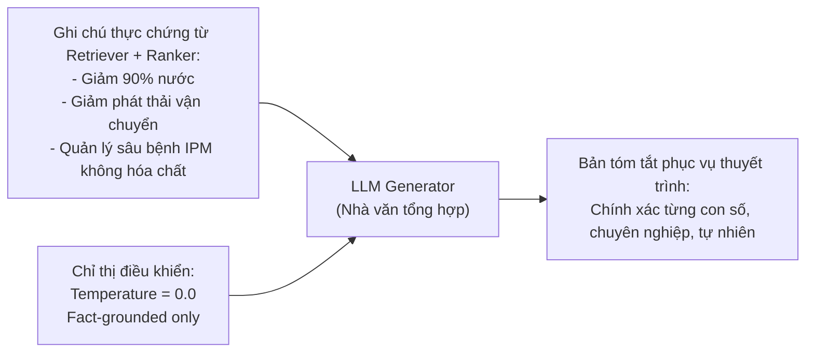
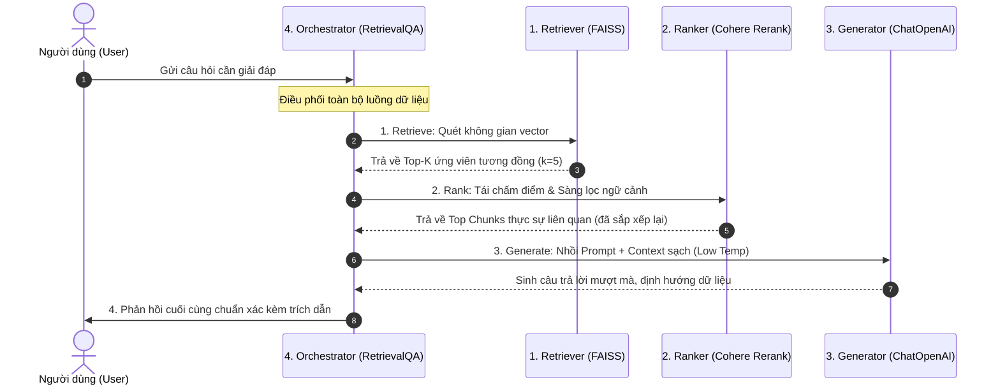
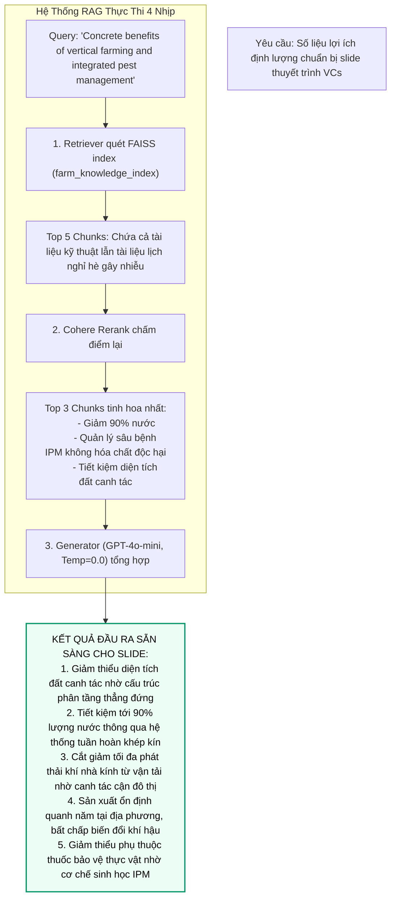
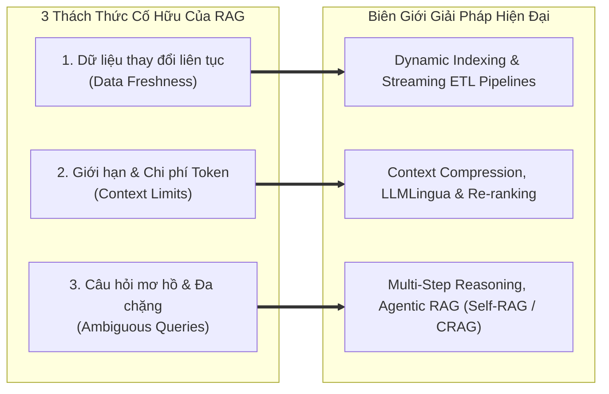
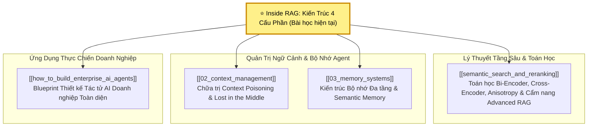

# KIẾN TRÚC RAG: GIẢI PHẪU 4 CẤU PHẦN CỐT LÕI & VÒNG LẶP ĐIỀU PHỐI (INSIDE RAG)
## Từ Ảo Giác Tham Số Đến Thế Hệ Sinh Định Hướng Dữ Liệu (Grounded Generation): Retriever, Ranker, Generator & Orchestration Layer

---

## 📌 MỤC LỤC
1. [Khởi Nguyên Vấn Đề: Ảo Giác Tự Tin (Confident Hallucination) & Nghịch Lý Trí Nhớ](#1-khởi-nguyên-vấn-đề-ảo-giác-tự-tin-confident-hallucination--nghịch-lý-trí-nhớ)
2. [Mô Hình Tư Duy (Mental Model): Kỳ Thi Mở Sách (The Open-Book Exam)](#2-mô-hình-tư-duy-mental-model-kỳ-thi-mở-sách-the-open-book-exam)
3. [Giải Phẫu 4 Cấu Phần Cốt Lõi Của RAG (The 4 Core Building Blocks)](#3-giải-phẫu-4-cấu-phần-cốt-lõi-của-rag-the-4-core-building-blocks)
   - [Cấu phần 1: Không gian nhúng & Bộ truy xuất (Embeddings & Retriever)](#cấu-phần-1-không-gian-nhúng--bộ-truy-xuất-embeddings--retriever)
   - [Cấu phần 2: Bộ tái xếp hạng (Ranker / Re-ranker) - Màng lọc ngữ cảnh sống còn](#cấu-phần-2-bộ-tái-xếp-hạng-ranker--re-ranker---màng-lọc-ngữ-cảnh-sống-còn)
   - [Cấu phần 3: Bộ sinh ngôn ngữ (Generator / LLM) - Ngòi bút tổng hợp](#cấu-phần-3-bộ-sinh-ngôn-ngữ-generator--llm---ngòi-bút-tổng-hợp)
   - [Cấu phần 4: Tầng điều phối (Orchestration Layer / Chain) - Nhạc trưởng dàn nhạc](#cấu-phần-4-tầng-điều-phối-orchestration-layer--chain---nhạc-trưởng-dàn-nhạc)
4. [Vòng Điệp Nhịp Nhàng Của RAG: Retrieve $\to$ Rank $\to$ Generate $\to$ Orchestrate](#4-vòng-điệp-nhịp-nhàng-của-rag-retrieve-to-rank-to-generate-to-orchestrate)
5. [Hiện Thực Hóa Mã Nguồn Thực Chiến (Production Pipeline Implementation)](#5-hiện-thực-hóa-mã-nguồn-thực-chiến-production-pipeline-implementation)
   - [Bước 1: Nạp chỉ mục & Khởi tạo Vector Database (FAISS + OpenAI Embeddings)](#bước-1-nạp-chỉ-mục--khởi-tạo-vector-database-faiss--openai-embeddings)
   - [Bước 2: Cấu hình & Kiểm định Retriever độc lập (Retriever Verification Gate)](#bước-2-cấu-hình--kiểm-định-retriever-độc-lập-retriever-verification-gate)
   - [Bước 3: Tích hợp Re-ranker qua Contextual Compression (Cohere Rerank)](#bước-3-tích-hợp-re-ranker-qua-contextual-compression-cohere-rerank)
   - [Bước 4: Thiết lập Generator với Temperature nghiêm ngặt](#bước-4-thiết-lập-generator-với-temperature-nghiêm-ngặt)
   - [Bước 5: Kết nối chuỗi điều phối hoàn chỉnh (RetrievalQA / LCEL Chain)](#bước-5-kết-nối-chuỗi-điều-phối-hoàn-chỉnh-retrievalqa--lcel-chain)
6. [Nghiên Cứu Điển Cứu (Case Study): Tổng Hợp Dữ Liệu Gọi Vốn Nông Nghiệp Thẳng Đứng (Vertical Farming & IPM)](#6-nghiên-cứu-điển-cứu-case-study-tổng-hợp-dữ-liệu-gọi-vốn-nông-nghiệp-thẳng-đứng-vertical-farming--ipm)
7. [Bảng Ma Trận Phân Định Vai Trò: Retriever vs. Ranker vs. Generator vs. Orchestrator](#7-bảng-ma-trận-phân-định-vai-trò-retriever-vs-ranker-vs-generator-vs-orchestrator)
8. [Các Thách Thức Cố Hữu & Biên Giới Nghiên Cứu Hiện Đại (Challenges & Frontiers)](#8-các-thách-thức-cố-hữu--biên-giới-nghiên-cứu-hiện-đại-challenges--frontiers)
   - [Tính tươi mới của dữ liệu (Data Freshness & Dynamic Indexing)](#tính-tươi-mới-của-dữ-liệu-data-freshness--dynamic-indexing)
   - [Áp lực trần Context Window & Nén ngữ cảnh (Context Limits & Compression)](#áp-lực-trần-context-window--nén-ngữ-cảnh-context-limits--compression)
   - [Truy vấn mơ hồ & Suy luận đa chặng (Ambiguous Queries & Multi-hop Reasoning)](#truy-vấn-mơ-hồ--suy-luận-đa-chặng-ambiguous-queries--multi-hop-reasoning)
9. [Cây Điều Hướng & Liên Kết Trong Vault](#9-cây-điều-hướng--liên-kết-trong-vault)

---

## 1. KHỞI NGUYÊN VẤN ĐỀ: ẢO GIÁC TỰ TIN (CONFIDENT HALLUCINATION) & NGHỊCH LÝ TRÍ NHỚ

Trong quá trình tương tác với các Mô hình Ngôn ngữ Lớn (LLMs), bạn chắc chắn đã từng gặp phải hiện tượng này: bạn đặt ra một câu hỏi chuyên sâu, mô hình đưa ra câu trả lời bằng giọng văn vô cùng tự tin, mạch lạc, lập luận chặt chẽ... nhưng **nội dung hoàn toàn sai lệch** hoặc tệ hơn là **bịa đặt 100% dữ kiện (Hallucination)**.



### Tại sao LLM lại ảo giác?
Bản chất của LLM là **cỗ máy dự đoán token tiếp theo dựa trên xác suất thống kê** (Autoregressive Token Prediction) được nén vào hàng trăm tỷ tham số tĩnh trong quá trình pre-training:
1. **Tri thức tham số (Parametric Memory) đóng băng theo thời gian:** Mô hình không biết những gì diễn ra sau thời điểm cutoff dữ liệu.
2. **Thiếu khả năng truy nguyên (Lack of Provenance):** Mô hình không thể chỉ ra câu nói này bắt nguồn từ tài liệu hay trang sách nào.
3. **Ảo giác cấu trúc:** Khi gặp lỗ hổng kiến thức, cơ chế Attention vẫn cố gắng ghép các từ có xác suất đồng xuất hiện cao nhất để tạo nên câu văn nghe "xuôi tai", dẫn đến các câu trả lời sai lệch nhưng cực kỳ thuyết phục.

Khoảng cách phân định giữa một mô hình đoán mò và một trợ lý AI đáng tin cậy nằm ở công nghệ: **Retrieval-Augmented Generation (RAG)**.

---

## 2. MÔ HÌNH TƯ DUY (MENTAL MODEL): KỲ THI MỞ SÁCH (THE OPEN-BOOK EXAM)

Để hiểu sâu sắc bản chất của RAG, hãy sử dụng phép ẩn dụ trực quan về **hai thí sinh bước vào phòng thi**:



* **Mô hình AI thông thường (Zero-RAG):** Giống như thí sinh A đi thi mà **chỉ dựa vào trí nhớ sinh học**. Đối với các câu hỏi lịch sử xa xưa hay kiến thức đại cương, thí sinh có thể nhớ mang máng. Nhưng đối với các điều khoản bảo hiểm mới cập nhật tuần trước hay số liệu tài chính quý vừa qua, thí sinh buộc phải đoán mò.
* **Hệ thống RAG:** Giống như thí sinh B được phép **mở sách giáo trình (Open-Book Exam)**. Khi đối diện câu hỏi:
  1. Thí sinh không vội trả lời ngay từ trí nhớ.
  2. Thí sinh tra cứu mục lục, lật đúng trang sách chứa điều khoản liên quan nhất.
  3. Thí sinh đọc kỹ đoạn trích thực tế và dùng năng lực ngôn ngữ của mình để tổng hợp, diễn giải lại câu trả lời bằng văn phong lưu loát.

> [!important] Định Nghĩa Cốt Lõi Về RAG
> **Retrieval-Augmented Generation (RAG)** là quy trình kỹ nghệ trong đó mô hình sinh ngôn ngữ được cấp quyền truy xuất động vào cơ sở tri thức bên ngoài (Non-Parametric Knowledge Base) để tìm nạp các dữ kiện thực chứng liên quan nhất, từ đó tạo ra phản hồi **định hướng dữ liệu (Grounded Generation)**, chính xác và có thể kiểm chứng nguồn gốc từ đầu đến cuối (End-to-End Explainable).

---

## 3. GIẢI PHẪU 4 CẤU PHẦN CỐT LÕI CỦA RAG (THE 4 CORE BUILDING BLOCKS)

Một hệ sinh thái RAG tiêu chuẩn trong sản xuất không chỉ đơn giản là "nhúng vector rồi gửi vào prompt". Nó là sự hợp tác chuẩn xác của **4 cấu phần độc lập nhưng gắn kết hữu cơ**:



---

### Cấu phần 1: Không gian nhúng & Bộ truy xuất (Embeddings & Retriever)

Bộ truy xuất (**Retriever**) là cấu phần đầu tiên và có tính quyết định sống còn: nó chính là thực thể **trực tiếp tìm kiếm thông tin mà mô hình sẽ dùng để suy luận**. Nếu Retriever không tìm ra đúng tài liệu, toàn bộ các bước phía sau đều trở nên vô nghĩa.



1. **Mô hình Vector Embeddings (ví dụ: `OpenAIEmbeddings`):**
   * Chuyển hóa ngôn ngữ tự nhiên từ dạng chuỗi ký tự thành các **vector số học nhiều chiều** (Dense Vectors).
   * Điểm mấu chốt: Các vector này bảo toàn các mối quan hệ ngữ nghĩa. Máy tính sử dụng các phép toán hình học (như Cosine Similarity, Dot Product) để đo lường mức độ tương đồng giữa câu hỏi và tài liệu trong không gian nhiều chiều.
2. **Cơ sở dữ liệu Vector (ví dụ: `FAISS` - Facebook AI Similarity Search):**
   * FAISS đóng vai trò như một **thư viện thông minh (Smart Library)**: Thay vì sắp xếp sách theo từ khóa chữ cái (như tìm kiếm Lexical BM25 truyền thống), nó tổ chức thông tin theo **ý nghĩa và khái niệm**.
   * Khi bạn tìm kiếm, FAISS không tìm các từ trùng khớp mặt chữ, mà tìm các đoạn văn bản có **ý nghĩa tương đồng nhất** với câu hỏi của bạn.
3. **Cơ chế hoạt động của Retriever:**
   * Chuyển câu hỏi người dùng thành vector.
   * Quét qua chỉ mục vector đã lập sẵn (`similarity_search`).
   * Trích xuất ra $k$ đoạn văn bản (chunks) có khoảng cách ngữ nghĩa gần nhất (ví dụ: $k=5$).

---

### Cấu phần 2: Bộ tái xếp hạng (Ranker / Re-ranker) - Màng lọc ngữ cảnh sống còn

Một sai lầm kinh điển của các kỹ sư triển khai RAG sơ khai (Naive RAG) là giả định rằng: *Cứ tìm kiếm tương đồng vector là tài liệu lấy về sẽ liên quan hoàn hảo đến câu hỏi.* Thực tế hoàn toàn không phải như vậy!

> [!warning] Nghịch Lý Tương Đồng Ngữ Nghĩa vs. Mức Độ Liên Quan Ngữ Cảnh
> * **Retriever (Bi-Encoder):** Tìm các văn bản có **từ vựng và chủ đề tương tự**. Nhưng tương tự không đồng nghĩa với việc trả lời đúng câu hỏi!
> * **Ranker (Cross-Encoder):** Đánh giá trực tiếp cặp `(Query, Document)` và trả lời câu hỏi: **"Đoạn văn này có thực sự trả lời đúng trọng tâm câu hỏi của người dùng hay không?"**



#### Ví Dụ Điển Hình: Nghỉ Phép Công Ty vs. Kỳ Nghỉ Khách Hàng
* Hãy tưởng tượng bạn đang xây dựng một bot Q&A giải đáp chính sách nhân sự công ty.
* Người dùng hỏi về **chế độ nghỉ mát của nhân viên**.
* Retriever quét vector DB và tìm thấy một đoạn văn nhắc nhiều lần đến *"kỳ nghỉ, du lịch, ngày nghỉ"*. Tuy nhiên, đoạn văn đó lại quy định về **lịch nghỉ lễ của đối tác và khách hàng** chứ không phải chính sách dành cho nhân viên nội bộ!
* Nếu đưa trực tiếp đoạn văn đó vào LLM, mô hình sẽ nhầm lẫn chính sách khách hàng thành chính sách nhân viên.
* **Bộ Tái Xếp Hạng (Ranker)** xuất hiện để giải quyết đúng bài toán này: Nó sử dụng mô hình Cross-Encoder chuyên biệt (như [[semantic_search_and_reranking#cross-encoder-bộ-mã-hóa-giao-thoa-đỉnh-cao-độ-chính-xác-qua-full-self-attention|Cohere Rerank]]) đọc đồng thời cả câu hỏi và đoạn trích, tính toán lại điểm liên quan (re-score), loại bỏ các đoạn văn nhiễu lệch đề và **đẩy tài liệu chứa câu trả lời thực sự lên vị trí số 1**.

---

### Cấu phần 3: Bộ sinh ngôn ngữ (Generator / LLM) - Ngòi bút tổng hợp

Nếu coi **Retriever và Ranker là những nhà nghiên cứu (Researchers)** miệt mài vào kho lưu trữ thu thập và sắp xếp các tài liệu thực chứng, thì **Generator chính là nhà văn (Writer)**:
* Người đọc lại toàn bộ các ghi chú đã được chắt lọc đó.
* Vận dụng năng lực hiểu ngôn ngữ và lập luận để chắp bút viết nên một câu trả lời hoàn chỉnh, mạch lạc, tự nhiên và chuẩn xác.



#### Nguyên Tắc Cấu Hình Generator Trong RAG Doanh Nghiệp:
1. **Nhiệt độ thấp (Low Temperature: $0.0 - 0.2$):** Giữ cho mô hình tập trung tối đa vào tính xác thực (Factuality) và nhất quán, triệt tiêu sự bay bổng ngẫu hứng có thể dẫn tới ảo giác.
2. **Mô hình gọn nhẹ & Tối ưu tốc độ (Lightweight & Cost-effective):** Vì tri thức chuyên ngành đã được nạp đầy đủ qua context của Retriever, bạn không nhất thiết phải dùng những mô hình khổng lồ đắt đỏ. Các mô hình gọn nhẹ, tốc độ cao (như GPT-4o-mini, Claude 3.5 Haiku) hoàn toàn đủ khả năng đọc hiểu và tổng hợp xuất sắc với chi phí cực thấp.

---

### Cấu phần 4: Tầng điều phối (Orchestration Layer / Chain) - Nhạc trưởng dàn nhạc

Từng cấu phần riêng lẻ (Retriever, Ranker, Generator) dù có xuất sắc đến đâu cũng chỉ là những công cụ rời rạc. Cần có một cấu phần liên kết chúng lại thành một dây chuyền tự động hóa duy nhất. Đó là sứ mệnh của **Tầng điều phối (Orchestration Layer)**, tiêu biểu là các chuỗi như `RetrievalQA` hay biểu thức hợp thành **LCEL (LangChain Expression Language)**.

> [!tip] Ẩn Dụ Về Vị Nhạc Trưởng (The Orchestra Conductor)
> Tầng điều phối giống như **vị nhạc trưởng của một dàn nhạc giao hưởng**:
> * Khi nhận câu hỏi từ khán giả (User Query), nhạc trưởng gõ đũa chỉ huy Retriever tìm kiếm trong kho tổng phổ.
> * Chuyển giao các nốt nhạc tìm được cho bè Ranker thẩm định và sắp xếp thứ tự ưu tiên.
> * Trao bản tổng phổ đã gọt giũa hoàn hảo cho bè lĩnh xướng Generator cất giọng.
> * Đem lại một giai điệu hài hòa, chính xác tuyệt đối mà không có bất kỳ nốt phô chênh nào.

---

## 4. VÒNG ĐIỆP NHỊP NHÀNG CỦA RAG: RETRIEVE $\to$ RANK $\to$ GENERATE $\to$ ORCHESTRATE

Mỗi khi bạn chứng kiến một hệ thống AI đưa ra một câu trả lời chính xác đến từng chi tiết, có dẫn chứng số liệu thực tế rõ ràng, phía sau hậu trường luôn là **vũ điệu 4 nhịp** vận hành liên tục:



$$\boxed{\text{User Query} \xrightarrow{\quad} \textbf{RETRIEVE} \xrightarrow{\quad} \textbf{RANK} \xrightarrow{\quad} \textbf{GENERATE} \xrightarrow{\quad} \textbf{ORCHESTRATE}}$$

1. **Retrieve (Thu hồi):** Rà soát không gian vector để gom các đoạn văn bản tương đồng ngữ nghĩa.
2. **Rank (Tái xếp hạng):** Thẩm định sâu sắc mối quan hệ câu hỏi - tài liệu, đẩy thông tin đúng nhất lên đầu context window.
3. **Generate (Sinh nội dung):** LLM suy luận trên ngữ cảnh được cung cấp để viết nên câu trả lời tự nhiên.
4. **Orchestrate (Điều phối):** Gắn kết tự động hóa toàn bộ vòng lặp từ đầu vào tới đầu ra thành một quy trình liền mạch.

---

## 5. HIỆN THỰC HÓA MÃ NGUỒN THỰC CHIẾN (PRODUCTION PIPELINE IMPLEMENTATION)

Dưới đây là mã nguồn Python mẫu mực hiện thực hóa toàn bộ kiến trúc 4 cấu phần trên nền tảng LangChain, FAISS, OpenAI Embeddings và Cohere Rerank:

```python
"""
Kiến trúc RAG Hoàn chỉnh 4 Cấu Phần:
Retriever (FAISS + OpenAI) -> Ranker (Cohere Rerank) -> Generator (ChatOpenAI) -> Orchestrator (RetrievalQA)
"""

import os
from typing import List
from langchain_community.vectorstores import FAISS
from langchain_openai import OpenAIEmbeddings, ChatOpenAI
from langchain.retrievers.contextual_compression import ContextualCompressionRetriever
from langchain_cohere import CohereRerank
from langchain.chains import RetrievalQA
from langchain.docstore.document import Document

# ---------------------------------------------------------------------------
# CẤU HÌNH KHÓA TRUY CẬP API
# ---------------------------------------------------------------------------
os.environ["OPENAI_API_KEY"] = os.getenv("OPENAI_API_KEY", "your-openai-api-key")
os.environ["COHERE_API_KEY"] = os.getenv("COHERE_API_KEY", "your-cohere-api-key")


# ===========================================================================
# BƯỚC 1: NẠP CHỈ MỤC & KHỞI TẠO VECTOR DATABASE
# ===========================================================================
print(">>> [Bước 1] Khởi tạo mô hình Embedding và nạp cơ sở dữ liệu Vector...")

embedding_model = OpenAIEmbeddings(
    model="text-embedding-3-small"
)

# Trong kịch bản thực tế, chỉ mục này được nạp từ tệp tin FAISS đã lưu trữ offline
# Cảnh báo bảo mật: allow_dangerous_deserialization=True chỉ sử dụng với tệp tin nội bộ tin cậy
INDEX_PATH = "farm_knowledge_index"

if os.path.exists(INDEX_PATH):
    vector_db = FAISS.load_local(
        folder_path=INDEX_PATH,
        embeddings=embedding_model,
        allow_dangerous_deserialization=True  # Bắt buộc khi deserialize tệp tin pickle
    )
else:
    # Khởi tạo dữ liệu mẫu nếu chưa có chỉ mục lưu sẵn
    sample_docs = [
        Document(
            page_content="Vertical farming enables up to 90% water conservation compared to conventional farming through closed-loop recirculation.",
            metadata={"source": "water_management_report_2026.pdf", "topic": "conservation"}
        ),
        Document(
            page_content="Integrated Pest Management (IPM) in vertical farming drastically lowers pesticide dependency by utilizing biological controls.",
            metadata={"source": "ipm_agritech_study.pdf", "topic": "pest_control"}
        ),
        Document(
            page_content="Locating vertical farms in urban centers minimizes transport emissions and ensures local, year-round fresh crop yield.",
            metadata={"source": "urban_agri_logistics.pdf", "topic": "emissions"}
        ),
        Document(
            page_content="Vertical farming dramatically reduces land use footprint by stacking growing layers vertically in controlled environments.",
            metadata={"source": "land_efficiency_whitepaper.pdf", "topic": "land_use"}
        ),
        Document(
            page_content="Our holiday schedule for client visits during summer requires 2 weeks advance notice to the front desk.",
            metadata={"source": "internal_memo_visitor_policy.pdf", "topic": "holiday"}  # Đoạn gây nhiễu
        ),
    ]
    vector_db = FAISS.from_documents(sample_docs, embedding_model)
    vector_db.save_local(INDEX_PATH)
    print("    Đã khởi tạo và lưu trữ chỉ mục mẫu thành công.")


# ===========================================================================
# BƯỚC 2: CẤU HÌNH & KIỂM ĐỊNH BỘ TRUY XUẤT (RETRIEVER VERIFICATION)
# ===========================================================================
print(">>> [Bước 2] Thiết lập Retriever với k=5 và kiểm tra tính toàn vẹn...")

base_retriever = vector_db.as_retriever(
    search_type="similarity",
    search_kwargs={"k": 5}
)

test_query = "What are the concrete benefits of vertical farming and integrated pest management?"
retrieved_test_docs = base_retriever.invoke(test_query)
print(f"    Kiểm định: Retriever đã thu hồi {len(retrieved_test_docs)} đoạn tài liệu sơ bộ.")


# ===========================================================================
# BƯỚC 3: TÍCH HỢP BỘ TÁI XẾP HẠNG (COHERE RE-RANKER)
# ===========================================================================
print(">>> [Bước 3] Tích hợp Cohere Rerank qua ContextualCompressionRetriever...")

# Khởi tạo mô hình Cross-Encoder Re-ranker
reranker = CohereRerank(
    model="rerank-v3.5",
    top_n=3  # Chỉ giữ lại Top 3 tài liệu có mức độ phù hợp cao nhất sau khi chấm điểm lại
)

# Bọc Base Retriever bằng Contextual Compression Retriever
compression_retriever = ContextualCompressionRetriever(
    base_compressor=reranker,
    base_retriever=base_retriever
)


# ===========================================================================
# BƯỚC 4: THIẾT LẬP GENERATOR VỚI TEMPERATURE FACTUALITY
# ===========================================================================
print(">>> [Bước 4] Khởi tạo LLM Generator gọn nhẹ với temperature=0.0...")

generator_llm = ChatOpenAI(
    model_name="gpt-4o-mini",
    temperature=0.0,      # Triệt tiêu ngẫu hứng để đảm bảo phản hồi 100% bám sát dữ liệu
    max_tokens=500
)


# ===========================================================================
# BƯỚC 5: KẾT NỐI TẦNG ĐIỀU PHỐI (ORCHESTRATION CHAIN)
# ===========================================================================
print(">>> [Bước 5] Ghép nối dàn nhạc qua RetrievalQA Chain...")

rag_orchestration_chain = RetrievalQA.from_chain_type(
    llm=generator_llm,
    chain_type="stuff",
    retriever=compression_retriever,
    return_source_documents=True
)

# ===========================================================================
# THỰC THI TRUY VẤN SẢN XUẤT (LIVE PRODUCTION RUN)
# ===========================================================================
print("\n" + "="*70)
print(f"TRUY VẤN: {test_query}")
print("="*70)

response = rag_orchestration_chain.invoke({"query": test_query})

print("\n--- PHẢN HỒI ĐÃ ĐƯỢC ĐỊNH HƯỚNG DỮ LIỆU (GROUNDED ANSWER) ---")
print(response["result"])

print("\n--- TÀI LIỆU NGUỒN ĐƯỢC CHẮT LỌC (SOURCE EVIDENCE) ---")
for idx, doc in enumerate(response["source_documents"], 1):
    source_name = doc.metadata.get("source", "Unknown")
    print(f"[{idx}] Nguồn: {source_name} | Nội dung: {doc.page_content[:90]}...")
```

---

## 6. NGHIÊN CỨU ĐIỂN CỨU (CASE STUDY): TỔNG HỢP DỮ LIỆU GỌI VỐN NÔNG NGHIỆP THẲNG ĐỨNG (VERTICAL FARMING & IPM)

Hãy xem cách hệ thống trên giải quyết một kịch bản kinh doanh thực tế trong doanh nghiệp:

### Tình huống thực tế:
Bạn là Giám đốc Công nghệ (CTO) hoặc Trưởng nhóm Nghiên cứu đang chuẩn bị bài thuyết trình (Pitch Deck) trước các nhà đầu tư mạo hiểm (VCs). Bạn cần trích xuất ngay lập tức các **luận điểm định lượng, bằng chứng xác thực (Evidence-based insights)** về lợi ích cốt lõi của công nghệ nông nghiệp thẳng đứng và hệ thống quản lý sâu bệnh tích hợp (Integrated Pest Management - IPM) từ thư viện hàng nghìn trang báo cáo nghiên cứu.



* **Kết quả:** Thay vì một đoạn văn bản chung chung hoặc một câu trả lời bịa đặt số liệu, hệ thống xuất ra danh sách 5 lợi ích then chốt với số liệu chuẩn xác 100% trích xuất từ báo cáo nghiên cứu gốc.
* **Giá trị kinh doanh:** Người dùng hoàn toàn tự tin mang dữ liệu này đối thoại trước hội đồng đầu tư mà không sợ rủi ro sai lệch thông tin.

---

## 7. BẢNG MA TRẬN PHÂN ĐỊNH VAI TRÒ: RETRIEVER VS. RANKER VS. GENERATOR VS. ORCHESTRATOR

| Tiêu Chí So Sánh | 1. Retriever (Bộ Truy Xuất) | 2. Ranker (Bộ Tái Xếp Hạng) | 3. Generator (Bộ Sinh Ngôn Ngữ) | 4. Orchestration Layer (Tầng Điều Phối) |
| :--- | :--- | :--- | :--- | :--- |
| **Ẩn dụ nhận thức** | **Thư viện viên** lục tìm tài liệu sơ bộ | **Tổng biên tập** thẩm định tính liên quan | **Nhà văn** chấp bút câu trả lời | **Nhạc trưởng** chỉ huy toàn bộ dàn nhạc |
| **Bản chất công nghệ** | Bi-Encoder (Siamese Network) + Approximate Nearest Neighbors (ANN) | Cross-Encoder (Full Self-Attention giữa Query và Document) | Causal Autoregressive LLM (Decoder-only Transformer) | Directed Acyclic Graph (DAG) / Chuỗi gọi Pipeline |
| **Công cụ đại diện** | `FAISS`, `Pinecone`, `Qdrant`, `OpenAIEmbeddings` | `Cohere Rerank`, `BGE-Reranker-Large`, `ColBERT` | `ChatOpenAI (GPT-4o)`, `Claude 3.5`, `LLaMA-3` | `LangChain (RetrievalQA / LCEL)`, `LlamaIndex`, `Haystack` |
| **Độ phức tạp tính toán** | $O(1)$ đến $O(\log N)$ nhờ chỉ mục HNSW/IVFFlat | $O(K \times (L_q + L_d)^2)$ với $K \approx 5 - 20$ | $O(T \times L_{\text{ctx}})$ autoregressive token generation | $O(1)$ overhead kết nối mạng và chuyển giao state |
| **Độ trễ trung bình** | Cực nhanh: $5\text{ms} - 25\text{ms}$ | Trung bình: $50\text{ms} - 150\text{ms}$ | Chiếm phần lớn thời gian: $500\text{ms} - 2000\text{ms}$ | Không đáng kể ($< 2\text{ms}$) |
| **Hậu quả nếu vắng mặt** | Hệ thống hoàn toàn mù thông tin nội bộ, chỉ nói mò từ trí nhớ | Bị nhiễu bởi các tài liệu trùng từ khóa nhưng lạc đề; kích hoạt *Lost in the Middle* | Có tài liệu đúng nhưng không thể diễn giải ra ngôn ngữ tự nhiên mạch lạc | Các cấu phần rời rạc, phải viết code kết nối thủ công dễ gãy vỡ |

---

## 8. CÁC THÁCH THỨC CỐ HỮU & BIÊN GIỚI NGHIÊN CỨU HIỆN ĐẠI (CHALLENGES & FRONTIERS)

Dù RAG mang lại bước nhảy vọt so với suy luận tham số thuần túy, các hệ thống triển khai thực tế vẫn đối diện với 3 thách thức kỹ thuật lớn:



### 1. Tính tươi mới của dữ liệu (Data Freshness & Dynamic Indexing)
* **Thách thức:** Kho tài liệu doanh nghiệp liên tục biến động (hợp đồng mới được ký, chính sách nhân sự sửa đổi hàng tháng). Nếu chỉ mục vector chỉ được tạo một lần offline (Static Indexing), câu trả lời sẽ sớm trở nên lạc hậu.
* **Giải pháp hiện đại:**
  * **Dynamic Indexing & Change Data Capture (CDC):** Tích hợp pipeline dữ liệu thời gian thực (Kafka, Debezium) lắng nghe thay đổi từ cơ sở dữ liệu gốc để tự động cập nhật hoặc xóa vector chunk tương ứng trong Vector DB.
  * **Chỉ mục kết hợp thời gian (Temporal Metadata Filtering):** Gắn nhãn thời gian `created_at` và `valid_until` vào metadata của vector để lọc các tài liệu đã hết hiệu lực.

### 2. Áp lực trần Context Window & Nén ngữ cảnh (Context Limits & Compression)
* **Thách thức:** Dù các LLM hiện đại có Context Window lên tới 1M hoặc 2M tokens, việc nhồi hàng chục chunks thô vào Prompt không chỉ làm tăng vọt chi phí tiền bạc và độ trễ suy luận, mà còn kích hoạt hiện tượng [[semantic_search_and_reranking#hiện-tượng-lost-in-the-middle-liu-et-al-2023--vai-trò-sống-còn-của-re-ranker|Lost in the Middle]] khiến LLM bỏ sót thông tin quan trọng ở giữa.
* **Giải pháp hiện đại:**
  * **Contextual Compression & Selective Extraction:** Sử dụng các thuật toán như *LLMLingua* hoặc bộ lọc nén ngữ cảnh của Cohere để lược bỏ các token thừa, chỉ giữ lại các câu mang mật độ thông tin cao nhất trước khi đưa vào Generator.
  * **Hierarchical Retrieval (Parent-Child Chunking):** Chỉ lưu embedding của các mẩu nhỏ để tìm kiếm chính xác, sau đó nạp đoạn văn cha có cấu trúc hoàn chỉnh vào LLM (xem chi tiết tại [[semantic_search_and_reranking#1-hierarchical--parent-document-retrieval-sentence-window--auto-merging|Hierarchical Retrieval]]).

### 3. Truy vấn mơ hồ & Suy luận đa chặng (Ambiguous Queries & Multi-hop Reasoning)
* **Thách thức:** Khi người dùng đặt câu hỏi quá ngắn, đa nghĩa (ví dụ: *"Chính sách thế nào?"*) hoặc câu hỏi đòi hỏi phải thu thập dữ kiện từ 3-4 tài liệu khác nhau mới kết luận được, một lượt truy xuất duy nhất (Single-turn RAG) chắc chắn thất bại.
* **Giải pháp hiện đại:**
  * **Agentic RAG & Tự phản tư (Self-Reflective Loops):** Chuyển dịch từ đường ống tuyến tính sang vòng lặp tác tử tự trị:
    * [[semantic_search_and_reranking#1-self-rag-self-reflective-retrieval-augmented-generation-asai-et-al-2023|Self-RAG]]: Tác tử tự đánh giá xem mình có cần truy xuất thêm hay không qua các reflection tokens.
    * [[semantic_search_and_reranking#2-corrective-rag-crag-yan-et-al-2024|Corrective RAG (CRAG)]]: Tự động kích hoạt Web Search dự phòng nếu điểm tin cậy của tài liệu nội bộ quá thấp.
    * [[02_react_and_planning|ReAct & Multi-hop Planning]]: Phân rã câu hỏi lớn thành nhiều câu hỏi con và thực hiện truy xuất tuần tự từng bước.

---

## 9. CÂY ĐIỀU HƯỚNG & LIÊN KẾT TRONG VAULT

Tài liệu này là nền tảng khởi đầu cho toàn bộ hệ thống RAG và Semantic Memory trong Obsidian Vault. Hãy khám phá sâu hơn theo lộ trình sau:



* **Nghiên cứu sâu về toán học vector & mô hình:** [[semantic_search_and_reranking|Tìm Kiếm Ngữ Nghĩa & Tái Xếp Hạng (Bi-Encoder vs Cross-Encoder)]]
* **Quản trị rủi ro ngữ cảnh:** [[02_context_management|Quản Trị Cửa Sổ Ngữ Cảnh: Bệnh Lý & Tỉa Nhánh]]
* **Nâng cấp thành bộ nhớ dài hạn cho Agent:** [[03_memory_systems|Kiến Trúc Bộ Nhớ Đa Tầng Cho AI Agents]]
* **Thiết kế tổng thể hệ thống doanh nghiệp:** [[how_to_build_enterprise_ai_agents|Cẩm Nang Xây Dựng AI Agent Doanh Nghiệp]]
