# KIẾN TRÚC RAG: GIẢI PHẪU 4 CẤU PHẦN CỐT LÕI & VÒNG LẶP ĐIỀU PHỐI (INSIDE RAG)
## Từ Ảo Giác Tham Số Đến Thế Hệ Sinh Định Hướng Dữ Liệu (Grounded Generation): Retriever, Ranker, Generator & Orchestration Layer

---

## 📌 MỤC LỤC
1. [Khởi Nguyên Vấn Đề: Ảo Giác Tự Tin (Confident Hallucination) & Nghịch Lý Trí Nhớ](#1-khởi-nguyên-vấn-đề-ảo-giác-tự-tin-confident-hallucination--nghịch-lý-trí-nhớ)
2. [Mô Hình Tư Duy (Mental Model): Kỳ Thi Mở Sách (The Open-Book Exam)](#2-mô-hình-tư-duy-mental-model-kỳ-thi-mở-sách-the-open-book-exam)
3. [Giải Phẫu 4 Cấu Phần Cốt Lõi Của RAG (The 4 Core Building Blocks)](#3-giải-phẫu-4-cấu-phần-cốt-lõi-của-rag-the-4-core-building-blocks)
   - [Cấu phần 1: Không gian nhúng & Bộ truy xuất (Embeddings & Retriever)](#cấu-phần-1-không-gian-nhúng--bộ-truy-xuất-embeddings--retriever)
   - [Cấu phần 2: Bộ tái xếp hạng (Ranker / Re-ranker) - Màng lọc ngữ cảnh sống còn](#cấu-phần-2-bộ-tái-xếp-hạng-ranker--re-ranker---màng-lọc-ngữ-cảnh-sống-còn)
   - [Cấu phần 3: Bộ sinh ngôn ngữ (Generator / LLM) - Ngòi bút tổng hợp](#cấu-phần-3-bộ-sinh-ngôn-ngữ-generator--llm---ngòi-bút-tổng-hợp)
   - [Cấu phần 4: Tầng điều phối (Orchestration Layer / Chain) - Nhạc trưởng dàn nhạc](#cấu-phần-4-tầng-điều-phối-orchestration-layer--chain---nhạc-trưởng-dàn-nhạc)
4. [Vòng Điệp Nhịp Nhàng Của RAG: Retrieve $\to$ Rank $\to$ Generate $\to$ Orchestrate](#4-vòng-điệp-nhịp-nhàng-của-rag-retrieve-to-rank-to-generate-to-orchestrate)
5. [Hiện Thực Hóa Mã Nguồn Thực Chiến (Production Pipeline Implementation)](#5-hiện-thực-hóa-mã-nguồn-thực-chiến-production-pipeline-implementation)
   - [Bước 1: Nạp chỉ mục & Khởi tạo Vector Database (FAISS + OpenAI Embeddings)](#bước-1-nạp-chỉ-mục--khởi-tạo-vector-database-faiss--openai-embeddings)
   - [Bước 2: Cấu hình & Kiểm định Retriever độc lập (Retriever Verification Gate)](#bước-2-cấu-hình--kiểm-định-retriever-độc-lập-retriever-verification-gate)
   - [Bước 3: Tích hợp Re-ranker qua Contextual Compression (Cohere Rerank)](#bước-3-tích-hợp-re-ranker-qua-contextual-compression-cohere-rerank)
   - [Bước 4: Thiết lập Generator với Temperature nghiêm ngặt](#bước-4-thiết-lập-generator-với-temperature-nghiêm-ngặt)
   - [Bước 5: Kết nối chuỗi điều phối hoàn chỉnh (RetrievalQA / LCEL Chain)](#bước-5-kết-nối-chuỗi-điều-phối-hoàn-chỉnh-retrievalqa--lcel-chain)
6. [Nghiên Cứu Điển Cứu (Case Study): Tổng Hợp Dữ Liệu Gọi Vốn Nông Nghiệp Thẳng Đứng (Vertical Farming & IPM)](#6-nghiên-cứu-điển-cứu-case-study-tổng-hợp-dữ-liệu-gọi-vốn-nông-nghiệp-thẳng-đứng-vertical-farming--ipm)
7. [Bảng Ma Trận Phân Định Vai Trò: Retriever vs. Ranker vs. Generator vs. Orchestrator](#7-bảng-ma-trận-phân-định-vai-trò-retriever-vs-ranker-vs-generator-vs-orchestrator)
8. [Các Thách Thức Cố Hữu & Biên Giới Nghiên Cứu Hiện Đại (Challenges & Frontiers)](#8-các-thách-thức-cố-hữu--biên-giới-nghiên-cứu-hiện-đại-challenges--frontiers)
   - [Tính tươi mới của dữ liệu (Data Freshness & Dynamic Indexing)](#tính-tươi-mới-của-dữ-liệu-data-freshness--dynamic-indexing)
   - [Áp lực trần Context Window & Nén ngữ cảnh (Context Limits & Compression)](#áp-lực-trần-context-window--nén-ngữ-cảnh-context-limits--compression)
9. [Các Mẫu Thiết Kế RAG Chiến Lược & Chiến Thuật Truy Xuất (Strategic RAG Patterns & Retrieval Strategies)](#9-các-mẫu-thiết-kế-rag-chiến-lược--chiến-thuật-truy-xuất-strategic-rag-patterns--retrieval-strategies)
   - [9.1. Basic RAG with a Single Retriever (RAG Cơ Bản Với Bộ Truy Xuất Đơn)](#91-basic-rag-with-a-single-retriever-rag-cơ-bản-với-bộ-truy-xuất-đơn)
   - [9.2. Dense Retrieval with Small Top-k (Truy Xuất Dày Với Top-k Tinh Gọn)](#92-dense-retrieval-with-small-top-k-truy-xuất-dày-với-top-k-tinh-gọn)
   - [9.3. Switch from Hybrid to Pure Dense Retrieval (Chuyển Dịch Từ Tìm Kiếm Lai Sang Dense Thuần Túy)](#93-switch-from-hybrid-to-pure-dense-retrieval-chuyển-dịch-từ-tìm-kiếm-lai-sang-dense-thuần-túy)
   - [9.4. Hierarchical Retrieval Pattern (Mẫu Truy Xuất Phân Cấp / Parent-Child Chunking)](#94-hierarchical-retrieval-pattern-mẫu-truy-xuất-phân-cấp--parent-child-chunking)
   - [9.5. Hierarchical Retrieval with Multi-Step Reasoning (Truy Xuất Phân Cấp Kết Hợp Suy Luận Đa Chặng)](#95-hierarchical-retrieval-with-multi-step-reasoning-truy-xuất-phân-cấp-kết-hợp-suy-luận-đa-chặng)
   - [9.6. Question-Answering Pattern (Mẫu Hỏi Đáp Trực Diện / Factoid QA)](#96-question-answering-pattern-mẫu-hỏi-đáp-trực-diện--factoid-qa)
   - [9.7. Summarization Pattern (Mẫu Tóm Tắt Toàn Cảnh Tài Liệu)](#97-summarization-pattern-mẫu-tóm-tắt-toàn-cảnh-tài-liệu)
   - [9.8. Summarization RAG Pattern (Mẫu RAG Tóm Tắt Theo Lăng Kính Định Hướng)](#98-summarization-rag-pattern-mẫu-rag-tóm-tắt-theo-lăng-kính-định-hướng)
   - [9.9. Knowledge Synthesis Pattern (Mẫu Tổng Hợp Tri Thức Đa Nguồn)](#99-knowledge-synthesis-pattern-mẫu-tổng-hợp-tri-thức-đa-nguồn)
   - [9.10. Bảng Ma Trận So Sánh & Cây Quyết Định Lựa Chọn Pattern](#910-bảng-ma-trận-so-sánh--cây-quyết-định-lựa-chọn-pattern)
10. [Cây Điều Hướng & Liên Kết Trong Vault](#10-cây-điều-hướng--liên-kết-trong-vault)

---

## 1. KHỞI NGUYÊN VẤN ĐỀ: ẢO GIÁC TỰ TIN (CONFIDENT HALLUCINATION) & NGHỊCH LÝ TRÍ NHỚ

Trong quá trình tương tác với các Mô hình Ngôn ngữ Lớn (LLMs), bạn chắc chắn đã từng gặp phải hiện tượng này: bạn đặt ra một câu hỏi chuyên sâu, mô hình đưa ra câu trả lời bằng giọng văn vô cùng tự tin, mạch lạc, lập luận chặt chẽ... nhưng **nội dung hoàn toàn sai lệch** hoặc tệ hơn là **bịa đặt 100% dữ kiện (Hallucination)**.

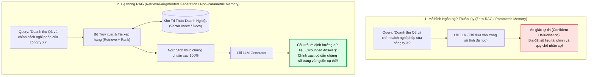

### Tại sao LLM lại ảo giác?
Bản chất của LLM là **cỗ máy dự đoán token tiếp theo dựa trên xác suất thống kê** (Autoregressive Token Prediction) được nén vào hàng trăm tỷ tham số tĩnh trong quá trình pre-training:
1. **Tri thức tham số (Parametric Memory) đóng băng theo thời gian:** Mô hình không biết những gì diễn ra sau thời điểm cutoff dữ liệu.
2. **Thiếu khả năng truy nguyên (Lack of Provenance):** Mô hình không thể chỉ ra câu nói này bắt nguồn từ tài liệu hay trang sách nào.
3. **Ảo giác cấu trúc:** Khi gặp lỗ hổng kiến thức, cơ chế Attention vẫn cố gắng ghép các từ có xác suất đồng xuất hiện cao nhất để tạo nên câu văn nghe "xuôi tai", dẫn đến các câu trả lời sai lệch nhưng cực kỳ thuyết phục.

Khoảng cách phân định giữa một mô hình đoán mò và một trợ lý AI đáng tin cậy nằm ở công nghệ: **Retrieval-Augmented Generation (RAG)**.

---

## 2. MÔ HÌNH TƯ DUY (MENTAL MODEL): KỲ THI MỞ SÁCH (THE OPEN-BOOK EXAM)

Để hiểu sâu sắc bản chất của RAG, hãy sử dụng phép ẩn dụ trực quan về **hai thí sinh bước vào phòng thi**:

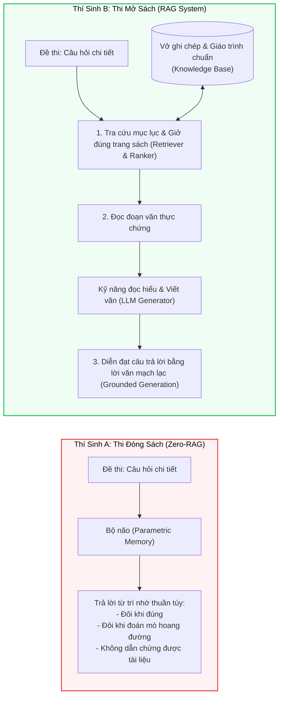

* **Mô hình AI thông thường (Zero-RAG):** Giống như thí sinh A đi thi mà **chỉ dựa vào trí nhớ sinh học**. Đối với các câu hỏi lịch sử xa xưa hay kiến thức đại cương, thí sinh có thể nhớ mang máng. Nhưng đối với các điều khoản bảo hiểm mới cập nhật tuần trước hay số liệu tài chính quý vừa qua, thí sinh buộc phải đoán mò.
* **Hệ thống RAG:** Giống như thí sinh B được phép **mở sách giáo trình (Open-Book Exam)**. Khi đối diện câu hỏi:
  1. Thí sinh không vội trả lời ngay từ trí nhớ.
  2. Thí sinh tra cứu mục lục, lật đúng trang sách chứa điều khoản liên quan nhất.
  3. Thí sinh đọc kỹ đoạn trích thực tế và dùng năng lực ngôn ngữ của mình để tổng hợp, diễn giải lại câu trả lời bằng văn phong lưu loát.

> [!important] Định Nghĩa Cốt Lõi Về RAG
> **Retrieval-Augmented Generation (RAG)** là quy trình kỹ nghệ trong đó mô hình sinh ngôn ngữ được cấp quyền truy xuất động vào cơ sở tri thức bên ngoài (Non-Parametric Knowledge Base) để tìm nạp các dữ kiện thực chứng liên quan nhất, từ đó tạo ra phản hồi **định hướng dữ liệu (Grounded Generation)**, chính xác và có thể kiểm chứng nguồn gốc từ đầu đến cuối (End-to-End Explainable).

---

## 3. GIẢI PHẪU 4 CẤU PHẦN CỐT LÕI CỦA RAG (THE 4 CORE BUILDING BLOCKS)

Một hệ sinh thái RAG tiêu chuẩn trong sản xuất không chỉ đơn giản là "nhúng vector rồi gửi vào prompt". Nó là sự hợp tác chuẩn xác của **4 cấu phần độc lập nhưng gắn kết hữu cơ**:

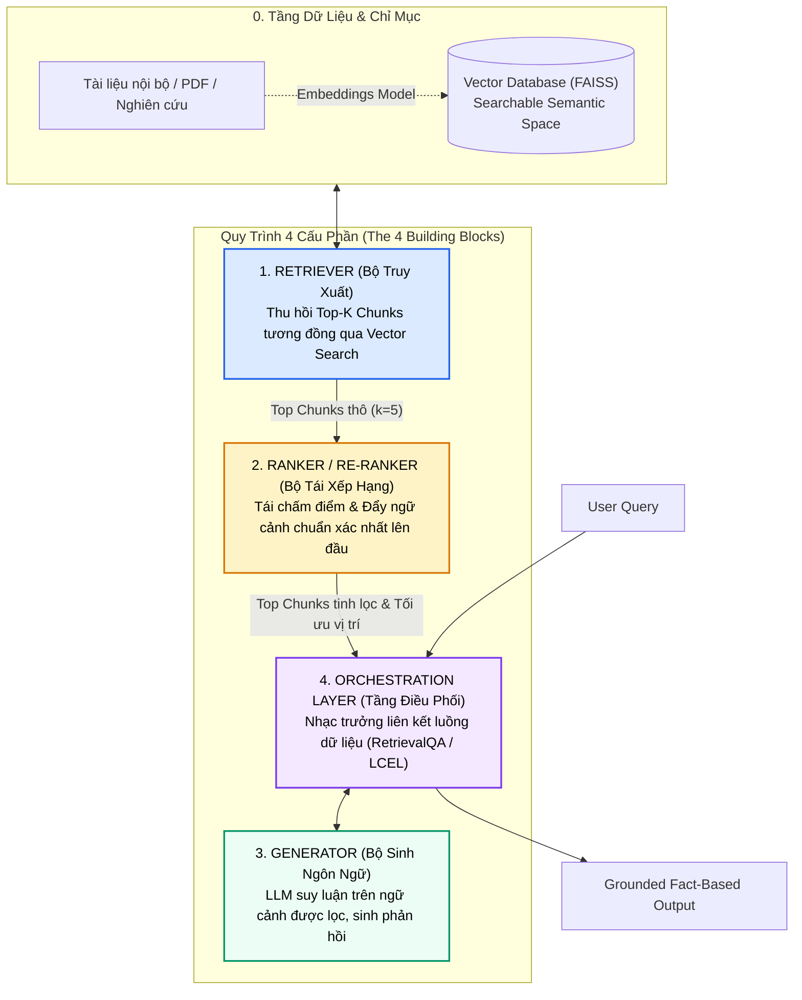

---

### Cấu phần 1: Không gian nhúng & Bộ truy xuất (Embeddings & Retriever)

Bộ truy xuất (**Retriever**) là cấu phần đầu tiên và có tính quyết định sống còn: nó chính là thực thể **trực tiếp tìm kiếm thông tin mà mô hình sẽ dùng để suy luận**. Nếu Retriever không tìm ra đúng tài liệu, toàn bộ các bước phía sau đều trở nên vô nghĩa.

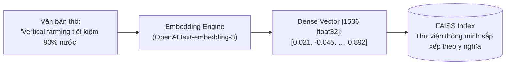

1. **Mô hình Vector Embeddings (ví dụ: `OpenAIEmbeddings`):**
   * Chuyển hóa ngôn ngữ tự nhiên từ dạng chuỗi ký tự thành các **vector số học nhiều chiều** (Dense Vectors).
   * Điểm mấu chốt: Các vector này bảo toàn các mối quan hệ ngữ nghĩa. Máy tính sử dụng các phép toán hình học (như Cosine Similarity, Dot Product) để đo lường mức độ tương đồng giữa câu hỏi và tài liệu trong không gian nhiều chiều.
2. **Cơ sở dữ liệu Vector (ví dụ: `FAISS` - Facebook AI Similarity Search):**
   * FAISS đóng vai trò như một **thư viện thông minh (Smart Library)**: Thay vì sắp xếp sách theo từ khóa chữ cái (như tìm kiếm Lexical BM25 truyền thống), nó tổ chức thông tin theo **ý nghĩa và khái niệm**.
   * Khi bạn tìm kiếm, FAISS không tìm các từ trùng khớp mặt chữ, mà tìm các đoạn văn bản có **ý nghĩa tương đồng nhất** với câu hỏi của bạn.
3. **Cơ chế hoạt động của Retriever:**
   * Chuyển câu hỏi người dùng thành vector.
   * Quét qua chỉ mục vector đã lập sẵn (`similarity_search`).
   * Trích xuất ra $k$ đoạn văn bản (chunks) có khoảng cách ngữ nghĩa gần nhất (ví dụ: $k=5$).

---

### Cấu phần 2: Bộ tái xếp hạng (Ranker / Re-ranker) - Màng lọc ngữ cảnh sống còn

Một sai lầm kinh điển của các kỹ sư triển khai RAG sơ khai (Naive RAG) là giả định rằng: *Cứ tìm kiếm tương đồng vector là tài liệu lấy về sẽ liên quan hoàn hảo đến câu hỏi.* Thực tế hoàn toàn không phải như vậy!

> [!warning] Nghịch Lý Tương Đồng Ngữ Nghĩa vs. Mức Độ Liên Quan Ngữ Cảnh
> * **Retriever (Bi-Encoder):** Tìm các văn bản có **từ vựng và chủ đề tương tự**. Nhưng tương tự không đồng nghĩa với việc trả lời đúng câu hỏi!
> * **Ranker (Cross-Encoder):** Đánh giá trực tiếp cặp `(Query, Document)` và trả lời câu hỏi: **"Đoạn văn này có thực sự trả lời đúng trọng tâm câu hỏi của người dùng hay không?"**

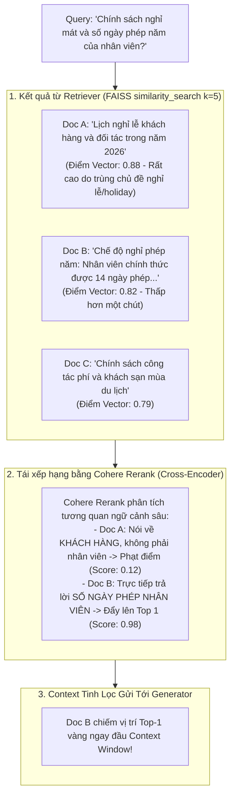

#### Ví Dụ Điển Hình: Nghỉ Phép Công Ty vs. Kỳ Nghỉ Khách Hàng
* Hãy tưởng tượng bạn đang xây dựng một bot Q&A giải đáp chính sách nhân sự công ty.
* Người dùng hỏi về **chế độ nghỉ mát của nhân viên**.
* Retriever quét vector DB và tìm thấy một đoạn văn nhắc nhiều lần đến *"kỳ nghỉ, du lịch, ngày nghỉ"*. Tuy nhiên, đoạn văn đó lại quy định về **lịch nghỉ lễ của đối tác và khách hàng** chứ không phải chính sách dành cho nhân viên nội bộ!
* Nếu đưa trực tiếp đoạn văn đó vào LLM, mô hình sẽ nhầm lẫn chính sách khách hàng thành chính sách nhân viên.
* **Bộ Tái Xếp Hạng (Ranker)** xuất hiện để giải quyết đúng bài toán này: Nó sử dụng mô hình Cross-Encoder chuyên biệt (như [[01_semantic_search_and_reranking#cross-encoder-bộ-mã-hóa-giao-thoa-đỉnh-cao-độ-chính-xác-qua-full-self-attention|Cohere Rerank]]) đọc đồng thời cả câu hỏi và đoạn trích, tính toán lại điểm liên quan (re-score), loại bỏ các đoạn văn nhiễu lệch đề và **đẩy tài liệu chứa câu trả lời thực sự lên vị trí số 1**.

---

### Cấu phần 3: Bộ sinh ngôn ngữ (Generator / LLM) - Ngòi bút tổng hợp

Nếu coi **Retriever và Ranker là những nhà nghiên cứu (Researchers)** miệt mài vào kho lưu trữ thu thập và sắp xếp các tài liệu thực chứng, thì **Generator chính là nhà văn (Writer)**:
* Người đọc lại toàn bộ các ghi chú đã được chắt lọc đó.
* Vận dụng năng lực hiểu ngôn ngữ và lập luận để chắp bút viết nên một câu trả lời hoàn chỉnh, mạch lạc, tự nhiên và chuẩn xác.

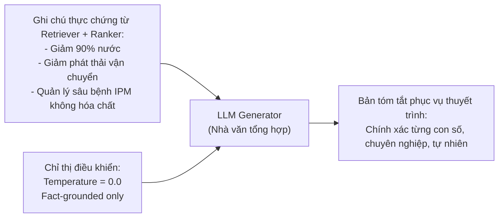

#### Nguyên Tắc Cấu Hình Generator Trong RAG Doanh Nghiệp:
1. **Nhiệt độ thấp (Low Temperature: $0.0 - 0.2$):** Giữ cho mô hình tập trung tối đa vào tính xác thực (Factuality) và nhất quán, triệt tiêu sự bay bổng ngẫu hứng có thể dẫn tới ảo giác.
2. **Mô hình gọn nhẹ & Tối ưu tốc độ (Lightweight & Cost-effective):** Vì tri thức chuyên ngành đã được nạp đầy đủ qua context của Retriever, bạn không nhất thiết phải dùng những mô hình khổng lồ đắt đỏ. Các mô hình gọn nhẹ, tốc độ cao (như GPT-4o-mini, Claude 3.5 Haiku) hoàn toàn đủ khả năng đọc hiểu và tổng hợp xuất sắc với chi phí cực thấp.

---

### Cấu phần 4: Tầng điều phối (Orchestration Layer / Chain) - Nhạc trưởng dàn nhạc

Từng cấu phần riêng lẻ (Retriever, Ranker, Generator) dù có xuất sắc đến đâu cũng chỉ là những công cụ rời rạc. Cần có một cấu phần liên kết chúng lại thành một dây chuyền tự động hóa duy nhất. Đó là sứ mệnh của **Tầng điều phối (Orchestration Layer)**, tiêu biểu là các chuỗi như `RetrievalQA` hay biểu thức hợp thành **LCEL (LangChain Expression Language)**.

> [!tip] Ẩn Dụ Về Vị Nhạc Trưởng (The Orchestra Conductor)
> Tầng điều phối giống như **vị nhạc trưởng của một dàn nhạc giao hưởng**:
> * Khi nhận câu hỏi từ khán giả (User Query), nhạc trưởng gõ đũa chỉ huy Retriever tìm kiếm trong kho tổng phổ.
> * Chuyển giao các nốt nhạc tìm được cho bè Ranker thẩm định và sắp xếp thứ tự ưu tiên.
> * Trao bản tổng phổ đã gọt giũa hoàn hảo cho bè lĩnh xướng Generator cất giọng.
> * Đem lại một giai điệu hài hòa, chính xác tuyệt đối mà không có bất kỳ nốt phô chênh nào.

---

## 4. VÒNG ĐIỆP NHỊP NHÀNG CỦA RAG: RETRIEVE $\to$ RANK $\to$ GENERATE $\to$ ORCHESTRATE

Mỗi khi bạn chứng kiến một hệ thống AI đưa ra một câu trả lời chính xác đến từng chi tiết, có dẫn chứng số liệu thực tế rõ ràng, phía sau hậu trường luôn là **vũ điệu 4 nhịp** vận hành liên tục:

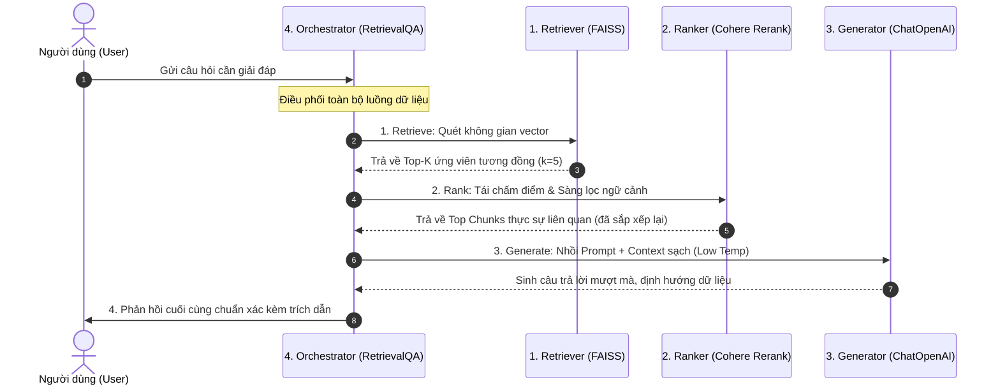

$$\boxed{\text{User Query} \xrightarrow{\quad} \textbf{RETRIEVE} \xrightarrow{\quad} \textbf{RANK} \xrightarrow{\quad} \textbf{GENERATE} \xrightarrow{\quad} \textbf{ORCHESTRATE}}$$

1. **Retrieve (Thu hồi):** Rà soát không gian vector để gom các đoạn văn bản tương đồng ngữ nghĩa.
2. **Rank (Tái xếp hạng):** Thẩm định sâu sắc mối quan hệ câu hỏi - tài liệu, đẩy thông tin đúng nhất lên đầu context window.
3. **Generate (Sinh nội dung):** LLM suy luận trên ngữ cảnh được cung cấp để viết nên câu trả lời tự nhiên.
4. **Orchestrate (Điều phối):** Gắn kết tự động hóa toàn bộ vòng lặp từ đầu vào tới đầu ra thành một quy trình liền mạch.

---

## 5. HIỆN THỰC HÓA MÃ NGUỒN THỰC CHIẾN (PRODUCTION PIPELINE IMPLEMENTATION)

Dưới đây là mã nguồn Python mẫu mực hiện thực hóa toàn bộ kiến trúc 4 cấu phần trên nền tảng LangChain, FAISS, OpenAI Embeddings và Cohere Rerank:

```python
"""
Kiến trúc RAG Hoàn chỉnh 4 Cấu Phần:
Retriever (FAISS + OpenAI) -> Ranker (Cohere Rerank) -> Generator (ChatOpenAI) -> Orchestrator (RetrievalQA)
"""

import os
from typing import List
from langchain_community.vectorstores import FAISS
from langchain_openai import OpenAIEmbeddings, ChatOpenAI
from langchain.retrievers.contextual_compression import ContextualCompressionRetriever
from langchain_cohere import CohereRerank
from langchain.chains import RetrievalQA
from langchain.docstore.document import Document

# ---------------------------------------------------------------------------
# CẤU HÌNH KHÓA TRUY CẬP API
# ---------------------------------------------------------------------------
os.environ["OPENAI_API_KEY"] = os.getenv("OPENAI_API_KEY", "your-openai-api-key")
os.environ["COHERE_API_KEY"] = os.getenv("COHERE_API_KEY", "your-cohere-api-key")


# ===========================================================================
# BƯỚC 1: NẠP CHỈ MỤC & KHỞI TẠO VECTOR DATABASE
# ===========================================================================
print(">>> [Bước 1] Khởi tạo mô hình Embedding và nạp cơ sở dữ liệu Vector...")

embedding_model = OpenAIEmbeddings(
    model="text-embedding-3-small"
)

# Trong kịch bản thực tế, chỉ mục này được nạp từ tệp tin FAISS đã lưu trữ offline
# Cảnh báo bảo mật: allow_dangerous_deserialization=True chỉ sử dụng với tệp tin nội bộ tin cậy
INDEX_PATH = "farm_knowledge_index"

if os.path.exists(INDEX_PATH):
    vector_db = FAISS.load_local(
        folder_path=INDEX_PATH,
        embeddings=embedding_model,
        allow_dangerous_deserialization=True  # Bắt buộc khi deserialize tệp tin pickle
    )
else:
    # Khởi tạo dữ liệu mẫu nếu chưa có chỉ mục lưu sẵn
    sample_docs = [
        Document(
            page_content="Vertical farming enables up to 90% water conservation compared to conventional farming through closed-loop recirculation.",
            metadata={"source": "water_management_report_2026.pdf", "topic": "conservation"}
        ),
        Document(
            page_content="Integrated Pest Management (IPM) in vertical farming drastically lowers pesticide dependency by utilizing biological controls.",
            metadata={"source": "ipm_agritech_study.pdf", "topic": "pest_control"}
        ),
        Document(
            page_content="Locating vertical farms in urban centers minimizes transport emissions and ensures local, year-round fresh crop yield.",
            metadata={"source": "urban_agri_logistics.pdf", "topic": "emissions"}
        ),
        Document(
            page_content="Vertical farming dramatically reduces land use footprint by stacking growing layers vertically in controlled environments.",
            metadata={"source": "land_efficiency_whitepaper.pdf", "topic": "land_use"}
        ),
        Document(
            page_content="Our holiday schedule for client visits during summer requires 2 weeks advance notice to the front desk.",
            metadata={"source": "internal_memo_visitor_policy.pdf", "topic": "holiday"}  # Đoạn gây nhiễu
        ),
    ]
    vector_db = FAISS.from_documents(sample_docs, embedding_model)
    vector_db.save_local(INDEX_PATH)
    print("    Đã khởi tạo và lưu trữ chỉ mục mẫu thành công.")


# ===========================================================================
# BƯỚC 2: CẤU HÌNH & KIỂM ĐỊNH BỘ TRUY XUẤT (RETRIEVER VERIFICATION)
# ===========================================================================
print(">>> [Bước 2] Thiết lập Retriever với k=5 và kiểm tra tính toàn vẹn...")

base_retriever = vector_db.as_retriever(
    search_type="similarity",
    search_kwargs={"k": 5}
)

test_query = "What are the concrete benefits of vertical farming and integrated pest management?"
retrieved_test_docs = base_retriever.invoke(test_query)
print(f"    Kiểm định: Retriever đã thu hồi {len(retrieved_test_docs)} đoạn tài liệu sơ bộ.")


# ===========================================================================
# BƯỚC 3: TÍCH HỢP BỘ TÁI XẾP HẠNG (COHERE RE-RANKER)
# ===========================================================================
print(">>> [Bước 3] Tích hợp Cohere Rerank qua ContextualCompressionRetriever...")

# Khởi tạo mô hình Cross-Encoder Re-ranker
reranker = CohereRerank(
    model="rerank-v3.5",
    top_n=3  # Chỉ giữ lại Top 3 tài liệu có mức độ phù hợp cao nhất sau khi chấm điểm lại
)

# Bọc Base Retriever bằng Contextual Compression Retriever
compression_retriever = ContextualCompressionRetriever(
    base_compressor=reranker,
    base_retriever=base_retriever
)


# ===========================================================================
# BƯỚC 4: THIẾT LẬP GENERATOR VỚI TEMPERATURE FACTUALITY
# ===========================================================================
print(">>> [Bước 4] Khởi tạo LLM Generator gọn nhẹ với temperature=0.0...")

generator_llm = ChatOpenAI(
    model_name="gpt-4o-mini",
    temperature=0.0,      # Triệt tiêu ngẫu hứng để đảm bảo phản hồi 100% bám sát dữ liệu
    max_tokens=500
)


# ===========================================================================
# BƯỚC 5: KẾT NỐI TẦNG ĐIỀU PHỐI (ORCHESTRATION CHAIN)
# ===========================================================================
print(">>> [Bước 5] Ghép nối dàn nhạc qua RetrievalQA Chain...")

rag_orchestration_chain = RetrievalQA.from_chain_type(
    llm=generator_llm,
    chain_type="stuff",
    retriever=compression_retriever,
    return_source_documents=True
)

# ===========================================================================
# THỰC THI TRUY VẤN SẢN XUẤT (LIVE PRODUCTION RUN)
# ===========================================================================
print("\n" + "="*70)
print(f"TRUY VẤN: {test_query}")
print("="*70)

response = rag_orchestration_chain.invoke({"query": test_query})

print("\n--- PHẢN HỒI ĐÃ ĐƯỢC ĐỊNH HƯỚNG DỮ LIỆU (GROUNDED ANSWER) ---")
print(response["result"])

print("\n--- TÀI LIỆU NGUỒN ĐƯỢC CHẮT LỌC (SOURCE EVIDENCE) ---")
for idx, doc in enumerate(response["source_documents"], 1):
    source_name = doc.metadata.get("source", "Unknown")
    print(f"[{idx}] Nguồn: {source_name} | Nội dung: {doc.page_content[:90]}...")
```

---

## 6. NGHIÊN CỨU ĐIỂN CỨU (CASE STUDY): TỔNG HỢP DỮ LIỆU GỌI VỐN NÔNG NGHIỆP THẲNG ĐỨNG (VERTICAL FARMING & IPM)

Hãy xem cách hệ thống trên giải quyết một kịch bản kinh doanh thực tế trong doanh nghiệp:

### Tình huống thực tế:
Bạn là Giám đốc Công nghệ (CTO) hoặc Trưởng nhóm Nghiên cứu đang chuẩn bị bài thuyết trình (Pitch Deck) trước các nhà đầu tư mạo hiểm (VCs). Bạn cần trích xuất ngay lập tức các **luận điểm định lượng, bằng chứng xác thực (Evidence-based insights)** về lợi ích cốt lõi của công nghệ nông nghiệp thẳng đứng và hệ thống quản lý sâu bệnh tích hợp (Integrated Pest Management - IPM) từ thư viện hàng nghìn trang báo cáo nghiên cứu.

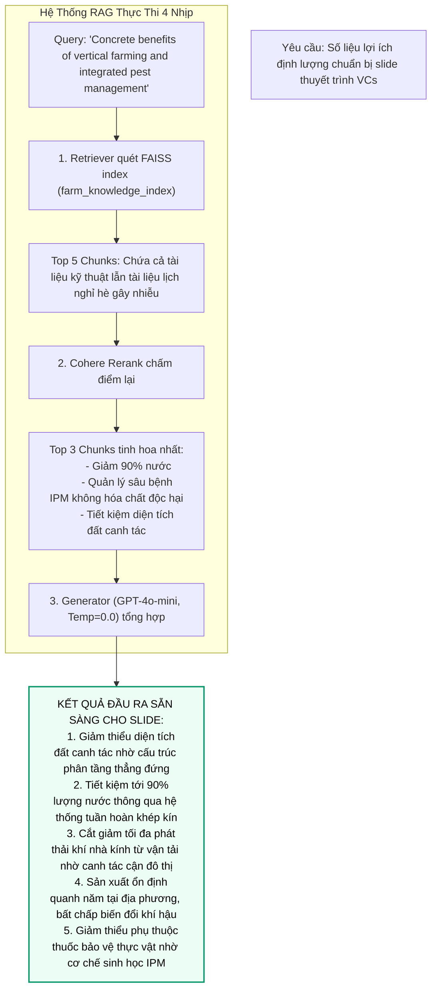

* **Kết quả:** Thay vì một đoạn văn bản chung chung hoặc một câu trả lời bịa đặt số liệu, hệ thống xuất ra danh sách 5 lợi ích then chốt với số liệu chuẩn xác 100% trích xuất từ báo cáo nghiên cứu gốc.
* **Giá trị kinh doanh:** Người dùng hoàn toàn tự tin mang dữ liệu này đối thoại trước hội đồng đầu tư mà không sợ rủi ro sai lệch thông tin.

---

## 7. BẢNG MA TRẬN PHÂN ĐỊNH VAI TRÒ: RETRIEVER VS. RANKER VS. GENERATOR VS. ORCHESTRATOR

| Tiêu Chí So Sánh | 1. Retriever (Bộ Truy Xuất) | 2. Ranker (Bộ Tái Xếp Hạng) | 3. Generator (Bộ Sinh Ngôn Ngữ) | 4. Orchestration Layer (Tầng Điều Phối) |
| :--- | :--- | :--- | :--- | :--- |
| **Ẩn dụ nhận thức** | **Thư viện viên** lục tìm tài liệu sơ bộ | **Tổng biên tập** thẩm định tính liên quan | **Nhà văn** chấp bút câu trả lời | **Nhạc trưởng** chỉ huy toàn bộ dàn nhạc |
| **Bản chất công nghệ** | Bi-Encoder (Siamese Network) + Approximate Nearest Neighbors (ANN) | Cross-Encoder (Full Self-Attention giữa Query và Document) | Causal Autoregressive LLM (Decoder-only Transformer) | Directed Acyclic Graph (DAG) / Chuỗi gọi Pipeline |
| **Công cụ đại diện** | `FAISS`, `Pinecone`, `Qdrant`, `OpenAIEmbeddings` | `Cohere Rerank`, `BGE-Reranker-Large`, `ColBERT` | `ChatOpenAI (GPT-4o)`, `Claude 3.5`, `LLaMA-3` | `LangChain (RetrievalQA / LCEL)`, `LlamaIndex`, `Haystack` |
| **Độ phức tạp tính toán** | $O(1)$ đến $O(\log N)$ nhờ chỉ mục HNSW/IVFFlat | $O(K \times (L_q + L_d)^2)$ với $K \approx 5 - 20$ | $O(T \times L_{\text{ctx}})$ autoregressive token generation | $O(1)$ overhead kết nối mạng và chuyển giao state |
| **Độ trễ trung bình** | Cực nhanh: $5\text{ms} - 25\text{ms}$ | Trung bình: $50\text{ms} - 150\text{ms}$ | Chiếm phần lớn thời gian: $500\text{ms} - 2000\text{ms}$ | Không đáng kể ($< 2\text{ms}$) |
| **Hậu quả nếu vắng mặt** | Hệ thống hoàn toàn mù thông tin nội bộ, chỉ nói mò từ trí nhớ | Bị nhiễu bởi các tài liệu trùng từ khóa nhưng lạc đề; kích hoạt *Lost in the Middle* | Có tài liệu đúng nhưng không thể diễn giải ra ngôn ngữ tự nhiên mạch lạc | Các cấu phần rời rạc, phải viết code kết nối thủ công dễ gãy vỡ |

---

## 8. CÁC THÁCH THỨC CỐ HỮU & BIÊN GIỚI NGHIÊN CỨU HIỆN ĐẠI (CHALLENGES & FRONTIERS)

Dù RAG mang lại bước nhảy vọt so với suy luận tham số thuần túy, các hệ thống triển khai thực tế vẫn đối diện với 3 thách thức kỹ thuật lớn:

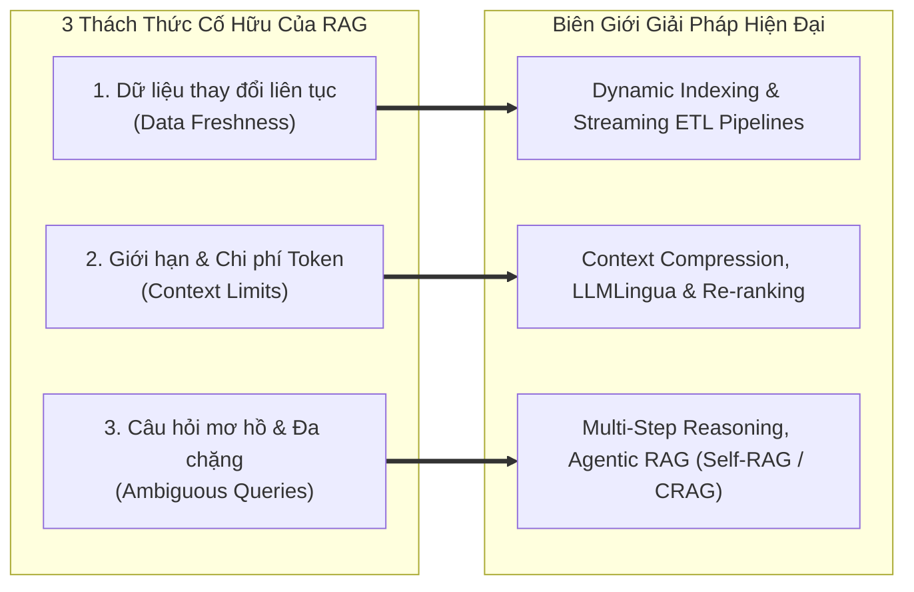

### 1. Tính tươi mới của dữ liệu (Data Freshness & Dynamic Indexing)
* **Thách thức:** Kho tài liệu doanh nghiệp liên tục biến động (hợp đồng mới được ký, chính sách nhân sự sửa đổi hàng tháng). Nếu chỉ mục vector chỉ được tạo một lần offline (Static Indexing), câu trả lời sẽ sớm trở nên lạc hậu.
* **Giải pháp hiện đại:**
  * **Dynamic Indexing & Change Data Capture (CDC):** Tích hợp pipeline dữ liệu thời gian thực (Kafka, Debezium) lắng nghe thay đổi từ cơ sở dữ liệu gốc để tự động cập nhật hoặc xóa vector chunk tương ứng trong Vector DB.
  * **Chỉ mục kết hợp thời gian (Temporal Metadata Filtering):** Gắn nhãn thời gian `created_at` và `valid_until` vào metadata của vector để lọc các tài liệu đã hết hiệu lực.

### 2. Áp lực trần Context Window & Nén ngữ cảnh (Context Limits & Compression)
* **Thách thức:** Dù các LLM hiện đại có Context Window lên tới 1M hoặc 2M tokens, việc nhồi hàng chục chunks thô vào Prompt không chỉ làm tăng vọt chi phí tiền bạc và độ trễ suy luận, mà còn kích hoạt hiện tượng [[01_semantic_search_and_reranking#hiện-tượng-lost-in-the-middle-liu-et-al-2023--vai-trò-sống-còn-của-re-ranker|Lost in the Middle]] khiến LLM bỏ sót thông tin quan trọng ở giữa.
* **Giải pháp hiện đại:**
  * **Contextual Compression & Selective Extraction:** Sử dụng các thuật toán như *LLMLingua* hoặc bộ lọc nén ngữ cảnh của Cohere để lược bỏ các token thừa, chỉ giữ lại các câu mang mật độ thông tin cao nhất trước khi đưa vào Generator.
  * **Hierarchical Retrieval (Parent-Child Chunking):** Chỉ lưu embedding của các mẩu nhỏ để tìm kiếm chính xác, sau đó nạp đoạn văn cha có cấu trúc hoàn chỉnh vào LLM (xem chi tiết tại [[01_semantic_search_and_reranking#1-hierarchical--parent-document-retrieval-sentence-window--auto-merging|Hierarchical Retrieval]]).

### 3. Truy vấn mơ hồ & Suy luận đa chặng (Ambiguous Queries & Multi-hop Reasoning)
* **Thách thức:** Khi người dùng đặt câu hỏi quá ngắn, đa nghĩa (ví dụ: *"Chính sách thế nào?"*) hoặc câu hỏi đòi hỏi phải thu thập dữ kiện từ 3-4 tài liệu khác nhau mới kết luận được, một lượt truy xuất duy nhất (Single-turn RAG) chắc chắn thất bại.
* **Giải pháp hiện đại:**
  * **Agentic RAG & Tự phản tư (Self-Reflective Loops):** Chuyển dịch từ đường ống tuyến tính sang vòng lặp tác tử tự trị:
    * [[01_semantic_search_and_reranking#1-self-rag-self-reflective-retrieval-augmented-generation-asai-et-al-2023|Self-RAG]]: Tác tử tự đánh giá xem mình có cần truy xuất thêm hay không qua các reflection tokens.
    * [[01_semantic_search_and_reranking#2-corrective-rag-crag-yan-et-al-2024|Corrective RAG (CRAG)]]: Tự động kích hoạt Web Search dự phòng nếu điểm tin cậy của tài liệu nội bộ quá thấp.
    * [[03-building-agents/03-loop-engineering/02_react_and_planning|ReAct & Multi-hop Planning]]: Phân rã câu hỏi lớn thành nhiều câu hỏi con và thực hiện truy xuất tuần tự từng bước.

---

## 9. CÁC MẪU THIẾT KẾ RAG CHIẾN LƯỢC & CHIẾN THUẬT TRUY XUẤT (STRATEGIC RAG DESIGN PATTERNS & RETRIEVAL STRATEGIES)

Trong thực tế kỹ nghệ phần mềm và hệ thống AI doanh nghiệp, RAG không chỉ dừng lại ở một đường ống tuyến tính đơn giản. Tùy thuộc vào bản chất của dữ liệu, ngân sách độ trễ (Latency Budget), chi phí token và loại hình tác vụ (hỏi đáp sự thật, tóm tắt hay tổng hợp tri thức), các kỹ sư AI áp dụng các **Mẫu thiết kế (Design Patterns)** và **Chiến thuật truy xuất (Retrieval Strategies)** chuyên biệt.

Dưới đây là 9 mẫu thiết kế và chiến thuật cốt lõi định hình nên các hệ thống RAG hiện đại:

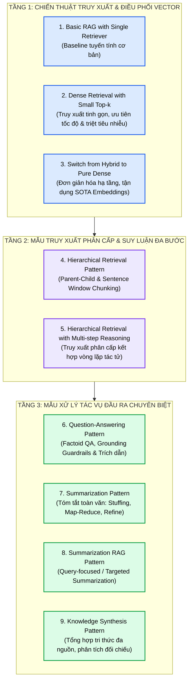

---

### 9.1. Basic RAG with a Single Retriever (RAG Cơ Bản Với Bộ Truy Xuất Đơn)

#### Bản chất kiến trúc
Đây là mẫu thiết kế nguyên thủy (Naive / Baseline RAG) được sử dụng rộng rãi khi bắt đầu xây dựng sản phẩm:
* Hệ thống chỉ duy trì **duy nhất một bộ truy xuất vector dày (Single Dense Vector Retriever)** như FAISS, ChromaDB hay Qdrant.
* Toàn bộ quy trình diễn ra theo đường ống 1 chiều tuyến tính nghiêm ngặt không có phân nhánh:
  $$C = \text{TopK}_{d \in \mathcal{D}} \left( \cos(E(q), E(d)) \right)$$
  $$y = \text{LLM}(\text{Prompt}(q, C))$$

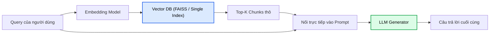

#### Khi nào nên áp dụng?
* **Xây dựng PoC (Proof of Concept) siêu tốc:** Cần kiểm chứng giá trị bài toán trong vòng 24 - 48 giờ.
* **Tập dữ liệu nhỏ và đồng nhất:** Kho tài liệu dưới 1,000 trang, cấu trúc văn bản rõ ràng, ít biệt ngữ lạ.
* **Chi phí tính toán tối thiểu:** Không có ngân sách hạ tầng cho GPU Re-ranker hoặc các cụm tìm kiếm lai phức tạp.

#### Điểm nghẽn chí mạng (Failure Modes)
1. **Thiếu lớp Re-ranking:** Dễ bị đánh lừa bởi các đoạn văn có độ tương đồng cosine cao nhưng hoàn toàn lệch chủ đề ngữ cảnh.
2. **Điểm đứt gãy đơn lẻ (Single Point of Semantic Failure):** Nếu mô hình nhúng hiểu sai từ khóa trong truy vấn, toàn bộ $K$ chunks kéo về đều là rác (Garbage In $\to$ Garbage Out).
3. **Nghịch lý $K$:** Nếu đặt $K$ lớn ($K \ge 10$) $\to$ dính lỗi *Lost in the Middle*. Nếu đặt $K$ nhỏ ($K \le 3$) $\to$ tụt giảm Recall nghiêm trọng.

---

### 9.2. Dense Retrieval with Small Top-k (Truy Xuất Dày Với Top-k Tinh Gọn)

#### Triết lý thiết kế: "Less is More" (Ít hơn là Tốt hơn)
Thay vì thu hồi 10 hoặc 20 đoạn văn như thói quen thông thường, chiến thuật này chủ động khống chế tham số truy xuất ở ngưỡng tối thiểu cực đoan:
$$K \in \{2, 3\}$$

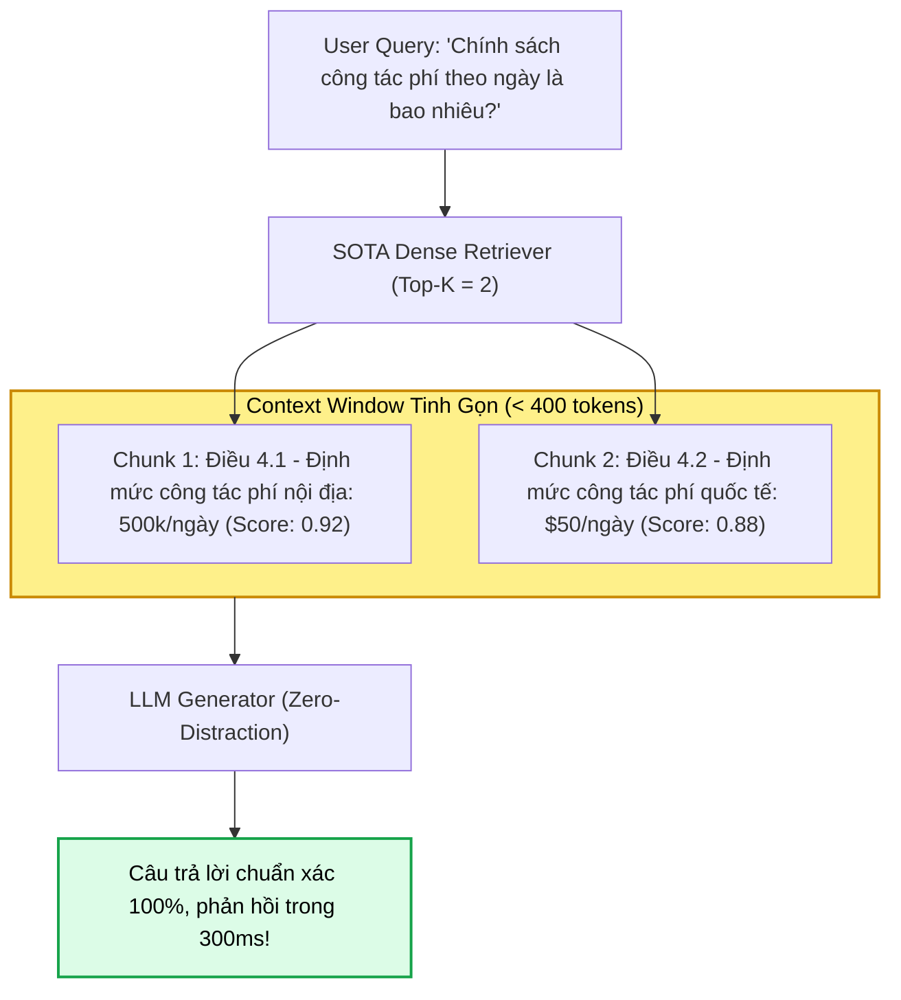

#### Các lợi thế kỹ thuật mang tính quyết định
1. **Triệt tiêu hiện tượng "Lost in the Middle":** Khi chỉ có 2 chunks trong Prompt, toàn bộ thông tin nằm trọn ở vị trí đầu và cuối của Context Window — nơi cơ chế Self-Attention của mô hình ngôn ngữ đạt độ tập trung cao nhất ($100\%$ Attention Density).
2. **Tối ưu hóa kinh tế Token (Token Economics):**
   * Giảm $75\% - 85\%$ số lượng input tokens trên mỗi request.
   * Với hệ thống phục vụ $1,000,000$ truy vấn/tháng, tiết kiệm hàng nghìn USD chi phí suy luận API.
3. **Giảm thiểu độ trễ phản hồi (Latency Minimization):** Giảm mạnh thời gian nạp bộ đệm KV Cache (TTFT - Time To First Token) của LLM.
4. **Ngăn chặn ô nhiễm ngữ cảnh (Context Poisoning):** Không đưa các chunk có độ tương đồng thấp ($0.65 - 0.70$) vào Prompt để tránh làm phân tán sự chú ý của LLM.

> [!important]
> **Điều kiện tiên quyết để triển khai thành công:**
> Chiến thuật này **BẮT BUỘC** phải đi kèm với:
> 1. Mô hình Embedding thuộc hàng đỉnh cao (SOTA) như `text-embedding-3-large` (3072 dims), Cohere Embed v3, hoặc BGE-Large.
> 2. Câu hỏi thuộc dạng **Factoid / Direct Lookup** (hỏi số liệu, điều khoản, định nghĩa rõ ràng).
> Tuyệt đối không dùng $K$ nhỏ cho các bài toán phân tích tổng hợp liên tài liệu vì nguy cơ bỏ sót dữ kiện (Low Recall).

---

### 9.3. Switch from Hybrid to Pure Dense Retrieval (Chuyển Dịch Từ Tìm Kiếm Lai Sang Dense Thuần Túy)

#### Bối cảnh: Tại sao từng phải dùng Hybrid Search?
Trong giai đoạn 2020 - 2023, kiến trúc tiêu chuẩn công nghiệp luôn khuyến nghị **Hybrid Search** (kết hợp Dense Vector + BM25 Sparse Search). Lý do là các mô hình nhúng thời kỳ đầu (như BERT, SBERT sơ khai) rất yếu trong việc nhận diện:
* Mã sản phẩm SKU (`A89-XYZ-2024`)
* Tên định danh cá nhân, số chứng minh thư, số hiệu hợp đồng
* Biệt ngữ chuyên môn hiếm gặp (Out-Of-Vocabulary - OOV)

Tuy nhiên, việc duy trì Hybrid Search đòi hỏi phải vận hành song song cụm Elasticsearch/OpenSearch cùng với Vector Database, gây tốn kém hạ tầng và đau đầu về bài toán đồng bộ dữ liệu.

#### 3 Động lực kiến trúc chuyển dịch sang Pure Dense Retrieval
1. **Sự bùng nổ của các mô hình Embedding thế hệ mới:**
   * Các mô hình nhúng hiện đại (OpenAI Embedding v3, Cohere v3, Voyage AI, BGE-M3) được huấn luyện với hàm mất mát tương phản (Contrastive Loss) quy mô hàng chục tỷ cặp văn bản và áp dụng kỹ thuật *Matryoshka Representation Learning (MRL)*.
   * Chúng có khả năng biểu diễn xuất sắc cả chuỗi ký tự định danh, số liệu và mã code mà không còn bị hiện tượng sụp đổ ngữ nghĩa (Embedding Collapse).
2. **Cắt giảm triệt để Tổng chi phí sở hữu (TCO - Total Cost of Ownership):**
   * Xóa bỏ hoàn toàn cụm máy chủ Lucene/Elasticsearch, tiết kiệm $50\%$ tài nguyên RAM và I/O lưu trữ.
   * Triệt tiêu bài toán **Bất đồng bộ kép (Dual-Write Inconsistency)**: Không còn rủi ro bản ghi đã lưu vào Vector DB nhưng chưa kịp đánh chỉ mục vào Elasticsearch (hoặc ngược lại).
3. **Loại bỏ siêu tham số dung hợp mong manh (Fragile Fusion Hyperparameters):**
   * Trong Hybrid Search, bạn phải liên tục căn chỉnh trọng số $\alpha$ trong công thức:
     $$S_{\text{hybrid}} = \alpha \cdot S_{\text{dense}} + (1 - \alpha) \cdot S_{\text{sparse}}$$
   * Việc chuyển sang Pure Dense giúp quy trình kỹ thuật trở nên thuần nhất, dễ kiểm thử hồi quy (Regression Testing) và dễ scale hạ tầng theo chiều ngang.

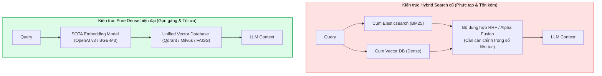

#### Ma trận ra quyết định: Khi nào được phép chuyển sang Pure Dense?

| Tiêu chí nghiệp vụ | Giữ lại Hybrid Search (Dense + BM25) | Chuyển sang Pure Dense Retrieval |
| :--- | :--- | :--- |
| **Đặc thù truy vấn** | Gõ từ khóa cụ thể, mã lỗi kỹ thuật, mã SKU, số hợp đồng | Đặt câu hỏi tự nhiên dài, hội thoại bot, paraphrase phong phú |
| **Tập dữ liệu** | Mã nguồn phần mềm, log hệ thống, danh mục hàng hóa | Sách, tài liệu chính sách, cẩm nang nội bộ, bài nghiên cứu |
| **Ngân sách hạ tầng** | Doanh nghiệp lớn, sẵn sàng chi trả cho cụm tìm kiếm kép | Tối ưu chi phí, ưu tiên kiến trúc vi dịch vụ tinh gọn |
| **Mô hình nhúng** | Mô hình nhúng cũ hoặc mô hình nhỏ (< 512 dimensions) | SOTA Embeddings (`text-embedding-3-large`, BGE-M3) |

---

### 9.4. Hierarchical Retrieval Pattern (Mẫu Truy Xuất Phân Cấp / Parent-Child Chunking)

#### Nghịch lý kích thước Chunk (The Chunk Size Dilemma)
Một trong những xung đột căn bản nhất trong thiết kế RAG là xung đột kích thước phân đoạn:
* **Nếu chọn Chunk nhỏ ($100 - 200$ tokens):** Vector nhúng biểu diễn cực kỳ sắc nét một ý tưởng cụ thể, điểm tương đồng cosine rất cao khi match câu hỏi. Tuy nhiên, khi đưa vào LLM, chunk bị cụt bối cảnh (mất thông tin về chủ ngữ, bảng biểu liên đới hoặc điều kiện ràng buộc ở đoạn trước).
* **Nếu chọn Chunk lớn ($1000 - 2000$ tokens):** LLM có đầy đủ ngữ cảnh để suy luận mạch lạc. Tuy nhiên, vector nhúng của đoạn văn lớn bị hiện tượng **loãng ngữ nghĩa (Semantic Dilution)** — chứa quá nhiều chủ đề hỗn tạp khiến điểm cosine bị kéo về mức trung bình, làm bộ tìm kiếm vector bỏ lọt tài liệu.

#### Cơ chế giải quyết: Tách rời "Văn bản để Tìm" và "Văn bản để Đọc"
Mẫu thiết kế phân cấp (Hierarchical Retrieval) giải quyết hoàn hảo nghịch lý này bằng kiến trúc hai tầng:
1. **Child Chunks (Tầng con):** Văn bản được băm nhỏ thành các đoạn $128 - 256$ tokens. Chỉ có các Child Chunks này được chuyển thành vector và lập chỉ mục trong Vector Database để phục vụ tìm kiếm chính xác.
2. **Parent Document / Chunk (Tầng cha):** Các đoạn lớn ($1024 - 2048$ tokens) hoặc toàn bộ trang văn bản chứa trọn vẹn ngữ cảnh xung quanh. Mỗi Child Chunk mang một trường metadata: `parent_id`.
3. **Tại thời điểm truy xuất:**
   $$\text{Query} \xrightarrow{\text{Vector Search}} \text{Child Chunks} \xrightarrow{\text{Lookup Metadata: parent\_id}} \text{Parent Documents} \xrightarrow{\text{Deduplicate}} \text{LLM Prompt}$$

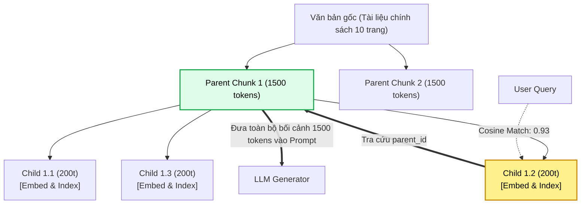

#### Biến thể: Sentence Window Retrieval
Thay vì chia Parent-Child theo cấu trúc khối, biến thể **Sentence Window Retrieval**:
* Băm tài liệu thành từng **câu đơn lẻ** và chỉ embed từng câu đó.
* Khi một câu đơn khớp với câu hỏi người dùng, hệ thống tự động bung cửa sổ trượt lấy thêm $w$ câu phía trước và $w$ câu phía sau ($w = 3$ câu).
* LLM nhận được một đoạn văn hoàn chỉnh 7 câu với câu trọng tâm nằm ngay chính giữa.

---

### 9.5. Hierarchical Retrieval with Multi-Step Reasoning (Truy Xuất Phân Cấp Kết Hợp Suy Luận Đa Chặng)

#### Khái niệm & Bài toán thực tế
Khi người dùng đặt một câu hỏi phức tạp mang tính khảo cứu đa chiều, ví dụ:
> *"So sánh tỷ lệ tăng trưởng doanh thu và rủi ro chuỗi cung ứng giữa Báo cáo Thường niên 2023 và 2024 của VinFast, chỉ ra các hành động khắc phục mà ban điều hành đã công bố?"*

Một lượt truy xuất phân cấp duy nhất (Single-turn Hierarchical Retrieval) chắc chắn thất bại vì dữ liệu nằm ở nhiều tài liệu khác nhau và đòi hỏi phải tổng hợp qua từng bước logic.

#### Vòng lặp tác tử 4 chặng (The 4-Step Agentic Loop)

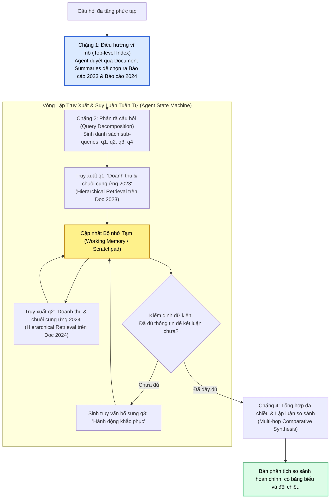

#### Triển khai mã nguồn mẫu (Agentic Planning Pattern)
```python
from typing import List, Dict, Any
from langchain_core.prompts import ChatPromptTemplate
from langchain_openai import ChatOpenAI

llm = ChatOpenAI(model="gpt-4o", temperature=0)

# Chặng 1 & 2: Phân rã câu hỏi phức tạp thành các câu hỏi con
planner_prompt = ChatPromptTemplate.from_messages([
    ("system", "Bạn là Chuyên gia hoạch định truy xuất. Hãy phân rã câu hỏi lớn thành danh sách 2-4 câu hỏi con độc lập."),
    ("user", "{complex_query}")
])

def multi_step_hierarchical_rag(complex_query: str, hierarchical_retriever) -> str:
    # 1. Sinh kế hoạch truy xuất
    plan = (planner_prompt | llm).invoke({"complex_query": complex_query}).content
    sub_queries = [line.strip("- ") for line in plan.split("\n") if line.strip().startswith("-")]
    
    working_memory: List[Dict[str, Any]] = []
    
    # 2. Vòng lặp truy xuất tuần tự trên cây dữ liệu phân cấp
    for q in sub_queries:
        # Hierarchical retrieval: match Child chunks -> return Parent contexts
        parent_docs = hierarchical_retriever.invoke(q)
        evidence = "\n---\n".join([d.page_content for d in parent_docs])
        working_memory.append({"sub_query": q, "evidence": evidence})
        
    # 3. Tổng hợp đa chặng có suy luận đối chiếu
    synthesis_prompt = ChatPromptTemplate.from_messages([
        ("system", "Dựa trên các bằng chứng đã thu thập qua từng bước, hãy tổng hợp phân tích đối chiếu chuyên sâu."),
        ("user", "Câu hỏi gốc: {complex_query}\n\nNhật ký dữ kiện:\n{memory}")
    ])
    
    formatted_memory = "\n".join([f"Q: {m['sub_query']}\nBằng chứng:\n{m['evidence']}\n" for m in working_memory])
    return (synthesis_prompt | llm).invoke({"complex_query": complex_query, "memory": formatted_memory}).content
```

---

### 9.6. Question-Answering Pattern (Mẫu Hỏi Đáp Trực Diện / Factoid QA)

#### Định vị mục tiêu
Mẫu Question-Answering (Factoid QA) là mẫu thiết kế phổ biến nhất trong các ứng dụng AI doanh nghiệp (Chatbot chăm sóc khách hàng, Trợ lý tra cứu chính sách nhân sự, Q&A sổ tay vận hành).
Mục tiêu duy nhất của mẫu này là: **Đưa ra câu trả lời dứt khoát, chuẩn xác, không dài dòng và có bằng chứng xác thực 100%**.

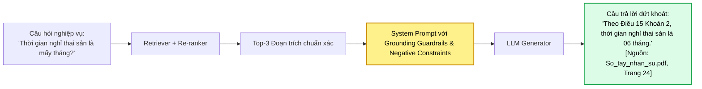

#### Thiết kế Prompt với Kỹ thuật Grounding Guardrails (Hàng Rào Chống Ảo Giác)
Một Prompt chuẩn mực cho Factoid QA bắt buộc phải cài đặt 3 cơ chế an toàn:
1. **Ràng buộc tiêu cực nghiêm ngặt (Strict Negative Constraint):** Ép buộc LLM phải thừa nhận thiếu thông tin thay vì tự sáng tác.
2. **Quy tắc trích dẫn nguồn (Source Citation Enforcement):** Mọi luận điểm số liệu phải gắn liền với nguồn tài liệu.
3. **Giới hạn phạm vi (Boundary Fence):** Cấm LLM sử dụng kiến thức bên ngoài được học trong pre-training để bổ sung nếu tài liệu không đề cập.

```markdown
> [!example] Mẫu System Prompt Chuẩn Cho Factoid QA
> Bạn là Trợ lý Hỏi Đáp Pháp chế & Chính sách Doanh nghiệp.
> NHIỆM VỤ: Trả lời câu hỏi của người dùng CHỈ DỰA TRÊN ngữ cảnh được cung cấp dưới đây.
> 
> QUY TẮC BẮT BUỘC:
> 1. Nếu thông tin không xuất hiện trong ngữ cảnh, bạn BẮT BUỘC phải trả lời: "Tôi rất tiếc, tài liệu được cung cấp không chứa thông tin để trả lời câu hỏi này." TUYỆT ĐỐI không được suy đoán hoặc dùng kiến thức ngoài.
> 2. Mọi câu trả lời phải kèm trích dẫn chính xác: [Tên_tài_liệu, Mục X, Trang Y].
> 3. Trả lời trực diện, súc tích, đi thẳng vào trọng tâm câu hỏi.
```

---

### 9.7. Summarization Pattern (Mẫu Tóm Tắt Toàn Cảnh Tài Liệu)

#### Bản chất bài toán
Khác với tìm kiếm thông tin cục bộ, tác vụ tóm tắt văn bản tổng thể (Document-wide Summarization) đòi hỏi hệ thống phải đọc hiểu **toàn bộ một tài liệu rất dài** (báo cáo kiểm toán 150 trang, hồ sơ dự thầu, tài liệu thiết kế hệ thống) vượt xa sức chứa của Context Window.

#### 3 Kỹ thuật kiến trúc kinh điển

```mermaid
flowchart TD
    subgraph M1["Chiến lược 1: Stuffing (Nhồi trực tiếp)"]
        D1["Tài liệu vừa kích thước"] --> LLM1["1 lần LLM Call"] --> S1["Bản tóm tắt"]
    end

    subgraph M2["Chiến lược 2: Map-Reduce (Tóm tắt song song)"]
        D2["Tài liệu siêu dài"] --> Split["Chia nhỏ thành M đoạn"]
        Split --> Map1["Map: LLM tóm tắt đoạn 1"]
        Split --> Map2["Map: LLM tóm tắt đoạn 2"]
        Split --> Map3["Map: LLM tóm tắt đoạn M"]
        Map1 --> Reduce["Reduce: LLM tổng hợp các bản tóm tắt con"]
        Map2 --> Reduce
        Map3 --> Reduce
        Reduce --> S2["Bản tóm tắt toàn cảnh"]
    end

    subgraph M3["Chiến lược 3: Refine (Tinh chỉnh lũy tiến)"]
        ChunkA["Đoạn 1"] --> R1["LLM tóm tắt"] --> SumA["Tóm tắt 1"]
        SumA & ChunkB["Đoạn 2"] --> R2["LLM cập nhật tóm tắt"] --> SumB["Tóm tắt 2"]
        SumB & ChunkC["Đoạn 3"] --> R3["LLM hoàn thiện"] --> S3["Tóm tắt cuối cùng"]
    end

    style M1 fill:#f1f5f9,stroke:#64748b,stroke-width:1px,color:#000000
    style M2 fill:#dbeafe,stroke:#2563eb,stroke-width:2px,color:#000000
    style M3 fill:#ede9fe,stroke:#7c3aed,stroke-width:2px,color:#000000
```

* **1. Stuffing:** Đơn giản nhất. Chỉ phù hợp khi tài liệu $< 30,000$ tokens và dùng các mô hình có Context Window lớn (Gemini 1.5 Pro, Claude 3.5 Sonnet). Nhược điểm: Chi phí rất đắt và dễ mất chi tiết vi mô.
* **2. Map-Reduce:**
  * *Ưu điểm:* Xử lý được tài liệu có độ dài vô hạn; giai đoạn Map chạy **song song hoàn toàn** (Async Concurrency) nên tốc độ cực nhanh.
  * *Nhược điểm:* Mất đi các mối liên kết ngữ cảnh chéo giữa các đoạn văn cách xa nhau trong giai đoạn Map.
* **3. Refine (Tuần tự lũy tiến):**
  * *Ưu điểm:* Giữ được dòng chảy ngữ cảnh liền mạch từ đầu đến cuối trang sách, hạn chế tình trạng trùng lặp ý tưởng.
  * *Nhược điểm:* Chạy tuần tự $N$ bước gọi LLM $\to$ độ trễ tổng thể (Latency) rất lớn, chi phí API tích lũy cao.

---

### 9.8. Summarization RAG Pattern (Mẫu RAG Tóm Tắt Theo Lăng Kính Định Hướng)

#### Phân biệt sâu sắc: Generic Summarization vs. Summarization RAG
* **Generic Summarization (Mục 9.7):** Tóm tắt toàn bộ văn bản một cách trung lập, thụ động (*"Hãy tóm tắt tập tài liệu này"*).
* **Summarization RAG (Targeted / Query-focused Summarization):** Tóm tắt kho tài liệu khổng lồ hàng nghìn trang **xoay quanh một chủ đề hoặc lăng kính cụ thể do người dùng yêu cầu**.

> [!example] Ví Dụ Điển Hình
> Một ngân hàng có $500$ hợp đồng tín dụng doanh nghiệp. Giám đốc Quản trị Rủi ro yêu cầu:
> *"Hãy tóm tắt tất cả các điều khoản về tài sản thế chấp bổ sung và điều kiện kích hoạt thu hồi nợ trước hạn trong toàn bộ 500 hợp đồng này."*

Nếu dùng Generic Summarization, bạn sẽ phải tóm tắt toàn bộ 500 hợp đồng (hàng triệu tokens rác về thông tin công ty, địa chỉ, tài khoản...). 
**Summarization RAG kết hợp sức mạnh của Retrieval để lọc trước khi Tóm tắt:**

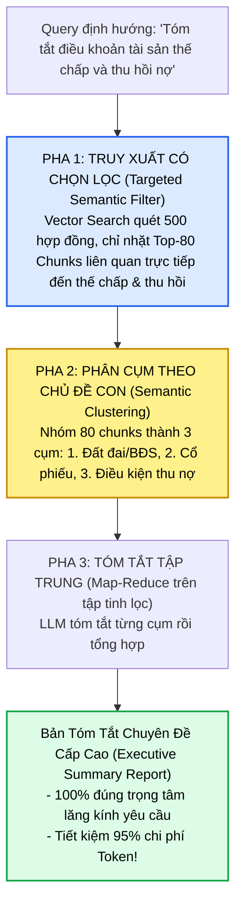

---

### 9.9. Knowledge Synthesis Pattern (Mẫu Tổng Hợp Tri Thức Đa Nguồn)

#### Bước nhảy vọt từ "Trích xuất" sang "Tổng hợp Tri thức"
Phần lớn các hệ thống RAG tầm thường chỉ dừng lại ở tầng **Trích xuất thông tin (Extraction)**: tìm thấy đoạn nào thì đọc lại đoạn đó.
Mẫu **Knowledge Synthesis (Tổng Hợp Tri Thức)** đưa hệ thống lên tầng năng lực cao nhất của nhận thức: **Phân tích đối sánh, chỉ ra mâu thuẫn và tạo ra insight mới từ nhiều nguồn độc lập**.

#### Kiến trúc 4 tầng của Knowledge Synthesis

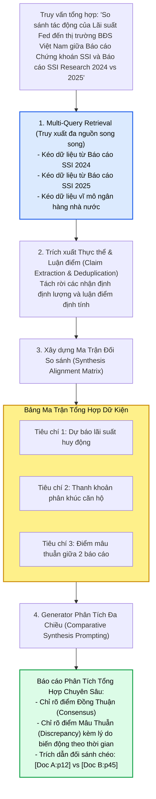

#### Các thành tố bắt buộc trong câu trả lời tổng hợp
1. **Điểm đồng thuận (Consensus Points):** Những nhận định mà tất cả các nguồn tài liệu đều thống nhất xác nhận.
2. **Điểm bất đồng & Xung đột dữ liệu (Contradictions & Variance):** Những số liệu hoặc quan điểm đối lập nhau giữa các tác giả hoặc qua các mốc thời gian khác nhau (ví dụ: *"Báo cáo tháng 3 dự báo tăng $10\%$, nhưng báo cáo tháng 9 đã điều chỉnh giảm về $4\%$ do lạm phát"*).
3. **Trích dẫn đa nguồn kép (Cross-citation):** Gắn mã nguồn đối chiếu rõ ràng: `[SSI_2024:Trang 15]` so với `[SSI_2025:Trang 28]`.

---

### 9.10. Bảng Ma Trận So Sánh & Cây Quyết Định Lựa Chọn Pattern

#### Bảng ma trận so sánh toàn diện 9 mẫu thiết kế RAG

| Mẫu thiết kế (Design Pattern) | Độ phức tạp kiến trúc | Mức tiêu thụ Token | Độ trễ (Latency) | Độ chính xác (Precision) | Năng lực tổng hợp | Kịch bản triển khai tối ưu |
| :--- | :---: | :---: | :---: | :---: | :---: | :--- |
| **1. Basic RAG (Single Retriever)** | ⭐ (Thấp) | Thấp | ⚡ ($< 500\text{ms}$) | Trung bình | Yếu | Xây dựng PoC nhanh, dữ liệu nội bộ ngắn |
| **2. Dense Retrieval (Small Top-k)** | ⭐ (Thấp) | Cực thấp | ⚡ ($< 300\text{ms}$) | Rất cao (Factoid) | Yếu | Tra cứu thông số, FAQ, định nghĩa sự thật |
| **3. Pure Dense Retrieval** | ⭐⭐ (Trung bình) | Thấp | ⚡ ($< 400\text{ms}$) | Cao | Trung bình | Chatbot đàm thoại tự nhiên, giảm chi phí hạ tầng |
| **4. Hierarchical Retrieval** | ⭐⭐⭐ (Khá) | Trung bình | ⏱️ ($500 - 800\text{ms}$) | Rất cao | Khá | Tài liệu dài, bảo toàn trọn vẹn ngữ cảnh |
| **5. Hierarchical + Multi-Step** | ⭐⭐⭐⭐⭐ (Rất cao) | Cao | 🐢 ($2 - 5\text{s}$) | Cực đại | Rất mạnh | Thẩm định pháp lý, phân tích tài chính đa năm |
| **6. Question-Answering (QA)** | ⭐⭐ (Trung bình) | Thấp | ⚡ ($400 - 700\text{ms}$) | Rất cao | Thấp | Hệ thống hỗ trợ khách hàng, tuân thủ quy chế |
| **7. Summarization Pattern** | ⭐⭐⭐ (Khá) | Rất cao | 🐢 ($3 - 10\text{s}$) | Khá | Mạnh (Toàn văn) | Nén biên bản cuộc họp, tóm tắt sách trắng |
| **8. Summarization RAG** | ⭐⭐⭐⭐ (Cao) | Trung bình | ⏱️ ($1 - 3\text{s}$) | Cao | Rất mạnh | Tóm tắt theo chủ đề hẹp trong kho dữ liệu lớn |
| **9. Knowledge Synthesis** | ⭐⭐⭐⭐⭐ (Rất cao) | Cao | 🐢 ($2 - 6\text{s}$) | Cực đại | Đỉnh cao | Báo cáo nghiên cứu chiến lược, đối soát đa nguồn |

#### Cây quyết định kiến trúc (Decision Tree)

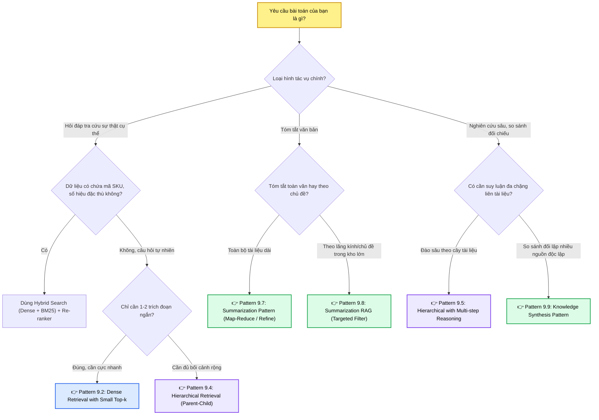

---

## 10. CÂY ĐIỀU HƯỚNG & LIÊN KẾT TRONG VAULT

Tài liệu này là nền tảng khởi đầu cho toàn bộ hệ thống RAG và Semantic Memory trong Obsidian Vault. Hãy khám phá sâu hơn theo lộ trình sau:

```mermaid
flowchart TD
    CurrentNode["⭐ Inside RAG: Kiến Trúc 4 Cấu Phần<br>(Bài học hiện tại)"]

    subgraph DeepDive1["1. Lý Thuyết Tầng Sâu & Cơ Sở Dữ Liệu"]
        SS_Note["01. Semantic Search & Reranking<br>Toán học Bi-Encoder, Cross-Encoder & Advanced RAG"]
        VDB_Note["03. Embeddings & Vector Databases<br>HNSW, FAISS, ChromaDB, Milvus, Pinecone"]
    end

    subgraph DeepDive2["2. Quản Trị Ngữ Cảnh & Bộ Nhớ Agent"]
        Ctx_Note["02. Quản Trị Ngữ Cảnh (Context Management)<br>Chữa trị Context Poisoning & Lost in the Middle"]
        Mem_Note["03. Hệ Thống Bộ Nhớ (Memory Systems)<br>Kiến trúc Bộ nhớ Đa tầng & Semantic Memory"]
    end

    subgraph DeepDive3["3. Ứng Dụng Thực Chiến Doanh Nghiệp"]
        Ent_Note["06. Cẩm Nang Xây Dựng AI Agent Doanh Nghiệp<br>Blueprint Thiết kế Tác tử Toàn diện"]
    end

    CurrentNode --> SS_Note
    CurrentNode --> VDB_Note
    CurrentNode --> Ctx_Note
    CurrentNode --> Mem_Note
    CurrentNode --> Ent_Note

    style CurrentNode fill:#fef08a,stroke:#ca8a04,stroke-width:2px,color:#000000
    style SS_Note fill:#dbeafe,stroke:#2563eb,stroke-width:2px,color:#000000
    style VDB_Note fill:#dbeafe,stroke:#2563eb,stroke-width:2px,color:#000000
    style Ctx_Note fill:#ede9fe,stroke:#7c3aed,stroke-width:2px,color:#000000
    style Mem_Note fill:#ede9fe,stroke:#7c3aed,stroke-width:2px,color:#000000
    style Ent_Note fill:#dcfce7,stroke:#16a34a,stroke-width:2px,color:#000000
```

* **Nghiên cứu sâu về toán học vector & mô hình:** [[01_semantic_search_and_reranking|Tìm Kiếm Ngữ Nghĩa & Tái Xếp Hạng (Bi-Encoder vs Cross-Encoder)]]
* **Cơ sở dữ liệu Vector & Thuật toán Indexing HNSW:** [[03_embeddings_and_vector_databases|Vai Trò Cốt Lõi Của Embeddings & Cơ Sở Dữ Liệu Vector (FAISS, Chroma, Milvus, Pinecone)]]
* **Quản trị rủi ro ngữ cảnh:** [[03-building-agents/01-harness-and-memory/02_context_management|Quản Trị Cửa Sổ Ngữ Cảnh: Bệnh Lý & Tỉa Nhánh]]
* **Nâng cấp thành bộ nhớ dài hạn cho Agent:** [[03-building-agents/01-harness-and-memory/03_memory_systems|Kiến Trúc Bộ Nhớ Đa Tầng Cho AI Agents]]
* **Thiết kế tổng thể hệ thống doanh nghiệp:** [[03-building-agents/06_how_to_build_enterprise_ai_agents|Cẩm Nang Xây Dựng AI Agent Doanh Nghiệp]]
