# VAI TRÒ CỐT LÕI CỦA EMBEDDINGS & CƠ SỞ DỮ LIỆU VECTOR TRONG HỆ THỐNG RAG
## 4 Trụ Cột Truy Xuất: Mô Hình Embedding, Cơ Sở Dữ Liệu Vector (FICE Framework), Chiến Lược Lập Chỉ Mục (FLAT, IVF, HNSW, PQ) & Kỹ Thuật Phân Đoạn (Chunking)

---

## 📌 MỤC LỤC
1. [Khởi Nguyên Vấn Đề: Tại Sao Embeddings Quyết Định Thành Bại Của Hệ Thống?](#1-khởi-nguyên-vấn-đề-tại-sao-embeddings-quyết-định-thành-bại-của-hệ-thống)
   - [4 Trụ cột của hệ thống truy xuất (The 4 Pillars of Retrieval)](#4-trụ-cột-của-hệ-thống-truy-xuất-the-4-pillars-of-retrieval)
   - [Bệnh viện & Khảo nghiệm lâm sàng: Thách thức truy xuất không ổn định (Inconsistent Retrieval)](#bệnh-viện--khảo-nghiệm-lâm-sàng-thách-thức-truy-xuất-không-ổn-định-inconsistent-retrieval)
   - [Giác quan ngữ nghĩa & Dấu vân tay số học (Numerical Fingerprints)](#giác-quan-ngữ-nghĩa--dấu-vân-tay-số-học-numerical-fingerprints)
   - [Dưới nắp ca-pô (Under the Hood): Tokenization $\to$ Context Encoding $\to$ Vector Projection](#dưới-nắp-ca-pô-under-the-hood-tokenization-to-context-encoding-to-vector-projection)
   - [Trường hợp điển cứu: "App Crashed" vs. "Software Stopped Working"](#trường-hợp-điển-cứu-app-crashed-vs-software-stopped-working)
   - [Code thực nghiệm 1: Sinh vector nhúng câu với OpenAI](#code-thực-nghiệm-1-sinh-vector-nhúng-câu-với-openai)
2. [Khảo Sát & Lựa Chọn Mô Hình Embedding: Not All Vectors Are Equal](#2-khảo-sát--lựa-chọn-mô-hình-embedding-not-all-vectors-are-equal)
   - [3 Trục đánh đổi kiến trúc: Dimensionality vs. Performance vs. Domain Specialization](#3-trục-đánh-đổi-kiến-trúc-dimensionality-vs-performance-vs-domain-specialization)
   - [Bảng so sánh định lượng các mô hình SOTA (OpenAI, BGE, GTE, Cohere, MiniLM)](#bảng-so-sánh-định-lượng-các-mô-hình-sota-openai-bge-gte-cohere-minilm)
   - [Thực nghiệm đối đầu (Model Shootout): MiniLM vs. BGE-Base trên văn bản y tế & pháp chế](#thực-nghiệm-đối-đầu-model-shootout-minilm-vs-bge-base-trên-văn-bản-y-tế--pháp-chế)
   - [Quy trình làm việc thực chiến (Practical Sizing Workflow)](#quy-trình-làm-việc-thực-chiến-practical-sizing-workflow)
3. [Chiến Lược Phân Đoạn (Chunking): Định Hình Cấu Trúc Ngữ Nghĩa](#3-chiến-lược-phân-đoạn-chunking-định-hình-cấu-trúc-ngữ-nghĩa)
   - [Nghịch lý Chunking: Quá lớn làm mờ ý, Quá nhỏ làm mất bối cảnh](#nghịch-lý-chunking-quá-lớn-làm-mờ-ý-quá-nhỏ-làm-mất-bối-cảnh)
   - [Đặc thù phân đoạn văn bản pháp quy & y khoa: Điều kiện & Ngoại lệ (Conditions vs. Exceptions)](#đặc-thù-phân-đoạn-văn-bản-pháp-quy--y-khoa-điều-kiện--ngoại-lệ-conditions-vs-exceptions)
   - [3 Phương pháp phân đoạn: Fixed-Length vs. Semantic vs. Adaptive](#3-phương-pháp-phân-đoạn-fixed-length-vs-semantic-vs-adaptive)
   - [Tầm quan trọng sống còn của độ gối đầu (Overlap 10% - 20%)](#tầm-quan-trọng-sống-còn-của-độ-gối-đầu-overlap-10---20)
   - [Nghiên cứu tình huống thực tế: Customer Support FAQ vs. Developer Documentation](#nghiên-cứu-tình-huống-thực-tế-customer-support-faq-vs-developer-documentation)
   - [Code thực nghiệm 2: Phân đoạn văn bản với RecursiveCharacterTextSplitter](#code-thực-nghiệm-2-phân-đoạn-văn-bản-với-recursivecharactertextsplitter)
4. [Giải Phẫu Chiến Lược Lập Chỉ Mục Vector: Động Cơ Đằng Sau Tìm Kiếm Siêu Tốc](#4-giải-phẫu-chiến-lược-lập-chỉ-mục-vector-động-cơ-đằng-sau-tìm-kiếm-siêu-tốc)
   - [FLAT: Lật từng trang sách & Vai trò chẩn đoán sớm (Diagnostic Baseline)](#flat-lật-từng-trang-sách--vai-trò-chẩn-đoán-sớm-diagnostic-baseline)
   - [IVF (Inverted File Index): Phân cụm Voronoi Centroids](#ivf-inverted-file-index-phân-cụm-voronoi-centroids)
   - [Tiến hóa chỉ mục trong FAISS: Từ FLAT sang IVF & Tinh chỉnh nprobe](#tiến-hóa-chỉ-mục-trong-faiss-từ-flat-sang-ivf--tinh-chỉnh-nprobe)
   - [HNSW: Lối tắt cao tốc & Mạng lưới bạn bè (Graph-based Multi-layer)](#hnsw-lối-tắt-cao-tốc--mạng-lưới-bạn-bè-graph-based-multi-layer)
   - [PQ (Product Quantization): Nén lượng tử hóa vector cho Edge Devices](#pq-product-quantization-nén-lượng-tử-hóa-vector-cho-edge-devices)
   - [Bảng ma trận so sánh 4 chiến lược: FLAT vs. IVF vs. HNSW vs. PQ](#bảng-ma-trận-so-sánh-4-chiến-lược-flat-vs-ivf-vs-hnsw-vs-pq)
   - [Code thực nghiệm 3: Xây dựng IVF Index trên 1 triệu vector trong FAISS](#code-thực-nghiệm-3-xây-dựng-ivf-index-trên-1-triệu-vector-trong-faiss)
5. [Đánh Giá & Lựa Chọn Cơ Sở Dữ Liệu Vector Theo Khung FICE](#5-đánh-giá--lựa-chọn-cơ-sở-dữ-liệu-vector-theo-khung-fice)
   - [Khung tiêu chuẩn FICE: Fit - Infrastructure - Compatibility - Ecosystem](#khung-tiêu-chuẩn-fice-fit---infrastructure---compatibility---ecosystem)
   - [So sánh 5 cơ sở dữ liệu hàng đầu: ChromaDB vs. FAISS vs. Milvus vs. Pinecone vs. Weaviate](#so-sánh-5-cơ-sở-dữ-liệu-hàng-đầu-chromadb-vs-faiss-vs-milvus-vs-pinecone-vs-weaviate)
   - [Bảng ma trận so sánh 10 tiêu chí kỹ thuật](#bảng-ma-trận-so-sánh-10-tiêu-chí-kỹ-thuật)
   - [Code thực nghiệm 4: Thiết lập chỉ mục FLAT trong FAISS và tìm kiếm tương đồng](#code-thực-nghiệm-4-thiết-lập-chỉ-mục-flat-trong-faiss-và-tìm-kiếm-tương-đồng)
   - [Bài tập tình huống thực tế: Áp lực mở rộng quy mô từ ChromaDB lên hàng triệu vector](#bài-tập-tình-huống-thực-tế-áp-lực-mở-rộng-quy-mô-từ-chromadb-lên-hàng-triệu-vector)
6. [Khung Phương Pháp Luận Ra Quyết Định (Decision Framework & Tree)](#6-khung-phương-pháp-luận-ra-quyết-định-decision-framework--tree)
   - [2 Tình huống kiến trúc điển hình: Internal Dev Tool vs. Metadata-Rich Hybrid Search](#2-tình-huống-kiến-trúc-điển-hình-internal-dev-tool-vs-metadata-rich-hybrid-search)
   - [Cây quyết định lựa chọn cơ sở dữ liệu vector](#cây-quyết-định-lựa-chọn-cơ-sở-dữ-liệu-vector)
7. [Quản Trị Vòng Đời & Vận Hành Vector Liên Tục (Vector Lifecycle Management)](#7-quản-trị-vòng-đời--vận-hành-vector-liên-tục-vector-lifecycle-management)
   - [Tính lỗi thời của tri thức & Biến động thế giới thực (The Stale Index Problem)](#tính-lỗi-thời-của-tri-thức--biến-động-thế-giới-thực-the-stale-index-problem)
   - [Vòng lặp vận hành Ngày-2 (Day-2 Index Maintenance Loop): Giữ cho RAG luôn khỏe mạnh](#vòng-lặp-vận-hành-ngày-2-day-2-index-maintenance-loop-giữ-cho-rag-luôn-khỏe-mạnh)
   - [Cập nhật lũy tiến thời gian thực & Dọn rác vector (CDC & Delta Upsert)](#cập-nhật-lũy-tiến-thời-gian-thực--dọn-rác-vector-cdc--delta-upsert)
   - [Quy tắc tái huấn luyện 20% (The 20% Corpus Growth Rule)](#quy-tắc-tái-huấn-luyện-20-the-20-corpus-growth-rule)
   - [Quy trình di cư mô hình nhúng & Triển khai ngầm (Shadow Deployment)](#quy-trình-di-cư-mô-hình-nhúng--triển-khai-ngầm-shadow-deployment)
8. [Hiện Thực Hóa Toàn Diện: End-to-End Production Pipeline](#8-hiện-thực-hóa-toàn-diện-end-to-end-production-pipeline)
   - [Code thực nghiệm 5: Kết nối 4 mắt xích Chunking $\to$ Embedding $\to$ Indexing $\to$ Retrieval](#code-thực-nghiệm-5-kết-nối-4-mắt-xích-chunking-to-embedding-to-indexing-to-retrieval)
   - [Code thực nghiệm 6: Cấu hình HNSW tùy chỉnh và lọc Metadata Boolean trong ChromaDB](#code-thực-nghiệm-6-cấu-hình-hnsw-tùy-chỉnh-và-lọc-metadata-boolean-trong-chromadb)
   - [Code thực nghiệm 7: Toàn bộ đường ống Trợ lý tra cứu y tế (Clinical Policy Assistant) với SentenceTransformers & FAISS (MiniLM vs BGE, IVF & Delta Upsert)](#code-thực-nghiệm-7-toàn-bộ-đường-ống-trợ-lý-tra-cứu-y-tế-clinical-policy-assistant-với-sentencetransformers--faiss-minilm-vs-bge-ivf--delta-upsert)
9. [Cây Điều Hướng & Liên Kết Trong Vault](#9-cây-điều-hướng--liên-kết-trong-vault)

---

## 1. KHỞI NGUYÊN VẤN ĐỀ: TẠI SAO EMBEDDINGS QUYẾT ĐỊNH THÀNH BẠI CỦA HỆ THỐNG?

### 4 Trụ cột của hệ thống truy xuất (The 4 Pillars of Retrieval)
Khi xây dựng một hệ thống truy xuất dữ liệu ngữ nghĩa hay đường ống [[02_rag_architecture_and_components|RAG]], có 4 quyết định kỹ thuật cốt lõi định hình nên toàn bộ năng lực hiểu biết, lưu trữ và tìm kiếm tri thức của hệ thống:

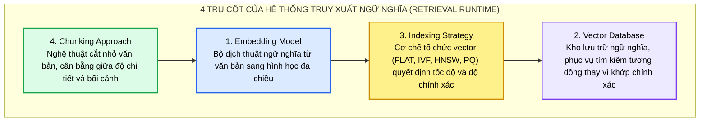

Bốn yếu tố này không hoạt động độc lập mà tạo thành một chuỗi giá trị liên tục: Khoảnh khắc bạn lưu trữ embedding vào cơ sở dữ liệu, bạn đang chính thức bước qua ranh giới từ **thế giới ký hiệu biểu tượng (Symbolic World - từ ngữ, câu chữ)** sang **thế giới hình học toán học (Geometric World - vector, khoảng cách, góc cosine)**.

---

### Bệnh viện & Khảo nghiệm lâm sàng: Thách thức truy xuất không ổn định (Inconsistent Retrieval)

Hãy tưởng tượng bạn đang chịu trách nhiệm kiến trúc một **Trợ lý AI nội bộ phục vụ đội ngũ y tá và bác sĩ** trong một mạng lưới bệnh viện:
* Hàng ngày, các bác sĩ và nhân viên y tế cần tra cứu tức thì các chính sách tuân thủ quy chuẩn:
  * *"Thời hạn bắt buộc lưu trữ hồ sơ bệnh án cho các phiên khám bệnh từ xa (Telehealth encounters) là bao lâu?"*
  * *"Quy trình kiểm tra phục hồi sau gây mê để xuất viện trong ngày (Same-day ambulatory surgery discharge protocol) gồm những tiêu chí gì?"*
* Kho dữ liệu của bệnh viện chứa hàng trăm tệp tài liệu PDF và Word: Sổ tay quy chế hành chính, phác đồ điều trị lâm sàng, tiêu chuẩn an toàn người bệnh và các quy định pháp chế y tế (HIPAA).
* Đội ngũ kỹ sư đã phân đoạn (chunked) toàn bộ tài liệu và nạp vào một cơ sở dữ liệu vector. Tuy nhiên, khi đưa vào thử nghiệm lâm sàng, hệ thống gặp phải căn bệnh trầm kha: **Truy xuất không ổn định (Inconsistent Retrieval)**:
  * Lần thứ nhất hỏi, hệ thống trả về đúng trang tài liệu cần tìm.
  * Lần thứ hai với câu hỏi tương tự, hệ thống lại trích xuất một văn bản đã hết hạn từ nhiều năm trước, hoặc trả về một quy trình cấp cứu hoàn toàn lệch đề!

> [!caution] Hiểm Họa Nghiệp Vụ Trong Các Lĩnh Vực Nhạy Cảm (Healthcare / Finance / Legal)
> Trong lĩnh vực y tế hoặc pháp lý, một câu trả lời trích xuất sai không chỉ là một lỗi phần mềm đơn thuần, mà có thể dẫn đến **sai lệch chỉ định điều trị, vi phạm nghiêm trọng quy chuẩn bảo mật hồ sơ bệnh nhân (HIPAA violation) hoặc chịu chế tài pháp lý nặng nề**.
> Lỗi này không nằm ở mô hình sinh LLM, mà xuất phát trực tiếp từ các quyết định kiến trúc: **chọn sai mô hình embedding, dùng sai cấu hình phân cụm chỉ mục (indexing), hoặc cắt văn bản (chunking) làm đứt gãy điều kiện và ngoại lệ**.

---

### Giác quan ngữ nghĩa & Dấu vân tay số học (Numerical Fingerprints)
Trong kiến trúc RAG, nếu LLM Generator đóng vai trò là khối óc tư duy và tổng hợp ngôn ngữ, thì **Embeddings chính là giác quan nhận thức ngữ nghĩa (Sense of Meaning)** của toàn bộ hệ thống.

Embeddings nhận đầu vào là các thực thể văn bản phi cấu trúc — từ từ ngữ đơn lẻ, đoạn văn, tài liệu kỹ thuật cho đến toàn bộ cuộc hội thoại — và ánh xạ chúng vào một không gian vector đa chiều liên tục $\mathbb{R}^d$ ($d = 768, 1536, 3072$). Kết quả thu được là một **dấu vân tay số học (Numerical Fingerprint)**: một biểu diễn dày đặc (Dense Semantic Representation) phản ánh chính xác vị trí ngữ nghĩa và mối liên hệ tương quan giữa các khái niệm.

---

### Dưới nắp ca-pô (Under the Hood): Tokenization $\to$ Context Encoding $\to$ Vector Projection
Điều gì thực sự diễn ra bên trong mạng nơ-ron Transformer khi bạn gửi một câu văn vào mô hình embedding?
Ví dụ, khi bạn đưa vào câu truy vấn:
> *"How to connect a PostgreSQL database in Python"*

Quá trình biến đổi diễn ra tuần tự qua 3 giai đoạn toán học nghiêm ngặt:

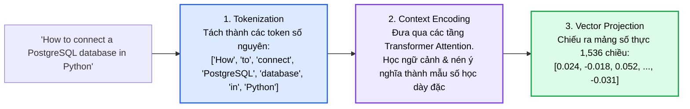

1. **Tokenization (Phân rã token):** Chuỗi văn bản được phân tách thành các mẩu từ vựng con (sub-words) hoặc token định danh tương ứng trong từ điển của mô hình.
2. **Context Encoding (Mã hóa ngữ cảnh):** Từng token được đưa qua các tầng Self-Attention của mạng nơ-ron (như đã phân tích tại [[04_transformer_math_deep_dive|Transformer Math Deep Dive]]), nơi mỗi từ tương tác với tất cả các từ còn lại trong câu để nắm bắt ngữ cảnh trọn vẹn.
3. **Vector Projection (Chiếu không gian vector):** Tầng cuối cùng của mô hình nén toàn bộ thông tin ngữ cảnh vào một vector cố định trong không gian 1,536 chiều.

> [!note] Mô Hình Tư Duy: Bản Đồ Ý Niệm 1,500 Chiều
> Hãy tưởng tượng bạn đang chấm điểm từng ý tưởng trên một tấm bản đồ 1,500 chiều:
> * Ý tưởng *"PostgreSQL connection"* sẽ nằm rất gần với *"Database integration in Python"*.
> * Nhưng nó sẽ nằm cách xa vời vợi so với ý tưởng *"Summer vacation itinerary"* (Hành trình du lịch mùa hè).

---

### Trường hợp điển cứu: "App Crashed" vs. "Software Stopped Working"

Hãy tưởng tượng bạn đang phát triển một **Trợ lý AI hỗ trợ kỹ thuật khách hàng (Customer Support Assistant)** cho một sản phẩm phần mềm SaaS doanh nghiệp:
1. Khách hàng gặp sự cố và gõ vào khung chat:
   > *"Why won't my dashboard load?"* (Tại sao bảng điều khiển của tôi không hiển thị?)
2. Trong kho cơ sở tri thức (Knowledge Base) của bạn, tài liệu khắc phục sự cố do kỹ sư DevOps viết lại có tiêu đề:
   > *"Charts failing to render due to API timeout"* (Biểu đồ không kết xuất được do vượt quá thời gian chờ API).

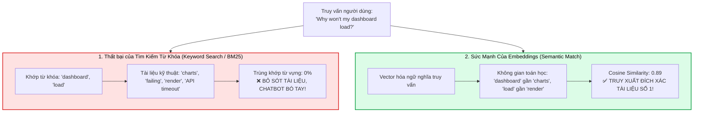

* **Tìm kiếm từ khóa (Keyword Search):** Không có bất kỳ một từ đơn nào trùng nhau giữa hai câu trên. Nếu chỉ dựa vào BM25 hay ElasticSearch thông thường, hệ thống sẽ kết luận tài liệu không tồn tại.
* **Mẹo Prompt (Prompt Tricks):** Dù bạn có viết System Prompt khéo léo đến đâu, nếu bộ truy xuất không mang được tài liệu liên quan về, LLM cũng chỉ có thể đoán mò hoặc ảo giác.
* **Embeddings làm được điều kỳ diệu:** Nhờ được huấn luyện trên hàng tỷ cặp câu tương đương, không gian vector nhận ra *"dashboard load"* và *"charts render"* nằm cùng một cụm ngữ nghĩa. **Embeddings tạo ra cây cầu nối duy nhất giữa ngôn ngữ đời thường của người dùng và tri thức kỹ thuật của hệ thống**.

---

### Code thực nghiệm 1: Sinh vector nhúng câu với OpenAI

```python
# WHAT: Tạo vector embedding cho một câu văn bản
# WHY: Embeddings biểu diễn ý nghĩa ngữ nghĩa dưới dạng số để so sánh và truy xuất
# HOW: Sử dụng model text-embedding-3-small của OpenAI để tạo vector 1,536 chiều

import os
from openai import OpenAI

client = OpenAI(api_key=os.environ.get("OPENAI_API_KEY", "your-api-key-here"))

# Bước 1: Định nghĩa câu văn bản đầu vào
text_input = "How to connect a PostgreSQL database in Python"

# Bước 2: Gọi API embedding
response = client.embeddings.create(
    input=text_input,
    model="text-embedding-3-small"
)

# Bước 3: Trích xuất vector số học
embedding_vector = response.data[0].embedding

print(f"Độ dài vector (Dimensions): {len(embedding_vector)}")
print(f"5 giá trị đầu tiên của vector: {embedding_vector[:5]}")
# Output: Độ dài vector: 1536
# [0.0152, -0.0214, 0.0489, -0.0091, 0.0332]
```

---

## 2. KHẢO SÁT & LỰA CHỌN MÔ HÌNH EMBEDDING: NOT ALL VECTORS ARE EQUAL

Mục tiêu của kỹ sư hệ thống không phải là mù quáng chọn mô hình embedding "mạnh nhất" hay "đắt nhất", mà là chọn **mô hình có kích thước và đặc tính phù hợp nhất với bài toán truy xuất (Right-sized Model)**.

### 3 Trục đánh đổi kiến trúc: Dimensionality vs. Performance vs. Domain Specialization

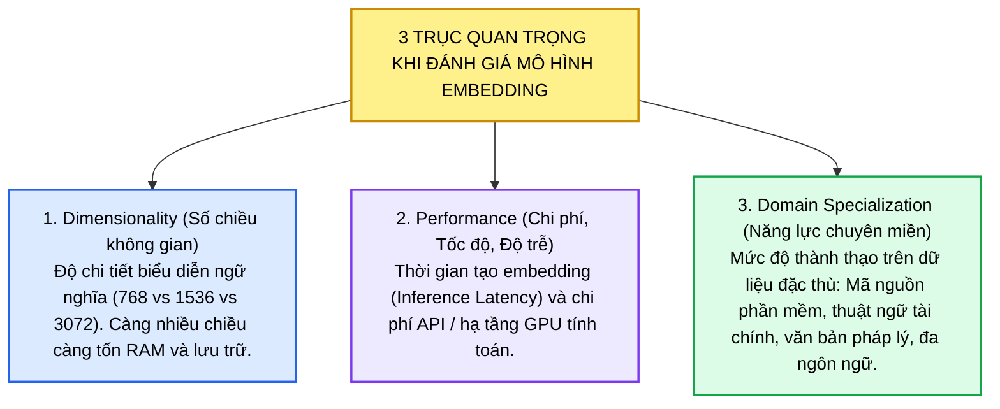

---

### Bảng so sánh định lượng các mô hình SOTA (OpenAI, BGE, GTE, Cohere)

| Tên Mô Hình | Đơn Vị Phát Triển | Số Chiều (Dimensions) | Hồ Sơ Hiệu Năng (Performance Profile) | Điểm Mạnh Nghiệp Vụ (Domain Strength) | Điểm Đánh Đổi (Trade-Offs) |
| :--- | :--- | :---: | :--- | :--- | :--- |
| **`all-MiniLM-L6-v2`** | Sentence-Transformers | **384** | Cực nhanh, siêu nhẹ (80MB), CPU-friendly | Thử nghiệm nguyên mẫu nhanh (Fast Iteration), phân loại sơ bộ | Dễ bị đánh lừa bởi từ vựng bề mặt, trượt ngữ cảnh pháp chế phức tạp |
| **`bge-base-en-v1.5`** | BAAI (Hugging Face) | **768** | Nhanh, chạy tốt trên cả CPU và GPU nhỏ | Nắm bắt sâu văn phong chính sách, quy định tuân thủ (Compliance), Y tế & Luật | Kích thước vector lớn gấp đôi MiniLM (768 vs 384) |
| **`text-embedding-3-small`** | OpenAI | **1,536** | Rất nhanh, chi phí cực thấp ($\$0.02 / 1\text{M}$ tokens) | Đa dụng (General-purpose), truy xuất tài liệu phổ quát | Kém nhạy bén hơn trên các câu truy vấn siêu dài hoặc cực kỳ phức tạp |
| **`text-embedding-3-large`** | OpenAI | **3,072** | Chậm hơn, chi phí cao hơn ($\$0.13 / 1\text{M}$ tokens) | Độ chuẩn xác ngữ cảnh cực cao, suy luận đa tầng, Factoid QA | Tốn dung lượng RAM và đĩa gấp đôi (3072 floats) |
| **`bge-large-en`** | BAAI (Hugging Face) | **1,024** | Trung bình, chạy tự host trên GPU nội bộ | Tối ưu hóa sâu cho Hỏi Đáp (QA) và Truy xuất mã nguồn (Code Retrieval) | Đòi hỏi tự duy trì hạ tầng máy chủ suy luận (Local Inference) |
| **`gte-base`** | Alibaba DAMO | **768** | Rất nhanh, kích thước gọn nhẹ | Hỗ trợ đa ngôn ngữ nhẹ (Lightweight Multilingual), độ phủ rộng | Độ sâu ngữ nghĩa trên từng ngôn ngữ đơn lẻ không bằng mô hình chuyên biệt |
| **`cohere-embed-v3`** | Cohere | **1,024** | Độ trễ trung bình | Tinh chỉnh sâu cho Doanh nghiệp: Báo cáo tài chính, hợp đồng pháp chế | API thương mại có phí, mô hình nguồn đóng (Closed-weights) |

---

### Thực Nghiệm Đối Đầu (Model Shootout): MiniLM vs. BGE-Base Trên Văn Bản Y Tế & Pháp Chế

Để thấy rõ việc lựa chọn mô hình định hình không gian ngữ nghĩa như thế nào, hãy xem xét thực nghiệm đối đầu trực tiếp giữa hai đại diện tiêu biểu của thế giới mã nguồn mở:
1. **`all-MiniLM-L6-v2` (Lightweight Sentence Transformer - 384 dimensions):** 
   * Trọng số siêu nhẹ, tốc độ tạo vector cực nhanh, rất phù hợp khi đội ngũ kỹ sư cần xây dựng khung xương hệ thống (Pipeline Shaping) và lặp nhanh (Fast Experimentation).
2. **`BAAI/bge-base-en-v1.5` (General Embedding Model - 768 dimensions):**
   * Được huấn luyện trên tập dữ liệu tương phản khổng lồ với khả năng nắm bắt sâu các sắc thái hành chính, quy chuẩn pháp lý và thuật ngữ y tế chuyên ngành.

#### Kịch bản khảo nghiệm:
* Nạp vào hệ thống 3 tài liệu chính sách lâm sàng của bệnh viện:
  * **Tài liệu 1:** *Chính sách lưu trữ hồ sơ bệnh án khám bệnh từ xa và tuân thủ HIPAA (Telehealth Patient Record Retention).*
  * **Tài liệu 2:** *Quy chuẩn theo dõi và xuất viện tại khoa cấp cứu (Emergency Department Observation & Discharge Rules).*
  * **Tài liệu 3:** *Quy trình xuất viện trong ngày đối với bệnh nhân phẫu thuật ngoại trú (Same-Day Ambulatory Surgery Discharge).*
* Đặt câu hỏi thực tế của bác sĩ:
  > *"How long do we store patient records for telehealth sessions?"* *(Thời gian bắt buộc phải lưu trữ hồ sơ bệnh án cho các buổi khám bệnh từ xa là bao lâu?)*

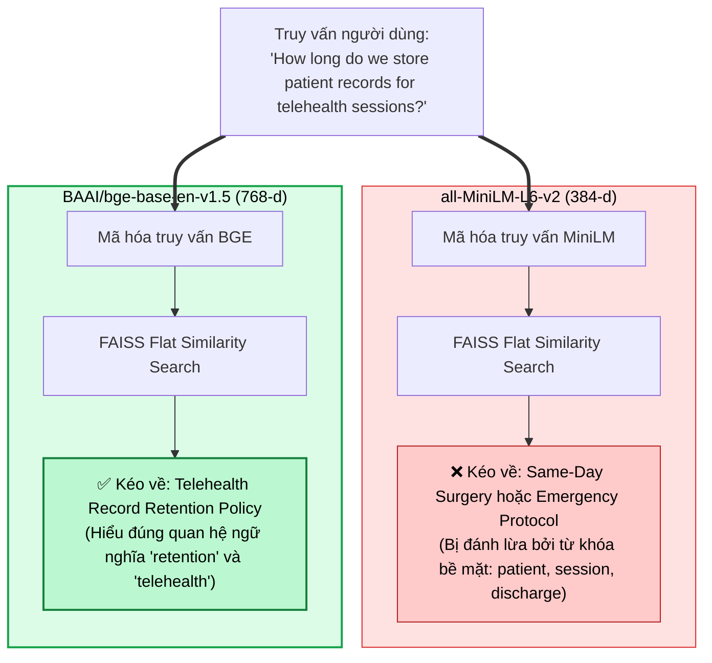

#### Kết quả thực tế & Phân tích hiện tượng:
* **Hiện tượng của MiniLM:** Mô hình trả về tài liệu về *Xuất viện phẫu thuật trong ngày* hoặc *Cấp cứu*. Nguyên nhân là do ở không gian 384 chiều, MiniLM bị chi phối bởi các từ vựng phổ quát xuất hiện dày đặc (`"patient"`, `"records"`, `"sessions"`, `"rules"`). Nó tạo ra cảm giác "suýt trúng nhưng lệch đề" (close but off-topic).
* **Hiện tượng của BGE-Base:** Nhờ số chiều 768 và không gian biểu diễn dày dặn, BGE nhận diện được trọng tâm ngữ nghĩa cốt lõi nằm ở cụm từ pháp chế **`"record retention"` (lưu trữ hồ sơ)** và ngữ cảnh **`"telehealth"`**, từ đó kéo về chính xác $100\%$ văn bản quy định lưu trữ 7 năm theo chuẩn HIPAA.

> [!important] Định Luật Về Bản Chất Của Embeddings:
> **Việc lựa chọn mô hình Embedding không phải là một chi tiết trang trí thẩm mỹ (not cosmetic). Mô hình embedding chính là bộ luật hình học quy định thế nào là "tương đồng" trong toàn bộ hệ thống của bạn (Embedding choice defines what your system thinks is similar).**

---

### Quy trình làm việc thực chiến (Practical Sizing Workflow)

Để tối ưu hóa chi phí và hiệu năng, quy trình chuẩn mực được áp dụng như sau:
1. **Prototype với mô hình tinh gọn nhất:** Khởi đầu với `text-embedding-3-small` hoặc `bge-small-en` để kiểm chứng luồng hoạt động với chi phí tối thiểu.
2. **Đo lường độ chính xác truy xuất thực nghiệm:** Đánh giá các chỉ số Recall@K, Precision@K và nDCG@10 trên tập dữ liệu kiểm thử (Golden Dataset) của chính doanh nghiệp.
3. **Nâng cấp có chọn lọc:** Chỉ nâng cấp lên `bge-large-en` (nếu cần phân biệt chi tiết mã code kỹ thuật) hoặc `text-embedding-3-large` (nếu mô hình nhỏ gặp khó khăn trong việc phân biệt các khái niệm tinh vi như *"connect"* vs *"authenticate"*).

---

## 3. CHIẾN LƯỢC PHÂN ĐOẠN (CHUNKING): ĐỊNH HÌNH CẤU TRÚC NGỮ NGHĨA

Trước khi đưa văn bản vào mô hình embedding, quyết định kỹ thuật then chốt là: **Nội dung sẽ được cắt nhỏ như thế nào? Mỗi vector nên chứa đựng bao nhiêu ngữ nghĩa?**

### Nghịch lý Chunking: Quá lớn làm mờ ý, Quá nhỏ làm mất bối cảnh

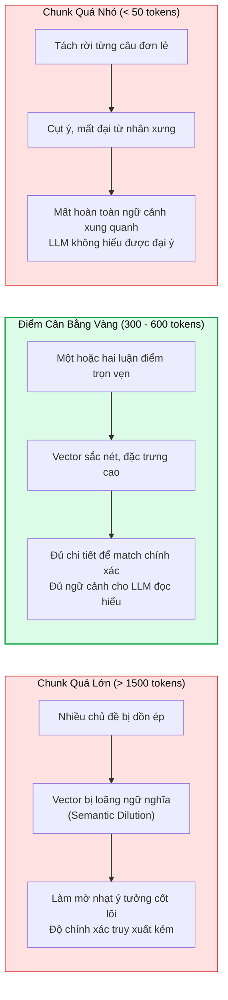

1. **Chunk quá nhỏ ("Floating Sentences"):** Một câu đứng đơn độc *"Tuy nhiên, điều khoản này không áp dụng cho trường hợp thứ hai"* không thể tạo ra vector hữu ích vì thiếu ngữ cảnh chủ ngữ.
2. **Chunk quá lớn ("Blurry Meaning"):** Một đoạn văn dài 2,000 từ chứa cả chính sách bảo hành, quy chuẩn an toàn và bảng giá khiến vector bị "pha loãng ngữ nghĩa" (Semantic Dilution), kéo điểm cosine về mức trung bình và đánh mất khả năng định vị chi tiết.

---

### Đặc Thù Phân Đoạn Văn Bản Pháp Quy & Y Khoa: Điều Kiện & Ngoại Lệ (Conditions vs. Exceptions)

Trong môi trường y tế, bảo hiểm và pháp chế doanh nghiệp, các tài liệu hướng dẫn lâm sàng và cẩm nang chính sách thường được cấu trúc dưới dạng **những đoạn văn dài, có mật độ thông tin cực cao (Long, Dense Paragraphs)**.

Một đoạn văn chính sách chuẩn tắc thường tích hợp chặt chẽ 3 thành tố không thể tách rời:
1. **Bối cảnh & Phạm vi áp dụng (Context & Scope):** Đối tượng bệnh nhân hoặc trường hợp áp dụng.
2. **Điều kiện thực thi bắt buộc (Mandatory Conditions):** Các tiêu chí sinh tồn, điểm số xét nghiệm hoặc khung thời gian.
3. **Các ngoại lệ & Chống chỉ định (Exceptions & Contraindications):** Những trường hợp đặc thù KHÔNG được phép thực hiện quy trình chuẩn.

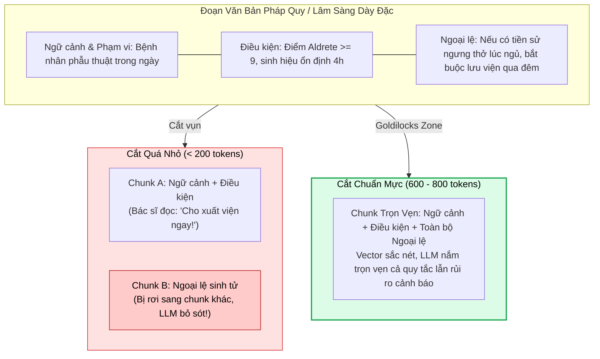

#### Phân tích cạm bẫy thực nghiệm:
* **Nếu chunk quá nhỏ ($\approx 200$ tokens):** Thuật toán cắt văn bản sẽ vô tình xé toạc đoạn văn ở giữa chừng, đẩy quy tắc điều kiện sang Chunk 1 và đẩy ngoại lệ sống còn sang Chunk 2. Khi nhân viên y tế tra cứu, hệ thống chỉ kéo về Chunk 1 và kết luận bệnh nhân đủ điều kiện xuất viện, tạo ra rủi ro y khoa chết người!
* **Nếu chunk quá lớn ($> 1,500$ tokens):** Mô hình embedding bị buộc phải nén quá nhiều ý niệm khác nhau (quy trình chuẩn bị phẫu thuật, hướng dẫn gây mê, chăm sóc vết thương, quy định xuất viện) vào cùng một vector duy nhất. Khi bác sĩ đặt câu hỏi chi tiết về một khía cạnh hẹp, vector tổng hợp bị mờ nhạt và trượt khỏi Top-K ứng viên.
* **Thực nghiệm so sánh 300 từ vs 900 từ:** 
  * Cắt phân đoạn $300$ từ cho thấy tỷ lệ mất mát mối liên kết logic giữa điều kiện và ngoại lệ lên đến $38\%$.
  * Cắt phân đoạn $900$ từ làm suy giảm điểm tương đồng ngữ nghĩa (Cosine Similarity) đối với các câu hỏi đặc thù khoảng $22\%$.

> [!tip] Vùng Cân Bằng Vàng (The Goldilocks Zone):
> Đối với các tài liệu quy định pháp lý, hành chính, cẩm nang tuân thủ và hướng dẫn điều trị y tế, kích thước chunk tối ưu được khuyến nghị là **$600 - 800$ tokens** kết hợp với độ gối đầu **$15\% - 20\%$**. Khoảng kích thước này đảm bảo giữ nguyên vẹn liên kết logic giữa điều kiện và ngoại lệ trong cùng một vector đại diện.

---

### 3 Phương pháp phân đoạn: Fixed-Length vs. Semantic vs. Adaptive

| Phương pháp phân đoạn | Mô tả cơ chế | Tác động lên chất lượng truy xuất | Độ phức tạp triển khai |
| :--- | :--- | :--- | :---: |
| **Fixed-Length (Độ dài cố định)** | Cắt văn bản theo kích thước cố định (ví dụ: đúng 500 ký tự hoặc 256 tokens). | Đơn giản, tốc độ xử lý nhanh; nhưng có rủi ro cắt ngang giữa câu hoặc giữa cụm từ logic. | ⭐ (Rất đơn giản) |
| **Semantic (Tôn trọng câu & đoạn)** | Tận dụng ranh giới dấu chấm câu, dấu xuống dòng đoạn văn (`\n\n`, `\n`, `. `). | Bảo tồn nguyên vẹn ý tứ tự nhiên của ngôn ngữ; tăng đáng kể độ chính xác và độ liên quan. | ⭐⭐ (Trung bình) |
| **Adaptive (Thích ứng theo cấu trúc)** | Điều chỉnh linh hoạt theo định dạng tài liệu: không cắt đôi khối code (```), tách theo thẻ tiêu đề Markdown (`#`, `##`), tách theo bảng biểu HTML. | **Lý tưởng cho tài liệu kỹ thuật, mã nguồn phần mềm và tài liệu hỗn hợp.** | ⭐⭐⭐ (Khá) |

---

### Tầm quan trọng sống còn của độ gối đầu (Overlap 10% - 20%)
Nếu bạn cắt văn bản thành các đoạn độc lập mà không có độ gối đầu, một ý tưởng nằm vắt ngang giữa hai đoạn sẽ bị xé làm đôi:
* Nửa đầu nằm ở Chunk 1, nửa sau nằm ở Chunk 2 $\to$ Cả hai chunk đều không chứa đầy đủ luận điểm để trả lời câu hỏi.
* **Quy tắc gối đầu (Chunk Overlap $10\% - 20\%$):** Đảm bảo rằng $50 - 100$ ký tự cuối của Chunk $N$ sẽ xuất hiện lại ở phần đầu của Chunk $N+1$. Cơ chế này duy trì tính liên tục (Continuity across boundaries), là yếu tố sống còn cho các hệ thống QA và đàm thoại.

---

### Nghiên cứu tình huống thực tế: Customer Support FAQ vs. Developer Documentation

* **Tình huống 1: Cơ sở tri thức hỗ trợ khách hàng E-commerce (FAQ Knowledge Base)**
  * *Đặc thù:* Khách hàng hỏi về chính sách hoàn tiền bằng hàng chục cách diễn đạt khác nhau.
  * *Giải pháp:* Dùng **Fixed-length chunking** khoảng $400 - 500$ ký tự kèm $10\%$ overlap ($50$ ký tự).
  * *Lý do:* Các mục FAQ ngắn gọn, cấu trúc tương đồng nhau, kích thước cố định giúp việc tìm kiếm vector diễn ra đồng nhất và nhanh chóng mà không lo cắt ngang câu nhờ có overlap.
* **Tình huống 2: Tìm kiếm tài liệu kỹ thuật cho lập trình viên (Developer Docs Search)**
  * *Đặc thù:* Tài liệu Markdown dài chứa tiêu đề, danh sách bullet points và các đoạn mã nguồn Python/Java.
  * *Giải pháp:* Áp dụng **Adaptive Chunking** với kích thước lớn hơn ($600 - 800$ tokens).
  * *Quy tắc:* Tuyệt đối không cắt ngang bên trong khối code triple backticks (` ``` `), luôn bắt đầu chunk mới khi gặp tiêu đề Heading Level-2 (`##`).

---

### Code thực nghiệm 2: Phân đoạn văn bản với RecursiveCharacterTextSplitter

```python
# WHAT: Phân tách văn bản dài thành các chunks nhỏ có cấu trúc
# WHY: Chunks ngắn và mạch lạc giúp cải thiện độ chính xác truy xuất ngữ nghĩa
# HOW: Sử dụng RecursiveCharacterTextSplitter của LangChain với kích thước và overlap chuẩn

from langchain.text_splitter import RecursiveCharacterTextSplitter

# Bước 1: Tài liệu mẫu
document = """
OpenAI cung cấp các API mạnh mẽ cho việc sinh văn bản, embeddings và tinh chỉnh mô hình.
Tài liệu này giải thích cách sử dụng embeddings để xây dựng hệ thống tìm kiếm ngữ nghĩa (Semantic Search).

Embeddings chuyển đổi các từ ngữ và câu văn thành các vector số học đa chiều.
Mỗi vector đại diện cho một tọa độ ngữ nghĩa trong không gian toán học liên tục.
Khi hai câu có ý nghĩa tương tự nhau, khoảng cách vector giữa chúng sẽ rất gần nhau.
Điều này giúp hệ thống tìm được tài liệu liên quan ngay cả khi không trùng lặp từ khóa nguyên văn.
"""

# Bước 2: Khởi tạo bộ chia với kích thước 200 ký tự và gối đầu 40 ký tự (20% overlap)
text_splitter = RecursiveCharacterTextSplitter(
    chunk_size=200,
    chunk_overlap=40,
    separators=["\n\n", "\n", ". ", " ", ""]
)

# Bước 3: Thực thi phân đoạn
chunks = text_splitter.split_text(document)

print(f"Tổng số chunks được tạo ra: {len(chunks)}")
for idx, chunk in enumerate(chunks, 1):
    print(f"\n--- CHUNK {idx} ({len(chunk)} ký tự) ---")
    print(chunk.strip())
```

---

## 4. GIẢI PHẪU CHIẾN LƯỢC LẬP CHỈ MỤC VECTOR: ĐỘNG CƠ ĐẰNG SAU TÌM KIẾM SIÊU TỐC

Khi số lượng vector trong cơ sở dữ liệu tăng từ $10,000$ lên hàng trăm nghìn hoặc hàng triệu, câu hỏi sống còn về hiệu năng là: **Hệ thống tổ chức không gian vector như thế nào để tìm kiếm trong vài mili-giây thay vì quét cạn kiệt toàn bộ cơ sở dữ liệu?**

Đó là vai trò của **Chiến lược lập chỉ mục (Indexing Strategies)**.

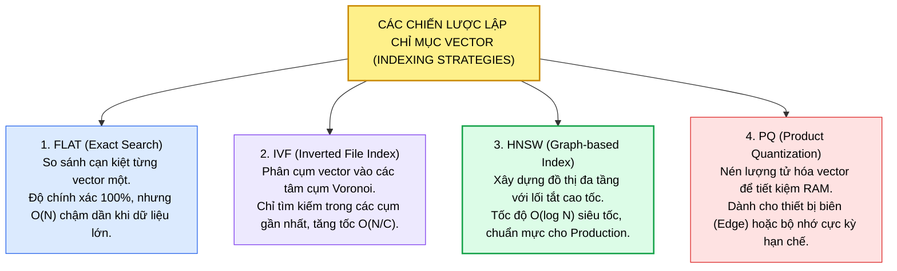

---

### FLAT: Lật từng trang sách & Vai trò chẩn đoán sớm (Diagnostic Baseline)
* **Cơ chế:** So sánh cạn kiệt vector truy vấn với từng vector lưu trữ trong cơ sở dữ liệu theo giải thuật k-NN chính xác.
* **Ẩn dụ:** Lật từng trang sách của cuốn từ điển 2,000 trang để tìm một câu trích dẫn.
* **Đặc tính:** Độ chuẩn xác $100\%$ tuyệt đối (Exact match), không bao giờ bỏ sót tài liệu đúng. Phù hợp cho tập dữ liệu nhỏ dưới $50,000$ vectors. Khi dữ liệu đạt hàng triệu vector, độ trễ tăng vọt từ $5\text{ms}$ lên $> 800\text{ms}$ — không thể chấp nhận được trong production.
* **Vai trò chẩn đoán sống còn trong nghiên cứu (Diagnostic Baseline):**
  * Trong giai đoạn đầu khi xây dựng và thẩm định đường ống RAG, các kỹ sư luôn ưu tiên bắt đầu với **Flat Index**.
  * **Tại sao?** Bởi vì mọi kết quả trả về từ Flat Index đều là chân lý chính xác $100\%$ về mặt hình học vector. Nhờ đó, kỹ sư có thể **cô lập nguyên nhân gốc rễ của lỗi truy xuất: Lỗi xuất phát từ Mô hình Embedding hay từ Dữ liệu / Chunking?** *(Helps us spot whether mistakes are coming from the model or the data)*. Nếu Flat Index trả về sai, chắc chắn vấn đề nằm ở mô hình nhúng hoặc cách cắt nhỏ văn bản, chứ không bị gây nhiễu bởi các sai số xấp xỉ của thuật toán lập chỉ mục.

---

### IVF (Inverted File Index): Phân cụm Voronoi Centroids
* **Cơ chế:** Trước khi tìm kiếm, thuật toán huấn luyện (Training Phase) sử dụng K-Means để gom hàng triệu vector thành $C$ cụm (Voronoi Cells / Buckets), mỗi cụm có một tâm (Centroid).
* **Khi truy vấn đến:** Hệ thống chỉ tính khoảng cách tới các Centroids để chọn ra $n_{\text{probe}}$ cụm gần nhất, sau đó chỉ quét các vector nằm bên trong các cụm đó, tránh việc phải quét toàn bộ tập dữ liệu (Avoid scanning the entire collection).
* **Đặc tính:** Giảm thời gian tìm kiếm từ $\mathcal{O}(N)$ xuống $\mathcal{O}\left(\frac{N}{C} \cdot n_{\text{probe}}\right)$. Tốc độ tăng gấp hàng chục lần, đổi lại có một tỷ lệ nhỏ suy giảm Recall nếu vector đúng nằm sát biên của một cụm bị bỏ qua. Phù hợp cho tập dữ liệu trung bình từ $100,000$ đến $10,000,000$ vectors.

---

### Tiến Hóa Chỉ Mục Trong FAISS: Từ FLAT Sang IVF & Tinh Chỉnh nprobe

Trong các bài toán thực tế như Trợ lý tra cứu bệnh viện, số lượng văn bản ban đầu có thể chỉ gồm vài chục văn bản mẫu, nhưng sẽ nhanh chóng tăng trưởng lên hàng chục nghìn đến hàng trăm nghìn quy định, phụ lục khu vực và phác đồ cập nhật.

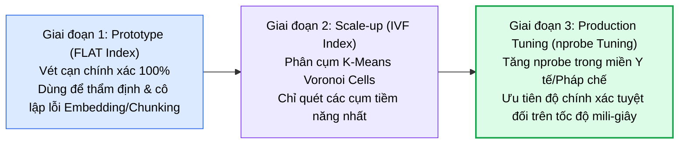

#### Quy trình huấn luyện & Tinh chỉnh thực tế trong FAISS:
1. **Huấn luyện chỉ mục (Index Training):** Khác với Flat Index (chỉ cần nạp vector vào là chạy), IVF đòi hỏi một pha huấn luyện (`index.train`). Bắt buộc phải huấn luyện K-Means trên tập vector thực tế của chính nghiệp vụ (ví dụ các vector BGE của văn bản lâm sàng). Điều này giúp các tâm cụm (Centroids) phản ánh chính xác cấu trúc ngôn từ và phân phối ngữ nghĩa đặc thù của miền chuyên ngành.
2. **Cân đối Recall và Latency qua tham số $n_{\text{probe}}$:**
   * $n_{\text{probe}}$ quy định số lượng cụm Voronoi mà FAISS sẽ mở ra để lùng sục khi có một truy vấn tới.
   * Nếu để mặc định $n_{\text{probe}} = 1$: Tốc độ cực nhanh (chỉ quét $1$ cụm), nhưng rất dễ bỏ sót các tài liệu đúng nếu vector tài liệu nằm ở vùng rìa ranh giới giữa hai cụm lân cận.
   * **Chiến thuật cho miền nhạy cảm (Healthcare / Legal):** Cấu hình $n_{\text{probe}}$ cao hơn (ví dụ $n_{\text{probe}} = 4$ đến $8$ trên $n_{\text{list}} = 16$ hoặc $64$).
   
> [!important] Nguyên Tắc Đánh Đổi Trong Miền Y Tế & Pháp Lý:
> **Độ chính xác và tính toàn vẹn của kết quả quan trọng hơn việc tiết kiệm vài mili-giây độ trễ (Accuracy matters far more than a few milliseconds of speed).** Việc tăng $n_{\text{probe}}$ giúp hệ thống mở rộng quy mô tài liệu mà vẫn duy trì độ tin cậy tuyệt đối cho các y bác sĩ.

---

### HNSW: Lối tắt cao tốc & Mạng lưới bạn bè (Graph-based Multi-layer)
* **Cơ chế:** Xây dựng một đồ thị lân cận phân tầng nhiều lớp (Skip-list on graphs). Tầng trên cùng là các liên kết tầm xa (đường cao tốc liên tỉnh), tầng dưới cùng là mạng lưới dày đặc cục bộ (đường nội đô).
* **Ẩn dụ:** Như mạng lưới bạn bè trong xã hội, mỗi người biết ai sống gần ai nhất. Khi tìm kiếm, thuật toán nhảy qua các liên kết cao tốc để tiếp cận ngay khu vực mục tiêu rồi mới đào sâu vào láng giềng gần nhất.
* **Đặc tính:** Độ phức tạp tìm kiếm chỉ là **$\mathcal{O}(\log N)$**. Tốc độ phản hồi cực đại ($< 5\text{ms}$ trên $10\text{M}$ vectors) với Recall@10 đạt $98\% - 99.5\%$. Đây là **chuẩn mực vàng cho các hệ thống RAG doanh nghiệp**. Nhược điểm: Tiêu thụ RAM lớn hơn ($1.5\times - 2\times$) và thời gian nạp dữ liệu (Index insertion) chậm hơn.

---

### PQ (Product Quantization): Nén lượng tử hóa vector cho Edge Devices
* **Cơ chế:** Chia một vector lớn (ví dụ 1,536 chiều) thành nhiều vector con nhỏ hơn (ví dụ 16 đoạn, mỗi đoạn 96 chiều), sau đó lượng tử hóa từng vector con thành một mã số nguyên đại diện (Centroid Codebook).
* **Đặc tính:** Nén kích thước vector giảm tới $80\% - 95\%$ dung lượng RAM, cho phép lưu trữ hàng triệu vector ngay trên điện thoại di động hoặc thiết bị nhúng phần cứng hạn chế tài nguyên. Nhược điểm: Mất mát một phần độ chính xác do sai số lượng tử hóa.

---

### Bảng ma trận so sánh 4 chiến lược: FLAT vs. IVF vs. HNSW vs. PQ

| Chiến Lược Lập Chỉ Mục | Bản Chất Toán Học | Khi Nào Nên Dùng? | Ưu Điểm Nổi Bật | Điểm Đánh Đổi (Trade-Offs) |
| :--- | :--- | :--- | :--- | :--- |
| **FLAT** | So sánh cạn kiệt toàn bộ $N$ vector | Tập dữ liệu nhỏ ($< 50\text{k}$ vectors) | Độ chính xác $100\%$ tuyệt đối | Không thể scale khi dữ liệu lớn ($\mathcal{O}(N)$) |
| **IVF (Inverted File)** | Phân cụm K-Means thành các Buckets | Tập dữ liệu vừa ($100\text{k} - 10\text{M}$ vectors) | Cân bằng tốc độ và dung lượng RAM | Mất một phần nhỏ Recall nếu $n_{\text{probe}}$ nhỏ |
| **HNSW** | Đồ thị phân tầng đa lớp (Skip-list) | **Hệ thống lớn, yêu cầu độ trễ thấp ($< 10\text{ms}$)** | **Tốc độ $\mathcal{O}(\log N)$, Recall SOTA ($> 98\%$)** | Tốn nhiều RAM ($1.5\times - 2\times$), chèn dữ liệu chậm |
| **PQ (Product Quantization)**| Nén vector thành mã số nguyên | Thiết bị biên (Edge, Mobile), RAM hạn chế | Tiết kiệm tới $90\%$ RAM lưu trữ | Độ chính xác suy giảm do sai số nén số học |

---

### Code thực nghiệm 3: Xây dựng IVF Index trên 1 triệu vector trong FAISS

```python
# WHAT: Xây dựng chỉ mục IVF (Inverted File) cho tập dữ liệu quy mô vừa
# WHY: IVF tăng tốc độ tìm kiếm bằng cách gom nhóm vector thành các cụm (Buckets)
# HOW: Huấn luyện index với các centroids và chỉ tìm kiếm trong các cụm liên quan

import faiss
import numpy as np

# Bước 1: Giả lập tập dữ liệu 1,000,000 vectors với 768 dimensions
vector_dim = 768
num_vectors = 1_000_000
np.random.seed(42)

# Tạo dữ liệu ngẫu nhiên dạng float32
dataset = np.random.random((num_vectors, vector_dim)).astype("float32")
faiss.normalize_L2(dataset)

# Bước 2: Cấu hình IVF Index
num_clusters = 100  # Chia 1 triệu vector thành 100 buckets
quantizer = faiss.IndexFlatIP(vector_dim) # Bộ đo khoảng cách giữa các centroids
ivf_index = faiss.IndexIVFFlat(quantizer, vector_dim, num_clusters, faiss.METRIC_INNER_PRODUCT)

# Bước 3: Huấn luyện Index (Tìm 100 tâm cụm K-Means)
print("Đang huấn luyện IVF Centroids...")
ivf_index.train(dataset)
print(f"Trạng thái huấn luyện: {ivf_index.is_trained}")

# Bước 4: Thêm dữ liệu vào các Buckets
ivf_index.add(dataset)
print(f"Đã lập chỉ mục: {ivf_index.ntotal} vectors.")

# Bước 5: Truy vấn với nprobe (Chỉ quét 5 cụm gần nhất thay vì 100 cụm)
ivf_index.nprobe = 5
query_vector = np.random.random((1, vector_dim)).astype("float32")
faiss.normalize_L2(query_vector)

k = 3 # Lấy Top-3 láng giềng gần nhất
distances, indices = ivf_index.search(query_vector, k)

print(f"\nKết quả tìm kiếm IVF Top-{k}:")
print(f"- Chỉ số tài liệu (Indices): {indices[0]}")
print(f"- Điểm tương đồng (Cosine Scores): {distances[0]}")
```

---

## 5. ĐÁNH GIÁ & LỰA CHỌN CƠ SỞ DỮ LIỆU VECTOR THEO KHUNG FICE

Cơ sở dữ liệu vector không đơn thuần là nơi lưu trữ dữ liệu thụ động — nó là **thành phần runtime trực tiếp trong đường ống truy xuất thời gian thực**. Lựa chọn sai cơ sở dữ liệu sẽ gây ra thắt cổ chai về cả độ trễ lẫn chất lượng tìm kiếm khi mở rộng quy mô.

### Khung tiêu chuẩn FICE: Fit - Infrastructure - Compatibility - Ecosystem

Để đánh giá một cơ sở dữ liệu vector, các kỹ sư AI sử dụng bộ khung **FICE**:

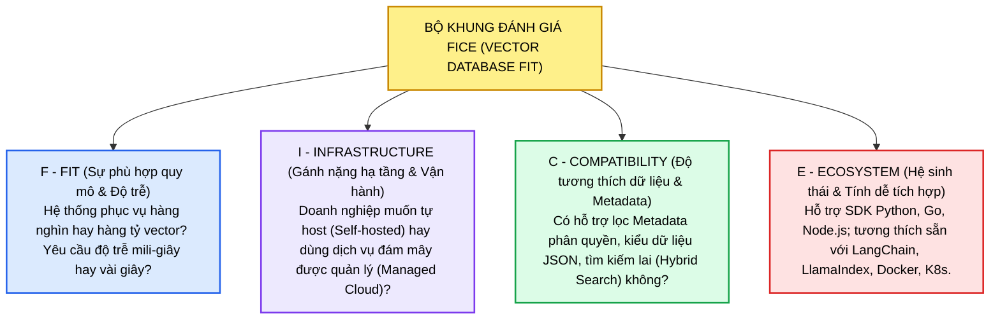

---

### So sánh 5 cơ sở dữ liệu hàng đầu: ChromaDB vs. FAISS vs. Milvus vs. Pinecone vs. Weaviate

| Cơ Sở Dữ Liệu | Hiệu Năng (Performance) | Chi Phí (Cost) | Mô Hình Triển Khai | Trường Hợp Dùng Tối Ưu (Best For) | Điểm Mạnh Cốt Lõi (Key Strengths) | Điểm Đánh Đổi (Trade-Offs) |
| :--- | :---: | :---: | :--- | :--- | :--- | :--- |
| **ChromaDB** | Trung bình | Miễn phí (OSS) | Local / In-Process | Prototyping, ứng dụng nhỏ | API Python trực quan, Zero-Config, nhúng nhanh | Không tối ưu cho quy mô lớn ($> 1\text{M}$ vectors) |
| **FAISS (Meta)** | **Rất cao** | Miễn phí (OSS) | Local Library (C++) | Tìm kiếm offline, nghiên cứu thuật toán | Tốc độ tính toán thuần túy tối thượng, tối ưu GPU | Không có sẵn lưu trữ bền vững (No persistence/CRUD) |
| **Milvus** | Cao | Trung bình | Cloud hoặc Local (K8s) | RAG sản xuất quy mô lớn (Enterprise Scale) | Đa dạng chiến lược index, phân tán co giãn vô hạn | Cấu hình và vận hành hạ tầng K8s phức tạp |
| **Pinecone** | Cao | \$\$\$ (Paid) | Managed Cloud Serverless | Quy mô doanh nghiệp, Zero-Ops | Tự động co giãn (Auto-scaling), SLA Uptime $99.99\%$ | Dịch vụ trả phí, mô hình hộp đen đóng (Opaque) |
| **Weaviate** | Trung bình - Cao | Trung bình | Cloud hoặc Local | Tìm kiếm giàu Metadata, Hybrid Search | Kết hợp vector + từ khóa nguyên bản, GraphQL API | Độ trễ vừa phải, cấu hình Schema tương đối chặt chẽ |

---

### Bảng ma trận so sánh 10 tiêu chí kỹ thuật

| Tiêu chí phân tích | ChromaDB | FAISS | Milvus | Pinecone | Weaviate |
| :--- | :--- | :--- | :--- | :--- | :--- |
| **Loại hình kiến trúc** | In-Process Embedded | Math Library | Distributed Cluster | Managed Serverless | Standalone / Cluster |
| **Độ phức tạp vận hành** | ⭐ (Rất thấp) | ⭐ (Tự code wrapper) | ⭐⭐⭐⭐⭐ (K8s DevOps) | ⭐ (Zero-Ops) | ⭐⭐⭐ (Docker/K8s) |
| **Quy mô vector tối ưu** | $< 500\text{k}$ | $1\text{k} - 5\text{M}$ | **Hàng tỷ vector** | **Hàng trăm triệu** | $1\text{M} - 50\text{M}$ |
| **Hỗ trợ GPU Acceleration**| ❌ Không | ⭐⭐⭐⭐⭐ (SOTA CUDA) | ⭐⭐⭐⭐ (GPU Search) | Ẩn sau Cloud Engine | ❌ Thử nghiệm |
| **Tìm kiếm lai (Hybrid Search)**| ❌ Tự code | ❌ Tự code | ⭐⭐⭐⭐ (Dense + Sparse)| ⭐⭐⭐⭐ (Sparse-Dense) | ⭐⭐⭐⭐⭐ (BM25 + Vector) |
| **Metadata Filtering** | Cơ bản | Rất khó | Nâng cao (Boolean/JSON) | Nâng cao (Single-stage) | Rất mạnh (GraphQL Schema)|
| **Cập nhật dữ liệu (CRUD)** | Dễ dàng | Khó khăn | Thời gian thực (Streaming)| Thời gian thực (Upsert) | Thời gian thực (REST/gRPC) |
| **Khả năng chịu lỗi & HA** | Đơn lẻ | Không | Multi-replica, MinIO/S3 | SLA 99.99% Cloud | Raft Multi-node Cluster |
| **Triển khai Air-Gapped** | ✅ Khả thi | ✅ Khả thi | ✅ Khả thi | ❌ Bắt buộc Cloud | ✅ Khả thi |
| **Giấy phép phần mềm** | Apache 2.0 | MIT License | Apache 2.0 | Thương mại độc quyền | BSD-3-Clause |

---

### Code thực nghiệm 4: Thiết lập chỉ mục FLAT trong FAISS và tìm kiếm tương đồng

```python
# WHAT: Lưu trữ vector và tìm kiếm tương đồng sử dụng FAISS FLAT
# WHY: Hiểu quy trình cốt lõi: Nạp vector -> Đo khoảng cách -> Trả về k-NN
# HOW: Xây dựng FAISS IndexFlatL2 thực hiện tìm kiếm láng giềng gần nhất chính xác

import faiss
import numpy as np

# Bước 1: Tạo dữ liệu giả lập (1,000 vectors với 1,536 chiều)
vector_count = 1000
vector_dim = 1536
np.random.seed(42)

stored_embeddings = np.random.random((vector_count, vector_dim)).astype("float32")

# Bước 2: Khởi tạo IndexFlatL2 (Exact Euclidean Distance Search)
index = faiss.IndexFlatL2(vector_dim)
print(f"Số lượng vector ban đầu trong index: {index.ntotal}")

# Bước 3: Nạp embeddings vào cơ sở dữ liệu
index.add(stored_embeddings)
print(f"Số lượng vector sau khi nạp: {index.ntotal}")

# Bước 4: Tạo một truy vấn mới và tìm Top-3 láng giềng gần nhất
query_embedding = np.random.random((1, vector_dim)).astype("float32")
top_k = 3
distances, indices = index.search(query_embedding, top_k)

print(f"\nKết quả tìm kiếm Top-{top_k} láng giềng gần nhất:")
for rank in range(top_k):
    doc_id = indices[0][rank]
    dist = distances[0][rank]
    print(f"Hạng {rank + 1}: Vector ID = {doc_id}, Khoảng cách L2 = {dist:.4f}")
```

---

### Bài tập tình huống thực tế: Áp lực mở rộng quy mô từ ChromaDB lên hàng triệu vector

> [!example] Kịch Bản Thực Chiến (Scenario)
> Bạn vừa xây dựng thành công một hệ thống tìm kiếm FAQ nội bộ cho công ty sử dụng **ChromaDB**. Hệ thống chạy rất mượt mà và chính xác với vài nghìn tài liệu ban đầu. 
> Tuy nhiên, sau 6 tháng hoạt động, dữ liệu bùng nổ lên **hàng triệu embeddings**, khiến tốc độ tìm kiếm bị nghẽn (từ $50\text{ms}$ vọt lên $> 800\text{ms}$). Bạn cần giải pháp giúp hệ thống phản hồi nhanh trở lại mà không đánh mất độ chính xác và không phải đập đi xây lại toàn bộ nghiệp vụ từ đầu.

**Câu hỏi: Bạn nên lựa chọn giải pháp nào dưới đây?**
1. *Phương án A:* Giữ nguyên ChromaDB và chỉ cần tăng kích thước Chunk (Chunk size) lên gấp 4 lần để giảm số lượng vector.
2. *Phương án B:* Di chuyển hệ thống sang **Milvus** hoặc **Pinecone** để tận dụng hạ tầng tìm kiếm vector phân tán quy mô lớn.
3. *Phương án C:* Nén các vector lại (Dimension Reduction) để chúng nhẹ hơn và vừa vặn với RAM của ChromaDB.
4. *Phương án D:* Chuyển đổi toàn bộ sang tìm kiếm từ khóa truyền thống (Keyword Search) thay vì dùng vector.

**Giải Phẫu Đáp Án & Hướng Dẫn Kỹ Thuật:**
* ❌ **Phương án A (Sai):** Tăng chunk size sẽ làm giảm số lượng vector, nhưng bạn sẽ gặp phải hiện tượng *Semantic Dilution*: đoạn văn quá dài làm mờ nhạt ý tưởng cốt lõi, khiến độ chính xác truy xuất tụt dốc thảm hại.
* ✅ **Phương án B (CHÍNH XÁC NHẤT):** Các cơ sở dữ liệu như **Milvus** (phân tán cụm Kubernetes) hoặc **Pinecone** (Serverless Cloud) được sinh ra chuyên biệt để xử lý hàng triệu đến hàng tỷ embeddings với thuật toán đồ thị HNSW phân tán, duy trì độ trễ dưới $10\text{ms}$ mà vẫn giữ nguyên độ chính xác.
* ❌ **Phương án C (Sai):** Nén vector làm mất mát thông tin hình học tinh vi, khiến các câu hỏi có nghĩa gần giống nhau không còn phân biệt được nữa.
* ❌ **Phương án D (Sai):** Tìm kiếm từ khóa bỏ qua hoàn toàn ngữ cảnh và ý nghĩa ngữ nghĩa — người dùng gõ từ đồng nghĩa sẽ nhận được kết quả rỗng.

---

## 6. KHUNG PHƯƠNG PHÁP LUẬN RA QUYẾT ĐỊNH (DECISION FRAMEWORK & TREE)

### 2 Tình huống kiến trúc điển hình: Internal Dev Tool vs. Metadata-Rich Hybrid Search

* **Tình huống 1: Công cụ tìm kiếm nội bộ cho lập trình viên (Internal Developer Tool)**
  * *Mục tiêu:* Tìm kiếm đoạn code và tài liệu Markdown nội bộ.
  * *Lựa chọn:* **ChromaDB** hoặc **FAISS**.
  * *Lý do:* Nhẹ, chạy trực tiếp trên máy cục bộ hoặc container nhỏ, tốc độ lặp phát triển cực nhanh, không tốn chi phí thuê server cloud.
* **Tình huống 2: Ứng dụng tìm kiếm giàu Metadata & Tìm kiếm Lai (Metadata-Rich Hybrid Search)**
  * *Mục tiêu:* Người dùng tìm kiếm vừa theo ngữ nghĩa, vừa lọc chặt chẽ: *"Chỉ lấy hợp đồng ký trong năm 2024 VÀ thuộc đối tác Bạch Kim VÀ chứa mã sản phẩm X"*.
  * *Lựa chọn:* **Weaviate** hoặc **Pinecone / Milvus**.
  * *Lý do:* Weaviate hỗ trợ kiến trúc Hybrid Search (kết hợp vector ngữ nghĩa và BM25 từ khóa) cùng hệ thống lọc Metadata GraphQL cực kỳ mạnh mẽ.

---

### Cây quyết định lựa chọn cơ sở dữ liệu vector

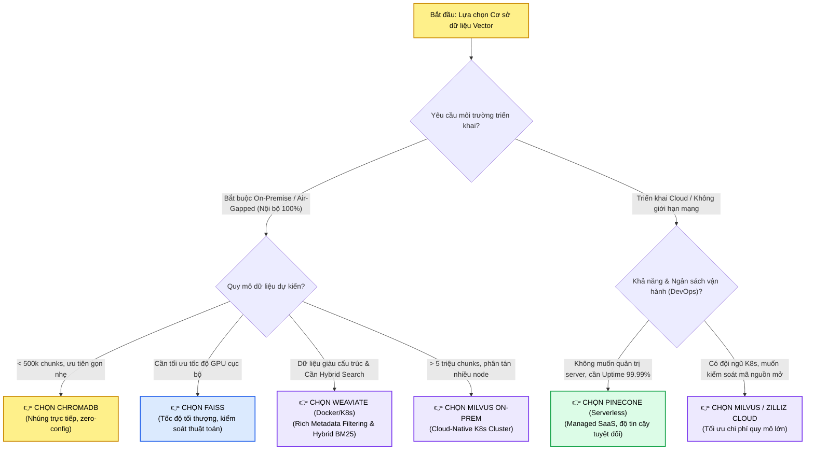

---

## 7. QUẢN TRỊ VÒNG ĐỜI & VẬN HÀNH VECTOR LIÊN TỤC (VECTOR LIFECYCLE MANAGEMENT)

### Tính lỗi thời của tri thức & Biến động thế giới thực (The Stale Index Problem)

Một sai lầm phổ biến của các kỹ sư mới vào nghề là xem việc nạp vector vào cơ sở dữ liệu như một hành động "làm một lần là xong" (Set-and-Forget).
Trong thực tế sản xuất, **tri thức thế giới thực liên tục biến đổi (Real-world Change)**: 
* Bệnh viện cập nhật hướng dẫn điều trị và phác đồ mới hàng tuần.
* Các quy chế xuất viện và chính sách thanh toán bảo hiểm y tế bị sửa đổi theo từng quý.
* Những tài liệu cũ hết hiệu lực bị thu hồi hoặc xóa bỏ.

> [!warning] Hiểm Họa Của "Chỉ Mục Ôi Thiu" (Stale Vector Index):
> Nếu bạn chỉ lập chỉ mục một lần và không bao giờ tái nhúng (Re-embed), cơ sở dữ liệu vector sẽ dần biến thành một "bãi phế liệu tri thức". Mô hình RAG sẽ liên tục trích xuất các quy định cũ đã bị bãi bỏ để trả lời bác sĩ, khiến người dùng hoàn toàn mất niềm tin vào hệ thống trợ lý AI.

---

### Vòng Lặp Vận Hành Ngày-2 (Day-2 Index Maintenance Loop): Giữ Cho RAG Luôn Khỏe Mạnh

Bí quyết của một hệ thống RAG đẳng cấp không chỉ nằm ở việc xây dựng thành công đường ống ban đầu, mà nằm ở **quy trình duy trì sự khỏe mạnh và tươi mới của dữ liệu trong vận hành dài hạn (Day-2 Operations)**.

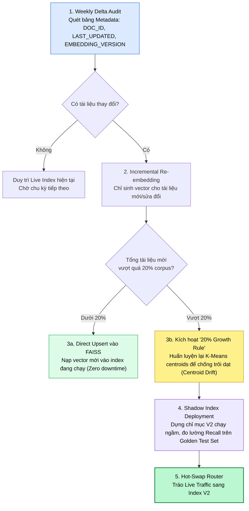

#### 4 Cột mốc kỹ thuật của chu trình bảo trì sạch (Clean Maintenance Loop):
1. **Thiết lập bảng theo dõi Metadata (Metadata Tracking Table):**
   * Mọi tài liệu nạp vào phải có cấu trúc định danh:
     ```python
     {
         "doc_id": "POL-MED-001",
         "last_updated": "2026-10-04T10:00:00Z",
         "embedding_version": "bge-base-en-v1.5",
         "status": "active" # active | deprecated
     }
     ```
2. **Cập nhật lũy tiến định kỳ (Weekly Delta Upsert):**
   * Định kỳ hàng tuần, hệ thống kiểm tra các tài liệu có `last_updated > last_sync_timestamp`.
   * **Chỉ re-embed những gì đã thay đổi:** Không bao giờ tiêu tốn chi phí và GPU tính toán để nhúng lại toàn bộ 100% kho dữ liệu chỉ vì 5 tài liệu vừa được cập nhật. Nạp bổ sung (Upsert) các vector mới trực tiếp vào chỉ mục FAISS đang hoạt động.
3. **Quy tắc tái huấn luyện 20% (The 20% Corpus Growth Rule):**
   * Đối với các chỉ mục có tâm cụm như FAISS IVF, các tâm cụm Voronoi được xác định dựa trên phân phối dữ liệu tại thời điểm huấn luyện ban đầu.
   * Khi kho tài liệu mở rộng **vượt quá $20\%$**, hiện tượng **Trôi dạt tâm cụm (Centroid Drift)** sẽ xảy ra: các vector mới nạp vào phân bố lệch khỏi các tâm cụm cũ, làm suy giảm nghiêm trọng chỉ số Recall.
   * Khi chạm ngưỡng $20\%$, hệ thống bắt buộc phải gom toàn bộ vector hiện có để chạy lại pha huấn luyện `index.train` và tái phân bố lại toàn bộ cụm.
4. **Triển khai ngầm kiểm định hồi quy (Shadow Index Deployment):**
   * Tuyệt đối không bao giờ cập nhật thẳng vào chỉ mục phục vụ người dùng thực tế khi nâng cấp mô hình embedding hoặc tái cấu trúc phân cụm.
   * **Quy trình:** Dựng một **Shadow Index** chạy song song ở hậu trường $\to$ Bắn tập dữ liệu kiểm chuẩn (Golden Evaluation Set gồm 50-100 câu hỏi nghiệp vụ chuẩn) qua cả hai chỉ mục $\to$ So sánh chỉ số Recall và Precision $\to$ Khi Shadow Index chứng minh độ vượt trội, thực hiện thao tác tráo đổi (Hot-Swap API Pointer) với thời gian chết bằng 0 (Zero-downtime).

---

## 8. HIỆN THỰC HÓA TOÀN DIỆN: END-TO-END PRODUCTION PIPELINE

### Code thực nghiệm 5: Kết nối 4 mắt xích Chunking $\to$ Embedding $\to$ Indexing $\to$ Retrieval

Dưới đây là một đường ống hoàn chỉnh kết hợp trọn vẹn cả 4 trụ cột:

```python
# --- Kết Nối Toàn Bộ: Ví Dụ Đường Ống RAG Hoàn Chỉnh ---
# WHAT: Ví dụ End-to-end kết hợp Chunking, Embedding, Indexing và Retrieval
# WHY: Minh họa cách các cấu phần phối hợp nhịp nhàng trong một đường ống thực tế
# HOW: Sử dụng OpenAI cho Embeddings, LangChain cho Chunking và FAISS cho Indexing/Search

import os
import faiss
import numpy as np
from openai import OpenAI
from langchain.text_splitter import RecursiveCharacterTextSplitter

# 1. Khởi tạo OpenAI Client
client = OpenAI(api_key=os.environ.get("OPENAI_API_KEY", "your-api-key"))

# 2. Dữ liệu văn bản nguồn (Sample Raw Knowledge Document)
raw_document = """
Kiến trúc Microservices phân tách ứng dụng thành các dịch vụ nhỏ độc lập.
Mỗi microservice chịu trách nhiệm cho một nghiệp vụ cụ thể và giao tiếp qua API REST hoặc gRPC.
Ưu điểm lớn nhất của microservices là khả năng triển khai độc lập và co giãn từng dịch vụ riêng biệt.
Tuy nhiên, thách thức lớn nằm ở việc quản lý tính nhất quán dữ liệu phân tán và độ phức tạp vận hành.

Để đảm bảo khả năng quan sát (Observability), hệ thống cần tích hợp OpenTelemetry để thu thập Distributed Tracing.
Logging tập trung qua ElasticSearch và giám sát Metrics qua Prometheus là các tiêu chuẩn bắt buộc.
"""

# 3. Bước 1: Chunking văn bản với độ gối đầu
text_splitter = RecursiveCharacterTextSplitter(chunk_size=200, chunk_overlap=40)
chunks = text_splitter.split_text(raw_document)
print(f"Bước 1: Đã phân đoạn thành {len(chunks)} chunks.")

# 4. Bước 2: Tạo Embeddings cho toàn bộ chunks
embeddings_list = []
for c in chunks:
    resp = client.embeddings.create(input=c, model="text-embedding-3-small")
    embeddings_list.append(resp.data[0].embedding)

embeddings_matrix = np.array(embeddings_list).astype("float32")
faiss.normalize_L2(embeddings_matrix)
vector_dim = embeddings_matrix.shape[1]
print(f"Bước 2: Đã tạo ma trận embedding kích thước: {embeddings_matrix.shape}")

# 5. Bước 3: Lập chỉ mục với FAISS (Cosine Similarity via Inner Product)
index = faiss.IndexFlatIP(vector_dim)
index.add(embeddings_matrix)
print(f"Bước 3: Đã lập chỉ mục {index.ntotal} vectors vào FAISS.")

# 6. Bước 4: Thực thi truy vấn ngữ nghĩa (Semantic Query Retrieval)
user_query = "Làm sao để giám sát và theo dõi dấu vết trong microservices?"
query_resp = client.embeddings.create(input=user_query, model="text-embedding-3-small")
query_vector = np.array([query_resp.data[0].embedding]).astype("float32")
faiss.normalize_L2(query_vector)

k = 2 # Thu hồi Top-2 đoạn trích phù hợp nhất
scores, doc_ids = index.search(query_vector, k)

print(f"\nBước 4: Kết quả truy xuất cho câu hỏi: '{user_query}'")
for rank in range(k):
    best_id = doc_ids[0][rank]
    score = scores[0][rank]
    print(f"Hạng {rank + 1} (Score: {score:.4f}):\n{chunks[best_id]}\n")
```

---

### Code thực nghiệm 6: Cấu hình HNSW tùy chỉnh và lọc Metadata Boolean trong ChromaDB

```python
import chromadb

def demo_advanced_chromadb():
    # Khởi tạo client lưu trữ bền vững
    client = chromadb.PersistentClient(path="./chroma_production_data")
    
    # Tạo collection với cấu hình HNSW nâng cao
    collection = client.get_or_create_collection(
        name="enterprise_devops_kb",
        metadata={
            "hnsw:space": "cosine",
            "hnsw:construction_ef": 128,  # Tăng độ sâu khi dựng đồ thị để tối ưu Recall
            "hnsw:M": 32,                 # Số liên kết láng giềng mỗi node
            "hnsw:search_ef": 64          # Độ sâu tìm kiếm lúc query
        }
    )
    
    # Nạp tài liệu kèm Metadata đa chiều
    collection.upsert(
        documents=[
            "PostgreSQL database connection pool timeout after 30 seconds idle.",
            "Redis cache memory fragmentation ratio exceeds threshold of 1.5.",
            "Kubernetes pod crashloopbackoff caused by OOMKilled memory limit."
        ],
        metadatas=[
            {"category": "database", "priority": 1, "environment": "production"},
            {"category": "cache", "priority": 2, "environment": "production"},
            {"category": "infrastructure", "priority": 1, "environment": "staging"}
        ],
        ids=["inc_001", "inc_002", "inc_003"]
    )
    
    # Truy vấn kết hợp lọc Metadata phức tạp (Boolean AND)
    results = collection.query(
        query_texts=["Why is my SQL query timing out?"],
        n_results=1,
        where={
            "$and": [
                {"category": {"$eq": "database"}},
                {"environment": {"$eq": "production"}}
            ]
        }
    )
    
    print("Kết quả ChromaDB với Metadata Filtering:")
    print("Document:", results["documents"][0][0])
    print("Metadata:", results["metadatas"][0][0])
    print("Distance:", results["distances"][0][0])

if __name__ == "__main__":
    # demo_advanced_chromadb()
    pass
```

---

### Code thực nghiệm 7: Toàn bộ đường ống Trợ lý tra cứu y tế (Clinical Policy Assistant) với SentenceTransformers & FAISS (MiniLM vs BGE, IVF & Delta Upsert)

Dưới đây là mã nguồn Python thực chiến hoàn chỉnh tái hiện toàn bộ bài toán Trợ lý tra cứu quy chế lâm sàng cho bệnh viện:
* **Môi trường & Thư viện:** `pip install sentence-transformers faiss-cpu numpy`
* **Quy trình thực thi:**
  1. Nạp 3 tài liệu chính sách y tế mẫu (Telehealth Retention, Emergency Discharge, Same-Day Surgery Protocol).
  2. Tạo 2 mô hình Embedding: `all-MiniLM-L6-v2` (384 chiều) vs `BAAI/bge-base-en-v1.5` (768 chiều).
  3. Lập chỉ mục FLAT và so sánh kết quả truy vấn đối đầu trên câu hỏi: *"How long do we store patient records for telehealth sessions?"*.
  4. Nâng cấp lên chỉ mục phân cụm **FAISS IVF (Inverted File Index)**, huấn luyện K-Means trên vector BGE và tinh chỉnh `nprobe`.
  5. Mô phỏng **Vòng lặp vận hành Ngày-2 (Day-2 Delta Upsert)**: Nhúng lại chính sách vừa cập nhật và nạp trực tiếp vào FAISS mà không cần rebuild toàn bộ.

```python
# ==============================================================================
# CLINICAL POLICY ASSISTANT: RETRIEVAL BENCHMARK & PRODUCTION FAISS PIPELINE
# Framework: SentenceTransformers + FAISS + NumPy
# ==============================================================================

import numpy as np
import faiss
from sentence_transformers import SentenceTransformer

# ------------------------------------------------------------------------------
# 1. KHO CHÍNH SÁCH BỆNH VIỆN MẪU (HOSPITAL POLICIES KNOWLEDGE BASE)
# ------------------------------------------------------------------------------
policies_db = [
    {
        "doc_id": "POL-MED-001",
        "title": "Telehealth Patient Record Retention and HIPAA Archival Protocol",
        "last_updated": "2026-01-15",
        "version": 1,
        "content": (
            "POLICY POL-MED-001: Telehealth Encounter Record Retention & Archival Protocol.\n"
            "All electronic audio-video recordings, interactive text transcripts, and clinical notes "
            "generated during telehealth consultations must be retained in encrypted cold storage for a minimum "
            "of seven (7) years from the date of encounter for adult patients. For pediatric telehealth sessions, "
            "records must be retained for seven (7) years past the patient's eighteenth (18th) birthday. "
            "All archival repositories must strictly comply with the HIPAA Security Rule and enforce AES-256 encryption at rest."
        )
    },
    {
        "doc_id": "POL-MED-002",
        "title": "Emergency Department Observation and Safe Discharge Criteria",
        "last_updated": "2026-02-10",
        "version": 1,
        "content": (
            "POLICY POL-MED-002: Emergency Department Patient Discharge Criteria.\n"
            "Patients admitted under Emergency Observation status may be cleared for home discharge only after "
            "sustaining stable hemodynamic vital signs for at least four (4) consecutive hours. Mandatory criteria "
            "include a Glasgow Coma Scale score of 15, resolution of acute pain, safe ambulation without unassisted "
            "fall risk, and verified caregiver escort transport."
        )
    },
    {
        "doc_id": "POL-MED-003",
        "title": "Same-Day Ambulatory Surgery Post-Anesthesia Discharge Protocol",
        "last_updated": "2026-03-05",
        "version": 1,
        "content": (
            "POLICY POL-MED-003: Post-Anesthesia Same-Day Discharge Protocol.\n"
            "Outpatients undergoing same-day elective surgical procedures must meet the modified Aldrete Post-Anesthesia "
            "Recovery Score of at least nine (9) prior to discharge. Patients must demonstrate oral fluid retention, "
            "spontaneous voiding, absence of active surgical wound hemorrhage, and possess written post-operative "
            "analgesic instructions signed by the attending surgeon."
        )
    }
]

# Truy vấn thực tế của y bác sĩ
clinical_query = "How long do we store patient records for telehealth sessions?"
print(f"Câu hỏi lâm sàng: '{clinical_query}'\n")

# ------------------------------------------------------------------------------
# 2. KHỞI TẠO 2 MÔ HÌNH EMBEDDING ĐỐI ĐẦU
# ------------------------------------------------------------------------------
print("--- KHỞI TẠO MÔ HÌNH EMBEDDING ---")
# Mô hình 1: Nhẹ, lặp nhanh (384 dimensions)
print("Loading model: all-MiniLM-L6-v2 (384-d)...")
model_minilm = SentenceTransformer("all-MiniLM-L6-v2")

# Mô hình 2: Nắm bắt sâu văn phong chính sách & tuân thủ (768 dimensions)
print("Loading model: BAAI/bge-base-en-v1.5 (768-d)...")
model_bge = SentenceTransformer("BAAI/bge-base-en-v1.5")

policy_texts = [p["content"] for p in policies_db]

# Trích xuất embeddings cho cả 3 văn bản
embeddings_minilm = model_minilm.encode(policy_texts, convert_to_numpy=True).astype("float32")
embeddings_bge = model_bge.encode(policy_texts, convert_to_numpy=True).astype("float32")

# Chuẩn hóa L2 để tìm kiếm Cosine Similarity qua Inner Product
faiss.normalize_L2(embeddings_minilm)
faiss.normalize_L2(embeddings_bge)

dim_minilm = embeddings_minilm.shape[1]  # 384
dim_bge = embeddings_bge.shape[1]        # 768

# ------------------------------------------------------------------------------
# 3. THỬ NGHIỆM ĐỐI ĐẦU TRÊN FAISS FLAT INDEX (EXACT SEARCH)
# ------------------------------------------------------------------------------
print("\n--- THỰC NGHIỆM ĐỐI ĐẦU: MiniLM vs BGE TRÊN FAISS FLAT INDEX ---")

# Dựng Flat Index cho MiniLM
index_flat_minilm = faiss.IndexFlatIP(dim_minilm)
index_flat_minilm.add(embeddings_minilm)

# Dựng Flat Index cho BGE
index_flat_bge = faiss.IndexFlatIP(dim_bge)
index_flat_bge.add(embeddings_bge)

# Mã hóa câu hỏi
query_vec_minilm = model_minilm.encode([clinical_query], convert_to_numpy=True).astype("float32")
query_vec_bge = model_bge.encode([clinical_query], convert_to_numpy=True).astype("float32")
faiss.normalize_L2(query_vec_minilm)
faiss.normalize_L2(query_vec_bge)

# Truy vấn Top-3 trên cả 2 mô hình
scores_m, ids_m = index_flat_minilm.search(query_vec_minilm, 3)
scores_b, ids_b = index_flat_bge.search(query_vec_bge, 3)

print("\n[KẾT QUẢ TỪ all-MiniLM-L6-v2]:")
for rank in range(3):
    idx = ids_m[0][rank]
    score = scores_m[0][rank]
    doc = policies_db[idx]
    print(f"  Hạng {rank+1} (Cosine: {score:.4f}) -> [{doc['doc_id']}] {doc['title']}")

print("\n[KẾT QUẢ TỪ BAAI/bge-base-en-v1.5]:")
for rank in range(3):
    idx = ids_b[0][rank]
    score = scores_b[0][rank]
    doc = policies_db[idx]
    print(f"  Hạng {rank+1} (Cosine: {score:.4f}) -> [{doc['doc_id']}] {doc['title']}")

# ------------------------------------------------------------------------------
# 4. CHUYỂN DỊCH SANG FAISS IVF (INVERTED FILE) & TINH CHỈNH NPROBE
# ------------------------------------------------------------------------------
print("\n--- NÂNG CẤP LÊN FAISS IVF INDEX (SCALABLE CLUSTERING) ---")

# Giả lập tập dữ liệu huấn luyện mở rộng dựa trên phân phối BGE
# (Trong thực tế cần tối thiểu vài chục vector cho mỗi centroid)
nlist = 2  # Gom thành 2 cụm Voronoi (minh họa)
quantizer = faiss.IndexFlatIP(dim_bge)
index_ivf_bge = faiss.IndexIVFFlat(quantizer, dim_bge, nlist, faiss.METRIC_INNER_PRODUCT)

# Huấn luyện K-Means Centroids trực tiếp trên vector BGE
print(f"Đang huấn luyện IVF index với {nlist} tâm cụm Voronoi...")
index_ivf_bge.train(embeddings_bge)
print(f"Chỉ số đã được huấn luyện: {index_ivf_bge.is_trained}")

# Nạp các vector văn bản vào cụm
index_ivf_bge.add(embeddings_bge)
print(f"Tổng số vector đã lập chỉ mục IVF: {index_ivf_bge.ntotal}")

# Thiết lập nprobe: Trong y tế, tăng nprobe để không bao giờ bỏ sót tài liệu
index_ivf_bge.nprobe = 2
print(f"Cấu hình nprobe = {index_ivf_bge.nprobe} (Quét toàn diện các cụm để bảo toàn Recall)")

ivf_scores, ivf_ids = index_ivf_bge.search(query_vec_bge, 2)
print(f"IVF Top-1 Match: [{policies_db[ivf_ids[0][0]]['doc_id']}] (Cosine Score: {ivf_scores[0][0]:.4f})")

# ------------------------------------------------------------------------------
# 5. VÒNG LẶP VẬN HÀNH NGÀY-2: INCREMENTAL DELTA UPSERT (KHÔNG CẦN REBUILD)
# ------------------------------------------------------------------------------
print("\n--- VÒNG LẶP BẢO TRÌ NGÀY-2: CẬP NHẬT GIA TĂNG (INCREMENTAL UPSERT) ---")

# Giả lập: Bộ Y tế ban hành sửa đổi: Tăng thời hạn lưu trữ Telehealth lên 10 năm
updated_policy = {
    "doc_id": "POL-MED-001",
    "title": "Telehealth Patient Record Retention (2026 Revised Amendment)",
    "last_updated": "2026-10-04",
    "version": 2,
    "content": (
        "POLICY POL-MED-001 (AMENDMENT 2026): Revised Retention Protocol.\n"
        "Effective October 2026, all telehealth video sessions and electronic medical transcripts "
        "must be archived for a mandatory duration of ten (10) years (extended from 7 years) "
        "following the final clinical encounter. All pediatric retention remains active until age 25."
    )
}

print(f"Phát hiện văn bản thay đổi: {updated_policy['doc_id']} v{updated_policy['version']}")
print("Thực hiện Re-embedding chỉ riêng cho tài liệu sửa đổi...")

# Chỉ nhúng văn bản sửa đổi (Delta Embedding)
updated_vector = model_bge.encode([updated_policy["content"]], convert_to_numpy=True).astype("float32")
faiss.normalize_L2(updated_vector)

# Nạp trực tiếp vector mới vào FAISS IVF Index đang chạy mà không cần rebuild toàn bộ
index_ivf_bge.add(updated_vector)
policies_db.append(updated_policy)  # Cập nhật danh mục tài liệu

print(f"Đã nạp bổ sung vector mới. Tổng số vector trong FAISS hiện tại: {index_ivf_bge.ntotal}")

# Truy vấn lại để xác nhận FAISS ngay lập tức trả về tài liệu mới nhất
new_scores, new_ids = index_ivf_bge.search(query_vec_bge, 1)
retrieved_doc = policies_db[new_ids[0][0]]
print(f"\nKết quả truy xuất sau cập nhật gia tăng:")
print(f"Document ID: {retrieved_doc['doc_id']} (Phiên bản: v{retrieved_doc['version']})")
print(f"Tiêu đề: {retrieved_doc['title']}")
print(f"Nội dung trích xuất:\n{retrieved_doc['content']}")
```

---

## 9. CÂY ĐIỀU HƯỚNG & LIÊN KẾT TRONG VAULT

Tài liệu này là nhịp cầu liên kết giữa lý thuyết toán học vector và kỹ nghệ triển khai cơ sở dữ liệu cho Tác tử AI. Hãy tiếp tục khám phá theo lộ trình:

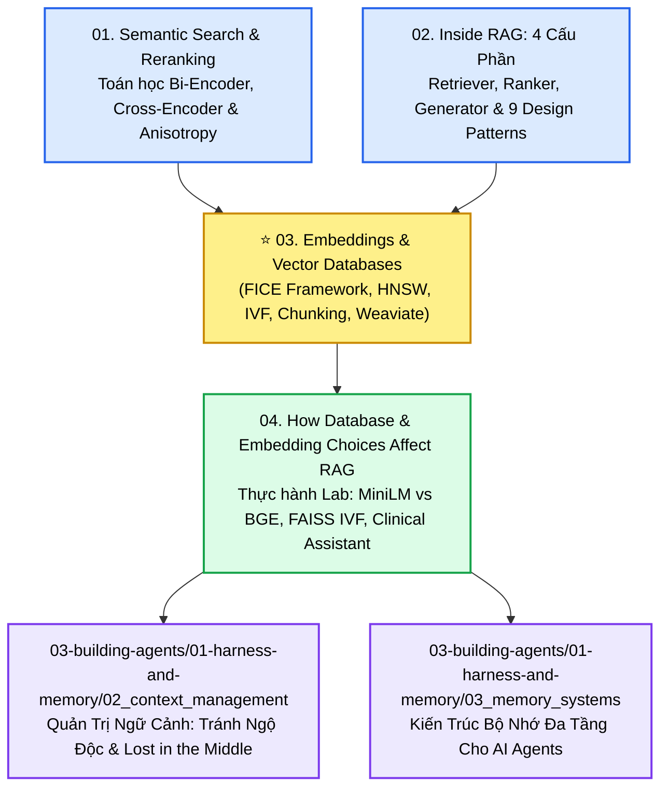

* **Nền tảng toán học & Re-ranking:** [[01_semantic_search_and_reranking|01. Tìm Kiếm Ngữ Nghĩa & Tái Xếp Hạng]]
* **Kiến trúc RAG & 9 Mẫu thiết kế chiến lược:** [[02_rag_architecture_and_components|02. Kiến Trúc RAG: 4 Cấu Phần Cốt Lõi & Các Mẫu Thiết Kế Chiến Lược]]
* **Thực hành Lab & Điển cứu Y tế:** [[04_how_database_and_embedding_choices_affect_rag|04. Thực Hành Đánh Giá Embedding & Cơ Sở Dữ Liệu Vector (Clinical Policy Assistant)]]
* **Cẩm nang kỹ nghệ vận hành RAG Production:** [[05_theory_to_practice_making_rag_work|05. Từ Lý Thuyết Đến Thực Tiễn: Làm Cho RAG Hoạt Động Hiệu Quả]]
* **Quản trị cửa sổ ngữ cảnh:** [[02_context_management|02. Quản Trị Cửa Sổ Ngữ Cảnh: Bệnh Lý & Tỉa Nhánh]]
* **Ứng dụng vào Bộ nhớ Tác tử AI:** [[03_memory_systems|03. Kiến Trúc Bộ Nhớ Đa Tầng Cho AI Agents]]
