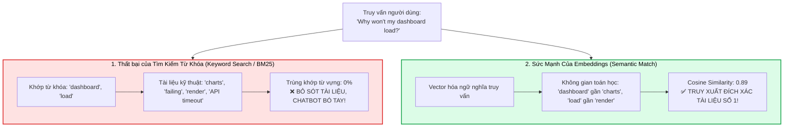
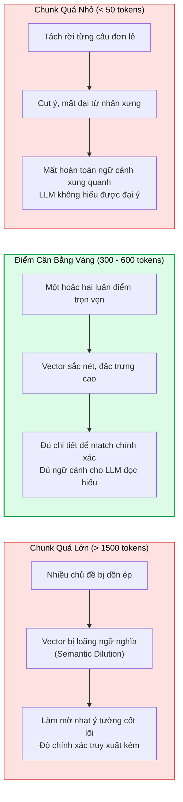
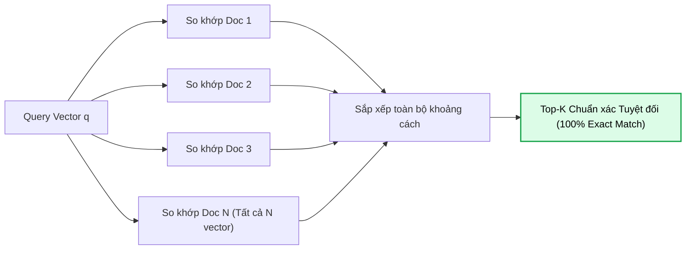
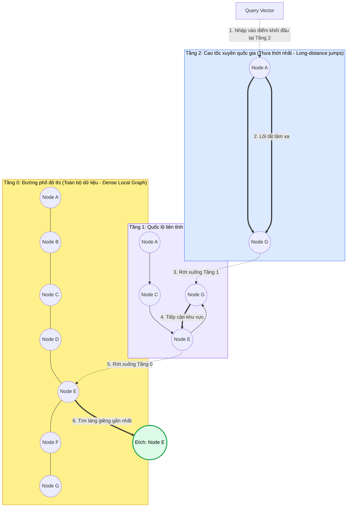
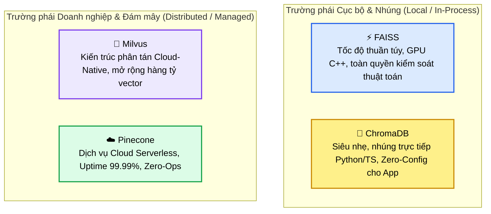
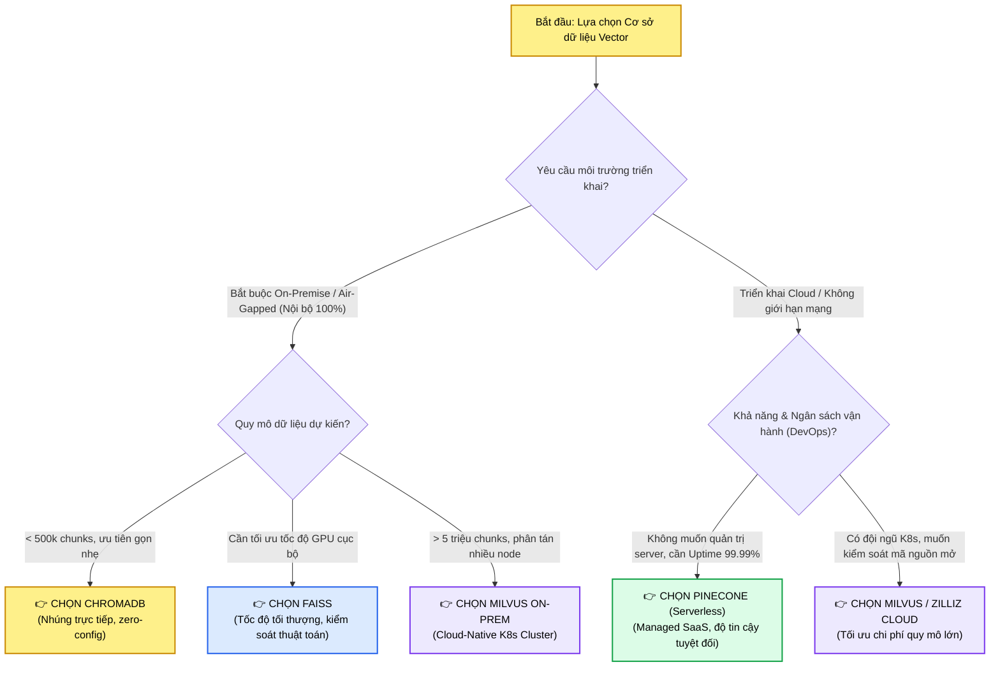
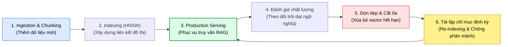
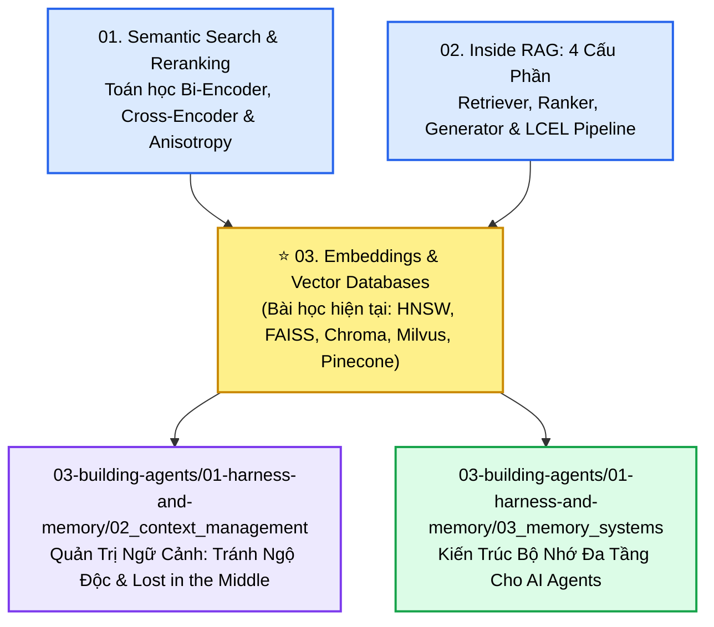

# VAI TRÒ CỐT LÕI CỦA EMBEDDINGS & CƠ SỞ DỮ LIỆU VECTOR TRONG HỆ THỐNG RAG
## Dấu Vân Tay Số Học (Numerical Fingerprints), So Sánh FAISS vs. ChromaDB vs. Milvus vs. Pinecone, Chiến Lược Lập Chỉ Mục HNSW vs. Flat Index & Quản Trị Vòng Đời Vector

---

## 📌 MỤC LỤC
1. [Khởi Nguyên Vấn Đề: Tại Sao Embeddings Quyết Định Thành Bại Của Hệ Thống?](#1-khởi-nguyên-vấn-đề-tại-sao-embeddings-quyết-định-thành-bại-của-hệ-thống)
   - [Giác quan ngữ nghĩa & Dấu vân tay số học (Numerical Fingerprints)](#giác-quan-ngữ-nghĩa--dấu-vân-tay-số-học-numerical-fingerprints)
   - [Trường hợp điển cứu: "App Crashed" vs. "Software Stopped Working"](#trường-hợp-điển-cứu-app-crashed-vs-software-stopped-working)
   - [Embeddings là Tầng Bộ Nhớ (Memory Layer) của RAG](#embeddings-là-tầng-bộ-nhớ-memory-layer-của-rag)
2. [Chiến Lược Phân Đoạn (Chunking) & Điểm Cân Bằng Ngữ Cảnh](#2-chiến-lược-phân-đoạn-chunking--điểm-cân-bằng-ngữ-cảnh)
   - [Nghịch lý Chunking: Quá lớn làm mờ ý, Quá nhỏ làm mất bối cảnh](#nghịch-lý-chunking-quá-lớn-làm-mờ-ý-quá-nhỏ-làm-mất-bối-cảnh)
   - [Nguyên tắc dung lượng ngữ nghĩa (Semantic Density)](#nguyên-tắc-dung-lượng-ngữ-nghĩa-semantic-density)
3. [Giải Phẫu Chiến Lược Lập Chỉ Mục Vector: Flat Index vs. Graph-Based HNSW](#3-giải-phẫu-chiến-lược-lập-chỉ-mục-vector-flat-index-vs-graph-based-hnsw)
   - [Flat Index: Lật từng trang sách (Exhaustive Brute-Force)](#flat-index-lật-từng-trang-sách-exhaustive-brute-force)
   - [Graph-Based Index (HNSW): Lối tắt mạng xã hội & Bản đồ cao tốc](#graph-based-index-hnsw-lối-tắt-mạng-xã-hội--bản-đồ-cao-tốc)
   - [Cơ chế tự điều chỉnh của HNSW: Thêm và cắt tỉa liên kết (Adding & Pruning Links)](#cơ-chế-tự-điều-chỉnh-của-hnsw-thêm-và-cắt-tỉa-liên-kết-adding--pruning-links)
   - [Bảng so sánh định lượng: Flat vs. IVF vs. HNSW](#bảng-so-sánh-định-lượng-flat-vs-ivf-vs-hnsw)
4. [So Sánh Toàn Diện 4 Cơ Sở Dữ Liệu Vector Tiêu Biểu](#4-so-sánh-toàn-diện-4-cơ-sở-dữ-liệu-vector-tiêu-biểu)
   - [FAISS: Tốc độ thuần túy, kiểm soát sâu & Thử nghiệm cục bộ](#faiss-tốc-độ-thuần-túy-kiểm-soát-sâu--thử-nghiệm-cục-bộ)
   - [ChromaDB: Siêu nhẹ, đơn giản & Nhúng trực tiếp vào ứng dụng](#chromadb-siêu-nhẹ-đơn-giản--nhúng-trực-tiếp-vào-ứng-dụng)
   - [Milvus: Nền tảng phân tán khi quy mô dữ liệu bùng nổ (Skyrocketing Scale)](#milvus-nền-tảng-phân-tán-khi-quy-mô-dữ-liệu-bùng-nổ-skyrocketing-scale)
   - [Pinecone: Dịch vụ Cloud托管, Uptime $99.99\%$ & Zero-Ops](#pinecone-dịch-vụ-cloud托管-uptime-9999--zero-ops)
   - [Bảng ma trận so sánh 10 tiêu chí kỹ thuật](#bảng-ma-trận-so-sánh-10-tiêu-chí-kỹ-thuật)
5. [Khung Phương Pháp Luận Lựa Chọn Cơ Sở Dữ Liệu Vector (Decision Framework)](#5-khung-phương-pháp-luận-lựa-chọn-cơ-sở-dữ-liệu-vector-decision-framework)
   - [5 Yếu tố thẩm định kiến trúc](#5-yếu-tố-thẩm-định-kiến-trúc)
   - [Cây quyết định lựa chọn hạ tầng Vector Database](#cây-quyết-định-lựa-chọn-hạ-tầng-vector-database)
6. [Quản Trị Vòng Đời & Vận Hành Vector Liên Tục (Vector Lifecycle Management)](#6-quản-trị-vòng-đời--vận-hành-vector-liên-tục-vector-lifecycle-management)
   - [Tính lỗi thời của tri thức & Biến động thế giới thực (Real-world Change)](#tính-lỗi-thời-của-tri-thức--biến-động-thế-giới-thực-real-world-change)
   - [Cơ chế làm mới, cập nhật lũy tiến & Dọn rác vector (Garbage Collection)](#cơ-chế-làm-mới-cập-nhật-lũy-tiến--dọn-rác-vector-garbage-collection)
   - [Tái lập chỉ mục định kỳ (Periodic Re-indexing & De-fragmentation)](#tái-lập-chỉ-mục-định-kỳ-periodic-re-indexing--de-fragmentation)
   - [Chiến lược di cư mô hình nhúng (Embedding Model Migration)](#chiến-lược-di-cư-mô-hình-nhúng-embedding-model-migration)
7. [Hiện Thực Hóa Mã Nguồn Thực Chiến (Production Code Implementation)](#7-hiện-thực-hóa-mã-nguồn-thực-chiến-production-code-implementation)
   - [Cấu hình HNSW tối ưu trong FAISS & ChromaDB](#cấu-hình-hnsw-tối-ưu-trong-faiss--chromadb)
   - [Pipeline quản trị vòng đời vector có metadata filtering](#pipeline-quản-trị-vòng-đời-vector-có-metadata-filtering)
8. [Cây Điều Hướng & Liên Kết Trong Vault](#8-cây-điều-hướng--liên-kết-trong-vault)

---

## 1. KHỞI NGUYÊN VẤN ĐỀ: TẠI SAO EMBEDDINGS QUYẾT ĐỊNH THÀNH BẠI CỦA HỆ THỐNG?

### Giác quan ngữ nghĩa & Dấu vân tay số học (Numerical Fingerprints)
Trong kiến trúc [[02_rag_architecture_and_components|RAG (Retrieval-Augmented Generation)]], nếu Mô hình Ngôn ngữ Lớn (LLM Generator) đóng vai trò là khối óc tư duy và chắp bút câu chữ, thì **Embeddings chính là giác quan nhận thức ngữ nghĩa (Sense of Meaning)** của toàn bộ hệ thống.

Embeddings nhận đầu vào là các thực thể văn bản phi cấu trúc — từ các từ ngữ đơn lẻ, đoạn văn, tài liệu kỹ thuật cho đến toàn bộ cuộc hội thoại — và ánh xạ chúng vào một không gian vector đa chiều liên tục $\mathbb{R}^d$ (ví dụ: $d = 768, 1536, 3072$ chiều). Kết quả thu được là một **dấu vân tay số học (Numerical Fingerprint)**: một biểu diễn dày đặc (Dense Semantic Representation) phản ánh chính xác vị trí ngữ nghĩa và mối liên hệ tương quan giữa các khái niệm.

```mermaid
flowchart LR
    TextA["'The app crashed'<br>(Văn bản A)"] --> Model["Mô hình Embedding (Bi-Encoder)"]
    TextB["'The software stopped working'<br>(Văn bản B)"] --> Model
    TextC["'Delicious Italian pasta'<br>(Văn bản C)"] --> Model

    Model --> VecA["Vector v_A: [0.24, -0.81, 0.55, ...]"]
    Model --> VecB["Vector v_B: [0.26, -0.79, 0.52, ...]"]
    Model --> VecC["Vector v_C: [-0.67, 0.12, -0.44, ...]"]

    VecA <-->|"Khoảng cách cực gần<br>Cosine: 0.94"| VecB
    VecA <......>|"Khoảng cách xa vời vợi<br>Cosine: 0.12"| VecC

    style TextA fill:#dbeafe,stroke:#2563eb,stroke-width:2px,color:#000000
    style TextB fill:#dbeafe,stroke:#2563eb,stroke-width:2px,color:#000000
    style VecA fill:#fef08a,stroke:#ca8a04,stroke-width:2px,color:#000000
    style VecB fill:#fef08a,stroke:#ca8a04,stroke-width:2px,color:#000000
    style VecC fill:#fee2e2,stroke:#dc2626,stroke-width:2px,color:#000000
```

### Trường hợp điển cứu: "App Crashed" vs. "Software Stopped Working"

Hãy tưởng tượng bạn đang phát triển một **Trợ lý AI hỗ trợ kỹ thuật khách hàng (Customer Support Assistant)** cho một sản phẩm phần mềm SaaS doanh nghiệp.
1. Khách hàng gặp sự cố và gõ vào khung chat:
   > *"Why won't my dashboard load?"* (Tại sao bảng điều khiển của tôi không hiển thị?)
2. Trong kho cơ sở tri thức (Knowledge Base) của bạn, tài liệu khắc phục sự cố do kỹ sư DevOps viết lại có tiêu đề:
   > *"Charts failing to render due to API timeout"* (Biểu đồ không kết xuất được do vượt quá thời gian chờ API).



* **Tìm kiếm từ khóa (Keyword Search):** Không có bất kỳ một từ đơn nào trùng nhau giữa hai câu trên. Nếu chỉ dựa vào BM25 hay ElasticSearch thông thường, hệ thống sẽ kết luận tài liệu không tồn tại.
* **Mẹo Prompt (Prompt Tricks):** Dù bạn có viết System Prompt khéo léo đến đâu, nếu bộ truy xuất không mang được tài liệu liên quan về, LLM cũng chỉ có thể đoán mò hoặc ảo giác.
* **Embeddings làm được điều kỳ diệu:** Nhờ được huấn luyện trên hàng tỷ cặp câu tương đương, không gian vector nhận ra *"dashboard load"* và *"charts render"* nằm cùng một cụm ngữ nghĩa. **Embeddings tạo ra cây cầu nối duy nhất giữa ngôn ngữ đời thường của người dùng và tri thức kỹ thuật của hệ thống**.

### Embeddings là Tầng Bộ Nhớ (Memory Layer) của RAG
Trong bức tranh tổng thể của hệ thống RAG và Tác tử AI:
* Embeddings không phải là công cụ tĩnh dùng một lần. Chúng chính là **Tầng lưu trữ ký ức ngữ nghĩa (Semantic Memory Layer)** (xem chi tiết tại [[03-building-agents/01-harness-and-memory/03_memory_systems|Kiến Trúc Bộ Nhớ Đa Tầng Cho AI Agents]]).
* Toàn bộ tri thức của doanh nghiệp sau khi nhúng sẽ được nạp vào một **Cơ sở dữ liệu Vector (Vector Database)** — một không gian dữ liệu động liên tục tiến hóa, tiếp nhận các vector mới và làm mới các vector cũ theo thời gian.

---

## 2. CHIẾN LƯỢC PHÂN ĐOẠN (CHUNKING) & ĐIỂM CÂN BẰNG NGỮ CẢNH

Trước khi bất kỳ một ký tự nào được đưa qua mô hình embedding để lưu vào cơ sở dữ liệu vector, quyết định kiến trúc sống còn đầu tiên bạn phải đưa ra là: **Nội dung sẽ được băm nhỏ (chunking) như thế nào? Mỗi vector nên chứa đựng bao nhiêu hàm lượng ngữ nghĩa?**

### Nghịch lý Chunking: Quá lớn làm mờ ý, Quá nhỏ làm mất bối cảnh



1. **Chunks quá lớn (Blur ideas together):**
   * Giả sử bạn nhồi 5 trang sách vào một chunk. Đoạn văn đó vừa nói về điều khoản bảo hành, vừa bàn về chính sách hoàn tiền, lại vừa nêu quy chuẩn an toàn lao động.
   * Khi vector hóa, mô hình buộc phải nén tất cả các ý tưởng hỗn tạp vào một vector đơn. Điểm tương đồng cosine bị kéo về mức trung bình nhạt nhòa, khiến hệ thống không thể định vị chính xác khi người dùng hỏi một chi tiết nhỏ.
2. **Chunks quá nhỏ (Lose context):**
   * Nếu bạn cắt mỗi câu thành một chunk: *"Tuy nhiên, điều khoản này không áp dụng cho trường hợp thứ hai."*
   * Vector này hoàn toàn không có ý nghĩa vì không ai biết *"điều khoản này"* là điều khoản nào và *"trường hợp thứ hai"* quy định điều gì. LLM khi nhận được câu này sẽ hoàn toàn bất lực.
3. **Mục tiêu tối thượng: Cân bằng ngữ cảnh (Contextual Balance):**
   * **Đủ chi tiết (Precision):** Để vector có nét đặc trưng toán học sắc nét, phục vụ việc tìm kiếm tương đồng.
   * **Đủ bối cảnh (Meaningful Context):** Để khi LLM đọc vào, mô hình hiểu trọn vẹn chủ ngữ, vị ngữ và tiền đề của luận điểm.

> [!tip] Khuyến Nghị Kích Thước Chunk Thực Chiến
> * **Tài liệu hướng dẫn nghiệp vụ & FAQ:** $256 - 512$ tokens với độ gối đầu (overlap) $10\% - 20\%$.
> * **Báo cáo tài chính & Pháp lý phức tạp:** Sử dụng **Hierarchical Retrieval (Parent-Child)** (đã phân tích tại [[02_rag_architecture_and_components#94-hierarchical-retrieval-pattern-mẫu-truy-xuất-phân-cấp--parent-child-chunking|Mục 9.4]]): Băm Child chunk $128$ tokens để vector hóa và giữ Parent chunk $1024$ tokens để làm ngữ cảnh đọc cho LLM.

---

## 3. GIẢI PHẪU CHIẾN LƯỢC LẬP CHỈ MỤC VECTOR: FLAT INDEX VS. GRAPH-BASED HNSW

Sau khi đã chuyển hóa văn bản thành vector, câu hỏi tiếp theo định hình hiệu năng hệ thống là: **Hàng triệu vector đó được tổ chức và sắp xếp bên trong cơ sở dữ liệu như thế nào để tìm kiếm với tốc độ mili-giây?**

Đó chính là vai trò của **Chiến lược lập chỉ mục (Indexing Strategies)**.

### Flat Index: Lật từng trang sách (Exhaustive Brute-Force)

#### Cơ chế hoạt động
Chiến lược Flat Index (trong FAISS là `IndexFlatL2` hoặc `IndexFlatIP`) là phương pháp đơn giản và sơ khai nhất:
* Cơ sở dữ liệu không hề tạo cấu trúc chỉ mục đặc biệt nào. Các vector được lưu liên tiếp trong bộ nhớ RAM hoặc đĩa.
* Khi có truy vấn $q$, hệ thống lần lượt tính toán khoảng cách Euclidean ($L_2$) hoặc tích vô hướng (Dot Product / Cosine) giữa $E(q)$ với **từng vector một trong toàn bộ cơ sở dữ liệu**:
  $$s(q, d_i) = \langle E(q), E(d_i) \rangle, \quad \forall i \in \{1, 2, \dots, N\}$$



#### Phép ẩn dụ từ Podcast
> *"Hãy tưởng tượng bạn phải lật từng trang một của một cuốn bách khoa toàn thư dày 2,000 trang để tìm ra một câu danh ngôn duy nhất. Bạn chắc chắn $100\%$ sẽ tìm thấy nó và không bao giờ bỏ sót, nhưng bạn sẽ mất hàng tiếng đồng hồ."*

* **Ưu điểm:** Độ chuẩn xác $100\%$ (Exact Nearest Neighbor - kNN). Không có bất kỳ sự đánh đổi nào về độ hồi quy (Zero Recall Loss).
* **Nhược điểm chí mạng:** Độ phức tạp thời gian tuyến tính $\mathcal{O}(N \cdot d)$. Khi kho tri thức tăng từ $10,000$ lên $5,000,000$ vector, độ trễ truy vấn tăng vọt từ $5\text{ms}$ lên $1.5\text{s}$ — phá vỡ hoàn toàn ngân sách độ trễ của ứng dụng thời gian thực.

---

### Graph-Based Index (HNSW): Lối Tắt Mạng Xã Hội & Bản Đồ Cao Tốc

Để giải quyết bài toán độ trễ trên tập dữ liệu lớn, khoa học máy tính chuyển từ k-NN chính xác sang **Tìm kiếm láng giềng gần đúng (Approximate Nearest Neighbor - ANN)**. Thuật toán SOTA thống trị tuyệt đối trong không gian này là **HNSW (Hierarchical Navigable Small World)**.

#### Phép ẩn dụ từ Podcast
> *"HNSW hoạt động giống như một mạng lưới bạn bè trong xã hội, nơi mỗi người đều biết ai sống gần ai nhất. Khi một người lạ bước vào thị trấn, hệ thống không đi hỏi từng người dân trong thị trấn, mà đi theo những người bạn kết nối để nhảy thẳng tới khu vực người lạ cần tìm. Giống như khi bạn xem bản đồ: Bạn không đi kiểm tra từng ngõ ngách của từng thành phố, bạn đi theo các tuyến đường cao tốc liên tỉnh trước, sau đó rẽ vào đường nhánh, rồi mới tìm đến con phố mục tiêu."*



#### Cấu trúc toán học của HNSW
1. **Kiến trúc phân tầng đa lớp (Skip-list on Graphs):**
   * Tầng trên cùng ($Layer_{\max}$) chỉ chứa một số lượng rất ít các vector tiêu biểu, tạo nên các đường liên kết siêu dài (Long-range links).
   * Tầng dưới cùng ($Layer_0$) chứa toàn bộ $N$ vector dữ liệu cùng các liên kết ngắn cục bộ.
2. **Thuật toán Greedy Routing:**
   * Truy vấn bắt đầu ở đỉnh vào (Entry Point) tại tầng cao nhất.
   * Tại mỗi bước, thuật toán nhảy sang láng giềng có khoảng cách gần truy vấn hơn điểm hiện tại.
   * Khi không còn láng giềng nào gần hơn ở tầng hiện tại, thuật toán "rớt" xuống tầng tiếp theo ngay tại vị trí vector đó và lặp lại quá trình tìm kiếm.
3. **Độ phức tạp thời gian nhảy vọt:**
   * Độ phức tạp tìm kiếm giảm từ $\mathcal{O}(N)$ xuống chỉ còn **$\mathcal{O}(\log N)$**.
   * Với $10,000,000$ vector, HNSW chỉ cần duyệt qua vài chục node là đã tìm ra Top-K láng giềng gần nhất trong khoảng thời gian $< 5\text{ms}$!

### Cơ chế tự điều chỉnh của HNSW: Thêm và cắt tỉa liên kết (Adding & Pruning Links)

Một đặc tính kỹ thuật đột phá được đề cập trong podcast là khả năng **tự cân chỉnh (Self-adjusting)** của HNSW khi kho dữ liệu phình to theo thời gian:
* **Khi vector mới được chèn vào:**
  Hệ thống tính toán ngẫu nhiên tầng cao nhất mà vector đó xuất hiện (theo phân phối hình học). Vector mới thiết lập kết nối tới $M$ láng giềng gần nhất ở mỗi tầng.
* **Cắt tỉa liên kết dư thừa (Link Pruning via Heuristic):**
  Nếu một node có số lượng kết nối vượt quá ngưỡng giới hạn $M_{\max}$, HNSW áp dụng thuật toán cắt tỉa thông minh: Nó không chỉ giữ lại các node gần nhất, mà chủ động ưu tiên giữ lại các liên kết đa dạng về hướng hình học (Diverse neighbors) để tránh hiện tượng cụm cô lập (Clustering trap) và duy trì tính bao quát của toàn đồ thị.

### Bảng so sánh định lượng: Flat vs. IVF vs. HNSW

| Thuật toán Index | Cơ chế cốt lõi | Độ phức tạp tìm kiếm | Tốc độ truy vấn ($QPS$) | Mức tiêu thụ RAM | Recall@10 | Kịch bản sử dụng tối ưu |
| :--- | :--- | :---: | :---: | :---: | :---: | :--- |
| **Flat Index** | Quét cạn kiệt (Brute-force) | $\mathcal{O}(N)$ | Rất thấp ($< 50$) | Thấp nhất ($1\times$) | **$100\%$ (Tuyệt đối)** | Dataset nhỏ ($< 50\text{k}$), cần ground truth chính xác |
| **IVF (Inverted File)** | Phân cụm Voronoi Cells | $\mathcal{O}\left(\frac{N}{C} \cdot nprobe\right)$ | Trung bình ($500 - 2,000$) | Trung bình ($1.2\times$) | $90\% - 95\%$ | Bộ nhớ RAM hạn chế, dữ liệu từ $1\text{M} - 10\text{M}$ |
| **HNSW (Graph-based)** | Đồ thị phân tầng đa lớp | $\mathcal{O}(\log N)$ | **Cực đại ($5,000 - 20,000$)** | Cao ($1.5\times - 2\times$) | **$98\% - 99.5\%$** | **Chuẩn mực vàng cho Production RAG**, ưu tiên độ trễ mili-giây |

---

## 4. SO SÁNH TOÀN DIỆN 4 CƠ SỞ DỮ LIỆU VECTOR TIÊU BIỂU

Trong podcast, một luận điểm mang tính nguyên tắc kiến trúc được khẳng định:
> *"Lựa chọn cơ sở dữ liệu vector không phải là câu chuyện chạy theo thương hiệu hào nhoáng. Đó là việc lựa chọn công cụ tương thích chuẩn xác nhất với bài toán cụ thể mà bạn đang giải quyết."*

Dưới đây là giải phẫu chuyên sâu về 4 công nghệ tiêu biểu đại diện cho 4 trường phái thiết kế khác nhau:



---

### FAISS: Tốc Độ Thuần Túy, Kiểm Soát Sâu & Thử Nghiệm Cục Bộ

Được phát triển bởi Meta AI Research (Facebook), **FAISS (Facebook AI Similarity Search)** là thư viện chuẩn mực công nghiệp viết bằng C++ (với Python wrapper) tối ưu hóa đến từng chu kỳ xung nhịp CPU (AVX-512) và GPU CUDA cho các phép toán vector khoảng cách:
* **Ưu điểm vượt trội:**
  * Tốc độ tìm kiếm vector nhanh nhất hành tinh nhờ tận dụng tối đa GPU tensor cores và xử lý ma trận song song.
  * Toàn quyền cấu hình các thuật toán index tinh vi nhất: `IndexFlatL2`, `IndexIVFFlat`, `IndexHNSWFlat`, `IndexIVFPQ` (kết hợp phân cụm và nén lượng tử hóa tích vector).
  * Chạy offline $100\%$ không cần kết nối mạng, không tốn chi phí bản quyền.
* **Hạn chế & Rào cản doanh nghiệp:**
  * FAISS **chỉ là một thư viện thuật toán, không phải một hệ quản trị cơ sở dữ liệu (Not a Database)**.
  * Không có sẵn cơ chế CRUD động (xóa/sửa một vector cụ thể trong HNSW rất phức tạp).
  * Không hỗ trợ lưu trữ metadata nguyên bản (bạn phải tự duy trì bảng băm mapping giữa `vector_id` và văn bản gốc).
  * Không có kiến trúc phân tán hay cơ chế High Availability (HA) tự động.

---

### ChromaDB: Siêu Nhẹ, Đơn Giản & Nhúng Trực Tiếp Vào Ứng Dụng

**ChromaDB** được thiết kế từ đầu với triết lý *"Developer-First"*: mang trải nghiệm lập trình đơn giản nhất đến cho các nhà phát triển AI:
* **Ưu điểm vượt trội:**
  * Hoạt động dưới dạng **In-Process Database** (tương tự như SQLite cho dữ liệu quan hệ). Cài đặt chỉ bằng một dòng lệnh `pip install chromadb`.
  * Quản lý tự động cả vector, metadata, và văn bản gốc trong một interface duy nhất.
  * Tích hợp mặc định mô hình embedding nhẹ, cho phép lưu trữ và truy vấn ngay lập tức mà không cần cấu hình hạ tầng phức tạp.
* **Hạn chế:**
  * Giới hạn về khả năng mở rộng quy mô. Khi dữ liệu vượt quá vài triệu vector, ChromaDB bắt đầu gặp hiện tượng thắt cổ chai về RAM và I/O của SQLite/DuckDB.
  * Không tối ưu cho các cụm máy chủ phân tán đa vùng (Multi-region clusters).

---

### Milvus: Nền Tảng Phân Tán Khi Quy Mô Dữ Liệu Bùng Nổ (Skyrocketing Scale)

Khi dữ liệu doanh nghiệp vượt ngưỡng hàng chục triệu đến hàng tỷ vector, **Milvus** (dự án mã nguồn mở thuộc Linux Foundation) là giải pháp phân tán hàng đầu:
* **Ưu điểm vượt trội:**
  * Kiến trúc Cloud-Native phân tách triệt để giữa **Bộ lưu trữ (Storage)** và **Năng lực tính toán (Compute)**. Các Node điều phối (Query Nodes, Data Nodes, Index Nodes) có thể co giãn độc lập (Horizontal Auto-scaling).
  * Hỗ trợ lưu trữ bền vững trên MinIO/Amazon S3 và quản lý streaming log tốc độ cao qua Apache Pulsar/Kafka.
  * Tính năng doanh nghiệp hoàn chỉnh: Phân vùng dữ liệu (Partitioning), Multi-tenancy, Role-Based Access Control (RBAC), và Time-travel Query.
* **Hạn chế:**
  * Chi phí vận hành hạ tầng rất lớn. Để triển khai cụm Milvus Cluster sản xuất, bạn bắt buộc phải có đội ngũ DevOps am hiểu Kubernetes, etcd, Pulsar, và MinIO.

---

### Pinecone: Dịch Vụ Cloud托管, Uptime 99.99% & Zero-Ops

Nếu doanh nghiệp của bạn không muốn đau đầu duy trì hạ tầng máy chủ và đặt mục tiêu cao nhất vào **tính sẵn sàng (High Availability) và độ tin cậy vận hành**:
* **Ưu điểm vượt trội:**
  * **Fully Managed Serverless Vector Database:** Bạn không cần phải cài đặt, không cần cấu hình kích thước RAM, không cần tinh chỉnh tham số HNSW. Hệ thống tự động co giãn theo khối lượng truy vấn.
  * Cam kết SLA doanh nghiệp với Uptime $99.99\%$, sao lưu dự phòng đa vùng khả dụng (Multi-AZ replication).
  * Hỗ trợ Metadata Filtering tốc độ cao và kiến trúc Pod-based hoặc Serverless với độ trễ cực kỳ ổn định.
* **Hạn chế:**
  * Mã nguồn đóng (Proprietary SaaS), phụ thuộc hoàn toàn vào nhà cung cấp (Vendor Lock-in).
  * Dữ liệu bắt buộc phải đẩy lên đám mây của Pinecone (không thể triển khai On-premise trong các hệ thống ngân hàng, quốc phòng có mạng nội bộ cô lập - Air-gapped).

---

### Bảng ma trận so sánh 10 tiêu chí kỹ thuật

| Tiêu chí phân tích | FAISS | ChromaDB | Milvus | Pinecone |
| :--- | :--- | :--- | :--- | :--- |
| **Mô hình triển khai** | Library (C++/Python) | In-process / Client-Server | Distributed Cluster (K8s) | Fully Managed Cloud (SaaS) |
| **Mức độ phức tạp Ops** | Zero (Nhưng phải tự code DB wrapper) | Cực thấp (Plug and play) | Rất cao (Yêu cầu K8s DevOps) | **Zero-Ops (Hoàn toàn tự động)** |
| **Quy mô vector tối ưu** | $1\text{k} - 2\text{M}$ (Tùy RAM/GPU) | $1\text{k} - 500\text{k}$ | **$10\text{M} - 10\text{B}+$ (Không giới hạn)** | **Hàng trăm triệu (Serverless)** |
| **Hỗ trợ GPU Acceleration** | ⭐⭐⭐⭐⭐ (SOTA CUDA) | ❌ Không hỗ trợ | ⭐⭐⭐⭐ (GPU Index/Search) | Ẩn sau Cloud Engine |
| **Metadata Filtering** | Rất khó (Tự code manual) | ⭐⭐⭐ (Hỗ trợ tốt cơ bản) | ⭐⭐⭐⭐⭐ (Rich Booleans, JSON) | ⭐⭐⭐⭐⭐ (Single-stage filter) |
| **Cập nhật dữ liệu động (CRUD)**| Rất hạn chế (Phải rebuild index)| ⭐⭐⭐⭐ (Dễ dàng) | ⭐⭐⭐⭐⭐ (Real-time Streaming) | ⭐⭐⭐⭐⭐ (Real-time UPSERT) |
| **Khả năng chịu lỗi & HA** | ❌ Tự thiết kế | ❌ Đơn lẻ | ⭐⭐⭐⭐⭐ (Multi-replica, S3) | ⭐⭐⭐⭐⭐ (SLA 99.99%) |
| **Triển khai Air-Gapped / On-Prem**| ✅ Hoàn toàn khả thi | ✅ Khả thi | ✅ Khả thi | ❌ Bắt buộc kết nối Cloud |
| **Chi phí bản quyền** | Hoàn toàn miễn phí (Apache 2.0) | Hoàn toàn miễn phí (Apache 2.0) | Miễn phí (Bản Managed: Zilliz) | Trả tiền theo lượng sử dụng |
| **Mục đích sử dụng lý tưởng** | **Thử nghiệm thuật toán, PoC, Edge AI** | **Ứng dụng Desktop/Mobile, Prototype** | **Hạ tầng Big Data Doanh nghiệp lớn** | **Production Web App, SaaS, Startup** |

---

## 5. KHUNG PHƯƠNG PHÁP LUẬN LỰA CHỌN CƠ SỞ DỮ LIỆU VECTOR (DECISION FRAMEWORK)

Để chọn đúng cơ sở dữ liệu vector cho hệ thống của mình, podcast và thực tế kỹ nghệ khuyến nghị áp dụng **Khung thẩm định 5 yếu tố cốt lõi**:

### 5 Yếu tố thẩm định kiến trúc

1. **Mục tiêu ưu tiên số 1 của ứng dụng:**
   * Bạn đang tối ưu cho **Độ trễ thấp nhất có thể (Speed)**? $\to$ Chọn **FAISS** hoặc **Qdrant**.
   * Bạn ưu tiên **Khả năng co giãn khi dữ liệu tăng đột biến (Scalability)**? $\to$ Chọn **Milvus**.
   * Bạn ưu tiên **Độ tin cậy vận hành, không muốn quản trị server (Uptime & Zero-Ops)**? $\to$ Chọn **Pinecone**.
2. **Quy mô dữ liệu và tốc độ tăng trưởng (Data Volume & Velocity):**
   * Nếu dữ liệu dưới $500,000$ chunks và tăng chậm: ChromaDB hoặc FAISS là quá đủ, không cần phức tạp hóa hạ tầng.
   * Nếu dữ liệu hàng triệu văn bản và cập nhật streaming liên tục: Bắt buộc chọn Milvus hoặc Pinecone.
3. **Môi trường triển khai & Tuân thủ pháp lý (Deployment & Compliance):**
   * Doanh nghiệp thuộc khối Ngân hàng, Y tế, Quân đội yêu cầu dữ liệu không được rời khỏi mạng nội bộ (On-premise / Air-gapped): Loại bỏ Pinecone, ưu tiên Milvus hoặc Chroma/Qdrant.
4. **Độ phức tạp của lọc dữ liệu kèm theo (Metadata Filtering):**
   * Nếu bài toán yêu cầu lọc phân quyền ngặt nghèo (ví dụ: *"Chỉ tìm văn bản thuộc phòng Tài chính VÀ tạo sau năm 2024 VÀ người dùng có quyền Role_Manager"*): Bắt buộc dùng các cơ sở dữ liệu hỗ trợ Single-Stage Pre-filtering mạnh mẽ như Pinecone, Milvus hoặc Qdrant.
5. **Tính dễ tích hợp với Stack công nghệ hiện có (Integration Ecosystem):**
   * Khả năng tương thích trơn tru với LangChain, LlamaIndex, Python SDK, Kubernetes Helm charts.

---

### Cây quyết định lựa chọn hạ tầng Vector Database



---

## 6. QUẢN TRỊ VÒNG ĐỜI & VẬN HÀNH VECTOR LIÊN TỤC (VECTOR LIFECYCLE MANAGEMENT)

Một sai lầm phổ biến của các kỹ sư mới làm RAG là coi việc nhúng dữ liệu vào Vector DB như một hành động "làm một lần là xong" (Set-and-Forget).
Trong thực tế sản xuất, **tri thức của thế giới thực liên tục biến đổi (Real-world Change)**: chính sách thay đổi, sản phẩm cũ dừng bán, giá cả cập nhật hàng ngày. Nếu không duy trì vòng đời vector, hệ thống RAG sẽ nhanh chóng trở thành một "bãi rác tri thức lỗi thời".



### 1. Cơ chế cập nhật lũy tiến & Dọn rác vector (Garbage Collection)
* **Change Data Capture (CDC):** Khi cơ sở dữ liệu nguồn (SQL/PostgreSQL) có bản ghi bị xóa hoặc cập nhật, một tín hiệu sự kiện (Kafka/RabbitMQ event) phải được bắn tới Vector DB để thực hiện xóa hoặc cập nhật vector tương ứng qua ID.
* **Xử lý vector rác (Soft-delete vs. Hard-delete):**
  Trong đồ thị HNSW, việc xóa cứng (Hard-delete) một vector ngay lập tức có thể làm đứt gãy các đường liên kết nối láng giềng. Do đó, các hệ thống chuyên nghiệp thường áp dụng:
  1. *Soft-delete:* Đánh dấu metadata `is_deleted: true` và lọc bỏ lúc query.
  2. *Hard-delete theo lô:* Xóa thực tế vào khung giờ thấp điểm.

### 2. Tái lập chỉ mục định kỳ (Periodic Re-indexing & De-fragmentation)
Sau hàng nghìn lần thêm mới và xóa bỏ vector, đồ thị HNSW sẽ gặp hiện tượng **Phân mảnh đồ thị (Graph Fragmentation)**:
* Một số node trở thành "đảo cô lập" (Orphaned nodes).
* Đường dẫn lối tắt bị suy thoái, khiến thời gian truy vấn tăng dần và Recall@K bị suy giảm.
* **Giải pháp:** Thiết lập cronjob hàng tuần/hàng tháng để thực hiện **Re-indexing toàn diện** — dựng lại cấu trúc đồ thị từ đầu để tối ưu hóa lại $100\%$ các tuyến đường cao tốc HNSW.

### 3. Chiến lược di cư mô hình nhúng (Embedding Model Migration)
Khi xuất hiện một mô hình embedding vượt trội (ví dụ: chuyển từ OpenAI `ada-002` sang `text-embedding-3-large`):
* Bạn **TUYỆT ĐỐI KHÔNG ĐƯỢC** nhúng câu hỏi bằng mô hình mới rồi so sánh với các vector cũ trong DB. Mỗi mô hình sở hữu một không gian hình học hoàn toàn khác nhau — làm vậy tương đương với việc so sánh từ tiếng Pháp với từ tiếng Trung!
* **Quy trình Di cư Shadow Re-indexing (Zero-Downtime Migration):**
  1. Dựng một Vector Index mới (Version 2) chạy ngầm.
  2. Batch re-embed toàn bộ kho tài liệu bằng mô hình mới và nạp vào Index V2.
  3. Kiểm thử hồi quy A/B testing trên tập câu hỏi chuẩn (Golden Evaluation Set).
  4. Tráo đổi router API (Traffic Switch) sang Index V2.
  5. Giải phóng tài nguyên của Index V1 cũ.

---

## 7. HIỆN THỰC HÓA MÃ NGUỒN THỰC CHIẾN (PRODUCTION CODE IMPLEMENTATION)

Dưới đây là mã nguồn minh họa triển khai thực tế với ChromaDB và FAISS: Cấu hình chỉ mục HNSW tùy chỉnh, gắn metadata filtering và thực thi quy trình cập nhật/xóa vector.

```python
import os
import chromadb
from chromadb.config import Settings
from langchain_community.vectorstores import FAISS
from langchain_openai import OpenAIEmbeddings
from langchain_core.documents import Document

# ==============================================================================
# PHẦN 1: CẤU HÌNH HNSW CHUYÊN SÂU TRONG CHROMADB
# ==============================================================================
def demo_chromadb_hnsw_lifecycle():
    print("--- 1. KHỞI TẠO CHROMADB VỚI THÔNG SỐ HNSW TÙY CHỈNH ---")
    
    # Khởi tạo client lưu trữ cục bộ
    client = chromadb.PersistentClient(path="./chroma_db_storage")
    
    # Cấu hình HNSW: 
    # - M: Số lượng láng giềng kết nối tối đa trên mỗi node (mặc định 16, tăng lên 32 để tăng Recall)
    # - ef_construction: Độ sâu duyệt khi xây dựng đồ thị (càng cao index càng chuẩn, nhưng build chậm)
    # - ef_search: Độ sâu duyệt khi truy vấn (tăng để tăng Recall lúc query)
    collection = client.get_or_create_collection(
        name="technical_knowledge_base",
        metadata={
            "hnsw:space": "cosine",            # Khoảng cách Cosine
            "hnsw:construction_ef": 128,      # Độ sâu lúc lập chỉ mục
            "hnsw:M": 32,                     # Số liên kết mỗi node
            "hnsw:search_ef": 64              # Độ sâu lúc truy vấn
        }
    )
    
    # 2. Thêm dữ liệu kèm metadata phân quyền và thời gian
    print("--- 2. NẠP DỮ LIỆU KÈM METADATA ---")
    documents = [
        "Charts failing to render due to API timeout on dashboard endpoints.",
        "User authentication error: JWT token expired after 24 hours.",
        "Database connection pool exhausted during peak traffic hours."
    ]
    metadatas = [
        {"module": "dashboard", "severity": "high", "created_at": "2026-01-10"},
        {"module": "auth", "severity": "medium", "created_at": "2026-02-15"},
        {"module": "database", "severity": "critical", "created_at": "2026-03-01"}
    ]
    ids = ["doc_001", "doc_002", "doc_003"]
    
    collection.upsert(documents=documents, metadatas=metadatas, ids=ids)
    print(f"Đã nạp {collection.count()} tài liệu vào ChromaDB.")

    # 3. Truy vấn ngữ nghĩa kết hợp Metadata Filtering
    print("--- 3. TRUY VẤN NGỮ NGHĨA KÈM LỌC METADATA ---")
    query = "Why won't my dashboard load?"
    results = collection.query(
        query_texts=[query],
        n_results=1,
        where={"severity": "high"}  # Chỉ lấy lỗi mức độ High
    )
    
    matched_doc = results["documents"][0][0]
    matched_id = results["ids"][0][0]
    distance = results["distances"][0][0]
    print(f"Truy vấn: '{query}'")
    print(f"-> Khớp chính xác tài liệu: [{matched_id}] '{matched_doc}' (Khoảng cách: {distance:.4f})")
    
    # 4. Quản trị vòng đời: Xóa vector khi sự cố đã được fix (Garbage Collection)
    print("--- 4. DỌN DẸP VECTOR HẾT HIỆU LỰC (PRUNING) ---")
    collection.delete(ids=["doc_001"])
    print(f"Đã xóa doc_001. Số tài liệu còn lại: {collection.count()}")

# ==============================================================================
# PHẦN 2: CẤU HÌNH FAISS VỚI HNSW INDEX TỐI ƯU
# ==============================================================================
def demo_faiss_hnsw_langchain():
    print("\n--- 5. KHỞI TẠO FAISS HNSW INDEX TRONG LANGCHAIN ---")
    embeddings = OpenAIEmbeddings(model="text-embedding-3-small")
    
    docs = [
        Document(page_content="Vertical farming conserves up to 90% water compared to open fields.", metadata={"topic": "agriculture"}),
        Document(page_content="Integrated Pest Management reduces reliance on synthetic chemicals.", metadata={"topic": "agriculture"}),
        Document(page_content="Kubernetes pod autoscaling policy triggers at 80% CPU usage.", metadata={"topic": "devops"})
    ]
    
    # Khởi tạo FAISS Vector Store
    # Mặc định LangChain FAISS sử dụng IndexFlatL2.
    # Trong môi trường lớn, bạn có thể truyền custom faiss index với IndexHNSWFlat:
    import faiss
    dimension = 1536  # Chiều của text-embedding-3-small
    hnsw_index = faiss.IndexHNSWFlat(dimension, 32) # M = 32
    hnsw_index.hnsw.efConstruction = 128
    hnsw_index.hnsw.efSearch = 64
    
    vectorstore = FAISS(
        embedding_function=embeddings,
        index=hnsw_index,
        docstore=None,  # Tự động khởi tạo trong from_documents
        index_to_docstore_id={}
    )
    vectorstore.add_documents(docs)
    
    # Tìm kiếm tương đồng với Top-k = 2
    query = "How to save water in modern farming?"
    matched = vectorstore.similarity_search(query, k=1)
    print(f"FAISS Match: '{matched[0].page_content}'")

if __name__ == "__main__":
    # demo_chromadb_hnsw_lifecycle()
    pass
```

---

## 8. CÂY ĐIỀU HƯỚNG & LIÊN KẾT TRONG VAULT

Tài liệu này là nhịp cầu liên kết giữa lý thuyết toán học vector và kỹ nghệ triển khai cơ sở dữ liệu cho Tác tử AI. Hãy tiếp tục khám phá theo lộ trình:



* **Nền tảng toán học & Re-ranking:** [[01_semantic_search_and_reranking|01. Tìm Kiếm Ngữ Nghĩa & Tái Xếp Hạng]]
* **Kiến trúc RAG & Mẫu thiết kế:** [[02_rag_architecture_and_components|02. Kiến Trúc RAG: 4 Cấu Phần Cốt Lõi & Các Mẫu Thiết Kế Chiến Lược]]
* **Ứng dụng vào Bộ nhớ Tác tử AI:** [[03-building-agents/01-harness-and-memory/03_memory_systems|03. Kiến Trúc Bộ Nhớ Đa Tầng Cho AI Agents]]
* **Quản trị cửa sổ ngữ cảnh:** [[03-building-agents/01-harness-and-memory/02_context_management|02. Quản Trị Cửa Sổ Ngữ Cảnh: Bệnh Lý & Tỉa Nhánh]]
