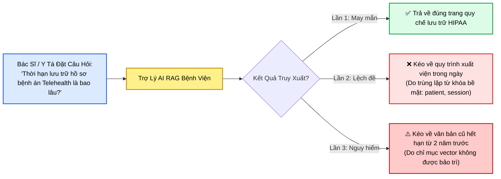
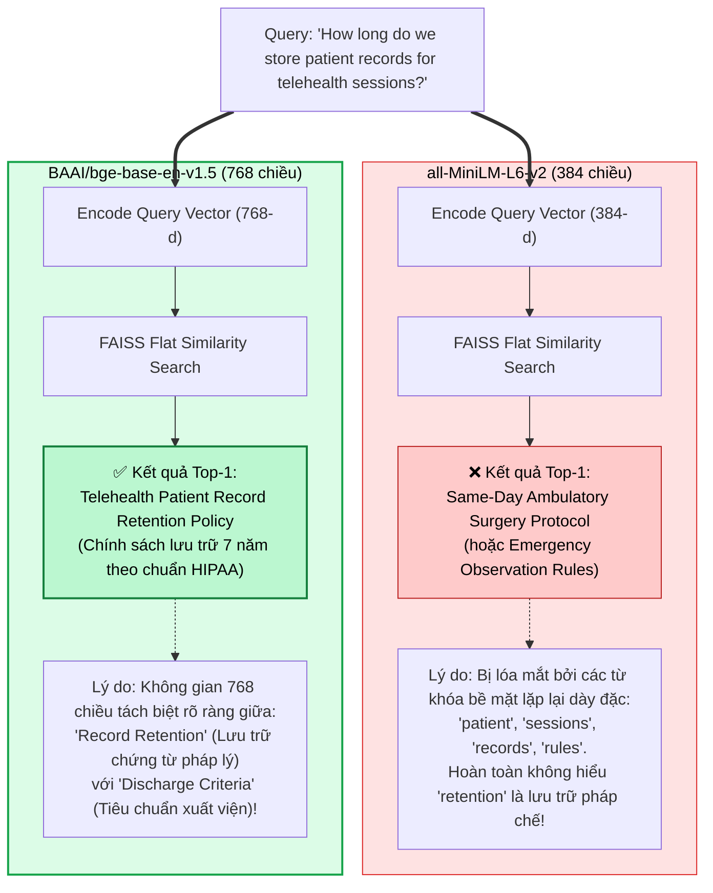
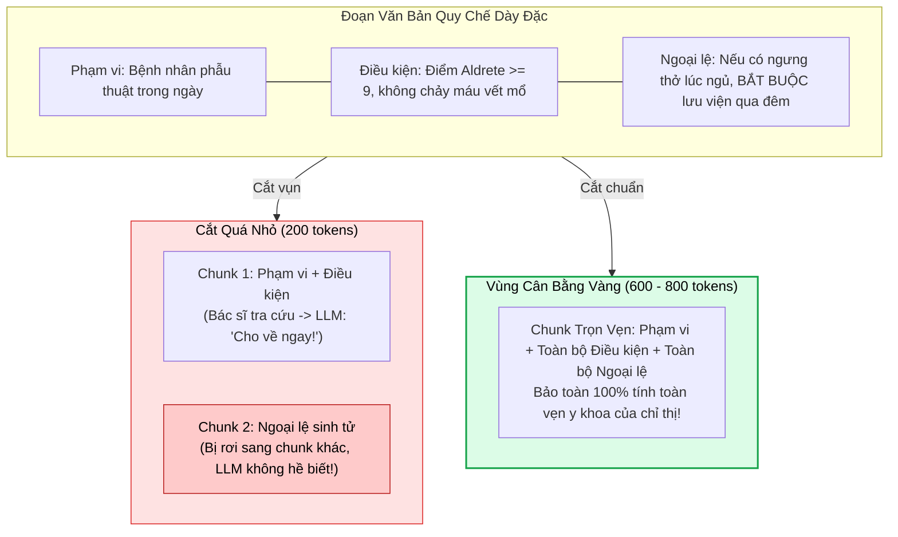
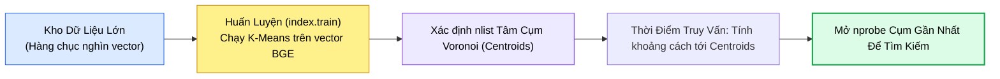
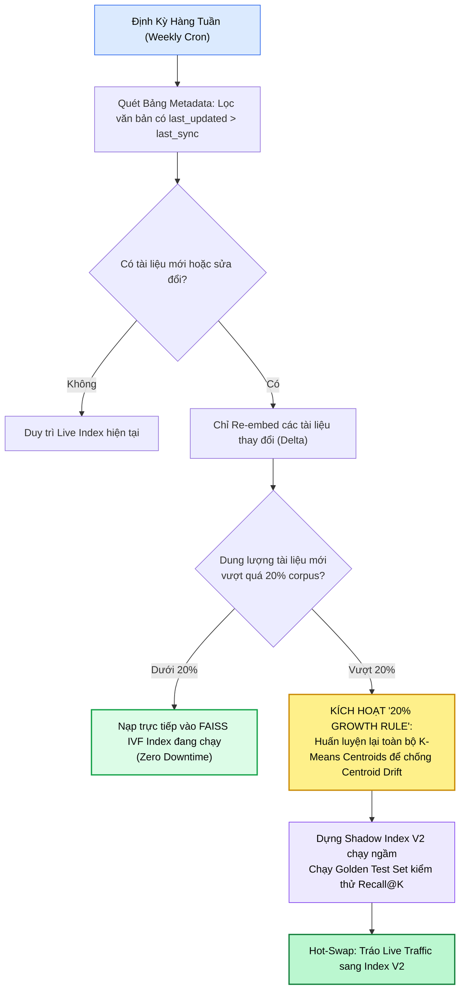

# THỰC HÀNH ĐÁNH GIÁ MÔ HÌNH EMBEDDING & CƠ SỞ DỮ LIỆU VECTOR TRONG HỆ THỐNG RAG
## Điển Cứu Thực Chiến: Xây Dựng Trợ Lý Tra Cứu Quy Trình Y Tế (Clinical Policy Assistant), Thử Nghiệm Đối Đầu MiniLM vs. BGE, Tối Ưu Hóa FAISS IVF & Vận Hành Ngày-2

---

## 📌 MỤC LỤC
1. [Khởi Điểm Bài Toán: Căn Bệnh "Truy Xuất Không Ổn Định" (Inconsistent Retrieval)](#1-khởi-điểm-bài-toán-căn-bệnh-truy-xuất-không-ổn-định-inconsistent-retrieval)
   - [Bối cảnh lâm sàng & Thách thức nghiệp vụ bệnh viện](#bối-cảnh-lâm-sàng--thách-thức-nghiệp-vụ-bệnh-viện)
   - [Kho dữ liệu quy chế & Các câu hỏi sống còn của y bác sĩ](#kho-dữ-liệu-quy-chế--các-câu-hỏi-sống-còn-của-y-bác-sĩ)
   - [Nghịch lý: Tại sao RAG cơ bản lại thất bại?](#nghịch-lý-tại-sao-rag-cơ-bản-lại-thất-bại)
2. [Khảo Nghiệm Embedding Đối Đầu: all-MiniLM-L6-v2 vs. BAAI/bge-base-en-v1.5](#2-khảo-nghiệm-embedding-đối-đầu-all-minilm-l6-v2-vs-baaibge-base-en-v15)
   - [Định vị vai trò: Rapid Prototyping vs. Domain Nuance & Compliance](#định-vị-vai-trò-rapid-prototyping-vs-domain-nuance--compliance)
   - [Khảo nghiệm thực tế trên câu hỏi lưu trữ hồ sơ Telehealth](#khảo-nghiệm-thực-tế-trên-câu-hỏi-lưu-trữ-hồ-sơ-telehealth)
   - [Bản chất toán học: "Embedding choice defines what your system thinks is similar"](#bản-chất-toán-học-embedding-choice-defines-what-your-system-thinks-is-similar)
3. [Nghệ Thuật Phân Đoạn (Chunking) Văn Bản Pháp Quy & Y Khoa](#3-nghệ-thuật-phân-đoạn-chunking-văn-bản-pháp-quy--y-khoa)
   - [Cấu trúc đoạn văn dày đặc: Điều kiện bắt buộc (Conditions) & Ngoại lệ (Exceptions)](#cấu-trúc-đoạn-văn-dày-đặc-điều-kiện-bắt-buộc-conditions--ngoại-lệ-exceptions)
   - [Thử nghiệm thực nghiệm: 300 từ vs. 900 từ](#thử-nghiệm-thực-nghiệm-300-từ-vs-900-từ)
   - [Vùng cân bằng vàng (Goldilocks Zone: 600 - 800 tokens)](#vùng-cân-bằng-vàng-goldilocks-zone-600---800-tokens)
4. [Chiến Lược Lập Chỉ Mục Vector: Tiến Hóa Từ FLAT Đến IVF & Tinh Chỉnh nprobe](#4-chiến-lược-lập-chỉ-mục-vector-tiến-hóa-từ-flat-đến-ivf--tinh-chỉnh-nprobe)
   - [Giai đoạn 1: FLAT Index như một công cụ chẩn đoán (Isolate Model vs. Data Errors)](#giai-đoạn-1-flat-index-như-một-công-cụ-chẩn-đoán-isolate-model-vs-data-errors)
   - [Giai đoạn 2: Scale-up sang Inverted File Index (IVF) với K-Means Voronoi Centroids](#giai-đoạn-2-scale-up-sang-inverted-file-index-ivf-với-k-means-voronoi-centroids)
   - [Huấn luyện cụm trên vector BGE & Tinh chỉnh nprobe trong y tế (Accuracy > Latency)](#huấn-luyện-cụm-trên-vector-bge--tinh-chỉnh-nprobe-trong-y-tế-accuracy--latency)
5. [Vòng Lặp Vận Hành Ngày-2 (Day-2 Operations & Maintenance Loop)](#5-vòng-lặp-vận-hành-ngày-2-day-2-operations--maintenance-loop)
   - [Hiểm họa của chỉ mục ôi thiu (The Stale Index Problem)](#hiểm-họa-của-chỉ-mục-ôi-thiu-the-stale-index-problem)
   - [Bảng theo dõi siêu dữ liệu: DOC_ID, LAST_UPDATED, EMBEDDING_VERSION](#bảng-theo-dõi-siêu-dữ-liệu-doc_id-last_updated-embedding_version)
   - [Cập nhật lũy tiến định kỳ (Weekly Incremental Delta Upsert)](#cập-nhật-lũy-tiến-định-kỳ-weekly-incremental-delta-upsert)
   - [Quy tắc tái huấn luyện 20% (The 20% Corpus Growth Rule)](#quy-tắc-tái-huấn-luyện-20-the-20-corpus-growth-rule)
   - [Triển khai ngầm (Shadow Index Deployment) & Hot-Swap Router](#triển-khai-ngầm-shadow-index-deployment--hot-swap-router)
6. [Mã Nguồn Thực Chiến Hoàn Chỉnh (Full Production Python Pipeline)](#6-mã-nguồn-thực-chiến-hoàn-chỉnh-full-production-python-pipeline)
   - [Cài đặt môi trường (sentence-transformers, faiss-cpu, numpy)](#cài-đặt-môi-trường-sentence-transformers-faiss-cpu-numpy)
   - [Source code đầy đủ: Dataset $\to$ Flat Benchmark $\to$ IVF Training $\to$ Delta Upsert](#source-code-đầy-đủ-dataset-to-flat-benchmark-to-ivf-training-to-delta-upsert)
7. [Bảng Đúc Kết Kiến Trúc & Cẩm Nang Quyết Định Nhanh](#7-bảng-đúc-kết-kiến-trúc--cẩm-nang-quyết-định-nhanh)
8. [Cây Điều Hướng & Liên Kết Trong Vault](#8-cây-điều-hướng--liên-kết-trong-vault)

---

## 1. KHỞI ĐIỂM BÀI TOÁN: CĂN BỆNH "TRUY XUẤT KHÔNG ỔN ĐỊNH" (INCONSISTENT RETRIEVAL)

### Bối cảnh lâm sàng & Thách thức nghiệp vụ bệnh viện
Hãy hình dung bạn đang chịu trách nhiệm phát triển một **Trợ lý AI nội bộ phục vụ đội ngũ y tá và bác sĩ** tại một hệ thống bệnh viện lớn. 
Trong ca trực áp lực cao, các bác sĩ không có thời gian để lật giở hàng trăm trang tài liệu Word hay PDF. Họ cần trợ lý AI cung cấp câu trả lời tức thì, chuẩn xác và có thể kiểm chứng được:



### Kho dữ liệu quy chế & Các câu hỏi sống còn của y bác sĩ
Kho tri thức bệnh viện bao gồm:
* **Hàng trăm tệp tài liệu PDF và Word:** Sổ tay chính sách hành chính, phác đồ điều trị của các chuyên khoa, hướng dẫn tuân thủ bảo mật thông tin sức khỏe (HIPAA), quy chuẩn xuất viện và kiểm soát nhiễm khuẩn.
* **Những câu hỏi điển hình:**
  1. *"How long do we store patient records for telehealth sessions?"* *(Thời hạn bắt buộc lưu trữ hồ sơ bệnh án đối với các buổi khám bệnh từ xa là bao lâu?)*
  2. *"What is the protocol for same-day discharge after ambulatory surgery?"* *(Quy chuẩn xuất viện trong ngày sau phẫu thuật ngoại trú bao gồm những tiêu chí hồi tỉnh nào?)*
  3. *"What are the emergency discharge rules for acute observation patients?"* *(Tiêu chuẩn cho bệnh nhân nằm theo dõi cấp cứu được xuất viện về nhà là gì?)*

### Nghịch lý: Tại sao RAG cơ bản lại thất bại?
Đội ngũ kỹ sư đã chia nhỏ tài liệu (chunking) và đẩy toàn bộ vào cơ sở dữ liệu vector. Nhưng khi đưa vào vận hành thực tế:
* **Truy xuất chập chờn (Inconsistent Retrieval):** Có lúc hệ thống lấy đúng văn bản, nhưng rất nhiều lúc lại kéo về một tài liệu hoàn toàn lệch đề hoặc tài liệu cũ đã bị bãi bỏ.
* **Hậu quả y khoa nghiêm trọng:** Khác với chatbot giải trí, trong môi trường lâm sàng, một câu trả lời trích xuất sai lệch có thể dẫn đến **sai phác đồ điều trị, xuất viện bệnh nhân chưa đủ điều kiện gây biến chứng, hoặc vi phạm nghiêm trọng luật bảo vệ dữ liệu bệnh nhân**.

Nguyên nhân cốt lõi không nằm ở mô hình ngôn ngữ lớn (LLM Generator), mà nằm ở **4 mắt xích then chốt trong chuỗi cung ứng tri thức**:
1. Chọn sai **Mô hình Embedding**.
2. Thiết lập sai **Chiến lược lập chỉ mục (Indexing)**.
3. Cắt vụn văn bản (**Chunking**) làm mất liên kết điều kiện - ngoại lệ.
4. Bỏ bê **Vận hành bảo trì chỉ mục định kỳ (Index Maintenance)**.

---

## 2. KHẢO NGHIỆM EMBEDDING ĐỐI ĐẦU: `all-MiniLM-L6-v2` VS. `BAAI/bge-base-en-v1.5`

### Định vị vai trò: Rapid Prototyping vs. Domain Nuance & Compliance
Để hiểu tại sao vector lại quyết định sự sống còn của RAG, chúng ta so sánh trực tiếp hai mô hình đại diện:

| Tiêu Chí Đánh Giá | `all-MiniLM-L6-v2` | `BAAI/bge-base-en-v1.5` |
| :--- | :--- | :--- |
| **Nhà phát triển** | Microsoft / Sentence-Transformers | Beijing Academy of Artificial Intelligence (BAAI) |
| **Số chiều không gian ($d$)** | **384 dimensions** | **768 dimensions** |
| **Kích thước mô hình** | Siêu nhẹ (~80 MB) | Trung bình (~440 MB) |
| **Tốc độ mã hóa (Throughput)** | Cực nhanh (CPU-friendly) | Nhanh (chạy tốt trên cả GPU và CPU) |
| **Hồ sơ năng lực** | Thích hợp tạo mẫu nhanh (Rapid Prototyping), định hình khung đường ống | Tối ưu hóa sâu cho văn phong hành chính, pháp quy, quy chuẩn y tế |
| **Độ nhạy ngữ cảnh tuân thủ** | Dễ bị đánh lừa bởi từ vựng bề mặt (Lexical Overlap) | Nắm bắt chính xác quan hệ ngữ nghĩa phân cấp sâu |

### Khảo nghiệm thực tế trên câu hỏi lưu trữ hồ sơ Telehealth
Đặt hệ thống trước câu hỏi thực tế của bác sĩ:
> **Truy vấn:** *"How long do we store patient records for telehealth sessions?"*



### Bản chất toán học: "Embedding choice defines what your system thinks is similar"
* Trong không gian vector 384 chiều của MiniLM, các câu văn có chứa các từ đồng âm hoặc cùng trường từ vựng y tế chung chung (`"patient"`, `"records"`, `"rules"`) bị kéo lại gần nhau. Kết quả là hệ thống trả về tài liệu về **quy trình xuất viện trong ngày** — một câu trả lời mang vẻ ngoài rất giống (close) nhưng bản chất nghiệp vụ thì sai hoàn toàn (off-topic).
* Ngược lại, không gian 768 chiều của BGE hiểu được cụm từ mang tính pháp chế **`"record retention"`** có mối liên hệ ngữ nghĩa mật thiết với **thời hạn lưu trữ chứng từ, mã hóa dữ liệu và điều luật HIPAA**.

> [!important] Định Luật Bất Biến Về Embeddings Trong RAG:
> **Lựa chọn mô hình Embedding không phải là một quyết định mang tính trang trí (not cosmetic). Mô hình embedding chính là hệ quy chiếu định nghĩa thế nào là "tương đồng ngữ nghĩa" trong toàn bộ hệ thống của bạn (Embedding choice defines what your system thinks is similar).**

---

## 3. NGHỆ THUẬT PHÂN ĐOẠN (CHUNKING) VĂN BẢN PHÁP QUY & Y KHOA

### Cấu trúc đoạn văn dày đặc: Điều kiện bắt buộc (Conditions) & Ngoại lệ (Exceptions)
Các tài liệu y tế và quy chế doanh nghiệp không được viết theo văn phong tự sự đơn giản. Chúng bao gồm các đoạn văn dày đặc (dense paragraphs), lồng ghép cấu trúc 3 lớp:
1. **Phạm vi (Scope):** Quy định này áp dụng cho ai (ví dụ: bệnh nhân phẫu thuật ngoại trú).
2. **Điều kiện (Conditions):** Các tiêu chuẩn bắt buộc phải đạt (ví dụ: điểm Aldrete $\ge 9$, sinh hiệu ổn định 4 giờ).
3. **Ngoại lệ & Cảnh báo sinh tử (Exceptions):** Trường hợp đặc biệt không được phép áp dụng (ví dụ: bệnh nhân có tiền sử ngưng thở khi ngủ thì KHÔNG được xuất viện trong ngày mà phải theo dõi qua đêm).



### Thử nghiệm thực nghiệm: 300 từ vs. 900 từ
Khi thử nghiệm cắt văn bản chính sách thành các đoạn có kích thước khác nhau:
* **Thử nghiệm với phân đoạn 300 từ:** Đoạn văn thường bị bẻ gãy ngay giữa chừng. Điều kiện nằm ở đoạn 1, nhưng ngoại lệ cảnh báo lại nằm ở đoạn 2. Khi truy xuất, hệ thống chỉ lấy đoạn 1, dẫn đến câu trả lời thiếu điều kiện loại trừ tối quan trọng.
* **Thử nghiệm với phân đoạn 900 từ:** Đoạn văn chứa quá nhiều nội dung hỗn hợp (từ chuẩn bị trước mổ, quy trình gây mê đến hướng dẫn xuất viện). Vector bị "pha loãng ngữ nghĩa" (Semantic Dilution), khiến các câu hỏi chuyên sâu bị giảm điểm tương đồng tới $20\% - 30\%$.

### Vùng cân bằng vàng (Goldilocks Zone: 600 - 800 tokens)
* Đối với văn bản pháp lý, quy chế tuân thủ và hướng dẫn lâm sàng, điểm cân bằng vàng là **$600 - 800$ tokens** (tương đương khoảng $450 - 600$ từ) kết hợp độ gối đầu **$15\% - 20\%$**.
* Khoảng kích thước này đảm bảo:
  1. Giữ nguyên vẹn toàn bộ ngữ cảnh, điều kiện và ngoại lệ trong cùng một vector.
  2. Đủ súc tích để vector embedding tập trung vào trọng tâm của chính sách đó.

---

## 4. CHIẾN LƯỢC LẬP CHỈ MỤC VECTOR: TIẾN HÓA TỪ FLAT ĐẾN IVF & TINH CHỈNH `NPROBE`

### Giai đoạn 1: FLAT Index như một công cụ chẩn đoán (Isolate Model vs. Data Errors)
Khi bắt đầu xây dựng hệ thống với vài chục đến vài trăm tài liệu mẫu:
* **Sử dụng FAISS Flat Index (`IndexFlatL2` hoặc `IndexFlatIP`):** Đây là thuật toán tìm kiếm vét cạn chính xác $100\%$ (Brute-force k-NN).
* **Giá trị chẩn đoán:** Flat Index không có sai số thuật toán. Nếu Flat Index trả về kết quả sai, bạn biết chắc chắn $100\%$ rằng: **Vấn đề nằm ở Mô hình Embedding hoặc Dữ liệu / Chunking, chứ không phải do thuật toán tìm kiếm** *(Helps us spot whether mistakes are coming from the model or the data)*.

### Giai đoạn 2: Scale-up sang Inverted File Index (IVF) với K-Means Voronoi Centroids
Khi kho tài liệu tăng trưởng từ hàng chục lên hàng chục nghìn văn bản:
* Tìm kiếm Flat trở nên chậm chạp ($\mathcal{O}(N)$).
* Chuyển đổi sang **IVF (Inverted File Index)**: Thuật toán gom hàng nghìn vector thành các cụm Voronoi (Voronoi Cells). Khi tìm kiếm, hệ thống chỉ quét bên trong các cụm tiềm năng nhất thay vì quét toàn bộ kho dữ liệu.



### Huấn luyện cụm trên vector BGE & Tinh chỉnh `nprobe` trong y tế (Accuracy > Latency)
1. **Huấn luyện trên vector nghiệp vụ thực tế:** Pha `index.train` phải được thực hiện trên chính các vector BGE của tài liệu bệnh viện để các tâm cụm phản ánh đúng cấu trúc ngữ nghĩa của thuật ngữ y tế.
2. **Tinh chỉnh $n_{\text{probe}}$:**
   * Mặc định $n_{\text{probe}} = 1$ chỉ quét cụm gần nhất (rất nhanh nhưng dễ trượt tài liệu ở vùng biên).
   * **Chiến thuật trong lĩnh vực y tế:** Cài đặt $n_{\text{probe}}$ cao hơn (ví dụ $n_{\text{probe}} = 2, 4$ hoặc $8$).
   * **Nguyên tắc đánh đổi:** Trong y tế và tuân thủ pháp luật, **độ chính xác và độ tin cậy quan trọng hơn việc tiết kiệm vài mili-giây tốc độ** *(Accuracy matters far more than a few milliseconds of speed)*.

---

## 5. VÒNG LẶP VẬN HÀNH NGÀY-2 (DAY-2 OPERATIONS & MAINTENANCE LOOP)

### Hiểm họa của chỉ mục ôi thiu (The Stale Index Problem)
Xây dựng một hệ thống RAG chạy được một lần là chuyện đơn giản. Giữ cho hệ thống luôn "khỏe mạnh" theo năm tháng mới là thách thức thực sự:
* Hàng tuần, bệnh viện ban hành các chỉ thị mới, cập nhật thời hạn lưu trữ hồ sơ, sửa đổi quy chuẩn cách ly.
* Nếu không bao giờ tái nhúng (Re-embed), chỉ mục sẽ dần trở nên **ôi thiu (Stale Index)**. Hệ thống sẽ tiếp tục trả lời bác sĩ dựa trên những chính sách cũ đã bị thu hồi.

### Bảng theo dõi siêu dữ liệu: `DOC_ID`, `LAST_UPDATED`, `EMBEDDING_VERSION`
Mỗi tài liệu trong kho lưu trữ bắt buộc phải đi kèm bản ghi siêu dữ liệu:
```python
{
    "doc_id": "POL-MED-001",
    "title": "Telehealth Patient Record Retention",
    "last_updated": "2026-10-04T08:00:00Z",
    "embedding_version": "bge-base-en-v1.5",
    "status": "active" # active | superseded | deprecated
}
```

### Cập nhật lũy tiến định kỳ (Weekly Incremental Delta Upsert)
* Hàng tuần, chạy tác vụ kiểm tra: Lọc các văn bản có `last_updated > last_sync_time`.
* **Chỉ re-embed những gì đã thay đổi (Delta Re-embedding):** Không tiêu tốn tài nguyên GPU nhúng lại toàn bộ 100% kho dữ liệu.
* Nạp thẳng các vector mới vào chỉ mục FAISS hiện có (Incremental Upsert) mà không cần ngắt quãng dịch vụ.



### Quy tắc tái huấn luyện 20% (The 20% Corpus Growth Rule)
* Trong FAISS IVF, các tâm cụm Voronoi được cố định dựa trên tập dữ liệu tại thời điểm huấn luyện.
* Khi số lượng tài liệu mới nạp vào vượt quá **$20\%$** quy mô ban đầu, hiện tượng **Trôi dạt tâm cụm (Centroid Drift)** sẽ diễn ra: Dữ liệu mới phân bố lệch khỏi các tâm cụm cũ, làm tụt giảm độ chính xác tìm kiếm.
* Khi chạm mốc $20\%$, hệ thống phải tự động kích hoạt quy trình gom toàn bộ vector và huấn luyện lại (`retrain`) các cụm Voronoi.

### Triển khai ngầm (Shadow Index Deployment) & Hot-Swap Router
* Tuyệt đối không tráo đổi chỉ mục trực tiếp trên môi trường đang phục vụ bệnh nhân.
* Luôn xây dựng một **Shadow Index** song song, chạy bộ câu hỏi kiểm chuẩn (Golden Evaluation Set) gồm 50 câu hỏi lâm sàng chuẩn mực.
* Chỉ khi Shadow Index đạt các chỉ số Recall@K và Precision vượt qua Live Index, hệ thống mới tráo đổi cổng điều hướng (Hot-swap Router) với thời gian chết bằng 0.

---

## 6. MÃ NGUỒN THỰC CHIẾN HOÀN CHỈNH (FULL PRODUCTION PYTHON PIPELINE)

### Cài đặt môi trường (`sentence-transformers`, `faiss-cpu`, `numpy`)
```bash
pip install sentence-transformers faiss-cpu numpy
```

### Source code đầy đủ: Dataset $\to$ Flat Benchmark $\to$ IVF Training $\to$ Delta Upsert

```python
# ==============================================================================
# HỆ THỐNG TRỢ LÝ TRA CỨU QUY TRÌNH Y TẾ (CLINICAL POLICY RAG ASSISTANT)
# Mô phỏng đầy đủ: So sánh MiniLM vs BGE, FAISS Flat vs IVF & Vận hành Ngày-2
# ==============================================================================

import numpy as np
import faiss
from sentence_transformers import SentenceTransformer

# ------------------------------------------------------------------------------
# 1. KHO TÀI LIỆU CHÍNH SÁCH BỆNH VIỆN MẪU (CLINICAL KNOWLEDGE BASE)
# ------------------------------------------------------------------------------
policies_db = [
    {
        "doc_id": "POL-MED-001",
        "title": "Telehealth Patient Record Retention and HIPAA Archival Protocol",
        "last_updated": "2026-01-15",
        "version": 1,
        "content": (
            "POLICY POL-MED-001: Telehealth Encounter Record Retention & Archival Protocol.\n"
            "All electronic audio-video recordings, interactive text transcripts, and clinical notes "
            "generated during telehealth consultations must be retained in encrypted cold storage for a minimum "
            "of seven (7) years from the date of encounter for adult patients. For pediatric telehealth sessions, "
            "records must be retained for seven (7) years past the patient's eighteenth (18th) birthday. "
            "All archival repositories must strictly comply with the HIPAA Security Rule and enforce AES-256 encryption at rest."
        )
    },
    {
        "doc_id": "POL-MED-002",
        "title": "Emergency Department Observation and Safe Discharge Criteria",
        "last_updated": "2026-02-10",
        "version": 1,
        "content": (
            "POLICY POL-MED-002: Emergency Department Patient Discharge Criteria.\n"
            "Patients admitted under Emergency Observation status may be cleared for home discharge only after "
            "sustaining stable hemodynamic vital signs for at least four (4) consecutive hours. Mandatory criteria "
            "include a Glasgow Coma Scale score of 15, resolution of acute pain, safe ambulation without unassisted "
            "fall risk, and verified caregiver escort transport."
        )
    },
    {
        "doc_id": "POL-MED-003",
        "title": "Same-Day Ambulatory Surgery Post-Anesthesia Discharge Protocol",
        "last_updated": "2026-03-05",
        "version": 1,
        "content": (
            "POLICY POL-MED-003: Post-Anesthesia Same-Day Discharge Protocol.\n"
            "Outpatients undergoing same-day elective surgical procedures must meet the modified Aldrete Post-Anesthesia "
            "Recovery Score of at least nine (9) prior to discharge. Patients must demonstrate oral fluid retention, "
            "spontaneous voiding, absence of active surgical wound hemorrhage, and possess written post-operative "
            "analgesic instructions signed by the attending surgeon."
        )
    }
]

# Câu truy vấn thực tế của bác sĩ
clinical_query = "How long do we store patient records for telehealth sessions?"
print(f"Câu hỏi lâm sàng: '{clinical_query}'\n")

# ------------------------------------------------------------------------------
# 2. KHỞI TẠO MÔ HÌNH: all-MiniLM-L6-v2 vs BAAI/bge-base-en-v1.5
# ------------------------------------------------------------------------------
print("--- [BƯỚC 1] KHỞI TẠO MÔ HÌNH EMBEDDING ---")
print("Loading model MiniLM: all-MiniLM-L6-v2 (384 chiều, siêu nhẹ)...")
model_minilm = SentenceTransformer("all-MiniLM-L6-v2")

print("Loading model BGE: BAAI/bge-base-en-v1.5 (768 chiều, chuyên sâu tuân thủ)...")
model_bge = SentenceTransformer("BAAI/bge-base-en-v1.5")

policy_texts = [p["content"] for p in policies_db]

# Trích xuất embeddings cho cả 3 văn bản
emb_minilm = model_minilm.encode(policy_texts, convert_to_numpy=True).astype("float32")
emb_bge = model_bge.encode(policy_texts, convert_to_numpy=True).astype("float32")

# Chuẩn hóa L2 để tìm kiếm Cosine Similarity qua Inner Product
faiss.normalize_L2(emb_minilm)
faiss.normalize_L2(emb_bge)

dim_minilm = emb_minilm.shape[1] # 384
dim_bge = emb_bge.shape[1]       # 768

# ------------------------------------------------------------------------------
# 3. THỰC NGHIỆM ĐỐI ĐẦU TRÊN FAISS FLAT INDEX (EXACT SEARCH)
# ------------------------------------------------------------------------------
print("\n--- [BƯỚC 2] THỰC NGHIỆM ĐỐI ĐẦU TRÊN FAISS FLAT INDEX ---")

# Dựng Flat Index cho MiniLM
index_flat_m = faiss.IndexFlatIP(dim_minilm)
index_flat_m.add(emb_minilm)

# Dựng Flat Index cho BGE
index_flat_b = faiss.IndexFlatIP(dim_bge)
index_flat_b.add(emb_bge)

# Mã hóa câu hỏi của bác sĩ
q_vec_m = model_minilm.encode([clinical_query], convert_to_numpy=True).astype("float32")
q_vec_b = model_bge.encode([clinical_query], convert_to_numpy=True).astype("float32")
faiss.normalize_L2(q_vec_m)
faiss.normalize_L2(q_vec_b)

# Tìm kiếm Top-3
scores_m, ids_m = index_flat_m.search(q_vec_m, 3)
scores_b, ids_b = index_flat_b.search(q_vec_b, 3)

print("\n[KẾT QUẢ TỪ all-MiniLM-L6-v2]:")
for rank in range(3):
    idx = ids_m[0][rank]
    score = scores_m[0][rank]
    print(f"  Hạng {rank+1} (Score: {score:.4f}) -> [{policies_db[idx]['doc_id']}] {policies_db[idx]['title']}")

print("\n[KẾT QUẢ TỪ BAAI/bge-base-en-v1.5]:")
for rank in range(3):
    idx = ids_b[0][rank]
    score = scores_b[0][rank]
    print(f"  Hạng {rank+1} (Score: {score:.4f}) -> [{policies_db[idx]['doc_id']}] {policies_db[idx]['title']}")

# ------------------------------------------------------------------------------
# 4. CHUYỂN DỊCH SANG FAISS IVF (INVERTED FILE) & TINH CHỈNH NPROBE
# ------------------------------------------------------------------------------
print("\n--- [BƯỚC 3] NÂNG CẤP LÊN FAISS IVF INDEX & TINH CHỈNH NPROBE ---")

nlist = 2  # Phân chia 2 cụm Voronoi (minh họa với tập dữ liệu nhỏ)
quantizer = faiss.IndexFlatIP(dim_bge)
index_ivf_bge = faiss.IndexIVFFlat(quantizer, dim_bge, nlist, faiss.METRIC_INNER_PRODUCT)

# Huấn luyện các tâm cụm Voronoi trên vector BGE
print("Huấn luyện K-Means Centroids trên tập vector BGE...")
index_ivf_bge.train(emb_bge)
index_ivf_bge.add(emb_bge)

# Tinh chỉnh nprobe: Trong y tế, tăng nprobe để không bỏ sót tài liệu
index_ivf_bge.nprobe = 2
print(f"Cấu hình nprobe = {index_ivf_bge.nprobe} (Quét toàn diện các cụm gần nhất)")

ivf_scores, ivf_ids = index_ivf_bge.search(q_vec_b, 2)
top1_doc = policies_db[ivf_ids[0][0]]
print(f"IVF Top-1 Match: [{top1_doc['doc_id']}] - Score: {ivf_scores[0][0]:.4f}")

# ------------------------------------------------------------------------------
# 5. VÒNG LẶP VẬN HÀNH NGÀY-2: INCREMENTAL DELTA UPSERT (KHÔNG REBUILD)
# ------------------------------------------------------------------------------
print("\n--- [BƯỚC 4] VẬN HÀNH NGÀY-2: CẬP NHẬT GIA TĂNG (INCREMENTAL UPSERT) ---")

# Giả lập: Bệnh viện ban hành sửa đổi: Tăng thời hạn lưu trữ Telehealth lên 10 năm
revised_policy = {
    "doc_id": "POL-MED-001",
    "title": "Telehealth Patient Record Retention (2026 Revised Amendment)",
    "last_updated": "2026-10-04",
    "version": 2,
    "content": (
        "POLICY POL-MED-001 (AMENDMENT 2026): Revised Retention Protocol.\n"
        "Effective October 2026, all telehealth video sessions and electronic medical transcripts "
        "must be archived for a mandatory duration of ten (10) years (extended from 7 years) "
        "following the final clinical encounter. All pediatric retention remains active until age 25."
    )
}

print(f"Phát hiện văn bản thay đổi: {revised_policy['doc_id']} v{revised_policy['version']}")
print("Chỉ chạy embedding cho văn bản sửa đổi (Delta Re-embedding)...")

# Chỉ tạo embedding cho tài liệu sửa đổi
revised_vec = model_bge.encode([revised_policy["content"]], convert_to_numpy=True).astype("float32")
faiss.normalize_L2(revised_vec)

# Nạp trực tiếp vector mới vào FAISS IVF Index đang chạy mà không cần rebuild toàn bộ
index_ivf_bge.add(revised_vec)
policies_db.append(revised_policy)

print(f"Đã nạp bổ sung vector mới. Tổng số vector trong FAISS: {index_ivf_bge.ntotal}")

# Truy vấn lại để xác nhận hệ thống trả về ngay chính sách mới nhất
new_scores, new_ids = index_ivf_bge.search(q_vec_b, 1)
latest_doc = policies_db[new_ids[0][0]]
print(f"\nKết quả truy xuất tức thì sau cập nhật:")
print(f"Document ID: {latest_doc['doc_id']} (Phiên bản: v{latest_doc['version']})")
print(f"Tiêu đề: {latest_doc['title']}")
print(f"Nội dung trích xuất:\n{latest_doc['content']}")
```

---

## 7. BẢNG ĐÚC KẾT KIẾN TRÚC & CẨM NANG QUYẾT ĐỊNH NHANH

| Mắt Xích Kỹ Thuật | Lựa Chọn Mặc Định / Thử Nghiệm | Lựa Chọn Production / Lĩnh Vực Nhạy Cảm | Nguyên Lý Cốt Lõi |
| :--- | :--- | :--- | :--- |
| **Mô Hình Embedding** | `all-MiniLM-L6-v2` (384-d) | `BAAI/bge-base-en-v1.5` (768-d) hoặc `text-embedding-3-large` | Mô hình embedding quy định thế nào là "tương đồng" trong không gian hình học. |
| **Kỹ Thuật Chunking** | Fixed-length 200 - 300 tokens | **600 - 800 tokens kèm 15% - 20% overlap** | Bảo tồn trọn vẹn cặp đôi Điều kiện (Conditions) và Ngoại lệ (Exceptions). |
| **Chiến Lược Indexing** | FAISS Flat Index (k-NN chính xác 100%) | **FAISS IVF / HNSW với $n_{\text{probe}}$ cao** | Bắt đầu với Flat để cô lập lỗi Model vs Data. Trong y tế, độ chính xác luôn ưu tiên hơn tốc độ. |
| **Vận Hành Bảo Trì** | Nạp một lần rồi bỏ mặc (Set-and-Forget) | **Delta Re-embedding + Quy tắc 20% Growth Rule + Shadow Deployment** | RAG chỉ tươi mới khi dữ liệu được bảo trì. Không bao giờ rebuild toàn bộ nếu chỉ đổi vài tài liệu. |

---

## 8. CÂY ĐIỀU HƯỚNG & LIÊN KẾT TRONG VAULT

* **Nền tảng toán học & Re-ranking:** [01. Tìm Kiếm Ngữ Nghĩa & Tái Xếp Hạng](./01_semantic_search_and_reranking.md)
* **Giải phẫu cấu phần & 9 Mẫu thiết kế RAG:** [02. Kiến Trúc RAG: 4 Cấu Phần Cốt Lõi & Các Mẫu Thiết Kế Chiến Lược](./02_rag_architecture_and_components.md)
* **Lý thuyết toàn diện về Embeddings & Khung FICE:** [03. Vai Trò Cốt Lõi Của Embeddings & Cơ Sở Dữ Liệu Vector (FAISS, Chroma, Milvus, Pinecone)](./03_embeddings_and_vector_databases.md)
* **Cẩm nang kỹ nghệ vận hành RAG Production:** [05. Từ Lý Thuyết Đến Thực Tiễn: Làm Cho RAG Hoạt Động Hiệu Quả](../../audio/05_theory_to_practice_making_rag_work.mp3)
* **Duy trì & Vận hành chỉ mục Vector:** [06. Duy Trì & Vận Hành Chỉ Mục Vector Trong Hệ Thống RAG (Drift Management)](../../audio/06_maintaining_vector_indices_in_rag.mp3)
* **Quản trị rủi ro ngữ cảnh:** [02. Quản Trị Cửa Sổ Ngữ Cảnh: Bệnh Lý & Tỉa Nhánh](../../03-building-agents/01-harness-and-memory/02_context_management.md)
* **Nâng cấp thành bộ nhớ dài hạn cho Agent:** [03. Kiến Trúc Bộ Nhớ Đa Tầng Cho AI Agents](../../03-building-agents/01-harness-and-memory/03_memory_systems.md)
