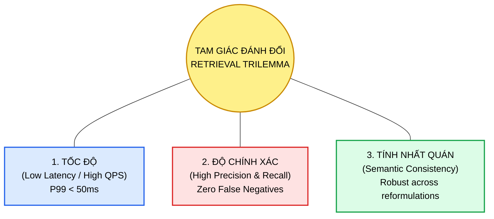
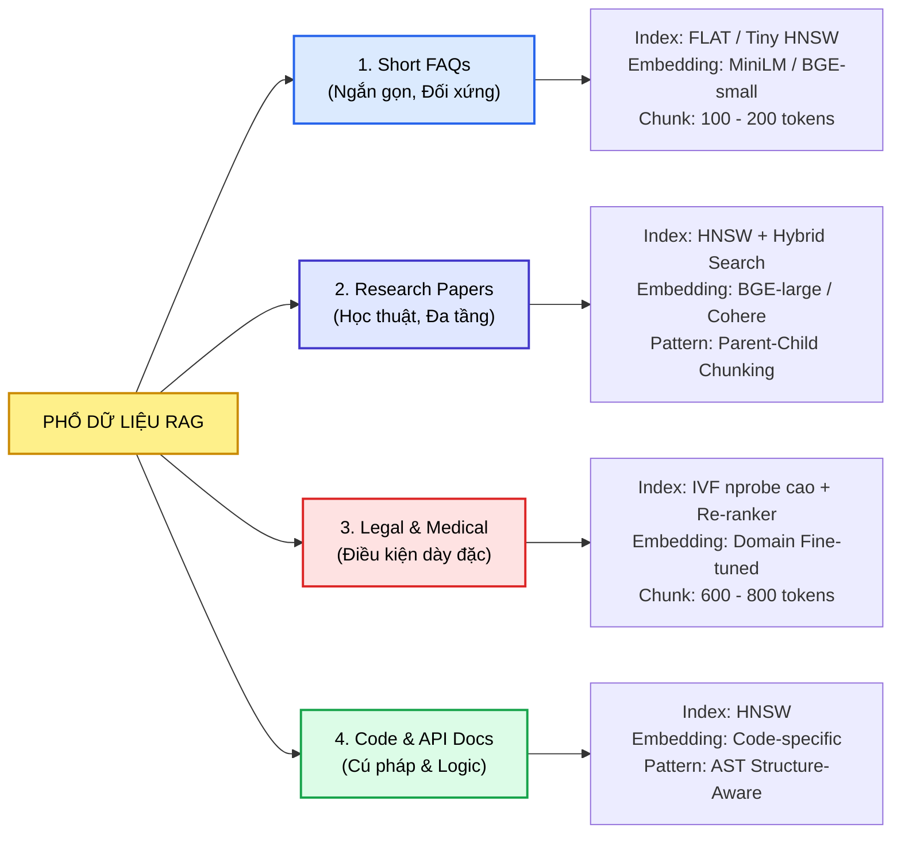
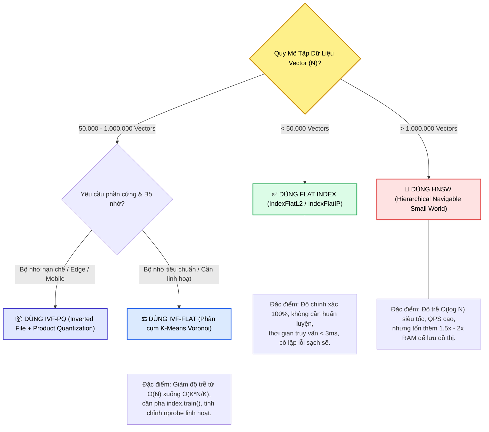
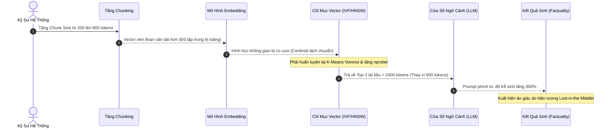
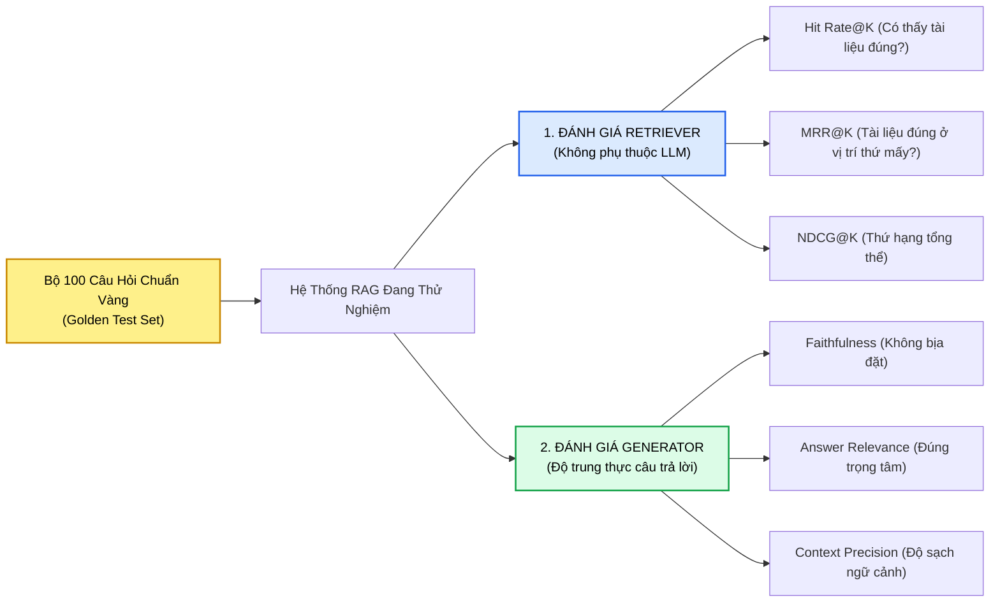

# TỪ LÝ THUYẾT ĐẾN THỰC TIỄN: LÀM CHO RAG HOẠT ĐỘNG HIỆU QUẢ (MAKING RAG WORK)
## Cẩm Nang Kỹ Nghệ Vận Hành RAG Production: Thu Hẹp Khoảng Cách Demo vs. Thực Tế, Tam Giác Đánh Đổi Tốc Độ - Độ Chính Xác, Phân Khối Nhận Thức Cấu Trúc (Structure-Aware Chunking) & Hiệu Ứng Cánh Bướm Cấu Hình

---

## 📌 MỤC LỤC
1. [Khoảng Cách Thực Tế: Bản Demo "Copy-Paste" vs. Hiện Thực Khốc Liệt Của Production](#1-khoảng-cách-thực-tế-bản-demo-copy-paste-vs-hiện-thực-khốc-liệt-của-production)
   - [Nghịch lý "Tutorial trơn tru - Hệ thống thật gãy vụn"](#nghịch-lý-tutorial-trơn-tru---hệ-thống-thật-gãy-vụn)
   - [Hiện tượng trôi dạt hiệu năng bất định (Unpredictable Performance Drift)](#hiện-tượng-trôi-dạt-hiệu-năng-bất-định-unpredictable-performance-drift)
   - [Định nghĩa công việc thực sự của Kỹ sư RAG (The Real Engineering Work)](#định-nghĩa-công-việc-thực-sự-của-kỹ-sư-rag-the-real-engineering-work)
2. [Tam Giác Đánh Đổi Bất Khả Thi Trong Truy Xuất (The Retrieval Trilemma)](#2-tam-giác-đánh-đổi-bất-khả-thi-trong-truy-xuất-the-retrieval-trilemma)
   - [3 Đỉnh của tam giác: Tốc độ vs. Độ chính xác vs. Tính nhất quán](#3-đỉnh-của-tam-giác-tốc-độ-vs-độ-chính-xác-vs-tính-nhất-quán)
   - [Đường cong giới hạn Pareto (Pareto Frontier) của Latency và Recall](#đường-cong-giới-hạn-pareto-pareto-frontier-của-latency-và-recall)
   - [Cái giá của sự tối ưu cục bộ: Tăng độ chính xác làm độ trễ vọt gấp 3 lần](#cái-giá-của-sự-tối-ưu-cục-bộ-tăng-độ-chính-xác-làm-độ-trễ-vọt-gấp-3-lần)
3. [Phổ Kiến Trúc Theo Loại Hình Dữ Liệu (The RAG Use-Case Spectrum)](#3-phổ-kiến-trúc-theo-loại-hình-dữ-liệu-the-rag-use-case-spectrum)
   - [Tại sao "One Size Fits None"? Dữ liệu thay đổi làm đảo lộn hành vi hệ thống](#tại-sao-one-size-fits-none-dữ-liệu-thay-đổi-làm-đảo-lộn-hành-vi-hệ-thống)
   - [Phân loại 4 miền dữ liệu điển hình trong doanh nghiệp](#phân-loại-4-miền-dữ-liệu-điển-hình-trong-doanh-nghiệp)
     * *Nhóm 1: 10.000 câu FAQ ngắn (Customer Support)*
     * *Nhóm 2: Bài báo nghiên cứu học thuật & Báo cáo phân tích chuyên sâu (Research Papers)*
     * *Nhóm 3: Văn bản pháp quy, hợp đồng & hồ sơ bệnh án (Legal, Compliance & Medical)*
     * *Nhóm 4: Kho mã nguồn & Tài liệu kỹ thuật (Code Repositories & API Specs)*
   - [Bảng đối chiếu kiến trúc và cấu hình theo miền nghiệp vụ](#bảng-đối-chiếu-kiến-trúc-và-cấu-hình-theo-miền-nghiệp-vụ)
4. [Động Học Của Kích Thước Khối (Chunk Size Dynamics: Small vs. Large Chunks)](#4-động-học-của-kích-thước-khối-chunk-size-dynamics-small-vs-large-chunks)
   - [Đoạn nhỏ (Small Chunks): Ưu thế Recall nhưng hiểm họa phân mảnh ngữ nghĩa](#đoạn-nhỏ-small-chunks-ưu-thế-recall-nhưng-hiểm-họa-phân-mảnh-ngữ-nghĩa)
   - [Đoạn lớn (Large Chunks): Ngữ cảnh mượt mà nhưng làm loãng độ chính xác (Diluted Precision)](#đoạn-lớn-large-chunks-ngữ-cảnh-mượt-mà-nhưng-làm-loãng-độ-chính-xác-diluted-precision)
   - [Hiện tượng "Kim chìm đáy bể" (Lost-in-the-Middle) khi mở rộng kích thước khối](#hiện-tượng-kim-chìm-đáy-bể-lost-in-the-middle-khi-mở-rộng-kích-thước-khối)
5. [Phân Đoạn Có Nhận Thức Cấu Trúc (Structure-Aware / Syntax-Aware Chunking)](#5-phân-đoạn-có-nhận-thức-cấu-trúc-structure-aware--syntax-aware-chunking)
   - [Giải mã bài kiểm tra thực nghiệm: Tại sao lựa chọn B là tư duy chuẩn thực chiến?](#giải-mã-bài-kiểm-tra-thực-nghiệm-tại-sao-lựa-chọn-b-là-tư-duy-chuẩn-thực-chiến)
   - [Cơ chế giữ mã nguồn và phần giải thích trong cùng một khối](#cơ-chế-giữ-mã-nguồn-và-phần-giải-thích-trong-cùng-một-khối)
   - [Kỹ thuật phân tích cú pháp AST (Abstract Syntax Tree Chunking)](#kỹ-thuật-phân-tích-cú-pháp-ast-abstract-syntax-tree-chunking)
   - [Bảo toàn cấu trúc Markdown & Bảng biểu dữ liệu (Table-Preserving Chunking)](#bảo-toàn-cấu-trúc-markdown--bảng-biểu-dữ-liệu-table-preserving-chunking)
   - [Bảng phân cấp 4 thế hệ kỹ thuật Chunking](#bảng-phân-cấp-4-thế-hệ-kỹ-thuật-chunking)
6. [Quy Tắc Thực Tiễn Chọn Chỉ Mục: Khi Nào FLAT Đủ Dùng & Khi Nào Cần IVF / HNSW?](#6-quy-tắc-thực-tiễn-chọn-chỉ-mục-khi-nào-flat-đủ-dùng--khi-nào-cần-ivf--hnsw)
   - [Độ phức tạp tính toán: $O(N)$ vs. $O(K \cdot N/K)$ vs. $O(\log N)$](#độ-phức-tạp-tính-toán-on-vs-ok-cdot-nk-vs-olog-n)
   - [FLAT Index: Khi nào sự đơn giản là vũ khí tối thượng?](#flat-index-khi-nào-sự-đơn-giản-là-vũ-khí-tối-thượng)
   - [Thời điểm chuyển tiếp sang IVF: Tối ưu bộ nhớ và cân đối nlist/nprobe](#thời-điểm-chuyển-tiếp-sang-ivf-tối-ưu-bộ-nhớ-và-cân-đối-nlistnprobe)
   - [Thời điểm bắt buộc phải dùng HNSW: Scale hàng triệu vector với QPS cao](#thời-điểm-bắt-buộc-phải-dùng-hnsw-scale-hàng-triệu-vector-với-qps-cao)
7. [Hiệu Ứng Cánh Bướm Cấu Hình (The Configuration Ripple Effect)](#7-hiệu-ứng-cánh-bướm-cấu-hình-the-configuration-ripple-effect)
   - [Một thay đổi tham số nhỏ lan tỏa qua toàn bộ pipeline như thế nào?](#một-thay-đổi-tham-số-nhỏ-lan-tỏa-qua-toàn-bộ-pipeline-như-thế-nào)
   - [Sơ đồ lan truyền tác động (Ripple Propagation Map)](#sơ-đồ-lan-truyền-tác-động-ripple-propagation-map)
   - [Nguyên tắc cô lập biến (Isolate Variables) trong thử nghiệm RAG](#nguyên-tắc-cô-lập-biến-isolate-variables-trong-thử-nghiệm-rag)
8. [Phương Pháp Luận Đánh Giá Truy Xuất Thực Chiến (Empirical Retrieval Benchmarking)](#8-phương-pháp-luận-đánh-giá-truy-xuất-thực-chiến-empirical-retrieval-benchmarking)
   - [Đo lường những gì thực sự hiệu quả thay vì "nhìn thấy hay trên lý thuyết"](#đo-lường-những-gì-thực-sự-hiệu-quả-thay-vì-nhìn-thấy-hay-trên-lý-thuyết)
   - [Chỉ số đánh giá tầng Retriever: Hit Rate@K, MRR, NDCG](#chỉ-số-đánh-giá-tầng-retriever-hit-ratek-mrr-ndcg)
   - [Bộ ba chỉ số Ragas (RAG Triad): Faithfulness, Answer Relevance, Context Precision](#bộ-ba-chỉ-số-ragas-rag-triad-faithfulness-answer-relevance-context-precision)
   - [Xây dựng Golden Test Set để chốt chặn hồi quy (Regression Testing)](#xây-dựng-golden-test-set-để-chốt-chặn-hồi-quy-regression-testing)
9. [Cẩm Nang Xử Lý Sự Cố RAG Thường Gặp (RAG Troubleshooting Runbook)](#9-cẩm-nang-xử-lý-sự-cố-rag-thường-gặp-rag-troubleshooting-runbook)
10. [Cây Điều Hướng & Liên Kết Trong Vault](#10-cây-điều-hướng--liên-kết-trong-vault)

---

## 1. KHOẢNG CÁCH THỰC TẾ: BẢN DEMO "COPY-PASTE" VS. HIỆN THỰC KHỐC LIỆT CỦA PRODUCTION

### Nghịch lý "Tutorial trơn tru - Hệ thống thật gãy vụn"
Khi tiếp cận RAG qua các bài hướng dẫn trực tuyến hoặc thư viện mã nguồn mở, mọi thứ dường như cực kỳ đơn giản:
1. Đọc văn bản từ một tệp `.txt` hoặc `.pdf` mẫu.
2. Cắt nhỏ văn bản bằng `RecursiveCharacterTextSplitter(chunk_size=500, chunk_overlap=50)`.
3. Nhúng vector qua một mô hình mặc định (`all-MiniLM-L6-v2` hoặc OpenAI `text-embedding-ada-002`).
4. Nạp vào cơ sở dữ liệu in-memory (như ChromaDB hoặc FAISS).
5. Đặt câu hỏi truy vấn: Hệ thống trả về kết quả mượt mà, chính xác và ấn tượng.

Tuy nhiên, **khoảnh khắc bạn đưa kiến trúc "sao chép - dán" đó vào dữ liệu doanh nghiệp thực tế, toàn bộ ảo tưởng về sự hoàn hảo sẽ sụp đổ**.

```mermaid
flowchart TD
    subgraph DEMO["ẢO TƯỞNG TOY DEMO"]
        A1["Tài liệu ngắn gọn, sạch sẽ"] --> A2["Mô hình nhúng mặc định"]
        A2 --> A3["Cơ sở dữ liệu in-memory"]
        A3 --> A4["Truy xuất hoàn hảo 100%"]
    end

    subgraph PROD["HIỆN THỰC PRODUCTION KHỐC LIỆT"]
        B1["Văn bản hỗn độn: PDF scanned, Markdown, Code, Hợp đồng"] --> B2["Cắt rời ngữ cảnh: Mất Điều kiện & Ngoại lệ"]
        B2 --> B3["Nhầm lẫn ngữ nghĩa: Bị kéo lệch bởi từ khóa bề mặt"]
        B3 --> B4["Bùng nổ quy mô: Hàng triệu vector, tràn RAM, độ trễ vọt gấp 3"]
        B4 --> B5["Chỉ mục ôi thiu (Stale Index): Trích xuất chính sách bãi bỏ"]
    end

    style DEMO fill:#dcfce7,stroke:#16a34a,stroke-width:2px,color:#000000
    style PROD fill:#fee2e2,stroke:#dc2626,stroke-width:2px,color:#000000
```



### Hiện tượng trôi dạt hiệu năng bất định (Unpredictable Performance Drift)
Trong môi trường thực tế, hệ thống RAG không vận hành theo đường thẳng ổn định mà mang tính **bất định cao (unpredictable)**:
* **Ngày thứ Nhất:** Hệ thống phản hồi siêu tốc ($< 30\text{ms}$), các câu hỏi phổ biến đều được trả lời. Nhưng đội ngũ vận hành phát hiện hệ thống âm thầm bỏ sót các tài liệu mang tính sống còn (hiện tượng **False Negatives / Low Recall**). Khách hàng hoặc bác sĩ nhận được câu trả lời thiếu điều kiện loại trừ nguy hiểm.
* **Ngày thứ Hai:** Nhóm kỹ sư can thiệp để khắc phục: tăng kích thước khối (chunk size), đổi sang mô hình embedding đa chiều hơn, hoặc chuyển từ chỉ mục xấp xỉ sang quét kỹ hơn ($n_{\text{probe}}$ cao). Độ chính xác và độ hồi tưởng lập tức tăng vọt. Nhưng cái giá phải trả ngay sau đó: **độ trễ hệ thống (latency) tăng gấp 3 lần**, lượng CPU và VRAM tiêu thụ vượt ngân sách, hệ thống bắt đầu nghẽn cổ chai khi số lượng người dùng đồng thời (concurrency) tăng lên.

> [!CAUTION]
> **Quy luật bất biến của kỹ nghệ RAG:**
> Không có bất kỳ cấu hình "thần thánh" nào tối ưu tuyệt đối cho mọi tình huống. Mỗi bước tinh chỉnh đều là một cuộc thương lượng đánh đổi giữa **Tốc độ (Latency)**, **Độ chính xác (Accuracy)** và **Chi phí tài nguyên (Compute Budget)**.

### Định nghĩa công việc thực sự của Kỹ sư RAG (The Real Engineering Work)
Nắm vững lý thuyết về cách vector biểu diễn ngữ nghĩa không gian hay cách các thuật toán đồ thị tìm kiếm láng giềng gần nhất là điều kiện cần. Nhưng **công việc thực sự của một kỹ sư RAG trong thực tế là:**
1. Thấu hiểu sâu sắc bản chất và cấu trúc của dữ liệu miền nghiệp vụ (Domain-specific Data Distribution).
2. Xử lý và làm chủ những sự đánh đổi phức tạp khi chuyển từ dữ liệu đồ chơi sang dữ liệu sống.
3. Liên tục thử nghiệm, đo đạc bằng chỉ số định lượng, và tinh chỉnh các mắt xích để toàn bộ quy trình đạt được điểm cân bằng tối ưu.

---

## 2. TAM GIÁC ĐÁNH ĐỔI BẤT KHẢ THI TRONG TRUY XUẤT (THE RETRIEVAL TRILEMMA)

Trong kỹ thuật phân tán, chúng ta có Định lý CAP. Tương tự, trong kỹ nghệ RAG Production, các kỹ sư phải đối mặt với **Tam Giác Đánh Đổi Bất Khả Thi (The Retrieval Trilemma)**:



### 3 Đỉnh của tam giác: Tốc độ vs. Độ chính xác vs. Tính nhất quán
1. **Tốc độ (Speed / Low Latency):**
   * Thời gian hoàn thành truy xuất ở phân vị $P99 < 50\text{ms}$.
   * Tối đa hóa số lượng truy vấn trên giây (Queries Per Second - QPS).
   * Thường đạt được bằng cách: dùng chỉ mục xấp xỉ thô (IVF với $n_{\text{probe}}$ nhỏ, PQ nén dữ liệu), chunk nhỏ, mô hình embedding gọn nhẹ ($384$ chiều).
2. **Độ chính xác (Accuracy / High Recall & Precision):**
   * Thu hồi trọn vẹn mọi bằng chứng có liên quan, không bỏ sót các trường hợp ngoại lệ.
   * Thường đòi hỏi: Quét cạn kiệt (FLAT Index) hoặc đồ thị lân cận dày đặc (HNSW với $efSearch$ lớn), embedding chiều cao ($768 - 3072$ chiều), tái xếp hạng chuyên sâu bằng Cross-Encoder.
3. **Tính nhất quán (Semantic Consistency):**
   * Khả năng duy trì cùng một kết quả trích xuất chuẩn xác bất kể người dùng thay đổi cách diễn đạt, dùng từ đồng nghĩa, hoặc câu hỏi có độ dài ngắn khác nhau.
   * Yêu cầu phân đoạn bảo toàn trọn vẹn ngữ cảnh (Contextual / Structure-Aware Chunking) và mô hình embedding có khả năng khái quát hóa miền xuất sắc.

### Đường cong giới hạn Pareto (Pareto Frontier) của Latency và Recall
Mối quan hệ giữa độ trễ và độ hồi tưởng trong hệ thống truy xuất tuân theo quy luật hiệu suất giảm dần (Diminishing Returns):

```
Độ Hồi Tưởng (Recall@K)
   1.0 |                                     .-* (FLAT / Exact k-NN)
       |                                .--''
   0.9 |                         .---'''   (HNSW efSearch=128 / IVF nprobe=16)
       |                   .--'''
   0.8 |             .---''  (IVF nprobe=4)
       |       .---''
   0.7 |   .--'  (IVF nprobe=1)
       |  /
   0.5 | / (PQ nén mạnh)
       +----------------------------------------------------> Độ Trễ (Latency ms)
       0ms      20ms      50ms      100ms     300ms    1000ms
```

* **Vùng tăng trưởng nhanh ($0 \to 50\text{ms}$):** Tăng nhẹ độ phức tạp chỉ mục giúp Recall tăng vọt từ $50\%$ lên $85\%$.
* **Vùng tiệm cận giới hạn ($> 100\text{ms}$):** Để kéo Recall từ $92\%$ lên $98\%$, hệ thống phải trả giá bằng việc **độ trễ tăng gấp 3 đến 5 lần**, do thuật toán phải duyệt qua các cụm vector xa xôi hoặc qua tầng Cross-Encoder nặng nề.

---

## 3. PHỔ KIẾN TRÚC THEO LOẠI HÌNH DỮ LIỆU (THE RAG USE-CASE SPECTRUM)

Một trong những sai lầm chết người của người mới làm RAG là áp dụng cùng một khuôn mẫu thiết kế cho mọi bài toán. **Cùng một mô hình nhúng, cùng một cơ sở dữ liệu vector, cùng một loại chỉ mục sẽ có hành vi hoàn toàn trái ngược khi bản chất dữ liệu thay đổi**.



### Phân loại 4 miền dữ liệu điển hình trong doanh nghiệp

#### Nhóm 1: 10.000 câu FAQ ngắn gọn (Customer Support)
* **Đặc thù dữ liệu:** Câu hỏi và câu trả lời độc lập, ngắn ($50 - 150$ từ), từ vựng giao tiếp tự nhiên hàng ngày. Tính đối xứng cao (Symmetric Search: Câu hỏi tìm câu hỏi tương tự).
* **Kiến trúc tối ưu:**
  * **Chunking:** Mỗi cặp Q&A là một chunk độc lập. Không cần overlap phức tạp.
  * **Embedding:** Mô hình nhẹ như `all-MiniLM-L6-v2` hoặc `bge-small-en-v1.5` ($384$ chiều).
  * **Index:** Chỉ mục phẳng (FLAT Index) hoặc HNSW nhỏ gọn. Với $10.000$ bản ghi, FLAT Index chỉ mất $< 2\text{ms}$ cho một truy vấn, không cần đánh đổi độ chính xác của IVF.

#### Nhóm 2: Bài báo nghiên cứu học thuật & Báo cáo tài chính (Deep Research Papers)
* **Đặc thù dữ liệu:** Cấu trúc đa tầng (Tóm tắt, Giới thiệu, Phương pháp, Dữ liệu, Thảo luận). Chứa nhiều thuật ngữ trừu tượng, trích dẫn chéo, và các bảng biểu đối chiếu.
* **Kiến trúc tối ưu:**
  * **Chunking:** **Hierarchical Parent-Child Chunking** (Chunk nhỏ $200$ tokens để đối sánh vector chính xác, nhưng trả về cho LLM toàn bộ khối cha $1000$ tokens để không mất mạch lập luận).
  * **Embedding:** Mô hình dung lượng biểu diễn lớn như `text-embedding-3-large` ($1536/3072$ chiều) hoặc `BAAI/bge-large-en-v1.5` ($1024$ chiều).
  * **Retrieval Pattern:** Hybrid Search (Dense Vector + BM25) kết hợp tái xếp hạng Cohere Rerank.

#### Nhóm 3: Văn bản pháp quy, quy chuẩn y khoa & hợp đồng (Legal, Compliance & Medical)
* **Đặc thù dữ liệu:** Cực kỳ dày đặc, mỗi câu chữ đều mang tính ràng buộc pháp lý hoặc sinh tử lâm sàng. Các điều khoản thường có cấu trúc: **Quy định chung $\to$ Điều kiện tiên quyết $\to$ Các trường hợp ngoại lệ nghiêm ngặt**.
* **Kiến trúc tối ưu:**
  * **Chunking:** Cửa sổ lớn ($600 - 800$ tokens) với độ gối đầu $20\%$ để tuyệt đối không cắt đôi cặp bài trùng "Điều kiện - Ngoại lệ" (xem chi tiết tại [04. How Database & Embedding Choices Affect RAG](./04_how_database_and_embedding_choices_affect_rag.md)).
  * **Embedding:** Mô hình chuyên ngành hoặc mô hình được huấn luyện tương phản mạnh về tính tuân thủ pháp lý.
  * **Index:** FAISS IVF với $n_{\text{probe}}$ cao hoặc HNSW chất lượng cao ($M=64, efConstruction=200$).

#### Nhóm 4: Kho mã nguồn & Tài liệu kỹ thuật (Code Repositories & API Specs)
* **Đặc thù dữ liệu:** Văn bản phi tự nhiên, cấu trúc cú pháp chặt chẽ (hàm, lớp, tham số, giá trị trả về, logic thực thi).
* **Kiến trúc tối ưu:**
  * **Chunking:** **Structure-Aware Chunking (Phân khối nhận thức cấu trúc)** dựa trên cây cú pháp trừu tượng (AST).
  * **Nguyên tắc vàng:** Luôn giữ khối mã nguồn và đoạn văn bản giải thích/docstring đi kèm trong cùng một chunk duy nhất.

### Bảng đối chiếu kiến trúc và cấu hình theo miền nghiệp vụ

| Tiêu Chí Kỹ Thuật | Nhóm 1: FAQ Khách Hàng | Nhóm 2: Bài Báo Nghiên Cứu | Nhóm 3: Pháp Quy & Y Khoa | Nhóm 4: Mã Nguồn & API |
| :--- | :--- | :--- | :--- | :--- |
| **Quy mô dữ liệu** | $10\text{k} - 50\text{k}$ mục | $100\text{k} - 1\text{M}$ trang | $50\text{k} - 500\text{k}$ đoạn quy chế | $100\text{k} - 2\text{M}$ dòng code |
| **Chiến lược Chunking** | Single Q&A Item | Parent-Child ($200 \to 1000$) | Paragraph $600 - 800$ tokens | **Structure-Aware (AST)** |
| **Độ gối đầu (Overlap)**| $0\%$ (Độc lập) | $10\% - 15\%$ | **$15\% - 20\%$ bắt buộc** | Cú pháp Scope-based |
| **Mô hình Embedding** | `all-MiniLM-L6-v2` (384-d)| `bge-large` / OpenAI 1536-d | `bge-base` / Cohere v3 | `voyage-code-2` / `bge-en-icl` |
| **Loại Index khuyến nghị**| **FLAT Index** (Đủ nhanh) | **HNSW** ($M=32, ef=64$) | **IVF** ($n_{\text{probe}}$ cao) | **HNSW** kết hợp BM25 |
| **Post-Retrieval** | Direct Top-3 | Hybrid + RRF + Cross-Encoder| Cross-Encoder Re-ranking | Re-rank theo Scope/Symbol |

---

## 4. ĐỘNG HỌC CỦA KÍCH THƯỚC KHỐI (CHUNK SIZE DYNAMICS: SMALL VS. LARGE CHUNKS)

Một trong những đòn bẩy cấu hình có tác động mạnh mẽ nhất đến chất lượng truy xuất là **kích thước khối văn bản (Chunk Size)**:

```
[--- Toàn Bộ Tài Liệu 2000 Từ ---]
  |
  +---> Phương Án A (Small Chunks - 100 Từ): [C1] [C2] [C3] [C4] [C5] ... [C20]
  |     * Ưu điểm: Độ tập trung ngữ nghĩa cao, Cosine similarity cực sắc nét.
  |     * Nhược điểm: Phân mảnh ý nghĩa! [C3] chứa điều kiện nhưng ngoại lệ lại nằm ở [C4].
  |
  +---> Phương Án B (Large Chunks - 1000 Từ): [Khối Lớn 1] [Khối Lớn 2]
        * Ưu điểm: Ngữ cảnh mượt mà, bao quát trọn vẹn lập luận.
        * Nhược điểm: Pha loãng ngữ nghĩa! Ý quan trọng bị chôn vùi giữa 900 từ rác.
```

### Đoạn nhỏ (Small Chunks): Ưu thế Recall nhưng hiểm họa phân mảnh ngữ nghĩa
* **Cơ chế hoạt động:** Khi văn bản được cắt nhỏ thành các khối $100 - 200$ tokens, vector embedding đại diện cho một ý niệm đơn nhất, cô đọng.
* **Mặt tích cực:**
  * Khả năng nhớ lại (Recall) ở cấp độ chi tiết rất cao: Nếu người dùng hỏi một thông số kỹ thuật cụ thể (ví dụ: *"Cổng kết nối mặc định của Redis là gì?"*), vector của chunk nhỏ sẽ khớp gần như tuyệt đối với vector câu hỏi.
  * Giảm thiểu việc đưa nội dung rác vào cửa sổ ngữ cảnh của LLM.
* **Hiểm họa kỹ thuật:**
  * **Phân mảnh ngữ nghĩa (Semantic Fragmentation):** Một câu hoàn chỉnh có thể bị chém làm đôi. Mệnh đề chính nằm ở chunk trước, còn mệnh đề điều kiện hoặc trạng từ phủ định (*"Trừ khi có văn bản ủy quyền của Giám đốc"*) lại rơi vào chunk sau.
  * Khi bộ truy xuất chỉ kéo chunk trước về, LLM Generator sẽ đưa ra câu trả lời sai lệch nghiêm trọng.

### Đoạn lớn (Large Chunks): Ngữ cảnh mượt mà nhưng làm loãng độ chính xác (Diluted Precision)
* **Cơ chế hoạt động:** Mỗi khối chứa từ $800 - 1500$ tokens, bao trùm toàn bộ một phân mục hoặc một chương sách.
* **Mặt tích cực:**
  * Ngữ cảnh cung cấp cho LLM cực kỳ mượt mà, toàn diện và có đầy đủ quan hệ nguyên nhân - kết quả.
  * Không bao giờ lo ngại việc cắt đứt các điều khoản phụ thuộc.
* **Hiểm họa kỹ thuật:**
  * **Pha loãng vector (Semantic Vector Dilution):** Vì một vector có số chiều cố định (ví dụ $768$ float numbers), việc nén $1000$ từ vào một điểm trong không gian sẽ khiến vector phản ánh giá trị trung bình mờ nhạt của toàn bộ đoạn văn. Ý niệm cốt lõi bị pha loãng bởi các từ ngữ xung quanh.
  * **Độ chính xác truy xuất sụt giảm (Low Precision):** Khoảng cách tương đồng cosine giữa câu hỏi ngắn và vector chunk lớn thường rất thấp, khiến bộ tìm kiếm dễ bỏ qua tài liệu đúng.

### Hiện tượng "Kim chìm đáy bể" (Lost-in-the-Middle) khi mở rộng kích thước khối
Khi bạn đẩy nhiều chunk lớn vào prompt của LLM, hệ thống sẽ vấp phải hiện tượng tâm lý học nhận thức của Transformer: **Lost in the Middle** (Liu et al., 2023). Các token nằm ở giữa đoạn văn bản dài có trọng số chú ý (Attention Weight) thấp hơn đáng kể so với các token ở phần đầu và phần cuối. Do đó, dù bạn truy xuất được chunk chứa câu trả lời, LLM vẫn có thể bị ảo giác và bỏ qua chi tiết đó.

---

## 5. PHÂN ĐOẠN CÓ NHẬN THỨC CẤU TRÚC (STRUCTURE-AWARE / SYNTAX-AWARE CHUNKING)

### Giải mã bài kiểm tra thực nghiệm: Tại sao lựa chọn B là tư duy chuẩn thực chiến?
Trong bài kiểm tra thực nghiệm của khóa học:
> *Khi bạn phân khối một tài liệu kỹ thuật chứa cả mã nguồn lập trình và phần giải thích bằng văn bản đi kèm, cấu hình phân đoạn nào là tối ưu nhất?*
> * **Lựa chọn A:** Tách riêng toàn bộ mã nguồn vào các khối riêng biệt và toàn bộ văn bản giải thích vào các khối văn bản thuần túy.
> * **Lựa chọn B:** Giữ mã nguồn và phần giải thích của nó trong cùng một khối thống nhất (Structure-Aware Chunking).

```
+--------------------------------------------------------------------------------+
| LỰA CHỌN B: STRUCTURE-AWARE CHUNK                                              |
|                                                                                |
|  [Văn bản giải thích]                                                         |
|  "Hàm `calculate_retention_period` xác định thời hạn lưu trữ hồ sơ y tế        |
|   dựa trên độ tuổi bệnh nhân và quy định HIPAA hiện hành..."                  |
|                                                                                |
|  [Mã nguồn đi kèm]                                                             |
|  ```python                                                                     |
|  def calculate_retention_period(patient_age: int, is_telehealth: bool) -> int: |
|      if patient_age < 18:                                                      |
|          return max(7, 21 - patient_age)                                       |
|      return 10 if is_telehealth else 7                                         |
|  ```                                                                           |
+--------------------------------------------------------------------------------+
  ===> GIỮ TRỌN VẸN CẢ Ý ĐỊNH NGÔN NGỮ TỰ NHIÊN LẪN LOGIC THỰC THI TOÁN HỌC!
```

> [!TIP]
> **Đúc kết từ bài kiểm tra:**
> **Nếu bạn chọn B, bạn đã tư duy như một kỹ sư thực chiến (Practitioner Mindset).** 
> Người dùng không bao giờ tìm kiếm bằng cú pháp trừu tượng như `def calculate_retention_period(...)`. Họ tìm kiếm bằng ngôn ngữ tự nhiên: *"Hồ sơ khám từ xa của trẻ em lưu bao lâu?"*. 
> Nếu bạn tách riêng mã nguồn, chunk code chỉ toàn các ký hiệu lập trình khô khan, hoàn toàn xa lạ với không gian embedding của ngôn ngữ tự nhiên. Việc giữ mã và phần giải thích trong cùng một khối giúp **văn bản tự nhiên đóng vai trò là "mỏ neo ngữ nghĩa" (semantic anchor)**, kéo câu hỏi của người dùng về đúng đoạn code chứa thuật toán tương ứng!

### Cơ chế giữ mã nguồn và phần giải thích trong cùng một khối
1. **Bảo tồn ngữ cảnh chức năng (Functional Context):** Khối code thể hiện cơ chế *"Làm thế nào"* (How), trong khi đoạn văn bản giải thích làm rõ *"Để làm gì"* (Why/What). Tách rời chúng sẽ làm mất đi một nửa giá trị thông tin.
2. **Khắc phục khoảng cách ngữ nghĩa (Semantic Gap):** Các mô hình embedding thông dụng (như OpenAI, BGE) được huấn luyện chủ yếu trên ngôn ngữ tự nhiên. Phần giải thích văn bản tạo ra cầu nối đưa vector câu hỏi tự nhiên tiếp cận logic của khối mã nguồn.

### Kỹ thuật phân tích cú pháp AST (Abstract Syntax Tree Chunking)
Thay vì sử dụng các bộ đếm ký tự vô cảm (như đếm đúng 500 ký tự rồi cắt ngang bất chấp nằm giữa một vòng lặp `for`), kỹ thuật **Syntax-Aware Chunking** sử dụng bộ phân tích cú pháp cây (như thư viện `tree-sitter`) để thấu hiểu ngữ pháp của ngôn ngữ:

```python
# Phác thảo cơ chế Syntax-Aware Chunking dựa trên cây cú pháp AST
from langchain_text_splitters import Language, RecursiveCharacterTextSplitter

python_splitter = RecursiveCharacterTextSplitter.from_language(
    language=Language.PYTHON,
    chunk_size=600,
    chunk_overlap=100
)

# Thuật toán sẽ ưu tiên cắt tại các ranh giới tự nhiên của mã nguồn:
# 1. Ranh giới giữa các Lớp (class definitions)
# 2. Ranh giới giữa các Hàm (function definitions)
# 3. Ranh giới giữa các khối lệnh (if/else, for/while blocks)
# Tuyệt đối không bao giờ chém đôi một dòng code hoặc tách rời docstring khỏi hàm!
```

### Bảo toàn cấu trúc Markdown & Bảng biểu dữ liệu (Table-Preserving Chunking)
Một thảm họa phổ biến khác trong RAG là bảng biểu Markdown:
```markdown
| Mã Bệnh Nhân | Chẩn Đoán | Phác Đồ | Ngày Xuất Viện |
| MED-102      | Viêm ruột | Kháng sinh IV | 2026-10-04 |
| MED-103      | Chấn thương sọ não | Theo dõi ICU | 2026-10-12 |
```
Nếu bộ chia văn bản cắt ngang bảng tại dòng thứ hai:
* Chunk 1 sẽ có tiêu đề bảng nhưng mất các dòng dữ liệu sau.
* Chunk 2 sẽ có các dòng dữ liệu nhưng **hoàn toàn mất tiêu đề cột**, khiến các giá trị `MED-103`, `Kháng sinh` trở thành các chuỗi ký tự vô nghĩa trong không gian vector.
* **Giải pháp Structure-Aware:** Khi phát hiện khối bảng, bộ phân đoạn phải hoặc giữ trọn bảng trong một chunk, hoặc nếu bảng quá dài, **buộc phải tái tạo lại dòng tiêu đề (header row) ở đầu mỗi chunk con kế tiếp**.

### Bảng phân cấp 4 thế hệ kỹ thuật Chunking

| Thế Hệ | Tên Kỹ Thuật | Cơ Chế Phân Cắt | Ngữ Cảnh Bảo Toàn | Chi Phí Tính Toán | Ứng Dụng Thực Tế |
| :---: | :--- | :--- | :---: | :---: | :--- |
| **Gen 1** | **Fixed-Length Window** | Cắt cứng theo số token/ký tự | Thấp (Dễ đứt gãy ý) | Cực thấp ($O(1)$) | Baseline thử nghiệm ban đầu |
| **Gen 2** | **Sentence / Recursive Splitter** | Cắt theo dấu câu (`\n\n`, `\n`, `.`) | Trung bình | Thấp | Tài liệu văn xuôi đơn giản |
| **Gen 3** | **Structure-Aware (AST / Markdown)** | Phân tích cú pháp cây code & header | **Rất cao** | Vừa phải (AST parse) | **Mã nguồn, API Specs, Hợp đồng, Bảng biểu** |
| **Gen 4** | **Contextual / Agentic Chunking** | Dùng LLM tóm tắt bối cảnh cha vào từng chunk | **Hoàn hảo** | Cao (Tốn token gọi LLM) | Dữ liệu nhạy cảm cao cấp (Anthropic standard) |

---

## 6. QUY TẮC THỰC TIỄN CHỌN CHỈ MỤC: KHI NÀO FLAT ĐỦ DÙNG & KHI NÀO CẦN IVF / HNSW?

Kinh nghiệm thực chiến dạy cho chúng ta một bài học lớn: **Càng thử nghiệm nhiều, bạn càng nhận ra không phải lúc nào cũng cần đến những thuật toán chỉ mục phức tạp nhất**.



### Độ phức tạp tính toán: $O(N)$ vs. $O(K \cdot N/K)$ vs. $O(\log N)$
* **FLAT Index ($O(N)$):** Quét toàn bộ mọi vector trong kho lưu trữ. Không có bất kỳ sự xấp xỉ nào. Tính toán khoảng cách Euclid hoặc Cosine chính xác tuyệt đối.
* **IVF Index ($O(\text{nprobe} \cdot \frac{N}{\text{nlist}})$):** Phân chia không gian thành $\text{nlist}$ cụm Voronoi bằng K-Means. Khi truy vấn, thuật toán chỉ quét qua $\text{nprobe}$ cụm gần nhất, giảm bớt khối lượng tính toán từ $90\%$ đến $99\%$.
* **HNSW Index ($O(\log N)$):** Xây dựng mạng đồ thị phân tầng đa lớp. Tìm kiếm bằng cơ chế nhảy cóc (Skip-list trên đồ thị), đạt tốc độ phản hồi cực nhanh ngay cả khi quy mô dữ liệu chạm ngưỡng hàng triệu đến hàng trăm triệu vectors.

### FLAT Index: Khi nào sự đơn giản là vũ khí tối thượng?
1. **Quy mô dưới 50.000 vectors:** Với $20.000$ sản phẩm trong bài toán thương mại điện tử hoặc vài nghìn trang tài liệu nội bộ, một CPU hiện đại có thể quét cạn kiệt toàn bộ không gian vector chỉ trong **$1 - 3$ mili-giây**. Việc cố gắng dựng chỉ mục IVF hay HNSW trong trường hợp này là sự phức tạp hóa hạ tầng không cần thiết (Over-engineering).
2. **Vai trò Chẩn Đoán Sớm (Diagnostic Baseline):** Khi hệ thống RAG gặp lỗi truy xuất, FLAT Index là công cụ duy nhất giúp bạn khẳng định $100\%$ lỗi do mô hình Embedding hay do thuật toán phân cụm chỉ mục. Nếu FLAT Index cũng không tìm ra tài liệu đúng, chắc chắn mô hình Embedding hoặc kỹ thuật Chunking đang có vấn đề, bạn không cần tốn thời gian tinh chỉnh tham số chỉ mục!
3. **Không cần pha huấn luyện:** FLAT Index sẵn sàng hoạt động ngay lập tức mà không yêu cầu bước `index.train()` gom cụm K-Means.

### Thời điểm chuyển tiếp sang IVF: Tối ưu bộ nhớ và cân đối nlist/nprobe
* **Khi quy mô đạt từ $100.000$ đến $1.000.000$ vectors:** Độ trễ của FLAT bắt đầu vượt quá ngưỡng chấp nhận được ($> 100\text{ms}$).
* **Cơ chế điều khiển mềm dẻo:** Điểm mạnh nhất của IVF là khả năng tinh chỉnh tham số $n_{\text{probe}}$ tại thời điểm chạy (runtime query):
  * Ban ngày khi hệ thống chịu tải cao: Đặt $n_{\text{probe}} = 4$ để tối đa hóa tốc độ phục vụ.
  * Ban đêm hoặc với các truy vấn pháp lý/y tế đặc biệt: Đặt $n_{\text{probe}} = 32$ để ưu tiên độ chính xác tuyệt đối.

### Thời điểm bắt buộc phải dùng HNSW: Scale hàng triệu vector với QPS cao
* Khi hệ thống phục vụ hàng ngàn người dùng đồng thời và quy mô dữ liệu vượt qua ngưỡng $1.000.000$ vectors.
* HNSW mang lại tỷ lệ đánh đổi Tốc độ / Recall xuất sắc nhất hiện nay, nhưng đòi hỏi ngân sách phần cứng dồi dào vì cấu trúc đồ thị tiêu tốn thêm lượng lớn bộ nhớ RAM.

---

## 7. HIỆU ỨNG CÁNH BƯỚM CẤU HÌNH (THE CONFIGURATION RIPPLE EFFECT)

Trong các bài toán thông thường, việc thay đổi cấu hình một module hiếm khi làm sụp đổ các module khác. Nhưng trong hệ sinh thái RAG, **một thay đổi tham số tưởng chừng nhỏ nhặt ở tầng đầu vào sẽ tạo ra sóng xung kích lan tỏa khắp toàn bộ chuỗi cung ứng tri thức**:



### Sơ đồ lan truyền tác động (Ripple Propagation Map)

#### 1. Thay đổi Kích thước Khối (Chunk Size & Overlap)
* **Tác động đến Embedding:** Làm thay đổi mật độ ngữ nghĩa của vector đại diện.
* **Tác động đến Index:** Làm thay đổi phân bố cụm hình học. Nếu sử dụng IVF, các tâm cụm (Centroids) cũ sẽ bị lệch lạc, đòi hỏi phải tái huấn luyện K-Means (`index.train()`).
* **Tác động đến Chi phí & Độ trễ:** Nếu Top-K giữ nguyên là 5, nhưng kích thước chunk tăng gấp 4 lần, số lượng token nạp vào LLM tăng từ $1.000$ lên $4.000$ tokens, khiến chi phí API tăng gấp 4 và thời gian Time-To-First-Token (TTFT) tăng rõ rệt.

#### 2. Thay đổi Khoảng cách Hình học (Distance Metric: Cosine vs. L2 vs. Inner Product)
* Việc chuyển từ Euclidean Distance ($L2$) sang Cosine Similarity mà quên chuẩn hóa vector độ dài đơn vị ($L2$-normalization qua `faiss.normalize_L2`) sẽ làm sai lệch hoàn toàn thứ hạng tìm kiếm.
* Nhiều mô hình như BGE yêu cầu chuẩn hóa $L2$ trước khi tính tích vô hướng (Inner Product) để đảm bảo tính tương đương toán học với Cosine similarity.

#### 3. Nguyên tắc cô lập biến (Isolate Variables) trong thử nghiệm RAG
> [!IMPORTANT]
> **Quy tắc vàng khi làm thực nghiệm RAG:**
> **Chỉ thay đổi duy nhất MỘT biến số tại một thời điểm.** 
> Nếu bạn đồng thời thay đổi mô hình Embedding (MiniLM $\to$ BGE) và thay đổi kích thước chunk ($200 \to 800$) cùng lúc, bạn sẽ hoàn toàn mù quáng trong việc xác định xem sự cải thiện (hoặc sụt giảm) hiệu năng đến từ khả năng hiểu ngôn ngữ của BGE hay do đoạn văn bản có kích thước phù hợp hơn!

---

## 8. PHƯƠNG PHÁP LUẬN ĐÁNH GIÁ TRUY XUẤT THỰC CHIẾN (EMPIRICAL RETRIEVAL BENCHMARKING)

Làm sao bạn biết một thay đổi cấu hình thực sự cải thiện hệ thống hay chỉ là cảm giác chủ quan? **Câu trả lời duy nhất: Đo lường định lượng trên tập dữ liệu chuẩn vàng (Golden Benchmark Dataset)**.



### Chỉ số đánh giá tầng Retriever: Hit Rate@K, MRR, NDCG

#### 1. Hit Rate@K (Tỷ lệ trúng đích trong Top-K)
Tỷ lệ phần trăm các câu hỏi trong tập kiểm thử mà hệ thống truy xuất được ít nhất một tài liệu chứa thông tin chính xác trong số $K$ kết quả đầu tiên:
$$
\text{Hit Rate@K} = \frac{1}{|Q|} \sum_{q \in Q} \mathbb{I}(\text{Top-K}(q) \cap \text{GroundTruth}(q) \neq \emptyset)
$$
* *Ý nghĩa:* Đo lường khả năng bao phủ tối thiểu. Nếu Hit Rate@5 $< 90\%$, hệ thống Retriever của bạn đang đánh rơi quá nhiều thông tin quan trọng.

#### 2. MRR@K (Mean Reciprocal Rank - Hạng nghịch đảo trung bình)
Đo lường vị trí xuất hiện của tài liệu chính xác đầu tiên trong danh sách kết quả:
$$
\text{MRR@K} = \frac{1}{|Q|} \sum_{i=1}^{|Q|} \frac{1}{\text{rank}_i}
$$
* *Ví dụ:* Nếu tài liệu đúng nằm ở vị trí số 1, điểm là $1.0$. Nếu nằm ở vị trí số 2, điểm là $1/2 = 0.5$. Nếu nằm ở vị trí số 5, điểm chỉ còn $1/5 = 0.2$.
* *Ý nghĩa:* Đo lường mức độ ưu tiên xếp hạng. Điểm MRR cao đồng nghĩa tài liệu then chốt luôn nằm ở đầu danh sách, giúp LLM dễ dàng tiếp cận mà không bị hiệu ứng Lost-in-the-Middle.

#### 3. NDCG@K (Normalized Discounted Cumulative Gain)
Đánh giá toàn diện chất lượng của danh sách xếp hạng khi các tài liệu có mức độ liên quan nhiều cấp độ (ví dụ: Liên quan cao, Liên quan vừa, Không liên quan). Phạt nặng các thuật toán đẩy tài liệu quan trọng xuống vị trí cuối bảng.

### Bộ ba chỉ số Ragas (RAG Triad)

| Chỉ Số Ragas | Mắt Xích Đo Lường | Câu Hỏi Kiểm Định | Nguy Cơ Nếu Điểm Thấp |
| :--- | :--- | :--- | :--- |
| **Context Relevance** | Query $\to$ Retrieved Chunks | Các đoạn văn kéo về có thực sự chứa câu trả lời cho câu hỏi không? | Kéo rác vào context, tốn token, pha loãng sự tập trung của LLM. |
| **Faithfulness** | Context $\to$ Generated Answer | Câu trả lời của LLM có thể chứng minh hoàn toàn từ ngữ cảnh trích xuất không? | **Ảo giác nghiêm trọng (Hallucination)**, LLM tự suy diễn thông tin ngoài luồng. |
| **Answer Relevance** | Query $\to$ Generated Answer | Câu trả lời có giải quyết trực tiếp và đầy đủ nhu cầu của người hỏi không? | Trả lời vòng vo, lệch trọng tâm hoặc từ chối trả lời không cần thiết. |

### Xây dựng Golden Test Set để chốt chặn hồi quy (Regression Testing)
Trước khi đưa ra bất kỳ quyết định thay đổi chỉ mục hay mô hình nhúng nào trong production, đội ngũ kỹ sư phải thiết lập một bộ **100 đến 200 câu hỏi chuẩn vàng (Golden Test Set)**:
* Mỗi câu hỏi đi kèm danh sách ID tài liệu gốc chính xác (`ground_truth_doc_ids`).
* Chạy kiểm thử tự động (CI/CD Pipeline) mỗi khi có phiên bản cập nhật. Nếu một cấu hình mới giúp tăng tốc độ $30\%$ nhưng làm giảm Hit Rate@5 xuống dưới ngưỡng cam kết (ví dụ $95\%$), bản cập nhật đó sẽ bị chặn triển khai tự động.

---

## 9. CẨM NANG XỬ LÝ SỰ CỐ RAG THƯỜNG GẶP (RAG TROUBLESHOOTING RUNBOOK)

| Triệu Chứng Bệnh Lý | Nguyên Nhân Gốc Rễ Khả Dĩ | Hành Động Khắc Phục Khuyến Nghị |
| :--- | :--- | :--- |
| **Truy xuất nhanh nhưng bỏ sót tài liệu đúng (Low Recall / False Negatives)** | 1. Kích thước chunk quá nhỏ làm phân mảnh ý.<br>2. Giá trị $n_{\text{probe}}$ của IVF quá thấp.<br>3. Mô hình embedding không hiểu thuật ngữ chuyên ngành. | • Tăng kích thước chunk và bổ sung $15\% - 20\%$ overlap.<br>• Tăng $n_{\text{probe}}$ từ 1 lên 8 hoặc 16.<br>• Chuyển sang mô hình embedding chuyên ngành (như BGE-large hoặc Cohere v3). |
| **Độ trễ truy xuất tăng vọt gấp 3 - 5 lần sau khi tối ưu** | 1. $n_{\text{probe}}$ hoặc $efSearch$ bị đẩy lên quá cao.<br>2. Đang dùng FLAT Index trên tập dữ liệu quá lớn ($> 500\text{k}$).<br>3. Tầng Re-ranker xử lý quá nhiều ứng viên (ví dụ Top-100). | • Giảm $n_{\text{probe}}$ về điểm cân bằng trên đường cong Pareto.<br>• Chuyển từ FLAT sang HNSW hoặc IVF-PQ.<br>• Thu hẹp phễu Re-ranker: chỉ đưa Top-20 vào Cross-Encoder thay vì Top-100. |
| **LLM trả lời sai dù tài liệu trích xuất có chứa đáp án** | 1. Đoạn văn chứa đáp án bị chìm vào giữa prompt dài (Lost-in-the-Middle).<br>2. Kéo về quá nhiều chunk gây nhiễu context window. | • Đảo vị trí chunk quan trọng lên đầu prompt.<br>• Giảm $K$ (chỉ lấy Top-3 thay vì Top-10).<br>• Áp dụng Contextual Compression để loại bỏ các câu rác trước khi đưa vào LLM. |
| **Hệ thống trả về các văn bản/chính sách cũ đã hết hạn** | 1. Chỉ mục vector bị ôi thiu (Stale Index).<br>2. Dữ liệu mới được nạp nhưng chưa cập nhật trường thời gian. | • Thiết lập quy trình **Weekly Incremental Delta Upsert** (xem [04. How Database & Embedding Choices Affect RAG](./04_how_database_and_embedding_choices_affect_rag.md)).<br>• Bổ sung bộ lọc Metadata Filter: `effective_date <= NOW() AND is_active == True`. |
| **Mã nguồn và hàm bị cắt ngang, hệ thống giải thích sai code** | Dùng bộ cắt văn bản đếm ký tự thông thường làm đứt gãy cấu trúc cú pháp. | • Chuyển sang **Structure-Aware Chunking (AST Parser)**.<br>• Buộc khối code và docstring/phần giải thích nằm trọn trong cùng một chunk duy nhất. |

---

## 10. CÂY ĐIỀU HƯỚNG & LIÊN KẾT TRONG VAULT

* **Nền tảng toán học & Re-ranking:** [01. Tìm Kiếm Ngữ Nghĩa & Tái Xếp Hạng](./01_semantic_search_and_reranking.md)
* **Giải phẫu cấu phần & 9 Mẫu thiết kế RAG:** [02. Kiến Trúc RAG: 4 Cấu Phần Cốt Lõi & Các Mẫu Thiết Kế Chiến Lược](./02_rag_architecture_and_components.md)
* **Lý thuyết toàn diện về Embeddings & Khung FICE:** [03. Vai Trò Cốt Lõi Của Embeddings & Cơ Sở Dữ Liệu Vector](./03_embeddings_and_vector_databases.md)
* **Phòng thí nghiệm thực hành lâm sàng:** [04. Thực Hành Đánh Giá Mô Hình Embedding & Cơ Sở Dữ Liệu Vector (Lab BGE vs. MiniLM & FAISS IVF)](./04_how_database_and_embedding_choices_affect_rag.md)
* **Duy trì & Vận hành chỉ mục Vector:** [06. Duy Trì & Vận Hành Chỉ Mục Vector Trong Hệ Thống RAG (Drift Management)](../../audio/06_maintaining_vector_indices_in_rag.mp3)
* **Quản trị rủi ro ngữ cảnh:** [02. Quản Trị Cửa Sổ Ngữ Cảnh: Bệnh Lý & Tỉa Nhánh](../../03-building-agents/01-harness-and-memory/03_context_management.md)
* **Nâng cấp thành bộ nhớ dài hạn cho Agent:** [03. Kiến Trúc Bộ Nhớ Đa Tầng Cho AI Agents](../../03-building-agents/01-harness-and-memory/04_memory_systems.md)
* **Đánh giá và quan sát Agent:** [01. Đánh Giá & Quan Sát Hệ Thống Tác Tử (Agent Evals & Tracing)](../../03-building-agents/04-observability-evals-and-cost/01_agent_evals_and_tracing.md)
