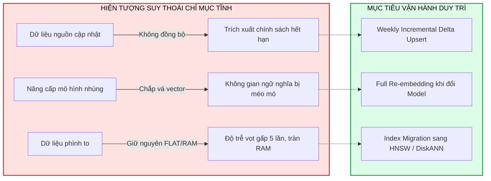
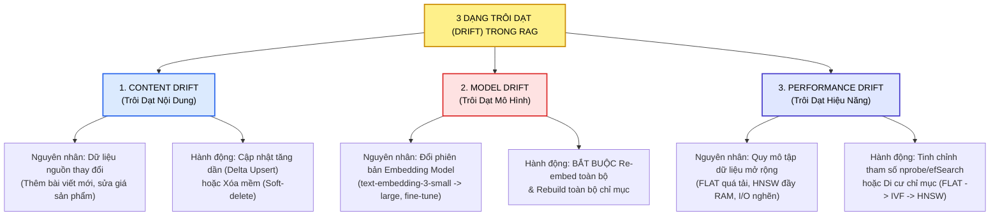
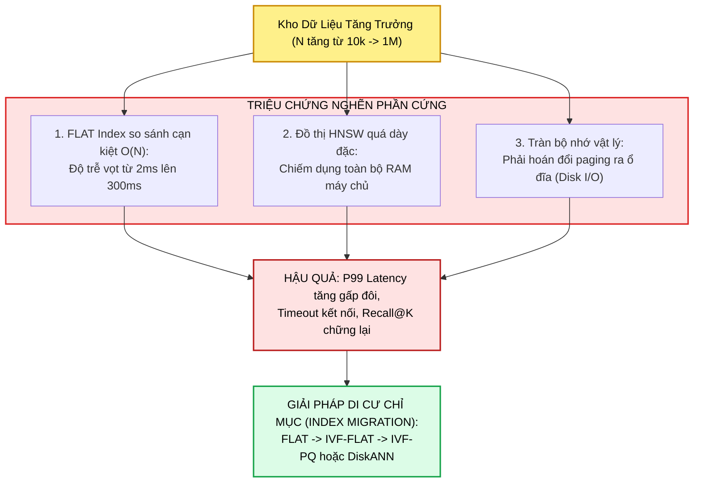
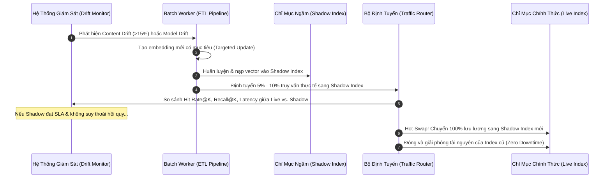

# DUY TRÌ & VẬN HÀNH CHỈ MỤC VECTOR TRONG HỆ THỐNG RAG (MAINTAINING VECTOR INDICES)
## Chiến Lược Kiểm Soát 3 Dạng Trôi Dạt (Content, Model, Performance Drift), Đánh Đổi Kiến Trúc (FLAT, HNSW, IVF-PQ, DiskANN), Shadow Deployment & Pipeline Tự Động Đồng Bộ Hóa

---

## 📌 MỤC LỤC
1. [Bản Chất Động Của Chỉ Mục Vector: Khi Nào Hệ Thống Bắt Đầu Lạc Hậu?](#1-bản-chất-động-của-chỉ-mục-vector-khi-nào-hệ-thống-bắt-đầu-lạc-hậu)
   - [Chỉ mục vector là một thực thể sống (A Living, Moving Entity)](#chỉ-mục-vector-là-một-thực-thể-sống-a-living-moving-entity)
   - [Hậu quả của một chỉ mục tĩnh (Static Index)](#hậu-quả-của-một-chỉ-mục-tĩnh-static-index)
   - [Mục tiêu cốt lõi: Duy trì sự đồng bộ ngữ nghĩa (Maintain Semantic Synchronization)](#mục-tiêu-cốt-lõi-duy-trì-sự-đồng-bộ-ngữ-nghĩa-maintain-semantic-synchronization)
2. [Giải Phẫu 3 Dạng Trôi Dạt Trong Hệ Thống RAG (The 3 Types of Drift)](#2-giải-phẫu-3-dạng-trôi-dạt-trong-hệ-thống-rag-the-3-types-of-drift)
   - [Trôi dạt nội dung (Content Drift): Dữ liệu nguồn biến động](#trôi-dạt-nội-dung-content-drift-dữ-liệu-nguồn-biến-động)
   - [Trôi dạt mô hình (Model Drift): Không gian ngữ nghĩa chuyển dịch](#trôi-dạt-mô-hình-model-drift-không-gian-ngữ-nghĩa-chuyển-dịch)
   - [Trôi dạt hiệu năng (Performance Drift): Quy mô phá vỡ SLA hệ thống](#trôi-dạt-hiệu-năng-performance-drift-quy-mô-phá-vỡ-sla-hệ-thống)
   - [Sơ đồ so sánh 3 nguồn trôi dạt và tác động lan truyền](#sơ-đồ-so-sánh-3-nguồn-trôi-dạt-và-tác-động-lan-truyền)
3. [Chiến Lược Cập Nhật Khắc Phục Trôi Dạt Nội Dung (Content Drift)](#3-chiến-lược-cập-nhật-khắc-phục-trôi-dạt-nội-dung-content-drift)
   - [Cập nhật tăng dần (Incremental Upsert) vs. Tái nhúng toàn bộ (Full Re-embed)](#cập-nhật-tăng-dần-incremental-upsert-vs-tái-nhúng-toàn-bộ-full-re-embed)
   - [Bảng phân tích 4 kịch bản vận hành thực tế](#bảng-phân-tích-4-kịch-bản-vận-hành-thực-tế)
   - [Quy tắc thực nghiệm 15% - 20%: Ngưỡng kích hoạt tái lập chỉ mục](#quy-tắc-thực-nghiệm-15---20-ngưỡng-kích-hoạt-tái-lập-chỉ-mục)
   - [4 Câu hỏi then chốt trước khi bấm nút cập nhật](#4-câu-hỏi-then-chốt-trước-khi-bấm-nút-cập-nhật)
4. [Chiến Lược Cập Nhật Khắc Phục Trôi Dạt Mô Hình (Model Drift)](#4-chiến-lược-cập-nhật-khắc-phục-trôi-dạt-mô-hình-model-drift)
   - [Tại sao không thể "chắp vá" vector mới vào không gian cũ?](#tại-sao-không-thể-chắp-vá-vector-mới-vào-không-gian-cũ)
   - [Dấu hiệu kích hoạt: Nâng cấp chiều dữ liệu và sự sụt giảm Recall@K](#dấu-hiệu-kích-hoạt-nâng-cấp-chiều-dữ-liệu-và-sự-sụt-giảm-recallk)
   - [Tính bất khả thương lượng trong các ngành quản lý nghiêm ngặt (Finance, Health, Gov)](#tính-bất-khả-thương-lượng-trong-các-ngành-quản-lý-nghiêm-ngặt-finance-health-gov)
5. [Chiến Lược Cập Nhật Khắc Phục Trôi Dạt Hiệu Năng (Performance Drift)](#5-chiến-lược-cập-nhật-khắc-phục-trôi-dạt-hiệu-năng-performance-drift)
   - [Điểm nghẽn phần cứng khi tập dữ liệu mở rộng (RAM vs Disk, Graph Density)](#điểm-nghẽn-phần-cứng-khi-tập-dữ-liệu-mở-rộng-ram-vs-disk-graph-density)
   - [Triệu chứng nhận biết: Độ trễ tăng gấp đôi và suy giảm thông lượng (QPS)](#triệu-chứng-nhận-biết-độ-trễ-tăng-gấp-đôi-và-suy-giảm-thông-lượng-qps)
   - [Di cư kiến trúc chỉ mục: FLAT $\to$ IVF $\to$ HNSW $\to$ DiskANN](#di-cư-kiến-trúc-chỉ-mục-flat-to-ivf-to-hnsw-to-diskann)
6. [Giải Mã Bài Tập Thực Nghiệm 1: Chẩn Đoán Suy Giảm Khả Năng Ghi Nhớ](#6-giải-mã-bài-tập-thực-nghiệm-1-chẩn-đoán-suy-giảm-khả-năng-ghi-nhớ)
   - [Tình huống: Kho kiến thức CSKH đối mặt với cả 3 vấn đề cùng lúc](#tình-huống-kho-kiến-thức-cskh-đối-mặt-với-cả-3-vấn-đề-cùng-lúc)
   - [Phân tích sai lầm của phương án "Rebuild toàn bộ một lần cho xong"](#phân-tích-sai-lầm-của-phương-án-rebuild-toàn-bộ-một-lần-cho-xong)
   - [Giải pháp kỹ thuật chuẩn xác: Tách biệt và giải quyết độc lập từng dạng drift](#giải-pháp-kỹ-thuật-chuẩn-xác-tách-biệt-và-giải-quyết-độc-lập-từng-dạng-drift)
7. [Đánh Đổi Kiến Trúc Lập Chỉ Mục: FLAT vs. HNSW vs. IVF-PQ vs. DiskANN / ScaNN](#7-đánh-đổi-kiến-trúc-lập-chỉ-mục-flat-vs-hnsw-vs-ivf-pq-vs-diskann--scann)
   - [Bảng so sánh định lượng 4 kiến trúc chỉ mục thực chiến](#bảng-so-sánh-định-lượng-4-kiến-trúc-chỉ-mục-thực-chiến)
   - [Chiến lược định tuyến kết hợp (Hybrid Routing Pattern)](#chiến-lược-định-tuyến-kết-hợp-hybrid-routing-pattern)
8. [Phân Đoạn Dữ Liệu (Chunking): Đòn Bẩy Tiềm Ẩn Của Sự Liên Quan Ngữ Nghĩa](#8-phân-đoạn-dữ-liệu-chunking-đòn-bẩy-tiềm-ẩn-của-sự-liên-quan-ngữ-nghĩa)
   - [Kích thước cố định vs. Phân đoạn ngữ nghĩa vs. Cửa sổ trượt](#kích-thước-cố-định-vs-phân-đoạn-ngữ-nghĩa-vs-cửa-sổ-trượt)
   - [Đo lường độ trùng lặp truy xuất (Retrieval Overlap Metrics) để tinh chỉnh Chunk Size](#đo-lường-độ-trùng-lặp-truy-xuất-retrieval-overlap-metrics-để-tinh-chỉnh-chunk-size)
9. [Vòng Lặp Vận Hành RAG Toàn Diện (The Complete Maintenance Lifecycle)](#9-vòng-lặp-vận-hành-rag-toàn-diện-the-complete-maintenance-lifecycle)
   - [Quy trình 5 bước: Phát hiện $\to$ Cập nhật mục tiêu $\to$ Shadow Deploy $\to$ Benchmark $\to$ Hot-Swap](#quy-trình-5-bước-phát-hiện-to-cập-nhật-mục-tiêu-to-shadow-deploy-to-benchmark-to-hot-swap)
   - [Triển khai ngầm (Shadow Deployment) & Kiểm thử A/B tỷ lệ truy cập](#triển-khai-ngầm-shadow-deployment--kiểm-thử-ab-tỷ-lệ-truy-cập)
10. [Giải Mã Bài Tập Thực Nghiệm 2: Tối Ưu Hóa RAG Y Tế (Clinical Assistant)](#10-giải-mã-bài-tập-thực-nghiệm-2-tối-ưu-hóa-rag-y-tế-clinical-assistant)
    - [Tình huống: Truy xuất lâm sàng chậm, context thừa/thiếu, không được downtime qua đêm](#tình-huống-truy-xuất-lâm-sàng-chậm-context-thừathiếu-không-được-downtime-qua-đêm)
    - [Phân tích 4 lựa chọn: Tại sao HNSW + Cập nhật tăng dần hàng đêm là phương án tối ưu?](#phân-tích-4-lựa-chọn-tại-sao-hnsw--cập-nhật-tăng-dần-hàng-đêm-là-phương-án-tối-ưu)
11. [Mã Nguồn Thực Chiến Hoàn Chỉnh (Production Python Pipeline)](#11-mã-nguồn-thực-chiến-hoàn-chỉnh-production-python-pipeline)
    - [Module 1: Cập nhật tăng dần cho Content Drift (`update_index_for_content_drift`)](#module-1-cập-nhật-tăng-dần-cho-content-drift-update_index_for_content_drift)
    - [Module 2: Di cư chỉ mục cho Performance Drift (`migrate_for_performance_drift`)](#module-2-di-cư-chỉ-mục-cho-performance-drift-migrate_for_performance_drift)
    - [Module 3: Bộ điều phối tự động duy trì đường ống RAG (`maintain_rag_index`)](#module-3-bộ-điều-phối-tự-động-duy-trì-đường-ống-rag-maintain_rag_index)
12. [Đúc Kết Kiến Trúc & Cây Điều Hướng Vault](#12-đúc-kết-kiến-trúc--cây-điều-hướng-vault)

---

## 1. BẢN CHẤT ĐỘNG CỦA CHỈ MỤC VECTOR: KHI NÀO HỆ THỐNG BẮT ĐẦU LẠC HẬU?

### Chỉ mục vector là một thực thể sống (A Living, Moving Entity)
Trong tư duy lập trình truyền thống, cơ sở dữ liệu thường được xem như kho lưu trữ tĩnh: dữ liệu nạp vào được lập chỉ mục B-Tree và giữ nguyên trạng thái cho đến khi có lệnh ghi đè. Tuy nhiên, **trong các hệ thống RAG hiện đại, chỉ mục vector (vector index) là một thực thể vận động liên tục**:
* **Tài liệu nguồn thay đổi:** Các chính sách mới được ban hành, thông số sản phẩm được cập nhật, tài liệu cũ bị bãi bỏ.
* **Mô hình embedding phát triển:** Các kiến trúc nhúng mới (như `text-embedding-3-large`, `BGE-M3`) liên tục ra mắt với khả năng biểu diễn ngữ nghĩa sắc nét hơn.
* **Quy mô dữ liệu tăng trưởng:** Dung lượng kho ngữ liệu từ $10.000$ đoạn văn bản ban đầu có thể nhanh chóng phình to lên hàng triệu vector sau vài tháng vận hành.

### Hậu quả của một chỉ mục tĩnh (Static Index)
Một hệ thống RAG bị "bỏ mặc" (set-and-forget) sẽ nhanh chóng suy thoái theo thời gian:
1. **Lỗi thời tri thức (Knowledge Obsolescence):** Dù mô hình embedding từng là SOTA tại thời điểm triển khai, việc không cập nhật sẽ khiến hệ thống trích xuất các quy định cũ đã hết hiệu lực, gây ra ảo giác nguy hiểm cho người dùng.
2. **Lệch pha không gian vector (Vector Space Misalignment):** Khi nạp thêm tài liệu mới bằng một mô hình nhúng khác phiên bản, các vector cũ và mới sẽ không còn nằm trong cùng một hệ quy chiếu hình học, phá hủy hoàn toàn độ tin cậy của khoảng cách Cosine hay tích vô hướng Inner Product.
3. **Nghẽn cổ chai phần cứng (Resource Exhaustion):** Chỉ mục ban đầu chạy mượt trên RAM nhưng khi số lượng vector tăng gấp 10 lần, hệ thống sẽ tràn bộ nhớ, đẩy các phép toán tìm kiếm sang đọc ổ đĩa (Disk I/O), khiến độ trễ vọt lên gấp hàng chục lần.



### Mục tiêu cốt lõi: Duy trì sự đồng bộ ngữ nghĩa (Maintain Semantic Synchronization)
Mục tiêu của kỹ sư RAG không phải là theo đuổi sự hoàn hảo viển vông, mà là **biết chính xác khi nào cần cập nhật tăng dần, khi nào cần tinh chỉnh tham số chỉ mục, và khi nào bắt buộc phải tái nhúng và xây dựng lại từ đầu**. Hệ thống truy xuất chỉ thực sự hoạt động hiệu quả khi toàn bộ chuỗi cung ứng tri thức:
$$
\text{Data Source} \longrightarrow \text{Chunking} \longrightarrow \text{Embedding Model} \longrightarrow \text{Vector Index} \longrightarrow \text{Retriever} \longrightarrow \text{LLM}
$$
luôn cùng chia sẻ và nói **chung một ngôn ngữ ngữ nghĩa (semantic synchronization)**.

---

## 2. GIẢI PHẪU 3 DẠNG TRÔI DẠT TRONG HỆ THỐNG RAG (THE 3 TYPES OF DRIFT)

Để duy trì hệ thống bền vững, bạn phải phân biệt rạch ròi 3 nguồn gốc gây ra sự suy thoái hiệu năng:



### Trôi dạt nội dung (Content Drift): Dữ liệu nguồn biến động
* **Định nghĩa:** Nội dung thực tế trong các tệp tài liệu, câu hỏi thường gặp (FAQ), hướng dẫn sử dụng, hoặc danh mục sản phẩm bị chỉnh sửa, thêm mới hoặc bãi bỏ.
* **Bản chất:** Mô hình embedding vẫn giữ nguyên, thuật toán chỉ mục vẫn ổn định, nhưng **các vector lưu trong cơ sở dữ liệu không còn phản ánh đúng thông tin thực tế của văn bản nguồn**.
* **Hậu quả:** Hệ thống trả về thông tin sai lệch hoặc trích dẫn các tài liệu đã bị xóa.

### Trôi dạt mô hình (Model Drift): Không gian ngữ nghĩa chuyển dịch
* **Định nghĩa:** Bạn nâng cấp mô hình embedding lên thế hệ mới (ví dụ từ `all-MiniLM-L6-v2` lên `bge-base-en-v1.5`, hoặc từ OpenAI `ada-002` lên `text-embedding-3-large`), hoặc mô hình được tinh chỉnh (fine-tuned) trên tập dữ liệu chuyên ngành.
* **Bản chất:** Ngay cả khi văn bản nguồn hoàn toàn không đổi một chữ, **hàm ánh xạ toán học từ ký tự sang vector đã thay đổi**. Chiều vector có thể thay đổi ($384 \to 768 \to 1536$), hoặc sự phân bố các cụm ngữ nghĩa trong không gian nhiều chiều bị tái cấu trúc.
* **Hậu quả:** Không thể so sánh vector sinh ra từ mô hình mới với vector cũ trong cơ sở dữ liệu. Mọi phép đo khoảng cách đều trở nên vô nghĩa.

### Trôi dạt hiệu năng (Performance Drift): Quy mô phá vỡ SLA hệ thống
* **Định nghĩa:** Sự suy thoái về tốc độ phản hồi (Latency) hoặc độ chính xác thu hồi (Recall) xuất hiện khi kích thước kho dữ liệu phình to theo thời gian.
* **Bản chất:** Hoàn toàn không liên quan đến ngữ nghĩa của văn bản. Cả dữ liệu và mô hình nhúng đều chuẩn xác, nhưng **thuật toán chỉ mục (Index structure) đã chạm ngưỡng giới hạn phần cứng hoặc bị loãng đồ thị lân cận**.
* **Hậu quả:** Độ trễ $P95/P99$ vọt từ $20\text{ms}$ lên $500\text{ms}$, hệ thống vi phạm thỏa thuận mức dịch vụ (Service Level Agreement - SLA), gây timeout trên giao diện người dùng.

---

## 3. CHIẾN LƯỢC CẬP NHẬT KHẮC PHỤC TRÔI DẠT NỘI DUNG (CONTENT DRIFT)

### Cập nhật tăng dần (Incremental Upsert) vs. Tái nhúng toàn bộ (Full Re-embed)
Khi dữ liệu nguồn biến động, bạn đứng trước hai ngã rẽ chiến lược:
1. **Cập nhật tăng dần (Incremental Delta Upsert):**
   * *Cơ chế:* Chỉ tạo embedding cho các tài liệu mới được tạo hoặc vừa chỉnh sửa, sau đó đẩy bổ sung vào chỉ mục hiện hành (`index.add()`). Đồng thời đánh dấu xóa mềm (`is_deleted = True`) cho các bản ghi cũ.
   * *Ưu điểm:* Cực kỳ tiết kiệm chi phí tính toán, thời gian xử lý nhanh ($O(\Delta N)$), có thể chạy tự động hàng giờ hoặc hàng đêm qua cron job.
   * *Nhược điểm:* Nếu sử dụng chỉ mục phân cụm như IVF, việc nạp thêm vector mà không huấn luyện lại K-Means sẽ làm các tâm cụm (Centroids) dần bị lệch lạc (Centroid Drift).
2. **Tái nhúng và xây dựng lại toàn bộ (Full Re-embed & Rebuild):**
   * *Cơ chế:* Quét lại toàn bộ kho tài liệu từ đầu, phân đoạn lại, sinh vector nhúng mới cho $100\%$ dữ liệu và huấn luyện lại chỉ mục từ con số không.
   * *Ưu điểm:* Đảm bảo tính nhất quán ngữ nghĩa tuyệt đối $100\%$, tối ưu hóa cấu trúc phân cụm hoàn hảo.
   * *Nhược điểm:* Tốn kém chi phí token và điện toán GPU, đòi hỏi khoảng thời gian ngừng hoạt động (downtime window) hoặc hạ tầng triển khai kép (Blue-Green Deployment).

### Bảng phân tích 4 kịch bản vận hành thực tế

| Bối Cảnh Nghiệp Vụ | Tần Suất Biến Động | Chiến Lược Đề Xuất | Lý Do Kỹ Thuật |
| :--- | :--- | :--- | :--- |
| **Nền tảng học trực tuyến** (Giảng viên tải bài học mới hàng tuần) | Thường xuyên bổ sung & chỉnh sửa nội dung | **Cập nhật tăng dần (Incremental)** | Xử lý nhanh qua đêm theo lô (batch); người học cần tài liệu mới ngay mà không cần đồng bộ toàn cục tuyệt đối. |
| **Tài liệu công nghệ cao** (Cập nhật liên tục theo từng sprint/release) | Biến động liên tục từng phần nhỏ | **Cập nhật tăng dần hàng ngày + Tái nhúng định kỳ hàng quý** | Cân bằng hoàn hảo giữa việc duy trì nội dung tươi mới và giữ không gian vector ổn định, không tốn chi phí rebuild hàng tuần. |
| **Cơ sở dữ liệu án lệ pháp lý** (Bổ sung án lệ theo quý) | Nội dung tĩnh, văn bản chuẩn hóa, chu kỳ cố định | **Tái nhúng toàn bộ + Xây dựng lại (Full Rebuild)** | Độ chính xác ngữ nghĩa và tính toàn vẹn pháp lý quan trọng hơn chi phí tính toán; đảm bảo điểm số tương đồng có ý nghĩa chuẩn xác trên toàn bộ kho lưu trữ. |
| **Báo cáo tuân thủ tài chính** (Báo cáo kiểm toán hàng tháng) | Dung lượng thấp, đòi hỏi độ chính xác tuyệt đối | **Tái nhúng toàn bộ (Full Re-embed)** | Số lượng tài liệu không quá lớn ($< 50.000$ trang), rủi ro sai lệch ngữ nghĩa mang lại hậu quả pháp lý nghiêm trọng, không được phép chắp vá. |

### Quy tắc thực nghiệm 15% - 20%: Ngưỡng kích hoạt tái lập chỉ mục
> [!TIP]
> **Ngưỡng thay đổi ngữ nghĩa thực tiễn (The 15% - 20% Drift Rule):**
> Trong quá trình vận hành cập nhật tăng dần, hãy duy trì bảng siêu dữ liệu (Metadata) ghi nhận `doc_id`, `last_updated`, và `embedding_model_version`. 
> **Khi tổng số lượng vector mới được bổ sung vượt quá $15\% - 20\%$ quy mô tập dữ liệu ban đầu, hoặc khi có hơn $15\%$ vector đến từ phiên bản nhúng cũ hơn, đó là thời điểm bắt buộc phải lên lịch xây dựng lại toàn bộ chỉ mục (Full Index Rebuild).** 
> Đây là ngưỡng giới hạn mà hiện tượng trôi dạt tâm cụm (Centroid Drift) bắt đầu làm sụt giảm rõ rệt chỉ số Recall@K của các thuật toán phân vùng như IVF.

### 4 Câu hỏi then chốt trước khi bấm nút cập nhật
Trước khi quyết định phương án bảo trì chỉ mục, hãy tự vấn 4 câu hỏi kiến trúc:
1. **Tần suất biến động dữ liệu:** Dữ liệu nguồn của bạn thay đổi theo từng phút, từng ngày hay theo từng quý?
2. **Độ nhạy cảm ngữ nghĩa:** Ứng dụng của bạn nhạy cảm đến mức nào với các sai lệch ngữ nghĩa nhỏ? (Sai một từ trong chatbot giải trí là vô hại, nhưng sai một điều khoản pháp lý hoặc liều lượng thuốc là thảm họa).
3. **Ngân sách bảo trì (Maintenance Window):** Hệ thống có khoảng thời gian rảnh rỗi ban đêm (off-peak hours) để chạy batch job không, hay phải phục vụ liên tục $24/7$ toàn cầu?
4. **Ngưỡng chấp nhận sụt giảm Recall@K:** Mức độ sụt giảm khả năng thu hồi bao nhiêu phần trăm là chấp nhận được trước khi người dùng thực sự phàn nàn?

---

## 4. CHIẾN LƯỢC CẬP NHẬT KHẮC PHỤC TRÔI DẠT MÔ HÌNH (MODEL DRIFT)

### Tại sao không thể "chắp vá" vector mới vào không gian cũ?
Nhiều kỹ sư mắc phải sai lầm ngây thơ: Khi OpenAI phát hành mô hình `text-embedding-3-small` để thay thế `ada-002`, họ giữ nguyên các vector cũ trong cơ sở dữ liệu và chỉ dùng mô hình mới để nhúng các tài liệu mới thêm vào!

```
[KHÔNG GIAN CŨ (ada-002)]        [KHÔNG GIAN MỚI (text-embedding-3-small)]
  Vector A (Chính sách lưu trữ)     Vector C (Quy định mới sửa đổi)
  Tọa độ: [0.12, -0.84, 0.45...]    Tọa độ: [0.77, 0.05, -0.31...]
               \                     /
                \                   /
                 \                 /
             Tính Cosine Similarity giữa A và C?
             ===> HOÀN TOÀN VÔ NGHĨA VỀ MẶT TOÁN HỌC!
             (Giống như so sánh nhiệt độ Độ C với Độ F mà không đổi đơn vị)
```

Mỗi mô hình embedding định nghĩa một **hệ tọa độ không gian riêng biệt (Manifold Space)**. Hai vector đến từ hai mô hình khác nhau không thể tính khoảng cách hình học, bởi vì trục tọa độ của chúng không đại diện cho cùng một thuộc tính ngữ nghĩa. 

### Dấu hiệu kích hoạt: Nâng cấp chiều dữ liệu và sự sụt giảm Recall@K
Bạn bắt buộc phải kích hoạt quy trình **Tái nhúng toàn bộ và Xây dựng lại chỉ mục (Full Re-embed & Rebuild)** khi:
1. **Nâng cấp phiên bản mô hình nhúng:** Chuyển sang mô hình có chiều vector khác (ví dụ: $384 \to 768$ hoặc $1536 \to 3072$).
2. **Sụt giảm Recall@K bất thường:** Sau khi thử nghiệm nhúng một số tài liệu mới, bạn nhận thấy chỉ số Recall@K giảm mạnh trên tập dữ liệu kiểm thử. Điều này chứng minh cấu trúc chỉ mục hiện tại không còn bao hàm được không gian ý nghĩa mới.
3. **Nhu cầu thấu hiểu thuật ngữ miền sâu (Domain-specific Nuance):** Khi doanh nghiệp chuyển từ mô hình đa năng (General-purpose) sang mô hình fine-tune riêng cho ngành y tế hoặc pháp lý.

### Tính bất khả thương lượng trong các ngành quản lý nghiêm ngặt (Finance, Health, Gov)
Trong các ngành tài chính, y tế và hành chính công, việc tái nhúng toàn bộ sau khi nâng cấp mô hình là **yêu cầu bắt buộc về mặt tuân thủ (Compliance)**. Tính nhất quán, độ chính xác có thể kiểm chứng và khả năng truy vết nguồn gốc (Auditability) luôn được đặt cao hơn chi phí tính toán hoặc thời gian chạy máy chủ.

---

## 5. CHIẾN LƯỢC CẬP NHẬT KHẮC PHỤC TRÔI DẠT HIỆU NĂNG (PERFORMANCE DRIFT)

Khác với hai dạng trôi dạt trên, **Trôi dạt hiệu năng (Performance Drift) không bắt nguồn từ sự thay đổi ý nghĩa ngữ nghĩa, mà xuất phát từ quy mô vật lý của dữ liệu và hành vi hệ thống**.



### Điểm nghẽn phần cứng khi tập dữ liệu mở rộng (RAM vs Disk, Graph Density)
* **FLAT Index ($O(N)$):** Khi $N \le 50.000$, FLAT Index là sự lựa chọn hoàn hảo vì tốc độ quét $< 3\text{ms}$. Nhưng khi $N$ chạm mốc $1.000.000$, mỗi truy vấn đòi hỏi thực hiện hàng triệu phép nhân ma trận dấu phẩy động, làm nghẽn toàn bộ luồng CPU.
* **HNSW Graph Density:** Khi số lượng nút trên đồ thị HNSW tăng lên, dung lượng RAM tiêu thụ tăng theo cấp số nhân (mỗi vector $768$ chiều tốn khoảng $3\text{KB}$ dữ liệu đồ thị kèm theo). Khi vượt quá dung lượng RAM thực, hệ điều hành buộc phải dùng cơ chế hoán đổi bộ nhớ (Disk Swapping), khiến tốc độ truy vấn sụt giảm hàng trăm lần.

### Triệu chứng nhận biết: Độ trễ tăng gấp đôi và suy giảm thông lượng (QPS)
Kỹ sư hệ thống cần theo dõi các cảnh báo sau để phát hiện sớm Performance Drift:
1. **Độ trễ truy vấn trung bình (Average Latency) hoặc $P99$ tăng gấp đôi** so với thời điểm triển khai ban đầu dù lưu lượng truy cập không đổi.
2. **Chỉ số Recall@K bắt đầu chững lại hoặc giảm nhẹ** ngay cả khi chất lượng tài liệu và mô hình nhúng hoàn toàn ổn định (do các thuật toán ANN bị giới hạn số bước nhảy tìm kiếm).
3. **Các lỗi tràn bộ nhớ (Out-Of-Memory - OOM)** hoặc nghẽn đọc ghi đĩa (Disk I/O Bottlenecks) xuất hiện liên tục trong giờ cao điểm.

### Di cư kiến trúc chỉ mục: FLAT $\to$ IVF $\to$ HNSW $\to$ DiskANN
Khi Performance Drift xuất hiện, giải pháp không phải là nhúng lại tài liệu, mà là **di cư sang một cấu trúc chỉ mục có khả năng mở rộng cao hơn**:
* $N < 50.000$: Giữ nguyên **FLAT Index**.
* $50.000 \le N \le 1.000.000$: Chuyển đổi sang **IVF-FLAT** (huấn luyện K-Means Voronoi, điều tiết $n_{\text{probe}}$ linh hoạt).
* $N > 1.000.000$ (Yêu cầu tốc độ cao, RAM dồi dào): Chuyển sang **HNSW**.
* $N > 5.000.000$ (RAM hạn chế): Chuyển sang **IVF-PQ** (kết hợp phân cụm và nén lượng tử hóa Product Quantization) hoặc **DiskANN / ScaNN** (tìm kiếm ANN trực tiếp trên ổ cứng NVMe).

---

## 6. GIẢI MÃ BÀI TẬP THỰC NGHIỆM 1: CHẨN ĐOÁN SUY GIẢM KHẢ NĂNG GHI NHỚ

### Tình huống: Kho kiến thức CSKH đối mặt với cả 3 vấn đề cùng lúc
Một nhóm kỹ sư đang duy trì cơ sở dữ liệu vector cho kho tri thức hỗ trợ khách hàng của công ty. Gần đây, hệ thống ghi nhận đồng thời 3 triệu chứng:
1. Kết quả tìm kiếm trả về cả những bài viết đã hết hạn hoặc bị sửa đổi (**Dấu hiệu của Content Drift**).
2. Độ trễ truy vấn tăng lên rõ rệt trong giờ cao điểm (**Dấu hiệu của Performance Drift**).
3. Nhà cung cấp vừa ra mắt phiên bản mô hình embedding mới cho kết quả tốt hơn trên tập dữ liệu chuyên ngành (**Cơ hội nâng cấp Model Drift**).

> **Câu hỏi kiểm tra:**
> *Nhóm kỹ sư quyết định thực hiện một đợt "Xây dựng lại toàn bộ chỉ mục" (Full Rebuild) để giải quyết dứt điểm cả 3 vấn đề này cùng một lúc. Đây có phải là cách tiếp cận tốt nhất không?*
> 
> * **Phương án A:** ĐÚNG VẬY
> * **Phương án B:** SAI

### Phân tích sai lầm của phương án "Rebuild toàn bộ một lần cho xong"
* **ĐÁP ÁN CHÍNH XÁC: PHƯƠNG ÁN B (SAI)!**
* **Tại sao Phương án A lại sai lầm?**
  * Việc vội vã bấm nút "Full Rebuild" là tư duy cào bằng nguy hiểm trong vận hành hệ thống. Xây dựng lại toàn bộ sẽ giải quyết được vấn đề cập nhật mô hình mới, nhưng lại là sự lãng phí tài nguyên tính toán khủng khiếp và **gây ra thời gian chết (downtime) không đáng có** cho toàn bộ hệ thống.
  * Quan trọng hơn, nếu bạn không phân tách nguyên nhân gốc rễ, sau khi rebuild xong, hệ thống vẫn sẽ tiếp tục bị nghẽn độ trễ vào giờ cao điểm nếu bạn vẫn dùng loại chỉ mục cũ!

### Giải pháp kỹ thuật chuẩn xác: Tách biệt và giải quyết độc lập từng dạng drift

```
+----------------------------------------------------------------------------------------------------+
| NGUYÊN TẮC CÔ LẬP TRÔI DẠT (ISOLATE DRIFT REMEDIATION)                                             |
|                                                                                                    |
| 1. Vấn đề bài viết lỗi thời (Content Drift):                                                       |
|    -> Xử lý ngay lập tức bằng Cập nhật tăng dần (Incremental Upsert) hoặc Đánh dấu Xóa mềm        |
|       (Soft-delete), không cần chờ đợi bảo trì lớn.                                                |
|                                                                                                    |
| 2. Vấn đề độ trễ tăng vọt (Performance Drift):                                                     |
|    -> Điều chỉnh tham số chỉ mục (giảm nprobe, tinh chỉnh efSearch) hoặc di cư từ FLAT sang HNSW/IVF. |
|                                                                                                    |
| 3. Vấn đề mô hình embedding mới (Model Drift):                                                     |
|    -> Triển khai ngầm (Shadow Deployment): Chạy mô hình mới trên môi trường song song,             |
|       đo đạc Recall@K trên tập Golden Test Set trước khi quyết định di cư toàn bộ kho dữ liệu.    |
+----------------------------------------------------------------------------------------------------+
  ===> GIẢM THIỂU CHI PHÍ TÍNH TOÁN, TRIỆT TIÊU DOWNTIME VÀ BẢO ĐẢM TÍNH ỔN ĐỊNH DÀI LÂU!
```

---

## 7. ĐÁNH ĐỔI KIẾN TRÚC LẬP CHỈ MỤC: FLAT VS. HNSW VS. IVF-PQ VS. DISKANN / SCANN

Không có cấu hình chỉ mục "tốt nhất trên mọi phương diện", chỉ có cấu hình "phù hợp nhất với hình thái bài toán và ngân sách điện toán":

### Bảng so sánh định lượng 4 kiến trúc chỉ mục thực chiến

| Loại Chỉ Mục | Tốc Độ Truy Xuất | Chất Lượng Thu Hồi (Recall) | Chi Phí Bộ Nhớ (RAM) | Trường Hợp Sử Dụng Tối Ưu |
| :--- | :---: | :---: | :---: | :--- |
| **FLAT Index** (Phương pháp vét cạn) | Chậm ($O(N)$) | **Hoàn hảo ($100\%$)** | Thấp (Chỉ lưu vector thô) | Tập dữ liệu $\le 50.000$ vectors; kiểm thử ngoại tuyến, dùng làm chuẩn vàng chẩn đoán lỗi. |
| **HNSW** (Đồ thị thế giới nhỏ phân tầng) | **Rất nhanh ($O(\log N)$)** | **Gần như hoàn hảo ($95\% - 99\%$)** | **Rất cao (Gấp $1.5 - 2$ lần FLAT)** | Chatbot CSKH, hệ thống hỏi đáp thời gian thực; hỗ trợ cập nhật tăng dần mượt mà. |
| **IVF-PQ** (Tệp đảo ngược + Lượng tử hóa) | Cực nhanh | Giảm sút mức độ vừa phải ($85\% - 92\%$) | **Cực thấp (Nén $70\% - 90\%$ RAM)** | Sàn thương mại điện tử, tập dữ liệu hàng chục triệu vector hoặc khi tài nguyên GPU/VRAM bị thắt chặt. |
| **DiskANN / ScaNN** (ANN trên ổ cứng NVMe) | **Siêu tốc** | Linh hoạt điều chỉnh | Cực thấp trên RAM (Lưu trên NVMe SSD) | Hệ thống quy mô đám mây, hàng tỷ vector vượt quá dung lượng RAM vật lý của cụm máy chủ. |

```
Độ Hồi Tưởng (Recall)
   100% |  [FLAT] (Chậm, Chuẩn xác tuyệt đối)
        |         \
    95% |          [HNSW] (Cân bằng vàng cho Production RAG)
        |                 \
    90% |                  [DiskANN / ScaNN] (Quy mô hàng tỷ vector trên SSD)
        |                         \
    85% |                          [IVF-PQ] (Siêu nhẹ, nén RAM tối đa cho E-commerce)
        +----------------------------------------------------------------------------> Tốc Độ & Quy Mô
```

### Chiến lược định tuyến kết hợp (Hybrid Routing Pattern)
Đối với các hệ thống doanh nghiệp lớn, phương pháp tiếp cận tối tân là **kết hợp hai tầng chỉ mục (Two-tier Index Routing)**:
1. **Chỉ mục định tuyến thô (Coarse Routing Index):** Sử dụng chỉ mục nén IVF-PQ hoặc HNSW nhỏ để phân loại nhanh câu hỏi thuộc miền chủ đề nào (Routing).
2. **Chỉ mục cục bộ chuyên sâu (Fine-grained Local Index):** Sau khi xác định đúng phân vùng, truy vấn được chuyển đến chỉ mục FLAT hoặc HNSW chất lượng cao của riêng phân vùng đó để trích xuất với độ chính xác tuyệt đối.

---

## 8. PHÂN ĐOẠN DỮ LIỆU (CHUNKING): ĐÒN BẨY TIỀM ẨN CỦA SỰ LIÊN QUAN NGỮ NGHĨA

Việc phân đoạn (chunking) quyết định **ý nghĩa nào được đưa vào các vector embedding**. Nếu kỹ thuật phân đoạn kém hiệu quả, hệ thống sẽ kéo về các đoạn văn rác ngay cả khi bạn sử dụng mô hình embedding hoàn hảo nhất hành tinh.

### Kích thước cố định vs. Phân đoạn ngữ nghĩa vs. Cửa sổ trượt

| Chiến Lược Chunking | Ưu Điểm Nổi Bật | Nhược Điểm Cốt Tử | Khi Nào Nên Sử Dụng? |
| :--- | :--- | :--- | :--- |
| **Kích thước cố định** (Fixed-size, vd: 512 tokens) | Dễ tự động hóa, tính toán đơn giản, tốc độ tiền xử lý siêu tốc. | Cắt ngang câu/đoạn, phá vỡ ranh giới ngữ nghĩa tự nhiên. | Dữ liệu có cấu trúc đồng nhất cao (như mã nguồn chuẩn, file cấu hình). |
| **Phân đoạn ngữ nghĩa** (Semantic Chunking) | Bảo toàn trọn vẹn ngữ cảnh và mạch ý tưởng của tác giả. | Tiền xử lý chậm, khó chạy song song trên quy mô lớn. | Dữ liệu phi cấu trúc phức tạp (biên bản họp, bài blog dài, tiểu thuyết). |
| **Cửa sổ trượt** (Sliding Window có overlap) | Tăng cường khả năng nhớ ngữ cảnh, tránh đứt gãy biên. | Sinh ra các vector dư thừa, tăng chi phí lưu trữ và tính toán. | Hệ thống hỏi đáp (QA) đòi hỏi câu trả lời phải có ngữ cảnh hoàn chỉnh xung quanh. |

### Đo lường độ trùng lặp truy xuất (Retrieval Overlap Metrics) để tinh chỉnh Chunk Size
Làm sao biết kích thước chunk của bạn đang quá lớn hay quá nhỏ? Hãy theo dõi **Chỉ số trùng lặp ngữ nghĩa khi truy xuất (Retrieval Overlap Rate)** giữa các đoạn thông tin kéo về và câu trả lời chuẩn (Ground Truth Answer):
* **Độ trùng lặp quá thấp (Low Overlap):** Các đoạn văn trích xuất chỉ chạm nhẹ vào bề mặt câu hỏi mà không chứa đủ chi tiết trả lời $\implies$ **Hành động: Tăng kích thước khối (Chunk Size lớn hơn)** để mở rộng phạm vi ngữ cảnh.
* **Độ trùng lặp cao nhưng độ chính xác thấp (High Overlap, Low Precision):** Đoạn văn có chứa câu trả lời nhưng kèm theo quá nhiều thông tin rác bên lề, khiến LLM bị phân tâm $\implies$ **Hành động: Giảm kích thước khối (Chunk Size nhỏ hơn)** để loại bỏ nhiễu và tăng độ tập trung ngữ nghĩa.

---

## 9. VÒNG LẶP VẬN HÀNH RAG TOÀN DIỆN (THE COMPLETE MAINTENANCE LIFECYCLE)

Vận hành chỉ mục vector là một **thói quen kỹ thuật liên tục (continuous engineering routine)**, không phải là thiết lập một lần rồi kết thúc.



### Quy trình 5 bước: Phát hiện $\to$ Cập nhật mục tiêu $\to$ Shadow Deploy $\to$ Benchmark $\to$ Hot-Swap
1. **Phát hiện sự thay đổi (Detect Drift):** Liên tục giám sát 3 trục trôi dạt (Nội dung, Mô hình, Hiệu năng) qua log truy vấn và chỉ số hệ thống.
2. **Chạy bản cập nhật có mục tiêu (Run Targeted Update):** Cập nhật từng phần (nếu do nội dung) hoặc tái nhúng toàn bộ (nếu do đổi mô hình).
3. **Triển khai thử nghiệm ngầm (Shadow Deployment):** Khởi tạo chỉ mục mới song song và định tuyến một tỷ lệ nhỏ ($5\% - 10\%$) lưu lượng truy vấn thực tế để chạy thử nghiệm A/B ngầm.
4. **So sánh định lượng các chỉ số (Compare Metrics):** Đo lường trực tiếp Recall@K, $P99$ Latency và độ liên quan ngữ nghĩa trên lưu lượng thực tế và trên tập Golden Test Set.
5. **Hoán đổi nóng và giải phóng chỉ mục cũ (Hot-Swap & Decommission):** Khi chỉ mục mới chứng minh được độ ổn định vượt trội, bộ định tuyến chuyển toàn bộ $100\%$ lưu lượng sang chỉ mục mới một cách êm thấm (Zero Downtime), sau đó thu hồi tài nguyên của chỉ mục cũ.

---

## 10. GIẢI MÃ BÀI TẬP THỰC NGHIỆM 2: TỐI ƯU HÓA RAG Y TẾ (CLINICAL ASSISTANT)

### Tình huống: Truy xuất lâm sàng chậm, context thừa/thiếu, không được downtime qua đêm
Bạn đang tối ưu hóa quy trình RAG cho một trợ lý chăm sóc sức khỏe phục vụ y bác sĩ tra cứu ghi chú lâm sàng và tài liệu chính sách bệnh viện. Hệ thống đang gặp phải 3 thực trạng:
1. Phản hồi truy vấn bị chậm, gây sốt ruột cho đội ngũ y tế.
2. Một số đoạn văn bản trích xuất chứa ngữ cảnh không đầy đủ hoặc bị lặp lại dư thừa.
3. Ban giám đốc bệnh viện **nghiêm cấm thời gian ngừng hoạt động qua đêm (No Overnight Downtime)** vì hệ thống cấp cứu hoạt động $24/7$.

> **Câu hỏi kiểm tra:**
> *Sự kết hợp nào giữa các hành động dưới đây sẽ cân bằng tốt nhất giữa hiệu suất, chất lượng ngữ nghĩa và tính sẵn sàng của hệ thống?*
> 
> * **Lựa chọn 1:** Thu nhỏ kích thước khối và tái nhúng toàn bộ dữ liệu từ đầu.
> * **Lựa chọn 2:** Chuyển từ chỉ mục FLAT sang HNSW và chạy cập nhật tăng dần hàng đêm (Incremental Nightly Updates).
> * **Lựa chọn 3:** Chuyển sang chỉ mục IVF-PQ và tạm thời bỏ qua việc phân đoạn lại dữ liệu.
> * **Lựa chọn 4:** Không cần làm gì cả — mô hình ngôn ngữ lớn (LLM) sẽ tự động điều chỉnh theo nhiễu thu hồi.

### Phân tích 4 lựa chọn: Tại sao HNSW + Cập nhật tăng dần hàng đêm là phương án tối ưu?
* **ĐÁP ÁN CHÍNH XÁC: LỰA CHỌN 2!**
* **Lý giải kỹ thuật chi tiết:**
  * **Tại sao Lựa chọn 2 đúng?** HNSW giải quyết triệt để vấn đề tốc độ phản hồi chậm của FLAT Index bằng thuật toán đồ thị $O(\log N)$, đồng thời bảo toàn độ hồi tưởng cao ($> 95\%$). Cơ chế cập nhật tăng dần hàng đêm (Incremental Nightly Updates) cho phép nạp dữ liệu mới vào đồ thị HNSW mà không cần xây dựng lại toàn bộ chỉ mục, loại bỏ hoàn toàn nguy cơ downtime ban đêm.
  * **Tại sao Lựa chọn 1 sai?** Nhúng lại toàn bộ vi phạm trực tiếp yêu cầu không được có thời gian ngừng hoạt động. Ngoài ra, việc thu nhỏ khối quá mức làm tăng vọt tổng số lượng vector, khiến bộ nhớ RAM phình to và làm trầm trọng thêm độ trễ của hệ thống lớn.
  * **Tại sao Lựa chọn 3 sai?** IVF-PQ nén lượng tử hóa các vector làm méo mó một phần không gian hình học. Trong lĩnh vực y khoa và chăm sóc sức khỏe, việc hy sinh độ chính xác ngữ nghĩa để lấy tốc độ là điều cấm kỵ vì có thể dẫn đến sai sót phác đồ điều trị.
  * **Tại sao Lựa chọn 4 sai?** Mô hình sinh LLM không có khả năng tự sửa lỗi nếu đầu vào bị mất thông tin. Nhiễu và sai lệch sẽ tích tụ theo thời gian, làm hệ thống ngày càng suy thoái.

---

## 11. MÃ NGUỒN THỰC CHIẾN HOÀN CHỈNH (PRODUCTION PYTHON PIPELINE)

Dưới đây là mã nguồn hoàn chỉnh hiện thực hóa toàn bộ các chiến lược quản trị trôi dạt và bảo trì chỉ mục bằng `sentence-transformers`, `faiss` và `numpy`:

```python
"""
PRODUCTION RAG INDEX MAINTENANCE PIPELINE
=========================================
Minh họa 3 chiến lược cốt lõi:
1. update_index_for_content_drift: Cập nhật tăng dần khi có văn bản mới/sửa đổi.
2. migrate_for_performance_drift: Di cư từ FLAT sang IVF khi dữ liệu mở rộng.
3. maintain_rag_index: Bộ điều phối tự động phân loại và xử lý 3 dạng trôi dạt.
"""

import numpy as np
import faiss
from sentence_transformers import SentenceTransformer

# ------------------------------------------------------------------------------
# MODULE 1: CẬP NHẬT TĂNG DẦN CHO CONTENT DRIFT
# ------------------------------------------------------------------------------
def update_index_for_content_drift(index, model, updated_docs, doc_metadata_db):
    """
    Cập nhật chỉ mục vector tăng dần khi có tài liệu mới hoặc sửa đổi.
    Tránh chi phí tái nhúng tốn kém khi chỉ có một phần nhỏ dữ liệu thay đổi.
    """
    print(f"\n[Content Drift] Bắt đầu cập nhật tăng dần cho {len(updated_docs)} tài liệu...")
    
    # Bước 1: Trích xuất nội dung văn bản và sinh vector nhúng mới
    texts = [doc["text"] for doc in updated_docs]
    new_vectors = model.encode(texts, normalize_embeddings=True).astype("float32")
    
    # Bước 2: Nạp trực tiếp vector mới vào chỉ mục hiện hành (O(delta N))
    start_id = index.ntotal
    index.add(new_vectors)
    
    # Bước 3: Cập nhật cơ sở dữ liệu siêu dữ liệu (Metadata Mapping)
    for i, doc in enumerate(updated_docs):
        doc_metadata_db.append({
            "vector_id": start_id + i,
            "doc_id": doc["doc_id"],
            "title": doc["title"],
            "version": doc.get("version", 1),
            "last_updated": doc.get("last_updated", "2026-10-04"),
            "text": doc["text"]
        })
        
    print(f"[Content Drift] Hoàn tất! Tổng số vector hiện tại trong chỉ mục: {index.ntotal}")
    return index, doc_metadata_db


# ------------------------------------------------------------------------------
# MODULE 2: DI CƯ CHỈ MỤC CHO PERFORMANCE DRIFT
# ------------------------------------------------------------------------------
def migrate_for_performance_drift(vectors, num_clusters=4, nprobe=2):
    """
    Di cư từ FLAT sang IVF Index khi kích thước tập dữ liệu tăng cao làm suy giảm SLA.
    IVF đánh đổi một phần nhỏ Recall để đạt bước nhảy vọt về tốc độ truy vấn.
    """
    vector_dim = vectors.shape[1]
    total_vectors = vectors.shape[0]
    print(f"\n[Performance Drift] Bắt đầu di cư sang IVF Index ({total_vectors} vectors, dim={vector_dim})...")
    
    # Bước 1: Khởi tạo Quantizer cơ sở (Flat Inner Product)
    quantizer = faiss.IndexFlatIP(vector_dim)
    
    # Bước 2: Xây dựng Inverted File Index với num_clusters cụm Voronoi
    ivf_index = faiss.IndexIVFFlat(quantizer, vector_dim, num_clusters, faiss.METRIC_INNER_PRODUCT)
    
    # Bước 3: Huấn luyện tâm cụm K-Means Voronoi Centroids
    print(f"[Performance Drift] Đang huấn luyện K-Means với {num_clusters} centroids...")
    ivf_index.train(vectors)
    assert ivf_index.is_trained, "Lỗi: Chỉ mục IVF chưa được huấn luyện!"
    
    # Bước 4: Nạp toàn bộ vector vào các danh sách đảo (Inverted Lists)
    ivf_index.add(vectors)
    ivf_index.nprobe = nprobe
    
    print(f"[Performance Drift] Di cư hoàn tất! nprobe được thiết lập = {nprobe}")
    return ivf_index


# ------------------------------------------------------------------------------
# MODULE 3: BỘ ĐIỀU PHỐI DUY TRÌ ĐƯỜNG ỐNG RAG TOÀN DIỆN
# ------------------------------------------------------------------------------
def maintain_rag_index(
    index, 
    model, 
    new_docs, 
    all_docs, 
    doc_metadata_db,
    drift_type=None, 
    model_version_changed=False
):
    """
    Bộ điều phối tự động duy trì sự đồng bộ giữa dữ liệu, embedding và cấu trúc chỉ mục.
    Tự động áp dụng chiến lược cập nhật phù hợp dựa trên loại trôi dạt được phát hiện.
    """
    print(f"\n=======================================================")
    print(f"TIẾN HÀNH BẢO TRÌ ĐƯỜNG ỐNG RAG | DRIFT TYPE: {drift_type}")
    print(f"=======================================================")

    # TRƯỜNG HỢP 1: MODEL DRIFT (Bắt buộc Re-embed và Rebuild toàn bộ)
    if model_version_changed or drift_type == "model":
        print("[Xử Lý Model Drift] Phát hiện thay đổi phiên bản mô hình nhúng!")
        print("-> Kích hoạt quy trình: FULL RE-EMBEDDING & REBUILD TOÀN BỘ CHỈ MỤC...")
        
        all_texts = [doc["text"] for doc in all_docs]
        re_embedded_vectors = model.encode(all_texts, normalize_embeddings=True).astype("float32")
        
        # Khởi tạo chỉ mục mới hoàn toàn
        new_index = faiss.IndexFlatIP(re_embedded_vectors.shape[1])
        new_index.add(re_embedded_vectors)
        
        # Đồng bộ lại Metadata DB
        new_metadata_db = []
        for i, doc in enumerate(all_docs):
            new_metadata_db.append({
                "vector_id": i,
                "doc_id": doc["doc_id"],
                "title": doc["title"],
                "version": doc.get("version", 1),
                "last_updated": "2026-10-04",
                "text": doc["text"]
            })
        print(f"[Xử Lý Model Drift] Tái lập chỉ mục thành công với {new_index.ntotal} vectors thống nhất.")
        return new_index, new_metadata_db

    # TRƯỜNG HỢP 2: CONTENT DRIFT (Chỉ cập nhật tăng dần)
    elif drift_type == "content":
        return update_index_for_content_drift(index, model, new_docs, doc_metadata_db)

    # TRƯỜNG HỢP 3: PERFORMANCE DRIFT (Di cư cấu trúc chỉ mục)
    elif drift_type == "performance":
        # Trích xuất toàn bộ vector hiện có từ các tài liệu để tái cấu trúc sang IVF/HNSW
        all_texts = [doc["text"] for doc in all_docs]
        existing_vectors = model.encode(all_texts, normalize_embeddings=True).astype("float32")
        new_index = migrate_for_performance_drift(existing_vectors, num_clusters=4, nprobe=2)
        return new_index, doc_metadata_db

    else:
        print("[Bảo Trì Định Kỳ] Không phát hiện trôi dạt nghiêm trọng. Giữ nguyên trạng thái chỉ mục.")
        return index, doc_metadata_db


# ------------------------------------------------------------------------------
# CHẠY THỰC NGHIỆM KIỂM CHỨNG PIPELINE
# ------------------------------------------------------------------------------
if __name__ == "__main__":
    # Khởi tạo mô hình embedding thực nghiệm
    embed_model = SentenceTransformer("all-MiniLM-L6-v2")
    
    # Kho dữ liệu ban đầu
    initial_corpus = [
        {"doc_id": "DOC-001", "title": "Chính sách nghỉ phép", "text": "Nhân viên được hưởng 12 ngày phép năm có hưởng lương."},
        {"doc_id": "DOC-002", "title": "Bảo mật thông tin", "text": "Tất cả mật khẩu phải có độ dài tối thiểu 12 ký tự và đổi định kỳ."},
        {"doc_id": "DOC-003", "title": "Quy chế làm việc từ xa", "text": "Nhân viên được đăng ký làm việc tại nhà tối đa 2 ngày mỗi tuần."}
    ]
    
    metadata_store = []
    
    # Khởi tạo chỉ mục ban đầu (FLAT Index)
    raw_vecs = embed_model.encode([d["text"] for d in initial_corpus], normalize_embeddings=True).astype("float32")
    active_index = faiss.IndexFlatIP(raw_vecs.shape[1])
    active_index.add(raw_vecs)
    for idx, d in enumerate(initial_corpus):
        metadata_store.append({"vector_id": idx, **d})
        
    print(f"Hệ thống khởi tạo thành công: {active_index.ntotal} tài liệu trong FLAT Index.")

    # 1. Thử nghiệm Content Drift: Giảng viên/HR bổ sung thêm chính sách mới
    new_incoming_docs = [
        {"doc_id": "DOC-004", "title": "Phụ cấp ăn trưa", "text": "Công ty hỗ trợ 50.000 VNĐ tiền ăn trưa cho mỗi ngày làm việc thực tế."}
    ]
    active_index, metadata_store = maintain_rag_index(
        index=active_index,
        model=embed_model,
        new_docs=new_incoming_docs,
        all_docs=initial_corpus + new_incoming_docs,
        doc_metadata_db=metadata_store,
        drift_type="content"
    )

    # 2. Thử nghiệm Performance Drift: Quy mô mở rộng, di cư sang IVF Index
    active_index, metadata_store = maintain_rag_index(
        index=active_index,
        model=embed_model,
        new_docs=[],
        all_docs=initial_corpus + new_incoming_docs,
        doc_metadata_db=metadata_store,
        drift_type="performance"
    )

    # 3. Thử nghiệm Model Drift: Nâng cấp mô hình embedding mới
    active_index, metadata_store = maintain_rag_index(
        index=active_index,
        model=embed_model,
        new_docs=[],
        all_docs=initial_corpus + new_incoming_docs,
        doc_metadata_db=metadata_store,
        drift_type="model",
        model_version_changed=True
    )
```

---

## 12. ĐÚC KẾT KIẾN TRÚC & CÂY ĐIỀU HƯỚNG VAULT

### Bảng đúc kết quy tắc bảo trì chỉ mục 3 chiều

| Dạng Trôi Dạt (Drift) | Tín Hiệu Nhận Biết (Symptom) | Biện Pháp Can Thiệp Kỹ Thuật | Tần Suất Thực Hiện Khuyến Nghị |
| :--- | :--- | :--- | :--- |
| **Content Drift** | Trích xuất văn bản cũ, tài liệu mới không tìm thấy | **Incremental Delta Upsert** (kèm Metadata Timestamp Filter) | Chạy tự động hàng giờ hoặc hàng đêm (Nightly Batch) |
| **Model Drift** | Nâng cấp Embedding Model, Recall@K sụt giảm mạnh | **Full Re-embedding & Full Rebuild** (Triển khai ngầm Shadow Deploy) | Theo chu kỳ phát hành mô hình (Hàng quý hoặc nửa năm) |
| **Performance Drift**| $P95/P99$ Latency tăng gấp đôi, nghẽn I/O, tràn RAM | **Index Migration** (FLAT $\to$ IVF $\to$ HNSW $\to$ DiskANN) | Khi quy mô dữ liệu vượt ngưỡng phần cứng cam kết |

---

### 🔗 Cây Điều Hướng & Liên Kết Trong Vault

* **Nền tảng toán học & Re-ranking:** [01. Tìm Kiếm Ngữ Nghĩa & Tái Xếp Hạng](./01_semantic_search_and_reranking.md)
* **Giải phẫu 4 cấu phần & 9 Mẫu thiết kế RAG:** [02. Kiến Trúc RAG: 4 Cấu Phần Cốt Lõi & Các Mẫu Thiết Kế Chiến Lược](./02_rag_architecture_and_components.md)
* **Lý thuyết toàn diện về Embeddings & Khung FICE:** [03. Vai Trò Cốt Lõi Của Embeddings & Cơ Sở Dữ Liệu Vector (FAISS, Chroma, Milvus, Pinecone)](./03_embeddings_and_vector_databases.md)
* **Lab thực hành lâm sàng đối đầu MiniLM vs. BGE:** [04. Thực Hành Đánh Giá Embedding & Cơ Sở Dữ Liệu Vector (Clinical Policy Assistant)](./04_how_database_and_embedding_choices_affect_rag.md)
* **Cẩm nang kỹ nghệ vận hành RAG Production:** [05. Từ Lý Thuyết Đến Thực Tiễn: Làm Cho RAG Hoạt Động Hiệu Quả (Making RAG Work)](../../audio/05_theory_to_practice_making_rag_work.mp3)
* **Quản trị rủi ro ngữ cảnh:** [02. Quản Trị Cửa Sổ Ngữ Cảnh: Bệnh Lý & Tỉa Nhánh](../../03-building-agents/01-harness-and-memory/02_context_management.md)
* **Nâng cấp thành bộ nhớ dài hạn cho Agent:** [03. Kiến Trúc Bộ Nhớ Đa Tầng Cho AI Agents](../../03-building-agents/01-harness-and-memory/03_memory_systems.md)
* **Đánh giá và kiểm thử tác tử tự động:** [01. Đánh Giá & Quan Sát Hệ Thống Tác Tử (Agent Evals & Tracing)](../../03-building-agents/04-observability-and-evals/01_agent_evals_and_tracing.md)
