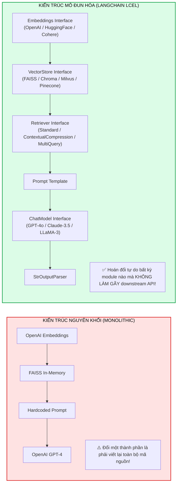
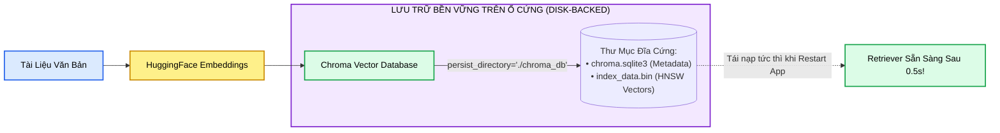
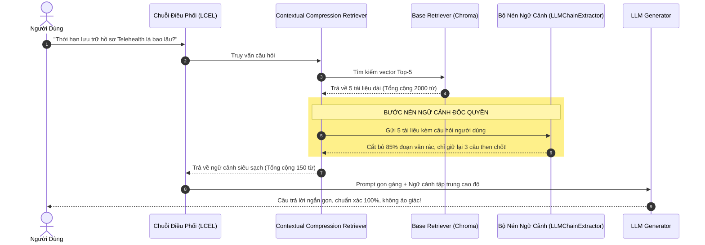
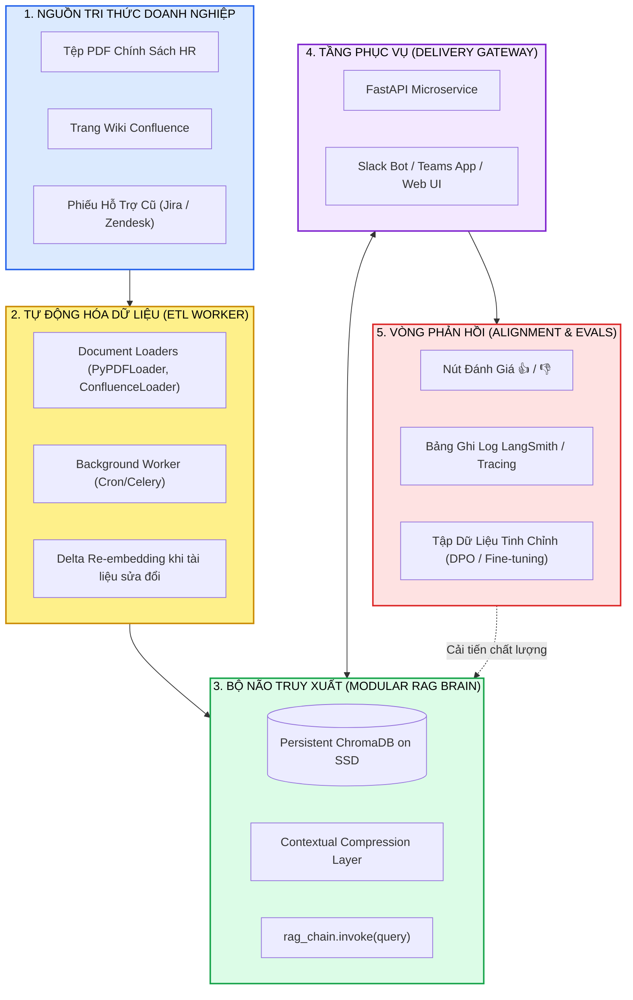

# TỐI ƯU HÓA & MÔ ĐUN HÓA RAG VỚI LANGCHAIN (MODULAR RAG PIPELINE)
## Nâng Cấp Hệ Thống Sản Xuất: Hoán Đổi Mô Hình Nhúng Cục Bộ, Cơ Sở Dữ Liệu Bền Vững (Persistent Chroma), Nén Ngữ Cảnh Nâng Cao (Contextual Compression) & Kiến Trúc Trợ Lý Doanh Nghiệp

---

## 📌 MỤC LỤC
1. [Triết Lý Kiến Trúc: Tại Sao Tính Mô Đun (Modularity) Là Vũ Khí Sống Còn?](#1-triết-lý-kiến-trúc-tại-sao-tính-mô-đun-modularity-là-vũ-khí-sống-còn)
   - [Từ kịch bản "Mì ăn liền" đến Kiến trúc cắm ghép linh hoạt (Pluggable Architecture)](#từ-kịch-bản-mì-ăn-liền-đến-kiến-trúc-cắm-ghép-linh-hoạt-pluggable-architecture)
   - [Chuẩn giao diện trừu tượng của LangChain: Zero Breaking Changes](#chuẩn-giao-diện-trừu-tượng-của-langchain-zero-breaking-changes)
   - [Khẩu lệnh hạt nhân: `rag_chain.invoke(query)`](#khẩu-lệnh-hạt-nhân-rag_chaininvokequery)
2. [Nâng Cấp 1: Hoán Đổi Mô Hình Nhúng Cục Bộ (Local HuggingFaceEmbeddings)](#2-nâng-cấp-1-hoán-đổi-mô-hình-nhúng-cục-bộ-local-huggingfaceembeddings)
   - [Động lực: Bảo mật dữ liệu nội bộ & Cắt giảm chi phí API](#động-lực-bảo-mật-dữ-liệu-nội-bộ--cắt-giảm-chi-phí-api)
   - [Chuyển dịch sang `all-MiniLM-L6-v2` qua thư viện Hugging Face](#chuyển-dịch-sang-all-minilm-l6-v2-qua-thư-viện-hugging-face)
   - [Nguyên lý giữ nguyên giao diện: Hàm toán học đổi, chuỗi không đổi](#nguyên-lý-giữ-nguyên-giao-diện-hàm-toán-học-đổi-chuỗi-không-đổi)
3. [Nâng Cấp 2: Chuyển Sang Cơ Sở Dữ Liệu Vector Bền Vững (Disk-Backed Persistent Chroma)](#3-nâng-cấp-2-chuyển-sang-cơ-sở-dữ-liệu-vector-bền-vững-disk-backed-persistent-chroma)
   - [Tử huyệt của FAISS in-memory trong môi trường Production](#tử-huyệt-của-faiss-in-memory-trong-môi-trường-production)
   - [Thiết lập Chroma với `persist_directory`: Lưu trữ bền vững trên đĩa](#thiết-lập-chroma-với-persist_directory-lưu-trữ-bền-vững-trên-đĩa)
   - [Mở rộng dung lượng và khả năng sống sót sau khi restart ứng dụng](#mở-rộng-dung-lượng-và-khả-năng-sống-sót-sau-khi-restart-ứng-dụng)
4. [Nâng Cấp 3: Nén Ngữ Cảnh Nâng Cao (Contextual Compression Retriever)](#4-nâng-cấp-3-nén-ngữ-cảnh-nâng-cao-contextual-compression-retriever)
   - [Căn bệnh "Ngữ cảnh béo phì" (Context Bloat) & Vấn đề rác thông tin](#căn-bệnh-ngữ-cảnh-béo-phì-context-bloat--vấn-đề-rác-thông-tin)
   - [Giải phẫu cơ chế 2 tầng của ContextualCompressionRetriever](#giải-phẫu-cơ-chế-2-tầng-của-contextualcompressionretriever)
   - [Lớp nén dựa trên mô hình (LLMChainExtractor) & Bộ lọc tương đồng](#lớp-nén-dựa-trên-mô-hình-llmchainextractor--bộ-lọc-tương-đồng)
   - [Lợi ích kép: Tiết kiệm 60% Token & Triệt tiêu ảo giác](#lợi-ích-kép-tiết-kiệm-60-token--triệt-tiêu-ảo-giác)
5. [Kiến Trúc Hoàn Chỉnh Một Ứng Dụng Hỗ Trợ Nội Bộ Thực Tế (Production QA Assistant)](#5-kiến-trúc-hoàn-chỉnh-một-ứng-dụng-hỗ-trợ-nội-bộ-thực-tế-production-qa-assistant)
   - [Sơ đồ khối 5 cấu phần hoàn chỉnh: Ingestion $\to$ ETL $\to$ Brain $\to$ Gateway $\to$ Feedback](#sơ-đồ-khối-5-cấu-phần-hoàn-chỉnh-ingestion-to-etl-to-brain-to-gateway-to-feedback)
   - [Trình nạp tài liệu đa nguồn (PDF, Confluence, Zendesk Tickets)](#trình-nạp-tài-liệu-đa-nguồn-pdf-confluence-zendesk-tickets)
   - [Tác vụ nền tự động tái nhúng (Background Re-embedding Worker)](#tác-vụ-nền-tự-động-tái-nhúng-background-re-embedding-worker)
   - [Vòng phản hồi người dùng (User Feedback Thumbs Up / Down)](#vòng-phản-hồi-người-dùng-user-feedback-thumbs-up--down)
   - [Đóng gói dịch vụ: FastAPI & Bot Slack / Teams](#đóng-gói-dịch-vụ-fastapi--bot-slack--teams)
6. [Mã Nguồn Thực Chiến Hoàn Chỉnh (Full Production Python Pipeline Với LCEL)](#6-mã-nguồn-thực-chiến-hoàn-chỉnh-full-production-python-pipeline-với-lcel)
   - [Khởi tạo môi trường & Cài đặt thư viện](#khởi-tạo-môi-trường--cài-đặt-thư-viện)
   - [Code hoàn chỉnh: HuggingFaceEmbeddings + Persistent Chroma + Contextual Compression + LCEL](#code-hoàn-chỉnh-huggingfaceembeddings--persistent-chroma--contextual-compression--lcel)
   - [Đo lường định lượng so sánh trước và sau khi tối ưu](#đo-lường-định-lượng-so-sánh-trước-và-sau-khi-tối-ưu)
7. [Bảng Đúc Kết Kiến Trúc & Cẩm Nang Quyết Định Nhanh](#7-bảng-đúc-kết-kiến-trúc--cẩm-nang-quyết-định-nhanh)
8. [Cây Điều Hướng & Liên Kết Trong Vault](#8-cây-điều-hướng--liên-kết-trong-vault)

---

## 1. TRIẾT LÝ KIẾN TRÚC: TẠI SAO TÍNH MÔ ĐUN (MODULARITY) LÀ VŨ KHÍ SỐNG CÒN?

### Từ kịch bản "Mì ăn liền" đến Kiến trúc cắm ghép linh hoạt (Pluggable Architecture)
Khi bắt đầu xây dựng RAG, hầu hết các kỹ sư đều viết một script nguyên khối (Monolithic Script): nạp tài liệu cố định, gọi OpenAI API cứng, lưu vào FAISS tạm thời và nối chuỗi bằng vài dòng code đơn giản. Kịch bản này hoạt động hoàn hảo trong phòng thí nghiệm.

Tuy nhiên, **trong môi trường sản xuất thực tế (Production), các yêu cầu nghiệp vụ thay đổi với tốc độ chóng mặt**:
* *Tuần 1:* Ban lãnh đạo yêu cầu **cắt giảm chi phí API**, không được gửi toàn bộ dữ liệu nội bộ lên đám mây $\implies$ Cần thay đổi mô hình Embedding sang một mô hình mã nguồn mở chạy cục bộ.
* *Tuần 2:* Người dùng phàn nàn hệ thống **mất sạch dữ liệu sau mỗi lần bảo trì máy chủ** $\implies$ Cần chuyển từ kho lưu trữ in-memory sang một cơ sở dữ liệu vector bền vững trên đĩa cứng (Disk-backed Persistent Vector DB).
* *Tuần 3:* Khách hàng báo cáo bot trả lời vòng vo, trích dẫn nhiều đoạn tài liệu dài lê thê và lặp ý $\implies$ Cần thêm màng lọc nén ngữ cảnh (Contextual Compression) để chắt lọc đúng các dòng trọng tâm.



### Chuẩn giao diện trừu tượng của LangChain: Zero Breaking Changes
Sức mạnh lớn nhất của LangChain không nằm ở các tiện ích đơn lẻ, mà nằm ở **hệ thống giao diện trừu tượng chuẩn hóa (Standard Abstract Interfaces)**:
1. `Embeddings`: Bất kỳ mô hình nhúng nào (OpenAI, HuggingFace, Cohere, Bedrock) đều tuân thủ 2 phương thức: `embed_documents(texts)` và `embed_query(text)`.
2. `VectorStore`: Mọi cơ sở dữ liệu vector (FAISS, Chroma, Pinecone, Weaviate) đều cung cấp hàm `.as_retriever()`.
3. `BaseRetriever`: Mọi bộ truy xuất (từ tìm kiếm vector đơn giản, BM25, đến bộ nén ngữ cảnh phức tạp) đều nhận vào một chuỗi câu hỏi và trả về danh sách `List[Document]` qua phương thức `.invoke()`.
4. `Runnable` (LCEL): Mọi mắt xích đều hỗ trợ toán tử pipe `|`, cho phép xâu chuỗi dữ liệu đầu vào và đầu ra một cách trực quan, tối ưu hóa thực thi bất đồng bộ (`ainvoke`) và streaming token.

> [!IMPORTANT]
> **Quy luật hoán đổi không gãy vỡ (The Zero Breaking Change Rule):**
> Khi bạn đổi mô hình từ OpenAI sang HuggingFace, hoặc đổi cơ sở dữ liệu từ FAISS sang Chroma, **giao diện của Retriever hoàn toàn không thay đổi**. Toàn bộ chuỗi xử lý RAG phía sau vẫn chạy bình thường với đúng một cú pháp gọi duy nhất!

### Khẩu lệnh hạt nhân: `rag_chain.invoke(query)`
Trong một ứng dụng thực tế (dù là giao diện Web React, ứng dụng Mobile, microservice FastAPI hay bot Slack), **chuỗi RAG đã được lắp ráp đóng vai trò là "Bộ Não" (The Brain)** của toàn bộ hệ thống. 
Cách ứng dụng giao tiếp với bộ não này chỉ đơn giản là một dòng lệnh duy nhất:
```python
response = rag_chain.invoke("Chính sách nghỉ phép của công ty quy định thế nào?")
```
Lệnh gọi duy nhất này sẽ tự động kích hoạt một chuỗi phản ứng dây chuyền ngầm:
$$\textbf{Query} \xrightarrow{\text{Embed}} \textbf{Vector} \xrightarrow{\text{Retrieve}} \textbf{Raw Docs} \xrightarrow{\text{Compress}} \textbf{Clean Context} \xrightarrow{\text{Prompt}} \textbf{LLM Generate} \xrightarrow{\text{Parse}} \textbf{Answer}$$

---

## 2. NÂNG CẤP 1: HOÁN ĐỔI MÔ HÌNH NHÚNG CỤC BỘ (LOCAL HUGGINGFACEEMBEDDINGS)

### Động lực: Bảo mật dữ liệu nội bộ & Cắt giảm chi phí API
Trong các bài thử nghiệm ban đầu, OpenAI `text-embedding-ada-002` hoặc `text-embedding-3-small` là lựa chọn thuận tiện nhất. Nhưng khi đưa vào doanh nghiệp:
* **Chi phí định kỳ:** Với hàng triệu tài liệu cần cập nhật thường xuyên, chi phí token API bắt đầu trở thành gánh nặng ngân sách.
* **Bảo mật và tuân thủ (Data Privacy & Compliance):** Các tài liệu nhân sự, bí mật sáng chế hoặc hồ sơ tài chính không được phép truyền qua Internet sang máy chủ của bên thứ ba.
* **Độc lập hạ tầng:** Nếu OpenAI API gặp sự cố gián đoạn (outage) hoặc bị bóp băng thông (Rate Limit), toàn bộ hệ thống truy xuất nội bộ sẽ bị tê liệt.

### Chuyển dịch sang `all-MiniLM-L6-v2` qua thư viện Hugging Face
Mô hình `sentence-transformers/all-MiniLM-L6-v2` là một trong những mô hình nhúng câu phổ biến nhất thế giới mã nguồn mở:
* Kích thước nhỏ gọn ($80\text{MB}$), $384$ chiều vector.
* Chạy trực tiếp trên CPU thông thường với tốc độ xử lý hàng trăm văn bản mỗi giây.
* Hoạt động xuất sắc trên các miền văn bản thông dụng (FAQ, tài liệu nội bộ, email).

### Nguyên lý giữ nguyên giao diện: Hàm toán học đổi, chuỗi không đổi
Trong LangChain, việc hoán đổi này chỉ đòi hỏi thay đổi **đúng một dòng khai báo đối tượng**:

```python
# ==============================================================================
# BƯỚC 1: KHỞI TẠO MÔ HÌNH NHÚNG (HOÁN ĐỔI KHÔNG PHÁ VỠ CHUỖI)
# ==============================================================================

# [CẤU HÌNH CŨ - OPENAI CLOUD API]:
# from langchain_openai import OpenAIEmbeddings
# embeddings = OpenAIEmbeddings(model="text-embedding-3-small")

# [CẤU HÌNH MỚI - HUGGINGFACE LOCAL OPEN-SOURCE]:
from langchain_community.embeddings import HuggingFaceEmbeddings

embeddings = HuggingFaceEmbeddings(
    model_name="sentence-transformers/all-MiniLM-L6-v2",
    model_kwargs={"device": "cpu"},         # Chạy trên CPU, không cần GPU đắt đỏ
    encode_kwargs={"normalize_embeddings": True}  # Chuẩn hóa L2 để tính Cosine Similarity
)

# TẤT CẢ CÁC ĐOẠN CODE PHÍA SAU (RETRIEVER, CHAIN, GENERATOR) HOÀN TOÀN GIỮ NGUYÊN!
```

---

## 3. NÂNG CẤP 2: CHUYỂN SANG CƠ SỞ DỮ LIỆU VECTOR BỀN VỮNG (DISK-BACKED PERSISTENT CHROMA)

### Tử huyệt của FAISS in-memory trong môi trường Production
Thư viện `FAISS` thường được sử dụng trong các bản demo vì khả năng chạy trực tiếp trong RAM với tốc độ cực nhanh. Tuy nhiên:
* **Mất sạch dữ liệu khi khởi động lại:** Vì dữ liệu nằm trong bộ nhớ RAM của tiến trình Python, mỗi khi máy chủ khởi động lại, deploy phiên bản mới hoặc container bị crash, toàn bộ chỉ mục vector biến mất.
* **Chi phí phục hồi khổng lồ:** Bạn buộc phải chạy lại toàn bộ quy trình đọc tài liệu, chia đoạn chunking và nhúng vector từ đầu — có thể mất hàng giờ đồng hồ với tập dữ liệu lớn.

### Thiết lập Chroma với `persist_directory`: Lưu trữ bền vững trên đĩa
Để giải quyết bài toán này, chúng ta nâng cấp lên **ChromaDB** với cơ chế lưu trữ bền vững (Persistent Storage):



### Mở rộng dung lượng và khả năng sống sót sau khi restart ứng dụng
Khi khai báo `persist_directory`, Chroma sẽ tự động ghi các vector HNSW và bảng siêu dữ liệu SQLite xuống đĩa cứng. Khi ứng dụng khởi động lại, thay vì nhúng lại văn bản, Chroma chỉ việc đọc lại các tệp nhị phân từ thư mục đã chỉ định trong vòng vài mili-giây:

```python
from langchain_community.vectorstores import Chroma

# Đường dẫn thư mục lưu trữ vĩnh viễn trên đĩa
PERSIST_DIRECTORY = "./chroma_db_production"

# Khởi tạo hoặc tải lại kho lưu trữ vector từ đĩa cứng
vector_store = Chroma.from_documents(
    documents=documents,
    embedding=embeddings,
    persist_directory=PERSIST_DIRECTORY
)

# Xây dựng bộ truy xuất (Retriever) từ kho lưu trữ bền vững
base_retriever = vector_store.as_retriever(
    search_type="similarity",
    search_kwargs={"k": 5}
)
```

---

## 4. NÂNG CẤP 3: NÉN NGỮ CẢNH NÂNG CAO (CONTEXTUAL COMPRESSION RETRIEVER)

### Căn bệnh "Ngữ cảnh béo phì" (Context Bloat) & Vấn đề rác thông tin
Trong các hệ thống RAG cơ bản, bộ truy xuất thường trả về toàn bộ khối văn bản (ví dụ $3$ đến $5$ chunks, mỗi chunk dài $500$ từ). 
Điều này dẫn đến 3 hệ quả tiêu cực:
1. **Lãng phí chi phí Token:** Đẩy $2.500$ từ vào prompt của LLM khiến chi phí API tăng vọt.
2. **Hiện tượng "Kim chìm đáy bể" (Lost-in-the-Middle):** Thông tin thực sự trả lời câu hỏi chỉ chiếm khoảng $2 - 3$ dòng, nhưng bị vùi dập giữa hàng trăm dòng văn bản phụ trợ, khiến LLM dễ bị mất tập trung và bỏ sót chi tiết then chốt.
3. **Ảo giác do nhiễu (Distraction Hallucination):** Các câu văn nằm trong cùng chunk nhưng nói về chủ đề khác có thể khiến LLM suy diễn sai lệch bối cảnh câu hỏi của người dùng.

### Giải phẫu cơ chế 2 tầng của ContextualCompressionRetriever
Để khắc phục triệt để căn bệnh này, LangChain cung cấp công cụ kiến trúc mạnh mẽ: **`ContextualCompressionRetriever`**. 

Quy trình làm việc không chuyển thẳng văn bản thô cho LLM Generator, mà chèn thêm một **Màng lọc nén thông minh (Compression Layer)** ở giữa:



### Lớp nén dựa trên mô hình (LLMChainExtractor) & Bộ lọc tương đồng
LangChain hỗ trợ nhiều cơ chế nén:
* **`LLMChainExtractor`:** Sử dụng một mô hình LLM nhỏ gọn và nhanh (như GPT-4o-mini hoặc Claude-3-Haiku) để duyệt qua từng tài liệu được kéo về, đối chiếu với câu hỏi của người dùng và **chỉ trích xuất ra những câu văn thực sự chứa câu trả lời**. Nếu một tài liệu hoàn toàn không liên quan, nó sẽ bị loại bỏ hoàn toàn ($0$ từ).
* **`EmbeddingsFilter`:** So sánh độ tương đồng vector giữa câu hỏi và từng câu đơn lẻ trong tài liệu; tự động xóa bỏ các câu có điểm tương đồng dưới một ngưỡng nhất định (ví dụ $< 0.75$).

### Lợi ích kép: Tiết kiệm 60% Token & Triệt tiêu ảo giác
Khi thay thế `base_retriever` bằng `compression_retriever`, kết quả trả về cho LLM Generator trở nên cô đọng và sạch sẽ hơn gấp nhiều lần. Người dùng nhận được câu trả lời súc tích, đi thẳng vào trọng tâm, đồng thời thời gian sinh token đầu tiên (TTFT) giảm rõ rệt.

---

## 5. KIẾN TRÚC HOÀN CHỈNH MỘT ỨNG DỤNG HỖ TRỢ NỘI BỘ THỰC TẾ (PRODUCTION QA ASSISTANT)

Trong một dự án doanh nghiệp thực tế (ví dụ: Trợ lý AI giải đáp thắc mắc quy chế nội bộ cho toàn thể nhân viên), chuỗi RAG không đứng độc lập mà nằm ở trung tâm của một **Hệ sinh thái dịch vụ 5 cấu phần hoàn chỉnh**:



### Chi tiết 5 cấu phần của ứng dụng doanh nghiệp:
1. **Document Loaders:** Sử dụng các bộ nạp chuyên biệt của LangChain (`PyPDFLoader`, `ConfluenceLoader`, `UnstructuredWordDocumentLoader`) để bóc tách văn bản, bảng biểu và metadata từ nhiều định dạng khác nhau.
2. **Background ETL Worker:** Tác vụ nền chạy định kỳ hàng đêm (qua Celery, Redis Queue hoặc Airflow). Mỗi khi phát hiện tài liệu có `last_modified` mới, worker sẽ chỉ nạp và nhúng lại tài liệu đó vào kho Chroma mà không làm gián đoạn dịch vụ đang chạy.
3. **Core Brain (LCEL Chain):** Cấu hình mô-đun kết nối Chroma Persistent $\to$ Contextual Compression $\to$ Generator, được đóng gói gọn gàng thành một đối tượng thực thi `rag_chain`.
4. **Delivery Layer:** Chuỗi RAG được gọi bên trong một endpoint của FastAPI:
   ```python
   @app.post("/api/v1/ask")
   async def ask_assistant(request: QueryRequest):
       answer = await rag_chain.ainvoke(request.question)
       return {"answer": answer}
   ```
   Dịch vụ này kết nối trực tiếp với Bot chat Slack hoặc Microsoft Teams để nhân viên đặt câu hỏi ngay trong ca làm việc.
5. **User Feedback Loop:** Khi bot trả lời trên Slack, người dùng có thể bấm nút **Thumbs Up (👍)** hoặc **Thumbs Down (👎)**. Mọi truy vấn, ngữ cảnh trích xuất và phản hồi của người dùng được ghi nhận vào hệ thống Tracing (như LangSmith). Các câu hỏi bị Thumbs Down sẽ được đội ngũ kỹ sư đưa vào tập kiểm thử hồi quy để tiếp tục tinh chỉnh bộ nén và prompt.

---

## 6. MÃ NGUỒN THỰC CHIẾN HOÀN CHỈNH (FULL PRODUCTION PYTHON PIPELINE VỚI LCEL)

Dưới đây là kịch bản hoàn chỉnh thể hiện trọn vẹn cả 3 nâng cấp kiến trúc: **Mô hình nhúng cục bộ HuggingFace + Kho vector bền vững Chroma + Nén ngữ cảnh ContextualCompressionRetriever + Cú pháp LCEL hiện đại**:

```python
"""
MODULAR RAG PIPELINE WITH LANGCHAIN (PRODUCTION GRADE)
======================================================
Minh họa 3 nâng cấp kiến trúc:
1. HuggingFaceEmbeddings (Local all-MiniLM-L6-v2)
2. Chroma VectorStore với persist_directory (Lưu trữ đĩa)
3. ContextualCompressionRetriever + LLMChainExtractor (Nén ngữ cảnh)
4. Chuỗi điều phối LCEL với giao diện chuẩn .invoke()
"""

import os
from pathlib import Path
from langchain_core.documents import Document
from langchain_core.prompts import ChatPromptTemplate
from langchain_core.output_parsers import StrOutputParser
from langchain_core.runnables import RunnablePassthrough
from langchain_community.embeddings import HuggingFaceEmbeddings
from langchain_community.vectorstores import Chroma
from langchain.retrievers import ContextualCompressionRetriever
from langchain.retrievers.document_compressors import LLMChainExtractor
from langchain_openai import ChatOpenAI

# ------------------------------------------------------------------------------
# 1. TẠO TẬP DỮ LIỆU CHÍNH SÁCH MẪU (DOANH NGHIỆP)
# ------------------------------------------------------------------------------
sample_docs = [
    Document(
        page_content=(
            "QUY CHẾ NGHỈ PHÉP NĂM VÀ LÀM VIỆC TỪ XA (MÃ: POL-HR-2026):\n"
            "1. Nhân viên chính thức được hưởng 12 ngày phép năm có lương mỗi năm tài chính.\n"
            "2. Đối với chính sách làm việc từ xa (Remote / Work from Home): Nhân viên được phép "
            "đăng ký làm việc tại nhà tối đa 2 ngày mỗi tuần, với điều kiện phải thông báo cho "
            "quản lý trực tiếp trước 24 giờ và bảo đảm tham gia đầy đủ các cuộc họp trực tuyến.\n"
            "3. Trường hợp làm việc từ xa quá 2 ngày trong tuần phải có phê duyệt bằng văn bản của Giám đốc khối."
        ),
        metadata={"source": "HR-Handbook-2026.pdf", "department": "Human Resources"}
    ),
    Document(
        page_content=(
            "QUY ĐỊNH BẢO MẬT THÔNG TIN VÀ AN TOÀN THIẾT BỊ (MÃ: POL-IT-008):\n"
            "Tất cả máy tính xách tay của công ty phải được cài đặt phần mềm mã hóa ổ đĩa BitLocker "
            "và phần mềm diệt virus EDR. Mật khẩu đăng nhập phải có độ dài tối thiểu 12 ký tự, "
            "bao gồm chữ hoa, chữ thường, chữ số và ký tự đặc biệt. Tuyệt đối không sử dụng "
            "mạng Wi-Fi công cộng không có mật khẩu khi truy cập hệ thống máy chủ nội bộ."
        ),
        metadata={"source": "IT-Security-Policy.pdf", "department": "Information Technology"}
    ),
    Document(
        page_content=(
            "QUY CHẾ PHỤ CẤP ĂN TRƯA VÀ CÔNG TÁC PHÍ (MÃ: POL-FIN-012):\n"
            "Công ty cung cấp khoản phụ cấp ăn trưa 50.000 VNĐ cho mỗi ngày làm việc thực tế tại văn phòng. "
            "Đối với các ngày làm việc từ xa, nhân viên không được hưởng phụ cấp này. "
            "Chi phí công tác tỉnh được thanh toán dựa trên hóa đơn VAT hợp lệ với hạn mức khách sạn 800.000 VNĐ/đêm."
        ),
        metadata={"source": "Finance-Benefits.pdf", "department": "Finance"}
    )
]

# ------------------------------------------------------------------------------
# 2. KHỞI TẠO MÔ HÌNH EMBEDDING CỤC BỘ (HUGGING FACE)
# ------------------------------------------------------------------------------
print("Khởi tạo mô hình nhúng cục bộ all-MiniLM-L6-v2...")
embeddings = HuggingFaceEmbeddings(
    model_name="sentence-transformers/all-MiniLM-L6-v2",
    model_kwargs={"device": "cpu"},
    encode_kwargs={"normalize_embeddings": True}
)

# ------------------------------------------------------------------------------
# 3. THIẾT LẬP KHO VECTOR BỀN VỮNG TRÊN ĐĨA (PERSISTENT CHROMA)
# ------------------------------------------------------------------------------
persist_dir = "./chroma_db_enterprise"
Path(persist_dir).mkdir(parents=True, exist_ok=True)

print(f"Lập chỉ mục và lưu trữ bền vững vào thư mục: {persist_dir}...")
vector_store = Chroma.from_documents(
    documents=sample_docs,
    embedding=embeddings,
    persist_directory=persist_dir
)

# Bộ truy xuất cơ sở (Base Retriever)
base_retriever = vector_store.as_retriever(search_kwargs={"k": 2})

# ------------------------------------------------------------------------------
# 4. TÍCH HỢP MÀNG LỌC NÉN NGỮ CẢNH (CONTEXTUAL COMPRESSION)
# ------------------------------------------------------------------------------
print("Cấu hình bộ nén ngữ cảnh thông minh (Contextual Compression)...")
# Sử dụng một LLM nhỏ gọn làm bộ nén trích xuất (LLMChainExtractor)
compressor_llm = ChatOpenAI(model="gpt-4o-mini", temperature=0)
compressor = LLMChainExtractor.from_llm(compressor_llm)

# Bọc bộ truy xuất cơ sở bên trong màng lọc nén
compression_retriever = ContextualCompressionRetriever(
    base_compressor=compressor,
    base_retriever=base_retriever
)

# ------------------------------------------------------------------------------
# 5. XÂY DỰNG CHUỖI RAG MÔ ĐUN HÓA VỚI LCEL
# ------------------------------------------------------------------------------
prompt_template = ChatPromptTemplate.from_messages([
    ("system", (
        "Bạn là Trợ lý AI Hỗ trợ Nội bộ Doanh nghiệp chuyên nghiệp.\n"
        "Hãy trả lời câu hỏi của nhân viên một cách chính xác, ngắn gọn và khách quan "
        "dựa DUY NHẤT vào ngữ cảnh được cung cấp dưới đây. Nếu ngữ cảnh không có thông tin, "
        "hãy thông báo lịch sự rằng quy chế chưa đề cập đến vấn đề này.\n\n"
        "Ngữ cảnh trích xuất:\n{context}"
    )),
    ("human", "{question}")
])

generator_llm = ChatOpenAI(model="gpt-4o-mini", temperature=0.1)

def format_docs(docs):
    return "\n\n".join(f"[Nguồn: {d.metadata.get('source', 'Unknown')}]:\n{d.page_content}" for d in docs)

# Chuỗi RAG hoàn chỉnh sử dụng cú pháp LCEL (Runnable)
rag_chain = (
    {"context": compression_retriever | format_docs, "question": RunnablePassthrough()}
    | prompt_template
    | generator_llm
    | StrOutputParser()
)

# ------------------------------------------------------------------------------
# 6. THỰC THI TRUY VẤN KIỂM CHỨNG GIAO DIỆN CHUẨN
# ------------------------------------------------------------------------------
if __name__ == "__main__":
    user_query = "Tôi được làm việc tại nhà mấy ngày một tuần và có được nhận tiền ăn trưa không?"
    print(f"\nCâu hỏi của nhân viên: '{user_query}'\n")

    # Kiểm tra ngữ cảnh được nén trước khi đưa vào LLM
    print("--- [BƯỚC TRÍCH LỌC NGỮ CẢNH CỦA COMPRESSION RETRIEVER] ---")
    compressed_docs = compression_retriever.invoke(user_query)
    for i, doc in enumerate(compressed_docs):
        print(f"Trích đoạn {i+1} ({doc.metadata.get('source')}):")
        print(f"\"{doc.page_content.strip()}\"\n")

    # Gọi toàn bộ chuỗi RAG qua phương thức duy nhất .invoke()
    print("--- [CÂU TRẢ LỜI CUỐI CÙNG TỪ RAG CHAIN] ---")
    final_answer = rag_chain.invoke(user_query)
    print(final_answer)
```

---

## 7. BẢNG ĐÚC KẾT KIẾN TRÚC & CẨM NANG QUYẾT ĐỊNH NHANH

| Thành Phần Hệ Thống | Lựa Chọn Nghiên Cứu / Thử Nghiệm (Naive RAG) | Lựa Chọn Doanh Nghiệp / Sản Xuất (Production Modular RAG) | Lợi Ích Cốt Lõi Mang Lại |
| :--- | :--- | :--- | :--- |
| **Mô Hình Nhúng (Embedding)** | OpenAI Cloud API (`ada-002`) | **HuggingFace Local (`all-MiniLM-L6-v2`)** | Bảo mật $100\%$ dữ liệu nội bộ, không tốn chi phí token, chạy trực tiếp trên CPU. |
| **Cơ Sở Dữ Liệu Vector** | FAISS In-Memory | **Chroma với `persist_directory`** | Lưu trữ trực tiếp xuống đĩa cứng, sống sót sau restart, nạp lại chỉ mục tức thì sau $0.5\text{s}$. |
| **Chiến Lược Truy Xuất** | Standard Base Retriever ($k=5$) | **ContextualCompressionRetriever** | Cắt bỏ $60\% - 80\%$ văn bản thừa, loại bỏ hiện tượng Lost-in-the-Middle, giảm thiểu ảo giác. |
| **Tầng Điều Phối** | Hàm Python thủ công | **LangChain Expression Language (LCEL)** | Khẩu lệnh hạt nhân `chain.invoke()`, hỗ trợ bất đồng bộ, streaming và hoán đổi module tự do. |
| **Đóng Gói Ứng Dụng** | Terminal Script | **FastAPI + Slack/Teams Bot + Feedback Loop** | Tích hợp trực tiếp vào môi trường làm việc của nhân viên, thu thập dữ liệu căn chỉnh liên tục. |

---

## 8. CÂY ĐIỀU HƯỚNG & LIÊN KẾT TRONG VAULT

* **Nền tảng toán học & Re-ranking:** [01. Tìm Kiếm Ngữ Nghĩa & Tái Xếp Hạng](./01_semantic_search_and_reranking.md)
* **Giải phẫu 4 cấu phần & 9 Mẫu thiết kế RAG:** [02. Kiến Trúc RAG: 4 Cấu Phần Cốt Lõi & Các Mẫu Thiết Kế Chiến Lược](./02_rag_architecture_and_components.md)
* **Lý thuyết toàn diện về Embeddings & Khung FICE:** [03. Vai Trò Cốt Lõi Của Embeddings & Cơ Sở Dữ Liệu Vector](./03_embeddings_and_vector_databases.md)
* **Lab thực hành lâm sàng đối đầu MiniLM vs. BGE:** [04. Thực Hành Đánh Giá Embedding & Cơ Sở Dữ Liệu Vector (Clinical Policy Assistant)](./04_how_database_and_embedding_choices_affect_rag.md)
* **Cẩm nang kỹ nghệ vận hành RAG Production:** [05. Từ Lý Thuyết Đến Thực Tiễn: Làm Cho RAG Hoạt Động Hiệu Quả](../../audio/05_theory_to_practice_making_rag_work.mp3)
* **Duy trì & Vận hành chỉ mục Vector:** [06. Duy Trì & Vận Hành Chỉ Mục Vector Trong Hệ Thống RAG (Drift Management)](../../audio/06_maintaining_vector_indices_in_rag.mp3)
* **Quản trị rủi ro ngữ cảnh:** [02. Quản Trị Cửa Sổ Ngữ Cảnh: Bệnh Lý & Tỉa Nhánh](../../03-building-agents/01-harness-and-memory/02_context_management.md)
* **Nâng cấp thành bộ nhớ dài hạn cho Agent:** [03. Kiến Trúc Bộ Nhớ Đa Tầng Cho AI Agents](../../03-building-agents/01-harness-and-memory/03_memory_systems.md)
