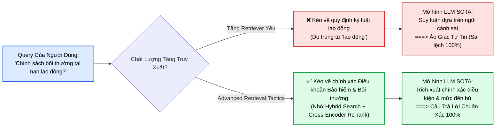
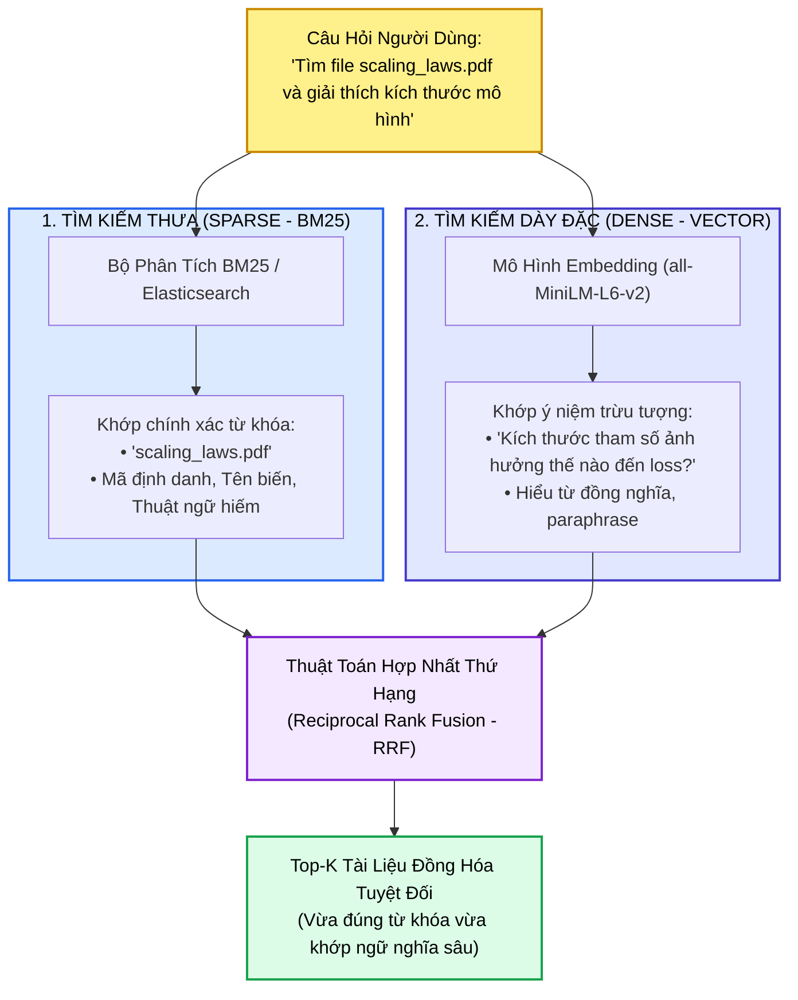
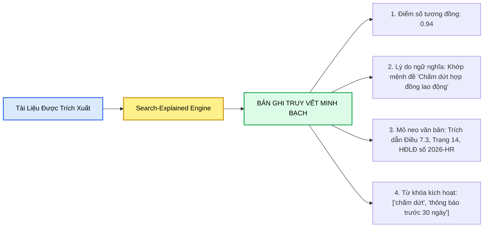
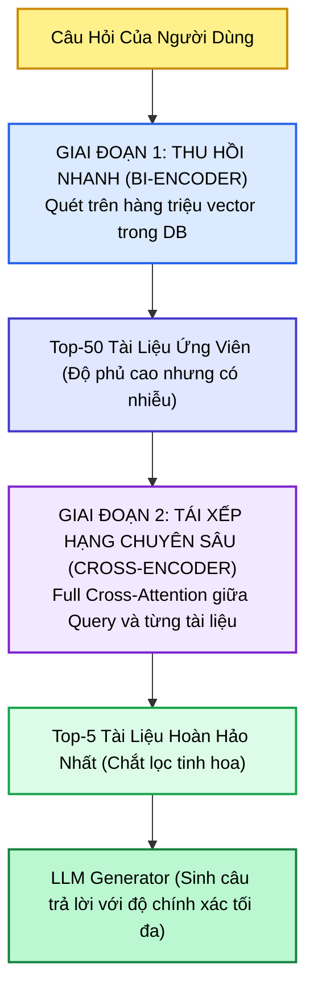
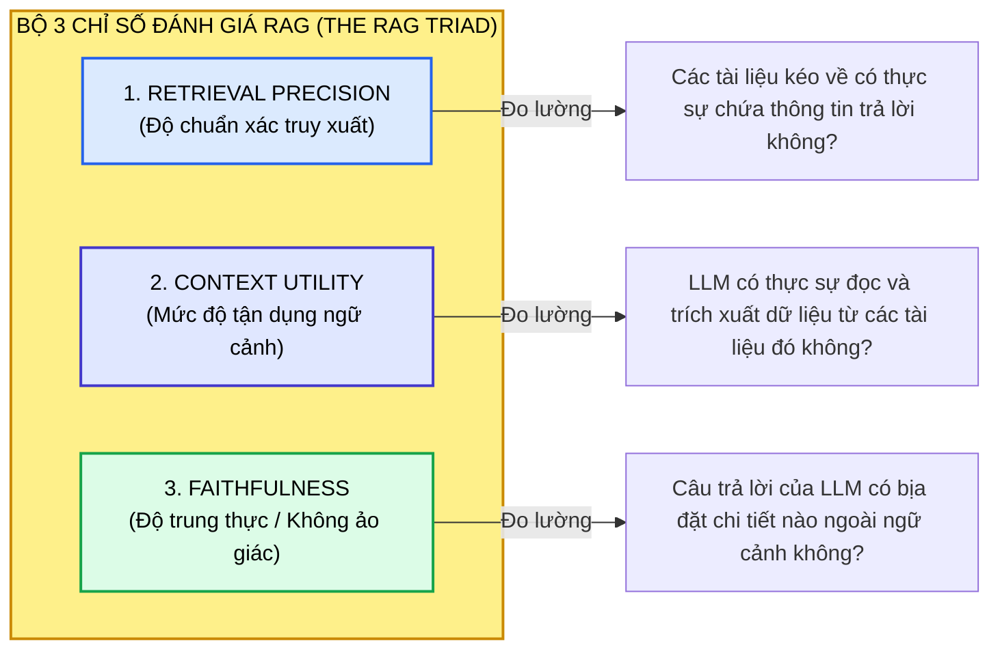
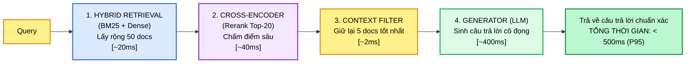

# CHIẾN THUẬT TRUY XUẤT NÂNG CAO TRONG HỆ THỐNG RAG (ADVANCED RETRIEVAL TACTICS)
## Nâng Cao Độ Chính Xác & Khả Năng Thu Hồi: Tìm Kiếm Lai Ghép (Hybrid Search), Truy Xuất Có Giải Thích (Search-Explained), Tái Xếp Hạng Chuyên Sâu (Cross-Encoder), Mở Rộng Truy Vấn (Query Expansion) & Khung Đánh Giá Đa Chiều

---

## 📌 MỤC LỤC
1. [Chân Lý Kiến Trúc: Tầng Truy Xuất Quyết Định Trí Tuệ Của LLM](#1-chân-lý-kiến-trúc-tầng-truy-xuất-quyết-định-trí-tuệ-của-llm)
   - [Nghịch lý "Mô hình siêu việt - Đầu vào rác rưởi" (Garbage In, Confident Garbage Out)](#nghịch-lý-mô-hình-siêu-việt---đầu-vào-rác-rưởi-garbage-in-confident-garbage-out)
   - [Đo đạc tác động: Nâng tỷ lệ trả lời đúng từ 60% lên 90% chỉ nhờ tầng Retriever](#đo-đạc-tác-động-nâng-tỷ-lệ-trả-lời-đúng-từ-60-lên-90-chỉ-nhờ-tầng-retriever)
2. [Chiến Thuật 1: Truy Xuất Lai Ghép (Hybrid Retrieval) — "Lưới An Toàn" Tuyệt Đối](#2-chiến-thuật-1-truy-xuất-lai-ghép-hybrid-retrieval--lưới-an-toàn-tuyệt-đối)
   - [Bản chất đối lập: Tìm kiếm thưa (Sparse / BM25) vs. Tìm kiếm dày đặc (Dense / Vector)](#bản-chất-đối-lập-tìm-kiếm-thưa-sparse--bm25-vs-tìm-kiếm-dày-đặc-dense--vector)
   - [Nghịch lý từ khóa trong tài liệu kỹ thuật: "scaling_laws.pdf" vs. "kích thước mô hình ảnh hưởng hiệu năng"](#nghịch-lý-từ-khóa-trong-tài-liệu-kỹ-thuật-scaling_lawspdf-vs-kích-thước-mô-hình-ảnh-hưởng-hiệu-năng)
   - [Toán học hợp nhất điểm số: Reciprocal Rank Fusion (RRF) & Convex Combination $\alpha$](#toán-học-hợp-nhất-điểm-số-reciprocal-rank-fusion-rrf--convex-combination-alpha)
   - [Mã nguồn LlamaIndex: Tích hợp `HybridRetriever(BM25 + VectorIndex)`](#mã-nguồn-llamaindex-tích-hợp-hybridretrieverbm25--vectorindex)
3. [Chiến Thuật 2: Truy Xuất Có Giải Thích (Search-Explained Retrieval) — Minh Bạch Hóa Hộp Đen](#3-chiến-thuật-2-truy-xuất-có-giải-thích-search-explained-retrieval--minh-bạch-hóa-hộp-đen)
   - [Tại sao các ngành kiểm soát nghiêm ngặt (Y tế, Pháp lý, Tài chính) cần lý giải?](#tại-sao-các-ngành-kiểm-soát-nghiêm-ngặt-y-tế-pháp-lý-tài-chính-cần-lý-giải)
   - [Cấu trúc bản ghi giải thích: Score, Reason, Keyword Density & Semantic Distance](#cấu-trúc-bản-ghi-giải-thích-score-reason-keyword-density--semantic-distance)
   - [Ví dụ thực tế: Truy vết điều khoản hợp đồng lao động](#ví-dụ-thực-tế-truy-vết-điều-khoản-hợp-đồng-lao-động)
4. [Chiến Thuật 3: Tái Xếp Hạng Bằng Bộ Mã Hóa Chéo (Cross-Encoder Re-ranking)](#4-chiến-thuật-3-tái-xếp-hạng-bằng-bộ-mã-hóa-chéo-cross-encoder-re-ranking)
   - [Giới hạn cố hữu của Bi-Encoder: Không có tương tác từ chéo (No Cross-Attention)](#giới-hạn-cố-hữu-của-bi-encoder-không-có-tương-tác-từ-chéo-no-cross-attention)
   - [Sức mạnh của Cross-Encoder: Đọc đồng thời Query và Candidate Document](#sức-mạnh-của-cross-encoder-đọc-đồng-thời-query-và-candidate-document)
   - [Quy trình phễu 2 giai đoạn (Two-Stage Funnel): Lấy 50 ứng viên $\to$ Tái xếp hạng Top-20 $\to$ Chắt lọc Top-5](#quy-trình-phễu-2-giai-đoạn-two-stage-funnel-lấy-50-ứng-viên-to-tái-xếp-hạng-top-20-to-chắt-lọc-top-5)
   - [Mã nguồn thực thi với `sentence-transformers.CrossEncoder`](#mã-nguồn-thực-thi-với-sentence-transformerscrossencoder)
5. [Chiến Thuật 4: Mở Rộng Truy Vấn (Query Expansion) — Thu Hẹp Khoảng Cách Từ Vựng](#5-chiến-thuật-4-mở-rộng-truy-vấn-query-expansion--thu-hẹp-khoảng-cách-từ-vựng)
   - [Khoảng cách từ vựng (Vocabulary Mismatch) giữa người dùng và tài liệu chuyên ngành](#khoảng-cách-từ-vựng-vocabulary-mismatch-giữa-người-dùng-và-tài-liệu-chuyên-ngành)
   - [Cơ chế sinh biến thể: Paraphrasing (T5), Từ đồng nghĩa và Phân rã câu hỏi con](#cơ-chế-sinh-biến-thể-paraphrasing-t5-từ-đồng-nghĩa-và-phân-rã-câu-hỏi-con)
   - [Ví dụ y sinh: "Cơn đau tim" $\to$ "Nhồi máu cơ tim" $\to$ "Biến cố tim mạch"](#ví-dụ-y-sinh-cơn-đau-tim-to-nhồi-máu-cơ-tim-to-biến-cố-tim-mạch)
6. [Đánh Giá Hiệu Quả RAG (RAG Evaluation): Đo Lường Phi Cấu Trúc & Thực Tế](#6-đánh-giá-hiệu-quả-rag-rag-evaluation-đo-lường-phi-cấu-trúc--thực-tế)
   - [Ảo tưởng "Độ chính xác là một con số duy nhất"](#ảo-tưởng-độ-chính-xác-là-một-con-số-duy-nhất)
   - [Bộ 3 chỉ số then chốt: Retrieval Precision vs. Context Utility vs. Faithfulness](#bộ-3-chỉ-số-then-chốt-retrieval-precision-vs-context-utility-vs-faithfulness)
   - [Hiện tượng "LLM gánh Retriever yếu" và phương pháp chẩn đoán](#hiện-tượng-llm-gánh-retriever-yếu-và-phương-pháp-chẩn-đoán)
   - [Hệ sinh thái công cụ: Ragas, TruLens, LangSmith](#hệ-sinh-thái-công-cụ-ragas-trulens-langsmith)
7. [Tối Ưu Hóa Hiệu Năng: Cân Bằng Độ Chính Xác vs. Độ Trễ (Latency vs. Accuracy)](#7-tối-ưu-hóa-hiệu-năng-cân-bằng-độ-chính-xác-vs-độ-trễ-latency-vs-accuracy)
   - [Kiến trúc Pipeline sản xuất 4 bước (Dưới 1 giây)](#kiến-trúc-pipeline-sản-xuất-4-bước-dưới-1-giây)
   - [Chiến lược bộ nhớ đệm (Caching Embeddings & Query Expansion)](#chiến-lược-bộ-nhớ-đệm-caching-embeddings--query-expansion)
   - [Triết lý cốt lõi: Tối ưu hóa sự tin cậy (Trust > Pure Speed)](#triết-lý-cốt-lõi-tối-ưu-hóa-sự-tin-cậy-trust--pure-speed)
8. [Ma Trận Ánh Xạ Chiến Thuật Theo Từng Trường Hợp Sử Dụng (Use-Case Mapping)](#8-ma-trận-ánh-xạ-chiến-thuật-theo-từng-trường-hợp-sử-dụng-use-case-mapping)
   - [Bot hỗ trợ khách hàng / Pháp lý / Tài chính](#bot-hỗ-trợ-khách-hàng--pháp-lý--tài-chính)
   - [Trợ lý nghiên cứu khoa học / Khám phá tri thức](#trợ-lý-nghiên-cứu-khoa-học--khám-phá-tri-thức)
   - [Người tóm tắt / Báo cáo phân tích](#người-tóm-tắt--báo-cáo-phân-tích)
   - [Trình duyệt tài liệu / Tìm kiếm tự do](#trình-duyệt-tài-liệu--tìm-kiếm-tự-do)
   - [Công cụ ra quyết định quan trọng (Y tế / Hàng không)](#công-cụ-ra-quyết-định-quan-trọng-y-tế--hàng-không)
9. [Giải Mã Bài Tập Thực Nghiệm: Cải Thiện Khả Năng Nhớ Lại Của Trợ Lý Nghiên Cứu](#9-giải-mã-bài-tập-thực-nghiệm-cải-thiện-khả-năng-nhớ-lại-của-trợ-lý-nghiên-cứu)
   - [Kịch bản: Bỏ sót nghiên cứu khi hỏi "kháng thuốc" thay vì "kháng kháng sinh"](#kịch-bản-bỏ-sót-nghiên-cứu-khi-hỏi-kháng-thuốc-thay-vì-kháng-kháng-sinh)
   - [Phân tích 4 lựa chọn: Tại sao Mở rộng truy vấn là lời giải chuẩn xác?](#phân-tích-4-lựa-chọn-tại-sao-mở-rộng-truy-vấn-là-lời-giải-chuẩn-xác)
10. [Mã Nguồn Thực Chiến Hoàn Chỉnh: Full Hybrid + Re-ranking Pipeline](#10-mã-nguồn-thực-chiến-hoàn-chỉnh-full-hybrid--re-ranking-pipeline)
11. [Cây Điều Hướng & Liên Kết Trong Vault](#11-cây-điều-hướng--liên-kết-trong-vault)

---

## 1. CHÂN LÝ KIẾN TRÚC: TẦNG TRUY XUẤT QUYẾT ĐỊNH TRÍ TUỆ CỦA LLM

### Nghịch lý "Mô hình siêu việt - Đầu vào rác rưởi" (Garbage In, Confident Garbage Out)
Một trong những hiểu lầm lớn nhất của các kỹ sư mới bước vào lĩnh vực AI là: *"Nếu hệ thống trả lời sai, hãy nâng cấp lên mô hình LLM lớn hơn và thông minh hơn"*. 

Thực tế kiểm chứng chứng minh điều ngược lại: **Hệ thống truy xuất (Retriever) quyết định mức độ hiểu biết ngữ cảnh của LLM, chứ không phải bản thân mô hình sinh**. 
* LLM là một cỗ máy suy luận logic dựa trên ngữ cảnh được cung cấp (In-context Reasoning Engine).
* Nếu tầng Retriever trích xuất các đoạn văn bản sai lệch, nghèo nàn hoặc đứt gãy, thì ngay cả những mô hình mạnh nhất thế giới (GPT-4o, Claude 3.5 Sonnet) cũng sẽ đưa ra kết luận hoàn toàn sai lầm với một giọng điệu tự tin tuyệt đối.



### Đo đạc tác động: Nâng tỷ lệ trả lời đúng từ 60% lên 90% chỉ nhờ tầng Retriever
Trong các hệ thống thực tế (như trợ lý hỗ trợ khách hàng, bot tra cứu văn bản pháp lý), việc giữ nguyên mô hình sinh LLM và **chỉ tập trung tối ưu hóa các chiến thuật truy xuất nâng cao** có thể tạo ra bước nhảy vọt:
* Tỷ lệ trả lời chính xác tăng từ $60\%$ lên $90\%$.
* Chi phí token giảm $50\%$ do không nạp tài liệu thừa.
* Độ tin cậy của người dùng tăng vọt nhờ trích dẫn nguồn có thể kiểm chứng được.

---

## 2. CHIẾN THUẬT 1: TRUY XUẤT LAI GHÉP (HYBRID RETRIEVAL) — "LƯỚI AN TOÀN" TUYỆT ĐỐI

Tìm kiếm lai ghép (Hybrid Retrieval) là phương pháp **"Cả Hai" (Best of Both Worlds)**: Kết hợp sức mạnh của tìm kiếm thưa (Sparse Keyword Search) và tìm kiếm dày đặc (Dense Semantic Search).



### Bản chất đối lập: Tìm kiếm thưa (Sparse / BM25) vs. Tìm kiếm dày đặc (Dense / Vector)
* **Tìm kiếm thưa (Sparse Retrieval - BM25 / TF-IDF):**
  * *Hình tượng:* Giống như một **thủ thư thủ cựu**, ghi nhớ chính xác từng ký tự trong mục lục sách.
  * *Điểm mạnh:* Khớp chính xác $100\%$ các thuật ngữ đặc thù, tên mã sản phẩm (`POL-MED-001`, `iPhone 15 Pro`), số seri, tên tệp tin (`scaling_laws.pdf`), hoặc tên người.
  * *Điểm yếu:* Hoàn toàn mù quáng trước ngữ nghĩa. Nếu người dùng dùng từ đồng nghĩa, BM25 trả về kết quả rỗng.
* **Tìm kiếm dày đặc (Dense Retrieval - Vector Embeddings):**
  * *Hình tượng:* Giống như một **chuyên gia ngôn ngữ sâu sắc**, thấu hiểu ý định cốt lõi của câu hỏi.
  * *Điểm mạnh:* Nắm bắt sự tương đồng ngữ nghĩa dù cách diễn đạt hoàn toàn khác nhau.
  * *Điểm yếu:* Dễ bị nhầm lẫn khi gặp các từ khóa mang tính kỹ thuật cao, từ viết tắt hiếm, hoặc chuỗi số hiệu cụ thể.

### Nghịch lý từ khóa trong tài liệu kỹ thuật
Trong tài liệu kỹ thuật, cùng một câu hỏi có thể được diễn đạt theo hai thái cực:
1. Người dùng A gõ: *"Các định luật tỷ lệ biến áp"* (Ngắn gọn, chứa từ khóa).
2. Người dùng B gõ: *"Kích thước của mô hình ảnh hưởng đến hiệu năng tính toán như thế nào?"* (Tự nhiên, giàu tính ngữ nghĩa).
3. Người dùng C gõ: *"Mở tệp scaling_laws.pdf"*.

Nếu chỉ dùng Dense Search, hệ thống sẽ trả lời tốt người dùng B nhưng có thể bỏ qua người dùng C. Nếu chỉ dùng BM25, hệ thống sẽ trả lời được C nhưng thất bại với B. **Truy xuất lai ghép chính là chiếc lưới an toàn bảo đảm cả hai trường phái câu hỏi đều tìm về đúng một nguồn tri thức duy nhất**.

### Toán học hợp nhất điểm số: Reciprocal Rank Fusion (RRF) & Convex Combination
Có hai phương pháp toán học kinh điển để hợp nhất kết quả từ Sparse và Dense:

#### 1. Reciprocal Rank Fusion (RRF - Khuyên dùng)
Không phụ thuộc vào thang điểm số khác biệt giữa BM25 (điểm không giới hạn) và Cosine Similarity ($[0, 1]$), RRF chỉ tính toán dựa trên **thứ hạng (rank)** của tài liệu trong từng danh sách:
$$
\text{RRF\_Score}(d) = \sum_{m \in \{\text{Sparse}, \text{Dense}\}} \frac{1}{k + r_m(d)}
$$
* $r_m(d)$ là thứ hạng của tài liệu $d$ trong hệ thống $m$ (vị trí 1, 2, 3...).
* $k$ là hằng số làm mượt (thường đặt $k = 60$).
* *Ý nghĩa:* Tài liệu nào xuất hiện ở vị trí cao trong cả hai danh sách sẽ có điểm RRF vượt trội.

#### 2. Convex Combination (Tổ hợp lồi theo trọng số $\alpha$)
Chuẩn hóa điểm số của BM25 và Dense về đoạn $[0, 1]$, sau đó tính tổng có trọng số:
$$
\text{Final\_Score}(d) = \alpha \cdot \text{Dense\_Score}(d) + (1 - \alpha) \cdot \text{Sparse\_Score}(d)
$$
* $\alpha \in [0, 1]$: Trong các tác vụ hỏi đáp kỹ thuật, $\alpha = 0.5 - 0.7$ là vùng cân bằng lý tưởng.

### Mã nguồn LlamaIndex: Tích hợp `HybridRetriever`
```python
from llama_index.core import VectorStoreIndex, SimpleDirectoryReader
from llama_index.retrievers.bm25 import BM25Retriever
from llama_index.core.retrievers import VectorIndexRetriever
from llama_index.core.retrievers import QueryFusionRetriever

# 1. Khởi tạo Retriever dày đặc (Dense) và thưa thớt (Sparse)
vector_retriever = VectorIndexRetriever(index=vector_index, similarity_top_k=20)
bm25_retriever = BM25Retriever.from_defaults(docstore=index.docstore, similarity_top_k=20)

# 2. Hợp nhất hai tầng truy xuất qua QueryFusionRetriever (RRF)
hybrid_retriever = QueryFusionRetriever(
    retrievers=[vector_retriever, bm25_retriever],
    similarity_top_k=10,
    num_queries=1,           # Sử dụng 1 câu hỏi gốc
    mode="reciprocal_rerank" # Thuật toán RRF chuẩn mực
)

# 3. Thực thi truy vấn lai
matched_nodes = hybrid_retriever.retrieve("scaling_laws.pdf model size performance")
```

---

## 3. CHIẾN THUẬT 2: TRUY XUẤT CÓ GIẢI THÍCH (SEARCH-EXPLAINED RETRIEVAL) — MINH BẠCH HÓA HỘP ĐEN

Trong các hệ sinh thái tiêu dùng thông thường, người dùng chỉ quan tâm đến câu trả lời cuối cùng. Nhưng **trong các lĩnh vực nhạy cảm được quản lý nghiêm ngặt (Y tế, Tòa án, Kiểm toán tài chính, Hàng không), mô hình RAG kiểu "hộp đen" là hoàn toàn không thể chấp nhận được**.

### Tại sao các ngành kiểm soát nghiêm ngặt cần lý giải?
* **Kiểm toán và giải trình (Auditability):** Bác sĩ hoặc luật sư phải chịu trách nhiệm pháp lý cho các quyết định của mình. Họ không thể ra quyết định chỉ vì "AI bảo thế".
* **Gỡ lỗi kỹ thuật (Debugging):** Giúp các kỹ sư RAG biết chính xác tại sao một tài liệu lại được kéo về (do trùng từ khóa cụ thể hay do khoảng cách vector gần).



### Cấu trúc bản ghi giải thích: Score, Reason, Keyword Density
Thay vì chỉ trả về văn bản trần trụi, mỗi tài liệu được bọc trong một cấu trúc dữ liệu minh bạch:
```python
# Cấu trúc bản ghi giải thích trích xuất
class ExplainedDocument:
    def __init__(self, doc_id, text, score, match_type, matched_terms, reason):
        self.doc_id = doc_id
        self.text = text
        self.score = score                  # Ví dụ: 0.89
        self.match_type = match_type        # 'hybrid_dense_sparse'
        self.matched_terms = matched_terms  # ['telehealth', 'retention', 'pediatric']
        self.reason = reason                # Lý do chọn lọc rõ ràng

# Minh họa vòng lặp hiển thị minh bạch cho chuyên gia thẩm định:
for doc in search_engine.retrieve_with_explanations(query):
    print(f"[{doc.score:.2f} | {doc.match_type}] Lý do: {doc.reason}")
    print(f"-> Mỏ neo văn bản: {doc.text[:120]}...\n")
```

---

## 4. CHIẾN THUẬT 3: TÁI XẾP HẠNG BẰNG BỘ MÃ HÓA CHÉO (CROSS-ENCODER RE-RANKING)

### Giới hạn cố hữu của Bi-Encoder: Không có tương tác từ chéo (No Cross-Attention)
Các mô hình nhúng thông thường (như OpenAI, SBERT, BGE) hoạt động theo kiến trúc **Bi-Encoder (Mô hình 2 tháp)**:
* Câu hỏi (Query) được mã hóa độc lập thành vector $u$.
* Đoạn văn (Document) được mã hóa độc lập thành vector $v$.
* Độ tương đồng được tính bằng tích vô hướng $\cos(u, v)$.
* *Hạn chế:* Các từ trong câu hỏi **hoàn toàn không được "nhìn thấy"** và không tương tác trực tiếp với các từ trong văn bản qua cơ chế Self-Attention của Transformer. Do đó, Bi-Encoder dễ bị đánh lừa bởi sự trùng lặp từ vựng bề mặt.

### Sức mạnh của Cross-Encoder: Đọc đồng thời Query và Candidate Document
Mô hình **Cross-Encoder** nhận đồng thời cả câu hỏi và tài liệu vào chung một chuỗi token duy nhất:
$$
\text{Input} = \text{[CLS]} \circ \text{Query} \circ \text{[SEP]} \circ \text{Document} \circ \text{[SEP]}
$$
* Toàn bộ các tầng Attention của Transformer được kích hoạt chéo giữa từng từ của câu hỏi và từng từ của tài liệu.
* Đánh giá được mối quan hệ logic sâu sắc (nhân quả, điều kiện, mức độ phủ định).
* Độ chính xác đạt mức gần như chuyên gia con người thẩm định.



### Quy trình phễu 2 giai đoạn (The Two-Stage Funnel)
Vì Cross-Encoder đòi hỏi tính toán rất nặng (độ phức tạp $O(L^2)$), chúng ta tuyệt đối không dùng nó để quét trên toàn bộ kho ngữ liệu hàng triệu văn bản. Thay vào đó, thiết lập một **Quy trình Phễu 2 giai đoạn**:
1. **Giai đoạn 1 (Fast Retrieval):** Bi-Encoder / Hybrid Search thu hồi nhanh **50 tài liệu ứng viên** ($< 20\text{ms}$).
2. **Giai đoạn 2 (Selective Re-ranking):** Cross-Encoder chấm điểm lại **Top-20 ứng viên** ($30 - 50\text{ms}$).
3. **Giai đoạn 3 (Generation):** Chọn lọc ra **Top-5 tài liệu có điểm số cao nhất** để đưa vào prompt của LLM.

```python
from sentence_transformers import CrossEncoder

# Khởi tạo mô hình Cross-Encoder chuyên dụng cho tái xếp hạng
reranker = CrossEncoder("cross-encoder/ms-marco-MiniLM-L-6-v2")

# Danh sách 50 tài liệu ứng viên từ tầng Hybrid Retriever
candidate_docs = [doc.text for doc in retrieved_docs]

# Tạo các cặp (Query, Document) để chấm điểm đồng thời
query_doc_pairs = [[query, doc_text] for doc_text in candidate_docs]
scores = reranker.predict(query_doc_pairs)

# Sắp xếp lại thứ tự theo điểm giảm dần và chọn ra Top-5
ranked_indices = scores.argsort()[::-1][:5]
final_top5_docs = [candidate_docs[i] for i in ranked_indices]
```

---

## 5. CHIẾN THUẬT 4: MỞ RỘNG TRUY VẤN (QUERY EXPANSION) — THU HẸP KHOẢNG CÁCH TỪ VỰNG

### Khoảng cách từ vựng (Vocabulary Mismatch) giữa người dùng và kho ngữ liệu
Một lượng lớn lỗi suy thoái truy xuất xuất phát từ việc **người dùng và tài liệu nguồn không nói cùng một ngôn ngữ**:
* Người dùng tìm kiếm bằng từ ngữ thông tục: *"Thuốc trị đau nhức xương khớp cho người già"*.
* Tài liệu y khoa ghi: *"Phác đồ điều trị thoái hóa khớp gối và loãng xương ở bệnh nhân lão khoa"*.
* Người dùng hỏi: *"Quy định kháng thuốc"*.
* Tài liệu khoa học ghi: *"Kháng kháng sinh (Antibiotic resistance) và cơ chế đột biến plasmid"*.

### Cơ chế sinh biến thể: Paraphrasing (T5), Từ đồng nghĩa và Sub-queries
Chiến thuật **Mở rộng truy vấn (Query Expansion)** sử dụng một mô hình ngôn ngữ nhỏ hoặc bộ sinh văn bản (như mô hình `T5_Paraphrase_Paws` hoặc Prompt LLM) để tự động tạo ra các câu hỏi tương đương trước khi tìm kiếm:

```
                  [CÂU HỎI GỐC CỦA NGƯỜI DÙNG]
                  "Làm sao phòng ngừa kháng thuốc?"
                                 |
                                 v
          +----------------------+----------------------+
          |                      |                      |
    [Biến Thể 1]           [Biến Thể 2]           [Biến Thể 3]
  "Cơ chế đề kháng      "Nguyên nhân kháng     "Quy định sử dụng
   kháng sinh trong      thuốc diệt khuẩn       kháng sinh an toàn
   lâm sàng y tế"        ở vi khuẩn"            trong bệnh viện"
          |                      |                      |
          +----------------------+----------------------+
                                 |
                                 v
                 [TÌM KIẾM ĐỒNG THỜI TRÊN KHO VECTOR]
                 ===> TĂNG ĐỘ HỒI TƯỞNG (RECALL) LÊN GẤP ĐÔI!
```

```python
from transformers import pipeline

# Sử dụng mô hình T5 nhẹ để sinh các biến thể diễn đạt lại
paraphraser = pipeline("text2text-generation", model="Vamsi/T5_Paraphrase_Paws")

def expand_query(original_query: str, num_variations: int = 3):
    prompt = f"paraphrase: {original_query}"
    outputs = paraphraser(prompt, num_return_sequences=num_variations, num_beams=5)
    variations = [out["generated_text"] for out in outputs]
    return list(set([original_query] + variations))

# Người dùng gõ: "AI safety guidelines"
# Mở rộng thành:
# - "AI safety guidelines"
# - "Artificial intelligence ethical policies"
# - "AI risk governance rules"
```

---

## 6. ĐÁNH GIÁ HIỆU QUẢ RAG (RAG EVALUATION): ĐO LƯỜNG PHI CẤU TRÚC & THỰC TẾ

### Ảo tưởng "Độ chính xác là một con số duy nhất"
Khi đánh giá một hệ thống RAG, việc chỉ nhìn vào một chỉ số duy nhất (ví dụ: *"Độ chính xác 80%"*) sẽ che giấu toàn bộ các điểm nghẽn nguy hiểm bên trong hệ thống. Bạn phải chia nhỏ bài toán thành **3 mắt xích độc lập**:



### Bảng phân tích chi tiết bộ 3 chỉ số Ragas

| Chỉ Số Đánh Giá | Nó Đo Lường Điều Gì? | Biểu Hiện Khi Mắt Xích Bị Hỏng | Biện Pháp Kỹ Thuật Khắc Phục |
| :--- | :--- | :--- | :--- |
| **Retrieval Precision / Recall** | Tầng Retriever kéo về các tài liệu có đúng trọng tâm câu hỏi không? | Chỉ số tụt giảm khi gặp câu hỏi hiếm, từ khóa chuyên ngành lạ. | Tích hợp **Hybrid Search** kết hợp **Mở rộng truy vấn (Query Expansion)**. |
| **Context Utility** | Mô hình LLM có thực sự sử dụng các tài liệu đã kéo về để trả lời không? | Ngữ cảnh nạp vào quá dài, chứa nhiều câu rác làm LLM bị phân tâm (*Lost-in-the-Middle*). | Áp dụng **Contextual Compression** hoặc thu hẹp Top-K xuống $3 - 5$ tài liệu. |
| **Faithfulness (Độ trung thực)** | Câu trả lời của LLM có căn cứ xác thực $100\%$ từ ngữ cảnh được cung cấp không? | LLM tự suy diễn thông tin từ trí nhớ tham số, trích dẫn sai số liệu hoặc thiếu chứng cứ. | Giảm nhiệt độ (`temperature = 0`), dùng Prompt nghiêm ngặt cấm tự suy diễn. |

### Hiện tượng "LLM gánh Retriever yếu" và phương pháp chẩn đoán
> [!WARNING]
> **Hiện tượng nguy hiểm trong đánh giá RAG:**
> Hệ thống của bạn có thể trả lời đúng $80\%$ câu hỏi trong bài kiểm tra, nhưng phân tích log tầng Retriever cho thấy nó **chỉ trích xuất đúng tài liệu trong $60\%$ trường hợp!**
> 
> *Điều này có nghĩa là gì?* Mô hình LLM của bạn đang **sử dụng trí nhớ tham số (Parametric Memory) đã học trước đó để "gánh" và tự bù đắp cho một bộ truy xuất yếu kém!*
> 
> Điều này cực kỳ nguy hiểm trong doanh nghiệp: Khi chính sách nội bộ của công ty thay đổi khác với kiến thức chung của nhân loại, LLM sẽ ngay lập tức trả lời sai do tầng Retriever không kéo được văn bản mới về! Do đó, **luôn luôn kiểm thử độc lập tầng Retriever trước khi đánh giá câu trả lời của LLM**.

---

## 7. TỐI ƯU HÓA HIỆU NĂNG: CÂN BẰNG ĐỘ CHÍNH XÁC VS. ĐỘ TRỄ (LATENCY VS. ACCURACY)

Mỗi lớp xử lý bổ sung (Hybrid Search, Query Expansion, Cross-Encoder) đều giúp tăng độ chính xác nhưng đồng thời cũng làm tăng độ trễ (latency). Mục tiêu của kỹ sư không phải là loại bỏ độ phức tạp, mà là **thiết kế một đường ống sản xuất (Production Pipeline) cân bằng tối ưu**:



### Triết lý cốt lõi: Tối ưu hóa sự tin cậy (Trust > Pure Speed)
* Đối với một Chatbot hỗ trợ thông thường: Bạn có thể bỏ qua bước Cross-Encoder để ưu tiên phản hồi tức thì ($< 100\text{ms}$).
* Đối với Trợ lý phân tích pháp lý, y tế, hoặc báo cáo tài chính: Người dùng sẵn sàng chờ thêm $200 - 400\text{ms}$ để đổi lấy một câu trả lời chính xác tuyệt đối kèm theo chứng cứ rõ ràng.
* **Hệ thống nhanh nhất không phải lúc nào cũng là hệ thống được người dùng tin cậy nhất.**

---

## 8. MA TRẬN ÁNH XẠ CHIẾN THUẬT THEO TỪNG TRƯỜNG HỢP SỬ DỤNG (USE-CASE MAPPING)

| Trường Hợp Sử Dụng | Yêu Cầu Sống Còn | Tổ Hợp Chiến Thuật Khuyến Nghị | Tại Sao Tổ Hợp Này Hiệu Quả? |
| :--- | :--- | :--- | :--- |
| **Bot Hỏi Đáp Chuyên Gia** (Hỗ trợ khách hàng, Pháp lý, Tài chính) | **Độ chính xác cao, Bằng chứng rõ ràng** | **Hybrid Retrieval + Cross-Encoder Re-rank + Search-Explained** | Bot cần câu trả lời chuẩn xác ngay lần đầu. Hybrid bắt trọn từ khóa & ngữ nghĩa; Cross-Encoder đẩy đoạn văn đúng nhất lên đầu; Search-Explained tạo dựng niềm tin nhờ trích dẫn. |
| **Trợ Lý Nghiên Cứu Khoa Học** (Khám phá tri thức, Review tài liệu) | **Độ bao phủ tối đa (High Recall)** | **Hybrid Retrieval + Query Expansion (Mở rộng truy vấn)** | Bỏ sót một công trình nghiên cứu là tai họa. Query Expansion bao quát mọi cách diễn đạt; Hybrid xử lý cả tên thuật ngữ chuyên ngành lẫn khái niệm trừu tượng. |
| **Người Tóm Tắt Văn Bản** (Tổng hợp báo cáo, Tóm tắt hồ sơ) | **Chất lượng ngữ cảnh & Tính mạch lạc** | **Cross-Encoder Re-rank (Top 5) + Contextual Compression** | Công cụ tóm tắt cần ngữ cảnh siêu sạch và không chứa thông tin thừa. Cross-Encoder lọc nhiễu triệt để trước khi nạp vào LLM. |
| **Trình Duyệt Tìm Kiếm Tự Do** (Khám phá kho dữ liệu nội bộ) | **Độ thu hồi & Tính minh bạch** | **Query Expansion + Search-Explained** | Người dùng tìm kiếm tự do, không có cấu trúc cố định. Mở rộng truy vấn giúp mở rộng tầm quét; giải thích giúp người dùng hiểu tại sao kết quả xuất hiện. |
| **Công Cụ Ra Quyết Định Nhạy Cảm** (Chẩn đoán lâm sàng, Hàng không) | **Khả năng kiểm toán & Sự tin tưởng tuyệt đối** | **Search-Explained Retrieval + Cross-Encoder** | Không thể chấp nhận "hộp đen". Mỗi khuyến nghị y khoa phải có lý do toán học và trích dẫn rõ ràng tới phác đồ của Bộ Y Tế. |

---

## 9. GIẢI MÃ BÀI TẬP THỰC NGHIỆM: CẢI THIỆN KHẢ NĂNG NHỚ LẠI CỦA TRỢ LÝ NGHIÊN CỨU

### Kịch bản thực tế:
Bạn đã xây dựng một trợ lý AI tóm tắt các bài báo khoa học. Hệ thống hoạt động rất tốt với các câu hỏi đại trà, nhưng các nhà nghiên cứu phàn nàn rằng **nó thường xuyên bỏ sót các nghiên cứu quan trọng khi họ đặt câu hỏi theo cách khác**, chẳng hạn như tìm kiếm cụm từ *"kháng thuốc"* thay vì thuật ngữ học thuật *"kháng kháng sinh"*.

> **Câu hỏi kiểm tra:**
> *Bạn nên làm gì để cải thiện khả năng nhớ lại (Recall) mà không làm suy giảm quá nhiều độ chính xác của hệ thống?*
> 
> * **Phương án 1:** Tăng nhiệt độ (temperature) trong bước sinh ngôn ngữ của LLM.
> * **Phương án 2:** Thêm tính năng **Mở Rộng Truy Vấn (Query Expansion)** với các cách diễn đạt lại hoặc từ đồng nghĩa trước khi truy xuất.
> * **Phương án 3:** Sử dụng một mô hình LLM lớn hơn để tạo ra các bản tóm tắt dài hơn.
> * **Phương án 4:** Loại bỏ việc truy xuất dày đặc (Dense) và chỉ dựa vào việc khớp từ khóa (BM25).

### Phân tích 4 lựa chọn: Tại sao Mở rộng truy vấn là lời giải chuẩn xác?
* **ĐÁP ÁN CHÍNH XÁC: PHƯƠNG ÁN 2!**
* **Giải thích chuyên sâu từng phương án:**
  * **Tại sao Phương án 2 đúng?** Mở rộng truy vấn (Query Expansion) bằng cách sinh ra các từ đồng nghĩa và cách diễn đạt tương đương trực tiếp giải quyết **Khoảng cách từ vựng (Vocabulary Mismatch)**. Hệ thống sẽ tự động tìm kiếm cả cụm từ *"kháng thuốc"*, *"kháng kháng sinh"*, và *"antibiotic resistance"*, giúp tăng tối đa phạm vi bao phủ mà không cần người dùng phải tự gõ lại câu hỏi thủ công.
  * **Tại sao Phương án 1 sai?** Tăng `temperature` chỉ làm câu trả lời của LLM trở nên ngẫu hứng và đa dạng từ ngữ hơn ở tầng sinh văn bản, hoàn toàn không có tác dụng gì trong việc tìm kiếm các bài báo bị bỏ sót dưới cơ sở dữ liệu.
  * **Tại sao Phương án 3 sai?** Mô hình LLM lớn hơn chỉ tóm tắt hay hơn những gì được cung cấp. Nếu tầng Retriever không kéo được bài báo về, LLM lớn đến đâu cũng hoàn toàn bất lực.
  * **Tại sao Phương án 4 sai?** Nếu chỉ dùng BM25, khi người dùng gõ "kháng thuốc", hệ thống sẽ càng bỏ sót toàn bộ các bài báo khoa học chỉ dùng thuật ngữ "kháng kháng sinh", làm giảm trầm trọng hơn nữa khả năng thu hồi!

---

## 10. MÃ NGUỒN THỰC CHIẾN HOÀN CHỈNH: FULL HYBRID + RE-RANKING PIPELINE

Dưới đây là mã nguồn Python hoàn chỉnh tích hợp trọn vẹn: **Mở rộng truy vấn $\to$ Truy xuất kết hợp (BM25 + Dense) $\to$ Tái xếp hạng bằng Cross-Encoder**:

```python
"""
ADVANCED RETRIEVAL PIPELINE (PRODUCTION READY)
==============================================
Tổ hợp 3 chiến thuật:
1. Query Expansion (Mở rộng từ đồng nghĩa)
2. Hybrid Retrieval (BM25 + Dense Embeddings)
3. Cross-Encoder Re-ranking (Top-5 Precision Filter)
"""

import numpy as np
from sentence_transformers import SentenceTransformer, CrossEncoder
from rank_bm25 import BM25Okapi

# ------------------------------------------------------------------------------
# 1. KHO DỮ LIỆU BÀI BÁO KHOA HỌC MẪU
# ------------------------------------------------------------------------------
corpus = [
    {
        "id": "PAPER-001",
        "title": "Cơ chế kháng kháng sinh ở vi khuẩn Gram âm",
        "text": "Nghiên cứu về sự đột biến gen và kháng kháng sinh (antibiotic resistance) ở các chủng vi khuẩn bệnh viện."
    },
    {
        "id": "PAPER-002",
        "title": "Phác đồ điều trị nhiễm khuẩn đường hô hấp",
        "text": "Hướng dẫn sử dụng kháng sinh thế hệ mới trong điều trị viêm phổi cấp tính và kiểm soát nhiễm khuẩn."
    },
    {
        "id": "PAPER-003",
        "title": "Tổng quan về tình trạng kháng thuốc tại Đông Nam Á",
        "text": "Báo cáo dịch tễ học về mức độ kháng thuốc điều trị ký sinh trùng sốt rét và vi khuẩn lao."
    },
    {
        "id": "PAPER-004",
        "title": "Định luật tỷ lệ trong huấn luyện mạng nơ-ron",
        "text": "Phân tích tác động của kích thước mô hình và số lượng token huấn luyện đến hiệu năng của Transformer."
    }
]

# ------------------------------------------------------------------------------
# 2. KHỞI TẠO CÁC MÔ HÌNH RETRIEVAL & RE-RANKER
# ------------------------------------------------------------------------------
print("Khởi tạo Dense Model (MiniLM) và Cross-Encoder Re-ranker...")
dense_model = SentenceTransformer("all-MiniLM-L6-v2")
reranker = CrossEncoder("cross-encoder/ms-marco-MiniLM-L-6-v2")

# Chuẩn bị dữ liệu cho BM25 (Sparse)
tokenized_corpus = [doc["text"].lower().split() for doc in corpus]
bm25 = BM25Okapi(tokenized_corpus)

# Chuẩn bị dữ liệu cho Dense Vector
doc_texts = [f"{d['title']} {d['text']}" for d in corpus]
corpus_embeddings = dense_model.encode(doc_texts, normalize_embeddings=True)

# ------------------------------------------------------------------------------
# 3. CHIẾN THUẬT: MỞ RỘNG TRUY VẤN (QUERY EXPANSION)
# ------------------------------------------------------------------------------
def expand_query(query: str) -> list:
    """Mở rộng câu hỏi với các thuật ngữ chuyên ngành tương đương."""
    synonym_map = {
        "kháng thuốc": ["kháng thuốc", "kháng kháng sinh", "antibiotic resistance"],
        "mô hình": ["mô hình", "transformer", "mạng nơ-ron"]
    }
    expanded = [query]
    for key, syns in synonym_map.items():
        if key in query.lower():
            expanded.extend(syns)
    return list(set(expanded))

# ------------------------------------------------------------------------------
# 4. CHIẾN THUẬT: TRUY XUẤT LAI GHÉP (HYBRID RETRIEVAL)
# ------------------------------------------------------------------------------
def hybrid_search(query: str, top_candidates: int = 4) -> list:
    """Kết hợp điểm BM25 và Dense Cosine Similarity bằng Reciprocal Rank Fusion."""
    # 1. Điểm BM25
    query_tokens = query.lower().split()
    bm25_scores = bm25.get_scores(query_tokens)
    bm25_ranks = np.argsort(bm25_scores)[::-1]
    
    # 2. Điểm Dense
    q_vec = dense_model.encode([query], normalize_embeddings=True)
    dense_scores = np.dot(corpus_embeddings, q_vec.T).flatten()
    dense_ranks = np.argsort(dense_scores)[::-1]
    
    # 3. Reciprocal Rank Fusion (RRF)
    k = 60
    rrf_scores = np.zeros(len(corpus))
    for rank, idx in enumerate(bm25_ranks):
        rrf_scores[idx] += 1.0 / (k + rank + 1)
    for rank, idx in enumerate(dense_ranks):
        rrf_scores[idx] += 1.0 / (k + rank + 1)
        
    top_indices = np.argsort(rrf_scores)[::-1][:top_candidates]
    return [corpus[i] for i in top_indices]

# ------------------------------------------------------------------------------
# 5. CHIẾN THUẬT: TÁI XẾP HẠNG BẰNG CROSS-ENCODER
# ------------------------------------------------------------------------------
def advanced_retrieval_pipeline(user_query: str, top_k: int = 2):
    print(f"\n==================================================")
    print(f"BẮT ĐẦU PIPELINE TRUY XUẤT CHO: '{user_query}'")
    print(f"==================================================")
    
    # Bước 1: Mở rộng truy vấn
    expanded_queries = expand_query(user_query)
    print(f"-> [Query Expansion] Các biến thể truy vấn: {expanded_queries}")
    
    # Bước 2: Truy xuất lai ghép trên tất cả các biến thể
    candidate_pool = {}
    for q in expanded_queries:
        docs = hybrid_search(q, top_candidates=3)
        for d in docs:
            candidate_pool[d["id"]] = d
            
    candidates = list(candidate_pool.values())
    print(f"-> [Hybrid Search] Thu hồi được {len(candidates)} ứng viên tiềm năng.")
    
    # Bước 3: Tái xếp hạng bằng Cross-Encoder
    cross_inp = [[user_query, f"{d['title']}: {d['text']}"] for d in candidates]
    scores = reranker.predict(cross_inp)
    
    # Sắp xếp lại theo điểm Cross-Encoder
    ranked_order = np.argsort(scores)[::-1][:top_k]
    
    print(f"\n--- [KẾT QUẢ CUỐI CÙNG SAU CROSS-ENCODER RE-RANKING] ---")
    final_results = []
    for rank_idx, idx in enumerate(ranked_order):
        doc = candidates[idx]
        score = scores[idx]
        print(f"Hạng {rank_idx+1} [Điểm: {score:.4f}]: {doc['title']} ({doc['id']})")
        print(f"   Trích dẫn: {doc['text']}\n")
        final_results.append(doc)
        
    return final_results

# ------------------------------------------------------------------------------
# CHẠY KIỂM THỬ THỰC TẾ
# ------------------------------------------------------------------------------
if __name__ == "__main__":
    # Test 1: Người dùng dùng từ thông tục "kháng thuốc"
    advanced_retrieval_pipeline("Tình trạng kháng thuốc hiện nay diễn biến ra sao?")
```

---

## 11. CÂY ĐIỀU HƯỚNG & LIÊN KẾT TRONG VAULT

* **Nền tảng toán học & Re-ranking:** [01. Tìm Kiếm Ngữ Nghĩa & Tái Xếp Hạng](./01_semantic_search_and_reranking.md)
* **Giải phẫu 4 cấu phần & 9 Mẫu thiết kế RAG:** [02. Kiến Trúc RAG: 4 Cấu Phần Cốt Lõi & Các Mẫu Thiết Kế Chiến Lược](./02_rag_architecture_and_components.md)
* **Lý thuyết toàn diện về Embeddings & Khung FICE:** [03. Vai Trò Cốt Lõi Của Embeddings & Cơ Sở Dữ Liệu Vector](./03_embeddings_and_vector_databases.md)
* **Lab thực hành lâm sàng đối đầu MiniLM vs. BGE:** [04. Thực Hành Đánh Giá Embedding & Cơ Sở Dữ Liệu Vector (Clinical Policy Assistant)](./04_how_database_and_embedding_choices_affect_rag.md)
* **Cẩm nang kỹ nghệ vận hành RAG Production:** [05. Từ Lý Thuyết Đến Thực Tiễn: Làm Cho RAG Hoạt Động Hiệu Quả](../../audio/05_theory_to_practice_making_rag_work.mp3)
* **Duy trì & Vận hành chỉ mục Vector:** [06. Duy Trì & Vận Hành Chỉ Mục Vector Trong Hệ Thống RAG (Drift Management)](../../audio/06_maintaining_vector_indices_in_rag.mp3)
* **Tối ưu hóa & Mô đun hóa RAG với LangChain:** [07. Tối Ưu Hóa & Mô Đun Hóa RAG Với LangChain](./07_optimizing_and_modularizing_rag_with_langchain.md)
* **Quản trị rủi ro ngữ cảnh:** [02. Quản Trị Cửa Sổ Ngữ Cảnh: Bệnh Lý & Tỉa Nhánh](../../03-building-agents/01-harness-and-memory/02_context_management.md)
* **Nâng cấp thành bộ nhớ dài hạn cho Agent:** [03. Kiến Trúc Bộ Nhớ Đa Tầng Cho AI Agents](../../03-building-agents/01-harness-and-memory/03_memory_systems.md)
