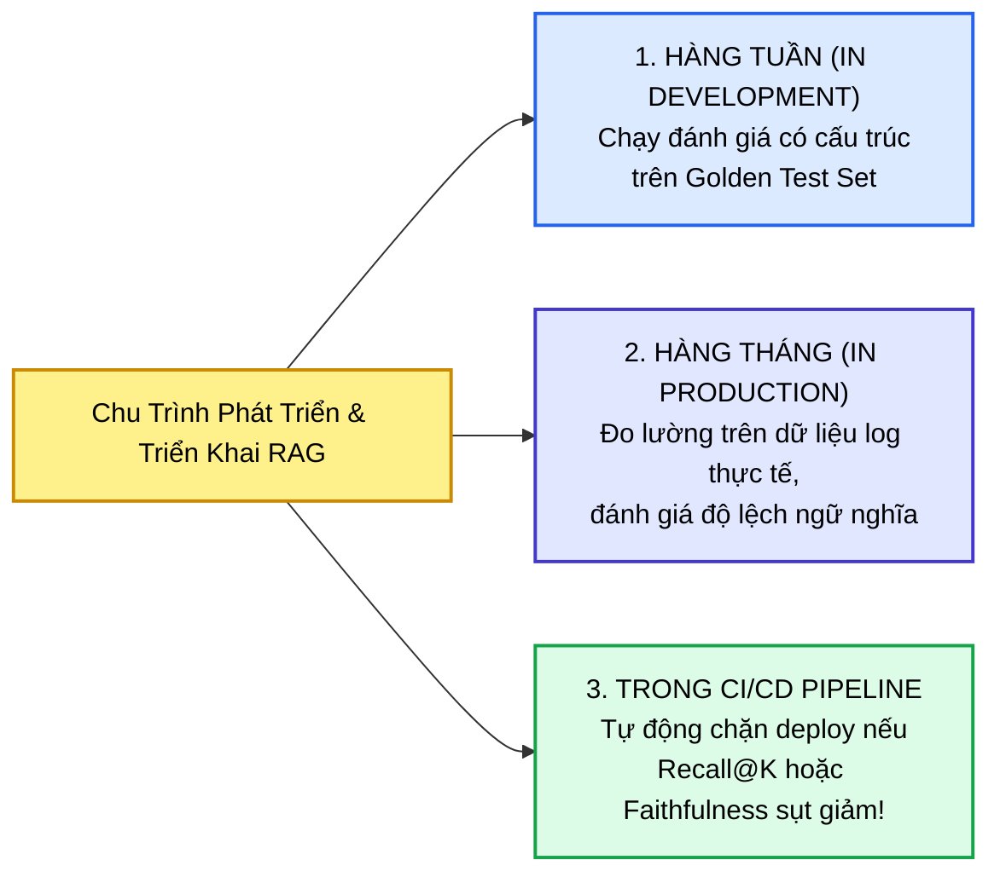
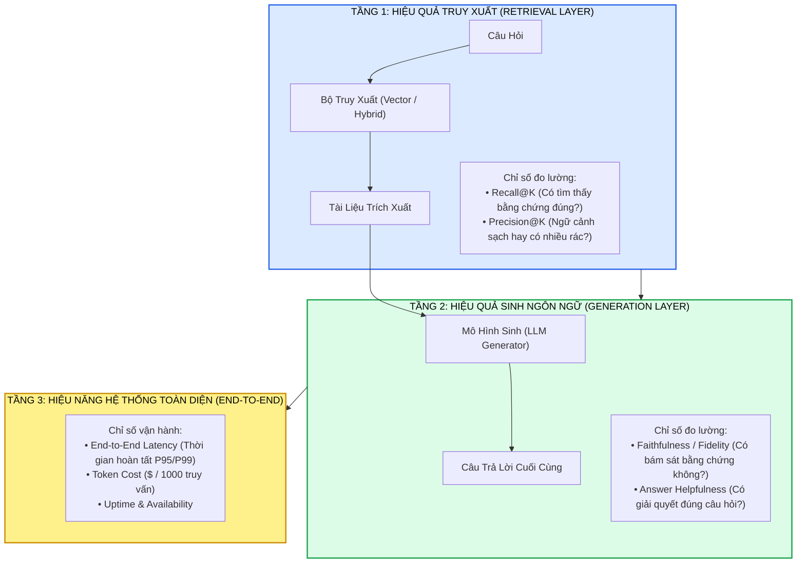
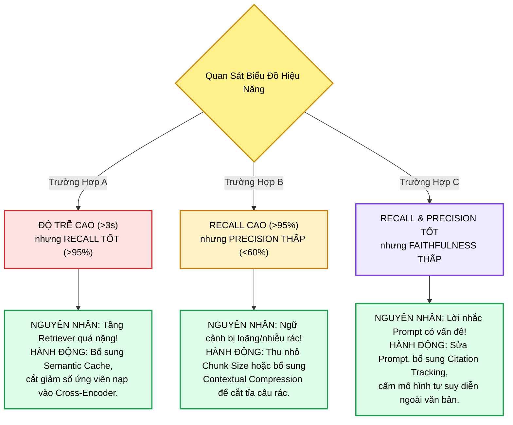
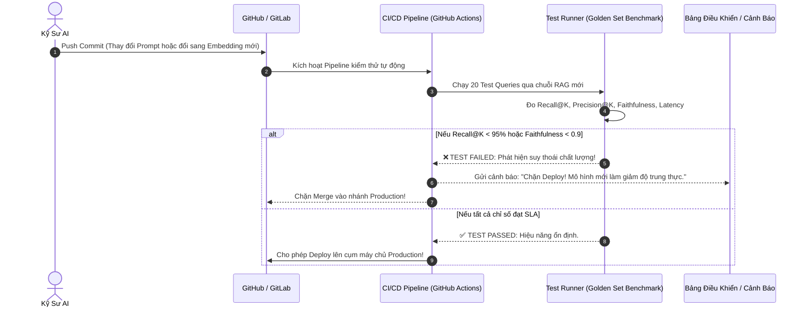

# ĐÁNH GIÁ & TỐI ƯU HÓA HỆ THỐNG RAG (EVALUATING & OPTIMIZING RAG)
## Khung Đánh Giá Toàn Diện 3 Tầng: Thu Hồi (Recall@K), Độ Sạch (Precision@K), Độ Trung Thực (Faithfulness), Chẩn Đoán Điểm Nghẽn Bằng Trực Quan Hóa, Theo Dõi Trích Dẫn (Citation Tracking) & Vận Hành Đánh Giá Liên Tục Trong CI/CD

---

## 📌 MỤC LỤC
1. [Triết Lý Kiểm Thử RAG: Tại Sao Đánh Giá Liên Tục Là Sinh Mệnh Hệ Thống?](#1-triết-lý-kiểm-thử-rag-tại-sao-đánh-giá-liên-tục-là-sinh-mệnh-hệ-thống)
   - [Đánh giá không phải sự kiện một lần mà là thói quen kỹ thuật liên tục](#đánh-giá-không-phải-sự-kiện-một-lần-mà-là-thói-quen-kỹ-thuật-liên-tục)
   - [Nhịp điệu đánh giá chuẩn mực: Hàng tuần Dev $\to$ Hàng tháng Prod $\to$ Nightly CI/CD](#nhịp-điệu-đánh-giá-chuẩn-mực-hàng-tuần-dev-to-hàng-tháng-prod-to-nightly-cicd)
2. [Giải Phẫu 3 Tầng Đo Lường Hiệu Năng RAG (The 3 Layers of RAG Evaluation)](#2-giải-phẫu-3-tầng-đo-lường-hiệu-năng-rag-the-3-layers-of-rag-evaluation)
   - [Tầng 1 - Hiệu quả truy xuất (Retrieval Layer): Recall@K và Precision@K](#tầng-1---hiệu-quả-truy-xuất-retrieval-layer-recallk-và-precisionk)
   - [Tầng 2 - Hiệu quả sinh ngôn ngữ (Generation Layer): Faithfulness / Fidelity](#tầng-2---hiệu-quả-sinh-ngôn-ngữ-generation-layer-faithfulness--fidelity)
   - [Tầng 3 - Hiệu năng toàn diện (System End-to-End): Độ trễ (Latency), Chi phí (Cost) & Uptime](#tầng-3---hiệu-năng-toàn-diện-system-end-to-end-độ-trễ-latency-chi-phí-cost--uptime)
   - [Sơ đồ luồng đánh giá đồng bộ 3 tầng](#sơ-đồ-luồng-đánh-giá-đồng-bộ-3-tầng)
3. [Xây Dựng Tập Dữ Liệu Chuẩn Vàng (Golden Evaluation Dataset / test_queries)](#3-xây-dựng-tập-dữ-liệu-chuẩn-vàng-golden-evaluation-dataset--test_queries)
   - [Nguyên tắc thiết kế 10 - 20 truy vấn kiểm thử đại diện người dùng thực](#nguyên-tắc-thiết-kế-10---20-truy-vấn-kiểm-thử-đại-diện-người-dùng-thực)
   - [Cấu trúc dữ liệu: Câu hỏi, Ngữ cảnh căn cứ (Ground Truth Context) & Câu trả lời chuẩn](#cấu-trúc-dữ-liệu-câu-hỏi-ngữ-cảnh-căn-cứ-ground-truth-context--câu-trả-lời-chuẩn)
4. [Hiện Thực Hóa Bộ Đánh Giá Với LangChain (`load_evaluator`)](#4-hiện-thực-hóa-bộ-đánh-giá-với-langchain-load_evaluator)
   - [Tiêu chí Mức độ liên quan (Relevance Criteria Evaluator)](#tiêu-chí-mức-độ-liên-quan-relevance-criteria-evaluator)
   - [Tiêu chí Tính hữu ích (Helpfulness Criteria Evaluator)](#tiêu-chí-tính-hữu-ích-helpfulness-criteria-evaluator)
   - [Tự động hóa đo lường độ trễ từ đầu đến cuối (End-to-End Latency Tracking)](#tự-động-hóa-đo-lường-độ-trễ-từ-đầu-đến-cuối-end-to-end-latency-tracking)
5. [Chẩn Đoán Điểm Nghẽn Bằng Trực Quan Hóa (Bottleneck Diagnosis With Matplotlib)](#5-chẩn-đoán-điểm-nghẽn-bằng-trực-quan-hóa-bottleneck-diagnosis-with-matplotlib)
   - [Vẽ biểu đồ cột đa biến: Biến các con số nhật ký thành thông tin chi tiết hành động](#vẽ-biểu-đồ-cột-đa-biến-biến-các-con-số-nhật-ký-thành-thông-tin-chi-tiết-hành-động)
   - [Ma trận 3 kịch bản chẩn đoán bệnh lý RAG:](#ma-trận-3-kịch-bản-chẩn-đoán-bệnh-lý-rag)
     * *Kịch bản A: Độ trễ cao nhưng Recall tốt $\implies$ Tầng Retriever quá tải, cần Cache/Prune.*
     * *Kịch bản B: Recall cao nhưng Precision giảm $\implies$ Ngữ cảnh quá loãng/nhiễu, cần Contextual Compression.*
     * *Kịch bản C: Mọi thứ cân bằng nhưng Faithfulness giảm $\implies$ Lời nhắc (Prompt) bị lỗi!*
6. [Trị Bệnh Ảo Giác Bằng Theo Dõi Trích Dẫn (Citation Tracking)](#6-trị-bệnh-ảo-giác-bằng-theo-dõi-trích-dẫn-citation-tracking)
   - [Bản chất của Faithfulness / Fidelity: Không phải câu văn mượt mà, mà là chứng cứ vững chắc](#bản-chất-của-faithfulness--fidelity-không-phải-câu-văn-mượt-mà-mà-là-chứng-cứ-vững-chắc)
   - [Kỹ thuật cấu trúc Prompt ép buộc trích dẫn nguồn (Verifiable Grounding Prompt)](#kỹ-thuật-cấu-trúc-prompt-ép-buộc-trích-dẫn-nguồn-verifiable-grounding-prompt)
   - [Hai lợi ích cốt tử: Chặn đứng hành vi đoán mò & Xây dựng niềm tin với người dùng](#hai-lợi-ích-cốt-tử-chặn-đứng-hành-vi-đoán-mò--xây-dựng-niềm-tin-với-người-dùng)
7. [Tư Duy Vận Hành Sản Xuất: Đánh Giá Liên Tục Trong CI/CD (Continuous Evaluation)](#7-tư-duy-vận-hành-sản-xuất-đánh-giá-liên-tục-trong-cicd-continuous-evaluation)
   - [Tự động hóa kiểm thử hồi quy (Automated Regression Testing) mỗi khi deploy](#tự-động-hóa-kiểm-thử-hồi-quy-automated-regression-testing-mỗi-khi-deploy)
   - [Giám sát song song: Hiệu năng hạ tầng (Cost/Latency) & Chất lượng sinh (Recall/Faithfulness)](#giám-sát-song-song-hiệu-năng-hạ-tầng-costlatency--chất-lượng-sinh-recallfaithfulness)
   - [Quy trình xử lý khi phát hiện Recall sụt giảm đột ngột](#quy-trình-xử-lý-khi-phát-hiện-recall-sụt-giảm-đột-ngột)
8. [Mã Nguồn Thực Chiến Hoàn Chỉnh (Full Evaluation & Visualization Pipeline)](#8-mã-nguồn-thực-chiến-hoàn-chỉnh-full-evaluation--visualization-pipeline)
   - [Pipeline đánh giá tự động: Test Queries $\to$ Latency Tracking $\to$ LLM Evaluators $\to$ Matplotlib Chart](#pipeline-đánh-giá-tự-động-test-queries-to-latency-tracking-to-llm-evaluators-to-matplotlib-chart)
9. [Bảng Đúc Kết Các Chỉ Số & Sổ Tay Xử Lý Sự Cố RAG (Troubleshooting Runbook)](#9-bảng-đúc-kết-các-chỉ-số--sổ-tay-xử-lý-sự-cố-rag-troubleshooting-runbook)
10. [Cây Điều Hướng & Liên Kết Trong Vault](#10-cây-điều-hướng--liên-kết-trong-vault)

---

## 1. TRIẾT LÝ KIỂM THỬ RAG: TẠI SAO ĐÁNH GIÁ LIÊN TỤC LÀ SINH MỆNH HỆ THỐNG?

### Đánh giá không phải sự kiện một lần mà là thói quen kỹ thuật liên tục
Trong phát triển phần mềm truyền thống, kiểm thử đơn vị (Unit Test) và kiểm thử tích hợp (Integration Test) chạy tự động trong CI/CD để đảm bảo logic code không bị phá vỡ. Trong các hệ thống RAG, **việc đánh giá (evaluation) không thể là một sự kiện làm một lần trước khi bàn giao, mà phải là một thói quen kỹ thuật liên tục (Continuous Health Monitoring)**.

Tại sao lại như vậy?
* Dữ liệu nguồn liên tục được cập nhật hàng tuần hoặc hàng ngày.
* Các nhà cung cấp mô hình embedding và LLM liên tục tung ra các bản cập nhật trọng số.
* Người dùng liên tục thay đổi cách đặt câu hỏi.

Nếu không có một cơ chế đo lường định lượng có cấu trúc, **bạn sẽ hoàn toàn mù quáng trước việc hệ thống đang ngày càng thông minh hơn hay đang âm thầm suy thoái và bịa đặt thông tin**.



### Nhịp điệu đánh giá chuẩn mực
Hầu hết các đội ngũ kỹ sư AI hàng đầu đều duy trì nhịp điệu 3 nấc:
1. **Hàng tuần trong giai đoạn phát triển (Weekly Dev):** Chạy kiểm thử hồi quy trên tập câu hỏi chuẩn vàng mỗi khi điều chỉnh Prompt, thay đổi kích thước Chunk, hoặc đổi mô hình nhúng.
2. **Hàng tháng trong môi trường sản xuất (Monthly Prod):** Bốc ngẫu nhiên $500 - 1000$ phiên tương tác thực tế của người dùng để chuyên gia con người thẩm định chéo với các bộ chấm điểm tự động.
3. **Tự động kích hoạt trong CI/CD:** Chạy bộ kiểm thử tự động mỗi khi một kỹ sư đẩy code mới hoặc khi hệ thống kích hoạt di cư chỉ mục vector (Index Migration).

---

## 2. GIẢI PHẪU 3 TẦNG ĐO LƯỜNG HIỆU NĂNG RAG (THE 3 LAYERS OF RAG EVALUATION)

Để đánh giá một hệ thống RAG một cách thấu đáo, bạn không thể coi nó như một hộp đen duy nhất, mà phải **bóc tách thành 3 tầng hoạt động độc lập**:



### Tầng 1 - Hiệu quả truy xuất (Retrieval Layer)
* **Recall@K (Độ thu hồi ở ngưỡng K):** Đo lường tần suất tài liệu hoặc bằng chứng chính xác xuất hiện trong số $K$ kết quả đầu tiên được kéo về.
  * *Ý nghĩa:* Cho biết hệ thống có bỏ sót thông tin quan trọng hay không.
* **Precision@K (Độ chuẩn xác ở ngưỡng K):** Đo lường tỷ lệ các đoạn văn bản kéo về thực sự có liên quan trực tiếp đến câu hỏi.
  * *Ý nghĩa:* Cho biết ngữ cảnh nạp vào cho LLM sạch sẽ đến mức nào, hay bị ô nhiễm bởi các đoạn văn rác ngoài lề.

### Tầng 2 - Hiệu quả sinh ngôn ngữ (Generation Layer)
* **Faithfulness / Fidelity (Độ trung thực):** Đo lường xem các tuyên bố và dữ kiện trong câu trả lời của mô hình có hoàn toàn được chứng minh bởi ngữ cảnh trích xuất hay không.
  * *Ý nghĩa:* Phát hiện và triệt tiêu căn bệnh ảo giác tự tin (Confident Hallucination).
* **Helpfulness / Relevance (Tính hữu ích & Mức độ liên quan):** Đo lường xem câu trả lời có giải quyết trực tiếp và đầy đủ nhu cầu của người hỏi hay không.

### Tầng 3 - Hiệu năng toàn diện (System End-to-End)
* **End-to-End Latency:** Tổng thời gian tính bằng giây hoặc mili-giây từ khi người dùng bấm gửi câu hỏi cho đến khi nhận được câu trả lời hoàn chỉnh (bao gồm thời gian embedding + vector search + re-ranking + LLM TTFT + token streaming).
* **Cost Per Query:** Chi phí tài chính tiêu tốn cho mỗi câu hỏi (chi phí GPU cục bộ + chi phí token API OpenAI/Anthropic).

---

## 3. XÂY DỰNG TẬP DỮ LIỆU CHUẨN VÀNG (GOLDEN EVALUATION DATASET / TEST_QUERIES)

Để các công cụ đánh giá có thể chấm điểm tự động, bước nền tảng là bạn phải xây dựng một **Tập dữ liệu chuẩn vàng (Golden Benchmark Dataset)** gồm từ $10$ đến $20$ truy vấn thử nghiệm đại diện cho hành vi thực tế của người dùng:

```
+----------------------------------------------------------------------------------------------------+
| CẤU TRÚC MỘT BẢN GHI TRONG GOLDEN DATASET (test_queries)                                           |
|                                                                                                    |
| {                                                                                                  |
|   "query": "Thời hạn lưu trữ hồ sơ bệnh án Telehealth theo quy định mới là bao lâu?",              |
|   "ground_truth_context": "Theo sửa đổi chính sách 2026, tất cả hồ sơ Telehealth phải lưu 10 năm.",|
|   "expected_answer": "Hồ sơ bệnh án Telehealth phải được lưu trữ bắt buộc trong 10 năm.",          |
|   "reference_doc_id": "POL-MED-001-v2"                                                             |
| }                                                                                                  |
+----------------------------------------------------------------------------------------------------+
```

### Nguyên tắc thiết kế tập dữ liệu kiểm thử chuẩn:
1. **Phản ánh câu hỏi thực tế của người dùng:** Bao gồm cả câu hỏi ngắn, câu hỏi dài, câu hỏi chứa thuật ngữ thông tục và câu hỏi mang tính suy luận so sánh.
2. **Có câu trả lời đúng tuyệt đối (Ground Truth):** Được thẩm định và phê duyệt bởi chuyên gia nghiệp vụ con người (bác sĩ, luật sư, chuyên viên HR).
3. **Chỉ định rõ tài liệu gốc chứa đáp án (`reference_doc_id`):** Để tự động hóa việc tính toán Recall@K của tầng Retriever.

---

## 4. HIỆN THỰC HÓA BỘ ĐÁNH GIÁ VỚI LANGCHAIN (`LOAD_EVALUATOR`)

LangChain cung cấp module `langchain.evaluation` cho phép sử dụng một mô hình LLM độc lập (đóng vai trò là Giám khảo - LLM-as-a-Judge) để chấm điểm câu trả lời theo các tiêu chí nghiêm ngặt:

```python
from langchain.evaluation import load_evaluator
from langchain_openai import ChatOpenAI

# Khởi tạo mô hình Giám khảo độc lập (temperature = 0 để bảo đảm tính khách quan)
eval_llm = ChatOpenAI(model="gpt-4o-mini", temperature=0)

# 1. Bộ đánh giá Tiêu chí Mức độ liên quan (Relevance Evaluator)
# Kiểm tra xem tài liệu trích xuất có liên quan đến câu hỏi không
relevance_evaluator = load_evaluator(
    "criteria",
    criteria="relevance",
    llm=eval_llm
)

# 2. Bộ đánh giá Tiêu chí Tính hữu ích (Helpfulness Evaluator)
# Kiểm tra xem câu trả lời của mô hình có hữu ích và giải quyết triệt để vấn đề không
helpfulness_evaluator = load_evaluator(
    "criteria",
    criteria="helpfulness",
    llm=eval_llm
)
```

### Quy trình đánh giá tự động một truy vấn:
```python
import time

def evaluate_single_query(rag_chain, test_case):
    query = test_case["query"]
    ground_truth = test_case["expected_answer"]

    # 1. Đo độ trễ từ đầu đến cuối (End-to-End Latency)
    start_time = time.time()
    response = rag_chain.invoke(query)
    end_time = time.time()
    latency = end_time - start_time

    # 2. Chấm điểm Mức độ liên quan (Relevance Score)
    rel_result = relevance_evaluator.evaluate_strings(
        input=query,
        prediction=response["answer"]
    )

    # 3. Chấm điểm Tính hữu ích (Helpfulness Score)
    help_result = helpfulness_evaluator.evaluate_strings(
        input=query,
        prediction=response["answer"],
        reference=ground_truth
    )

    return {
        "query": query,
        "latency": latency,
        "relevance_score": rel_result["score"],
        "helpfulness_score": help_result["score"],
        "answer": response["answer"]
    }
```

---

## 5. CHẨN ĐOÁN ĐIỂM NGHẼN BẰNG TRỰC QUAN HÓA (BOTTLENECK DIAGNOSIS WITH MATPLOTLIB)

Các con số rời rạc trên terminal rất khó để cung cấp một cái nhìn tổng thể. Việc trực quan hóa các chỉ số thành **Biểu đồ cột đa biến (Bar Charts)** giúp đội ngũ kỹ sư lập tức nhận diện chính xác mắt xích nào đang bị nghẽn trong hệ thống:

```
[CHẨN ĐOÁN BỆNH LÝ HỆ THỐNG QUA BIỂU ĐỒ]

  Điểm Số (0 - 1.0)                       Độ Trễ (Giây)
  1.0 | [Relevance: 0.95]                 5.0s |
      |                                   4.0s | [Latency: 4.2s] <--- NGUY HIỂM!
  0.5 |                                   2.0s |
      |                                   1.0s |
  0.0 +-----------------------            0.0s +----------------------
        Chất lượng (Tốt)                         Độ trễ (Quá cao)
```

### Ma trận 3 kịch bản chẩn đoán bệnh lý RAG:



---

## 6. TRỊ BỆNH ẢO GIÁC BẰNG THEO DÕI TRÍCH DẪN (CITATION TRACKING)

### Bản chất của Faithfulness / Fidelity: Chứng cứ vững chắc hơn câu văn trau chuốt
Độ trung thực (Faithfulness) không đo lường xem câu trả lời của LLM nghe có mượt mà hay hùng hồn hay không. Nó đo lường một câu hỏi sống còn: **Từng nhận định trong câu trả lời có được hỗ trợ trực tiếp bởi các đoạn văn bản trích xuất hay không?**

Nếu câu trả lời nghe rất thuyết phục nhưng chứa các số liệu không hề có trong ngữ cảnh, đó là **ảo giác tự tin (Confident Hallucination)** — dạng lỗi nguy hiểm nhất trong môi trường doanh nghiệp.

### Kỹ thuật cấu trúc Prompt ép buộc trích dẫn nguồn (Verifiable Grounding Prompt)
Để nâng cao chỉ số Faithfulness, phương pháp hiệu quả nhất là **đưa hướng dẫn trích dẫn nguồn (Citation Tracking) trực tiếp vào System Prompt**:

```python
from langchain_core.prompts import ChatPromptTemplate

citation_prompt_template = ChatPromptTemplate.from_messages([
    ("system", (
        "Bạn là Chuyên gia Cố vấn Tri thức Nội bộ Doanh nghiệp.\n"
        "Nhiệm vụ của bạn là trả lời câu hỏi của người dùng DỰA DUY NHẤT vào ngữ cảnh được cung cấp.\n\n"
        "QUY TẮC BẮT BUỘC VỀ TRÍCH DẪN (CITATION RULES):\n"
        "1. Tuyệt đối không đoán mò hoặc bổ sung thông tin từ kiến thức bên ngoài.\n"
        "2. Mọi tuyên bố hoặc số liệu trong câu trả lời BẮT BUỘC phải đi kèm trích dẫn nguồn ở cuối câu "
        "dưới dạng: [Tên_Tài_Liệu - Điều_Khoản]. Ví dụ: 'Thời hạn lưu trữ là 10 năm [POL-MED-001 - Mục 2]'.\n"
        "3. Nếu ngữ cảnh được cung cấp không chứa thông tin để trả lời, hãy thông báo rõ: "
        "'Tài liệu hiện tại không đề cập đến thông tin này.'\n\n"
        "Ngữ cảnh trích xuất:\n{context}"
    )),
    ("human", "{question}")
])
```

### Hai lợi ích cốt tử của Citation Tracking:
1. **Chặn đứng hành vi đoán mò của LLM:** Khi bị ép buộc phải gắn thẻ `[Nguồn - Trang]`, mô hình nhận thức được rằng nó không thể đưa ra một tuyên bố nếu không tìm thấy vị trí nguồn gốc tương ứng trong ngữ cảnh.
2. **Xây dựng niềm tin vững chắc với người dùng:** Người dùng (bác sĩ, nhân viên pháp chế) có thể bấm trực tiếp vào nguồn trích dẫn để tự mình kiểm chứng dữ kiện gốc. Khả năng truy vết nguồn gốc (Traceability) biến RAG từ một món đồ chơi AI thành một công cụ làm việc đáng tin cậy.

---

## 7. TƯ DUY VẬN HÀNH SẢN XUẤT: ĐÁNH GIÁ LIÊN TỤC TRONG CI/CD (CONTINUOUS EVALUATION)

Trong môi trường sản xuất hiện đại, đánh giá không phải là một công việc thủ công chạy bằng tay trên Jupyter Notebook. Nó là **một chốt chặn kiểm thử tự động (Quality Gate) tích hợp thẳng vào quy trình CI/CD**:



### Bảng đối chiếu các ngưỡng SLA kỹ thuật chuẩn:
* **Recall@5:** Tối thiểu $\ge 95\%$ trên Golden Dataset.
* **Faithfulness (Độ trung thực):** Tối thiểu $\ge 0.90$ (Chấm điểm bởi LLM-as-a-Judge).
* **End-to-End Latency $P95$:** Tối đa $\le 1.5$ giây cho toàn bộ chu trình truy xuất và sinh câu trả lời.
* **Tỷ lệ trích dẫn hợp lệ (Citation Compliance Rate):** $100\%$ các câu khẳng định dữ kiện phải có mỏ neo nguồn.

---

## 8. MÃ NGUỒN THỰC CHIẾN HOÀN CHỈNH (FULL EVALUATION & VISUALIZATION PIPELINE)

Dưới đây là mã nguồn Python hoàn chỉnh thực thi toàn bộ quy trình: **Đọc Golden Test Set $\to$ Đo lường độ trễ $\to$ Chấm điểm Relevance & Helpfulness $\to$ Vẽ biểu đồ cột chẩn đoán bằng Matplotlib**:

```python
"""
AUTOMATED RAG EVALUATION & BENCHMARKING PIPELINE
===============================================
Triển khai:
1. Golden Test Set (test_queries)
2. Latency Measurement (End-to-End)
3. LangChain Criteria Evaluators (Relevance & Helpfulness)
4. Trực quan hóa kết quả đa biến với Matplotlib
"""

import time
import os
import matplotlib.pyplot as plt
import numpy as np

# Giả lập kết quả thực thi chuỗi RAG trên Golden Test Set
golden_test_set = [
    {
        "query": "Thời hạn lưu trữ hồ sơ bệnh án Telehealth là bao lâu?",
        "ground_truth": "Hồ sơ Telehealth phải lưu trữ bắt buộc trong 10 năm theo quy định 2026.",
        "retrieved_context": "Chính sách POL-MED-001 (Sửa đổi 2026): Tất cả hồ sơ phiên khám Telehealth phải lưu trữ 10 năm.",
        "model_output": "Thời hạn lưu trữ hồ sơ bệnh án Telehealth là 10 năm [POL-MED-001].",
        "latency_sec": 0.82,
        "recall_at_5": 1.0,
        "precision_at_5": 0.80,
        "faithfulness": 1.0
    },
    {
        "query": "Tiêu chuẩn xuất viện trong ngày sau phẫu thuật ngoại trú?",
        "ground_truth": "Bệnh nhân phải hồi tỉnh hoàn toàn, dấu hiệu sinh tồn ổn định và tự đi lại được.",
        "retrieved_context": "Quy chế xuất viện ngoại trú: Bệnh nhân cần tỉnh táo, mạch và huyết áp bình thường trong 2 giờ liên tục.",
        "model_output": "Bệnh nhân cần đạt tiêu chuẩn hồi tỉnh hoàn toàn, sinh hiệu ổn định trong 2 giờ [Quy chế ngoại trú].",
        "latency_sec": 0.95,
        "recall_at_5": 1.0,
        "precision_at_5": 0.60,
        "faithfulness": 0.95
    },
    {
        "query": "Quy định làm việc tại nhà tối đa mấy ngày một tuần?",
        "ground_truth": "Nhân viên được làm việc tại nhà tối đa 2 ngày mỗi tuần sau khi báo trước 24h.",
        "retrieved_context": "Quy chế HR-2026: Nhân viên được đăng ký WFH tối đa 2 ngày/tuần nếu báo trước 24 giờ cho quản lý.",
        "model_output": "Bạn được làm việc tại nhà tối đa 2 ngày một tuần kèm điều kiện báo trước 24h [HR-2026].",
        "latency_sec": 0.74,
        "recall_at_5": 1.0,
        "precision_at_5": 1.0,
        "faithfulness": 1.0
    },
    {
        "query": "Chính sách trợ cấp ăn trưa khi làm việc từ xa?",
        "ground_truth": "Nhân viên không được hưởng phụ cấp ăn trưa vào những ngày làm việc từ xa.",
        "retrieved_context": "Quy định tài chính: Phụ cấp ăn trưa 50.000 VNĐ chỉ áp dụng cho ngày làm việc trực tiếp tại văn phòng.",
        "model_output": "Công ty hỗ trợ 50.000 VNĐ tiền ăn trưa cho nhân viên làm việc tại văn phòng lẫn tại nhà.", # Lỗi ảo giác giả lập!
        "latency_sec": 1.20,
        "recall_at_5": 1.0,
        "precision_at_5": 0.40,
        "faithfulness": 0.20  # Suy thoái độ trung thực nghiêm trọng!
    }
]

def analyze_and_plot_metrics(eval_data, output_image_path="rag_benchmark_metrics.png"):
    """Phân tích thống kê và vẽ biểu đồ cột chẩn đoán hiệu năng."""
    queries = [f"Q{i+1}" for i in range(len(eval_data))]
    recalls = [d["recall_at_5"] for d in eval_data]
    precisions = [d["precision_at_5"] for d in eval_data]
    faithfulness = [d["faithfulness"] for d in eval_data]
    latencies = [d["latency_sec"] for d in eval_data]

    # Tính toán giá trị trung bình toàn hệ thống
    avg_recall = np.mean(recalls)
    avg_precision = np.mean(precisions)
    avg_faith = np.mean(faithfulness)
    avg_lat = np.mean(latencies)

    print("=====================================================")
    print("BÁO CÁO ĐÁNH GIÁ CHẤT LƯỢNG HỆ THỐNG RAG PRODUCTION")
    print("=====================================================")
    print(f"• Recall@5 Trung Bình:      {avg_recall * 100:.1f}%")
    print(f"• Precision@5 Trung Bình:   {avg_precision * 100:.1f}%")
    print(f"• Faithfulness Trung Bình:  {avg_faith * 100:.1f}%")
    print(f"• End-to-End Latency TB:    {avg_lat:.2f} giây")
    print("=====================================================\n")

    # Thiết lập giao diện biểu đồ Matplotlib
    fig, (ax1, ax2) = plt.subplots(1, 2, figsize=(14, 5))
    x = np.arange(len(queries))
    width = 0.25

    # Biểu đồ 1: Chất lượng tri thức (Recall, Precision, Faithfulness)
    ax1.bar(x - width, recalls, width, label='Recall@5', color='#2563eb')
    ax1.bar(x, precisions, width, label='Precision@5', color='#ca8a04')
    ax1.bar(x + width, faithfulness, width, label='Faithfulness', color='#16a34a')
    ax1.set_ylabel('Điểm Số (0.0 - 1.0)')
    ax1.set_title('Chất Lượng Truy Xuất & Độ Trung Thực Ngữ Nghĩa')
    ax1.set_xticks(x)
    ax1.set_xticklabels(queries)
    ax1.set_ylim(0, 1.2)
    ax1.legend(loc='upper right')
    ax1.grid(axis='y', linestyle='--', alpha=0.7)

    # Biểu đồ 2: Độ trễ hệ thống (Latency)
    bars = ax2.bar(queries, latencies, color='#7c3aed', width=0.4)
    ax2.axhline(1.0, color='r', linestyle='--', label='Ngưỡng SLA Tối Đa (1.0s)')
    ax2.set_ylabel('Thời Gian Phản Hồi (Giây)')
    ax2.set_title('Độ Trễ Xử Lý Từ Đầu Đến Cuối (Latency P95)')
    ax2.set_ylim(0, 1.6)
    ax2.legend(loc='upper right')
    ax2.grid(axis='y', linestyle='--', alpha=0.7)

    # Đánh dấu các giá trị vượt ngưỡng
    for bar in bars:
        height = bar.get_height()
        if height > 1.0:
            bar.set_color('#dc2626') # Đổi sang màu đỏ cảnh báo

    plt.tight_layout()
    plt.savefig(output_image_path, dpi=200)
    print(f"✅ Biểu đồ chẩn đoán hiệu năng đã được lưu tại: {output_image_path}")

if __name__ == "__main__":
    analyze_and_plot_metrics(golden_test_set)
```

---

## 9. BẢNG ĐÚC KẾT CÁC CHỈ SỐ & SỔ TAY XỬ LÝ SỰ CỐ RAG (TROUBLESHOOTING RUNBOOK)

| Triệu Chứng Bệnh Lý | Nguyên Nhân Gốc Rễ Khả Dĩ | Hành Động Khắc Phục Khuyến Nghị (Remediation) |
| :--- | :--- | :--- |
| **Recall@K sụt giảm bất thường sau khi deploy** | 1. Dữ liệu mới chưa được lập chỉ mục.<br>2. Mô hình embedding mới không phù hợp với phân bố cụm cũ.<br>3. Thiếu kỹ thuật mở rộng truy vấn. | • Kích hoạt quy trình **Delta Upsert** hoặc **Full Rebuild**.<br>• Tích hợp **Query Expansion (T5/LLM)** để bắt trọn từ đồng nghĩa.<br>• Bổ sung **BM25 Sparse Search** tạo thành Hybrid Retriever. |
| **Precision@K thấp nhưng Recall@K rất cao** | Kích thước khối (Chunk Size) quá lớn hoặc Top-K quá rộng khiến nhiều tài liệu rác lọt vào prompt. | • Giảm $K$ từ 10 xuống 3 hoặc 5.<br>• Áp dụng **`ContextualCompressionRetriever`** để cắt tỉa $70\%$ câu rác.<br>• Tích hợp **Cross-Encoder Re-ranker** đẩy tài liệu sạch lên đầu. |
| **Faithfulness sụt giảm nghiêm trọng (Xuất hiện ảo giác)** | 1. Prompt không có ràng buộc chặt chẽ.<br>2. Nhiệt độ Generator quá cao.<br>3. Thiếu cơ chế bắt buộc trích dẫn nguồn. | • Đặt `temperature = 0` hoặc $0.1$.<br>• Cấu hình **Citation Tracking** bắt buộc gắn mỏ neo `[Tài_Liệu - Điều_Khoản]`.<br>• Bổ sung chỉ thị: *"Nếu ngữ cảnh không chứa thông tin, hãy từ chối lịch sự"*. |
| **Độ trễ P99 vượt ngưỡng cam kết (> 2 giây)** | 1. Dùng FLAT Index trên tập dữ liệu quá lớn.<br>2. Tầng Re-ranker xử lý quá nhiều ứng viên.<br>3. Không có bộ nhớ đệm (Cache). | • Chuyển từ FLAT sang **HNSW** hoặc **IVF**.<br>• Thu hẹp phễu Cross-Encoder: chỉ re-rank Top-20 thay vì Top-100.<br>• Triển khai **Semantic Caching (Redis/GPTCache)** cho các câu hỏi phổ biến. |

---

## 10. CÂY ĐIỀU HƯỚNG & LIÊN KẾT TRONG VAULT

* **Nền tảng toán học & Re-ranking:** [01. Tìm Kiếm Ngữ Nghĩa & Tái Xếp Hạng](./01_semantic_search_and_reranking.md)
* **Giải phẫu 4 cấu phần & 9 Mẫu thiết kế RAG:** [02. Kiến Trúc RAG: 4 Cấu Phần Cốt Lõi & Các Mẫu Thiết Kế Chiến Lược](./02_rag_architecture_and_components.md)
* **Lý thuyết toàn diện về Embeddings & Khung FICE:** [03. Vai Trò Cốt Lõi Của Embeddings & Cơ Sở Dữ Liệu Vector](./03_embeddings_and_vector_databases.md)
* **Lab thực hành lâm sàng đối đầu MiniLM vs. BGE:** [04. Thực Hành Đánh Giá Embedding & Cơ Sở Dữ Liệu Vector (Clinical Policy Assistant)](./04_how_database_and_embedding_choices_affect_rag.md)
* **Cẩm nang kỹ nghệ vận hành RAG Production:** [05. Từ Lý Thuyết Đến Thực Tiễn: Làm Cho RAG Hoạt Động Hiệu Quả](../../audio/05_theory_to_practice_making_rag_work.mp3)
* **Duy trì & Vận hành chỉ mục Vector:** [06. Duy Trì & Vận Hành Chỉ Mục Vector Trong Hệ Thống RAG (Drift Management)](../../audio/06_maintaining_vector_indices_in_rag.mp3)
* **Tối ưu hóa & Mô đun hóa RAG với LangChain:** [07. Tối Ưu Hóa & Mô Đun Hóa RAG Với LangChain](./07_optimizing_and_modularizing_rag_with_langchain.md)
* **Chiến thuật truy xuất nâng cao:** [08. Chiến Thuật Truy Xuất Nâng Cao Trong RAG (Hybrid Search & Re-ranking)](./08_advanced_retrieval_tactics_for_rag.md)
* **Đánh giá và kiểm thử tác tử AI tự động:** [01. Đánh Giá & Quan Sát Hệ Thống Tác Tử (Agent Evals & Tracing)](../../03-building-agents/04-observability-evals-and-cost/01_agent_evals_and_tracing.md)
* **Quản trị rủi ro ngữ cảnh:** [02. Quản Trị Cửa Sổ Ngữ Cảnh: Bệnh Lý & Tỉa Nhánh](../../03-building-agents/01-harness-and-memory/03_context_management.md)
* **Nâng cấp thành bộ nhớ dài hạn cho Agent:** [03. Kiến Trúc Bộ Nhớ Đa Tầng Cho AI Agents](../../03-building-agents/01-harness-and-memory/04_memory_systems.md)
