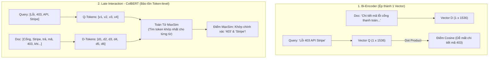

# Late-Interaction Retrieval & Token-Level ColBERTv2: Phá Vỡ Nút Thắt Single Vector Trong RAG

> [!important] Trực Giác Cốt Lõi (The Core Intuition)
> "Một bức tranh đáng giá ngàn lời nói, nhưng bạn không thể nhét cả bức tranh ngàn chữ đó vào một tọa độ GPS duy nhất mà không làm vỡ vụn các chi tiết li ti."
> 
> Trong kiến trúc Vector Search truyền thống (Bi-Encoder như OpenAI `text-embedding-3` hay BGE), ta ép một đoạn văn 500 từ thành **một vector duy nhất** 1536 chiều. Điều này tạo ra nút thắt cổ chai thông tin (Information Bottleneck) nghiêm trọng: các từ khóa hiếm, mã lỗi phần mềm, hay tên riêng thường bị hòa tan vào ý nghĩa chung chung của đoạn văn.
> 
> **Late Interaction (ColBERTv2)** đảo ngược hoàn toàn quy luật này: thay vì ép cả đoạn văn thành 1 vector, nó **giữ lại một vector độc lập cho từng từ (token)** và tính toán độ tương đồng tối đa (MaxSim) giữa các từ ngay tại thời điểm truy vấn. Kết quả: độ chính xác chi tiết tương đương Cross-Encoder nặng nề nhưng tốc độ tìm kiếm nhanh hàng nghìn lần.

---

## 1. Dành Cho Người Mới Bắt Đầu: Ba Thế Hệ Tìm Kiếm Ngữ Nghĩa

Để hiểu tại sao ColBERT được coi là bước nhảy vọt của ngành tìm kiếm thông tin hiện đại, hãy xem cách 3 thế hệ xử lý một câu hỏi tìm kiếm:

### A. Thế Hệ 1: Bi-Encoder (Nén Quá Mức - Single Dense Vector)
* **Cách làm:** Câu hỏi được biến thành 1 vector; mỗi tài liệu trong CSDL cũng được nén thành 1 vector duy nhất. Sau đó tính góc Cosine giữa 2 vector.
* **Hạn chế đời thường:** Giống như bạn tóm tắt toàn bộ một bộ phim 2 tiếng thành một câu ngắn: *"Phim hành động về cảnh sát"*. Khi khán giả hỏi: *"Tên của con chó xuất hiện ở phút thứ 42 là gì?"*, bản tóm tắt kia hoàn toàn bất lực vì thông tin vi mô đã bị xóa sạch trong quá trình nén.

### B. Thế Hệ 2: Cross-Encoder (Chính Xác Nhưng Siêu Chậm)
* **Cách làm:** Nối câu hỏi và từng tài liệu lại thành một chuỗi văn bản dài: `[CLS] Câu hỏi [SEP] Tài liệu [SEP]`, rồi nạp toàn bộ vào mạng Transformer để các từ tự "chú ý" (Cross-Attention) lẫn nhau.
* **Hạn chế đời thường:** Độ chính xác đạt $100\%$ điểm tối đa, nhưng bạn không thể đánh chỉ mục (Index) trước. Nếu CSDL có 1 triệu văn bản, mỗi khi người dùng bấm tìm kiếm, hệ thống phải chạy 1 triệu lượt Transformer forward pass $\to$ Mất cả ngày để trả về kết quả!

### C. Thế Hệ 3: Late Interaction / ColBERT (Tương Tác Muộn - Nhanh & Chuẩn)
* **Cách làm:** Tài liệu được nạp vào mạng nơ-ron trước để sinh ra một tập hợp các vector nhỏ (mỗi từ một vector). Khi có câu hỏi, câu hỏi cũng sinh ra các vector từ.
* **Bí quyết "Tương Tác Muộn":** Mô hình chỉ so khớp các vector từ với nhau ở bước cuối cùng (Late Interaction) bằng phép nhân vô hướng siêu nhanh, tìm xem mỗi từ trong câu hỏi khớp nhất với từ nào trong tài liệu, rồi cộng dồn lại.
* **Hiệu quả:** Tài liệu được tính toán trước $100\%$, tốc độ tìm kiếm chỉ mất vài mili-giây, nhưng độ chi tiết ngữ nghĩa được bảo tồn trọn vẹn.



---

## 2. Cơ Sở Toán Học: Toán Tử MaxSim (Maximum Similarity)

Giả sử câu truy vấn $Q$ có $N$ tokens và tài liệu $D$ có $M$ tokens.
Mô hình ColBERT chiếu mỗi token thành một vector không gian $d$-chiều (thường chọn $d = 128$, nhỏ hơn nhiều so với $1536$ của OpenAI để tiết kiệm bộ nhớ):
$$
E_Q = \text{Normalize}\left(\text{Encoder}(Q)\right) \in \mathbb{R}^{N \times d}
$$
$$
E_D = \text{Normalize}\left(\text{Encoder}(D)\right) \in \mathbb{R}^{M \times d}
$$

### Công Thức Toán Tử MaxSim
Độ tương đồng ngữ nghĩa giữa truy vấn $Q$ và tài liệu $D$ được định nghĩa bằng tổng các giá trị tương đồng cực đại của từng token truy vấn đối với toàn bộ các token tài liệu:
$$
S(Q, D) = \sum_{i=1}^{N} \max_{j \in \{1, \dots, M\}} \left( E_Q[i] \cdot E_D[j]^T \right)
$$

### Diễn Giải Hình Học Trực Quan:
1. Lấy token thứ nhất của câu hỏi (ví dụ: `"403"`).
2. So sánh vector của `"403"` với tất cả các vector từ trong tài liệu bằng tích vô hướng.
3. Chọn ra từ trong tài liệu giống với `"403"` nhất (ở đây là token `"403"` trong tài liệu, cho điểm $\approx 0.99$).
4. Lặp lại tương tự cho token `"Stripe"`, `"API"`, `"Lỗi"`.
5. Cộng tất cả các điểm cực đại này lại. Nếu một tài liệu chứa đầy đủ các chi tiết ngữ nghĩa mà câu hỏi yêu cầu, điểm $S(Q, D)$ sẽ đạt cực trị.

---

## 3. Đột Phá Của ColBERTv2: Nén Phần Dư & Tăng Tốc PLAID

Nếu mỗi tài liệu 500 từ lưu 500 vector 128 chiều (float32), dung lượng chỉ mục sẽ phình to gấp **$100\times$ đến $500\times$** so với Single Dense Vector, khiến RAM máy chủ cạn kiệt.
ColBERTv2 giải quyết bài toán này bằng thuật toán **Residual Compression (Nén phần dư)** và cơ chế lập chỉ mục **PLAID**:

### 1. Phân Cụm Tâm (Centroid Vector Quantization)
* Nhóm toàn bộ hàng triệu vector token trong không gian thành $K$ tâm cụm (Centroids) $\mathcal{C} = \{c_1, c_2, \dots, c_K\}$ (thường $K = 32.768$).
* Mỗi vector token $v$ được biểu diễn bằng:
  * ID của tâm cụm gần nhất $c^*$: Lưu bằng $16$ bits ($2$ bytes).
  * Vector phần dư sai lệch $r = v - c^*$: Được lượng tử hóa (Quantized) xuống chỉ còn **$1$ hoặc $2$ bits cho mỗi chiều**!
* **Kết quả:** Dung lượng lưu trữ giảm từ $512$ bytes/token xuống chỉ còn **$16 - 32$ bytes/token** (tiết kiệm hơn $95\%$ bộ nhớ).

### 2. Công Cụ Tìm Kiếm PLAID (Performance-optimized Late Interaction)
Thay vì quét qua toàn bộ tài liệu, PLAID áp dụng chiến lược 3 tầng lọc:
1. **Centroid Pruning:** Tìm các tâm cụm gần với câu hỏi nhất.
2. **Document Pruning:** Chỉ giữ lại các tài liệu có chứa các vector thuộc cụm gần.
3. **Exact MaxSim Computation:** Chỉ tính toán phép nhân MaxSim đầy đủ trên một tập con nhỏ các ứng viên hàng đầu.
* Độ trễ trung bình của PLAID: **$< 15\text{ms}$ trên CPU thông thường**, không cần GPU đắt đỏ lúc truy vấn!

---

## 4. Bảng So Sánh Toàn Diện: Bi-Encoder vs. ColBERT vs. Cross-Encoder

| Tiêu chí | Bi-Encoder (Dense) | Late Interaction (ColBERTv2) | Cross-Encoder (Re-ranker) |
| :--- | :--- | :--- | :--- |
| **Độ chính xác chi tiết (NDCG@10)** | Trung bình ($0.65 - 0.72$) | Xuất sắc ($0.82 - $0.88$) | Tối đa ($0.85 - $0.90$) |
| **Bảo tồn từ khóa hiếm/mã lỗi** | Kém (bị hòa tan) | Tuyệt vời (khớp token-level) | Tuyệt vời |
| **Khả năng Index trước tài liệu** | Có (1 vector/doc) | Có (đa vector nén với PLAID) | **Không thể** (phải chạy runtime) |
| **Độ trễ truy vấn (Query Latency)** | Siêu nhanh ($5 - 10\text{ms}$) | Cực nhanh ($10 - 25\text{ms}$) | Siêu chậm ($200 - 2000\text{ms}$) |
| **Dung lượng lưu trữ Index** | Rất nhỏ (~1 GB / 100k docs) | Vừa phải (~3-5 GB / 100k docs) | Không tốn index (chỉ lưu văn bản) |
| **Chi phí phần cứng khi phục vụ** | Thấp | Thấp / Trung bình | Rất cao (buộc phải có GPU mạnh) |

---

## 5. Triển Khai Code Thực Chiến: Python MaxSim Late-Interaction Engine

Dưới đây là một mô phỏng thuần Python hoàn chỉnh về cơ chế mã hóa đa vector, tính toán ma trận tương đồng token-to-token và thực thi toán tử MaxSim, so sánh trực tiếp kết quả với Single Dense Vector.

```python
"""
Late Interaction & MaxSim Search Engine
Minh họa trực quan cơ chế so khớp token-level của ColBERT và so sánh với Single Dense Vector.
"""

from typing import List, Dict, Tuple
import math
import random

# Thiết lập hạt giống để kết quả có tính tiền định
random.seed(42)

def normalize(vec: List[float]) -> List[float]:
    """Chuẩn hóa vector về độ dài L2 = 1."""
    norm = math.sqrt(sum(x * x for x in vec))
    if norm == 0:
        return vec
    return [x / norm for x in vec]

def dot_product(v1: List[float], v2: List[float]) -> float:
    """Tích vô hướng giữa 2 vector."""
    return sum(a * b for a, b in zip(v1, v2))


class MockColBERTEncoder:
    """
    Mô phỏng mô hình ColBERT sinh token embeddings 128 chiều.
    Các từ giống nhau hoặc có liên quan ngữ nghĩa sẽ có vector gần nhau.
    """
    def __init__(self, dim: int = 128):
        self.dim = dim
        self.token_vocab_cache: Dict[str, List[float]] = {}

    def _get_base_token_vector(self, token: str) -> List[float]:
        token_lower = token.lower().strip(",.!?")
        if token_lower not in self.token_vocab_cache:
            # Tạo vector giả định nhưng nhất quán cho mỗi từ
            rng = random.Random(abs(hash(token_lower)) % (2**32))
            raw_vec = [rng.gauss(0, 1) for _ in range(self.dim)]
            self.token_vocab_cache[token_lower] = normalize(raw_vec)
        return self.token_vocab_cache[token_lower]

    def encode(self, text: str) -> Tuple[List[str], List[List[float]], List[float]]:
        """
        Trả về:
        1. Danh sách tokens.
        2. Ma trận đa vector ColBERT: M vector (mỗi từ 1 vector).
        3. Vector đơn truyền thống (Bi-Encoder): Trung bình cộng của các vector.
        """
        tokens = text.strip().split()
        multi_vectors = [self._get_base_token_vector(t) for t in tokens]
        
        # Mô phỏng Single Dense Vector của Bi-Encoder bằng Mean Pooling
        single_dense = [0.0] * self.dim
        for v in multi_vectors:
            for d in range(self.dim):
                single_dense[d] += v[d]
        single_dense = normalize(single_dense)

        return tokens, multi_vectors, single_dense


class LateInteractionSearcher:
    """Bộ máy tìm kiếm so khớp tương tác muộn MaxSim."""
    
    def __init__(self, encoder: MockColBERTEncoder):
        self.encoder = encoder
        self.documents: List[Dict[str, Any]] = []

    def index_documents(self, doc_list: List[str]):
        """Đánh chỉ mục trước cho toàn bộ tài liệu."""
        self.documents.clear()
        for idx, text in enumerate(doc_list):
            tokens, multi_vecs, single_vec = self.encoder.encode(text)
            self.documents.append({
                "id": idx,
                "text": text,
                "tokens": tokens,
                "multi_vectors": multi_vecs,
                "single_vector": single_vec
            })
        print(f"✅ Đã chỉ mục hóa {len(self.documents)} tài liệu theo chuẩn đa vector ColBERT.")

    def search_colbert_maxsim(self, query: str, top_k: int = 2) -> List[Tuple[float, str, List[Tuple[str, str, float]]]]:
        """
        Tìm kiếm bằng toán tử MaxSim:
        S(Q, D) = sum_{i in Q} max_{j in D} (E_Q[i] . E_D[j])
        """
        q_tokens, q_multi_vecs, _ = self.encoder.encode(query)
        results = []

        for doc in self.documents:
            total_maxsim_score = 0.0
            alignment_details = []

            # Duyệt qua từng token của câu truy vấn
            for q_tok, q_vec in zip(q_tokens, q_multi_vecs):
                best_match_score = -1.0
                best_matched_doc_token = ""

                # Tìm token trong tài liệu có độ tương đồng lớn nhất
                for d_tok, d_vec in zip(doc["tokens"], doc["multi_vectors"]):
                    sim = dot_product(q_vec, d_vec)
                    if sim > best_match_score:
                        best_match_score = sim
                        best_matched_doc_token = d_tok

                total_maxsim_score += best_match_score
                alignment_details.append((q_tok, best_matched_doc_token, best_match_score))

            results.append((total_maxsim_score, doc["text"], alignment_details))

        # Sắp xếp theo điểm MaxSim giảm dần
        results.sort(key=lambda x: x[0], reverse=True)
        return results[:top_k]

    def search_dense_baseline(self, query: str, top_k: int = 2) -> List[Tuple[float, str]]:
        """Tìm kiếm theo kiểu Bi-Encoder truyền thống (Single Vector Cosine)."""
        _, _, q_single_vec = self.encoder.encode(query)
        results = []

        for doc in self.documents:
            cosine_sim = dot_product(q_single_vec, doc["single_vector"])
            results.append((cosine_sim, doc["text"]))

        results.sort(key=lambda x: x[0], reverse=True)
        return results[:top_k]


if __name__ == "__main__":
    encoder = MockColBERTEncoder(dim=64)
    searcher = LateInteractionSearcher(encoder)

    # Tập tài liệu thử nghiệm (trong đó có tài liệu chứa mã lỗi cụ thể)
    corpus = [
        "Hướng dẫn tích hợp cổng thanh toán trực tuyến: Hỗ trợ thẻ tín dụng Visa và Mastercard quốc tế.",
        "Xử lý sự cố: Nếu hệ thống trả về mã lỗi 403 Forbidden từ cổng Stripe thì cần kiểm tra API Key bí mật.",
        "Chính sách hoàn tiền cho khách hàng mua vé máy bay trong vòng 24 giờ kể từ khi thanh toán thành công.",
        "Thông báo bảo trì máy chủ cơ sở dữ liệu hàng tuần vào lúc 02:00 sáng chủ nhật."
    ]
    searcher.index_documents(corpus)

    test_query = "sửa lỗi 403 Stripe"

    print(f"\n" + "="*70)
    print(f"🔍 TRUY VẤN: '{test_query}'")
    print("="*70)

    # 1. Tìm kiếm bằng ColBERT MaxSim
    print("\n🎯 [KẾT QUẢ COLBERT LATE INTERACTION - MAXSIM]:")
    colbert_results = searcher.search_colbert_maxsim(test_query, top_k=2)
    for rank, (score, doc_text, alignments) in enumerate(colbert_results):
        print(f"\nTop {rank+1} (MaxSim Score = {score:.3f}): \"{doc_text}\"")
        print("  Chi tiết tương tác từng từ (Token Alignment):")
        for q_tok, d_tok, tok_score in alignments:
            print(f"    - Từ khóa '{q_tok}' khớp nhất với '{d_tok}' (Cosine: {tok_score:.3f})")

    # 2. So sánh với Bi-Encoder truyền thống
    print("\n" + "-"*70)
    print("⚖️ [SO SÁNH VỚI BI-ENCODER TRUYỀN THỐNG - SINGLE VECTOR]:")
    dense_results = searcher.search_dense_baseline(test_query, top_k=2)
    for rank, (score, doc_text) in enumerate(dense_results):
        print(f"Top {rank+1} (Cosine = {score:.3f}): \"{doc_text}\"")
    print("="*70)
```

---

## 6. Cạm Bẫy Thực Tế & Kinh Nghiệm Triển Khai (Production Gotchas)

### 1. Chi Phí Băng Thông Truyền Tải (Network Payload Overhead)
Trong khi một vector đơn 1536 float32 chỉ tốn khoảng $6\text{ KB}$, một tài liệu 500 tokens dùng ColBERT chưa nén có thể tốn $250\text{ KB}$. Khi cần truyền tải kết quả qua mạng giữa các Microservices, điều này có thể gây nghẽn băng thông.
* **Giải pháp:** Bắt buộc sử dụng định dạng nén nhị phân hoặc thư viện tối ưu hóa chuyên biệt như **RAGatouille** hoặc **Fast-ColBERT** chạy cục bộ cùng process.

### 2. Sự Kết Hợp Tối Ưu Trong RAG Pipeline
Trong thực tế, bạn không nhất thiết phải thay thế toàn bộ hệ thống Vector DB hiện có. Mô hình lai hiệu quả nhất là:
1. **Tầng 1 (Broad Retrieval):** Dùng BM25 hoặc Dense Vector lọc từ 1 triệu tài liệu xuống **Top-100**.
2. **Tầng 2 (ColBERT Re-ranking):** Dùng ColBERTv2 chạy MaxSim trên Top-100 này để lấy ra **Top-5** chính xác nhất đưa vào ngữ cảnh của Agent. Phương án này vừa tiết kiệm RAM vừa đạt độ chính xác đỉnh cao!

---

## 7. Tài Liệu Tham Khảo & Đọc Thêm

* [🔗 Khattab & Zaharia (2020) - ColBERT: Efficient and Effective Passage Search via Contextualized Late Interaction over BERT](https://arxiv.org/abs/2004.12832)
* [🔗 Santhanam et al. (2021) - ColBERTv2: Effective and Efficient Retrieval via Lightweight Late Interaction](https://arxiv.org/abs/2112.01488)
* [🔗 Santhanam et al. (2022) - PLAID: An Efficient Engine for Late Interaction Retrieval](https://arxiv.org/abs/2205.09707)
* [🔗 Thư viện RAGatouille - Bridge ColBERT to Production RAG](https://github.com/bclavie/RAGatouille)
