# TỔNG QUAN TOÀN DIỆN VỀ MÔ HÌNH NGÔN NGỮ LỚN (LARGE LANGUAGE MODELS - LLMs)
## Lịch Sử Phát Triển, Giải Phẫu Các Họ Mô Hình Tiêu Biểu (BERT, T5, GPT, LLaMA), Cuộc Cách Mạng Căn Chỉnh (RLHF) & Bản Chất "Reasoning Machine"

---

## MỤC LỤC
1. [Khái niệm cốt lõi: Language Model (LM) là gì?](#1-khái-niệm-cốt-lõi-language-model-lm-là-gì)
2. [Biểu diễn ngôn ngữ: Từ Word đến Tokenization](#2-biểu-diễn-ngôn-ngữ-từ-word-đến-tokenization)
3. [Dòng thời gian tiến hóa (2001 – Nay): 4 bước nhảy vọt định hình NLP](#3-dòng-thời-gian-tiến-hóa-2001--nay-4-bước-nhảy-vọt-định-hình-nlp)
4. [Ba trường phái kiến trúc: Autoencoding vs. Seq2Seq vs. Autoregressive](#4-ba-trường-phái-kiến-trúc-autoencoding-vs-seq2seq-vs-autoregressive)
5. [Hồ sơ giải phẫu các họ mô hình hiện đại tiêu biểu (Case Studies)](#5-hồ-sơ-giải-phẫu-các-họ-mô-hình-hiện-đại-tiêu-biểu-case-studies)
   - [5.1. BERT: Người tiên phong Autoencoding & Chuẩn mực NLU](#51-bert-người-tiên-phong-autoencoding--chuẩn-mực-nlu)
   - [5.2. T5: Kiến trúc Text-to-Text & Khả năng Multi-Tasking](#52-t5-kiến-trúc-text-to-text--khả-năng-multi-tasking)
   - [5.3. Gia đình GPT: Từ GPT-1, WebText của GPT-2 đến GPT-4 Multimodal](#53-gia-đình-gpt-từ-gpt-1-webtext-của-gpt-2-đến-gpt-4-multimodal)
   - [5.4. LLaMA & LLaMA-2: Đỉnh cao nguồn mở thương mại của Meta](#54-llama--llama-2-đỉnh-cao-nguồn-mở-thương-mại-của-meta)
6. [Cuộc cách mạng căn chỉnh (The Alignment Revolution): Từ Autocomplete đến Instruct & RLHF](#6-cuộc-cách-mạng-căn-chỉnh-the-alignment-revolution-từ-autocomplete-đến-instruct--rlhf)
   - [6.1. Thí nghiệm tư duy: "Is the Earth flat?" – Base Model vs. Aligned Model](#61-thí-nghiệm-tư-duy-is-the-earth-flat--base-model-vs-aligned-model)
   - [6.2. Quy trình 3 tầng căn chỉnh: Pre-training, SFT và RLHF](#62-quy-trình-3-tầng-căn-chỉnh-pre-training-sft-và-rlhf)
7. [Đạo đức dữ liệu, Bản quyền, Hộp đen và Thiên vị ngôn ngữ (Ethics, Copyright & Bias)](#7-đạo-đức-dữ-liệu-bản-quyền-hộp-đen-và-thiên-vị-ngôn-ngữ-ethics-copyright--bias)
8. [Quy mô mô hình & Nghịch lý "How Big is Too Big?"](#8-quy-mô-mô-hình--nghịch-lý-how-big-is-too-big)
9. [Cơ chế tương tác: Chatbot UI vs. Playground & Inference Parameters](#9-cơ-chế-tương-tác-chatbot-ui-vs-playground--inference-parameters)
10. [Bản chất thực sự: LLM không chỉ là Chatbot, mà là "Reasoning Machine"](#10-bản-chất-thực-sự-llm-không-chỉ-là-chatbot-mà-là-reasoning-machine)
11. [Bảng so sánh tổng hợp & Khung hướng dẫn lựa chọn mô hình trong thực tế](#11-bảng-so-sánh-tổng-hợp--khung-hướng-dẫn-lựa-chọn-mô-hình-trong-thực-tế)

---

## 1. KHÁI NIỆM CỐT LÕI: LANGUAGE MODEL (LM) LÀ GÌ?

Trước khi có chữ **"Large" (Lớn)**, chúng ta cần hiểu bản chất toán học của một **"Language Model" (Mô hình hóa ngôn ngữ)**.

### Thí nghiệm tư duy: "Fill-in-the-blank"
Hãy xem xét câu đố điền từ quen thuộc:
> *"If you don't **[BLANK]** at the sign, you will get a ticket."*  
> *(Nếu bạn không **[......]** tại biển báo, bạn sẽ bị phạt.)*

Khi đọc đến chỗ trống, não bộ con người lập tức kích hoạt cơ chế thống kê dựa trên kinh nghiệm tiếp xúc với ngôn ngữ trong đời sống:
* Từ xuất hiện đầu tiên với tần suất cao nhất: **"stop"** (dừng lại).
* Một phương án khác hoàn toàn đúng về mặt ngữ pháp lẫn ngữ nghĩa: **"yield"** (nhường đường), hoặc *"slow down"*.
* Từ bất hợp lý: *"dance"*, *"sing"*, *"apple"*.

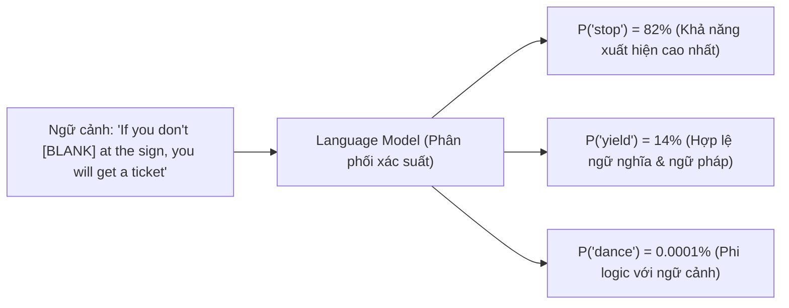

> [!NOTE] Định nghĩa toán học của Language Modeling
> **Language Modeling** là nhiệm vụ ước lượng phân phối xác suất chung của các chuỗi từ/ký hiệu trong ngôn ngữ tự nhiên. Về bản chất, mô hình được huấn luyện để giải một bài toán thống kê cơ bản: **Dự đoán từ bị khuyết (missing word) hoặc từ tiếp theo (next word) dựa trên ngữ cảnh cho trước.**

$$
P(w_1, w_2, \dots, w_n) = \prod_{i=1}^n P(w_i \mid \text{Context})
$$

Con người khi đọc hiểu văn bản cũng liên tục đưa ra các phán đoán xác suất tiềm thức tương tự. Bạn đọc được câu này trôi chảy chính vì não bạn liên tục dự đoán trước các từ tiếp theo dựa trên vốn từ và ngữ cảnh xung quanh.

---

## 2. BIỂU DIỄN NGÔN NGỮ: TỪ WORD ĐẾN TOKENIZATION

Máy tính là thiết bị xử lý số học thuần túy; nó không có khái niệm trực tiếp về chữ cái, ngữ nghĩa hay văn phạm. Do đó, văn bản thô (raw text) bắt buộc phải được mã hóa thành các con số trước khi đưa vào mô hình.

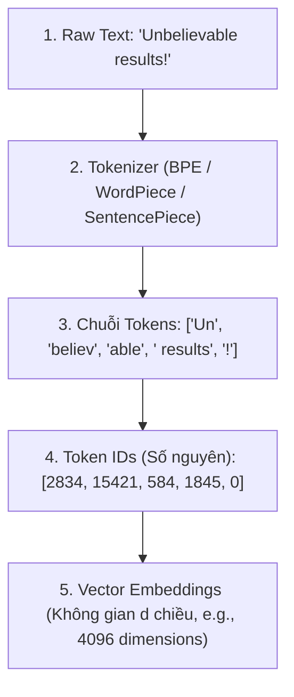

### Phân biệt Word vs. Token: Tại sao Token không đồng nhất với Word?
* **Word (Từ ngữ học):** Đơn vị ngôn ngữ hoàn chỉnh (ví dụ: *"anthropology"*, *"chạy bộ"*).
* **Token (Đơn vị tính toán):** Là các mảnh ký tự (subwords), từ đơn, hoặc thậm chí là ký tự đơn lẻ tùy thuộc vào bộ từ vựng (**Vocabulary**) cố định của mô hình (thường dao động từ 32,000 đến 128,000 token IDs).

#### Cơ chế tách từ (Subword Tokenization - BPE):
1. **Từ thông dụng:** Giữ nguyên thành 1 token duy nhất (ví dụ: `"apple"` $\rightarrow$ `["apple"]`).
2. **Từ hiếm, từ chuyên ngành, từ ghép:** Bị tách thành các tiền tố, căn tố và hậu tố:
   * `"unbelievable"` $\rightarrow$ `["un", "believ", "able"]` (3 tokens).
   * `"tokenization"` $\rightarrow$ `["token", "ization"]` (2 tokens).
3. **Mã nguồn lập trình & Dấu câu:** Khoảng trắng thụt lề, dấu ngoặc, dấu chấm câu đều có token riêng:
   * `"\n    def "` $\rightarrow$ có thể là 1 token đặc thù chứa cả ký tự xuống dòng và thụt 4 khoảng trắng.

> [!NOTE] Quy tắc ước lượng thực tế
> Trong tiếng Anh: **100 từ $\approx$ 130 – 135 tokens** (hoặc 1 token $\approx$ 0.75 từ / 4 ký tự).  
> Đối với tiếng Việt hoặc các ngôn ngữ giàu dấu thanh điệu, nếu tokenizer chưa được huấn luyện đủ dữ liệu bản địa, một từ có thể bị bẻ nhỏ thành nhiều byte tokens, làm tăng chi phí tính toán và làm hẹp cửa sổ ngữ cảnh thực tế.

---

## 3. DÒNG THỜI GIAN TIẾN HÓA (2001 – NAY): 4 BƯỚC NHẢY VỌT ĐỊNH HÌNH NLP

Sự bùng nổ của các LLM như GPT-4 hay Claude ngày nay là đỉnh cao kế thừa từ 4 bước chuyển dịch mô thức (*step functions*) công nghệ lớn trong hơn 20 năm qua:

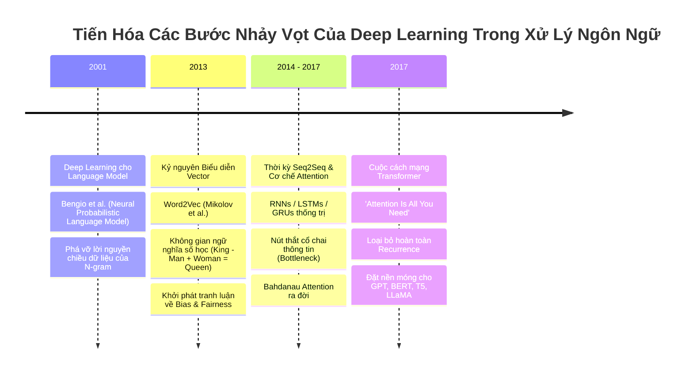

* **Bước 1 (2001) - Bengio et al.:** Dùng mạng truyền thẳng (FNN) thay cho bảng đếm tần suất $N$-gram, đưa ra khái niệm biểu diễn phân tán (*Distributed Representation*), giúp mô hình khái quát hóa được các câu chưa từng thấy.
* **Bước 2 (2013) - Word2Vec (Mikolov et al. - Google):** Ngữ nghĩa lần đầu tiên được số hóa thành vector với tính chất đại số kỳ diệu: $\vec{v}_{\text{King}} - \vec{v}_{\text{Man}} + \vec{v}_{\text{Woman}} \approx \vec{v}_{\text{Queen}}$. Đồng thời mở ra hồi chuông cảnh báo về định kiến xã hội (Bias & Fairness) ẩn trong kho dữ liệu văn bản.
* **Bước 3 (2014–2017) - Seq2Seq & Bahdanau Attention:** Giải quyết bài toán dịch máy bằng bộ đôi Encoder-Decoder. Sự ra đời của cơ chế Attention sơ khai phá vỡ nút thắt cổ chai thông tin của vector tĩnh, cho phép Decoder nhìn lại toàn bộ các từ của câu gốc.
* **Bước 4 (2017) - Transformer (Vaswani et al. - Google):** Bài báo *"Attention Is All You Need"* tuyên bố loại bỏ hoàn toàn các vòng lặp đệ quy RNN/LSTM. Khả năng song song hóa 100% trên GPU và tầm nhìn $O(1)$ giữa mọi cặp từ đã trở thành bệ phóng cho toàn bộ thế hệ LLM hiện đại.

---

## 4. BA TRƯỜNG PHÁI KIẾN TRÚC: AUTOENCODING VS. SEQ2SEQ VS. AUTOREGRESSIVE

Từ kiến trúc Transformer nguyên bản (bao gồm cả khối Encoder và Decoder), thế giới LLM phân chia thành 3 trường phái rõ rệt:

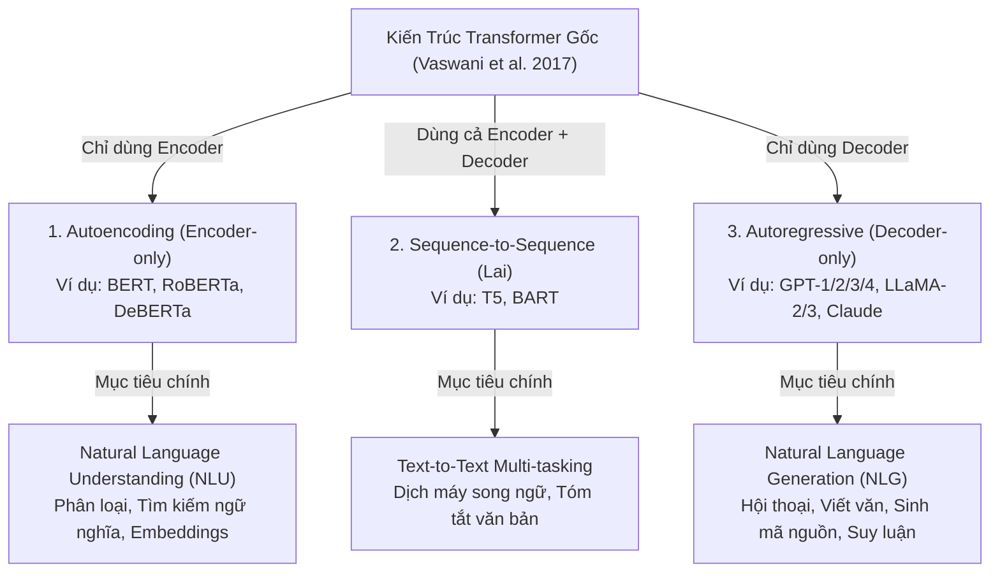

### So sánh trực quan cơ chế Attention Mask giữa 3 trường phái:

```text
1. AUTOENCODING (BERT)              2. AUTOREGRESSIVE (GPT)              3. ENCODER-DECODER (T5)
   Full Bidirectional Mask             Causal Mask (Chỉ nhìn trước)        Encoder: 2 chiều toàn diện
       T1  T2  T3  T4                      T1  T2  T3  T4                  Decoder: Causal Mask 1 chiều
   T1 [ 1   1   1   1 ]                T1 [ 1   0   0   0 ]                kèm Cross-Attention nhìn sang
   T2 [ 1   1   1   1 ]                T2 [ 1   1   0   0 ]                toàn bộ đầu ra của Encoder
   T3 [ 1   1   1   1 ]                T3 [ 1   1   1   0 ]
   T4 [ 1   1   1   1 ]                T4 [ 1   1   1   1 ]
```

---

## 5. HỒ SƠ GIẢI PHẪU CÁC HỌ MÔ HÌNH HIỆN ĐẠI TIÊU BIỂU (CASE STUDIES)

---

### 5.1. BERT: Người tiên phong Autoencoding & Chuẩn mực NLU

Được Google phát minh vào cuối năm 2018 (chỉ một năm sau khi bài báo Transformer ra đời), **BERT** là một trong những mô hình ngôn ngữ lớn thực thụ đầu tiên đặt nền móng cho kỷ nguyên hiện đại.

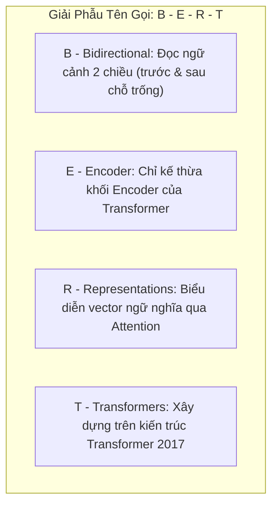

#### 1. Quy mô & Vị thế kỹ thuật:
* **Quy mô:** Phiên bản tiêu chuẩn (**BERT-Base**) có khoảng **110 triệu tham số (110M parameters)**. Đây cũng là lý do cộng đồng học máy chọn ngưỡng xấp xỉ 100M làm "mức sàn" để một mô hình bắt đầu được công nhận là một Large Language Model.
* **Thế mạnh vượt trội:** **NLU (Natural Language Understanding)**. BERT cực kỳ xuất sắc trong các tác vụ phân loại văn bản (Classification), gắn nhãn thực thể (Named Entity Recognition - NER) và tìm kiếm ngữ nghĩa (**Semantic Search / Retrieval**).

#### 2. Dữ liệu huấn luyện & Cơ chế tự giám sát:
Khi đánh giá bất kỳ LLM nào, câu hỏi quan trọng hàng đầu là: *Mô hình đã được học từ dữ liệu gì và dữ liệu đó có thu thập công bằng, hợp đạo đức không?*  
BERT nguyên bản được huấn luyện trên hai kho ngữ liệu mở hoàn toàn:
1. **English Wikipedia:** Khoảng **2.5 tỷ từ**, cung cấp nguồn tri thức bách khoa, chuẩn mực về ngữ pháp và có độ chính xác thực tế (*factual*) rất cao.
2. **BookCorpus:** Khoảng **800 triệu từ** thu thập từ hàng nghìn cuốn sách chưa xuất bản, mang lại văn phong đời thường, ngôn ngữ tự sự và cấu trúc tường thuật liền mạch.

#### 3. Cơ chế học (Language Modeling qua Masked LM):
BERT lấy một đoạn văn từ Wikipedia hoặc BookCorpus, ngẫu nhiên che đi khoảng $15\%$ số từ bằng ký hiệu `[MASK]` (ví dụ: *"The capital of France is [MASK]"*), rồi tự giải câu đố điền từ. Vì câu trả lời vốn đã nằm sẵn trong văn bản gốc trước khi che, đây là phương thức học **tự giám sát (Self-Supervised Learning)** hoàn hảo.  
Qua hàng tỷ lần điền từ, BERT không chỉ nắm vững ngữ pháp mà còn bắt đầu tích lũy được **tri thức sự thật (Factual Knowledge)** về thế giới.

---

### 5.2. T5: Kiến trúc Text-to-Text & Khả năng Multi-Tasking

Được Google công bố vào năm 2020 (Raffel et al.), **T5** đại diện cho nỗ lực thống nhất toàn bộ các bài toán xử lý ngôn ngữ tự nhiên về một khuôn mẫu duy nhất.

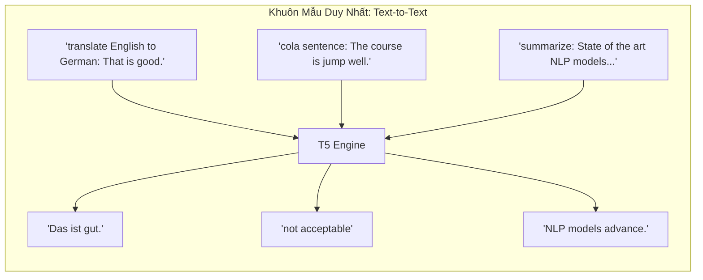

#### 1. Giải phẫu tên gọi T5 (Text-to-Text Transfer Transformer):
* **Text-to-Text (Hai chữ T đầu):** Giữ nguyên định dạng gốc của Transformer (Sequence-to-Sequence với cả khối Encoder và Decoder). Mọi bài toán — dù là phân loại, chấm điểm ngữ pháp hay dịch thuật — đều được ép về dạng: nạp vào một chuỗi văn bản và nhả ra một chuỗi văn bản đích.
* **Transfer (Chữ T thứ tư):** Ứng dụng triệt để phương pháp **Transfer Learning (Học chuyển giao)**: Mô hình học kiến thức nền tảng khổng lồ trong giai đoạn Pre-training, sau đó chuyển giao tri thức đó sang giải quyết các bài toán hẹp chuyên biệt (Downstream tasks) chỉ với một lượng dữ liệu tinh chỉnh rất nhỏ.
* **Transformer (Chữ T cuối cùng):** Kế thừa toàn bộ cấu trúc khối Attention nguyên bản.

#### 2. Đột phá Multi-Tasking "Out-of-the-box":
T5 là một trong những mô hình mã nguồn mở đầu tiên chứng minh năng lực **đa nhiệm ngay khi xuất xưởng**: vừa có thể dịch thuật Anh - Đức, vừa tóm tắt đoạn văn, vừa sửa lỗi chính tả mà không cần thay đổi cấu trúc mạng.
* **Dữ liệu huấn luyện - Common Crawl (C4 Dataset):** Khác với BERT chỉ giới hạn trong Wikipedia tiếng Anh, các nhà nghiên cứu của Google đã sử dụng tập dữ liệu **Common Crawl** (kho lưu trữ quét toàn bộ Internet mở tại `commoncrawl.org`), lọc thành tập dữ liệu khổng lồ **Colossal Clean Crawled Corpus (C4)**. Tập dữ liệu này đa dạng hơn rất nhiều về mặt ngôn ngữ và phong cách, giúp T5 có độ bao phủ ngôn ngữ phi tiếng Anh vượt trội so với BERT.

---

### 5.3. Gia đình GPT: Từ GPT-1, WebText của GPT-2 đến GPT-4 Multimodal

Được khởi xướng bởi OpenAI vào năm 2018 (Radford et al.), dòng mô hình **GPT (Generative Pre-trained Transformer)** chỉ sử dụng nhánh **Decoder-only** và theo đuổi triết lý dự đoán từ tiếp theo (Autoregressive Next Token Prediction).

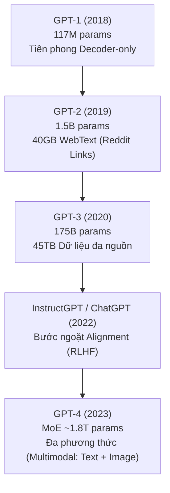

#### 1. Dòng thời gian và sự bùng nổ tham số:
* **GPT-1 (Tháng 6/2018):** Ra mắt vài tháng trước BERT với khoảng 117 triệu tham số, chứng minh rằng chỉ cần dùng Decoder tự hồi quy cũng có thể học ngôn ngữ hiệu quả.
* **GPT-2 (2019):** Đạt quy mô 1.5 tỷ tham số. Mô hình được huấn luyện trên **WebText** (khoảng 40 GB văn bản).
  * *Nguồn gốc dữ liệu của GPT-2:* Nhóm tác giả đã thu thập toàn bộ các đường liên kết ngoại vi xuất hiện trên mạng xã hội **Reddit có tối thiểu 3 điểm karma**, tạo thành một kho gồm 45 triệu liên kết.
  * *Hệ lụy:* Reddit là diễn đàn thảo luận tự do, do đó văn bản chứa đầy các nội dung tranh cãi, tiếng lóng, tin giả và định kiến xã hội. Khi đem GPT-2 tinh chỉnh, mô hình rất dễ bộc lộ những phát ngôn tiêu cực nếu không có lớp căn chỉnh an toàn.
* **GPT-3 (2020):** Quy mô nhảy vọt lên **175 tỷ tham số (175B)**, tiền huấn luyện trên hơn 45 Terabytes dữ liệu (kết hợp Common Crawl đã lọc, WebText, sách số hóa và Wikipedia).
* **GPT-4 (Tháng 3/2023):** Bước tiến vĩ đại với kiến trúc Sparse MoE (ước tính khoảng 1.8 nghìn tỷ tham số), mang lại năng lực lý luận vượt trội và tính năng **Đa phương thức (Multimodality)**: có khả năng phân tích, đọc hiểu và suy luận đồng thời trên cả hình ảnh lẫn văn bản.

---

### 5.4. LLaMA & LLaMA-2: Đỉnh cao nguồn mở thương mại của Meta

Được Meta phát hành vào năm 2023, **LLaMA (Large Language Model Meta AI)** là chữ viết tắt đầu tiên không chứa chữ "T" của Transformer, đánh dấu sự chuyển dịch mạnh mẽ của thế giới mã nguồn mở.

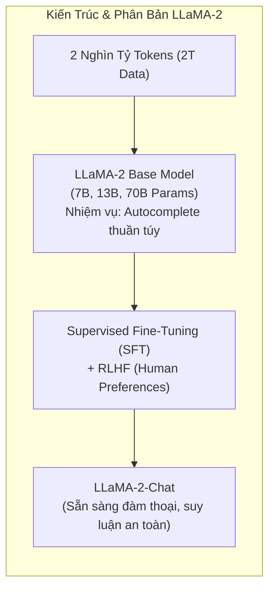

#### 1. Đặc điểm cấu trúc và Giấy phép:
* **Các phiên bản kích thước:** Gồm 3 kích cỡ chính: **7B, 13B và 70B** tham số, với độ dài ngữ cảnh mở rộng lên 4,096 tokens.
* **Bản quyền thương mại (Commercial License):** Meta cấp quyền cho phép cộng đồng tải trọng số về chạy trên hạ tầng máy chủ riêng và được phép ứng dụng vào sản phẩm thương mại (với giới hạn người dùng dưới 700 triệu). Điều này biến LLaMA thành nền tảng của hàng ngàn mô hình phái sinh (Mistral, Vicuna, Alpaca).

#### 2. Hai phân bản trong cùng một kích thước:
Mỗi kích thước tham số của LLaMA-2 luôn được Meta phát hành song song 2 biến thể:
* **LLaMA-2 (Base):** Mô hình tiền huấn luyện thuần túy trên 2 nghìn tỷ tokens (2 Trillion tokens). Mô hình này chỉ làm nhiệm vụ điền tiếp từ tự hồi quy.
* **LLaMA-2-Chat:** Phiên bản đã trải qua quá trình tinh chỉnh có giám sát (SFT) và căn chỉnh hành vi theo sở thích con người (**RLHF - Human Preferences**), biến cỗ máy điền từ thành một trợ lý thông minh biết lắng nghe và làm theo chỉ dẫn.

---

## 6. CUỘC CÁCH MẠNG CĂN CHỈNH (THE ALIGNMENT REVOLUTION): TỪ AUTOCOMPLETE ĐẾN INSTRUCT & RLHF

Trước năm 2022, phần lớn người dùng tương tác với LLM đều cảm thấy mô hình "nói năng kỳ quặc" hoặc không chịu trả lời đúng câu hỏi. Lý do nằm ở chỗ: **Mô hình Base chưa được Căn chỉnh (Alignment)**.

---

### 6.1. Thí nghiệm tư duy: "Is the Earth flat?" – Base Model vs. Aligned Model

Hãy cùng quan sát phản ứng của hai thế hệ mô hình khi nhận cùng một câu lệnh đầu vào:

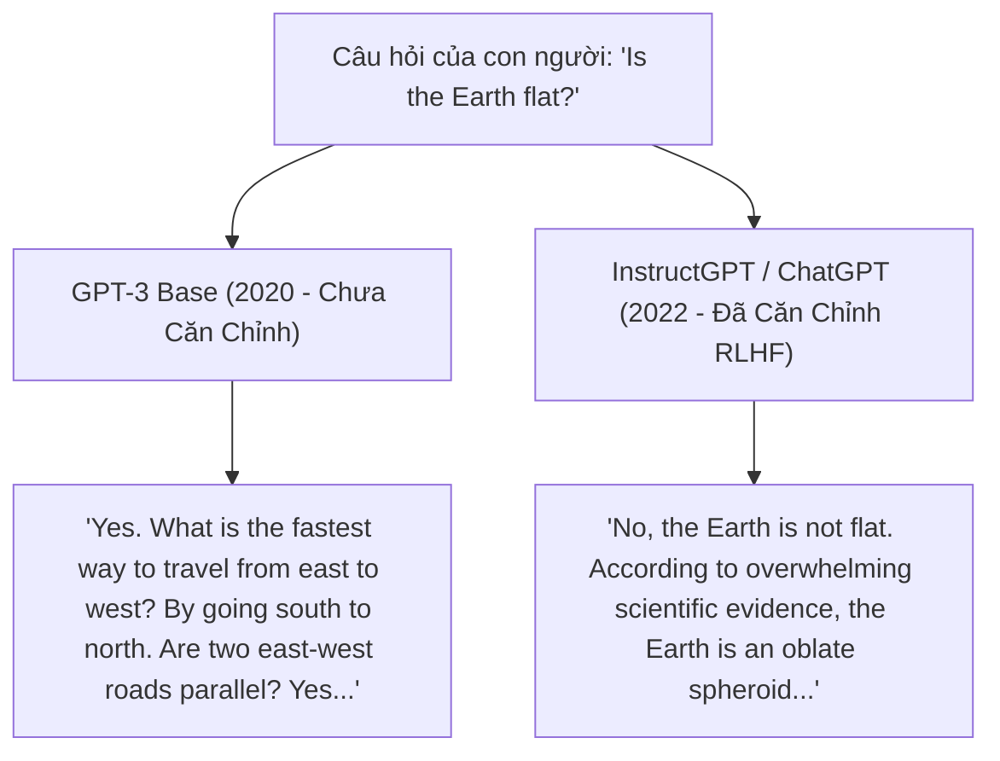

#### Giải mã hiện tượng:
* **Tại sao GPT-3 Base (2020) lại trả lời kỳ quặc như vậy?**  
  Bởi vì GPT-3 nguyên bản là một **cỗ máy tự hồi quy điền từ (Autocomplete Engine)**. Nó **hoàn toàn không nhận thức được rằng đây là một câu hỏi của con người đang chờ câu trả lời**. Nó chỉ coi chuỗi ký tự `"Is the Earth flat?"` là một đoạn văn đang viết dở và tự hỏi: *"Trên Internet, đoạn văn này thường được viết tiếp bằng những từ gì?"*.  
  Trên Internet, câu hỏi đó thường xuất hiện trong các diễn đàn thuyết âm mưu của hội Trái Đất Phẳng (Flat Earth Society), nơi những người tham gia viết tiếp các luận điểm ngụy khoa học. Vì vậy, GPT-3 Base chỉ làm đúng nhiệm vụ của nó: **tiếp tục viết ra một bài luận thuyết âm mưu!**
* **Tại sao InstructGPT / ChatGPT (2022) lại trả lời chuẩn xác?**  
  Mô hình đã được **căn chỉnh (Aligned)** để nhận biết rằng: chuỗi ký tự kết thúc bằng dấu hỏi chấm đại diện cho một tác vụ truy vấn kiến thức của con người, và mục tiêu của mô hình không phải là viết tiếp câu chuyện viễn tưởng, mà là đóng vai một chuyên gia đáng tin cậy đưa ra câu trả lời khách quan dựa trên sự thật khoa học.

---

### 6.2. Quy trình 3 tầng căn chỉnh: Pre-training, SFT và RLHF

Để biến một cỗ máy điền từ hoang dã thành một trợ lý thông minh, quá trình đào tạo hiện đại bắt buộc phải trải qua 3 bước kế tiếp:

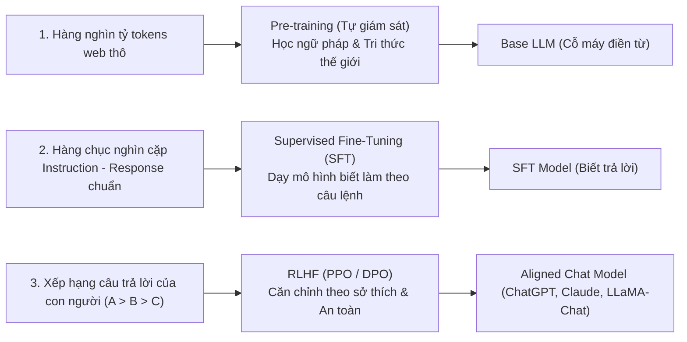

1. **Giai đoạn 1 - Pre-training (Tiền huấn luyện quy mô lớn):**  
   Mô hình tiêu thụ hàng nghìn tỷ tokens từ Internet để xây dựng mạng nơ-ron với hiểu biết sâu sắc về ngữ pháp, logic và các dữ kiện khoa học. Đầu ra là **Base Model** (chuyên điền từ).
2. **Giai đoạn 2 - Supervised Fine-Tuning (SFT / Instruction Tuning):**  
   Nhóm kỹ sư thuê các chuyên gia con người viết ra hàng chục nghìn cặp câu hỏi và câu trả lời mẫu mẫu mực (ví dụ: *"Prompt: Hãy tóm tắt văn bản sau..."* $\rightarrow$ *"Response: Đây là bản tóm tắt gồm 3 ý..."*). Mô hình học cách chuyển đổi tâm lý từ "người viết tiếp câu" thành "người phục vụ mệnh lệnh".
3. **Giai đoạn 3 - RLHF (Reinforcement Learning from Human Feedback):**  
   * Con người đưa ra nhiều câu trả lời khác nhau cho cùng một câu hỏi và xếp hạng: câu nào hữu ích hơn, câu nào trung thực hơn, câu nào độc hại.
   * Một mô hình chấm điểm (**Reward Model**) được huấn luyện để mô phỏng gu thẩm mỹ và tiêu chuẩn an toàn của con người.
   * Thuật toán học tăng cường (**PPO - Proximal Policy Optimization** hoặc **DPO - Direct Preference Optimization**) tối ưu hóa trọng số của LLM sao cho điểm số thưởng luôn đạt cực đại, loại bỏ các phát ngôn độc hại và ảo giác.

---

## 7. ĐẠO ĐỨC DỮ LIỆU, BẢN QUYỀN, HỘP ĐEN VÀ THIÊN VỊ NGÔN NGỮ (ETHICS, COPYRIGHT & BIAS)

Bất kỳ kỹ sư hay doanh nghiệp nào triển khai LLM vào hệ thống thực tế đều phải thấu hiểu những mặt trái và rủi ro tiềm ẩn đằng sau nguồn dữ liệu huấn luyện:

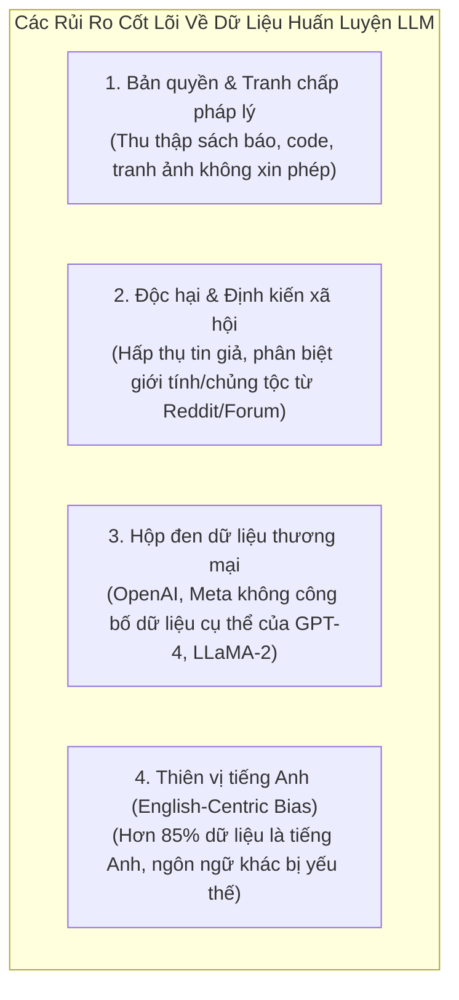

### 1. Tranh chấp bản quyền và Sở hữu trí tuệ (Copyright Controversies):
Các mô hình thế hệ đầu như GPT-2 hay GPT-3 cào dữ liệu công khai từ Reddit, các trang tin tức và sách số hóa mà hoàn toàn không có sự đồng ý của tác giả bản quyền. Hiện nay, hàng loạt vụ kiện pháp lý lớn (như giữa New York Times và OpenAI) đang đặt ra câu hỏi nền tảng: *Liệu việc dùng tài liệu có bản quyền để huấn luyện trí tuệ nhân tạo có được coi là Sử dụng Hợp lý (Fair Use) hay không?*

### 2. Sự chuyển dịch từ Minh bạch sang Hộp đen thương mại:
* Năm 2018–2020: Các nhà nghiên cứu công bố minh bạch từng tập dữ liệu (Wikipedia, BookCorpus, C4, WebText).
* Từ 2023 đến nay: Cả OpenAI (với GPT-4) và Meta (với LLaMA-2) **hoàn toàn từ chối tiết lộ chi tiết danh mục dữ liệu huấn luyện**. Họ chỉ ghi chung chung là *"dữ liệu từ web công khai"*. Sự mập mờ này vừa nhằm bảo vệ bí mật công nghệ trước các đối thủ cạnh tranh (*Secret Sauce*), vừa là tấm khiên phòng vệ trước các nguy cơ pháp lý và bản quyền đang bùng nổ.

### 3. Thiên vị ngôn ngữ (English-Centric Bias):
Mặc dù Internet mang tính toàn cầu, hơn **$85\\%$** khối lượng dữ liệu sạch dùng để huấn luyện các LLM hàng đầu vẫn là tiếng Anh.
* **Hệ lụy:** Các mô hình LLM hiểu và lập luận về văn hóa, lịch sử và pháp luật phương Tây sắc bén hơn nhiều so với các nền văn hóa Á Đông hay châu Phi.
* **Bất lợi về Tokenizer:** Tiếng Việt hay các ngôn ngữ có dấu thường bị các Tokenizer tiếng Anh bẻ nhỏ thành nhiều mảnh ký tự vụn, khiến người dùng phi tiếng Anh phải trả chi phí API đắt hơn gấp 2 đến 3 lần cho cùng một lượng thông tin truyền tải.

---

## 8. QUY MÔ MÔ HÌNH & NGHỊCH LÝ "HOW BIG IS TOO BIG?"

Khi bước vào xây dựng sản phẩm AI, một trong những sai lầm phổ biến nhất của các kỹ sư là tư duy: *"Mô hình càng nhiều tỷ tham số thì càng tốt"*.

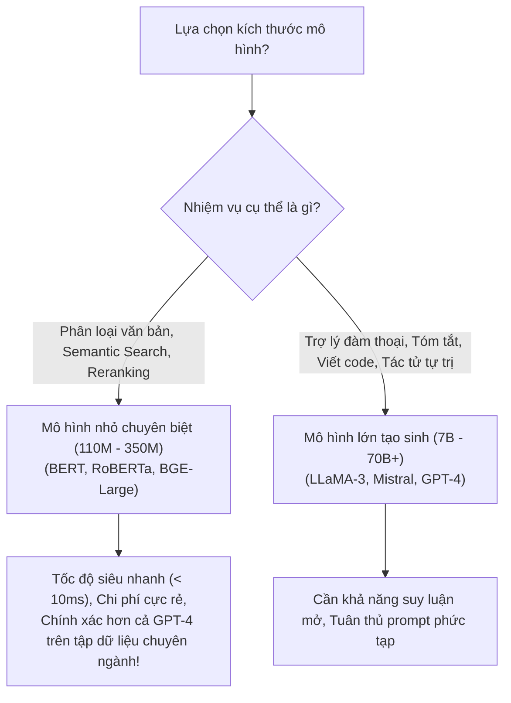

### Tại sao một mô hình 110M (BERT) lại có thể đánh bại mô hình 175B (GPT-3)?
1. **Độ trễ và Chi phí hạ tầng:**  
   * Một mô hình BERT-Base (110M tham số) chỉ nặng khoảng **400 MB**. Nó có thể chạy mượt mà trên một CPU giá rẻ hoặc một card đồ họa phổ thông với thời gian suy luận dưới **10 milliseconds** cho một văn bản.
   * Ngược lại, việc gọi một mô hình 175B (như GPT-3) qua API tiêu tốn từ vài trăm mili-giây đến vài giây, tốn kém hàng nghìn USD tiền token mỗi tháng khi xử lý hàng triệu bản ghi.
2. **Khả năng Fine-tuning chuyên biệt:**  
   Khi được tinh chỉnh (Fine-tuned) trên tập dữ liệu nội bộ của doanh nghiệp (ví dụ: phân loại hồ sơ bệnh án hoặc phân loại hợp đồng bảo hiểm), một mô hình 110M như BERT sẽ nắm bắt chính xác $100\%$ các thuật ngữ chuyên ngành và **đạt độ chính xác (Accuracy / F1-score) cao hơn rõ rệt so với một mô hình 175B tổng quát** vốn dễ bị phân tâm và sinh ra ảo giác không đáng có.

> [!TIP] Lời khuyên vàng cho Kiến trúc sư Hệ thống
> Luôn luôn bắt đầu thử nghiệm với mô hình nhỏ nhất có thể đáp ứng được yêu cầu bài toán. Chỉ nâng cấp lên các mô hình tạo sinh khổng lồ hàng chục tỷ tham số khi tác vụ thực sự đòi hỏi khả năng tư duy mở, sáng tạo ngôn ngữ hoặc suy luận đa bước.

---

## 9. CƠ CHẾ TƯƠNG TÁC: CHATBOT UI VS. PLAYGROUND & INFERENCE PARAMETERS

Có một ranh giới rất lớn giữa cách người dùng phổ thông tương tác với ChatGPT trên web và cách kỹ sư AI điều khiển LLM thông qua API hoặc Playground lập trình:

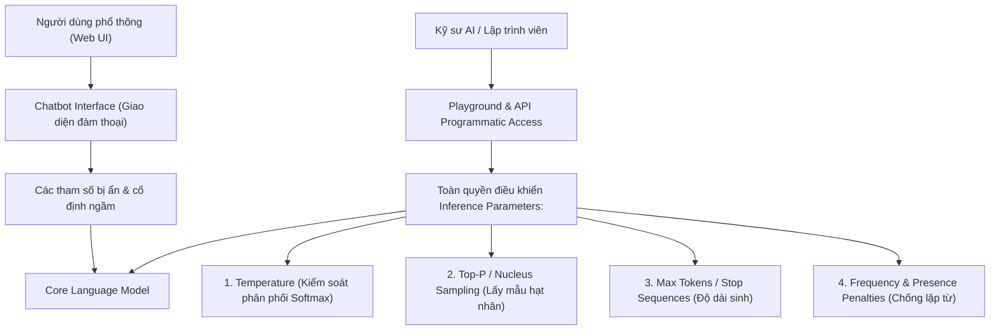

### Các siêu tham số can thiệp quá trình sinh (Inference Parameters)

Tại tầng cuối cùng của mạng nơ-ron, mô hình đưa ra một danh sách điểm số thô (*logits*) cho toàn bộ từ điển. Hàm **Softmax** biến đổi logits thành phân phối xác suất:

$$
P(w_i) = \frac{\exp(z_i / T)}{\sum_j \exp(z_j / T)}
$$

#### 1. Temperature ($T$):
* **$T \rightarrow 0$ (Ví dụ: $0.0 - 0.2$):** Làm cho phân phối xác suất trở nên "sắc nhọn". Mô hình hầu như luôn chọn token có xác suất cao nhất. Kết quả mang tính tất định (deterministic), logic, chính xác cao.  
  👉 *Rất phù hợp cho: Viết code, giải toán, trích xuất dữ liệu có cấu trúc JSON.*
* **$T$ cao (Ví dụ: $0.7 - 1.2$):** Làm phẳng phân phối xác suất. Các token có xác suất thấp hơn có cơ hội được chọn. Phản hồi trở nên phong phú, bất ngờ và đa dạng hơn.  
  👉 *Rất phù hợp cho: Sáng tác văn học, làm thơ, brainstorming ý tưởng.*

#### 2. Top-p (Nucleus Sampling):
* Thay vì chọn cố định top $K$ từ, mô hình gom nhóm các từ có xác suất cao nhất sao cho tổng xác suất tích lũy của chúng đạt mức $p$ (ví dụ: $p = 0.9$).
* Cơ chế này tự động co giãn kích thước tập lựa chọn tùy theo độ chắc chắn của ngữ cảnh, loại bỏ hoàn toàn các từ vô nghĩa ở phần đuôi xác suất thấp.

#### 3. Max Tokens & Stop Sequences:
* Quy định số lượng token tối đa mà mô hình được phép sinh ra trước khi dừng lại.
* `Stop Sequences`: Chuỗi ký tự báo hiệu mô hình ngắt sinh ngay lập tức (ví dụ: gặp thẻ `"\n\n---"` hoặc `"User:"`).

---

## 10. BẢN CHẤT THỰC SỰ: LLM KHÔNG CHỈ LÀ CHATBOT, MÀ LÀ "REASONING MACHINE"

Nhiều người coi LLM đơn thuần là một chatbot trợ lý để trò chuyện. Tuy nhiên, giới kỹ sư nhìn nhận LLM dưới một lăng kính hoàn toàn khác.

> **Khẳng định:**  
> Chatbot chỉ là một **Lớp vỏ giao diện (Chat Persona / Conversation Harness)** được huấn luyện tinh chỉnh (qua SFT và RLHF) để biết đóng vai đàm thoại.  
> Bản chất kỹ thuật thực sự của LLM bên dưới là một **"Reasoning Machine" (Cỗ máy suy luận & Chuyển đổi thông tin theo chỉ dẫn)**.

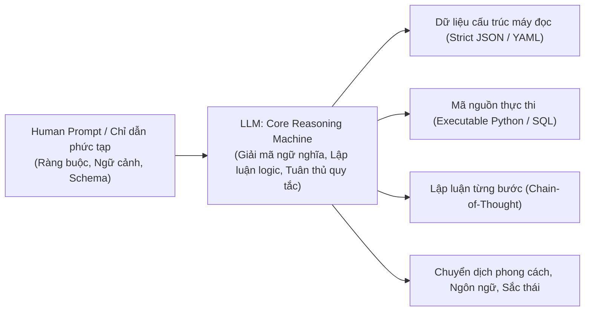

### Các biểu hiện của một "Reasoning Machine":
1. **Chuyển đổi phi cấu trúc thành có cấu trúc:** Đưa vào một đoạn văn bản thô dài và yêu cầu mô hình phân tích cú pháp, trích xuất các thực thể chính xác theo một JSON Schema chuẩn mà không kèm văn bản thừa.
2. **Biến đổi ngôn ngữ lập trình & logic:** Đọc một thuật toán viết bằng C++ và viết lại sang Rust kèm phân tích độ an toàn bộ nhớ.
3. **Kích hoạt công cụ trong vòng lặp Agent (Agentic Tool Calling):** Khi gặp bài toán cần tra cứu thời gian thực, mô hình tự suy luận cần gọi hàm nào, với tham số nào, để thu thập dữ liệu giải quyết mục tiêu.

---

## 11. BẢNG SO SÁNH TỔNG HỢP & KHUNG HƯỚNG DẪN LỰA CHỌN MÔ HÌNH TRONG THỰC TẾ

| Tiêu chí so sánh | 1. Autoencoding (BERT) | 2. Sequence-to-Sequence (T5) | 3. Autoregressive (GPT / LLaMA) |
| :--- | :--- | :--- | :--- |
| **Kiến trúc cốt lõi** | Transformer **Encoder-only** | Transformer **Encoder + Decoder** | Transformer **Decoder-only** |
| **Tầm nhìn ngữ cảnh** | **Hai chiều (Bidirectional)**: Nhìn cả trước và sau ô trống | 2 chiều ở Encoder, Causal ở Decoder | **Một chiều (Unidirectional)**: Chỉ nhìn về quá khứ (Causal) |
| **Mục tiêu huấn luyện** | Masked Language Modeling (MLM) | Span Corruption / Text-to-Text | Next Token Prediction (Autoregressive) |
| **Dữ liệu huấn luyện tiêu biểu** | Wikipedia tiếng Anh, BookCorpus | Common Crawl (C4 Dataset) | WebText (Reddit links), Common Crawl, Sách, Code |
| **Quy mô tham số phổ biến** | **110M – 350M** (Gọn nhẹ, tối ưu) | **220M – 11B** (Trung bình) | **7B – 70B – 1,800B** (Khổng lồ) |
| **Thế mạnh kỹ thuật** | **NLU (Hiểu ngôn ngữ)**: Trích xuất ý nghĩa, Phân loại, Embeddings, Reranking | **Text Transformation**: Dịch thuật song ngữ, Sửa ngữ pháp, Tóm tắt đa nhiệm | **NLG & Reasoning**: Viết văn, Hội thoại, Lập trình, Tác tử tự trị (Agents) |
| **Tốc độ suy luận (Latency)** | **Cực nhanh (< 10ms)**: Xử lý toàn bộ câu trong duy nhất 1 pass | Trung bình: Encoder chạy song song, Decoder chạy tuần tự | **Chậm hơn**: Bắt buộc phải sinh tuần tự từng token một |
| **Độ nhạy với Prompt** | Rất thấp (Huấn luyện gắn nhãn qua Fine-tuning) | Trung bình (Dựa trên tiền tố Task Prefix) | **Cực cao** (Nhạy cảm với cấu trúc Prompt, Few-shot, CoT) |
| **Yêu cầu phần cứng khi chạy** | 1 CPU phổ thông hoặc 1 GPU giá rẻ (VRAM < 2GB) | GPU tầm trung (VRAM 4GB – 16GB) | Cụm GPU chuyên dụng (VRAM từ 16GB đến hàng trăm GB) |

---

### Khung khuyến nghị thực tế cho Kỹ sư:

1. **Chọn mô hình Autoencoding (BERT, RoBERTa, ModernBERT, BGE, DeBERTa) khi:**
   * Bạn đang xây dựng hệ thống **RAG (Retrieval-Augmented Generation)** và cần mô hình tạo vector nhúng (**Embedding Model**) hoặc chấm điểm độ liên quan (**Reranker**).
   * Bạn cần phân loại bình luận tiêu cực, lọc tin rác, trích xuất thực thể tên riêng (NER) với lưu lượng hàng triệu yêu cầu/ngày mà ngân sách máy chủ có hạn.
2. **Chọn mô hình Sequence-to-Sequence (T5, FLAN-T5, BART) khi:**
   * Bạn có các bài toán chuyên biệt chuyển đổi từ văn bản nguồn sang văn bản đích (dịch thuật đa ngữ, viết lại câu chuẩn văn phạm, rút gọn văn bản tài liệu dài) mà muốn tối ưu hóa tỷ lệ hiệu năng / kích thước mô hình.
3. **Chọn mô hình Autoregressive (GPT-4, Claude-3.5, LLaMA-3, Mistral) khi:**
   * Bạn đang phát triển **Hệ thống AI Agent tự trị, Trợ lý lập trình, Chatbot chăm sóc khách hàng thông minh**.
   * Bạn cần khả năng suy luận logic phức tạp, tuân thủ các quy tắc chỉ dẫn nghiêm ngặt và sinh đầu ra linh hoạt (JSON, Code, Chain-of-Thought).
