# TỔNG QUAN TOÀN DIỆN VỀ MÔ HÌNH NGÔN NGỮ LỚN (LARGE LANGUAGE MODELS - LLMs)
## Lịch Sử Phát Triển, Cơ Chế Kỹ Thuật, Phân Loại Kiến Trúc & Bản Chất "Reasoning Machine"

---

## MỤC LỤC
1. [Khái niệm cốt lõi: Language Model (LM) là gì?](#1-khái-niệm-cốt-lõi-language-model-lm-là-gì)
2. [Biểu diễn ngôn ngữ: Từ Word đến Tokenization](#2-biểu-diễn-ngôn-ngữ-từ-word-đến-tokenization)
3. [Dòng thời gian tiến hóa (2001 – Nay): 4 bước nhảy vọt định hình NLP](#3-dòng-thời-gian-tiến-hóa-2001--nay-4-bước-nhảy-vọt-định-hình-nlp)
4. [Giải phẫu 2 trường phái kiến trúc: Autoregressive vs. Autoencoding](#4-giải-phẫu-2-trường-phái-kiến-trúc-autoregressive-vs-autoencoding)
5. [Quy mô "Large" trong LLM: Tham số, Dữ liệu & Điện toán](#5-quy-mô-large-trong-llm-tham-số-dữ-liệu--điện-toán)
6. [Cơ chế tương tác: Chatbot UI vs. Playground & API Inference Parameters](#6-cơ-chế-tương-tác-chatbot-ui-vs-playground--api-inference-parameters)
7. [Bản chất thực sự: LLM không chỉ là Chatbot, mà là "Reasoning Machine"](#7-bản-chất-thực-sự-llm-không-chỉ-là-chatbot-mà-là-reasoning-machine)
8. [Bảng so sánh tổng hợp & Khuyến nghị lựa chọn kiến trúc](#8-bảng-so-sánh-tổng-hợp--khuyến-nghị-lựa-chọn-kiến-trúc)

---

## 1. KHÁI NIỆM CỐT LÕI: LANGUAGE MODEL (LM) LÀ GÌ?

Trước khi có chữ **"Large" (Lớn)**, chúng ta cần hiểu bản chất toán học của một **"Language Model" (Mô hình hóa ngôn ngữ)**.

### Thí nghiệm tư duy: "Fill-in-the-blank"
Hãy xem xét câu đố điền từ quen thuộc:
> *"If you don't **[BLANK]** at the sign, you will get a ticket."*  
> *(Nếu bạn không **[......]** tại biển báo, bạn sẽ bị phạt.)*

Khi đọc đến chỗ trống, não bộ con người lập tức kích hoạt cơ chế thống kê dựa trên kinh nghiệm tiếp xúc với ngôn ngữ trong đời sống:
* Từ xuất hiện đầu tiên với tần suất cao nhất: **"stop"** (dừng lại).
* Một phương án khác hoàn toàn đúng về mặt ngữ pháp lẫn ngữ nghĩa: **"yield"** (nhường đường), hoặc *"slow down"*.
* Từ bất hợp lý: *"dance"*, *"sing"*, *"apple"*.

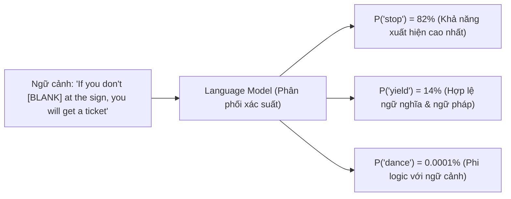

> [!NOTE] **Định nghĩa toán học của Language Modeling:**  
> **Language Modeling** là nhiệm vụ ước lượng phân phối xác suất chung của các chuỗi từ/ký hiệu trong ngôn ngữ tự nhiên. Về bản chất, mô hình được huấn luyện để giải một bài toán thống kê cơ bản: **Dự đoán từ bị khuyết (missing word) hoặc từ tiếp theo (next word) dựa trên ngữ cảnh cho trước.**

$$
P(w_1, w_2, \dots, w_n) = \prod_{i=1}^n P(w_i \mid \text{Context})
$$

Con người khi đọc hiểu văn bản cũng liên tục đưa ra các phán đoán xác suất tiềm thức tương tự. Bạn đọc được câu này trôi chảy chính vì não bạn liên tục dự đoán trước các từ tiếp theo dựa trên vốn từ và ngữ cảnh xung quanh.

---

## 2. BIỂU DIỄN NGÔN NGỮ: TỪ WORD ĐẾN TOKENIZATION

Máy tính là thiết bị xử lý số học thuần túy; nó không có khái niệm trực tiếp về chữ cái, ngữ nghĩa hay văn phạm. Do đó, văn bản thô (raw text) bắt buộc phải được mã hóa thành các con số trước khi đưa vào mô hình.

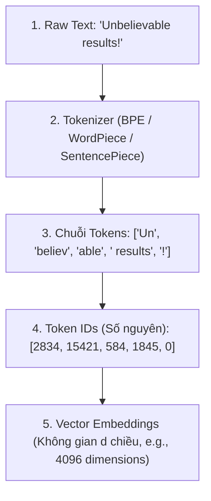

### Phân biệt Word vs. Token: Tại sao Token không đồng nhất với Word?
* **Word (Từ ngữ học):** Đơn vị ngôn ngữ hoàn chỉnh (ví dụ: *"anthropology"*, *"chạy bộ"*).
* **Token (Đơn vị tính toán):** Là các mảnh ký tự (subwords), từ đơn, hoặc thậm chí là ký tự đơn lẻ tùy thuộc vào bộ từ vựng (**Vocabulary**) cố định của mô hình (thường dao động từ 32,000 đến 128,000 token IDs).

#### Cơ chế tách từ (Subword Tokenization - BPE):
1. **Từ thông dụng:** Giữ nguyên thành 1 token duy nhất (ví dụ: `"apple"` $\rightarrow$ `["apple"]`).
2. **Từ hiếm, từ chuyên ngành, từ ghép:** Bị tách thành các tiền tố, căn tố và hậu tố:
   * `"unbelievable"` $\rightarrow$ `["un", "believ", "able"]` (3 tokens).
   * `"tokenization"` $\rightarrow$ `["token", "ization"]` (2 tokens).
3. **Mã nguồn lập trình & Dấu câu:** Khoảng trắng thụt lề, dấu ngoặc, dấu chấm câu đều có token riêng:
   * `"\n    def "` $\rightarrow$ có thể là 1 token đặc thù chứa cả ký tự xuống dòng và thụt 4 khoảng trắng.

> [!NOTE] Quy tắc ước lượng thực tế
> Trong tiếng Anh: **100 từ $\approx$ 130 – 135 tokens** (hoặc 1 token $\approx$ 0.75 từ / 4 ký tự).  
> Đối với tiếng Việt hoặc các ngôn ngữ giàu dấu thanh điệu, nếu tokenizer chưa được huấn luyện đủ dữ liệu bản địa, một từ có thể bị bẻ nhỏ thành nhiều byte tokens, làm tăng chi phí tính toán và làm hẹp cửa sổ ngữ cảnh thực tế.

---

## 3. DÒNG THỜI GIAN TIẾN HÓA (2001 – NAY): 4 BƯỚC NHẢY VỌT ĐỊNH HÌNH NLP

Sự bùng nổ của các LLM như GPT-4 hay Claude ngày nay là đỉnh cao kế thừa từ 4 bước chuyển dịch mô thức (*step functions*) công nghệ lớn trong hơn 20 năm qua:

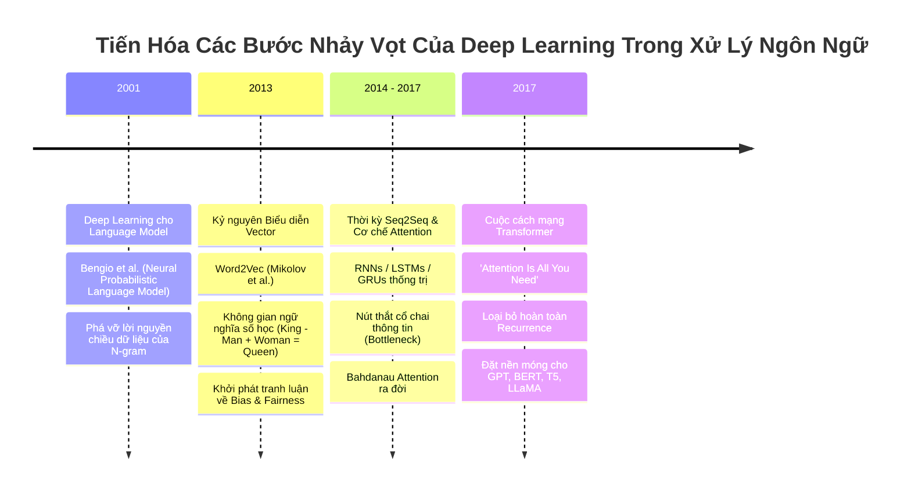

---

### Bước 1 (2001): Deep Learning kết hợp Language Modeling (Yoshua Bengio et al.)
* **Bối cảnh:** Trước năm 2001, các hệ thống NLP cổ điển dựa vào thống kê $N$-gram (đếm tần suất cùng xuất hiện của $N$ từ liền kề). Hạn chế chết người của $N$-gram là **Lời nguyền chiều dữ liệu (Curse of Dimensionality)**: nếu một cụm từ chưa từng xuất hiện trong tập huấn luyện, xác suất của nó mặc định bằng 0, không có khả năng khái quát hóa.
* **Đột phá:** Bài báo của Yoshua Bengio đề xuất dùng **Mạng nơ-ron truyền thẳng (Feed-Forward Neural Network)** để học mô hình ngôn ngữ. Mỗi từ được gán cho một vector số thực liên tục (**Distributed Representation**). Các từ mang ý nghĩa tương tự nhau (như "chó" và "mèo") sẽ nằm gần nhau trong không gian vector, giúp mô hình suy luận tốt cả với những cụm từ chưa từng gặp.

---

### Bước 2 (2013): Word2Vec – Số hóa ngữ nghĩa vào không gian Vector (Tomas Mikolov et al.)
* **Cơ chế:** Google giới thiệu mô hình Word2Vec gồm 2 kiến trúc mạng nơ-ron hiệu năng cao:
  1. **CBOW (Continuous Bag of Words):** Sử dụng các từ ngữ cảnh xung quanh để dự đoán từ trung tâm.
  2. **Skip-gram:** Sử dụng một từ trung tâm để dự đoán các từ ngữ cảnh xung quanh.

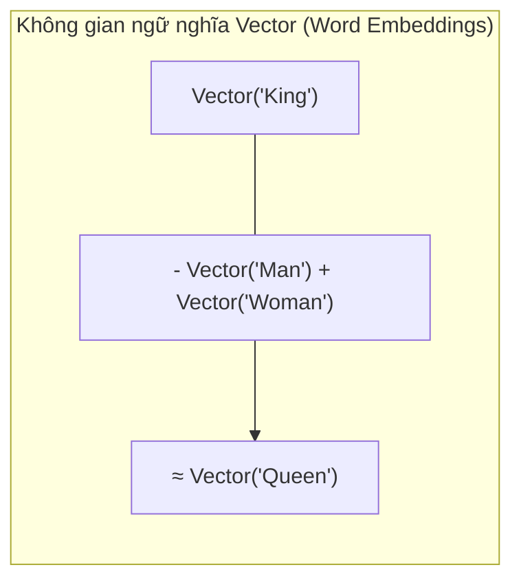

* **Đột phá:** Ngữ nghĩa của từ lần đầu tiên có thể tính toán số học:

$$
\vec{v}_{\text{King}} - \vec{v}_{\text{Man}} + \vec{v}_{\text{Woman}} \approx \vec{v}_{\text{Queen}}
$$
* **Khởi phát vấn đề Đạo đức & Định kiến (Bias & Fairness):** Vì học từ kho văn bản thực tế của con người, Word2Vec cũng hấp thụ toàn bộ các định kiến xã hội (ví dụ: mô hình liên kết các từ chỉ nghề nghiệp kỹ sư/bác sĩ với nam giới, và y tá/nội trợ với nữ giới). Đây là mốc thời gian mở đầu cho ngành nghiên cứu về độ công bằng và an toàn trong AI.

---

### Bước 3 (2014 – 2017): Sequence-to-Sequence & Sự trỗi dậy của Attention
* **Kiến trúc Seq2Seq:** Xử lý chuỗi văn bản (dịch thuật, tóm tắt) bằng 2 khối mạng hồi quy (RNN hoặc LSTM):
  * **Encoder:** Đọc từng từ một, tuần tự nén toàn bộ câu đầu vào vào một vector ẩn duy nhất (**Context Vector**).
  * **Decoder:** Nhận Context Vector đó và giải mã tuần tự ra câu đích.
* **Nút thắt cổ chai thông tin (Information Bottleneck):** Toàn bộ thông tin của một câu dài 50 từ hay một đoạn văn bị ép vào một vector kích thước cố định (ví dụ: 512 con số), khiến thông tin ở các từ đầu câu gần như bị xóa nhòa khi Encoder đọc đến cuối câu.
* **Cơ chế Attention sơ khai (Bahdanau et al., 2015):** Thay vì nén thành 1 vector tĩnh, Decoder được trang bị cơ chế "chú ý" (Attention). Tại mỗi bước sinh từ mới, Decoder có quyền **tính toán trọng số và nhìn lại toàn bộ các từ của câu gốc**, chọn ra từ nào quan trọng nhất để giải mã.

---

### Bước 4 (2017): Bước ngoặt Transformer – "Attention Is All You Need"
Năm 2017, nhóm nghiên cứu tại Google công bố bài báo kinh điển:
> **"Attention Is All You Need"** (Vaswani et al.)

Tiêu đề bài báo mang thông điệp mang tính cách mạng: **Không cần mạng nơ-ron hồi quy (RNN), không cần tích chập (CNN). Cơ chế Attention là tất cả những gì bạn cần!**

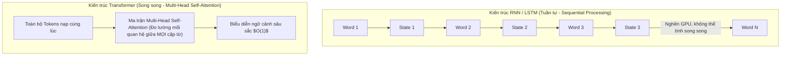

#### 2 ưu thế kỹ thuật áp đảo của Transformer:
1. **Khả năng song song hóa tối đa trên GPU:** Khác với RNN phải đợi tính xong từ thứ $t-1$ mới tính được từ thứ $t$, Transformer xử lý toàn bộ hàng nghìn token trong câu cùng một lúc qua các phép nhân ma trận lớn.
2. **Khắc phục hoàn toàn khoảng cách dài (Long-range dependencies):** Bất kỳ từ nào ở đầu đoạn văn cũng có thể "chú ý" trực tiếp đến từ ở cuối đoạn văn với chi phí bước truyền thông tin là $O(1)$.

Transformer chính là kiến trúc nền móng sinh ra toàn bộ các LLM hiện đại: **GPT, BERT, T5, LLaMA, Claude, Gemini**.

---

## 4. GIẢI PHẪU 2 TRƯỜNG PHÁI KIẾN TRÚC: AUTOREGRESSIVE VS. AUTOENCODING

Từ kiến trúc gốc Transformer (gồm cả khối Encoder và Decoder), thế giới NLP phân nhánh thành 2 trường phái lớn phục vụ 2 nhóm mục tiêu hoàn toàn khác nhau:

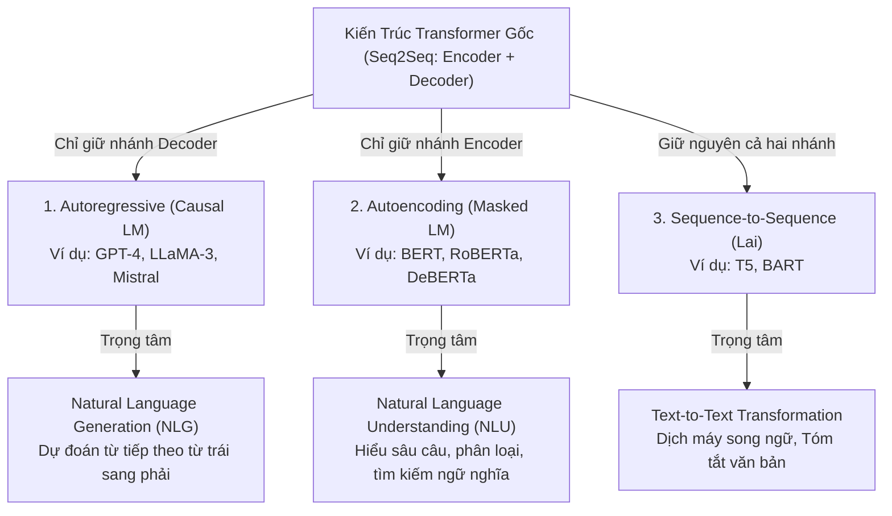

---

### A. Autoregressive Models (Mô hình Tự Hồi Quy / Causal Language Models)

#### 1. Cơ chế vận hành: Forward Predictive (Dự đoán tiến về phía trước)
Mô hình chỉ được phép tiếp cận ngữ cảnh **nằm phía trước** ô khuyết. Ô khuyết cần dự đoán luôn luôn nằm ở vị trí cuối cùng của chuỗi văn bản.

*Hàm xác suất sinh chuỗi (Causal LM Objective):*

$$
P(w_1, w_2, \dots, w_T) = \prod_{t=1}^T P(w_t \mid w_1, w_2, \dots, w_{t-1})
$$

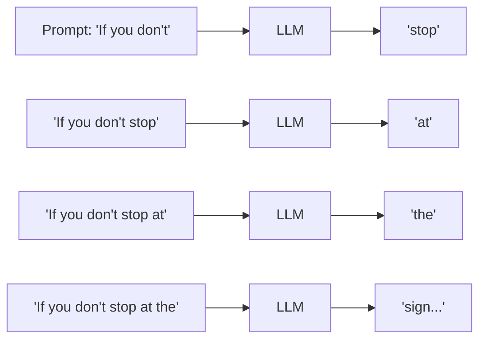

* **Cơ chế Causal Masking:** Trong ma trận Self-Attention, mô hình dùng một mặt nạ tam giác dưới để che đi toàn bộ các từ tương lai, không cho phép token hiện tại nhìn trộm đáp án phía sau.
* **Đặc tính:** Sinh văn bản tự do từng token một (Token-by-token autocomplete).
* **Đại diện tiêu biểu:** **GPT series** (OpenAI), **LLaMA series** (Meta), **Claude** (Anthropic), **Mistral**.
* **Ưu & Nhược điểm:**
  * ✅ Cực kỳ linh hoạt, có thể sinh bài văn, viết code, hội thoại tự do.
  * ❌ Quá trình sinh (Inference) chậm vì phải chạy lặp tuần tự từng token. Ngữ cảnh hiểu bị giới hạn 1 chiều (chỉ nhìn từ trái sang phải).

---

### B. Autoencoding Models (Mô hình Tự Mã Hóa / Masked Language Models)

#### 1. Cơ chế vận hành: Bidirectional Context (Ngữ cảnh 2 chiều toàn diện)
Mô hình che ngẫu nhiên một số token trong câu (ví dụ dùng token đặc biệt `[MASK]`), sau đó dùng **cả các từ đứng trước lẫn các từ đứng sau** để khôi phục lại từ gốc.

*Hàm mục tiêu huấn luyện (Masked LM Objective):*

$$
P(w_{\text{masked}} \mid w_{\text{left}}, w_{\text{right}})
$$

*(với $w_{\text{left}}$ và $w_{\text{right}}$ lần lượt là ngữ cảnh bên trái và bên phải của vị trí bị che).*

#### Ví dụ so sánh lợi thế ngữ cảnh:
* **Autoregressive (Chỉ nhìn trước):** *"If you don't [BLANK]"* $\rightarrow$ Rất khó đoán từ kế tiếp vì có quá nhiều khả năng (*mind, have, want, know, see...*).
* **Autoencoding (Nhìn cả 2 chiều):** *"If you don't **[MASK]** at the sign, you will get a ticket."* $\rightarrow$ Các từ phía sau (*"at the sign"*, *"ticket"*) cung cấp manh mối rõ ràng để xác định từ bị che phải là *"stop"* hoặc *"yield"*.

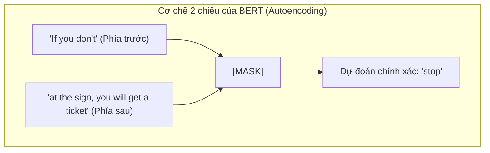

* **Đặc tính:** Xử lý toàn bộ chuỗi đầu vào song song trong duy nhất **một lượt truyền thẳng (One Forward Pass)**.
* **Đại diện tiêu biểu:** **BERT** (Google), **RoBERTa**, **DeBERTa**.
* **Ưu & Nhược điểm:**
  * ✅ Nắm bắt ý nghĩa câu và mối quan hệ ngữ pháp cực kỳ sâu sắc và nhanh chóng. Chi phí tính toán thấp.
  * ❌ Không thể sinh văn bản tự do dài (off-the-shelf) như các mô hình GPT.

---

### C. So sánh kiến trúc: Ma trận Attention Mask

Sự khác biệt cốt lõi trong giải thuật giữa Autoregressive và Autoencoding thể hiện rõ qua ma trận Attention Mask:

```
1. AUTOREGRESSIVE (Causal Mask)             2. AUTOENCODING (Full Bidirectional)
   Token chỉ được nhìn về quá khứ               Token được nhìn TOÀN BỘ câu
       T1   T2   T3   T4                           T1   T2   T3   T4
  T1 [  1    0    0    0 ]                    T1 [  1    1    1    1 ]
  T2 [  1    1    0    0 ]                    T2 [  1    1    1    1 ]
  T3 [  1    1    1    0 ]                    T3 [  1    1    1    1 ]
  T4 [  1    1    1    1 ]                    T4 [  1    1    1    1 ]
 (0 = bị che/không được nhìn; 1 = được tương tác)
```

---

## 5. QUY MÔ "LARGE" TRONG LLM: THAM SỐ, DỮ LIỆU & ĐIỆN TOÁN

Điều gì biến một "Language Model" thông thường thành một **"Large Language Model"**?

### Ngưỡng sàn kỹ thuật: 100 Triệu Tham Số (100M Parameters)
Trong cộng đồng học máy, không có một con số tuyệt đối trong từ điển, nhưng có một sự đồng thuận về ngưỡng tối thiểu:
* **Mức sàn để được gọi là Large:** Khoảng **100 triệu tham số (100M parameters)** trở lên.
  * BERT-base (2018): ~110M parameters.
  * GPT-1 (2018): ~117M parameters.
* **Các mô hình ngày nay:** Có quy mô từ hàng tỷ (**Billions - B**) đến hàng nghìn tỷ (**Trillions - T**) tham số.

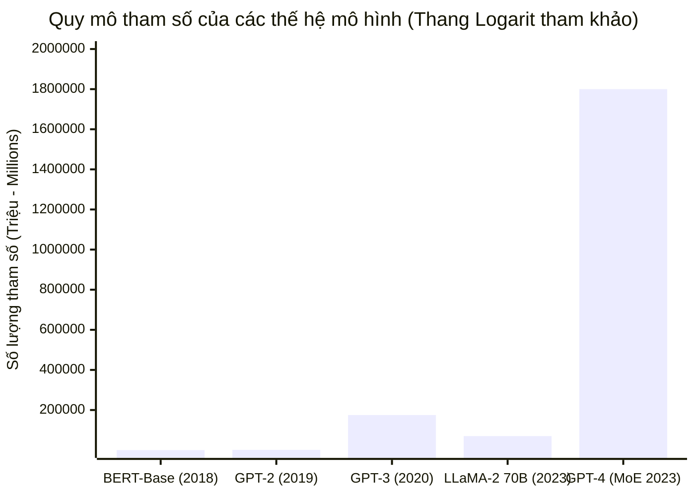

### Tham số (Parameters) là gì?
Tham số chính là các **Trọng số ($W$ - Weights)** và **Độ lệch ($b$ - Biases)** trong các phép nhân ma trận của mạng nơ-ron:
* Mỗi tham số là một số thực dấu phẩy động (Floating Point: FP32, FP16, BF16 hoặc FP8/INT4).
* **Nhu cầu bộ nhớ VRAM khi chạy:** Ước tính dung lượng bộ nhớ tối thiểu cho mô hình 70 tỷ tham số (70B) ở định dạng 16-bit (2 bytes mỗi tham số):

$$
\text{VRAM}_{\text{weights}} \approx 70 \times 10^9 \times 2 \text{ bytes} \approx 140 \text{ GB}
$$

chỉ riêng cho việc nạp trọng số mô hình vào bộ nhớ card đồ họa (chưa tính KV-cache trong quá trình suy luận).

### Dữ liệu tiền huấn luyện (Pre-training Data Scale)
Các LLM hiện đại được nạp một khối lượng dữ liệu khổng lồ:
* **Quy mô dữ liệu:** Từ hàng trăm tỷ đến **hàng nghìn tỷ tokens (Trillions of tokens)** trích xuất từ Internet (Common Crawl), thư viện sách số, bách khoa toàn thư Wikipedia, kho lưu trữ bài báo khoa học (arXiv), và mã nguồn mở (GitHub).
* **Sự hình thành tri thức:** Bằng cách dự đoán hàng nghìn tỷ lần các token bị khuyết trên kho dữ liệu toàn nhân loại, mô hình tự xây dựng một không gian nội hàm phản ánh quy luật ngữ pháp, logic suy luận, tri thức bách khoa và sắc thái phong cách viết.

---

## 6. CƠ CHẾ TƯƠNG TÁC: CHATBOT UI VS. PLAYGROUND & API INFERENCE PARAMETERS

Có một sự khác biệt rất lớn giữa cách người dùng thông thường trải nghiệm ChatGPT trên web và cách lập trình viên/kỹ sư điều khiển LLM thông qua API hoặc Playground.

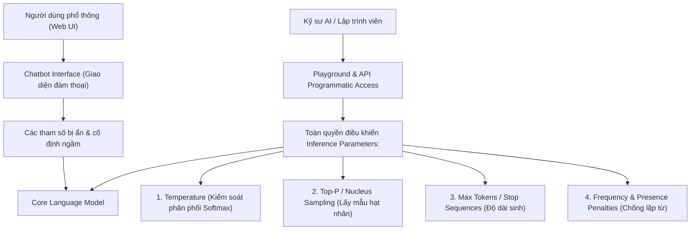

### Các siêu tham số can thiệp quá trình sinh (Inference Parameters)

Tại tầng cuối cùng của mạng nơ-ron, mô hình đưa ra một danh sách điểm số thô (*logits*) cho toàn bộ từ điển. Hàm **Softmax** biến đổi logits thành phân phối xác suất:

$$
P(w_i) = \frac{\exp(z_i / T)}{\sum_j \exp(z_j / T)}
$$

#### 1. Temperature ($T$)
* **$T \rightarrow 0$ (Ví dụ: $0.0 - 0.2$):** Làm cho phân phối xác suất trở nên "sắc nhọn". Mô hình hầu như luôn chọn token có xác suất cao nhất. Kết quả mang tính tất định (deterministic), logic, chính xác cao.  
  👉 *Rất phù hợp cho: Viết code, giải toán, trích xuất dữ liệu có cấu trúc JSON.*
* **$T$ cao (Ví dụ: $0.7 - 1.2$):** Làm phẳng phân phối xác suất. Các token có xác suất thấp hơn có cơ hội được chọn. Phản hồi trở nên phong phú, bất ngờ và đa dạng hơn.  
  👉 *Rất phù hợp cho: Sáng tác văn học, làm thơ, brainstorming ý tưởng.*

#### 2. Top-p (Nucleus Sampling)
* Thay vì chọn cố định top $K$ từ, mô hình gom nhóm các từ có xác suất cao nhất sao cho tổng xác suất tích lũy của chúng đạt mức $p$ (ví dụ: $p = 0.9$).
* Cơ chế này tự động co giãn kích thước tập lựa chọn tùy theo độ chắc chắn của ngữ cảnh, loại bỏ hoàn toàn các từ vô nghĩa ở phần đuôi xác suất thấp.

#### 3. Max Tokens & Stop Sequences
* Quy định số lượng token tối đa mà mô hình được phép sinh ra trước khi dừng lại.
* `Stop Sequences`: Chuỗi ký tự báo hiệu mô hình ngắt sinh ngay lập tức (ví dụ: gặp thẻ `"\n\n---"` hoặc `"User:"`).

---

## 7. BẢN CHẤT THỰC SỰ: LLM KHÔNG CHỈ LÀ CHATBOT, MÀ LÀ "REASONING MACHINE"

Nhiều người coi LLM đơn thuần là một chatbot trợ lý để trò chuyện. Tuy nhiên, giới kỹ sư nhìn nhận LLM dưới một lăng kính hoàn toàn khác.

> **Khẳng định:**  
> Chatbot chỉ là một **Lớp vỏ giao diện (Chat Persona / Conversation Harness)** được huấn luyện tinh chỉnh (qua SFT và RLHF) để biết đóng vai đàm thoại.  
> Bản chất kỹ thuật thực sự của LLM bên dưới là một **"Reasoning Machine" (Cỗ máy suy luận & Chuyển đổi thông tin theo chỉ dẫn)**.

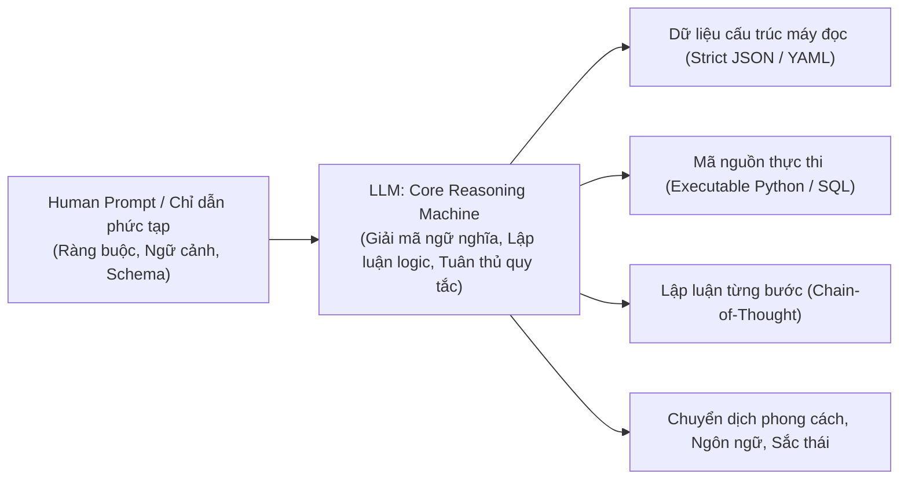

### Các biểu hiện của một "Reasoning Machine":
1. **Chuyển đổi phi cấu trúc thành có cấu trúc:** Đưa vào một đoạn văn bản thô dài và yêu cầu mô hình phân tích cú pháp, trích xuất các thực thể chính xác theo một JSON Schema chuẩn mà không kèm văn bản thừa.
2. **Biến đổi ngôn ngữ lập trình & logic:** Đọc một thuật toán viết bằng C++ và viết lại sang Rust kèm phân tích độ an toàn bộ nhớ.
3. **Kích hoạt công cụ trong vòng lặp Agent (Agentic Tool Calling):** Khi gặp bài toán cần tra cứu thời gian thực, mô hình tự suy luận cần gọi hàm nào, với tham số nào, để thu thập dữ liệu giải quyết mục tiêu.

---

## 8. BẢNG SO SÁNH TỔNG HỢP & KHUYẾN NGHỊ LỰA CHỌN KIẾN TRÚC

| Tiêu chí | 1. Autoencoding (BERT) | 2. Autoregressive (GPT / LLaMA) | 3. Sequence-to-Sequence (T5) |
| :--- | :--- | :--- | :--- |
| **Kiến trúc cốt lõi** | Transformer **Encoder-only** | Transformer **Decoder-only** | Transformer **Encoder + Decoder** |
| **Tầm nhìn ngữ cảnh** | **Hai chiều (Bidirectional)**: Nhìn cả trước và sau ô trống | **Một chiều (Unidirectional)**: Chỉ nhìn về phía trước (Causal) | 2 chiều ở Encoder, 1 chiều ở Decoder |
| **Mục tiêu huấn luyện** | Masked Language Modeling (MLM) | Next Token Prediction (Causal LM) | Span Corruption / Denoising Objective |
| **Thế mạnh kỹ thuật** | **NLU (Hiểu ngôn ngữ)**: Trích xuất ý nghĩa, Phân loại, Gán nhãn, Embeddings | **NLG (Sinh ngôn ngữ)**: Viết văn, Chatbot, Sinh mã nguồn, Suy luận | Text-to-Text: Dịch thuật song ngữ, Tóm tắt văn bản |
| **Tốc độ suy luận** | **Cực nhanh**: Xử lý toàn bộ chuỗi trong 1 pass tính toán duy nhất | **Chậm hơn**: Sinh tuần tự từng token một | Trung bình: Encoder chạy song song, Decoder chạy tuần tự |
| **Sinh văn bản tự do** | Gần như không thể (Off-the-shelf) | **Rất xuất sắc** | Tốt trong phạm vi bài toán xác định |
| **Hệ sinh thái & Bản quyền** | 100% Mã nguồn mở hoàn toàn, kích thước nhẹ (100MB – 1GB) | Hỗn hợp: Open-weights (LLaMA) và Proprietary API (GPT-4) | Hoàn toàn mở, kích thước trung bình (vài GB) |

### Khuyến nghị kỹ thuật thực tế: Khi nào nên dùng loại nào?

1. **Nên dùng Autoencoding (BERT, BGE, ModernBERT, RoBERTa) khi:**
   * Bạn đang xây dựng hệ thống **RAG (Retrieval-Augmented Generation)** và cần mô hình tạo vector nhúng (**Embedding Model**) hoặc chấm điểm độ liên quan (**Reranker**).
   * Bạn cần các tác vụ phân loại văn bản, lọc thư rác, phân tích cảm xúc thời gian thực với độ trễ cực thấp (< 10ms) và chi phí máy chủ tối thiểu.
2. **Nên dùng Autoregressive (GPT-4, LLaMA-3, Claude, Mistral) khi:**
   * Bạn đang phát triển **AI Chatbot, Trợ lý lập trình, Hệ thống AI Agent tự trị**.
   * Bạn cần khả năng suy luận logic phức tạp, tuân thủ các prompt chỉ dẫn đa bước và sinh đầu ra linh hoạt (văn bản, JSON, code).
3. **Nên dùng Sequence-to-Sequence (T5, BART) khi:**
   * Bạn có các bài toán chuyên biệt chuyển đổi từ văn bản nguồn sang văn bản đích (dịch thuật đa ngữ, rút gọn văn bản tài liệu dài) mà muốn tối ưu hóa tỷ lệ hiệu năng / kích thước mô hình.
