title: "Tổng Quan Toàn Diện Về Mạng Nơ-ron Nhân Tạo và Các Phân Loại Kiến Trúc"
tags:
  - agent-course
  - research/neural-networks
  - deep-learning
  - architecture
aliases:
  - Neural Networks and Classifications
  - Mạng Nơ-ron Nhân Tạo
  - Phân loại Neural Networks
type: note
created: 2026-09-21
updated: 2026-09-21
---

# TỔNG QUAN TOÀN DIỆN VỀ MẠNG NƠ-RON NHÂN TẠO (NEURAL NETWORKS) VÀ CÁC PHÂN LOẠI KIẾN TRÚC
## Giải Phẫu Cơ Chế Toán Học, Thuật Toán Học Tập & Bản Đồ Phân Loại Chi Tiết Từ Cổ Điển Đến Hiện Đại

---

## MỤC LỤC
1. [Bản chất cốt lõi: Mạng nơ-ron nhân tạo (ANN) là gì?](#1-bản-chất-cốt-lõi-mạng-nơ-ron-nhân-tạo-ann-là-gì)
   - [1.1. Giải phẫu một Nơ-ron nhân tạo (Artificial Neuron / Perceptron)](#11-giải-phẫu-một-nơ-ron-nhân-tạo-artificial-neuron--perceptron)
   - [1.2. Định lý xấp xỉ vạn năng (Universal Approximation Theorem)](#12-định-lý-xấp-xỉ-vạn-năng-universal-approximation-theorem)
2. [Cơ chế học tập & Nền tảng giải tích của Mạng nơ-ron](#2-cơ-chế-học-tập--nền-tảng-giải-tích-của-mạng-nơ-ron)
   - [2.1. Lan truyền xuôi (Forward Propagation) & Biểu diễn ma trận](#21-lan-truyền-xuôi-forward-propagation--biểu-diễn-ma-trận)
   - [2.2. Các hàm kích hoạt phi tuyến (Activation Functions)](#22-các-hàm-kích-hoạt-phi-tuyến-activation-functions)
   - [2.3. Hàm mất mát (Loss Functions)](#23-hàm-mất-mát-loss-functions)
   - [2.4. Lan truyền ngược (Backpropagation) & Quy tắc đạo hàm chuỗi](#24-lan-truyền-ngược-backpropagation--quy-tắc-đạo-hàm-chuỗi)
   - [2.5. Các giải thuật tối ưu hóa (Optimizers: SGD, Adam, AdamW)](#25-các-giải-thuật-tối-ưu-hóa-optimizers-sgd-adam-adamw)
   - [2.6. Khởi tạo trọng số & Kỹ thuật chuẩn hóa (Normalization & Regularization)](#26-khởi-tạo-trọng-số--kỹ-thuật-chuẩn-hóa-normalization--regularization)
3. [Phân loại theo Luồng xử lý & Cấu trúc liên kết (Architectural Taxonomy)](#3-phân-loại-theo-luồng-xử-lý--cấu-trúc-liên-kết-architectural-taxonomy)
   - [3.1. Feedforward Neural Networks (FNN / Multi-Layer Perceptron - MLP)](#31-feedforward-neural-networks-fnn--multi-layer-perceptron---mlp)
   - [3.2. Convolutional Neural Networks (CNN) & Thị giác máy tính](#32-convolutional-neural-networks-cnn--thị-giác-máy-tính)
   - [3.3. Recurrent Neural Networks (RNN, LSTM, GRU & Mô hình hóa tuần tự)](#33-recurrent-neural-networks-rnn-lstm-gru--mô-hình-hóa-tuần-tự)
   - [3.4. Transformer & Attention-based Networks](#34-transformer--attention-based-networks)
   - [3.5. Graph Neural Networks (GNN) & Cấu trúc dữ liệu phi Euclid](#35-graph-neural-networks-gnn--cấu-trúc-dữ-liệu-phi-euclid)
4. [Phân loại theo Mô thức học & Mục tiêu tạo sinh (Learning Paradigms)](#4-phân-loại-theo-mô-thức-học--mục-tiêu-tạo-sinh-learning-paradigms)
   - [4.1. Autoencoders (AE, DAE, VAE, VQ-VAE)](#41-autoencoders-ae-dae-vae-vq-vae)
   - [4.2. Generative Adversarial Networks (GAN)](#42-generative-adversarial-networks-gan)
   - [4.3. Diffusion Models (Mô hình khuếch tán xác suất)](#43-diffusion-models-mô-hình-khuếch-tán-xác-suất)
5. [Phân loại theo Đổi mới tính toán hiện đại: MoE & State Space Models](#5-phân-loại-theo-đổi-mới-tính-toán-hiện-đại-moe--state-space-models)
   - [5.1. Sparse Mixture of Experts (MoE)](#51-sparse-mixture-of-experts-moe)
   - [5.2. State Space Models (SSM) & Kiến trúc Mamba](#52-state-space-models-ssm--kiến-trúc-mamba)
6. [Bảng so sánh tổng hợp các họ kiến trúc](#6-bảng-so-sánh-tổng-hợp-các-họ-kiến-trúc)
7. [Khung hướng dẫn chọn mô hình trong thực tế kỹ thuật & Trade-offs](#7-khung-hướng-dẫn-chọn-mô-hình-trong-thực-tế-kỹ-thuật--trade-offs)
8. [Các Vấn Đề Thường Gặp Trong Huấn Luyện Mạng Nơ-ron (Diagnostics & Debugging)](#8-các-vấn-đề-thường-gặp-trong-huấn-luyện-mạng-nơ-ron-diagnostics--debugging)
   - [8.1. Triệt tiêu Gradient (Vanishing Gradient Problem)](#81-triệt-tiêu-gradient-vanishing-gradient-problem)
   - [8.2. Bùng nổ Gradient (Exploding Gradient Problem)](#82-bùng-nổ-gradient-exploding-gradient-problem)
   - [8.3. Hiện tượng Nơ-ron Chết (Dying ReLU Problem)](#83-hiện-tượng-nơ-ron-chết-dying-relu-problem)
   - [8.4. Học Quá Mức (Overfitting) & Học Dưới Mức (Underfitting)](#84-học-quá-mức-overfitting--học-dưới-mức-underfitting)
   - [8.5. Trôi Dạt Phân Phối Nội Tại (Internal Covariate Shift)](#85-trôi-dạt-phân-phối-nội-tại-internal-covariate-shift)
   - [8.6. Mắc kẹt tại Điểm Yên Ngựa & Cao Nguyên Gradient (Saddle Points & Plateaus)](#86-mắc-kẹt-tại-điểm-yên-ngựa--cao-nguyên-gradient-saddle-points--plateaus)
   - [8.7. Sập Chế Độ trong Mô Hình Tạo Sinh (Mode Collapse trong GAN)](#87-sập-chế-độ-trong-mô-hình-tạo-sinh-mode-collapse-trong-gan)
   - [8.8. Bảng Tổng Hợp Triệu Chứng, Nguyên Nhân & Đơn Thuốc Chẩn Đoán](#88-bảng-tổng-hợp-triệu-chứng-nguyên-nhân--đơn-thuốc-chẩn-đoán-debugging-cheat-sheet)

---

## 1. BẢN CHẤT CỐT LÕI: MẠNG NƠ-RON NHÂN TẠO (ANN) LÀ GÌ?

**Mạng nơ-ron nhân tạo (Artificial Neural Network - ANN)** là một mô hình tính toán lấy cảm hứng từ mạng lưới tế bào thần kinh sinh học trong não bộ sinh vật. Về bản chất toán học, mạng nơ-ron là một **bộ xấp xỉ hàm vạn năng (Universal Function Approximator)**: với số lượng nơ-ron và chiều sâu thích hợp, mạng có khả năng xấp xỉ bất kỳ hàm số phi tuyến liên tục nào ánh xạ từ không gian đầu vào $\mathcal{X}$ sang không gian mục tiêu $\mathcal{Y}$.

---

### 1.1. Giải phẫu một Nơ-ron nhân tạo (Artificial Neuron / Perceptron)

Một nơ-ron đơn lẻ là đơn vị tính toán nguyên tử cấu thành nên toàn bộ các mạng nơ-ron từ đơn giản đến phức tạp nhất:

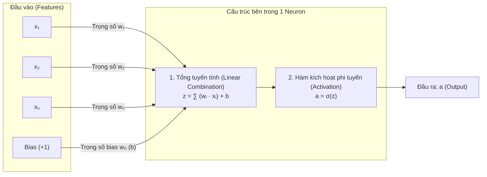

Quá trình tính toán của 1 nơ-ron diễn ra theo 2 giai đoạn kế tiếp:
1. **Giai đoạn 1 - Kết hợp tuyến tính (Linear Combination):**  
   Nhân từng chiều đầu vào $x_i$ với trọng số tương ứng $w_i$, sau đó cộng thêm độ lệch tự do $b$ (*bias*):
   
$$
z = \sum_{i=1}^n w_i x_i + b = \mathbf{w}^T \mathbf{x} + b
$$

2. **Giai đoạn 2 - Ánh xạ phi tuyến (Non-linear Activation):**  
   Đưa giá trị tổng tuyến tính $z$ qua một hàm kích hoạt phi tuyến $\sigma(z)$ để tạo ra tín hiệu kích hoạt đầu ra $a$:
   
$$
a = \sigma(z)
$$

> [!IMPORTANT] Tính chất phi tuyến là điều kiện sống còn
> Nếu loại bỏ hàm kích hoạt phi tuyến $\sigma(z)$, dù mạng nơ-ron có xếp chồng 100 hay 1,000 tầng tuyến tính thì tích của các phép nhân ma trận vẫn chỉ rút gọn về **duy nhất một phép biến đổi tuyến tính đơn lẻ**:
> 
> $\mathbf{y} = \mathbf{W}_3(\mathbf{W}_2(\mathbf{W}_1\mathbf{x} + \mathbf{b}_1) + \mathbf{b}_2) + \mathbf{b}_3 = \mathbf{W}_{\text{total}}\mathbf{x} + \mathbf{b}_{\text{total}}$
> 
> Phi tuyến tính chính là chiếc chìa khóa cho phép mạng bẻ cong không gian quyết định (*decision boundary*), giải quyết bài toán XOR kinh điển và phân tách các cụm dữ liệu phi tuyến phức tạp trong thế giới thực.

---

### 1.2. Định lý xấp xỉ vạn năng (Universal Approximation Theorem)

Được chứng minh độc lập bởi **Cybenko (1989)** cho hàm kích hoạt Sigmoid và mở rộng bởi **Hornik (1991)** cho hàm kích hoạt bất kỳ có tính chất không đa thức:
> Một mạng nơ-ron truyền thẳng (Feedforward) chỉ cần **duy nhất một tầng ẩn (hidden layer)** với số lượng nơ-ron hữu hạn nhưng đủ lớn và sử dụng hàm kích hoạt phi tuyến liên tục có thể xấp xỉ bất kỳ hàm liên tục $f: \mathbb{R}^n \to \mathbb{R}^m$ nào trên tập compact của $\mathbb{R}^n$ với độ chính xác tùy ý $\epsilon > 0$.

#### Ý nghĩa thực tế và Nghịch lý Chiều sâu (Depth vs. Width):
* **Mạng nông cực rộng (Shallow & Extremely Wide):** Theo định lý Cybenko, 1 tầng ẩn là đủ về mặt lý thuyết, nhưng số lượng nơ-ron cần thiết có thể bùng nổ theo hàm mũ $O(2^n)$ đối với số chiều đầu vào $n$, dẫn đến việc bất khả thi trong huấn luyện và khái quát hóa (overfitting nặng).
* **Mạng sâu đa tầng (Deep Neural Networks):** Việc xếp chồng nhiều tầng ẩn với độ rộng vừa phải cho phép mạng học các biểu diễn phân cấp (**Hierarchical Representations**): các tầng đầu học đặc trưng nguyên tử (cạnh, góc, màu sắc), các tầng giữa học hình khối và bộ phận, các tầng sâu học khái niệm toàn cục trừu tượng (khuôn mặt, chiếc xe, ngữ nghĩa câu). Chiều sâu mang lại hiệu quả biểu diễn (*representational efficiency*) theo hàm mũ so với chiều rộng.

---

## 2. CƠ CHẾ HỌC TẬP & NỀN TẢNG GIẢI TÍCH CỦA MẠNG NƠ-RON

Toàn bộ quá trình huấn luyện mạng nơ-ron là bài toán tối ưu hóa không lồi (**Non-convex Optimization**) trên không gian tham số hàng tỷ chiều, vận hành thông qua một vòng lặp kín gồm 4 bước:

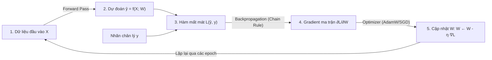

---

### 2.1. Lan truyền xuôi (Forward Propagation) & Biểu diễn ma trận

Xét mạng nhiều tầng (MLP), tại tầng $l \in [1, L]$:
* Vector kích hoạt đầu vào của tầng $l$ là đầu ra của tầng trước: $\mathbf{a}^{[l-1]}$ (với $\mathbf{a}^{[0]} = \mathbf{x}$).
* Phép tính tích ma trận và độ lệch:

$$
\mathbf{z}^{[l]} = \mathbf{W}^{[l]} \mathbf{a}^{[l-1]} + \mathbf{b}^{[l]}
$$

$$
\mathbf{a}^{[l]} = \sigma^{[l]}(\mathbf{z}^{[l]})
$$

Trong đó:
* $\mathbf{W}^{[l]} \in \mathbb{R}^{n^{[l]} \times n^{[l-1]}}$: Ma trận trọng số kết nối giữa tầng $l-1$ ($n^{[l-1]}$ nơ-ron) và tầng $l$ ($n^{[l]}$ nơ-ron).
* $\mathbf{b}^{[l]} \in \mathbb{R}^{n^{[l]}}$: Vector bias tầng $l$.
* Khi huấn luyện theo mini-batch kích thước $B$, toàn bộ dữ liệu được biểu diễn dưới dạng ma trận $\mathbf{A}^{[l-1]} \in \mathbb{R}^{n^{[l-1]} \times B}$, cho phép các phép tính tận dụng tối đa năng lực xử lý song song trên phần cứng chuyên dụng (GPU Tensor Cores / TPU).

---

### 2.2. Các hàm kích hoạt phi tuyến (Activation Functions)

Hàm kích hoạt xác định đặc tính động học của mạng, kiểm soát phạm vi giá trị và quyết định dòng chảy gradient:

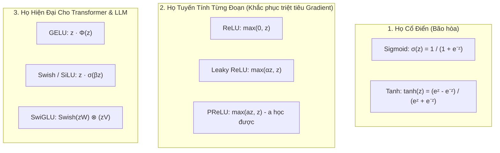

#### Bảng so sánh giải tích và động học của các hàm kích hoạt:

| Hàm kích hoạt | Công thức toán học $\sigma(z)$ | Đạo hàm $\sigma'(z)$ | Miền giá trị | Ưu điểm cốt lõi | Nhược điểm & Rủi ro động học |
| :--- | :--- | :--- | :--- | :--- | :--- |
| **Sigmoid** | $\frac{1}{1 + e^{-z}}$ | $\sigma(z)(1 - \sigma(z))$ | $(0, 1)$ | Trực quan cho bài toán xác suất nhị phân. | Đạo hàm cực đại chỉ bằng $0.25$. Khi $|z| > 4$, đạo hàm xấp xỉ $0 \implies$ **Triệt tiêu Gradient (Vanishing Gradient)** trầm trọng. Không có tâm tại 0 (non-zero centered). |
| **Tanh** | $\frac{e^z - e^{-z}}{e^z + e^{-z}}$ | $1 - \tanh^2(z)$ | $(-1, 1)$ | Có tâm đối xứng tại 0 (Zero-centered), đạo hàm cực đại bằng $1.0$, hội tụ nhanh hơn Sigmoid. | Vẫn bị bão hòa ở hai đuôi khi $|z|$ lớn, gây nghẽn dòng gradient ở các tầng sâu. |
| **ReLU** | $\max(0, z)$ | $\begin{cases} 1 & \text{if } z > 0 \\ 0 & \text{if } z < 0 \end{cases}$ | $[0, +\infty)$ | Chi phí tính toán cực thấp (phép so sánh nhị phân), đạo hàm cố định bằng 1 với $z > 0 \implies$ giải quyết triệt tiêu gradient, tăng tốc hội tụ 6x. | **Dying ReLU**: Nếu một nơ-ron nhận cập nhật lớn đẩy giá trị tổng luôn âm ($z < 0$), đạo hàm sẽ luôn bằng 0 và nơ-ron đó "chết" vĩnh viễn trong suốt quá trình huấn luyện còn lại. |
| **Leaky ReLU** | $\max(\alpha z, z)$ $(\alpha \approx 0.01)$ | $\begin{cases} 1 & \text{if } z > 0 \\ \alpha & \text{if } z \le 0 \end{cases}$ | $(-\infty, +\infty)$ | Duy trì một độ dốc nhỏ $\alpha$ khi $z \le 0$, đảm bảo mọi nơ-ron đều nhận được gradient để phục hồi, loại bỏ hiện tượng Dying ReLU. | Cần tinh chỉnh siêu tham số $\alpha$ (hoặc dùng PReLU để tham số $\alpha$ tự học qua dữ liệu). |
| **GELU** | $z \cdot \Phi(z) = z \cdot P(X \le z)$ ($X \sim \mathcal{N}(0, 1)$) | $\Phi(z) + z \cdot \phi(z)$ | $(-0.17, +\infty)$ | Làm mượt quá trình kích hoạt, tích hợp tính chất ngẫu nhiên thống kê (Stochastic Regularizer). Là tiêu chuẩn vàng trong **BERT, GPT-2, GPT-3, ViT**. | Tốn chi phí tính toán hơn ReLU do chứa hàm phân phối tích lũy Gauss. |
| **SwiGLU** | $\text{Swish}(x\mathbf{W}) \otimes (x\mathbf{V})$ | *Tích vô hướng đạo hàm cổng* | $(-\infty, +\infty)$ | Cơ chế cổng nhân tuyến tính (Gated Linear Unit) cho phép mạng lọc và điều tiết thông tin linh hoạt. Là tiêu chuẩn trong **LLaMA-2/3, Mistral, Gemma**. | Tăng số lượng tham số ma trận trọng số trong khối MLP lên $1.5$ lần so với FFN thông thường. |

---

### 2.3. Hàm mất mát (Loss Functions)

Hàm mất mát $\mathcal{L}(\hat{y}, y)$ là thước đo toán học lượng hóa sai lệch giữa phân phối dự đoán của mô hình và phân phối thực tế của dữ liệu:

#### 1. Mean Squared Error (MSE) - Hồi quy liên tục (Regression):

$$
\mathcal{L}_{\text{MSE}} = \frac{1}{N} \sum_{i=1}^N (y_i - \hat{y}_i)^2
$$

* **Đặc tính:** Nhạy cảm cực độ với các điểm dị biệt (outliers) do sai số bị bình phương. Nếu phân phối nhiễu là phân phối chuẩn Gauss, việc tối thiểu hóa MSE tương đương với ước lượng hợp lý cực đại (Maximum Likelihood Estimation - MLE).

#### 2. Binary Cross-Entropy (BCE) - Phân loại nhị phân (Binary Classification):

$$
\mathcal{L}_{\text{BCE}} = -\frac{1}{N} \sum_{i=1}^N \left[ y_i \ln(\hat{y}_i) + (1 - y_i) \ln(1 - \hat{y}_i) \right]
$$

* **Đặc tính:** Khi kết hợp với hàm kích hoạt Sigmoid ở tầng ra, đạo hàm của hàm mất mát theo tổng tuyến tính $z$ có dạng cực kỳ tinh giản: $\frac{\partial \mathcal{L}}{\partial z} = \hat{y} - y$, triệt tiêu hoàn toàn hệ số bão hòa $\sigma'(z)$, giúp quá trình học không bị chậm lại khi mô hình dự đoán sai trầm trọng.

#### 3. Categorical Cross-Entropy - Phân loại đa lớp & Dự đoán token LLM:

$$
\mathcal{L}_{\text{CE}} = -\sum_{c=1}^C y_c \ln(\hat{y}_c)
$$

* Với $\hat{y}_c = \frac{e^{z_c}}{\sum_{j=1}^C e^{z_j}}$ (Softmax).
* Trong bài toán mô hình hóa ngôn ngữ (LLM Next Token Prediction), $C$ là quy mô từ vựng ($|V| \approx 32,000 - 128,000$ tokens). Hàm này đo lường khoảng cách Kullback-Leibler giữa phân phối One-hot thực tế và phân phối xác suất dự đoán của mô hình.

---

### 2.4. Lan truyền ngược (Backpropagation) & Quy tắc đạo hàm chuỗi

Lan truyền ngược (Rumelhart, Hinton & Williams, 1986) là giải thuật nền tảng cho phép tính toán gradient của hàm mất mát đối với toàn bộ các trọng số trong mạng một cách hiệu quả với độ phức tạp tính toán tuyến tính $O(|W|)$.

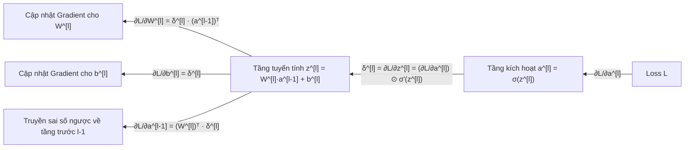

#### Nền tảng giải tích của Backpropagation tại tầng $l$:
Đặt vector sai số độ nhạy (sensitivity vector) tại tầng $l$ là:

$$
\boldsymbol{\delta}^{[l]} \equiv \frac{\partial \mathcal{L}}{\partial \mathbf{z}^{[l]}} \in \mathbb{R}^{n^{[l]}}
$$

1. **Tại tầng ra cuối cùng $L$:**
   Áp dụng quy tắc đạo hàm chuỗi:
   
$$
\boldsymbol{\delta}^{[L]} = \frac{\partial \mathcal{L}}{\partial \mathbf{a}^{[L]}} \odot \sigma'(\mathbf{z}^{[L]})
$$

   *(Đặc biệt: với Cross-Entropy loss và Softmax output, công thức rút gọn thành $\boldsymbol{\delta}^{[L]} = \hat{\mathbf{y}} - \mathbf{y}$).*

2. **Lan truyền sai số ngược từ tầng $l+1$ về tầng $l$:**
   
$$
\boldsymbol{\delta}^{[l]} = \left( (\mathbf{W}^{[l+1]})^T \boldsymbol{\delta}^{[l+1]} \right) \odot \sigma'(\mathbf{z}^{[l]})
$$

   *(Trong đó $\odot$ là phép nhân Hadamard từng phần tử).*

3. **Tính đạo hàm riêng đối với các tham số trọng số và bias:**
   
$$
\frac{\partial \mathcal{L}}{\partial \mathbf{W}^{[l]}} = \boldsymbol{\delta}^{[l]} (\mathbf{a}^{[l-1]})^T \in \mathbb{R}^{n^{[l]} \times n^{[l-1]}}
$$

$$
\frac{\partial \mathcal{L}}{\partial \mathbf{b}^{[l]}} = \boldsymbol{\delta}^{[l]} \in \mathbb{R}^{n^{[l]}}
$$

Toàn bộ quá trình là việc nhân ngược vector gradient từ tầng ra về tầng vào, tái sử dụng các kết quả trung gian đã lưu lại trong pha Forward Pass.

---

### 2.5. Các giải thuật tối ưu hóa (Optimizers: SGD, Adam, AdamW)

Sau khi tính toán được gradient $\mathbf{g}_t = \nabla_{\mathbf{W}} \mathcal{L}_t$, thuật toán tối ưu có nhiệm vụ điều hướng các tham số trong không gian phi lồi để tìm kiếm cực tiểu toàn cục:

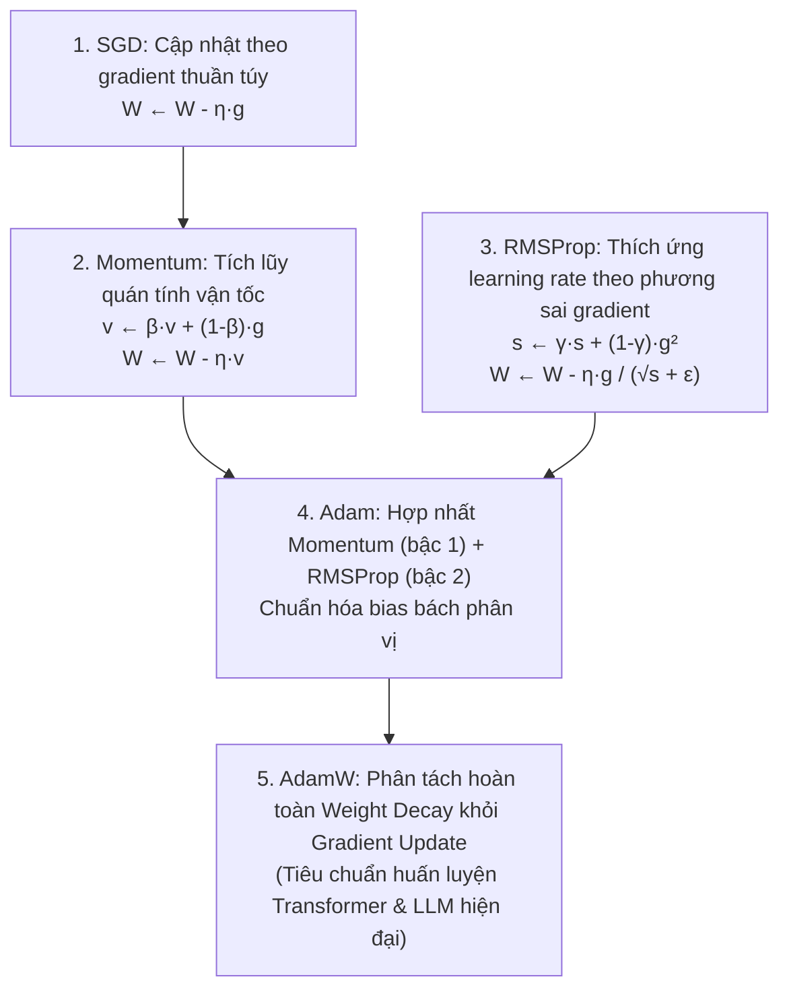

#### 1. Stochastic Gradient Descent (SGD) & SGD with Momentum:
* **SGD cơ bản:** $\mathbf{W}_{t+1} = \mathbf{W}_t - \eta \mathbf{g}_t$.  
  *Điểm yếu:* Dao động zigzag cực mạnh trong các thung lũng dốc không đều (ill-conditioned ravines), tốc độ hội tụ chậm và dễ mắc kẹt tại điểm yên ngựa (saddle points).
* **Momentum (Polyak, 1964):** Bổ sung khái niệm quán tính vật lý thông qua biến vận tốc $\mathbf{v}_t$:
  
$$
\mathbf{v}_t = \beta \mathbf{v}_{t-1} + (1 - \beta) \mathbf{g}_t
$$

$$
\mathbf{W}_{t+1} = \mathbf{W}_t - \eta \mathbf{v}_t
$$

  *(Hệ số $\beta \approx 0.9$ giúp triệt tiêu dao động vuông góc và gia tốc theo hướng hội tụ chính).*

#### 2. Adaptive Moment Estimation (Adam - Kingma & Ba, 2014):
Adam tính toán tốc độ học thích ứng riêng cho từng tham số dựa trên cả mô-men bậc 1 (kỳ vọng hướng đi) và mô-men bậc 2 (độ lớn biến thiên):
* Ước lượng mô-men bậc 1: $\mathbf{m}_t = \beta_1 \mathbf{m}_{t-1} + (1 - \beta_1) \mathbf{g}_t$ ($\beta_1 = 0.9$).
* Ước lượng mô-men bậc 2: $\mathbf{v}_t = \beta_2 \mathbf{v}_{t-1} + (1 - \beta_2) \mathbf{g}_t^2$ ($\beta_2 = 0.999$).
* Hiệu chỉnh độ lệch khởi tạo (Bias Correction):
  
$$
\hat{\mathbf{m}}_t = \frac{\mathbf{m}_t}{1 - \beta_1^t}, \quad \hat{\mathbf{v}}_t = \frac{\mathbf{v}_t}{1 - \beta_2^t}
$$

* Cập nhật tham số:
  
$$
\mathbf{W}_{t+1} = \mathbf{W}_t - \frac{\eta}{\sqrt{\hat{\mathbf{v}}_t} + \epsilon} \hat{\mathbf{m}}_t
$$

#### 3. AdamW (Adam with Decoupled Weight Decay - Loshchilov & Hutter, 2017):
Trong Adam nguyên bản, phương pháp phạt $L_2$ Regularization được cộng trực tiếp vào hàm mất mát $\mathcal{L}_{\text{reg}} = \mathcal{L} + \frac{1}{2}\lambda \|\mathbf{W}\|^2$, dẫn đến việc gradient của phạt kích thước bị chia cho $\sqrt{\mathbf{v}_t}$, làm mất đi bản chất của Weight Decay đối với các trọng số có gradient biến thiên lớn.

**AdamW tách rời hoàn toàn bước suy giảm trọng số khỏi gradient:**

$$
\mathbf{W}_{t+1} = \mathbf{W}_t - \eta \lambda \mathbf{W}_t - \frac{\eta}{\sqrt{\hat{\mathbf{v}}_t} + \epsilon} \hat{\mathbf{m}}_t
$$

> [!TIP] Chuẩn mực trong Huấn Luyện AI Hiện Đại
> AdamW là giải thuật tối ưu hóa mặc định, bắt buộc phải có khi huấn luyện bất kỳ mô hình Transformer, Vision Transformer hay Large Language Model nào hiện nay (từ GPT-4, Claude, LLaMA-3 đến Stable Diffusion).

---

### 2.6. Khởi tạo trọng số & Kỹ thuật chuẩn hóa (Normalization & Regularization)

#### Khởi tạo trọng số (Weight Initialization):
Nếu khởi tạo trọng số quá lớn, tín hiệu qua các tầng sẽ bùng nổ (Exploding Activations). Nếu khởi tạo quá nhỏ, tín hiệu sẽ nhanh chóng suy biến về 0 (Vanishing Activations):
* **Xavier/Glorot Initialization (2010):** Tối ưu cho các hàm kích hoạt đối xứng quanh 0 như Tanh và Sigmoid:
  
$$
W_{ij} \sim \mathcal{N}\left(0, \frac{2}{n_{\text{in}} + n_{\text{out}}}\right)
$$

* **He/Kaiming Initialization (2015):** Tối ưu cho hàm ReLU/Leaky ReLU (do ReLU triệt tiêu một nửa phân phối âm):
  
$$
W_{ij} \sim \mathcal{N}\left(0, \frac{2}{n_{\text{in}}}\right)
$$

#### Các kỹ thuật chuẩn hóa (Normalization Techniques):
* **Batch Normalization (BatchNorm - 2015):** Chuẩn hóa theo chiều mini-batch qua các mẫu. Rất hiệu quả trong CNN nhưng phụ thuộc kích thước batch và không phù hợp với dữ liệu chuỗi có độ dài thay đổi.
* **Layer Normalization (LayerNorm - 2016):** Chuẩn hóa qua toàn bộ các kênh đặc trưng của cùng một mẫu độc lập. Không phụ thuộc vào batch size, là nền tảng của các kiến trúc NLP và Transformer.
* **RMSNorm (Root Mean Square Normalization - 2019):** Bỏ qua bước tính kỳ vọng trung bình $\mu$ trong LayerNorm, chỉ chuẩn hóa theo căn bậc hai của bình phương trung bình:
  
$$
\bar{a}_i = \frac{a_i}{\sqrt{\frac{1}{d}\sum_{j=1}^d a_j^2 + \epsilon}} \cdot \gamma_i
$$

  *(Giúp tiết kiệm 7% đến 15% thời gian tính toán mà không làm giảm độ chính xác; được sử dụng trong LLaMA-2/3, Mistral, Gemma).*

---

## 3. PHÂN LOẠI THEO LUỒNG XỬ LÝ & CẤU TRÚC LIÊN KẾT (ARCHITECTURAL TAXONOMY)

Dựa trên cấu trúc hình học kết nối và cách thức tín hiệu thông tin di chuyển qua đồ thị tính toán, mạng nơ-ron được chia thành 5 họ kiến trúc lớn:

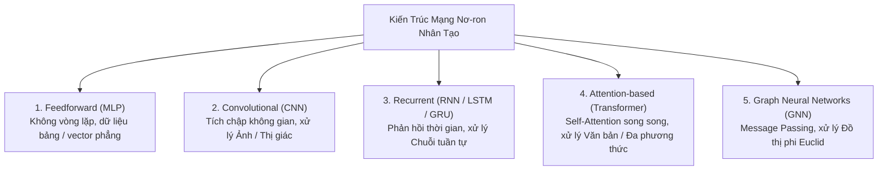

---

### 3.1. Feedforward Neural Networks (FNN / Multi-Layer Perceptron - MLP)

#### Cơ chế kỹ thuật:
FNN là dạng kiến trúc đơn giản nhất của mạng nơ-ron:
* Tín hiệu chỉ truyền theo duy nhất **một chiều tiến** từ Input $\to$ Hidden Layers $\to$ Output. Tuyệt đối không tồn tại bất kỳ chu trình hay liên kết phản hồi nào (Directed Acyclic Graph - DAG).
* Mỗi nơ-ron ở tầng sau kết nối với toàn bộ các nơ-ron ở tầng trước (**Fully Connected / Dense Layer**).

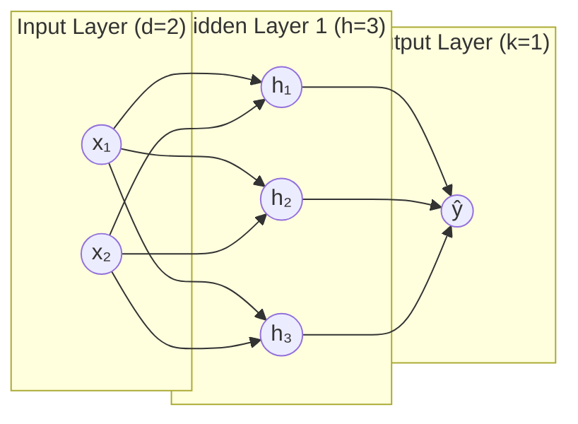

#### Giới hạn cốt lõi & Vấn đề Bùng nổ Tham số:
1. **Bùng nổ tham số khi dữ liệu nhiều chiều:**  
   Xét một bức ảnh màu kích thước thông thường $1024 \times 1024 \times 3 \approx 3.14 \times 10^6$ giá trị. Nếu tầng ẩn đầu tiên chỉ có $2,048$ nơ-ron, ma trận trọng số $\mathbf{W}^{[1]}$ sẽ có quy mô:
   
$$
3,145,728 \times 2,048 \approx 6.44 \times 10^9 \text{ parameters}
$$

   Chỉ riêng tầng đầu tiên đã ngốn hơn 25 GB VRAM ở định dạng FP32, dẫn đến overfitting nghiêm trọng và bất khả thi về tính toán.
2. **Phá hủy cấu trúc không gian và ngữ cảnh:**  
   Khi làm phẳng (flatten) dữ liệu ảnh hoặc ma trận 2D thành vector 1D, các mối quan hệ khoảng cách hình học giữa các điểm ảnh lân cận bị phá hủy hoàn toàn.

---

### 3.2. Convolutional Neural Networks (CNN) & Thị giác máy tính

Được Yann LeCun tiên phong với LeNet-5 (1998) và bùng nổ cùng AlexNet (2012), CNN là cuộc cách mạng giải quyết triệt để bài toán xử lý dữ liệu dạng lưới 2D/3D (hình ảnh, video, âm phổ spectrogram).

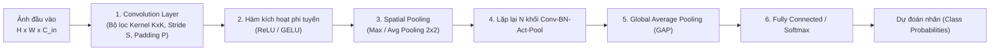

#### 1. Ba nguyên lý thiết kế then chốt của CNN:
1. **Trường tiếp nhận cục bộ (Local Receptive Fields):** Một nơ-ron không nhìn toàn bộ ảnh mà chỉ kết nối với một vùng lân cận có kích thước $K \times K$ pixels (ví dụ $3 \times 3$ hoặc $5 \times 5$).
2. **Chia sẻ trọng số (Shared Weights / Weight Tying):** Một bộ lọc (*Kernel/Filter*) duy nhất được trượt đều trên toàn bộ bức ảnh để trích xuất cùng một mẫu đặc trưng ở mọi vị trí không gian.
3. **Tính bất biến với phép dịch chuyển (Translation Invariance):** Dù vật thể mục tiêu (như con mèo) nằm ở góc trên bên trái hay góc dưới bên phải bức ảnh, phép tích chập đều phát hiện ra đặc trưng đó và đưa tín hiệu về feature map.

#### 2. Toán học của Phép Tích Chập 2 Chiều (2D Convolution) & Ví Dụ Bằng Số Trực Quan

Về mặt giải tích, phép tích chập 2 chiều giữa ảnh đầu vào $\mathbf{I}$ và bộ lọc kernel $\mathbf{K}$ kích thước $k_h \times k_w$ được tính theo công thức:

$$
\mathbf{S}(i, j) = (\mathbf{I} * \mathbf{K})(i, j) = \sum_{m=0}^{k_h-1} \sum_{n=0}^{k_w-1} \mathbf{I}(i + m, j + n) \mathbf{K}(m, n)
$$

---

#### 💡 VÍ DỤ BẰNG SỐ CHI TIẾT: CÁCH MẠNG NƠ-RON "NHÌN THẤY" ĐƯỜNG BIÊN

Để hiểu bản chất, hãy tưởng tượng bạn cầm một chiếc kính lúp kích thước $3 \times 3$ (Kernel) rà soát từng ô trên một bức ảnh đen trắng kích thước $4 \times 4$.

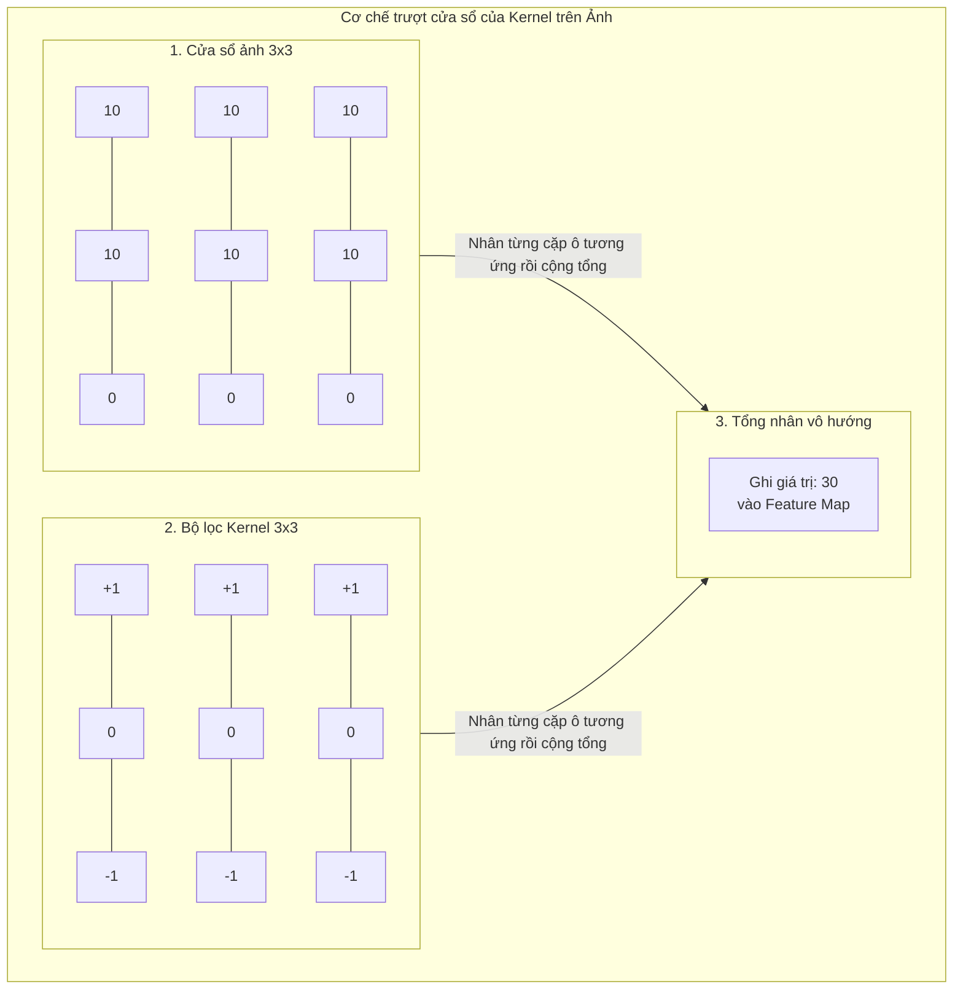

##### 1. Dữ liệu đầu vào:
* **Bức ảnh đen trắng $\mathbf{I}$ ($4 \times 4$ pixels):** Nửa bên trái sáng (độ sáng = $10$), nửa bên phải tối (độ sáng = $0$):

$$
\mathbf{I} = \begin{bmatrix}
10 & 10 & 0 & 0 \\
10 & 10 & 0 & 0 \\
10 & 10 & 0 & 0 \\
10 & 10 & 0 & 0
\end{bmatrix}
$$

* **Bộ lọc phát hiện đường biên dọc $\mathbf{K}$ ($3 \times 3$ Kernel - Vertical Edge Filter):**

$$
\mathbf{K} = \begin{bmatrix}
1 & 0 & -1 \\
1 & 0 & -1 \\
1 & 0 & -1
\end{bmatrix}
$$

*(Ý nghĩa của bộ lọc: Cột trái mang trọng số dương $+1$, cột giữa bằng $0$, cột phải mang trọng số âm $-1$. Nếu có sự biến thiên ánh sáng đột ngột từ trái sang phải, tổng nhân sẽ cho ra một giá trị rất lớn).*

##### 2. Quá trình trượt Kernel và tính toán từng bước (Stride = 1):

* **Bước 1 (Góc trên-trái, tọa độ hàng 1, cột 1):**  
  Cửa sổ ảnh $3 \times 3$ được chọn là:
  
$$
\begin{bmatrix} 10 & 10 & 0 \\ 10 & 10 & 0 \\ 10 & 10 & 0 \end{bmatrix}
$$

  Nhân từng phần tử tương ứng với Kernel và cộng tổng:
  
$$
(10 \times 1 + 10 \times 0 + 0 \times -1) + (10 \times 1 + 10 \times 0 + 0 \times -1) + (10 \times 1 + 10 \times 0 + 0 \times -1)
$$

$$
= 10 + 10 + 10 = 30
$$

  $\implies$ Ghi giá trị **$30$** vào vị trí $(0, 0)$ của Feature Map.

* **Bước 2 (Trượt sang phải 1 ô, tọa độ hàng 1, cột 2):**  
  Cửa sổ ảnh $3 \times 3$ mới là:
  
$$
\begin{bmatrix} 10 & 0 & 0 \\ 10 & 0 & 0 \\ 10 & 0 & 0 \end{bmatrix}
$$

  Nhân từng phần tử tương ứng với Kernel và cộng tổng:
  
$$
(10 \times 1 + 0 \times 0 + 0 \times -1) + (10 \times 1 + 0 \times 0 + 0 \times -1) + (10 \times 1 + 0 \times 0 + 0 \times -1)
$$

$$
= 10 + 10 + 10 = 30
$$

  $\implies$ Ghi giá trị **$30$** vào vị trí $(0, 1)$ của Feature Map.

* **Bước 3 & Bước 4 (Trượt xuống hàng dưới):**  
  Do bức ảnh đồng nhất theo phương đứng, phép tính tại hai vị trí hàng dưới cho ra kết quả tương tự là $30$ và $30$.

##### 3. Kết quả Feature Map đầu ra ($2 \times 2$):

$$
\mathbf{S} = \begin{bmatrix}
30 & 30 \\
30 & 30
\end{bmatrix}
$$

> [!TIP] Bản chất vật lý đằng sau con số
> * **Khi có đường biên:** Sự đối lập giữa vùng sáng ($10$) và vùng tối ($0$) giúp nhân với bộ lọc sinh ra giá trị dương cực lớn ($30$). Mạng nơ-ron lập tức phát hiện: *"Tại đây có một đường ranh giới dọc!"*.
> * **Nếu vùng ảnh đồng nhất (toàn màu trắng hoặc toàn màu đen):** Giả sử cả 9 ô đều có độ sáng bằng $10$:
>   
>   $(10 \times 1 + 10 \times 0 + 10 \times -1) \times 3 = (10 + 0 - 10) \times 3 = 0$
>   
>   Kết quả triệt tiêu hoàn toàn về **$0$**! Nghĩa là khi cảnh vật phẳng lặng không có góc cạnh, bộ lọc không phản ứng. Đó chính là cách CNN phát hiện đường biên và chi tiết vật thể một cách thông minh mà không phụ thuộc vào độ sáng nền.

---

#### 💡 VÍ DỤ VỀ CÁC SIÊU THAM SỐ: PADDING & MAX POOLING

##### 1. Tại sao phải cần Padding (Đệm viền)?
* **Vấn đề khi không đệm (Valid Padding):** Qua ví dụ trên, ảnh $4 \times 4$ khi đi qua bộ lọc $3 \times 3$ đã bị co nhỏ lại thành $2 \times 2$. Nếu mạng có 50 tầng tích chập, kích thước ảnh sẽ nhanh chóng bị teo nhỏ về $0$. Ngoài ra, các pixel ở mép biên ngoài chỉ được quét qua đúng 1 lần, làm mất mát rất nhiều thông tin ở góc ảnh.
* **Giải pháp Same Padding ($P = 1$):** Bổ sung một viền số $0$ (Zero-padding) bao quanh bức ảnh $4 \times 4$, biến nó thành ma trận $6 \times 6$:

$$
\mathbf{I}_{\text{padded}} = \begin{bmatrix}
0 & 0 & 0 & 0 & 0 & 0 \\
0 & 10 & 10 & 0 & 0 & 0 \\
0 & 10 & 10 & 0 & 0 & 0 \\
0 & 10 & 10 & 0 & 0 & 0 \\
0 & 10 & 10 & 0 & 0 & 0 \\
0 & 0 & 0 & 0 & 0 & 0
\end{bmatrix}
$$

* **Áp dụng công thức tính kích thước đầu ra:**
  
$$
O = \left\lfloor \frac{W - K + 2P}{S} \right\rfloor + 1 = \left\lfloor \frac{4 - 3 + 2(1)}{1} \right\rfloor + 1 = 4
$$

  Ảnh đầu ra giữ nguyên kích thước $4 \times 4$, cho phép xếp chồng hàng trăm tầng tích chập mà không làm teo ảnh.

##### 2. Ví dụ về Max Pooling $2 \times 2$ (Lấy mẫu cực đại):
Giả sử sau bước tích chập và hàm kích hoạt ReLU, mạng tạo ra một Feature Map kích thước $4 \times 4$:

$$
\begin{bmatrix}
1 & 3 & 2 & 4 \\
5 & \mathbf{9} & 0 & 1 \\
3 & 2 & \mathbf{8} & 3 \\
1 & 0 & 2 & 7
\end{bmatrix}
$$

Áp dụng cửa sổ Max Pooling $2 \times 2$ với bước nhảy Stride $S = 2$ (chia ảnh thành 4 góc riêng biệt không chồng lấn):
* Góc trên-trái: $\max(1, 3, 5, 9) = \mathbf{9}$
* Góc trên-phải: $\max(2, 4, 0, 1) = \mathbf{4}$
* Góc dưới-trái: $\max(3, 2, 1, 0) = \mathbf{3}$
* Góc dưới-phải: $\max(8, 3, 2, 7) = \mathbf{8}$

Kết quả sau Max Pooling là ma trận $2 \times 2$:

$$
\begin{bmatrix}
9 & 4 \\
3 & 8
\end{bmatrix}
$$

* **Ý nghĩa thực tiễn:** Giảm tới $75\%$ dung lượng tính toán ở các tầng sau, đồng thời chỉ giữ lại tín hiệu nhận diện đặc trưng mạnh nhất trong từng vùng, giúp mạng có khả năng bất biến với những biến dạng nhỏ của vật thể.

##### 3. Tích chập đa kênh 3D (Ảnh màu RGB):
* Ảnh màu thực tế có 3 kênh: **Đỏ (R), Lục (G), Lam (B)** $\implies$ Tensor kích thước $(H \times W \times 3)$.
* Một bộ lọc Kernel lúc này cũng bắt buộc phải có 3 lát cắt độ sâu tương ứng: kích thước $(3 \times 3 \times 3)$.
* Cả 3 lát cắt kernel sẽ đồng thời trượt trên 3 kênh R, G, B, thực hiện $3 \times 9 = 27$ phép nhân rồi cộng tất cả lại, sau đó cộng thêm một số bias $b$ duy nhất $\implies$ Sinh ra đúng **một tấm bản đồ đặc trưng 2D duy nhất**.
* Nếu tầng đó sử dụng $64$ bộ lọc khác nhau $\implies$ Đầu ra sẽ là một khối tensor gồm $64$ kênh đặc trưng mới.

#### 4. Lịch sử tiến hóa của các kiến trúc CNN đột phá:

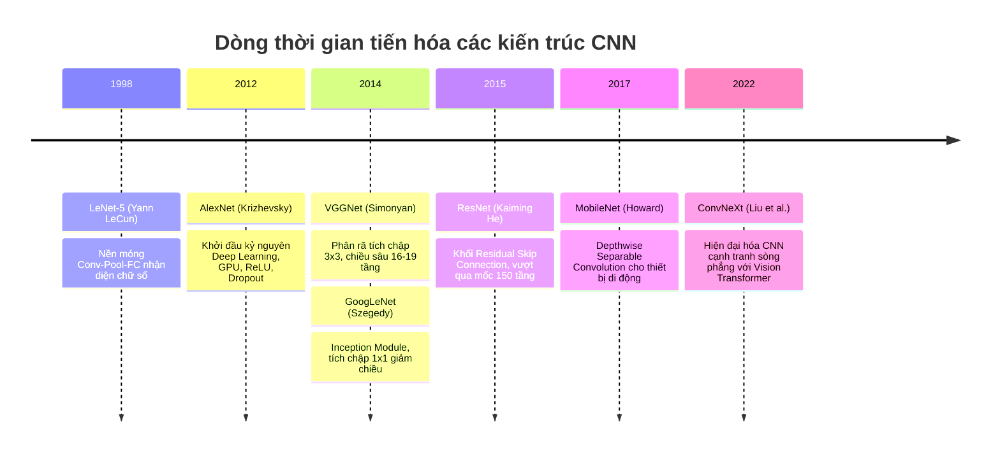

* **VGGNet (2014) - Quy luật phân rã $3 \times 3$:**  
  VGG chứng minh rằng xếp chồng hai tầng tích chập $3 \times 3$ tạo ra trường tiếp nhận tương đương một tầng $5 \times 5$, nhưng số lượng tham số giảm tới $28\%$ ($2 \times 3^2 = 18$ so với $5^2 = 25$) và bổ sung thêm một hàm kích hoạt phi tuyến ở giữa giúp tăng năng lực biểu diễn.
* **GoogLeNet / Inception (2014) - Tích chập $1 \times 1$ Bottleneck:**  
  Sử dụng tích chập $1 \times 1$ như một bộ biến đổi tuyến tính qua các kênh để nén số kênh (*Dimensionality Reduction*) trước khi áp dụng các bộ lọc đắt đỏ $3 \times 3$ và $5 \times 5$, cho phép xây dựng mạng cực sâu với chi phí tính toán thấp.
* **ResNet (2015) - Đột phá Residual Skip Connection:**  
  Khi tăng độ sâu của mạng vượt quá 20-30 tầng, mạng CNN gặp phải hiện tượng suy thoái (**Degradation Problem**): độ chính xác trên cả tập huấn luyện lẫn tập kiểm thử đều giảm sút nghiêm trọng do thông tin và gradient bị tắc nghẽn.  
  Kaiming He giới thiệu khối kết nối tắt (Skip / Residual Connection):
  
$$
\mathbf{y} = \mathcal{F}(\mathbf{x}, \{W_i\}) + \mathbf{x}
$$

  ```mermaid
  flowchart TD
      X["Đầu vào x"] --> Weight1["Weight Layer (Conv)"]
      Weight1 --> Act1["ReLU"]
      Act1 --> Weight2["Weight Layer (Conv)"]
      Weight2 --> Sum((+))
      X -->|"Đường dẫn tắt (Identity Shortcut x)"| Sum
      Sum --> Out["ReLU(F(x) + x)"]
  ```

  Khi truyền ngược, gradient tại tầng vào là:
  
$$
\frac{\partial \mathcal{L}}{\partial \mathbf{x}} = \frac{\partial \mathcal{L}}{\partial \mathbf{y}} \left( \frac{\partial \mathcal{F}}{\partial \mathbf{x}} + \mathbf{I} \right)
$$

  Số hạng $\mathbf{I}$ (ma trận đơn vị) tạo ra một "đường cao tốc" (gradient highway) cho phép gradient truyền ngược trực tiếp không suy suyển về các tầng đầu tiên, mở đường cho việc huấn luyện thành công các mạng có độ sâu 152 tầng và thậm chí 1,000 tầng.

---

### 3.3. Recurrent Neural Networks (RNN, LSTM, GRU & Mô hình hóa tuần tự)

RNN được thiết kế để giải quyết bài toán xử lý **dữ liệu chuỗi thời gian (Sequential Data)** nơi thứ tự xuất hiện của các phần tử chi phối trực tiếp ngữ nghĩa (văn bản tự nhiên, giọng nói, dự báo tài chính).

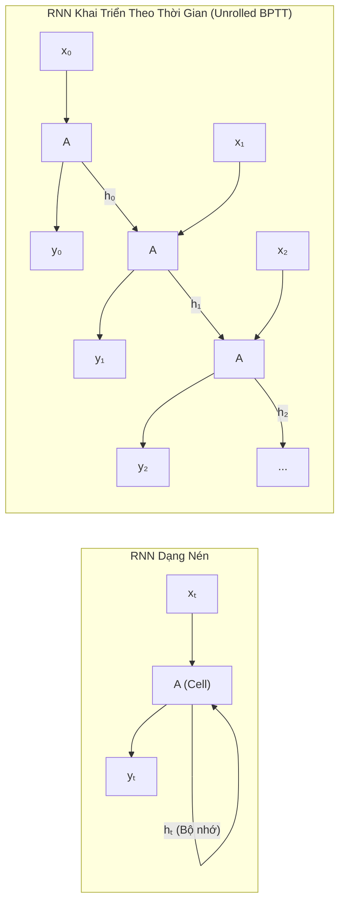

#### 1. Động học của Vanilla RNN:
Tại mỗi bước thời gian $t$, mạng duy trì một vector trạng thái ẩn (Hidden State) $\mathbf{h}_t$ đóng vai trò như một bộ nhớ ngắn hạn nén thông tin từ quá khứ:

$$
\mathbf{h}_t = \tanh(\mathbf{W}_{hh} \mathbf{h}_{t-1} + \mathbf{W}_{xh} \mathbf{x}_t + \mathbf{b}_h)
$$

$$
\hat{\mathbf{y}}_t = \text{softmax}(\mathbf{W}_{hy} \mathbf{h}_t + \mathbf{b}_y)
$$

#### 2. Khủng hoảng Triệt tiêu & Nổ Gradient trong BPTT (Backpropagation Through Time):
Khi tính đạo hàm của hàm mất mát ở bước $T$ đối với trạng thái ẩn ở bước $k$ ($k \ll T$), áp dụng quy tắc đạo hàm chuỗi:

$$
\frac{\partial \mathcal{L}_T}{\partial \mathbf{h}_k} = \frac{\partial \mathcal{L}_T}{\partial \mathbf{h}_T} \prod_{j=k+1}^T \frac{\partial \mathbf{h}_j}{\partial \mathbf{h}_{j-1}} = \frac{\partial \mathcal{L}_T}{\partial \mathbf{h}_T} \prod_{j=k+1}^T \operatorname{diag}(1 - \tanh^2(\mathbf{z}_j)) \mathbf{W}_{hh}^T
$$

* Nếu giá trị riêng lớn nhất (bán kính phổ $\rho$) của ma trận $\mathbf{W}_{hh}$ nhỏ hơn 1: tích liên tiếp của hàng chục ma trận sẽ tiến về $0$ theo hàm mũ $\implies$ **Triệt tiêu Gradient (Vanishing Gradient)**. Mạng hoàn toàn "quên" mất thông tin ở đầu chuỗi, không thể học được các mối quan hệ ngữ cảnh dài hạn.
* Nếu bán kính phổ lớn hơn 1: gradient bùng nổ theo hàm mũ $\implies$ **Nổ Gradient (Exploding Gradient)**, trọng số tràn số thành `NaN`.

---

#### 3. Cứu rỗi bằng Cơ Chế Cổng: Long Short-Term Memory (LSTM)

Hochreiter & Schmidhuber (1997) phát minh ra kiến trúc **LSTM**, giới thiệu một đường truyền bảo toàn thông tin dài hạn gọi là **Cell State (Trạng thái ô - $\mathbf{C}_t$)**, được bảo vệ bởi **Constant Error Carousel (CEC)** và điều tiết bởi 3 cổng logic:

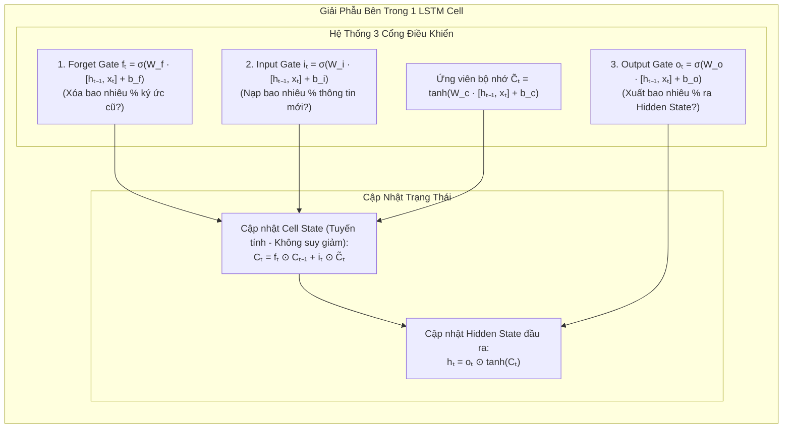

#### Hệ thống 4 phương trình cốt lõi của LSTM Cell:
1. **Forget Gate ($f_t$):** Xác định tỉ lệ thông tin từ $C_{t-1}$ cần bị lãng quên:
   
$$
\mathbf{f}_t = \sigma(\mathbf{W}_f [\mathbf{h}_{t-1}, \mathbf{x}_t] + \mathbf{b}_f)
$$

2. **Input Gate ($i_t$) & Candidate Cell ($\tilde{C}_t$):** Quyết định lượng thông tin mới nạp vào bộ nhớ:
   
$$
\mathbf{i}_t = \sigma(\mathbf{W}_i [\mathbf{h}_{t-1}, \mathbf{x}_t] + \mathbf{b}_i), \quad \tilde{\mathbf{C}}_t = \tanh(\mathbf{W}_c [\mathbf{h}_{t-1}, \mathbf{x}_t] + \mathbf{b}_c)
$$

3. **Cập nhật Cell State ($C_t$):**
   
$$
\mathbf{C}_t = \mathbf{f}_t \odot \mathbf{C}_{t-1} + \mathbf{i}_t \odot \tilde{\mathbf{C}}_t
$$

4. **Output Gate ($o_t$) & Hidden State ($h_t$):**
   
$$
\mathbf{o}_t = \sigma(\mathbf{W}_o [\mathbf{h}_{t-1}, \mathbf{x}_t] + \mathbf{b}_o), \quad \mathbf{h}_t = \mathbf{o}_t \odot \tanh(\mathbf{C}_t)
$$

> [!IMPORTANT] Tại sao LSTM giải quyết được Triệt tiêu Gradient?
> Hãy xem đạo hàm $\frac{\partial \mathbf{C}_t}{\partial \mathbf{C}_{t-1}} = \mathbf{f}_t$. Vì phép cập nhật $C_t$ là phép **cộng tuyến tính** thay vì nhân ma trận phi tuyến lặp lại, nếu Forget Gate $f_t \approx 1$, gradient có thể chảy dọc theo đường truyền Cell State qua hàng trăm bước thời gian mà **hoàn toàn không bị suy giảm theo hàm mũ**.

---

#### 4. Gated Recurrent Unit (GRU - Cho et al., 2014):
GRU tinh giản LSTM bằng cách hợp nhất Cell State và Hidden State làm một, chỉ sử dụng 2 cổng điều khiển:
* **Reset Gate ($r_t$):** Quyết định mức độ kết hợp giữa thông tin quá khứ và đầu vào hiện tại.
* **Update Gate ($z_t$):** Đảm nhiệm đồng thời vai trò của cả Forget Gate và Input Gate trong LSTM:
  
$$
\mathbf{h}_t = (1 - \mathbf{z}_t) \odot \mathbf{h}_{t-1} + \mathbf{z}_t \odot \tilde{\mathbf{h}}_t
$$

GRU giảm bớt $25\%$ tham số so với LSTM, tiết kiệm bộ nhớ và huấn luyện nhanh hơn rõ rệt trong khi đạt hiệu năng tương đương trên phần lớn các tác vụ.

---

### 3.4. Transformer & Attention-based Networks

Transformer (Vaswani et al., 2017 - *"Attention Is All You Need"*) đã tạo ra bước ngoặt lịch sử chấm dứt sự thống trị của RNN, trở thành nền tảng của toàn bộ cuộc cách mạng Generative AI và Large Language Models ngày nay.

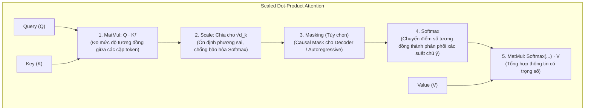

#### 1. Công thức toán học Scaled Dot-Product Attention:

$$
\text{Attention}(\mathbf{Q}, \mathbf{K}, \mathbf{V}) = \text{softmax}\left( \frac{\mathbf{Q} \mathbf{K}^T}{\sqrt{d_k}} \right) \mathbf{V}
$$

* $\mathbf{Q} \in \mathbb{R}^{N \times d_k}$ (Query - Điều token đang truy vấn).
* $\mathbf{K} \in \mathbb{R}^{M \times d_k}$ (Key - Nhãn đặc trưng của các token khác).
* $\mathbf{V} \in \mathbb{R}^{M \times d_v}$ (Value - Nội dung thông tin mà các token mang theo).
* **Tại sao phải chia cho $\sqrt{d_k}$?** Giả sử các thành phần của $Q$ và $K$ là các biến ngẫu nhiên độc lập có kỳ vọng 0 và phương sai 1. Tích vô hướng $\mathbf{q} \cdot \mathbf{k} = \sum_{i=1}^{d_k} q_i k_i$ sẽ có kỳ vọng 0 nhưng phương sai bằng chính $d_k$. Khi $d_k$ lớn (ví dụ $d_k = 128$), giá trị tích vô hướng có thể rất lớn, đẩy hàm Softmax vào vùng bão hòa có đạo hàm cực nhỏ ($\approx 0$), gây nghẽn gradient. Việc chia cho $\sqrt{d_k}$ đưa phương sai trở về 1, ổn định dòng gradient.

#### 2. Multi-Head Attention (MHA):
Thay vì tính toán attention trên một không gian chiều $d_{\text{model}}$ duy nhất, Multi-Head Attention chiếu $Q, K, V$ vào $h$ không gian con khác nhau ($d_k = d_{\text{model}} / h$):

$$
\text{MultiHead}(\mathbf{Q}, \mathbf{K}, \mathbf{V}) = \text{Concat}(\text{head}_1, \dots, \text{head}_h) \mathbf{W}^O
$$

$$
\text{head}_i = \text{Attention}(\mathbf{Q}\mathbf{W}_i^Q, \mathbf{K}\mathbf{W}_i^K, \mathbf{V}\mathbf{W}_i^V)
$$

Cơ chế này cho phép mô hình đồng thời quan sát và liên kết thông tin ở nhiều khía cạnh khác nhau (ví dụ: một head chuyên theo dõi quan hệ ngữ pháp động từ - tân ngữ, một head chuyên liên kết đại từ nhân xưng với chủ ngữ cách xa hàng trăm từ).

#### 3. Các bước cải tiến kiến trúc cốt lõi trong LLM hiện đại:
* **Positional Encoding (Mã hóa vị trí):** Do Attention thuần túy là phép toán bất biến với hoán vị (Permutation Invariant), mô hình cần được nạp thông tin thứ tự từ:
  * *Sinusoidal (Vaswani 2017):* Dùng hàm sin/cos với tần số khác nhau.
  * *Rotary Position Embedding (RoPE - Su et al., 2021):* Xoay vector biểu diễn trong mặt phẳng phức theo góc $\theta_i = m \theta$. Bảo toàn mối quan hệ khoảng cách tương đối $m - n$, hiện là tiêu chuẩn vàng trong **LLaMA-2/3, Mistral, Qwen**.
* **Chuẩn hóa Pre-LN & RMSNorm:** Thay vì đặt LayerNorm sau khối Attention/FFN (*Post-LN* - khó hội tụ nếu không có learning rate warmup kéo dài), các kiến trúc hiện đại chuyển sang đặt LayerNorm trước khối (*Pre-LN*) kết hợp với **RMSNorm** để ổn định động học khi quy mô mô hình tăng vọt.
* **Ba phân nhánh kiến trúc Transformer:**
  * **Encoder-only (BERT, RoBERTa, ModernBERT):** Attention 2 chiều toàn diện. Tối ưu cho hiểu ngôn ngữ, phân loại, tìm kiếm ngữ nghĩa (*Embedding Models*).
  * **Decoder-only (GPT-3/4, LLaMA, Claude, Mistral):** Causal Masking (chỉ nhìn về quá khứ). Tối ưu cho sinh văn bản tự hồi quy (*Autoregressive Generation*) và suy luận logic đa bước.
  * **Encoder-Decoder (T5, BART):** Phù hợp cho bài toán ánh xạ chuỗi sang chuỗi (Dịch máy, Tóm tắt văn bản).

---

### 3.5. Graph Neural Networks (GNN) & Cấu trúc dữ liệu phi Euclid

Hầu hết dữ liệu truyền thống (ảnh, văn bản, âm thanh) đều nằm trong không gian Euclid phẳng (lưới 2D hoặc chuỗi 1D). Tuy nhiên, phần lớn tri thức trong thế giới thực lại tồn tại dưới dạng **đồ thị phi Euclid (Non-Euclidean Graphs - $\mathcal{G} = (\mathcal{V}, \mathcal{E})$)**: mạng lưới giao dịch tài chính, đồ thị tri thức, liên kết mạng xã hội, tương tác protein và cấu trúc phân tử hóa học.

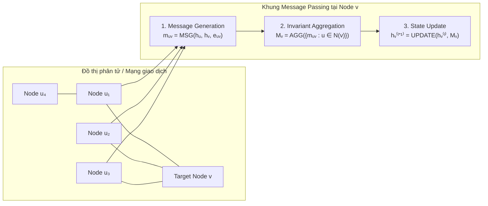

#### 1. Khung tổng quát Message Passing Neural Networks (MPNN):
Tại mỗi tầng $l$, mỗi đỉnh $v \in \mathcal{V}$ cập nhật trạng thái vector biểu diễn $\mathbf{h}_v^{(l)}$ thông qua 3 bước:
1. **Message:** Các đỉnh láng giềng $u \in \mathcal{N}(v)$ gửi thông điệp dựa trên trạng thái của chúng và thuộc tính cạnh liên kết $e_{uv}$.
2. **Aggregation:** Thu gom toàn bộ thông điệp từ tập láng giềng bằng một hàm toán học **bất biến với thứ tự hoán vị (Permutation Invariant Function)** như Sum, Mean hoặc Max:
   
$$
\mathbf{m}_v^{(l)} = \bigoplus_{u \in \mathcal{N}(v)} \text{MESSAGE}^{(l)}\left( \mathbf{h}_u^{(l)}, \mathbf{h}_v^{(l)}, \mathbf{e}_{uv} \right)
$$

3. **Update:** Kết hợp thông điệp thu gom được với trạng thái hiện tại của đỉnh $v$:
   
$$
\mathbf{h}_v^{(l+1)} = \text{UPDATE}^{(l)}\left( \mathbf{h}_v^{(l)}, \mathbf{m}_v^{(l)} \right)
$$

#### 2. Ba biến thể kiến trúc GNN tiêu biểu:
* **Graph Convolutional Networks (GCN - Kipf & Welling, 2017):**  
  Áp dụng phép xấp xỉ bậc một của tích chập phổ Fourier trên đồ thị thông qua ma trận kề chuẩn hóa đối xứng:
  
$$
\mathbf{H}^{(l+1)} = \sigma\left( \mathbf{\tilde{D}}^{-\frac{1}{2}} \mathbf{\tilde{A}} \mathbf{\tilde{D}}^{-\frac{1}{2}} \mathbf{H}^{(l)} \mathbf{W}^{(l)} \right)
$$

  *(Trong đó $\mathbf{\tilde{A}} = \mathbf{A} + \mathbf{I}_N$ là ma trận kề bổ sung vòng tự nối self-loop, $\mathbf{\tilde{D}}_{ii} = \sum_j \mathbf{\tilde{A}}_{ij}$ là ma trận bậc).*
* **Graph Attention Networks (GAT - Veličković et al., 2018):**  
  Không sử dụng trọng số cố định từ ma trận bậc, GAT tính toán trọng số chú ý động $\alpha_{uv}$ giữa các đỉnh láng giềng:
  
$$
\alpha_{uv} = \frac{\exp\left(\text{LeakyReLU}\left(\mathbf{a}^T [\mathbf{W}\mathbf{h}_u \parallel \mathbf{W}\mathbf{h}_v]\right)\right)}{\sum_{k \in \mathcal{N}(v)} \exp\left(\text{LeakyReLU}\left(\mathbf{a}^T [\mathbf{W}\mathbf{h}_k \parallel \mathbf{W}\mathbf{h}_v]\right)\right)}
$$

* **GraphSAGE (Hamilton et al., 2017):**  
  Khắc phục điểm yếu phải nạp toàn bộ đồ thị vào bộ nhớ của GCN bằng cách **lấy mẫu ngẫu nhiên láng giềng (Neighborhood Sampling)** với kích thước cố định, cho phép huấn luyện quy nạp (**Inductive Learning**) trên các đồ thị siêu khổng lồ hàng tỷ đỉnh (như mạng lưới gợi ý của Pinterest).

#### 3. Hai thách thức kỹ thuật lớn của GNN:
* **Over-smoothing (Quá mịn biểu diễn):** Khi xếp chồng nhiều hơn 4 tầng GNN, việc truyền thông điệp liên tục khiến vector biểu diễn của tất cả các node trong đồ thị hội tụ về các vector giống hệt nhau, làm mất đi tính phân biệt.
* **Over-squashing (Nghẽn cổ chai thông tin):** Số lượng đỉnh trong vùng láng giềng tăng theo hàm mũ theo số tầng, nhưng toàn bộ thông tin đó phải bị nén vào một vector cố định có số chiều giới hạn.

---

## 4. PHÂN LOẠI THEO MÔ THỨC HỌC & MỤC TIÊU TẠO SINH (LEARNING PARADIGMS)

Ngoài cách phân chia theo cấu trúc kết nối, mạng nơ-ron còn được phân loại dựa trên **mục tiêu tối ưu hóa** và **khả năng ước lượng phân phối xác suất dữ liệu để tạo sinh mẫu mới**:

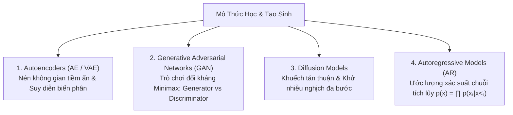

---

### 4.1. Autoencoders (AE, DAE, VAE, VQ-VAE)

Một Autoencoder tiêu chuẩn gồm 2 cấu phần chính:
* **Encoder ($f_\phi$):** Nén dữ liệu đầu vào chiều cao $\mathbf{x} \in \mathbb{R}^D$ thành vector tiềm ẩn chiều thấp $\mathbf{z} \in \mathbb{R}^d$ ($d \ll D$) tại vùng nút thắt cổ chai (**Bottleneck / Latent Space**).
* **Decoder ($g_\theta$):** Giải nén vector tiềm ẩn $\mathbf{z}$ để tái tạo lại dữ liệu ban đầu $\hat{\mathbf{x}} = g_\theta(\mathbf{z}) \approx \mathbf{x}$.

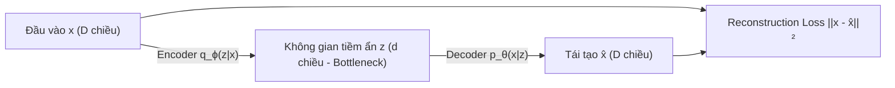

#### Các biến thể tiến hóa:
1. **Denoising Autoencoder (DAE):** Cố tình thêm nhiễu vào đầu vào $\tilde{\mathbf{x}} \sim q_D(\tilde{\mathbf{x}}|\mathbf{x})$ và bắt Decoder phải tái tạo ảnh sạch ban đầu $\mathbf{x}$, buộc mạng phải học được cấu trúc đa tạp (*manifold*) của dữ liệu thay vì học vẹt phép đồng nhất.
2. **Variational Autoencoders (VAE - Kingma & Welling, 2013):**  
   Autoencoder truyền thống có không gian tiềm ẩn rời rạc và gián đoạn (chứa các vùng trống không có ý nghĩa), không thể dùng để tạo sinh. VAE biến không gian tiềm ẩn thành một **phân phối xác suất liên tục** bằng suy diễn biến phân (**Variational Inference**).

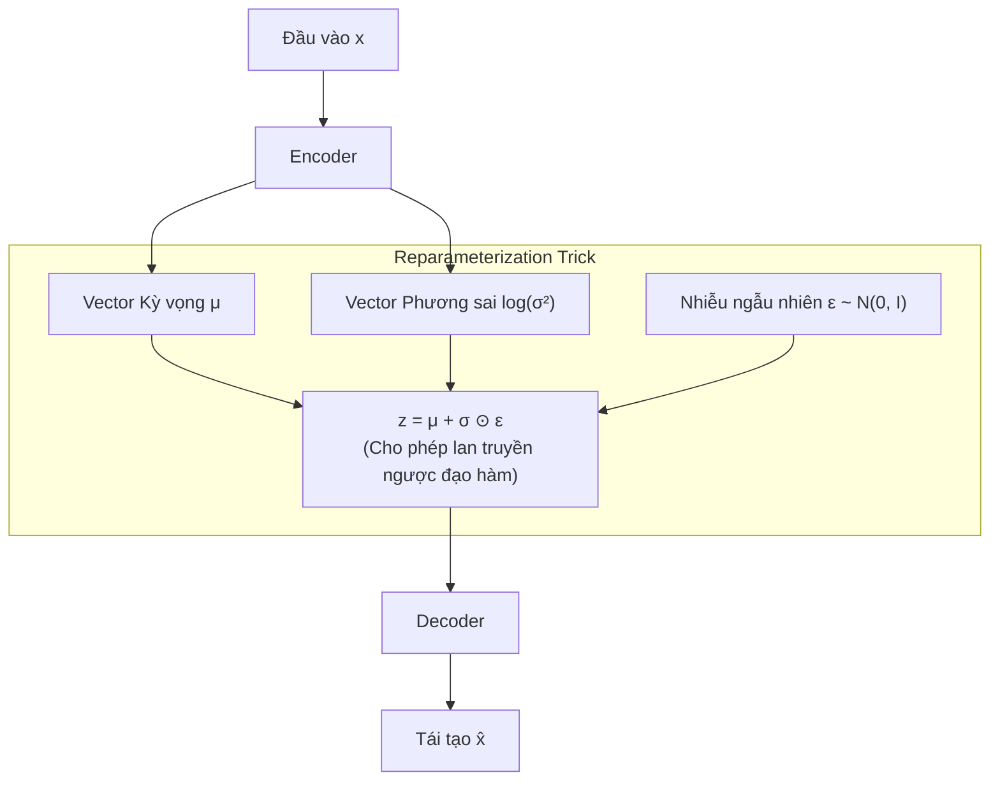

* **Hàm mục tiêu ELBO (Evidence Lower Bound):**
  
$$
\log p_\theta(\mathbf{x}) \ge \mathcal{L}_{\text{ELBO}} = \mathbb{E}_{q_\phi(\mathbf{z}|\mathbf{x})}[\log p_\theta(\mathbf{x}|\mathbf{z})] - D_{\text{KL}}(q_\phi(\mathbf{z}|\mathbf{x}) \parallel p(\mathbf{z}))
$$

  * Thành phần 1 (**Reconstruction Loss**): Đo độ sắc nét của dữ liệu tái tạo.
  * Thành phần 2 (**KL Divergence**): Ép phân phối tiềm ẩn $q_\phi(\mathbf{z}|\mathbf{x})$ phải tiệm cận phân phối chuẩn tắc tiền nghiệm $p(\mathbf{z}) = \mathcal{N}(\mathbf{0}, \mathbf{I})$, đảm bảo không gian tiềm ẩn trơn tru và liên tục, cho phép lấy mẫu ngẫu nhiên để sinh ảnh mới.
3. **Vector Quantized VAE (VQ-VAE - van den Oord et al., 2017):**  
   Rời rạc hóa không gian tiềm ẩn bằng một bảng mã (*Codebook*) gồm các vector nguyên tử, giải quyết hiện tượng mờ ảnh của VAE truyền thống, đặt nền móng cho các mô hình tạo sinh âm thanh và hình ảnh rời rạc (DALL-E 1, Jukebox).

---

### 4.2. Generative Adversarial Networks (GAN)

Được Ian Goodfellow giới thiệu năm 2014, GAN dựa trên lý thuyết trò chơi đối kháng (**Minimax Two-player Zero-sum Game**) giữa 2 mạng nơ-ron:

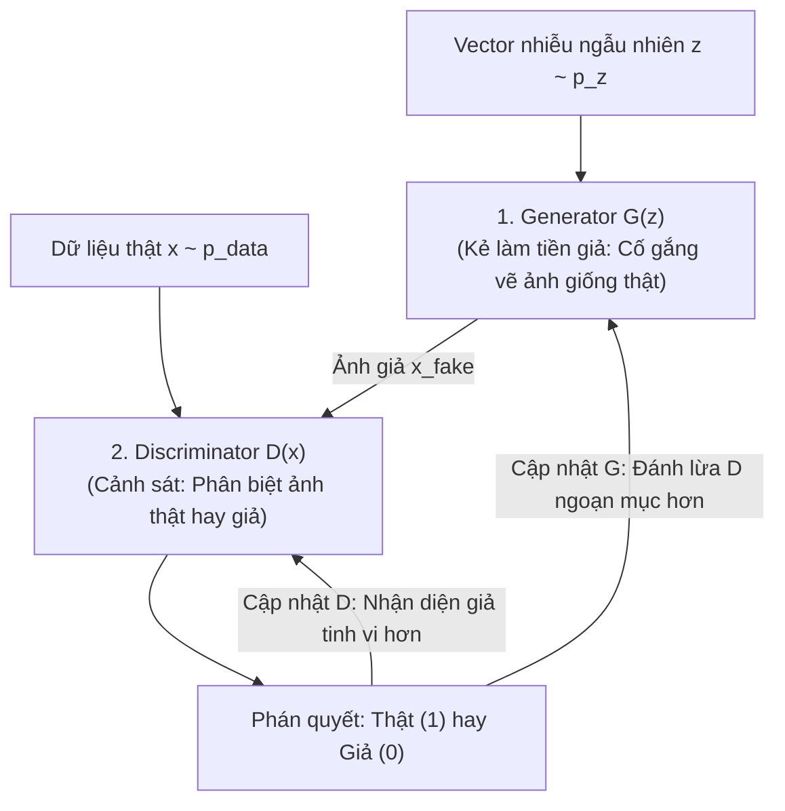

#### 1. Hàm mục tiêu toán học Minimax:

$$
\min_G \max_D V(D, G) = \mathbb{E}_{\mathbf{x} \sim p_{\text{data}}}[\log D(\mathbf{x})] + \mathbb{E}_{\mathbf{z} \sim p_z}[\log(1 - D(G(\mathbf{z})))]
$$

* Khi Discriminator đạt trạng thái tối ưu cục bộ:
  
$$
D^*(\mathbf{x}) = \frac{p_{\text{data}}(\mathbf{x})}{p_{\text{data}}(\mathbf{x}) + p_g(\mathbf{x})}
$$

* Khi đó, bài toán tối ưu của Generator quy về việc tối thiểu hóa **Khoảng cách Jensen-Shannon Divergence (JSD)** giữa phân phối thật và phân phối giả:
  
$$
V(D^*, G) = 2 \cdot D_{\text{JS}}(p_{\text{data}} \parallel p_g) - 2\log 2
$$

#### 2. Thách thức cố hữu & Đột phá Wasserstein GAN (WGAN):
* **Mode Collapse (Sập chế độ):** Generator phát hiện ra một vài mẫu ảnh đánh lừa thành công Discriminator và liên tục lặp lại các mẫu đó mà không học toàn bộ sự đa dạng của phân phối dữ liệu.
* **Triệt tiêu Gradient:** Khi Discriminator quá hoàn hảo ($D(G(z)) \to 0$), khoảng cách JSD bão hòa ở hằng số $\log 2$, khiến đạo hàm truyền về Generator hoàn toàn biến mất.
* **Wasserstein GAN (WGAN & WGAN-GP - Arjovsky et al., 2017):** Thay thế JSD bằng khoảng cách dịch chuyển đất (**Earth Mover's / Wasserstein Distance**) liên tục và khả vi ở mọi nơi, áp dụng ràng buộc **1-Lipschitz** thông qua cơ chế phạt gradient (**Gradient Penalty**), mang lại sự ổn định tuyệt đối trong huấn luyện GAN.
* **Kiến trúc đỉnh cao:** **StyleGAN (StyleGAN1/2/3 - NVIDIA)** sử dụng mạng Mapping Network và cơ chế AdaIN (Adaptive Instance Normalization) để điều khiển phong cách ở từng cấp độ phân giải, sinh khuôn mặt người chân thực không tì vết.

---

### 4.3. Diffusion Models (Mô hình khuếch tán xác suất)

Diffusion Models (Sohl-Dickstein et al. 2015, Ho et al. 2020 - DDPM) hiện là vị vua thống trị tuyệt đối trong lĩnh vực tạo sinh hình ảnh, video và thiết kế cấu trúc phân tử sinh học (Stable Diffusion, Midjourney, Sora, Flux).

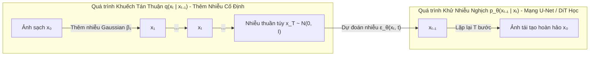

#### 1. Cơ chế toán học của Denoising Diffusion Probabilistic Models (DDPM):
1. **Quá trình khuếch tán thuận (Forward Noising Process):**  
   Dần dần cộng thêm nhiễu trắng Gaussian theo một lịch trình phương sai $\beta_1, \dots, \beta_T$:
   
$$
q(\mathbf{x}_t | \mathbf{x}_{t-1}) = \mathcal{N}\left(\mathbf{x}_t; \sqrt{1 - \beta_t}\mathbf{x}_{t-1}, \beta_t \mathbf{I}\right)
$$

   Nhờ tính chất cộng của phân phối chuẩn, ta có thể lấy mẫu trực tiếp trạng thái $\mathbf{x}_t$ ở bất kỳ bước $t$ nào mà không cần lặp lại $t$ lần:
   
$$
\mathbf{x}_t = \sqrt{\bar{\alpha}_t}\mathbf{x}_0 + \sqrt{1 - \bar{\alpha}_t}\boldsymbol{\epsilon}, \quad \boldsymbol{\epsilon} \sim \mathcal{N}(\mathbf{0}, \mathbf{I})
$$

   *(Với $\alpha_t = 1 - \beta_t$ và $\bar{\alpha}_t = \prod_{s=1}^t \alpha_s$).*

2. **Quá trình khử nhiễu nghịch (Reverse Denoising Process):**  
   Huấn luyện một mạng nơ-ron (kiến trúc **U-Net** hoặc **Diffusion Transformer - DiT**) học cách dự đoán chính xác thành phần nhiễu $\boldsymbol{\epsilon}_\theta(\mathbf{x}_t, t)$ đã bị trộn vào ở bước $t$.
3. **Hàm mất mát tinh giản (Simplified Loss):**
   
$$
\mathcal{L}_{\text{simple}}(\theta) = \mathbb{E}_{t, \mathbf{x}_0, \boldsymbol{\epsilon}} \left[ \left\| \boldsymbol{\epsilon} - \boldsymbol{\epsilon}_\theta(\mathbf{x}_t, t) \right\|^2 \right]
$$

#### 2. Kỹ thuật đưa Diffusion vào ứng dụng thực tế:
* **Classifier-Free Guidance (CFG - Ho & Salimans, 2021):**  
  Điều khiển mức độ bám sát câu lệnh mô tả (prompt $c$) trong quá trình tạo sinh bằng cách nội suy có trọng số giữa dự đoán có điều kiện và không điều kiện:
  
$$
\tilde{\boldsymbol{\epsilon}}_\theta(\mathbf{x}_t, c) = \boldsymbol{\epsilon}_\theta(\mathbf{x}_t, \emptyset) + s \cdot \left( \boldsymbol{\epsilon}_\theta(\mathbf{x}_t, c) - \boldsymbol{\epsilon}_\theta(\mathbf{x}_t, \emptyset) \right)
$$

  *(Hệ số hướng dẫn $s > 1$ giúp ảnh sinh ra khớp chính xác với prompt).*
* **Latent Diffusion Models (LDM / Stable Diffusion - Rombach et al., 2022):**  
  Việc chạy quy trình khuếch tán trên không gian điểm ảnh gốc $512 \times 512 \times 3$ đòi hỏi chi phí tính toán khổng lồ. LDM sử dụng một VAE đã được huấn luyện trước để nén bức ảnh xuống không gian tiềm ẩn $64 \times 64 \times 4$ (giảm $64\times$ khối lượng tính toán), sau đó chạy quá trình khuếch tán hoàn toàn trong không gian tiềm ẩn này.
* **Diffusion Transformer (DiT - Peebles & Xie, 2023):**  
  Thay thế hoàn toàn cấu trúc tích chập U-Net bằng các khối Transformer, chứng minh quy luật mở rộng tham số (Scaling Laws) vượt trội, trở thành nền tảng của **OpenAI Sora, FLUX.1**.

---

## 5. PHÂN LOẠI THEO ĐỔI MỚI TÍNH TOÁN HIỆN ĐẠI: MOE & STATE SPACE MODELS

---

### 5.1. Sparse Mixture of Experts (MoE)

Khi các mô hình ngôn ngữ mở rộng lên hàng trăm tỷ tham số, việc tính toán toàn bộ các tầng FFN cho từng token (**Dense Model**) trở nên cực kỳ lãng phí và chạm ngưỡng giới hạn năng lượng/phần cứng.

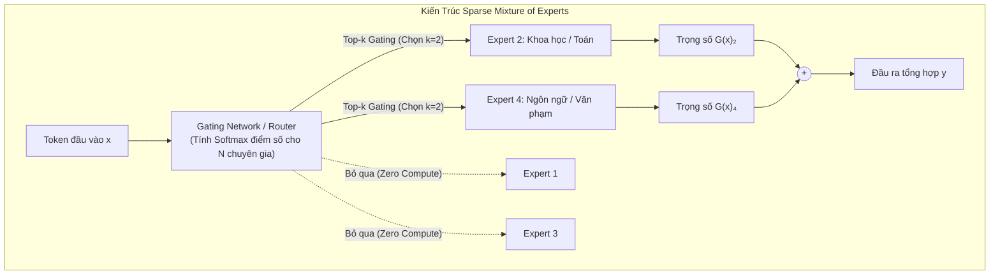

#### 1. Cơ chế tính toán Top-K Gating:
Thay vì chỉ có 1 tầng FFN duy nhất, khối MoE chứa $N$ mạng FFN riêng biệt được gọi là các chuyên gia (**Experts** - $E_1, \dots, E_N$). Một mạng định tuyến (**Router / Gating Network**) sẽ gán trọng số cho từng chuyên gia:

$$
y = \sum_{i=1}^N G(x)_i E_i(x)
$$

Để giữ tính chất thưa (**Sparsity**), hàm định tuyến chỉ giữ lại $k$ chuyên gia có điểm số cao nhất (thường $k = 2$, trong khi $N = 8$ hoặc $64$):

$$
G(x) = \text{Softmax}(\text{TopK}(x \mathbf{W}_g, k))
$$

#### 2. Thách thức Kỹ thuật & Cân bằng tải (Load Balancing):
* **Router Collapse:** Router có xu hướng bị thiên vị, luôn đẩy toàn bộ token vào 1 hoặc 2 chuyên gia quen thuộc, khiến các chuyên gia còn lại không được cập nhật và chết dần.
* **Auxiliary Loss:** Để ép Router phân bổ đều dữ liệu cho toàn bộ các chuyên gia, một hàm mất mát phụ được bổ sung trong quá trình huấn luyện:
  
$$
\mathcal{L}_{\text{aux}} = \alpha \cdot N \sum_{i=1}^N f_i P_i
$$

  *(Trong đó $f_i$ là tỉ lệ token thực tế gửi tới chuyên gia $i$, và $P_i$ là xác suất định tuyến trung bình dành cho chuyên gia $i$).*
* **Nghiên cứu thực tế:**
  * **Mixtral 8x7B (Mistral AI):** Tổng 46.7 tỷ tham số, nhưng chỉ kích hoạt 12.9 tỷ tham số cho mỗi token, đạt tốc độ suy luận và chi phí của mô hình 13B nhưng năng lực tương đương LLaMA-2 70B.
  * **DeepSeek-V2 / V3:** Ứng dụng **Fine-Grained MoE** (chia nhỏ thành hàng trăm chuyên gia siêu nhỏ) kết hợp cơ chế chia sẻ chuyên gia (**Shared Experts**) và Multi-head Latent Attention (MLA), tối ưu chi phí huấn luyện xuống mức kỷ lục thế giới.

---

### 5.2. State Space Models (SSM) & Kiến trúc Mamba

Dù Transformer cực kỳ mạnh mẽ, cơ chế Self-Attention có điểm nghẽn chí mạng: **độ phức tạp tính toán và bộ nhớ KV Cache tăng theo bình phương độ dài ngữ cảnh $O(N^2)$**. Điều này khiến Transformer trở nên cực kỳ đắt đỏ khi xử lý chuỗi hàng triệu tokens.

**State Space Models (SSM)** hồi sinh lý thuyết hệ thống điều khiển liên tục tuyến tính (**Linear Time-Invariant - LTI**) để đạt được độ phức tạp tuyến tính $O(N)$ trong khi duy trì khả năng suy luận dài hạn.

```mermaid
flowchart TD
    subgraph SSM_Dual["Góc Nhìn Kép Của State Space Models"]
        Continuous["1. Hệ thống liên tục thời gian:<br>h'(t) = A·h(t) + B·x(t)<br>y(t) = C·h(t) + D·x(t)"]
        Discretize["2. Rời rạc hóa (Zero-Order Hold):<br>Ā = exp(ΔA), B̄ = (ΔA)⁻¹(exp(ΔA) - I)·ΔB"]

        Continuous --> Discretize
        Discretize --> Recurrent["Chế độ Đệ quy (Inference):<br>hₜ = Ā hₜ₋₁ + B̄ xₜ<br>Tốc độ O(1), Bộ nhớ không tăng"]
        Discretize --> ConvView["Chế độ Tích chập (Training):<br>y = x * K̄<br>Song song hóa 100% trên GPU"]
    end
```

#### 1. Hệ thống liên tục và Quá trình Rời rạc hóa (Discretization):
Hệ thống liên tục ánh xạ tín hiệu đầu vào $x(t) \in \mathbb{R}$ sang không gian trạng thái tiềm ẩn $h(t) \in \mathbb{R}^N$ rồi tạo ra đầu ra $y(t)$:

$$
h'(t) = \mathbf{A} h(t) + \mathbf{B} x(t), \quad y(t) = \mathbf{C} h(t) + \mathbf{D} x(t)
$$

Bằng phương pháp Zero-Order Hold (ZOH) với bước thời gian $\Delta$, hệ thống liên tục được rời rạc hóa thành:

$$
\mathbf{h}_t = \mathbf{\bar{A}} \mathbf{h}_{t-1} + \mathbf{\bar{B}} \mathbf{x}_t, \quad \mathbf{y}_t = \mathbf{C} \mathbf{h}_t
$$

Trong đó $\mathbf{\bar{A}} = \exp(\Delta \mathbf{A})$ và $\mathbf{\bar{B}} = (\Delta \mathbf{A})^{-1}(\exp(\Delta \mathbf{A}) - \mathbf{I}) \cdot \Delta \mathbf{B}$.

#### 2. Góc nhìn kép (Dual View):
* **Khi Suy luận (Recurrent Mode):** Mô hình hoạt động như một RNN với trạng thái $h_t$ kích thước cố định. Chi phí sinh mỗi token là $O(1)$ và không cần lưu KV Cache khổng lồ như Transformer.
* **Khi Huấn luyện (Convolutional Mode):** Khi chuỗi đầu vào đã biết trước toàn bộ, phương trình đệ quy có thể khai triển thành phép tích chập 1D với kernel $\mathbf{\bar{K}} = (\mathbf{C}\mathbf{\bar{B}}, \mathbf{C}\mathbf{\bar{A}}\mathbf{\bar{B}}, \dots, \mathbf{C}\mathbf{\bar{A}}^{L-1}\mathbf{\bar{B}})$, cho phép tính toán song song hoàn toàn bằng thuật toán FFT trong thời gian $O(L \log L)$.

#### 3. Đột phá Mamba (Selective State Spaces - Gu & Dao, 2023):
* **Cơ chế chọn lọc (Selective SSM):** Các mô hình SSM cổ điển (như S4) có ma trận $\mathbf{A}, \mathbf{B}, \mathbf{C}$ không đổi theo thời gian (Time-Invariant), khiến mô hình không thể lọc bỏ thông tin rác hoặc chọn lọc thông tin quan trọng theo ngữ cảnh. Mamba cho phép các ma trận $\mathbf{B}, \mathbf{C}$ và bước nhảy $\Delta$ phụ thuộc trực tiếp vào đầu vào $\mathbf{x}_t$.
* **Hardware-aware Scan:** Khắc phục việc mất tính chất tích chập khi các tham số thay đổi theo thời gian bằng cách triển khai thuật toán cộng quét song song (Parallel Associative Scan) tối ưu trực tiếp trên bộ nhớ tĩnh SRAM của GPU, nhanh hơn Transformer tới $5\times$ trên chuỗi dài và có thể mở rộng ngữ cảnh tới 1 triệu tokens dễ dàng.

---

## 6. BẢNG SO SÁNH TỔNG HỢP CÁC HỌ KIẾN TRÚC

| Họ kiến trúc | Cấu trúc dữ liệu tối ưu | Khối tính toán cốt lõi | Độ phức tạp suy luận theo độ dài $N$ | Khả năng huấn luyện song song | Thế mạnh vượt trội | Điểm yếu chí mạng | Ứng dụng tiêu biểu |
| :--- | :--- | :--- | :--- | :--- | :--- | :--- | :--- |
| **MLP / FNN** | Dữ liệu bảng (Tabular), Vector phẳng 1D | Fully Connected, Tuyến tính + Kích hoạt | $O(1)$ | Cực đại trên GPU | Đơn giản, độ trễ suy luận thấp | Bùng nổ tham số, mất cấu trúc không gian/thời gian | Dự báo tín dụng, nén embedding |
| **CNN** | Lưới không gian 2D/3D (Ảnh, Video, Spectrogram) | Convolution Kernel, Max Pooling, Residual Block | $O(N)$ | Rất cao | Bất biến dịch chuyển, chia sẻ trọng số tối ưu | Kém linh hoạt với quan hệ phi cục bộ tầm xa | Nhận diện khuôn mặt, Xe tự hành (YOLO), Y tế |
| **RNN / LSTM** | Chuỗi tuần tự 1D (Text, Time-series, Audio) | Cổng điều khiển (Forget/Input), Constant Error Carousel | $O(N)$ | Rất kém (Tuần tự từng bước thời gian) | Duy trì bộ nhớ ngữ cảnh với tài nguyên cố định | Nghẽn phần cứng, quên ngữ cảnh khi chuỗi vượt quá 1000 bước | Dự báo cảm biến, Nhận dạng giọng nói cổ điển |
| **Transformer** | Chuỗi Tokens, Đa phương thức (Text, Code, Patch ảnh) | Multi-Head Self-Attention, Positional Encoding (RoPE) | $O(N^2)$ (Attention) $O(N)$ (Mỗi token mới) | Cực đại trên GPU/TPU | Tầm nhìn toàn cục $O(1)$, Nắm bắt phụ thuộc ngữ cảnh dài hạn | Bộ nhớ KV Cache và tính toán bùng nổ theo bình phương độ dài | **LLMs (ChatGPT, Claude, LLaMA), ViT, Dịch máy** |
| **GNN** | Đồ thị phi Euclid (Đỉnh, Cạnh, Mạng liên kết) | Message Passing, Graph Convolution, Graph Attention | Phụ thuộc bậc đỉnh $O(|\mathcal{E}|)$ | Trung bình đến Khá | Biểu diễn quan hệ topo và tính chất cấu trúc phức tạp | Hiện tượng Over-smoothing và Over-squashing khi đi sâu | Phát hiện gian lận ngân hàng, Khám phá cấu trúc thuốc mới |
| **VAE** | Dữ liệu đa chiều cần mô hình hóa phân phối tiềm ẩn | Encoder-Decoder, Reparameterization Trick, ELBO | $O(1)$ | Rất cao | Không gian tiềm ẩn liên tục, toán học xác suất chặt chẽ | Ảnh sinh ra thường bị mờ, khó cạnh tranh độ chi tiết với GAN/Diffusion | Nén không gian tiềm ẩn cho Stable Diffusion, Phát hiện dị biệt |
| **GAN** | Hình ảnh độ phân giải cao, Dịch chuyển miền dữ liệu | Trò chơi đối kháng Minimax: Generator vs Discriminator | $O(1)$ (1 bước Forward) | Rất cao | Tốc độ sinh 1 bước cực nhanh, độ tương phản sắc nét | Khó hội tụ, dễ sập chế độ (Mode Collapse), mất cân bằng động học | **StyleGAN, Chỉnh sửa khuôn mặt, Deepfake, Super-resolution** |
| **Diffusion** | Ảnh nghệ thuật, Video độ phân giải cao, 3D Assets | U-Net / DiT Khử nhiễu, Lấy mẫu Markov nghịch đảo, CFG | $O(T)$ (Cần lặp lại $T$ bước khử nhiễu) | Rất cao khi huấn luyện, Kém khi suy luận | Chất lượng ảnh vượt trội, đa dạng phân phối, không sập chế độ | Tốc độ sinh chậm do phải chạy lặp hàng chục bước khử nhiễu | **Midjourney, Stable Diffusion, FLUX, OpenAI Sora** |
| **Sparse MoE** | Chuỗi tokens quy mô khổng lồ đa lĩnh vực | Gating Network / Router, Tuyển chọn Top-K FFN Experts | $O(k \cdot N)$ ($k \ll \text{total experts}$) | Cực đại trên cụm phân tán | Mở rộng dung lượng tham số vượt bậc với chi phí FLOPs thấp | Đòi hỏi VRAM khổng lồ để lưu trữ toàn bộ chuyên gia | **GPT-4, Mixtral 8x7B, DeepSeek-V3, Grok** |
| **SSM (Mamba)** | Chuỗi siêu dài (Hàng trăm nghìn đến Hàng triệu tokens) | Selective State Spaces, Hardware-aware Parallel Scan | $O(1)$ mỗi token (Recurrent) | Cực đại (Convolutional mode) | Độ phức tạp tuyến tính $O(N)$, không cần KV Cache khổng lồ | Kém hơn Transformer một phần ở khả năng sao chép và tra cứu chính xác (*In-context Retrieval*) | **Xử lý tài liệu siêu dài, Genomics DNA, Phân tích log dài hạn** |

---

## 7. KHUNG HƯỚNG DẪN CHỌN MÔ HÌNH TRONG THỰC TẾ KỸ THUẬT & TRADE-OFFS

Để lựa chọn đúng kiến trúc khi giải quyết bài toán kỹ thuật trong môi trường sản xuất (**Production Environment**), kỹ sư nên tuân theo sơ đồ quyết định phân cấp sau:

```mermaid
flowchart TD
    Start["Xác định Bản chất Dữ liệu & Ràng buộc Hệ thống"] --> DataType{Dữ liệu đầu vào là gì?}

    DataType -->|"Bảng số liệu CSV, SQL, Log"| Tabular["Dữ liệu dạng Bảng"]
    Tabular --> ChoiceTab["1. Bắt đầu với GBDT (XGBoost / LightGBM / CatBoost).<br>2. Chỉ dùng Deep MLP khi cần học Embedding phối hợp."]

    DataType -->|"Ảnh, Video, Tín hiệu ma trận 2D"| Vision["Thị giác Máy tính"]
    Vision --> VTarget{"Môi trường triển khai & Mục tiêu?"}
    VTarget -->|"Edge devices, FPS cao, Nhẹ"| CNNModel["Chọn CNN (ResNet, MobileNet, YOLOv8/v11)"]
    VTarget -->|"Cloud Server, Dữ liệu khổng lồ, Đa phương thức"| ViTModel["Chọn Vision Transformer (ViT, CLIP, ConvNeXt)"]

    DataType -->|"Văn bản, Mã nguồn, Hội thoại"| Text["Ngôn ngữ Tự nhiên"]
    Text --> TTarget{"Nhiệm vụ chính là gì?"}
    TTarget -->|"Phân loại câu, Tìm kiếm ngữ nghĩa, Reranking"| BertFamily["Transformer Encoder-only (ModernBERT, BGE)"]
    TTarget -->|"Trò chuyện, Viết Code, Tác tử tự trị (Agents)"| LLMFamily{"Quy mô ngữ cảnh?"}
    LLMFamily -->|"Ngữ cảnh chuẩn (≤ 32k tokens)"| DenseLLM["Decoder-only Transformer (LLaMA-3, Mistral)"]
    LLMFamily -->|"Tối ưu chi phí điện toán quy mô lớn"| MoELLM["Sparse MoE (Mixtral, DeepSeek-V3)"]
    LLMFamily -->|"Ngữ cảnh siêu dài (Hàng triệu tokens, Log, DNA)"| MambaLLM["State Space Models (Mamba, Jamba)"]

    DataType -->|"Đồ thị, Mạng xã hội, Hóa sinh"| Graph["Dữ liệu Đồ thị"]
    Graph --> GNNModel["Chọn GNN (GCN, GAT, GraphSAGE)"]

    DataType -->|"Tạo sinh Hình ảnh, Video, Âm thanh"| GenAI{"Yêu cầu về Tốc độ vs Chất lượng?"}
    GenAI -->|"Realtime (< 50ms), Game, Bộ lọc khuôn mặt"| GANModel["Chọn GAN / StyleGAN hoặc VAE"]
    GenAI -->|"Chất lượng nghệ thuật tối đa, Chi tiết chân thực"| DiffModel["Chọn Latent Diffusion (SDXL) hoặc Diffusion Transformer (DiT / Flux)"]
```

### 4 Quy tắc Vàng trong Kỹ nghệ Mô hình (Architectural Engineering Principles):
1. **Nguyên lý Tối giản (Occam's Razor):** Đừng bao giờ vội vàng triển khai một mạng Transformer hay Deep Neural Network phức tạp nếu một mô hình cổ điển (XGBoost, Random Forest, Logistic Regression) có thể giải quyết được bài toán với độ chính xác chênh lệch không đáng kể. Chi phí bảo trì, giải thích và suy luận của mô hình đơn giản luôn vượt trội.
2. **Khai tử RNN cho các hệ thống NLP mới:** Trong thiết kế hệ thống hiện đại, tuyệt đối không sử dụng RNN hay LSTM cho bài toán ngôn ngữ mới. Hãy sử dụng Transformer (Encoder-only cho NLU và Decoder-only cho NLG) hoặc Mamba nếu cần xử lý chuỗi cực dài.
3. **Đánh đổi giữa VRAM và FLOPs trong MoE:** Một mô hình MoE (ví dụ Mixtral 8x7B) chỉ tiêu thụ điện toán tương đương mô hình 13B khi tạo mỗi token, nhưng bạn vẫn **bắt buộc phải có đủ bộ nhớ VRAM để chứa toàn bộ 47 tỷ tham số** của tất cả các chuyên gia.
4. **Không khuếch tán trên không gian Pixel:** Trong bài toán AI tạo sinh hình ảnh chất lượng cao, luôn thực hiện khuếch tán trong không gian tiềm ẩn (**Latent Space**) thông qua bộ mã hóa VAE để tiết kiệm từ $16\times$ đến $64\times$ tài nguyên GPU so với khuếch tán trực tiếp trên điểm ảnh gốc.

---

## 8. CÁC VẤN ĐỀ THƯỜNG GẶP TRONG HUẤN LUYỆN MẠNG NƠ-RON (DIAGNOSTICS & DEBUGGING)

Huấn luyện một mạng nơ-ron sâu là bài toán tối ưu hóa phức tạp trên không gian hàng tỷ chiều. Trong thực tế sản xuất, kỹ sư thường xuyên phải đối mặt với các hiện tượng bệnh lý động học khiến mạng không thể hội tụ, suy giảm hiệu năng hoặc sinh kết quả sai lệch. Dưới đây là 7 vấn đề kinh điển nhất, giải phẫu nguyên nhân, ví dụ bằng số cụ thể và phương án khắc phục chuẩn công nghiệp.

---

### 8.1. Triệt tiêu Gradient (Vanishing Gradient Problem)

#### 1. Bản chất & Triệu chứng nhận biết:
* **Hiện tượng:** Hàm mất mát (Loss) giảm rất chậm ở những epoch đầu rồi đi ngang hoàn toàn (plateau). Khi kiểm tra độ lớn gradient tại từng tầng trong mạng, gradient ở các tầng ra (Output layer) có giá trị bình thường, nhưng càng đi ngược về các tầng đầu (Input layer) thì gradient càng tiệm cận về $0$ (ví dụ: $\|
abla_{\mathbf{W}^{[1]}} \mathcal{L}\| \approx 10^{-7}$).
* **Hậu quả:** Các tầng nông của mạng — nơi có nhiệm vụ học các đặc trưng nền tảng (cạnh, góc, hình khối cơ bản) — gần như **bị đóng băng hoàn toàn**, khiến toàn bộ mạng sâu mất đi năng lực biểu diễn phân cấp.

#### 2. Cơ chế toán học giải tích:
Xét quá trình lan truyền ngược qua $L$ tầng. Theo quy tắc đạo hàm chuỗi, sai số tại tầng đầu tiên $\boldsymbol{\delta}^{[1]}$ được tính bằng tích liên tiếp:

$$
\boldsymbol{\delta}^{[1]} = \boldsymbol{\delta}^{[L]} \prod_{l=1}^{L-1} \left( (\mathbf{W}^{[l+1]})^T \operatorname{diag}(\sigma'(\mathbf{z}^{[l]})) \right)
$$

Nếu hàm kích hoạt là **Sigmoid** $\sigma(z) = \frac{1}{1 + e^{-z}}$, đạo hàm của nó là $\sigma'(z) = \sigma(z)(1 - \sigma(z))$. Giá trị cực đại của đạo hàm Sigmoid chỉ đạt **$0.25$** (khi $z = 0$). Khi $|z| > 4$, $\sigma'(z) < 0.018$.  
Khi tích lũy qua $L$ tầng, hệ số suy giảm sẽ nhân dồn theo cấp số nhân:

$$
(0.25)^L \xrightarrow{L=10} \approx 9.54 \times 10^{-7}
$$

#### 💡 Ví dụ bằng số trực quan:
Xét mạng nơ-ron 5 tầng ẩn dùng hàm kích hoạt Sigmoid. Giả sử tại mỗi tầng, giá trị đạo hàm trung bình là $\sigma'(z) \approx 0.2$ và chuẩn trọng số ma trận được khởi tạo là $\|W\| \approx 0.5$.
* Hệ số suy giảm qua mỗi tầng là: $0.2 \times 0.5 = \mathbf{0.1}$ (giảm 10 lần qua mỗi bước truyền ngược).
* Tại tầng ra (Tầng 5): Giả sử gradient sai số là $\delta^{[5]} = 1.0$.
* Tầng 4 nhận gradient: $\delta^{[4]} = 1.0 \times 0.1 = 0.1$.
* Tầng 3 nhận gradient: $\delta^{[3]} = 0.1 \times 0.1 = 0.01$.
* Tầng 2 nhận gradient: $\delta^{[2]} = 0.01 \times 0.1 = 0.001$.
* Tầng 1 nhận gradient: $\delta^{[1]} = 0.001 \times 0.1 = \mathbf{0.0001}$.

Nếu Learning Rate là $\eta = 0.01$:
* Tầng 5 cập nhật: $\Delta W^{[5]} = 0.01 \times 1.0 = \mathbf{0.01}$.
* Tầng 1 cập nhật: $\Delta W^{[1]} = 0.01 \times 0.0001 = \mathbf{10^{-6}}$ (chậm hơn tầng 5 tới **10,000 lần**!). Trọng số tầng 1 thực tế đứng yên.

#### 3. Phương án giải quyết kỹ thuật:
1. **Chuyển sang hàm kích hoạt không bão hòa:** Thay Sigmoid/Tanh bằng **ReLU** (đạo hàm luôn bằng 1 khi $z > 0$), **Leaky ReLU**, hoặc **GELU/SwiGLU**.
2. **Khởi tạo trọng số He/Kaiming:** Khởi tạo phương sai trọng số $W \sim \mathcal{N}(0, 2/n_{\text{in}})$ giúp bảo toàn phương sai tín hiệu qua các tầng.
3. **Sử dụng Residual Skip Connections:** Trong ResNet hoặc Transformer, đạo hàm có số hạng cộng trực tiếp $\frac{\partial \mathcal{L}}{\partial \mathbf{x}} = \frac{\partial \mathcal{L}}{\partial \mathbf{y}}(\frac{\partial \mathcal{F}}{\partial \mathbf{x}} + \mathbf{I})$. Số hạng đơn vị $\mathbf{I}$ đảm bảo gradient truyền thẳng về tầng đầu tiên mà không bị suy giảm.
4. **Chuẩn hóa tầng (Normalization):** Dùng LayerNorm hoặc RMSNorm giúp giữ phương sai tín hiệu ổn định quanh 1.

---

### 8.2. Bùng nổ Gradient (Exploding Gradient Problem)

#### 1. Bản chất & Triệu chứng nhận biết:
* **Hiện tượng:** Ngược lại với triệt tiêu gradient, trong quá trình huấn luyện, giá trị Loss ban đầu dao động điên cuồng, nhảy vọt lên hàng nghìn, hàng triệu, sau đó đột ngột biến thành **`NaN` (Not a Number)** hoặc **`Inf`**.
* **Hậu quả:** Trọng số bị cập nhật một bước quá lớn, văng ra khỏi miền nghiệm tối ưu và tràn số biểu diễn dấu phẩy động (Floating Point Overflow). Mô hình hoàn toàn sụp đổ và không thể phục hồi.

#### 2. Cơ chế toán học:
Nếu các giá trị riêng lớn nhất của ma trận trọng số $\mathbf{W}$ lớn hơn 1 (bán kính phổ $\rho(\mathbf{W}) > 1$), tích lũy qua $L$ tầng sẽ khuếch đại gradient theo hàm mũ:

$$
\|\boldsymbol{\delta}^{[1]}\| \propto \rho(\mathbf{W})^L \to +\infty
$$

Hiện tượng này đặc biệt nghiêm trọng trong **Recurrent Neural Networks (RNN)** khi mạng phải khai triển qua hàng trăm bước thời gian $T$, hoặc khi khởi tạo trọng số với phương sai quá lớn mà không có cơ chế chuẩn hóa.

#### 💡 Ví dụ bằng số trực quan:
Xét một mạng RNN xử lý chuỗi văn bản dài 20 từ (20 bước thời gian). Ma trận trọng số ẩn $\mathbf{W}_{hh}$ có giá trị riêng lớn nhất là $\lambda = 1.4$.
* Qua 20 bước nhân liên tiếp, hệ số khuếch đại là:
  
$$
(1.4)^{20} \approx 836.68
$$

* Nếu ở bước cuối cùng, gradient sai số chỉ là $10.0$, khi truyền về bước đầu tiên, gradient vọt lên thành:
  
$$
g = 10.0 \times 836.68 = 8,366.8
$$

* Với learning rate $\eta = 0.05$, bước nhảy cập nhật là:
  
$$
\Delta W = 0.05 \times 8,366.8 = \mathbf{418.34}
$$

Một bước nhảy khổng lồ như vậy sẽ hất văng trọng số từ vùng lân cận $0$ ra xa tít tắp, khiến các tầng tiếp theo tính toán hàm mũ $e^z$ tràn số giới hạn FP32 ($> 3.4 \times 10^{38}$), dẫn đến kết quả `NaN`.

#### 3. Phương án giải quyết kỹ thuật:
1. **Gradient Clipping (Cắt tỉa Gradient):**  
   Đây là phương pháp cứu cánh bắt buộc trong huấn luyện RNN và Transformer/LLM. Thay vì để gradient tự do, ta giới hạn độ lớn theo chuẩn $L_2$:
   
$$
\mathbf{g} \leftarrow \mathbf{g} \cdot \frac{c}{\max(c, \|\mathbf{g}\|_2)}
$$

   *(Ví dụ: Đặt ngưỡng cắt $c = 1.0$. Nếu $\|\mathbf{g}\|_2 = 8366.8$, gradient sẽ bị thu nhỏ đúng $8366.8$ lần về độ dài $1.0$, giữ nguyên hướng di chuyển nhưng kiểm soát độ dài bước).*
2. **Learning Rate Warmup:** Trong 1,000 đến 5,000 bước đầu tiên, cho learning rate tăng từ từ từ $0$ lên giá trị đỉnh $\eta_{\max}$ để các trọng số ổn định trước khi nhận các bước cập nhật lớn.
3. **Weight Decay (AdamW):** Phạt kích thước trọng số lớn để ép bán kính phổ của các ma trận luôn được kiểm soát.

---

### 8.3. Hiện tượng Nơ-ron Chết (Dying ReLU Problem)

#### 1. Bản chất & Triệu chứng nhận biết:
* **Hiện tượng:** Sau một số epoch huấn luyện, nhiều nơ-ron trong mạng có giá trị kích hoạt đầu ra **luôn luôn bằng $0$** đối với mọi mẫu dữ liệu trong tập huấn luyện.
* **Hậu quả:** Khi $30\% - 60\%$ nơ-ron bị chết, dung lượng thực tế của mạng nơ-ron bị co hẹp nghiêm trọng, tương đương việc bạn trả tiền mua GPU cho mạng 1,000 nơ-ron nhưng chỉ có 400 nơ-ron thực sự tham gia học.

#### 2. Cơ chế toán học:
Hàm kích hoạt ReLU có định nghĩa:

$$
f(z) = \max(0, z), \quad f'(z) = \begin{cases} 1 & \text{if } z > 0 \\ 0 & \text{if } z \le 0 \end{cases}
$$

Nếu tại một bước huấn luyện, nơ-ron nhận một gradient âm cực lớn làm bias $b$ bị kéo xuống một giá trị âm rất sâu. Lúc này, tổng tuyến tính $z = \mathbf{w}^T \mathbf{x} + b$ luôn nhỏ hơn $0$ đối với mọi vector đầu vào $\mathbf{x}$. Vì $z < 0$, đạo hàm $f'(z) = 0$ tuyệt đối. Do đó, nơ-ron không bao giờ nhận được gradient để cập nhật trọng số nữa $\implies$ rơi vào trạng thái "hôn mê vĩnh viễn".

#### 💡 Ví dụ bằng số trực quan:
Xét một nơ-ron có đầu vào chuẩn hóa $x \in [0, 1]$. Ban đầu $w = 2.0$ và $b = 0.5 \implies z = 2x + 0.5 > 0$ (nơ-ron hoạt động tốt).
* Trong một batch gặp dữ liệu bất thường (outlier), nơ-ron nhận gradient sai số $\frac{\partial \mathcal{L}}{\partial z} = 150$.
* Với learning rate $\eta = 0.1$, trọng số bias được cập nhật:
  
$$
b_{\text{new}} = 0.5 - 0.1 \times 150 = 0.5 - 15 = \mathbf{-14.5}
$$

* Ở các bước tiếp theo, với bất kỳ đầu vào nào $x \in [0, 1]$:
  
$$
z = w \cdot x + b_{\text{new}} = 2x - 14.5 \le 2(1) - 14.5 = \mathbf{-12.5} < 0
$$

Do $z$ luôn âm, $\text{ReLU}(z) = 0$ và đạo hàm $\text{ReLU}'(z) = 0$. Mọi gradient chảy qua nơ-ron này đều bị nhân với $0$. Nơ-ron này chính thức bị khai tử!

#### 3. Phương án giải quyết kỹ thuật:
1. **Dùng Leaky ReLU:** Thay vì bằng 0 khi $z < 0$, Leaky ReLU cho phép một độ dốc nhỏ $\alpha = 0.01$:
   
$$
f(z) = \max(0.01z, z)
$$

   Nhờ đó, đạo hàm luôn bằng $0.01$ khi $z \le 0$, nơ-ron vẫn nhận được một dòng gradient nhỏ để từ từ kéo bias trở lại miền dương.
2. **Dùng GELU hoặc SiLU/Swish:** Các hàm kích hoạt hiện đại này có đường cong mượt, có miền giá trị âm nhẹ (GELU đạt cực tiểu tại $-0.17$), loại bỏ hoàn toàn góc chết của ReLU.
3. **Khởi tạo bias dương nhỏ:** Khởi tạo bias ban đầu là $b = 0.01$ thay vì $0$ để đảm bảo nơ-ron được kích hoạt ngay từ bước đầu.
4. **Hạ thấp Learning Rate:** Tránh các cú giật gradient làm vỡ bias.

---

### 8.4. Học Quá Mức (Overfitting) & Học Dưới Mức (Underfitting)

Đây là bài toán đánh đổi cốt lõi giữa **Độ chệch (Bias)** và **Phương sai (Variance)** trong Học máy:

```mermaid
flowchart LR
    subgraph Under["1. Underfitting (High Bias)"]
        U1["Mô hình quá đơn giản"] --> U2["Train Loss CAO<br>Val Loss CAO"]
    end
    subgraph Optimal["2. Điểm Tối Ưu (Good Balance)"]
        O1["Vừa vặn tổng quát hóa"] --> O2["Train Loss THẤP<br>Val Loss THẤP"]
    end
    subgraph Over["3. Overfitting (High Variance)"]
        Ov1["Mô hình học vẹt nhiễu"] --> Ov2["Train Loss CỰC THẤP<br>Val Loss TĂNG VỌT"]
    end
    Under --> Optimal --> Over
```

#### 💡 Ví dụ bằng số trực quan:
* **Tình huống Overfitting:** Huấn luyện mạng phân loại khối u ác tính từ 500 bức ảnh chụp X-quang y tế bằng mô hình ResNet-50 (25 triệu tham số).
  * Sau 100 epoch: Train Accuracy đạt **$99.8\%$**, Train Loss $= 0.02$.
  * Nhưng trên tập Validation: Accuracy chỉ đạt **$58.2\%$**, Validation Loss tăng vọt lên **$1.65$**.
  * **Nguyên nhân:** Mô hình có dung lượng quá lớn so với số lượng mẫu, nó đã ghi nhớ từng vết xước trên phim chụp X-quang của tập Train thay vì học hình thái khối u. Khi gặp ảnh mới không có vết xước đó, nó dự đoán sai.

#### Phương án giải quyết kỹ thuật cho Overfitting:
1. **Dropout (Srivastava et al., 2014):**  
   Tại mỗi lượt forward pass, ngẫu nhiên ngắt kết nối (đặt về $0$) một tỉ lệ $p$ nơ-ron (thường $p = 0.5$ cho Dense layer, $p = 0.1$ cho Transformer).
   * *Bản chất:* Ép các nơ-ron không được hình thành các liên minh phụ thuộc lẫn nhau (*Co-adaptation*), mỗi nơ-ron phải tự học các đặc trưng có ích độc lập.
2. **Tăng cường dữ liệu (Data Augmentation):** Nhân bản dữ liệu bằng cách lật gương, xoay góc, crop ngẫu nhiên, đổi độ tương phản, thêm nhiễu Gaussian để mở rộng phân phối mẫu.
3. **Weight Decay ($L_2$ Regularization):** Bổ sung số hạng phạt $\frac{1}{2}\lambda \|\mathbf{W}\|^2$ vào hàm mất mát để triệt tiêu các trọng số có kích thước quá lớn, làm mượt biên quyết định (*Decision Boundary*).
4. **Early Stopping:** Theo dõi Validation Loss qua từng epoch; nếu sau $K$ epochs (Patience) mà Validation Loss không giảm thêm, lập tức dừng huấn luyện và khôi phục checkpoint tốt nhất.

---

### 8.5. Trôi Dạt Phân Phối Nội Tại (Internal Covariate Shift)

#### 1. Bản chất & Triệu chứng:
* **Hiện tượng:** Quá trình huấn luyện mạng cực kỳ chậm chạp, tốc độ hội tụ ì ạch, mạng cực kỳ nhạy cảm với việc chọn Learning Rate (chỉ cần tăng nhẹ là loss phân kỳ, giảm nhẹ là không học).
* **Nguyên nhân:** Khi các tầng $1, 2, \dots$ cập nhật trọng số sau mỗi batch, phân phối dữ liệu đầu ra của chúng (chính là đầu vào của tầng sau) **liên tục bị xáo trộn và trôi dạt**. Tầng sau giống như một người đang tập bắn súng vào một tấm bia liên tục chạy qua chạy lại, vừa học xong cách xử lý phân phối này thì bước sau phân phối đã biến thành hình dạng khác!

#### 💡 Ví dụ bằng số trực quan:
* Giả sử tại Epoch 1, đầu ra của Tầng 1 có giá trị trung bình $\mu = 0$ và độ lệch chuẩn $\sigma = 1.0$. Tầng 2 dùng hàm kích hoạt Tanh học cách phân tách dữ liệu xung quanh khoảng $(-1, 1)$ — nơi hàm Tanh có độ dốc cao nhất.
* Tại Epoch 2, sau một vài cập nhật trọng số lớn ở tầng 1, đầu ra của Tầng 1 bị trôi thành $\mu = 12.0$ và $\sigma = 8.0$.
* Lúc này, hầu hết dữ liệu đi vào Tầng 2 đều có giá trị $z > 8$. Với hàm Tanh:
  
$$
\tanh(8) \approx 0.9999998, \quad \tanh'(8) = 1 - \tanh^2(8) \approx \mathbf{3.35 \times 10^{-7}}
$$

Toàn bộ nơ-ron tầng 2 bị đẩy vào vùng bão hòa cực độ, gradient bị triệt tiêu gần như bằng $0$. Tầng 2 mất hàng trăm bước tiếp theo chỉ để cố gắng thích nghi lại với sự dịch chuyển phân phối này.

#### 2. Phương án giải quyết kỹ thuật:
1. **Batch Normalization (BatchNorm - Ioffe & Szegedy, 2015):**  
   Cưỡng bức chuẩn hóa đầu ra của mỗi tầng theo chiều mini-batch về phân phối chuẩn tắc $\mathcal{N}(0, 1)$, sau đó cho phép mạng tự học lại độ phóng đại $\gamma$ và độ lệch $\beta$:
   
$$
\hat{x}_i = \frac{x_i - \mu_B}{\sqrt{\sigma_B^2 + \epsilon}}, \quad y_i = \gamma \hat{x}_i + \beta
$$

2. **Layer Normalization (LayerNorm - Ba et al., 2016):**  
   Chuẩn hóa độc lập trên từng mẫu dữ liệu qua toàn bộ các kênh đặc trưng. Là tiêu chuẩn vàng trong mọi mô hình xử lý chuỗi và Transformer vì không phụ thuộc vào kích thước batch.

---

### 8.6. Mắc kẹt tại Điểm Yên Ngựa & Cao Nguyên Gradient (Saddle Points & Plateaus)

#### 1. Bản chất:
Trong không gian tối ưu hóa hàng triệu chiều của mạng nơ-ron, trực giác 3 chiều của con người thường đánh lừa chúng ta rằng mạng hay bị kẹt ở **Cực tiểu địa phương xấu (Bad Local Minima)**. Tuy nhiên, các nghiên cứu toán học (Dauphin et al., 2014) chỉ ra rằng: cực tiểu địa phương thực sự là cực kỳ hiếm. Phần lớn các điểm dừng có $\nabla \mathcal{L} \approx 0$ thực chất là **Điểm yên ngựa (Saddle Points)**.

```mermaid
flowchart TD
    SP["Điểm Yên Ngựa (Saddle Point)"]
    SP --> H1["Một số chiều dốc LÊN (Đạo hàm bậc hai > 0)"]
    SP --> H2["Một số chiều dốc XUỐNG (Đạo hàm bậc hai < 0)"]
    SP --> GradZero["Tại chính tâm: Gradient = 0<br>(Thuật toán Gradient Descent cơ bản bị đứng yên)"]
```

#### 💡 Ví dụ trực quan:
Xét hàm số đơn giản hai chiều: $f(x, y) = x^2 - y^2$.
* Tại điểm $(0, 0)$: Gradient là $\nabla f = (2x, -2y) = (0, 0)$.
* Nếu dùng thuật toán Gradient Descent cơ bản tại $(0, 0)$, bước nhảy là $\Delta = -\eta \nabla f = 0$. Thuật toán đứng yên!
* Tuy nhiên, điểm $(0, 0)$ chỉ là cực tiểu theo chiều $x$, còn theo chiều $y$, giá trị hàm số có thể dốc xuống $-\infty$! Chỉ cần đẩy nhẹ thuật toán lệch khỏi trục $x$ một chút, nó sẽ trôi tuột xuống dốc theo chiều $y$.

#### 2. Phương án giải quyết:
1. **Sử dụng Momentum & Adam:** Nhờ có biến vận tốc tích lũy $\mathbf{v}_t = \beta \mathbf{v}_{t-1} + (1-\beta)\mathbf{g}_t$, thuật toán mang theo "quán tính động năng" từ các bước dốc trước đó, giúp viên bi dễ dàng lăn vọt qua các cao nguyên phẳng và điểm yên ngựa thay vì dừng lại.
2. **Nhiễu ngẫu nhiên trong Stochastic Gradient:** Gradient tính trên mini-batch ngẫu nhiên luôn có phương sai tự nhiên (Noise). Chính phương sai này đóng vai trò như một lực đẩy rung lắc, tự động đánh văng tham số ra khỏi các điểm yên ngựa không ổn định.

---

### 8.7. Sập Chế Độ trong Mô Hình Tạo Sinh (Mode Collapse trong GAN)

#### 1. Bản chất & Triệu chứng:
* **Hiện tượng:** Khi huấn luyện mạng GAN để sinh ảnh đa dạng (ví dụ sinh 10 loài động vật khác nhau), mạng Generator đột nhiên chỉ sinh ra lặp đi lặp lại **duy nhất một mẫu ảnh giống hệt nhau** (hoặc chỉ sinh duy nhất loài chó và lờ đi 9 loài còn lại), bất kể vector nhiễu ngẫu nhiên $\mathbf{z}$ đầu vào thay đổi thế nào.
* **Nguyên nhân:** Generator phát hiện ra một điểm sơ hở cụ thể của Discriminator ở thời điểm hiện tại. Nó nhận ra rằng: *"Chỉ cần vẽ con chó màu vàng này là Discriminator bị lừa 100%!"*. Do đó, Generator dồn toàn bộ xác suất tạo sinh vào duy nhất một chế độ (*Mode*) cực tiểu đó mà không học toàn bộ phân phối đa dạng của thế giới thực.

```mermaid
flowchart TD
    subgraph Target["Phân phối dữ liệu thật (Đa chế độ - Multi-modal)"]
        direction LR
        M1["Mèo"] ~~~ M2["Chó"] ~~~ M3["Chim"] ~~~ M4["Ngựa"]
    end
    subgraph Collapse["Generator bị Sập Chế Độ (Mode Collapse)"]
        Gen["Generator sinh ra:"] --> C1["Chỉ duy nhất 1 mẫu Chó Vàng cho mọi vector z!"]
    end
```

#### 2. Phương án giải quyết:
1. **Wasserstein GAN with Gradient Penalty (WGAN-GP):** Thay thế hàm mục tiêu Minimax truyền thống bằng khoảng cách Earth Mover's Distance, cung cấp gradient mượt mà liên tục cho Generator kể cả khi Discriminator đã tối ưu, giải quyết triệt để vấn đề Mode Collapse.
2. **Chuyển sang Diffusion Models:** Các mô hình khuếch tán (Stable Diffusion, Midjourney, Flux) không sử dụng cơ chế đấu đối kháng (Adversarial Training) mà huấn luyện bằng bài toán hồi quy khử nhiễu xác suất cực đại. Do đó, Diffusion Models **hoàn toàn miễn nhiễm với hiện tượng Mode Collapse**.

---

### 8.8. Bảng Tổng Hợp Triệu Chứng, Nguyên Nhân & Đơn Thuốc Chẩn Đoán (Debugging Cheat Sheet)

Khi hệ thống huấn luyện gặp sự cố, kỹ sư có thể tra cứu nhanh bảng sau để xác định nguyên nhân và hành động can thiệp:

| Triệu chứng trên TensorBoard / WandB | Vấn đề tiềm ẩn | Nguyên nhân gốc rễ | Đơn thuốc xử lý nhanh (Quick Fixes) |
| :--- | :--- | :--- | :--- |
| **Loss biến thành `NaN` hoặc `Inf` sau vài epoch** | **Bùng nổ Gradient (Exploding Gradient)** | Khởi tạo trọng số quá lớn, Learning rate quá cao, chuỗi RNN quá dài | 1. Bật **Gradient Clipping** (chuẩn $L_2 \le 1.0$).<br>2. Bật Learning Rate Warmup.<br>3. Kiểm tra dữ liệu đầu vào xem có giá trị chia cho 0 hoặc log số âm không. |
| **Train Loss đi ngang ngay từ đầu, không giảm** | **Triệt tiêu Gradient (Vanishing Gradient)** | Dùng Sigmoid/Tanh ở các tầng sâu, khởi tạo trọng số quá bé | 1. Đổi hàm kích hoạt sang **ReLU / GELU**.<br>2. Dùng khởi tạo **He / Kaiming**.<br>3. Bổ sung **Residual Skip Connections**.<br>4. Thêm LayerNorm / BatchNorm. |
| **Nhiều nơ-ron có output luôn bằng 0** | **Hiện tượng Nơ-ron Chết (Dying ReLU)** | Bước cập nhật gradient quá lớn đẩy bias xuống âm sâu | 1. Đổi sang **Leaky ReLU** ($\alpha=0.01$) hoặc **GELU**.<br>2. Giảm Learning Rate.<br>3. Khởi tạo bias bằng số dương nhỏ ($b=0.01$). |
| **Train Loss cực thấp nhưng Val Loss tăng vọt** | **Học Quá Mức (Overfitting)** | Dung lượng mô hình quá lớn so với tập dữ liệu, mô hình học vẹt nhiễu | 1. Thêm **Dropout** ($p=0.2 - 0.5$).<br>2. Bật **Data Augmentation**.<br>3. Tăng hệ số **Weight Decay**.<br>4. Áp dụng **Early Stopping**. |
| **Cả Train Loss và Val Loss đều cao bất thường** | **Học Dưới Mức (Underfitting)** | Mô hình quá nông, hàm biểu diễn yếu, tối ưu hóa sai | 1. Tăng độ sâu/độ rộng của mạng.<br>2. Tăng thời gian huấn luyện (epochs).<br>3. Đổi Optimizer sang **AdamW**.<br>4. Bỏ bớt Regularization/Dropout quá mạnh. |
| **Tốc độ hội tụ cực chậm, loss dao động giật cục** | **Trôi Dạt Phân Phối Nội Tại (Covariate Shift)** | Đầu vào các tầng sau liên tục bị đổi thang đo | 1. Bổ sung **Batch Normalization** hoặc **Layer Normalization**.<br>2. Chuẩn hóa dữ liệu đầu vào về $\mu=0, \sigma=1$. |
| **Loss bị kẹt ở mức cao trong nhiều epoch rồi bất ngờ giảm** | **Mắc kẹt tại Điểm Yên Ngựa (Saddle Point)** | Gradient tiệm cận 0 tại vùng yên ngựa phẳng | 1. Tăng hệ số **Momentum** ($\beta=0.9$).<br>2. Dùng Optimizer thích ứng (**Adam / AdamW**).<br>3. Thử tăng kích thước batch hoặc đổi learning rate schedule. |
| **GAN chỉ sinh ra 1 kiểu ảnh duy nhất** | **Sập Chế Độ (Mode Collapse)** | Generator tối ưu cục bộ theo điểm yếu của Discriminator | 1. Dùng kiến trúc **WGAN-GP**.<br>2. Thêm Minibatch Discrimination.<br>3. Cân nhắc chuyển sang **Diffusion Models**. |

