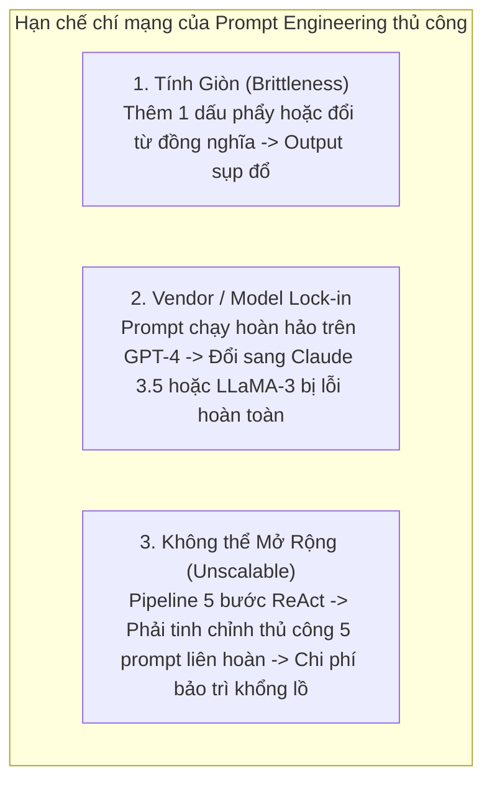
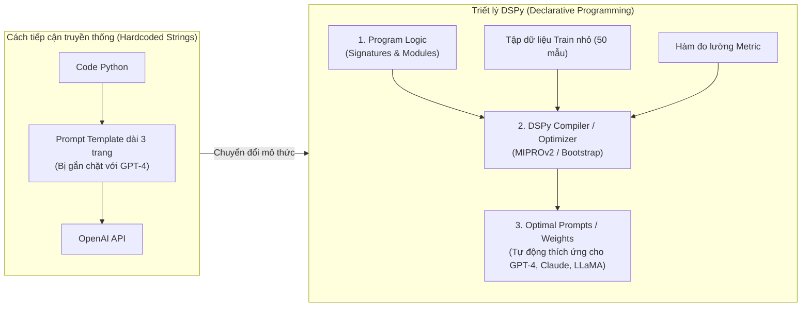
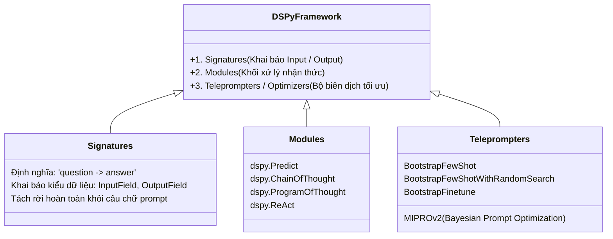
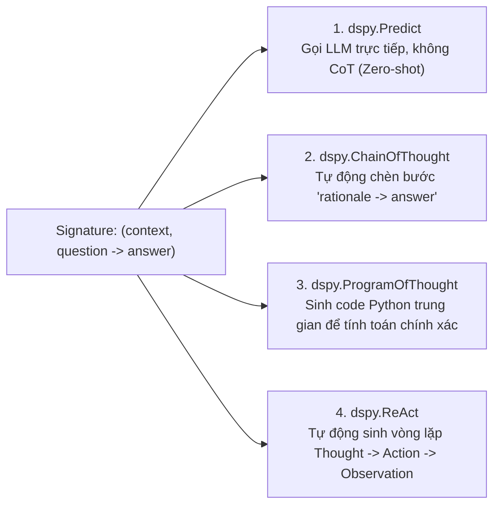
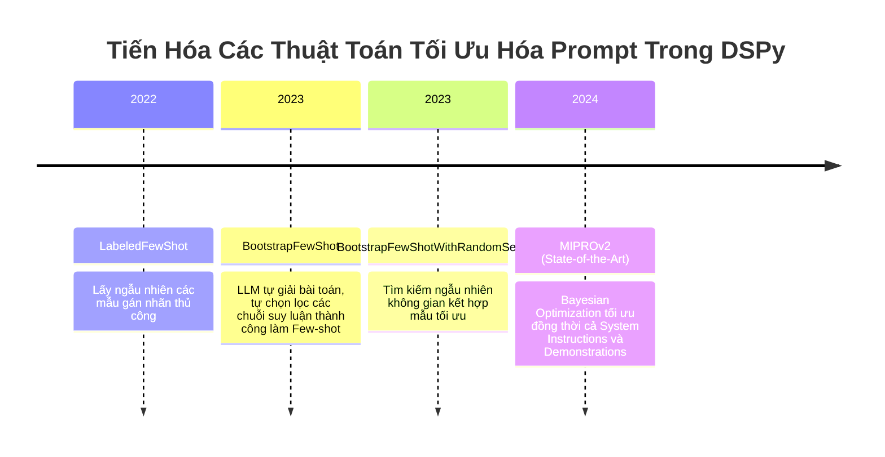
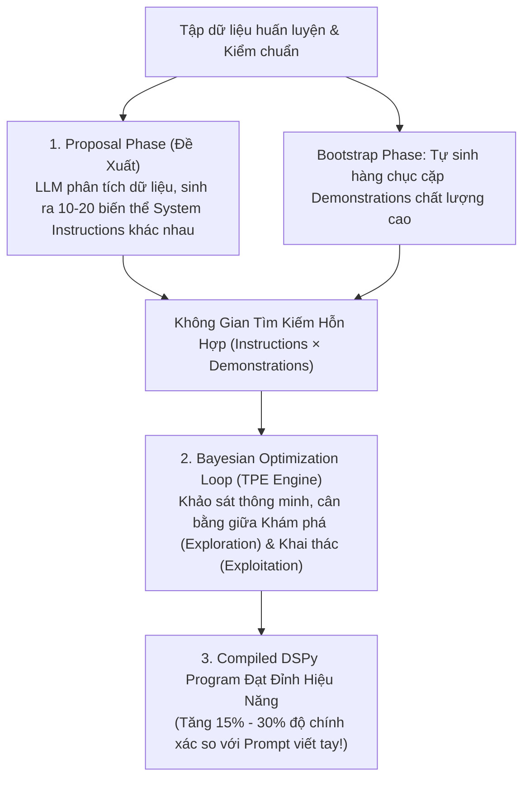
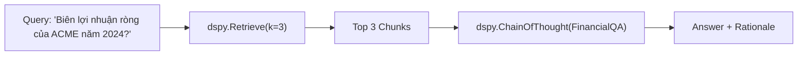
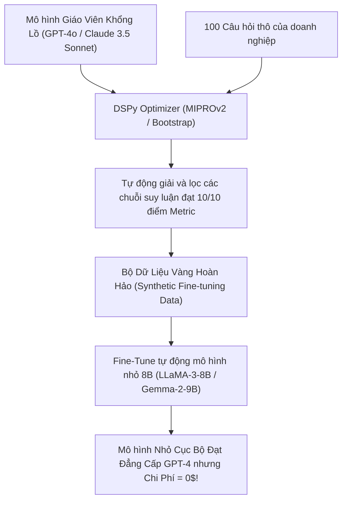

# LẬP TRÌNH HÓA PROMPT VỚI DSPy (STANFORD NLP): KỶ NGUYÊN TỐI ƯU HÓA PROMPT TỰ ĐỘNG
## Chấm Dứt Kỷ Nguyên "Prompt Crafting" Thủ Công: Khung Lập Trình Khai Báo (Declarative Programming), Signatures, Modules & Thuật Toán Tối Ưu Hóa (MIPROv2, BootstrapFewShot)

---

## MỤC LỤC
1. [Khởi nguyên cuộc khủng hoảng: Tại sao Prompt Engineering thủ công là ngõ cụt?](#1-khởi-nguyên-cuộc-khủng-hoảng-tại-sao-prompt-engineering-thủ-công-là-ngõ-cụt)
   - [Nghịch lý tính giòn (Brittleness) & Hiệu ứng cánh bướm khi đổi mô hình](#nghịch-lý-tính-giòn-brittleness--hiệu-ứng-cánh-bướm-khi-đổi-mô-hình)
   - [Sự tương đồng lịch sử: Từ Assembly sang Ngôn ngữ bậc cao (C / Python)](#sự-tương-đồng-lịch-sử-từ-assembly-sang-ngôn-ngữ-bậc-cao-c--python)
2. [Triết lý cốt lõi của DSPy: Tách rời Logic và Trọng số / Prompt](#2-triết-lý-cốt-lõi-của-dspy-tách-rời-logic-và-trọng-số--prompt)
   - [Khái niệm "Compiler for Language Models"](#khái-niệm-compiler-for-language-models)
   - [Ba trụ cột cấu thành DSPy: Signatures, Modules và Teleprompters (Optimizers)](#ba-trụ-cột-cấu-thành-dspy-signatures-modules-và-teleprompters-optimizers)
3. [Giải phẫu các thành phần cơ bản trong DSPy](#3-giải-phẫu-các-thành-phần-cơ-bản-trong-dspy)
   - [3.1. Signatures (Chữ ký khai báo Input / Output)](#31-signatures-chữ-ký-khai-báo-input--output)
   - [3.2. Modules (Khối xử lý nhận thức: Predict, ChainOfThought, ReAct, ProgramOfThought)](#32-modules-khối-xử-lý-nhận-thức-predict-chainofthought-react-programofthought)
   - [3.3. Metrics (Hàm mục tiêu đo lường chất lượng)](#33-metrics-hàm-mục-tiêu-đo-lường-chất-lượng)
4. [Các giải thuật tối ưu hóa tự động (Teleprompters & Optimizers)](#4-các-giải-thuật-tối-ưu-hóa-tự-động-teleprompters--optimizers)
   - [4.1. BootstrapFewShot & BootstrapFewShotWithRandomSearch](#41-bootstrapfewshot--bootstrapfewshotwithrandomsearch)
   - [4.2. MIPROv2 (Multi-prompt Instruction Proposal Optimizer): Đỉnh cao tối ưu Bayesian](#42-miprov2-multi-prompt-instruction-proposal-optimizer-đỉnh-cao-tối-ưu-bayesian)
   - [4.3. COPRO (Coordinate Prompt Optimization) & Automatic Prompt Engineer (APE)](#43-copro-coordinate-prompt-optimization--automatic-prompt-engineer-ape)
5. [Thực hành End-to-End: Xây dựng & Tự động tối ưu hóa Agent với DSPy](#5-thực-hành-end-to-end-xây-dựng--tự-động-tối-ưu-hóa-agent-với-dspy)
   - [5.1. Khởi tạo Language Model & Retrieval Model](#51-khởi-tạo-language-model--retrieval-model)
   - [5.2. Định nghĩa Pipeline RAG / ReAct đa chặng](#52-định-nghĩa-pipeline-rag--react-đa-chặng)
   - [5.3. Thiết kế Metric nghiệp vụ](#53-thiết-kế-metric-nghiệp-vụ)
   - [5.4. Chạy quá trình Biên dịch (Compile) & So sánh trước/sau tối ưu](#54-chạy-quá-trình-biên-dịch-compile--so-sánh-trướcsau-tối-ưu)
6. [Tối ưu hóa kép: Prompt Compilation kết hợp Fine-Tuning tự động](#6-tối-ưu-hóa-kép-prompt-compilation-kết-hợp-fine-tuning-tự-động)
7. [Bảng ma trận so sánh: Prompt Engineering thủ công vs. LangChain vs. DSPy](#7-bảng-ma-trận-so-sánh-prompt-engineering-thủ-công-vs-langchain-vs-dspy)
8. [Tài liệu nghiên cứu khoa học cốt lõi (Academic References)](#8-tài-liệu-nghiên-cứu-khoa-học-cốt-lõi-academic-references)

---

## 1. KHỞI NGUYÊN CUỘC KHỦNG HOẢNG: TẠI SAO PROMPT ENGINEERING THỦ CÔNG LÀ NGÕ CỤT?

Kể từ khi ChatGPT ra đời, thế giới AI chứng kiến sự bùng nổ của nghề "Prompt Engineer". Các kỹ sư dành hàng tuần lễ để thử nghiệm từng câu chữ, chèn thêm các cụm từ ma thuật như *"Take a deep breath and work on this step-by-step"*, *"You are a world-class expert"*, hay cấu trúc hàng chục thẻ XML phức tạp như đã trình bày trong [Các Kỹ Thuật Prompt Engineering Nâng Cao](./01_advanced_prompt_engineering_techniques.md).

Tuy nhiên, trong môi trường kỹ thuật phần mềm doanh nghiệp, cách tiếp cận này nhanh chóng bộc lộ **3 thất bại chí mạng**:



### Nghịch lý tính giòn (Brittleness) & Hiệu ứng cánh bướm khi đổi mô hình
* Một prompt được tinh chỉnh hoàn hảo cho GPT-4 (OpenAI) thường dựa trên các định kiến thống kê ngầm định trong tập dữ liệu tiền huấn luyện của OpenAI.
* Khi doanh nghiệp quyết định chuyển đổi sang mô hình nguồn mở (như LLaMA-3 hoặc DeepSeek) để giảm chi phí hoặc bảo mật dữ liệu nội bộ, toàn bộ chuỗi prompt viết tay lập tức bị suy giảm chất lượng: mô hình sinh thừa markdown, không gọi đúng tool, hoặc bỏ qua các ràng buộc định dạng.
* Kỹ sư lại phải bắt đầu lại toàn bộ quy trình "mò mẫm thử-và-sai" (Trial-and-Error) từ con số 0.

### Sự tương đồng lịch sử: Từ Assembly sang Ngôn ngữ bậc cao (C / Python)
* **Kỷ nguyên máy tính sơ khai:** Các lập trình viên phải viết mã Assembly trực tiếp cho từng thanh ghi (Registers) của một dòng CPU cụ thể. Khi đổi CPU, toàn bộ phần mềm phải được viết lại.
* **Cuộc cách mạng Trình biên dịch (Compilers):** Sự ra đời của ngôn ngữ bậc cao (C, Fortran) và Trình biên dịch (GCC) đã giải phóng lập trình viên: bạn chỉ cần viết **Logic thuật toán độc lập**, trình biên dịch sẽ tự động tối ưu hóa và phát sinh mã máy tương thích cho từng phần cứng cụ thể.
* **DSPy (Stanford NLP) chính là "Trình biên dịch" đầu tiên dành cho Mô hình Ngôn ngữ Lớn.** Thay vì viết chuỗi prompt thô (tương đương mã Assembly), bạn lập trình logic bằng Python, và DSPy sẽ **biên dịch (compile)** chương trình đó thành chuỗi Prompt hoặc trọng số Fine-tune tối ưu nhất cho bất kỳ mô hình LLM nào!

---

## 2. TRIẾT LÝ CỐT LÕI CỦA DSPy: TÁCH RỜI LOGIC VÀ TRỌNG SỐ / PROMPT

Dự án **DSPy (Demonstrate-Search-Predict in Python)** được phát triển bởi nhóm nghiên cứu của Giáo sư Christopher Potts và Omar Khattab tại Đại học Stanford (Khattab et al., 2023 - [arXiv:2310.03714](https://arxiv.org/abs/2310.03714)).



### Khái niệm "Compiler for Language Models"
Trong mô thức DSPy:
1. **Bạn không viết Prompt:** Bạn chỉ định nghĩa **Dòng dữ liệu (Information Flow)** và **Chữ ký chuyển đổi dữ liệu (Signatures)**.
2. **DSPy tự tìm Prompt tối ưu:** Thông qua các thuật toán tối ưu hóa (Optimizers / Teleprompters), DSPy sẽ tự động chạy thử trên tập dữ liệu nhỏ (Training Examples), tự sinh ra các câu hướng dẫn hệ thống (Instructions), tự chọn lọc các ví dụ minh họa mẫu mực nhất (**Few-shot Demonstrations**) và ghép thành prompt hoàn chỉnh mang lại điểm số cao nhất trên Metric đánh giá.

---

### Ba trụ cột cấu thành DSPy: Signatures, Modules và Teleprompters



> [!note] Giải thích Khối: Trụ Cột Signatures (Giao Diện Khai Báo Ngữ Nghĩa)
> * **Bản chất:** Giống như một Interface / Type Definition trong TypeScript hoặc C++. Nó chỉ quy định kiểu và mô tả của trường đầu vào (`InputField`) và trường đầu ra (`OutputField`), hoàn toàn không chứa câu từ gợi ý nào cho mô hình.
> * **Lợi ích:** Cho phép hoán đổi mô hình nền bên dưới (từ GPT-4o sang LLaMA-3 hay Claude 3.5) mà không phải viết lại bất kỳ dòng code giao diện nào.

> [!note] Giải thích Khối: Trụ Cột Modules (Khối Xử Lý Nhận Thức)
> * **Bản chất:** Tương đương với `torch.nn.Module` trong PyTorch. Một module đóng gói chiến lược tư duy (ví dụ: `dspy.ChainOfThought` tự động chèn trường `rationale` vào trước `answer`; `dspy.ReAct` tự động tạo vòng lặp Thought $\to$ Action $\to$ Observation).
> * **Tính khả cấu (Composability):** Các module có thể lồng nhau để tạo thành các pipeline đa chặng phức tạp.

> [!note] Giải thích Khối: Trụ Cột Teleprompters / Optimizers (Trình Biên Dịch Tối Ưu Hóa)
> * **Bản chất:** Đóng vai trò như thuật toán tối ưu hóa (Optimizer: SGD, AdamW) trong Deep Learning. Nó duyệt qua tập dữ liệu mẫu, kích hoạt pipeline chạy thử, chấm điểm bằng `Metric`, và tự động tinh chỉnh prompt (System Instructions và Few-shot Demonstrations) để đẩy điểm số lên cực đại.

---

## 3. GIẢI PHẪU CÁC THÀNH PHẦN CƠ BẢN TRONG DSPy

### 3.1. Signatures (Chữ ký khai báo Input / Output)

Một **Signature** trong DSPy là một bản đặc tả giao tiếp (Interface Specification) định nghĩa: *Chương trình nhận vào thông tin gì và cần sinh ra kết quả gì*, hoàn toàn không chứa văn bản hướng dẫn LLM phải làm như thế nào.

DSPy hỗ trợ hai cách khai báo Signature:

#### Cách 1: Cú pháp rút gọn (Inline String Notation)
Phù hợp cho các tác vụ chuẩn mực đơn giản:
```python
import dspy

# Định nghĩa tác vụ trả lời câu hỏi dựa trên ngữ cảnh
qa_signature = "context, question -> answer"

# Định nghĩa tác vụ phân loại cảm xúc kèm lý do
sentiment_signature = "sentence -> sentiment: bool, rationale: str"
```

#### Cách 2: Khai báo Hướng đối tượng (Class-based Notation - Khuyên Dùng)
Cho phép bổ sung mô tả ngữ nghĩa (Docstrings), kiểu dữ liệu và ràng buộc chi tiết:
```python
from dspy import Signature, InputField, OutputField

class FinancialAnalysisSignature(Signature):
    """Phân tích báo cáo tài chính doanh nghiệp và đưa ra khuyến nghị đầu tư."""
    
    financial_data: str = InputField(desc="Dữ liệu doanh thu, lợi nhuận, nợ vay từ báo cáo quý")
    industry_benchmark: str = InputField(desc="Chỉ số trung bình của các đối thủ trong ngành")
    
    risk_assessment: str = OutputField(desc="Đánh giá mức độ rủi ro tài chính (Thấp, Trung bình, Cao)")
    investment_verdict: str = OutputField(desc="Khuyến nghị: Mua (Buy), Giữ (Hold), hoặc Bán (Sell)")
    key_drivers: list[str] = OutputField(desc="Danh sách 3 động lực chính dẫn tới khuyến nghị")
```

---

### 3.2. Modules (Khối xử lý nhận thức)

Module trong DSPy tương tự như `torch.nn.Module` trong PyTorch: nó đóng gói logic biến đổi dữ liệu từ một Signature đầu vào thành đầu ra, đồng thời lưu giữ các "tham số" có thể học được (chính là Prompt, Instructions và Few-shot Demonstrations).

DSPy cung cấp sẵn 4 khối nhận thức kinh điển:



1. **`dspy.Predict`:** Gọi LLM theo chế độ thực thi trực tiếp cơ bản nhất.
2. **`dspy.ChainOfThought`:** DSPy tự động phân rã Signature thành:
   $$\text{Input} \to \text{Rationale} \to \text{Output}$$
   Điều kỳ diệu là bạn không cần phải gõ `"Let's think step by step"`; DSPy tự cấu trúc hóa trường suy luận này.
3. **`dspy.ProgramOfThought`:** Thay vì để LLM tự làm tính nhẩm bằng chữ (dễ sai sót), module này điều hướng LLM sinh mã Python, chạy mã trong sandbox và lấy kết quả nạp vào output.
4. **`dspy.ReAct`:** Tự động biến Signature thông thường thành một Tác tử ReAct hoàn chỉnh có khả năng gọi các công cụ ngoài:
```python
# Biến Signature thành một ReAct Agent hoàn chỉnh chỉ với 1 dòng code!
react_agent = dspy.ReAct(
    signature="question -> answer",
    tools=[search_database, execute_calculator]
)
```

---

### 3.3. Metrics (Hàm mục tiêu đo lường chất lượng)

Bộ biên dịch DSPy không thể tối ưu hóa nếu không có một **Hàm mục tiêu (Metric)** đánh giá xem một câu trả lời là "tốt" hay "xấu".

Metric trong DSPy là một hàm Python nhận vào:
* `example`: Dữ liệu mẫu chuẩn (Ground Truth).
* `pred`: Dự đoán do DSPy Module sinh ra.
* `trace`: (Tùy chọn) Toàn bộ cây vết thực thi của LLM.

```python
def enterprise_rag_metric(example, pred, trace=None):
    """Hàm đánh giá đa tiêu chí kết hợp logic cứng và thẩm định ngữ nghĩa."""
    # 1. Ràng buộc cứng: Không được rỗng và câu trả lời phải chứa từ khóa bắt buộc
    if not pred.answer or len(pred.answer.strip()) < 10:
        return False
        
    # 2. Khớp chính xác với nhãn Ground Truth (Exact Match)
    exact_match = example.answer.lower() in pred.answer.lower()
    
    # 3. Thẩm định độ chính xác số học nếu câu hỏi liên quan đến tài chính
    has_correct_numbers = True
    if hasattr(example, "expected_amount"):
        has_correct_numbers = str(example.expected_amount) in pred.answer
        
    # Trả về điểm số (hoặc số thực từ 0.0 đến 1.0)
    return exact_match and has_correct_numbers
```

---

## 4. CÁC GIẢI THUẬT TỐI ƯU HÓA TỰ ĐỘNG (TELEPROMPTERS & OPTIMIZERS)

Trọng tâm sức mạnh của DSPy nằm ở **Teleprompters (Bộ tối ưu hóa Prompt)**. Đây là các thuật toán tự động tinh chỉnh các tham số bên trong Module của bạn để tối đa hóa điểm số của Metric trên tập dữ liệu huấn luyện.



---

### 4.1. BootstrapFewShot & BootstrapFewShotWithRandomSearch

* **Nỗi đau truyền thống:** Để làm Few-shot CoT, con người phải ngồi tự gõ từng bước suy luận mẫu (*Demonstrations*). Việc này tốn hàng trăm giờ công.
* **Cơ chế Bootstrap tự hành (Self-Bootstrapping):**
  1. DSPy nạp mô hình LLM với chế độ Zero-shot ban đầu.
  2. Cho mô hình chạy qua tập câu hỏi huấn luyện chưa có lời giải chi tiết (Unlabeled inputs).
  3. Nếu mô hình đưa ra câu trả lời **vượt qua được bài kiểm tra của hàm Metric**: DSPy ghi nhận toàn bộ chuỗi suy luận CoT thành công đó và lưu thành một **Mẫu minh họa đạt chuẩn (Validated Demonstration)**.
  4. Nếu thất bại: Loại bỏ chuỗi đó.
  5. Ghép các Demonstrations tự sinh tốt nhất vào Prompt cuối cùng.
* **BootstrapFewShotWithRandomSearch:**
  * Thay vì chỉ chọn 1 tập mẫu cố định, thuật toán tiến hành lấy mẫu ngẫu nhiên $N$ tổ hợp khác nhau của các Demonstrations.
  * Đánh giá từng tổ hợp trên tập Validation và chọn ra tổ hợp mang lại điểm số tổng thể cao nhất.

---

### 4.2. MIPROv2 (Multi-prompt Instruction Proposal Optimizer): Đỉnh cao tối ưu Bayesian

Được công bố bởi nhóm Stanford vào giữa năm 2024 (Opsahl-Ong et al., [arXiv:2406.11695](https://arxiv.org/abs/2406.11695)), **MIPROv2** hiện là bộ tối ưu hóa mạnh mẽ nhất trong hệ sinh thái DSPy:



#### Quy trình 2 pha của MIPROv2:
1. **Pha đề xuất (Proposal Phase):**
   * Sử dụng một LLM mạnh (như GPT-4o) đọc toàn bộ mã nguồn Module, các mẫu dữ liệu và chữ ký Signature.
   * Sinh ra một tập hợp gồm $10 - 20$ câu lệnh **System Instructions** mang nhiều phong cách và góc nhìn lập luận khác nhau.
   * Đồng thời tự tạo tập hợp các mẫu Demonstrations qua Bootstrap.
2. **Pha tối ưu hóa Bayesian (Optimization Phase):**
   * Coi bài toán tìm Prompt như một bài toán tối ưu hóa hộp đen (Black-box Optimization).
   * Áp dụng giải thuật **Tree-structured Parzen Estimator (TPE)** để khảo sát không gian kết hợp giữa Instructions và Demonstrations.
   * Tự động hội tụ về cấu hình Prompt đạt điểm Metric cao nhất với số lượt gọi LLM ít nhất.

---

### 4.3. COPRO (Coordinate Prompt Optimization) & Automatic Prompt Engineer (APE)

* **APE (Zhou et al., ICLR 2023):** Công trình kinh điển chứng minh rằng: **LLM là những chuyên gia viết Prompt giỏi hơn con người.** Khi cung cấp cho LLM một vài cặp Input/Output mẫu và yêu cầu nó: *"Hãy tìm câu lệnh chỉ dẫn tổng quát khiến tôi sinh ra các kết quả này"*, các câu lệnh do mô hình tìm ra thường vượt trội hơn các câu lệnh do con người dày công biên soạn.
* **COPRO trong DSPy:** Mở rộng APE cho các pipeline nhiều bước (Multi-stage pipelines). Thuật toán tối ưu hóa từng tọa độ (Coordinate Descent): giữ cố định prompt ở bước 1, tối ưu hóa prompt ở bước 2; sau đó giữ bước 2, quay lại tối ưu bước 1 cho đến khi toàn bộ chuỗi đạt trạng thái cân bằng Nash.

---

## 5. THỰC HÀNH END-TO-END: XÂY DỰNG & TỰ ĐỘNG TỐI ƯU HÓA AGENT VỚI DSPy

Hãy cùng xây dựng một hệ thống **Enterprise Financial RAG Agent** hoàn chỉnh từ con số 0 bằng DSPy và chứng kiến thuật toán tự động nâng cấp hiệu năng của Agent:



### Bước 1: Thiết lập Môi trường và Mô hình

```python
import dspy
from dspy.datasets import HotPotQA

# 1. Cấu hình Mô hình Ngôn ngữ Lớn (LLM) và Mô hình Truy xuất (Retriever)
lm = dspy.LM("openai/gpt-4o-mini", api_key="sk-...")
# Hoặc dùng mô hình cục bộ qua Ollama: dspy.LM("ollama_chat/llama3.1", api_base="http://localhost:11434")

# Giả lập công cụ truy xuất Vector Database
class MockEnterpriseRetriever(dspy.Retrieve):
    def forward(self, query: str, k: int = 3):
        # Trả về các đoạn tài liệu tương ứng từ Vector DB
        return [
            dspy.Prediction(long_text="Năm 2024, ACME Corp đạt doanh thu 100 tỷ VNĐ và lợi nhuận sau thuế 18 tỷ VNĐ."),
            dspy.Prediction(long_text="Chính sách cổ tức năm 2024 của ACME dự kiến chi trả 10% bằng tiền mặt.")
        ]

dspy.configure(lm=lm)
retriever = MockEnterpriseRetriever()
```

---

### Bước 2: Khai báo Signature và Module Pipeline

```python
# 1. Khai báo Signature nghiệp vụ
class FinancialQA(dspy.Signature):
    """Trả lời câu hỏi tài chính dựa trên tài liệu báo cáo nội bộ."""
    context: list[str] = dspy.InputField(desc="Các đoạn trích xuất từ báo cáo tài chính")
    question: str = dspy.InputField(desc="Câu hỏi cần giải đáp của ban giám đốc")
    answer: str = dspy.OutputField(desc="Câu trả lời súc tích kèm số liệu tính toán cụ thể")

# 2. Xây dựng Module xử lý (Kế thừa dspy.Module)
class EnterpriseRAGProgram(dspy.Module):
    def __init__(self):
        super().__init__()
        self.retrieve = MockEnterpriseRetriever()
        # Sử dụng ChainOfThought để mô hình tự lập luận từng bước
        self.generate_answer = dspy.ChainOfThought(FinancialQA)
        
    def forward(self, question: str):
        # Bước 1: Truy xuất tài liệu
        context = self.retrieve(question)
        context_texts = [c.long_text for c in context]
        
        # Bước 2: Suy luận và trả lời
        prediction = self.generate_answer(context=context_texts, question=question)
        return prediction
```

---

### Bước 3: Chuẩn bị Tập Dữ Liệu Huấn Luyện & Hàm Đo Lường

Chỉ cần một tập dữ liệu nhỏ gồm $10 - 20$ ví dụ (thay vì hàng nghìn mẫu gắn nhãn tốn kém):

```python
# Chuẩn bị dữ liệu mẫu huấn luyện (Trainset) và kiểm chuẩn (Devset)
trainset = [
    dspy.Example(
        question="Biên lợi nhuận ròng của ACME năm 2024 là bao nhiêu?",
        answer="18% (Lợi nhuận ròng 18 tỷ trên tổng doanh thu 100 tỷ VNĐ)"
    ).with_inputs("question"),
    dspy.Example(
        question="ACME có kế hoạch chia cổ tức năm 2024 như thế nào?",
        answer="Chi trả 10% bằng tiền mặt"
    ).with_inputs("question")
]

# Định nghĩa Metric đánh giá tính chính xác dữ kiện
def validate_financial_answer(example, pred, trace=None):
    return example.answer.lower() in pred.answer.lower()
```

---

### Bước 4: Biên Dịch & Tự Động Tối Ưu Hóa (The Compilation Phase)

Đây là khoảnh khắc phép màu diễn ra. Ta truyền chương trình chưa tối ưu vào **BootstrapFewShot Optimizer**:

```python
from dspy.teleprompt import BootstrapFewShot

# 1. Khởi tạo Optimizer
optimizer = BootstrapFewShot(
    metric=validate_financial_answer,
    max_bootstrapped_demos=4,  # Tối đa 4 mẫu CoT tự sinh
    max_labeled_demos=2        # Tối đa 2 mẫu từ dữ liệu gốc
)

# 2. Kích hoạt Trình biên dịch (Compile)
print("🚀 Đang tiến hành biên dịch và tự động tối ưu hóa Agent...")
unoptimized_program = EnterpriseRAGProgram()
compiled_program = optimizer.compile(student=unoptimized_program, trainset=trainset)

# 3. Chạy thử nghiệm trên câu hỏi mới
test_query = "Hãy tính tỷ suất lợi nhuận ròng trên doanh thu của tập đoàn ACME trong năm 2024?"
result = compiled_program(question=test_query)

print("\n--- KẾT QUẢ SAU BIÊN DỊCH ---")
print("Chuỗi lập luận (Rationale):", result.rationale)
print("Câu trả lời (Answer):", result.answer)
```

#### Điều gì đã thực sự diễn ra dưới nền tảng?
1. Trình biên dịch DSPy tự động gửi câu hỏi trong `trainset` tới mô hình.
2. Mô hình thử nghiệm các bước suy nghĩ: *"Doanh thu là 100 tỷ, lợi nhuận sau thuế là 18 tỷ. Tỷ suất là 18 / 100 = 18%"*.
3. Hàm `validate_financial_answer` kiểm tra thấy kết quả chứa chuỗi `"18%"` $\to$ Hợp lệ!
4. DSPy **tự động đóng gói toàn bộ chuỗi lập luận xuất sắc này thành Demonstration mẫu** và tiêm thẳng vào Prompt cho các lần truy vấn trong tương lai.
5. Khi bạn đổi sang một mô hình khác (ví dụ: chuyển từ GPT-4 sang LLaMA-3), bạn chỉ cần chạy lại `optimizer.compile()`: DSPy sẽ tự động tái sinh một bộ Prompt tương thích $100\%$ với hành vi của LLaMA-3 mà bạn không cần phải sửa một dòng code nào!

---

## 6. TỐI ƯU HÓA KÉP: PROMPT COMPILATION KẾT HỢP FINE-TUNING TỰ ĐỘNG

Một trong những tính năng tiên tiến nhất của DSPy là khả năng **Chưng cất tri thức (Knowledge Distillation)** thông qua `dspy.BootstrapFinetune`:



* Thay vì phải trả tiền triệu USD cho API thương mại, bạn dùng DSPy kết hợp với GPT-4 để tạo ra hàng nghìn chuỗi lập luận chuẩn xác.
* Sau đó, module `BootstrapFinetune` sử dụng chính tập dữ liệu này để fine-tune một mô hình nhỏ gọn (như LLaMA-3 8B). Kết quả là bạn sở hữu một mô hình cục bộ chạy trên máy chủ riêng của doanh nghiệp với tốc độ cực nhanh, bảo mật tuyệt đối nhưng độ chính xác tương đương mô hình đóng khổng lồ!

---

## 7. BẢNG MA TRẬN SO SÁNH: PROMPT THỦ CÔNG VS. LANGCHAIN VS. DSPy

| Tiêu chí so sánh | **Prompt Engineering Thủ Công** | **LangChain / LlamaIndex** | **DSPy Framework (Stanford)** |
| :--- | :--- | :--- | :--- |
| **Bản chất tiếp cận** | Viết chuỗi văn bản tự do (*String Crafting*) | Nối chuỗi Prompt Templates (*Chains & Prompts*) | **Lập trình khai báo & Biên dịch thuật toán (*Compiler*)** |
| **Tính bền vững khi đổi Model** | Cực kỳ giòn (*Brittle*), phải sửa lại từ đầu | Dễ vỡ khi đổi mô hình nơ-ron nền | **Miễn nhiễm:** Chỉ cần gọi `compile()`, Prompt tự thích nghi |
| **Phương pháp tối ưu hóa** | Dựa trên cảm tính cá nhân (*Trial-and-Error*) | Không có cơ chế tự tối ưu prompt | **Toán học tối ưu (Bayesian, Random Search, MIPRO)** |
| **Xử lý Few-shot Examples** | Con người tự gõ bằng tay từng ví dụ | Chọn mẫu dựa trên Cosine similarity tĩnh | **Tự sinh và tự chọn lọc mẫu dựa trên Metric thành công** |
| **Khả năng kiểm thử định lượng**| Khó khăn, phụ thuộc vibe-checking | Cần tích hợp thêm công cụ ngoài | **Tích hợp sẵn bộ đánh giá và tối ưu trực tiếp theo Metric** |
| **Đường cong học tập** | Dễ bắt đầu, không cần học code | Dễ dùng nhưng cấu trúc trừu tượng rối rắm | Đòi hỏi tư duy lập trình hướng đối tượng (OOP) như PyTorch |

---

## 8. TÀI LIỆU NGHIÊN CỨU KHOA HỌC CỐT LÕI (ACADEMIC REFERENCES)

Dưới đây là danh mục các bài báo học thuật nền tảng tạo nên cuộc cách mạng lập trình hóa mô hình ngôn ngữ:

1. **DSPy: Compiling Declarative Language Model Calls into Self-Improving Pipelines:**
   * *Tác giả:* Khattab, O., Singhvi, A., Maheshwari, P., Zhang, Z., Santhanam, K., Vardham, S., ... & Potts, C. (Stanford University).
   * *Bài báo:* *arXiv preprint* (2023).
   * *Liên kết:* [arXiv:2310.03714](https://arxiv.org/abs/2310.03714)
   * *Ý nghĩa:* Tuyên ngôn chính thức khai sinh framework DSPy, định nghĩa khái niệm Module, Signature và Compiler cho LLM.
2. **Demonstrate-Search-Predict: Composing Retrieval and Language Models for Knowledge-Intensive NLP:**
   * *Tác giả:* Khattab, O., Santhanam, K., Li, X. L., Hall, D., Liang, P., Potts, C., & Zaharia, M. (2022).
   * *Bài báo:* *arXiv preprint*.
   * *Liên kết:* [arXiv:2212.14024](https://arxiv.org/abs/2212.14024)
   * *Ý nghĩa:* Tiền thân của DSPy (DSP framework), khởi xướng việc tách rời bài toán RAG thành các khối tính toán có thể lập trình được.
3. **Large Language Models Are Human-Level Prompt Engineers (APE):**
   * *Tác giả:* Zhou, Y., Madaan, A., Terzi, E., & Neubig, G. (Carnegie Mellon University).
   * *Xuất bản:* *International Conference on Learning Representations (ICLR 2023)*.
   * *Liên kết:* [arXiv:2211.01910](https://arxiv.org/abs/2211.01910)
   * *Ý nghĩa:* Đặt nền tảng cho việc sử dụng LLM để tự động sinh và đánh giá các ứng viên câu lệnh (Automatic Prompt Generation).
4. **Optimizing Instructions and Demonstrations for Multi-Stage Language Model Programs (MIPROv2):**
   * *Tác giả:* Opsahl-Ong, K., Ryan, M. J., Khattab, O., & Potts, C. (Stanford University).
   * *Bài báo:* *arXiv preprint* (2024).
   * *Liên kết:* [arXiv:2406.11695](https://arxiv.org/abs/2406.11695)
   * *Ý nghĩa:* Đề xuất giải thuật MIPRO và MIPROv2, sử dụng Bayesian Optimization để tối ưu hóa đồng thời cả System Prompts và Few-shot Demos cho các chuỗi Agent phức tạp.

---

## 🔗 LIÊN KẾT ĐIỀU HƯỚNG TRONG VAULT

* [Các Kỹ Thuật Prompt & Context Engineering Nâng Cao](./01_advanced_prompt_engineering_techniques.md): Khảo sát các kỹ thuật viết prompt kinh điển (CoT, ToT, XML Framing).
* [Giải Phẫu Kiến Trúc AI Harness](../../03-building-agents/01-harness-and-memory/02_harness_architecture.md): Tích hợp các DSPy Modules vào bộ khung phần mềm điều khiển.
* [Kiến Trúc Giao Thức Model Context Protocol (MCP)](../../03-building-agents/02-tools-and-mcp/01_mcp_architecture.md): Đóng gói công cụ ngoài cho DSPy ReAct Module.
* [Hệ Thống Giám Sát, Đo Lường & Đánh Giá Tác Tử AI](../../03-building-agents/04-observability-evals-and-cost/01_agent_evals_and_tracing.md): Xây dựng các hàm Metrics và tích hợp Tracing Langfuse cho chương trình DSPy.
* [Cẩm Nang Toàn Tập Xây Dựng AI Agent Doanh Nghiệp](../../03-building-agents/06-governance-and-enterprise-delivery/03_how_to_build_enterprise_ai_agents.md): Kiến trúc tổng thể đưa DSPy Agent lên môi trường sản xuất.
* Trở về mục lục Trụ cột 2: [✍️ Trụ Cột 2: Prompt & Context Engineering](../README.md)
* Trở về trang chủ Vault: [🏠 Vault Home MOC](../../README.md)
