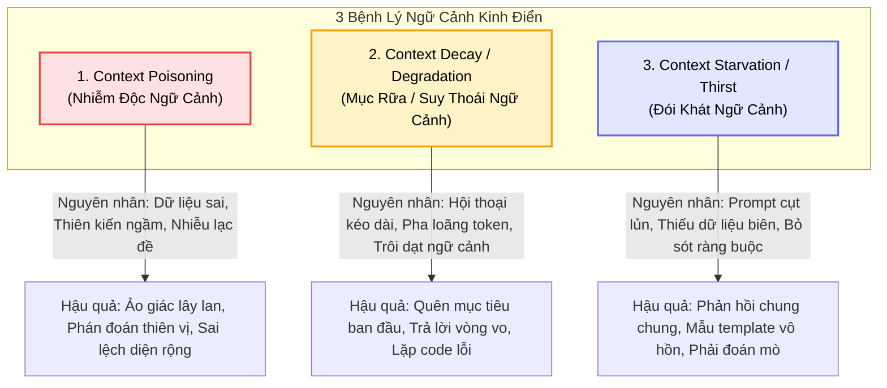
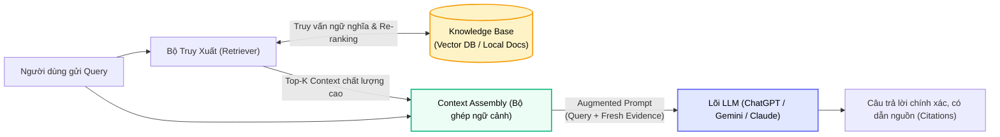
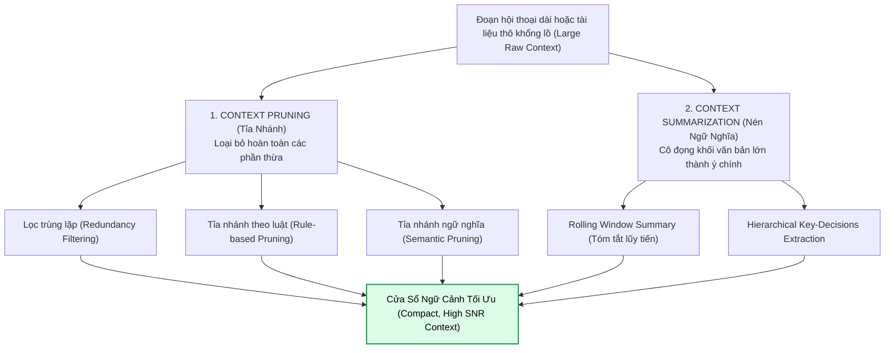
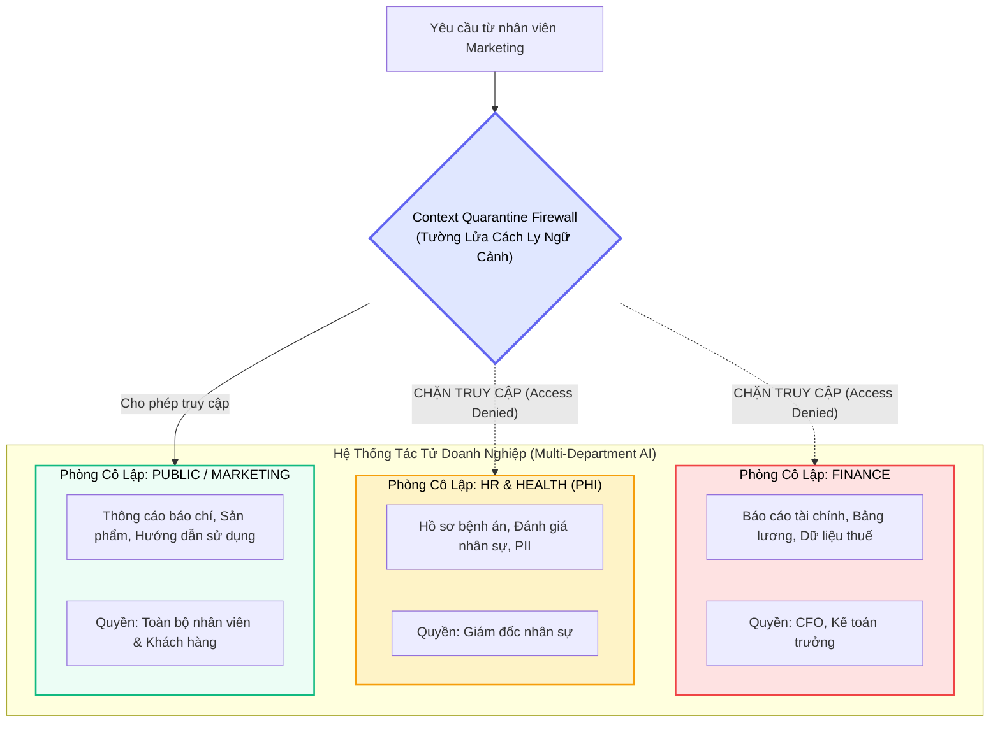
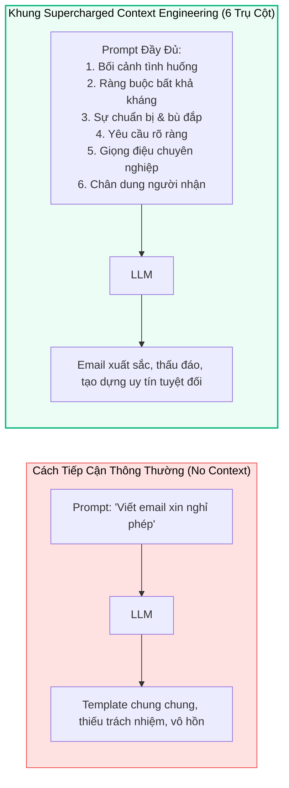

# 🧠 QUẢN TRỊ CỬA SỔ NGỮ CẢNH: BỆNH LÝ, TỈA NHÁNH, TÓM TẮT & CÔ LẬP
## Làm Chủ Context Window: Từ Chẩn Đoán Lỗi Đến Kiến Trúc Context Quarantine

---

## 📑 MỤC LỤC
1. [Bản Chất Của Context Window & Nguyên Lý "Rác Vào - Rác Ra"](#1-bản-chất-của-context-window--nguyên-lý-rác-vào---rác-ra)
2. [Ba Bệnh Lý Ngữ Cảnh Tử Huyệt (Common Context Failure Modes)](#2-ba-bệnh-lý-ngữ-cảnh-tử-huyệt-common-context-failure-modes)
   * [2.1. Nhiễm Độc Ngữ Cảnh (Context Poisoning)](#21-nhiễm-độc-ngữ-cảnh-context-poisoning)
   * [2.2. Mục Rữa & Suy Thoái Ngữ Cảnh (Context Decay & Degradation)](#22-mục-rữa--suy-thoái-ngữ-cảnh-context-decay--degradation)
   * [2.3. Đói Khát Ngữ Cảnh (Context Starvation / Thirst)](#23-đói-khát-ngữ-cảnh-context-starvation--thirst)
3. [Liều Thuốc Nền Tảng: Retrieval-Augmented Generation (RAG)](#3-liều-thuốc-nền-tảng-retrieval-augmented-generation-rag)
4. [Kỹ Thuật Tỉa Nhánh & Nén Ngữ Cảnh (Context Pruning & Summarization)](#4-kỹ-thuật-tỉa-nhánh--nén-ngữ-cảnh-context-pruning--summarization)
   * [4.1. Context Pruning (Tỉa Nhánh Thông Minh)](#41-context-pruning-tỉa-nhánh-thông-minh)
   * [4.2. Context Summarization (Nén Ngữ Nghĩa)](#42-context-summarization-nén-ngữ-nghĩa)
5. [Kiến Trúc Cô Lập Ngữ Cảnh (Context Quarantine)](#5-kiến-trúc-cô-lập-ngữ-cảnh-context-quarantine)
6. [Thực Nghiệm Thực Chiến: Supercharged Context Engineering Framework](#6-thực-nghiệm-thực-chiến-supercharged-context-engineering-framework)
7. [Tổng Kết & Liên Kết Hệ Thống](#7-tổng-kết--liên-kết-hệ-thống)

---

## 1. BẢN CHẤT CỦA CONTEXT WINDOW & NGUYÊN LÝ "RÁC VÀO - RÁC RA"

Trong các hệ thống tác tử AI tự hành (Autonomous Agents), **Cửa sổ ngữ cảnh (Context Window)** là vùng RAM duy nhất mà mô hình ngôn ngữ (LLM Core) có quyền truy cập trực tiếp tại thời điểm suy luận. Như đã phân tích trong [Kiến trúc & Tiến hóa của các hệ thống AI Chat](./01_ai_chat_systems_and_prompt_engineering.md), LLM là một hàm tính toán không trạng thái (stateless function):

$$
y_{t} = f_{\theta}(x_{\text{system}} \circ x_{\text{history}} \circ x_{\text{retrieved}} \circ x_{\text{user}})
$$

Tất cả sự thông minh, khả năng suy luận logic và tính chuẩn xác của câu trả lời phụ thuộc 100% vào chất lượng của vector token đầu vào. Khi chúng ta mở rộng cửa sổ ngữ cảnh từ $4\text{K}$ token lên $128\text{K}$, $1\text{M}$ hay thậm chí $2\text{M}$ token (như Gemini 1.5 Pro), một lầm tưởng phổ biến xuất hiện: *"Cứ nhồi toàn bộ tài liệu vào context là AI sẽ tự hiểu và giải quyết được mọi việc"*.

> [!warning] Nghịch Lý Cửa Sổ Ngữ Cảnh Lớn (The Large Context Window Paradox)
> Cửa sổ ngữ cảnh càng lớn thì tỷ lệ tín hiệu trên nhiễu (**Signal-to-Noise Ratio - SNR**) càng giảm. Hiện tượng **Lost in the Middle** (Liu et al., 2023) chứng minh rằng LLM có xu hướng chú ý mạnh vào phần đầu và phần cuối của prompt, trong khi thông tin ở khoảng giữa rất dễ bị bỏ quên hoặc hiểu sai lệch. 
>
> Ngữ cảnh không chỉ là "dung lượng bộ nhớ", mà là một **hệ sinh thái nhận thức mong manh**. Bất kỳ thông tin sai lệch, thừa thãi hay định kiến ngầm nào lọt vào context cũng sẽ bị khuếch đại lên gấp nhiều lần.

---

## 2. BA BỆNH LÝ NGỮ CẢNH TỬ HUYỆT (COMMON CONTEXT FAILURE MODES)

Khi vận hành các hệ thống AI thực tế, có 3 căn bệnh kinh điển khiến chất lượng phản hồi sụp đổ hoàn toàn:



---

### 2.1. Nhiễm Độc Ngữ Cảnh (Context Poisoning)

> [!important] Định Nghĩa
> **Context Poisoning (Nhiễm độc ngữ cảnh)** là sự ô nhiễm xảy ra khi thông tin **sai sự thật (incorrect)**, **thiên kiến bất công (biased)** hoặc **hoàn toàn vô ích (irrelevant)** thâm nhập vào không gian nhận thức của AI, sau đó lây lan âm thầm qua các lượt suy luận tiếp theo, làm hỏng toàn bộ các quyết định hạ nguồn.

#### Các nguồn gây nhiễm độc chủ yếu:

1. **Thiên kiến tiềm ẩn trong dữ liệu tiền huấn luyện (Pre-training Data Bias):**
   * *Thí nghiệm thực tế:* Khi gửi cùng một prompt đơn giản tới cả ChatGPT và Google Gemini:
     > *"Write a small story about a boy and girl choosing their career."*
   * *Kết quả:* Cả hai mô hình đều có xu hướng tự động gán nhân vật nam (Aarav, Leo) theo đuổi ngành kỹ thuật (Engineering) hoặc khoa học máy tính (Computer Science).
   * *Bản chất:* Dữ liệu khổng lồ thu thập từ Internet chứa sẵn thiên kiến giới tính lịch sử đối với ngành kỹ sư. Khi prompt không cung cấp ràng buộc cụ thể, mô hình kích hoạt mẫu hình xác suất thống kê thiên vị này, tự động "đầu độc" cốt truyện bằng một giả định bất bình đẳng.

2. **Dữ liệu tri thức nội bộ sai lệch hoặc lỗi thời (Outdated Enterprise Knowledge):**
   * Hãy tưởng tượng một hệ sinh thái tác tử hỗ trợ nhân sự (HR Agent). Nếu bộ phận IT tải lên CSDL tri thức một văn bản chính sách nghỉ phép từ năm 2021 (đã hết hiệu lực), tác tử sẽ liên tục trích xuất văn bản này để trả lời nhân viên. Hậu quả là thông tin sai lệch lan rộng khắp tổ chức, tạo ra rủi ro pháp lý nghiêm trọng.

3. **Thông tin lạc đề làm nhiễu loạn nhận thức (Irrelevant Topic Injection):**
   * Xảy ra khi một tác tử chăm sóc khách hàng vô tình kéo về một bản tin thời sự hoặc thảo luận diễn đàn không liên quan đến sản phẩm hiện tại. LLM bị phân tâm (distracted), cố gắng liên kết thông tin lạc đề đó vào câu trả lời, dẫn đến phản hồi kỳ quặc và mất trọng tâm.

---

### 2.2. Mục Rữa & Suy Thoái Ngữ Cảnh (Context Decay & Degradation)

> [!important] Định Nghĩa
> **Context Decay (Mục rữa ngữ cảnh)** hay **Context Degradation (Suy thoái ngữ cảnh)** là sự suy giảm dần về chất lượng thông tin mà AI sử dụng trong các phiên làm việc kéo dài. Hiện tượng này xảy ra khi cửa sổ ngữ cảnh bị lấp đầy bởi các chi tiết vụn vặt, không quan trọng, làm "pha loãng" và đẩy trôi những thông tin cốt lõi ban đầu ra ngoài tầm chú ý của mô hình.

#### Kịch bản thực tế: Khủng hoảng của Chatbot hỗ trợ kỹ thuật
* **Phút 0:** Khách hàng báo cáo lỗi nghiêm trọng: *"Tôi không thể thanh toán bằng thẻ Visa quốc tế có mã đầu 4111, hệ thống báo lỗi Gateway Timeout 504."* (Đây là **Golden Context** - ngữ cảnh vàng).
* **Phút 15 - Phút 60:** Nhân viên AI yêu cầu khách hàng thử xóa cache trình duyệt, đổi sang mạng 4G, gửi ảnh chụp màn hình, kiểm tra cookie... Hàng trăm tin nhắn debug phụ trợ được tích lũy vào lịch sử chat.
* **Hậu quả:** Sau 1 giờ, Cửa sổ ngữ cảnh bị tràn ngập bởi các đoạn log vụn vặt. AI rơi vào trạng thái "Context Decay": Nó hoàn toàn quên mất mã lỗi ban đầu là `504` và loại thẻ là `Visa 4111`, bắt đầu hỏi lại những câu ngớ ngẩn mà khách hàng đã trả lời từ đầu phiên.

---

### 2.3. Đói Khát Ngữ Cảnh (Context Starvation / Thirst)

> [!important] Định Nghĩa
> **Context Starvation (Đói khát ngữ cảnh)** là thái cực đối lập với việc nạp quá nhiều ngữ cảnh rác. Đây là trạng thái mô hình **không nhận đủ thông tin nền tảng tối thiểu** để có thể đưa ra câu trả lời chính xác, sắc bén.

* **Hình tượng hóa:** Giống như yêu cầu một người giải một bức tranh ghép hình (puzzle) khi thiếu mất một nửa số mảnh ghép.
* **Biểu hiện của AI khi bị đói ngữ cảnh:**
  * Sinh ra câu trả lời mang tính chất "mẫu văn mẫu" (boilerplate templates), chung chung, vô thưởng vô phạt.
  * Buộc phải "đoán mò" (hallucinate) các dữ kiện còn thiếu dựa trên xác suất từ ngữ.
  * Tỏ ra khách sáo, vòng vo nhưng hoàn toàn vô dụng cho công việc thực tế.

---

## 3. LIỀU THUỐC NỀN TẢNG: RETRIEVAL-AUGMENTED GENERATION (RAG)

Để chữa trị dứt điểm căn bệnh **Nhiễm độc ngữ cảnh do dữ liệu cũ** và **Đói khát ngữ cảnh**, kiến trúc **Retrieval-Augmented Generation (RAG)** ra đời như một cuộc cách mạng giải phóng LLM khỏi giới hạn tham số tĩnh.



### Triết Lý "Kỳ Thi Mở Sách" (The Open-Book Exam)
* **Kỷ nguyên Zero-RAG (Thi đóng sách):** Mô hình chỉ dựa vào "trí nhớ sinh học" (trọng số tham số pre-training). Khi được hỏi về doanh thu quý trước của công ty bạn, nó không biết nhưng vẫn cố trả lời bằng cách bịa đặt số liệu (Hallucination).
* **Kỷ nguyên RAG (Thi mở sách):** 
  1. Người dùng đặt câu hỏi.
  2. **Retrieve:** Hệ thống chuyển query thành vector embedding, tìm kiếm ngữ nghĩa trong Vector DB (như FAISS) để thu hồi các chunks tương đồng nhất.
  3. **Rank:** Bộ tái xếp hạng (như Cohere Rerank) thẩm định lại tính xác đáng ngữ cảnh, loại bỏ các đoạn trùng từ khóa nhưng lạc đề (ví dụ: kỳ nghỉ khách hàng vs nghỉ phép nhân viên) và đẩy dữ liệu chuẩn xác lên đầu context window.
  4. **Generate:** Lõi LLM (được cấu hình với `temperature=0.0`) đóng vai trò nhà văn, đọc ngữ cảnh thực chứng và tổng hợp câu trả lời tự nhiên.
  5. **Orchestrate:** Tầng điều phối tự động kết nối toàn bộ chuỗi theo vũ điệu: $\textbf{Retrieve} \to \textbf{Rank} \to \textbf{Generate} \to \textbf{Orchestrate}$.

> [!tip] Xem chi tiết kiến trúc & triển khai mã nguồn:
> Xem cẩm nang chuyên sâu: [Inside RAG: Giải Phẫu 4 Cấu Phần Cốt Lõi & Vòng Lặp Điều Phối](../../01-research-and-foundations/03-semantic-search/02_rag_architecture_and_components.md) và [Tìm kiếm Ngữ nghĩa & Tái xếp hạng](../../01-research-and-foundations/03-semantic-search/01_semantic_search_and_reranking.md).

### 4 Giá Trị Đột Phá RAG Mang Lại Cho Context:
1. **Triệt tiêu ảo giác (Anti-Hallucination):** Ép mô hình chỉ được suy luận dựa trên tài liệu cung cấp (*"Dựa trên tài liệu đính kèm, hãy cho biết..."*).
2. **Tiếp cận tri thức tươi mới thời gian thực (Data Freshness):** Doanh nghiệp chỉ cần cập nhật CSDL tri thức, không cần tốn hàng triệu USD để tái huấn luyện (fine-tune) mô hình.
3. **Chuyển hóa từ "Nhà báo đa năng" sang "Chuyên gia chuyên ngành":** Biến một mô hình ngôn ngữ chung thành một luật sư chuyên sâu hay bác sĩ chẩn đoán bằng cách nạp tài liệu chuẩn ngành.
4. **Minh bạch hóa & Dựng xây niềm tin (Auditability & Trust):** Phản hồi đi kèm trích dẫn nguồn cụ thể (URL, số trang, tên tệp tin), cho phép người dùng kiểm chứng chéo.

---

## 4. KỸ THUẬT TỈA NHÁNH & NÉN NGỮ CẢNH (CONTEXT PRUNING & SUMMARIZATION)

RAG giúp giải quyết bài toán thiếu thông tin, nhưng nếu truy xuất quá nhiều tài liệu, chúng ta lại đối mặt với nguy cơ **Context Decay** và lãng phí ngân sách token. Lúc này, hai kỹ thuật công nghệ ngữ cảnh bắt buộc phải được kích hoạt:



### 4.1. Context Pruning (Tỉa Nhánh Thông Minh)
Tỉa nhánh ngữ cảnh giống như công việc của một **tổng biên tập kỹ tính**: Chủ động phát hiện và cắt bỏ các thông tin rườm rà, lặp đi lặp lại hoặc thứ yếu trước khi gửi prompt vào LLM.

#### 3 Cấp độ Pruning:
1. **Loại bỏ trùng lặp (Redundancy Removal):**
   * Khi người dùng hỏi lặp đi lặp lại một ý bằng nhiều câu từ khác nhau, hoặc khi các công cụ trả về cùng một mẩu tin nhiều lần. Hệ thống tự động deduplicate để giải phóng token.
2. **Tỉa nhánh theo quy tắc (Rule-based Pruning):**
   * *Ví dụ thực tế trong lập trình:* Người dùng gửi prompt:
     > *"Tuần trước tôi hỏi về cách cài đặt `pip`. Sau đó tôi hỏi cách đọc tệp CSV. Còn bây giờ tôi muốn viết hàm lọc các hàng có `age < 30` trong pandas."*
   * *Hành động của Harness:* Các câu chuyện về cài `pip` và mở file tuần trước hoàn toàn không liên quan đến logic viết hàm `filter()`. Harness nhận diện theo timestamp hoặc tag trạng thái để cắt gọt sạch sẽ các câu chào hỏi, lịch sử cũ, chỉ giữ lại yêu cầu cốt lõi.
3. **Tỉa nhánh ngữ nghĩa (Semantic Pruning):**
   * Sử dụng một mô hình embedding nhỏ, tính toán điểm số đóng góp thông tin (Attention Score hoặc Perplexity) của từng câu. Những câu văn có độ tương đồng ngữ nghĩa thấp với mục tiêu hiện tại sẽ bị loại bỏ hoàn toàn.

---

### 4.2. Context Summarization (Nén Ngữ Nghĩa)
Khác với Pruning (cắt bỏ hẳn), **Summarization** giữ lại trọn vẹn tinh thần của thông điệp nhưng cô đọng lại dưới dạng ngắn gọn nhất.

* **Ứng dụng kinh điển: Biên bản cuộc họp 2 tiếng đồng hồ.**
  * Không thể nhét nguyên văn 30 trang transcript chứa hàng nghìn từ đệm ("ừm", "ờ", tranh luận ngoài lề) vào context của Agent.
  * Tác tử Summarizer sẽ nén bản ghi thành một bảng ngắn gọn:
    * **Mục tiêu cuộc họp.**
    * **3 Quyết định đã thống nhất.**
    * **Danh sách việc cần làm (Action Items) kèm người chịu trách nhiệm.**
* **Kỹ thuật Rolling Summary trong AI Harness:**
  * Giữ nguyên 5 tin nhắn gần nhất (Recent Chat Buffer).
  * 50 tin nhắn cũ hơn phía trước được tự động tóm tắt thành một đoạn văn 200 từ mang tên `Summary of Prior Discussion` và ghim lên đầu prompt.

---

## 5. KIẾN TRÚC CÔ LẬP NGỮ CẢNH (CONTEXT QUARANTINE)

> [!important] Triết Lý Nền Tảng
> **"Trong đời sống, bạn không bao giờ để thuốc điều trị lẫn lộn với thực phẩm."**
> Tương tự như vậy, trong kỹ thuật tác tử AI, **không phải mọi thông tin đều được phép trộn lẫn tự do với nhau**.



### 5.1. Context Quarantine Là Gì?
**Context Quarantine (Cách ly / Cô lập ngữ cảnh)** là phương pháp chủ động xây dựng các ranh giới ngăn cách bảo vệ (**protected walls**) giữa các luồng dữ liệu khác nhau trong hệ thống AI. 

Thay vì tạo ra một CSDL vector khổng lồ nơi dữ liệu tài chính mật, hồ sơ sức khỏe và bài viết blog nằm chung một "cái ao", Quarantine chia nhỏ không gian lưu trữ và suy luận thành các khoang độc lập (Silos có kiểm soát).

### 5.2. Bốn Lý Do Sống Còn Phải Cách Ly Ngữ Cảnh

1. **Bảo Mật Quyền Riêng Tư (Privacy & Regulatory Security):**
   * Tránh thảm họa rò rỉ dữ liệu cá nhân (PII) hoặc dữ liệu y tế (PHI - tuân thủ luật HIPAA/GDPR). Nếu một nhân viên marketing hỏi: *"Hãy viết bài đăng tuyển dụng vui vẻ"*, hệ thống không được phép vô tình nhúng dữ liệu lương thưởng của ban điều hành vào ngữ cảnh.
2. **Ngăn Chặn Lây Lan Thiên Kiến (Bias Containment):**
   * Nếu bạn lưu trữ dữ liệu tuyển dụng lịch sử từ 15 năm trước (thời điểm chứa nhiều thiên kiến giới tính) chung với tài liệu về mục tiêu đa dạng hóa (DEI) hiện đại, AI sẽ bị xung đột nhận thức. Cách ly dữ liệu cũ vào vùng kiểm dịch giúp ngăn chặn việc lây lan các thiên kiến độc hại sang các quyết định tuyển dụng mới.
3. **Độ Tin Cậy & Tính Chuẩn Xác Nghiệp Vụ (Reliability & Domain Accuracy):**
   * Mỗi phòng ban có thuật ngữ riêng. Từ *"Equity"* trong phòng Tài chính mang nghĩa cổ phần/vốn chủ sở hữu; trong khi ở phòng Nhân sự lại mang nghĩa sự công bằng, bình đẳng. Cách ly ngữ cảnh giúp loại bỏ hiện tượng nhập nhằng ngữ nghĩa (Polysemy Confusion).
4. **Ổn Định & Khả Năng Cô Lập Lỗi Hệ Thống (Fault Tolerance & System Stability):**
   * Nếu một nguồn dữ liệu bên ngoài bị nhiễm độc (ví dụ: một MCP Server bị tấn công Prompt Injection hoặc dữ liệu cào web bị lỗi cú pháp), bức tường cách ly sẽ giữ sự cố nằm gọn trong khoang đó, không làm sập hoặc làm sai lệch toàn bộ cụm tác tử doanh nghiệp.

---

## 6. THỰC NGHIỆM THỰC CHIẾN: SUPERCHARGED CONTEXT ENGINEERING FRAMEWORK

Để thấy được sức mạnh biến đổi kỳ diệu của việc quản trị ngữ cảnh bài bản, hãy so sánh một tác vụ công sở điển hình: **Viết email xin nghỉ phép tạm thời**.



---

### Thử Nghiệm 1: Khi Không Có Kỹ Thuật Ngữ Cảnh (Context Starvation)

* **Prompt gửi đi:**
  ```text
  Viết email xin nghỉ việc một buổi.
  ```
* **Kết quả từ AI:**
  > *"Kính gửi Sếp, tôi viết email này để xin phép nghỉ một buổi làm việc vào ngày mai vì có việc cá nhân. Tôi sẽ cố gắng kiểm tra email nếu có thể. Xin cảm ơn sếp."*
* **Đánh giá:** Một email vô hồn, cộc lốc, không rõ lý do, thể hiện sự thiếu chuyên nghiệp và khiến cấp trên lo ngại về tiến độ công việc bị đình trệ.

---

### Thử Nghiệm 2: Khung 6 Cấu Phần "Supercharged Context Engineering"

Khi áp dụng đầy đủ 6 cấu phần ngữ cảnh có chủ đích:

```text
Tôi cần soạn thảo một email công việc chính thức xin nghỉ phép ngắn, dưới đây là bộ ngữ cảnh chi tiết:

1. [BỐI CẢNH TÌNH HUỐNG (Situational Context)]:
   - Tôi cần tham dự buổi họp phụ huynh bắt buộc cho con vào chiều mai trong giờ hành chính (từ 14:00 đến 15:30).

2. [RÀNG BUỘC (Constraints)]:
   - Đây là lịch cố định của nhà trường, không thể dời sang ngày khác và bắt buộc phụ huynh phải có mặt.

3. [SỰ CHUẨN BỊ TRƯỚC (Preparation & Proactivity)]:
   - Tôi đã chủ động làm thêm giờ trong 2 ngày qua để hoàn thành toàn bộ các đầu việc khẩn cấp trong tuần, đảm bảo không làm gián đoạn tiến độ chung của nhóm.

4. [YÊU CẦU CỤ THỂ (The Request)]:
   - Tôi xin phép được nghỉ nửa ngày (hoặc tính là một buổi vắng có phép). Tôi sẵn sàng online trước 14:00 và sau 16:00 để hỗ trợ nếu có phát sinh khẩn cấp.

5. [GIỌNG ĐIỆU (Tone)]:
   - Chuyên nghiệp, tôn trọng, chân thành, thể hiện rõ tinh thần trách nhiệm cao và kế hoạch sắp xếp chu đáo.

6. [CHÂN DUNG NGƯỜI NHẬN (Recipient Profile)]:
   - Trưởng phòng trực tiếp - một người rất đề cao sự chủ động trong giao tiếp và luôn coi trọng các giá trị gia đình.
```

* **Kết quả sinh ra từ AI (Đẳng cấp chuyên nghiệp):**

> **Tiêu đề:** Đề xuất xin nghỉ phép một phần ngày [Ngày mai] – Sắp xếp công việc chu toàn
> 
> **Kính gửi Anh/Chị [Tên Quản lý],**
> 
> Em viết email này nhằm xin phép được vắng mặt một phần ngày làm việc vào chiều mai, **[Ngày/Tháng]**, trong khung giờ từ **14:00 đến 15:30**, để tham dự buổi họp phụ huynh bắt buộc cho con em. Buổi họp này do nhà trường ấn định thời gian cố định nên em không thể thương lượng dời lịch.
> 
> Để đảm bảo không ảnh hưởng đến tiến độ dự án chung của phòng ban, trong hai ngày làm việc vừa qua, em đã chủ động tăng ca để hoàn tất toàn bộ các đầu việc khẩn cấp theo kế hoạch tuần. Trước 14:00 và ngay sau khi buổi họp kết thúc lúc 16:00, em vẫn sẽ theo dõi sát sao tin nhắn và sẵn sàng xử lý các vấn đề phát sinh nếu nhóm cần hỗ trợ khẩn cấp.
> 
> Anh/Chị vui lòng hướng dẫn giúp em nên ghi nhận khoảng thời gian vắng mặt này là nghỉ nửa ngày hay tính theo chế độ giờ phép linh hoạt của công ty.
> 
> Em rất cảm ơn sự thấu hiểu, tạo điều kiện và ủng hộ của Anh/Chị dành cho công việc cũng như trách nhiệm gia đình của em!
> 
> **Trân trọng,**  
> **[Tên của bạn]**

---

## 7. TỔNG KẾT & LIÊN KẾT HỆ THỐNG

### Ma Trận Tóm Tắt Các Phương Pháp Xử Lý Ngữ Cảnh

| Thách Thức / Bệnh Lý | Triệu Chứng Nhận Biết | Công Cụ & Phương Pháp Giải Quyết |
| :--- | :--- | :--- |
| **Context Poisoning** | Mô hình lặp lại thông tin sai lệch, thiên kiến giới tính/xã hội, ảo giác tự tin | **RAG**, Fact-checking filter, CSDL tri thức chuẩn hóa |
| **Context Decay** | Quên mục tiêu ban đầu trong hội thoại dài, sinh mã lỗi vòng vo | **Context Pruning**, **Rolling Summarization**, Reset context session |
| **Context Starvation** | Câu trả lời chung chung như mẫu có sẵn, phán đoán vô căn cứ | **Supercharged Framework (6 Trụ cột)**, In-context Examples |
| **Security & Bias Leak**| Dữ liệu nhạy cảm lẫn lộn, xung đột định nghĩa giữa các phòng ban | **Context Quarantine**, Role-based Access Control (RBAC) |

---

### 🔗 Bản Đồ Liên Kết Kiến Thức (Knowledge Graph Links)
* 🔙 **Nền tảng liên quan:**
  * [Kiến Trúc & Tiến Hóa Của Các Hệ Thống AI Chat](./01_ai_chat_systems_and_prompt_engineering.md): Tổng quan về bộ khung AI Harness và cơ chế Context Drift.
  * [Tìm Kiếm Ngữ Nghĩa & Tái Xếp Hạng](../../01-research-and-foundations/03-semantic-search/01_semantic_search_and_reranking.md): Hạ tầng tìm kiếm vector nền tảng giúp RAG truy xuất tài liệu chính xác, tránh Poisoning.
  * [Kỹ Thuật Prompt Nâng Cao](../../02-prompt-and-context/01-prompt-engineering/01_advanced_prompt_engineering_techniques.md): Cách kết hợp CoT và Directional Stimulus để định hướng context.
* 🔜 **Bài học kế tiếp:**
  * [Kiến Trúc Phần Mềm AI Harness](./02_harness_architecture.md): Cách code bộ lọc Context Pruning và Quarantine trong thực tế.
  * [Kiến Trúc Bộ Nhớ Đa Tầng Cho Agent](./04_memory_systems.md): Phối hợp Short-term, Working và Long-term Memory.
  * [Nền Tảng Loop Engineering](../03-loop-and-multi-agent-engineering/01_loop_fundamentals.md): Duy trì sự ổn định của Context qua các vòng lặp phản hồi tự trị.
