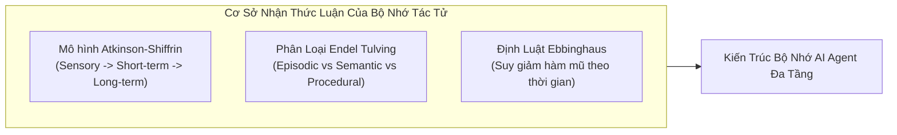
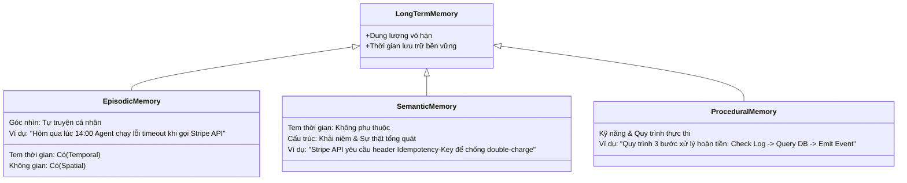
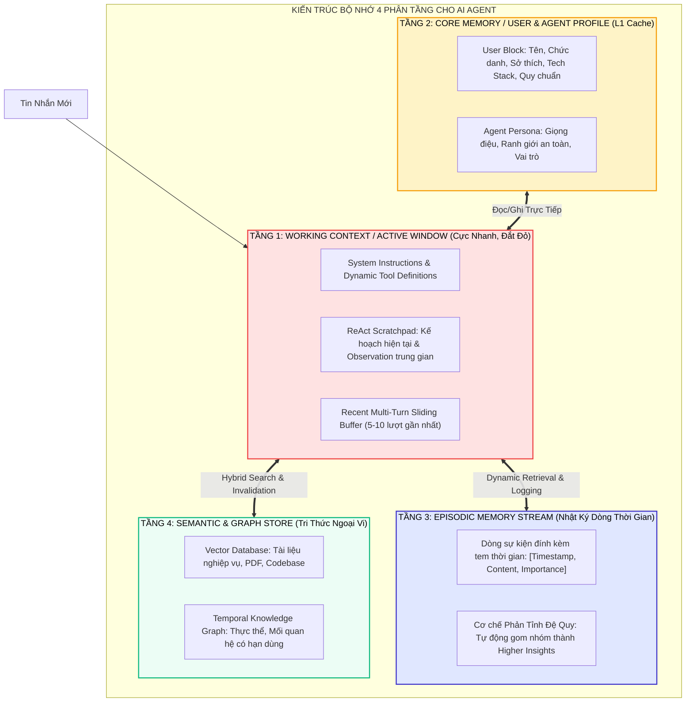
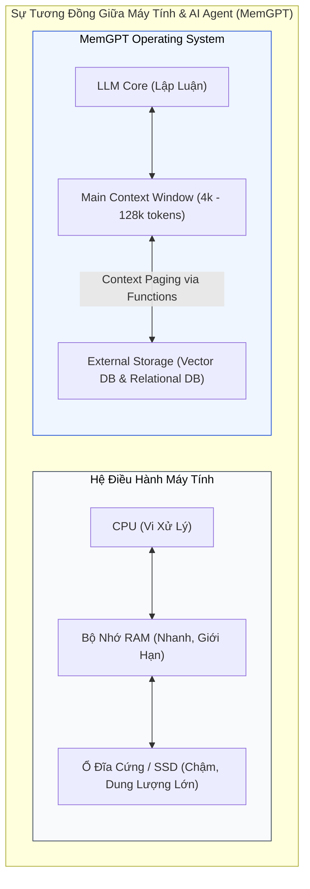
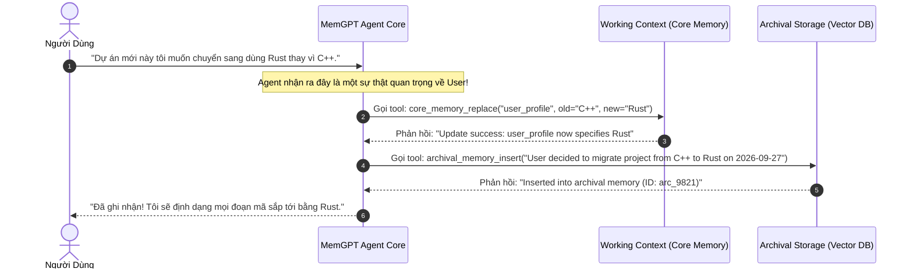
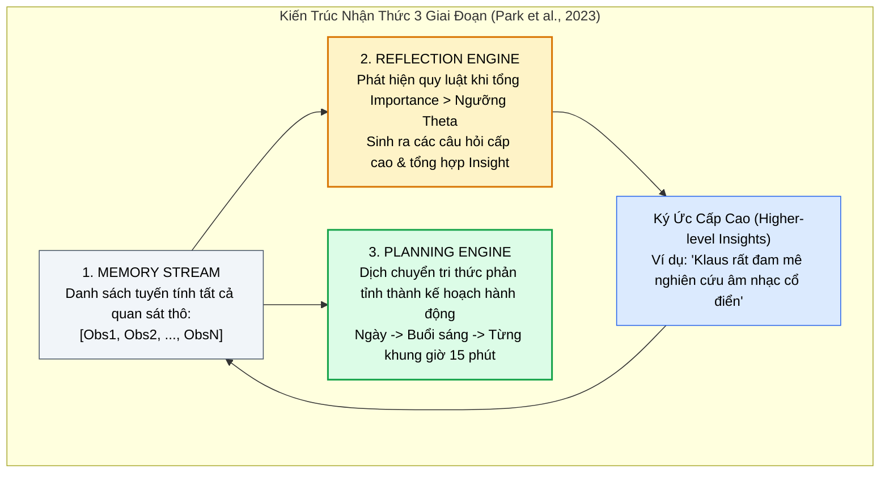
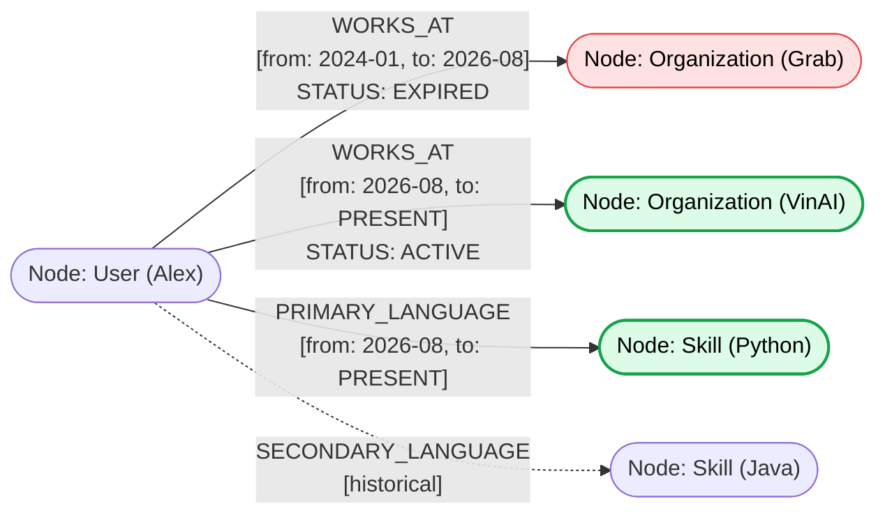
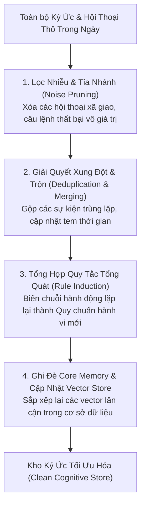

# 🧠 KIẾN TRÚC BỘ NHỚ ĐA TẦNG CHO AI AGENTS
## Short-Term, Working Memory & Semantic Long-Term Memory: Từ Cơ Sở Khoa Học Nhận Thức Đến Hệ Điều Hành Quản Trị Bộ Nhớ (MemGPT, Generative Agents & Temporal Knowledge Graphs)

---

## 📑 MỤC LỤC
1. [Nghịch Lý Mất Trí Nhớ & Cơ Sở Khoa Học Nhận Thức (Cognitive Psychology Foundations)](#1-nghịch-lý-mất-trí-nhớ--cơ-sở-khoa-học-nhận-thức-cognitive-psychology-foundations)
   - [Mô hình Đa Kho Nhận thức Atkinson-Shiffrin](#mô-hình-đa-kho-nhận-thức-atkinson-shiffrin)
   - [Phân loại Ký ức theo Endel Tulving: Episodic vs. Semantic vs. Procedural](#phân-loại-ký-ức-theo-endel-tulving-episodic-vs-semantic-vs-procedural)
   - [Định luật Quên Lãng Ebbinghaus (Ebbinghaus Forgetting Curve Mathematics)](#định-luật-quên-lãng-ebbinghaus-ebbinghaus-forgetting-curve-mathematics)
2. [Mô Hình Bộ Nhớ 4 Phân Tầng Hiện Đại Cho Tác Tử AI](#2-mô-hình-bộ-nhớ-4-phân-tầng-hiện-đại-cho-tác-tử-ai)
   - [Tầng 1: Sliding Working Memory (Ngăn xếp cửa sổ ngữ cảnh hiện hành)](#tầng-1-sliding-working-memory-ngăn-xếp-cửa-sổ-ngữ-cảnh-hiện-hành)
   - [Tầng 2: Core Memory / Working Context (L1 Cache: Persona & User Profile)](#tầng-2-core-memory--working-context-l1-cache-persona--user-profile)
   - [Tầng 3: Episodic Memory Stream (Dòng sự kiện tự truyện & Nhật ký hành động)](#tầng-3-episodic-memory-stream-dòng-sự-kiện-tự-truyện--nhật-ký-hành-động)
   - [Tầng 4: Semantic External Memory (Kho tri thức vĩnh viễn & RAG đa phương thức)](#tầng-4-semantic-external-memory-kho-tri-thức-vĩnh-viễn--rag-đa-phương-thức)
3. [Kiến Trúc MemGPT / Letta: Quản Trị Bộ Nhớ Kiểu Hệ Điều Hành (OS-Style Virtual Context Management)](#3-kiến-trúc-memgpt--letta-quản-trị-bộ-nhớ-kiểu-hệ-điều-hành-os-style-virtual-context-management)
   - [Tương đồng kiến trúc: LLM Core = CPU, Context Window = RAM, Database = Hard Drive](#tương-đồng-kiến-trúc-llm-core--cpu-context-window--ram-database--hard-drive)
   - [Cắt trang ngữ cảnh (Context Paging & Interrupts)](#cắt-trang-ngữ-cảnh-context-paging--interrupts)
   - [Bộ Công Cụ Tự Quản Trị Ký Ức (Self-Directed Memory Function Calling)](#bộ-công-cụ-tự-quản-trị-ký-ức-self-directed-memory-function-calling)
4. [Kiến Trúc Generative Agents (Stanford & Google, Park et al., 2023)](#4-kiến-trúc-generative-agents-stanford--google-park-et-al-2023)
   - [Memory Stream: Dòng ký ức liên tục kèm tem thời gian](#memory-stream-dòng-ký-ức-liên-tục-kèm-tem-thời-gian)
   - [Hàm Chấm Điểm Truy Xuất Ký Ức Kết Hợp 3 Trọng Số](#hàm-chấm-điểm-truy-xuất-ký-ức-kết-hợp-3-trọng-số)
   - [Cơ chế Phản Tỉnh Đệ Quy (Recursive Reflection Engine) & Lập Kế Hoạch Phân Cấp](#cơ-chế-phản-tỉnh-đệ-quy-recursive-reflection-engine--lập-kế-hoạch-phân-cấp)
5. [Đồ Thị Tri Thức Thời Gian (Temporal Knowledge Graph Memory: Zep, Mem0 & Graphiti)](#5-đồ-thị-tri-thức-thời-gian-temporal-knowledge-graph-memory-zep-mem0--graphiti)
   - [Thất bại của Vector-Only Memory khi đối mặt với sự thật biến đổi theo thời gian](#thất-bại-của-vector-only-memory-khi-đối-mặt-với-sự-thật-biến-đổi-theo-thời-gian)
   - [Mô hình Bi-Temporal Knowledge Graph: Quan hệ có tem hiệu lực](#mô-hình-bi-temporal-knowledge-graph-quan-hệ-có-tem-hiệu-lực)
   - [Giải quyết xung đột và vô hiệu hóa sự thật cũ (Contradiction Resolution)](#giải-quyết-xung-đột-và-vô-hiệu-hóa-sự-thật-cũ-contradiction-resolution)
6. [Vệ Sinh Ký Ức & Chu Trình Củng Cố Ban Đêm (Memory Hygiene & Sleep Cycles)](#6-vệ-sinh-ký-ức--chu-trình-củng-cố-ban-đêm-memory-hygiene--sleep-cycles)
   - [Cơ chế Memory Consolidation lấy cảm hứng từ giấc ngủ sinh học](#cơ-chế-memory-consolidation-lấy-cảm-hứng-từ-giấc-ngủ-sinh-học)
   - [Tỉa nhánh ký ức nhiễu và nén thông tin đệ quy](#tỉa-nhánh-ký-ức-nhiễu-và-nén-thông-tin-đệ-quy)
7. [Thực Chiến: Xây Dựng `HierarchicalCognitiveMemoryEngine` Bằng Python](#7-thực-chiến-xây-dựng-hierarchicalcognitivememoryengine-bằng-python)
   - [7.1. Cấu trúc dữ liệu Memory Record với tem thời gian & điểm Importance](#71-cấu-trúc-dữ-liệu-memory-record-với-tem-thời-gian--điểm-importance)
   - [7.2. Bộ tính điểm suy giảm Ebbinghaus & Truy xuất đa tiêu chí](#72-bộ-tính-điểm-suy-giảm-ebbinghaus--truy-xuất-đa-tiêu-chí)
   - [7.3. Background Reflection Worker tự động tổng hợp Insight](#73-background-reflection-worker-tự-động-tổng-hợp-insight)
8. [Bảng Ma Trận So Sánh Các Memory Framework Hàng Đầu](#8-bảng-ma-trận-so-sánh-các-memory-framework-hàng-đầu)
9. [Tài Liệu Nghiên Cứu Khoa Học Cốt Lõi (Academic References)](#9-tài-liệu-nghiên-cứu-khoa-học-cốt-lõi-academic-references)

---

## 1. NGHỊCH LÝ MẤT TRÍ NHỚ & CƠ SỞ KHOA HỌC NHẬN THỨC (COGNITIVE PSYCHOLOGY FOUNDATIONS)

Như đã giải thích trong [[00_ai_chat_systems_and_prompt_engineering|Kiến trúc & Tiến hóa của các hệ thống AI Chat]], một mô hình ngôn ngữ lớn (LLM) thuần túy là một hàm ánh xạ tĩnh không trạng thái (**Stateless Function**):

$$f_{\theta}: \text{Tokens}_{\text{in}} \to \text{Tokens}_{\text{out}}$$

Trọng số $\theta$ hoàn toàn đóng băng sau khi pre-training. Khi một phiên làm việc (Session) kết thúc, mô hình quay trở về trạng thái "mất trí nhớ hoàn toàn" (Amnesia). 

Nếu không có một hệ thống bộ nhớ bền vững (Persistent Memory System), một tác tử tự trị không thể tích lũy kinh nghiệm, không thể cá nhân hóa hành vi theo thời gian, và không thể thực thi các nhiệm vụ kéo dài nhiều ngày mà không lặp lại các sai lầm cũ.



### Mô hình Đa Kho Nhận thức Atkinson-Shiffrin

Lý thuyết nhận thức kinh điển của Atkinson và Shiffrin (1968) chia bộ nhớ con người thành 3 kho lưu trữ:
1. **Sensory Memory (Bộ nhớ cảm giác):** Lưu giữ tín hiệu thô (hình ảnh, âm thanh) trong vài mili-giây $\rightarrow$ Tương ứng với **đầu vào multimodal/pixel** trước khi parse.
2. **Short-Term / Working Memory (Bộ nhớ ngắn hạn / làm việc):** Lưu giữ $7 \pm 2$ mẩu thông tin trong vài chục giây $\rightarrow$ Tương ứng với **Cửa sổ ngữ cảnh (Context Window)** của LLM.
3. **Long-Term Memory (Bộ nhớ dài hạn):** Kho chứa dung lượng vô hạn lưu giữ thông tin suốt đời $\rightarrow$ Tương ứng với **Cơ sở dữ liệu Vector & Đồ thị tri thức (External Storage)**.

### Phân loại Ký ức theo Endel Tulving: Episodic vs. Semantic vs. Procedural

Nhà tâm lý học nhận thức Endel Tulving (1972) đã chia nhỏ bộ nhớ dài hạn thành 3 dạng thức khác biệt:



### Định luật Quên Lãng Ebbinghaus (Ebbinghaus Forgetting Curve Mathematics)

Hermann Ebbinghaus (1885) đã chứng minh rằng: **Khả năng nhớ lại một ký ức suy giảm theo quy luật hàm mũ nghịch đảo theo thời gian** nếu không được củng cố (Spaced Repetition).

Toán học của hàm suy giảm khả năng lưu giữ ký ức $R(t)$ tại thời điểm $t$:

$$R(t) = \exp\left(-\frac{t}{S}\right)$$

Trong đó:
* $t$: Khoảng thời gian trôi qua kể từ lần cuối cùng ký ức được truy cập hoặc kích hoạt.
* $S$: Độ bền vững của ký ức (Memory Stability / Strength). Một sự kiện có mức độ quan trọng cao (như thông báo đổi mật khẩu ngân hàng) sẽ có $S$ rất lớn, trong khi câu chào xã giao thông thường có $S$ rất nhỏ.

> [!important]
> **Ứng dụng toán học Ebbinghaus vào AI Agent:**  
> Khi truy vấn ký ức dài hạn, nếu chỉ dùng độ tương đồng vector Cosine đơn thuần, Agent sẽ nhầm lẫn giữa thông tin của 3 năm trước với thông tin của 5 phút trước. Áp dụng hệ số suy giảm Ebbinghaus $R(t)$ giúp tự động ưu tiên các sự kiện tươi mới (Recency) và dần đưa các ký ức mờ nhạt vào quên lãng có kiểm soát.

---

## 2. MÔ HÌNH BỘ NHỚ 4 PHÂN TẦNG HIỆN ĐẠI CHO TÁC TỬ AI

Một hệ thống AI Agent doanh nghiệp toàn diện tổ chức bộ nhớ theo **4 phân tầng nhận thức**:



### Tầng 1: Sliding Working Memory (Ngăn xếp cửa sổ ngữ cảnh hiện hành)
* Nằm trực tiếp trong RAM của phiên suy luận (Context Window).
* Chứa System Prompt, Scratchpad của chuỗi ReAct, và lịch sử đàm thoại của vài lượt gần nhất.
* Bắt buộc phải áp dụng kỹ thuật tỉa nhánh (Pruning) và tóm tắt cuốn chiếu (Rolling Summarization) được mô tả tại [[02_context_management|Quản trị Ngữ cảnh]] để tránh **Context Poisoning**.

### Tầng 2: Core Memory / Working Context (L1 Cache: Persona & User Profile)
* Là một block văn bản có kích thước cố định (khoảng $1,000 - 2,000\text{ tokens}$) được **ghim vĩnh viễn** ở đầu System Prompt.
* Chứa các thông tin cốt lõi nhất về người dùng và tác tử:
  * `[User Persona]`: Tên: Alex; Chức danh: Data Lead; Tech stack: PyTorch, DuckDB; Múi giờ: UTC+7.
  * `[Agent Persona]`: Trợ lý Kỹ thuật cao cấp; Phong cách: Ngắn gọn, tập trung code, không giải thích dài dòng.

### Tầng 3: Episodic Memory Stream (Dòng sự kiện tự truyện & Nhật ký hành động)
* Lưu trữ dưới dạng chuỗi thời gian (Time-series) của tất cả các sự kiện mà tác tử đã trải qua.
* Mỗi bản ghi chứa: Nội dung sự kiện, tem thời gian tạo, tem thời gian truy cập gần nhất, và **Điểm số quan trọng (Importance Score)**.

### Tầng 4: Semantic External Memory (Kho tri thức vĩnh viễn & RAG đa phương thức)
* Lưu trữ toàn bộ kho tài liệu, cẩm nang quy trình công ty, và lịch sử các ticket hỗ trợ.
* Sử dụng hệ thống tìm kiếm vector kết hợp đồ thị tri thức ([[01_semantic_search_and_reranking|Semantic Search & Advanced RAG]]).

---

## 3. KIẾN TRÚC MEMGPT / LETTA: QUẢN TRỊ BỘ NHỚ KIỂU HỆ ĐIỀU HÀNH (OS-STYLE VIRTUAL CONTEXT MANAGEMENT)

Được công bố bởi Packer et al. (UC Berkeley, 2023), **MemGPT (hiện là Letta)** đưa ra một phép so sánh mang tính đột phá: **Cửa sổ ngữ cảnh của LLM chính là bộ nhớ RAM vật lý của máy tính, và một AI Agent cần một Hệ Điều Hành để quản lý bộ nhớ ảo (Virtual Memory Paging)!**



### Cắt trang ngữ cảnh (Context Paging & Interrupts)

Trong hệ điều hành, khi một chương trình đòi hỏi nhiều bộ nhớ hơn lượng RAM vật lý có sẵn, OS sẽ chuyển các trang bộ nhớ không hoạt động ra ổ đĩa (Paging/Swapping).

MemGPT áp dụng nguyên lý này cho LLM:
1. **Context Window Split:** Cửa sổ ngữ cảnh được chia thành 3 phần cố định:
   * **System / Persona Block (Read-only)**.
   * **Working Memory Block (Core Memory - Đọc/Ghi tức thì)**.
   * **FIFO Conversation Buffer (Lịch sử hội thoại trượt)**.
2. **Context Warning Trigger:** Khi độ dài của FIFO Buffer chạm ngưỡng $70\%$ của cửa sổ ngữ cảnh, hệ thống không để xảy ra crash mà tự động kích hoạt một lời nhắc hệ thống ngầm (**Silent System Interrupt**).
3. **Paging Eviction:** Tác tử bị buộc phải tóm tắt các thông điệp cũ, đẩy chúng ra cơ sở dữ liệu ngoài (Archival Storage), và xóa sạch phần đệm để lấy chỗ cho thông tin mới.

### Bộ Công Cụ Tự Quản Trị Ký Ức (Self-Directed Memory Function Calling)

Điểm khác biệt căn bản giữa MemGPT và RAG thông thường: **Trong MemGPT, chính mô hình LLM là thực thể chủ động ra quyết định lưu trữ, tìm kiếm và xóa bỏ ký ức của chính nó thông qua các Function Calls chuyên dụng:**



#### 4 Hàm nguyên thủy tự quản trị bộ nhớ:
1. `core_memory_append(name: str, content: str)`: Chèn thêm một sự thật mới vào block bộ nhớ cốt lõi (User hoặc Agent Persona).
2. `core_memory_replace(name: str, old_content: str, new_content: str)`: Sửa đổi hoặc cập nhật một thông tin đã thay đổi (ví dụ: đổi địa chỉ nhà, đổi số điện thoại).
3. `archival_memory_insert(content: str)`: Đưa một sự kiện chi tiết vào cơ sở dữ liệu vector dài hạn.
4. `archival_memory_search(query: str, page: int)`: Khi người dùng hỏi về một sự kiện trong quá khứ, Agent chủ động tìm kiếm trong kho lưu trữ và lật từng trang kết quả.

---

## 4. KIẾN TRÚC GENERATIVE AGENTS (STANFORD & GOOGLE, PARK ET AL., 2023)

Trong công trình nghiên cứu kinh điển mô phỏng xã hội 25 tác tử tự hành tại thị trấn ảo Smallville, Park et al. (Stanford University & Google, 2023) đã thiết lập nền tảng toán học cho bộ nhớ nhận thức của AI Agent.



### Memory Stream: Dòng ký ức liên tục kèm tem thời gian

Mọi hành động của tác tử và mọi quan sát từ môi trường đều được ghi nhận vào **Memory Stream** dưới dạng một đối tượng có cấu trúc:

```python
class MemoryRecord:
    id: str
    content: str               # "Klaus nhìn thấy Maria đang pha cà phê tại quầy"
    created_at: datetime       # 2026-09-27 08:15:00
    last_accessed_at: datetime # 2026-09-27 08:30:00
    importance_score: float    # 3.0 / 10.0 (do mô hình LLM nhỏ đánh giá lúc ghi)
    embedding: list[float]     # Vector nhúng của content
```

### Hàm Chấm Điểm Truy Xuất Ký Ức Kết Hợp 3 Trọng Số

Khi tác tử cần đưa ra một quyết định hoặc trả lời người dùng với truy vấn $q$, hệ thống tính toán điểm số phù hợp $\text{Score}(m)$ cho **tất cả** các ký ức ứng viên $m$ trong Memory Stream:

$$\text{Score}(m) = \alpha_{\text{recency}} \cdot \text{Recency}(m) + \alpha_{\text{importance}} \cdot \text{Importance}(m) + \alpha_{\text{relevance}} \cdot \text{Relevance}(m, q)$$

Trong đó 3 thành phần được chuẩn hóa về đoạn $[0, 1]$:

1. **Điểm Tươi Mới (Recency Score):**
   $$\text{Recency}(m) = \gamma^{h(m)}$$
   Với $\gamma \in (0, 1)$ là hệ số suy giảm (thường chọn $\gamma = 0.995$) và $h(m)$ là số giờ trôi qua kể từ lần cuối cùng $m$ được truy cập.
2. **Điểm Quan Trọng (Importance Score):**
   Được đánh giá một lần duy nhất lúc tạo ký ức bởi một LLM thông qua prompt đo lường mức độ tác động cảm xúc/nghiệp vụ trên thang điểm $1 - 10$, sau đó chia cho 10:
   $$\text{Importance}(m) \in [0.1, 1.0]$$
   *(Ví dụ: "Ăn một cái bánh mì" = 2/10; "Đạt học bổng tiến sĩ" = 9/10).*
3. **Điểm Tương Đồng Ngữ Nghĩa (Relevance Score):**
   Đo bằng độ tương đồng Cosine giữa vector nhúng của ký ức $\mathbf{e}_m$ và vector nhúng của ngữ cảnh hiện tại $\mathbf{e}_q$:
   $$\text{Relevance}(m, q) = \frac{\mathbf{e}_m \cdot \mathbf{e}_q}{\|\mathbf{e}_m\| \|\mathbf{e}_q\|}$$

Top-$K$ ký ức có $\text{Score}(m)$ cao nhất sẽ được chọn để đưa vào Context Window.

### Cơ chế Phản Tỉnh Đệ Quy (Recursive Reflection Engine)

Nếu chỉ lưu trữ các quan sát thô (*"John uống nước"*, *"John mở tủ sách"*, *"John đọc sách toán"*), tác tử sẽ không bao giờ khái quát hóa được tri thức.

Cơ chế Phản Tỉnh hoạt động như sau:
1. **Bộ đếm tầm quan trọng tích lũy:** Mỗi khi một ký ức mới được ghi vào stream, ta cộng dồn điểm của nó:
   $$\text{CumulativeImportance} \leftarrow \text{CumulativeImportance} + \text{Importance}(m)$$
2. **Kích hoạt phản tỉnh (Reflection Threshold):** Khi tổng điểm vượt qua ngưỡng $\Theta$ (thường là 150 điểm):
   * Hệ thống trích xuất 100 ký ức gần nhất.
   * Yêu cầu LLM tìm kiếm **3 câu hỏi lớn có ý nghĩa nhất** về đối tượng.
   * Sử dụng 3 câu hỏi đó truy xuất lại các ký ức liên quan trong stream.
   * LLM tổng hợp các sự kiện chi tiết thành một **Insight cấp cao (Higher-level Abstraction)**.
   * Insight này được ghi ngược lại vào Memory Stream như một ký ức mới với điểm Importance rất cao!

---

## 5. ĐỒ THỊ TRI THỨC THỜI GIAN (TEMPORAL KNOWLEDGE GRAPH MEMORY: ZEP, MEM0 & GRAPHITI)

### Thất bại của Vector-Only Memory khi đối mặt với sự thật biến đổi theo thời gian

Phần lớn các hệ thống RAG và Chatbot thế hệ cũ sử dụng Vector Database để lưu trữ ký ức. Tuy nhiên, Vector Embedding hoàn toàn mù màu đối với **khía cạnh thời gian (Temporal Blindness)** và **mối quan hệ thực thể lồng nhau**.

Xét trường hợp thực tế sau:
* *Tháng 01/2024:* Người dùng nói *"Tôi là lập trình viên Backend tại Grab, chuyên về Java."* $\rightarrow$ Lưu vào Vector DB.
* *Tháng 08/2026:* Người dùng nói *"Tôi vừa nghỉ việc ở Grab để sang VinAI làm Kỹ sư AI về Python."* $\rightarrow$ Lưu vào Vector DB.
* *Tháng 09/2026:* Người dùng hỏi *"Tôi nên chuẩn bị CV như thế nào?"*
* **Thất bại của Vector Search:** Thuật toán Cosine Similarity trả về **cả 2 đoạn văn bản** vì chúng đều nói về công việc và kỹ năng của người dùng. Mô hình LLM rơi vào trạng thái ảo giác (Hallucination) hoặc trả lời mâu thuẫn: *"Với vị trí Backend Java tại Grab của bạn..."*.

### Mô hình Bi-Temporal Knowledge Graph: Quan hệ có tem hiệu lực

Các framework hiện đại như **Zep** và **Mem0** chuyển đổi ký ức thành một **Đồ thị tri thức có nhận thức thời gian (Bi-temporal Knowledge Graph)**:



Mỗi cạnh quan hệ (Edge) $E = (u, v, R)$ được gắn kèm 2 mốc thời gian:
* $t_{\text{valid\_from}}$: Thời điểm sự thật bắt đầu có hiệu lực trong thế giới thực.
* $t_{\text{valid\_to}}$: Thời điểm sự thật kết thúc hiệu lực (`null` hoặc `infinity` nếu đang hiện hành).

### Giải quyết xung đột và vô hiệu hóa sự thật cũ (Contradiction Resolution)

Khi tiếp nhận thông tin mới từ hội thoại:
1. **Entity & Relation Extraction:** Trích xuất bộ ba `(Subject, Predicate, Object)`.
2. **Conflict Detection Query:** Truy vấn đồ thị để kiểm tra xem đã tồn tại quan hệ tương tự với thuộc tính loại trừ lẫn nhau (Mutually Exclusive Relations, ví dụ `WORKS_AT`, `MARRIED_TO`, `LIVES_IN`) hay chưa.
3. **Invalidation Update:** Nếu phát hiện quan hệ mới mâu thuẫn với quan hệ cũ:
   * Không xóa node cũ (để bảo toàn ký ức lịch sử).
   * Cập nhật thuộc tính của cạnh cũ: $t_{\text{valid\_to}} \leftarrow \text{CurrentTimestamp}$.
   * Thêm cạnh mới với $t_{\text{valid\_from}} \leftarrow \text{CurrentTimestamp}$ và $t_{\text{valid\_to}} \leftarrow \text{null}$.

---

## 6. VỆ SINH KÝ ỨC & CHU TRÌNH CỦNG CỐ BAN ĐÊM (MEMORY HYGIENE & SLEEP CYCLES)

Một trong những sai lầm lớn nhất của các kỹ sư là coi bộ nhớ AI như một chiếc thùng rác không đáy tích lũy dữ liệu vô hạn. Sau 6 tháng vận hành, bộ nhớ sẽ chứa đầy những câu trò chuyện vô nghĩa (*"Hôm nay trời đẹp nhỉ"*, *"Cảm ơn bạn"*), làm loãng tri thức cốt lõi.

### Cơ chế Memory Consolidation lấy cảm hứng từ giấc ngủ sinh học

Trong giấc ngủ sóng chậm (Slow-Wave Sleep), não bộ con người thực hiện việc chuyển dịch thông tin từ vùng hồi hải mã (Hippocampus - bộ nhớ tạm) sang vỏ não mới (Neocortex - bộ nhớ vĩnh cửu), đồng thời cắt tỉa các khớp thần kinh không quan trọng.

Các hệ thống AI Agent doanh nghiệp áp dụng **Chu trình Củng cố Định kỳ (Nightly Memory Consolidation Cron Job)**:



---

## 7. THỰC CHIẾN: XÂY DỰNG `HierarchicalCognitiveMemoryEngine` BẰNG PYTHON

Dưới đây là một hệ thống bộ nhớ phân tầng hoàn chỉnh viết bằng Python kết hợp giữa **Core Memory**, **Episodic Stream với công thức suy giảm Ebbinghaus**, và **Bộ phản tỉnh đệ quy (Reflection Engine)**:

```python
import math
import time
from datetime import datetime, timedelta
from typing import List, Dict, Optional, Tuple
import numpy as np

class MemoryItem:
    """Đại diện cho một mẩu ký ức trong Episodic Memory Stream."""
    def __init__(self, content: str, importance: float, embedding: np.ndarray, created_at: Optional[datetime] = None):
        self.content = content
        self.importance = max(0.1, min(1.0, importance)) # Chuẩn hóa [0.1, 1.0]
        self.created_at = created_at or datetime.now()
        self.last_accessed_at = self.created_at
        self.embedding = embedding / np.linalg.norm(embedding) # Chuẩn hóa L2 vector

    def calculate_recency_score(self, current_time: datetime, decay_factor: float = 0.99) -> float:
        """Tính điểm suy giảm Ebbinghaus dựa trên số giờ trôi qua."""
        hours_elapsed = (current_time - self.last_accessed_at).total_seconds() / 3600.0
        return math.pow(decay_factor, hours_elapsed)

    def calculate_relevance_score(self, query_embedding: np.ndarray) -> float:
        """Đo độ tương đồng Cosine với truy vấn."""
        norm_query = query_embedding / np.linalg.norm(query_embedding)
        return float(np.dot(self.embedding, norm_query))


class HierarchicalCognitiveMemoryEngine:
    """
    Động cơ quản trị bộ nhớ nhận thức đa tầng cho AI Agent:
    - Core Memory: Persona & User Profile ghim trong Context
    - Episodic Stream: Nhật ký sự kiện kèm tính điểm suy giảm Ebbinghaus
    - Recursive Reflection: Tự động gom nhóm insight khi vượt ngưỡng quan trọng
    """
    def __init__(self, reflection_threshold: float = 8.0):
        # Tầng 2: Core Memory (L1 Cache)
        self.core_memory: Dict[str, str] = {
            "user_profile": "Name: Alex, Role: Head of AI. Preference: Python/FastAPI, concise code.",
            "agent_persona": "Enterprise Engineering Agent. Rigorous, type-safe, architecture-first."
        }
        
        # Tầng 3: Episodic Memory Stream
        self.memory_stream: List[MemoryItem] = []
        
        # Ngưỡng kích hoạt phản tỉnh
        self.reflection_threshold = reflection_threshold
        self.accumulated_importance = 0.0

    def add_memory(self, content: str, importance: float, embedding: np.ndarray):
        """Thêm một ký ức mới và kiểm tra điều kiện phản tỉnh."""
        item = MemoryItem(content, importance, embedding)
        self.memory_stream.append(item)
        self.accumulated_importance += item.importance
        print(f"[*] [Memory Stream] Ghi nhận: '{content}' (Importance: {importance:.2f})")

        # Kiểm tra ngưỡng kích hoạt Reflection
        if self.accumulated_importance >= self.reflection_threshold:
            self._trigger_reflection()

    def _trigger_reflection(self):
        """Pha phản tỉnh: Tự động tổng hợp các sự kiện gần đây thành High-Level Insight."""
        print("\n[🧠] KÍCH HOẠT QUÁ TRÌNH PHẢN TỈNH ĐỆ QUY (REFLECTION ENGINE)...")
        recent_memories = self.memory_stream[-5:]
        summary_text = " | ".join([m.content for m in recent_memories])
        
        # Giả lập LLM tổng hợp Insight cấp cao
        insight_content = f"TỔNG HỢP NHẬN THỨC: Người dùng đang chuyển trọng tâm hệ thống sang microservices hiệu năng cao dựa trên: {summary_text[:80]}..."
        
        # Tạo vector giả lập cho insight mới (trung bình cộng vector các thành phần)
        avg_embedding = np.mean([m.embedding for m in recent_memories], axis=0)
        
        # Ghi nhận Insight vào stream như một ký ức độc lập với Importance cao
        insight_item = MemoryItem(content=insight_content, importance=0.95, embedding=avg_embedding)
        self.memory_stream.append(insight_item)
        
        print(f"[🎉] Insight mới được củng cố: '{insight_content}'\n")
        self.accumulated_importance = 0.0 # Reset bộ đếm tích lũy

    def retrieve_context(self, query: str, query_embedding: np.ndarray, top_k: int = 3, 
                         alpha_recency: float = 0.3, alpha_importance: float = 0.3, alpha_relevance: float = 0.4) -> str:
        """
        Truy xuất bộ nhớ kết hợp 3 thành phần theo công thức Stanford Generative Agents:
        Score = alpha_rec * Recency + alpha_imp * Importance + alpha_rel * Relevance
        """
        if not self.memory_stream:
            return ""

        current_time = datetime.now()
        scored_memories: List[Tuple[float, MemoryItem]] = []

        for item in self.memory_stream:
            recency = item.calculate_recency_score(current_time)
            relevance = item.calculate_relevance_score(query_embedding)
            importance = item.importance

            total_score = (alpha_recency * recency) + (alpha_importance * importance) + (alpha_relevance * relevance)
            scored_memories.append((total_score, item))

        # Sắp xếp giảm dần theo tổng điểm
        scored_memories.sort(key=lambda x: x[0], reverse=True)
        top_results = scored_memories[:top_k]

        # Cập nhật thời gian truy cập cho các mẩu ký ức được chọn
        for _, item in top_results:
            item.last_accessed_at = current_time

        # Định dạng ngữ cảnh xuất ra
        episodic_context = "\n".join([f"- [Score: {score:.3f}] {item.content}" for score, item in top_results])
        
        formatted_prompt_block = (
            f"=== CORE MEMORY (WORKING CONTEXT) ===\n"
            f"[User Profile]: {self.core_memory['user_profile']}\n"
            f"[Agent Persona]: {self.core_memory['agent_persona']}\n\n"
            f"=== RELEVANT EPISODIC & SEMANTIC MEMORIES ===\n"
            f"{episodic_context}\n"
        )
        return formatted_prompt_block

    def update_core_memory(self, section: str, new_content: str):
        """Cơ chế MemGPT: Cho phép Agent tự cập nhật Core Memory."""
        if section in self.core_memory:
            self.core_memory[section] = new_content
            print(f"[+] [Core Memory Updated] [{section}] -> {new_content}")


# === THỰC THI THỬ NGHIỆM ĐỊNH LƯỢNG ===
if __name__ == "__main__":
    np.random.seed(42)
    memory_engine = HierarchicalCognitiveMemoryEngine(reflection_threshold=3.0)

    # Hàm tạo vector ngẫu nhiên giả lập Embedding model (ví dụ text-embedding-3-small 1536 dims)
    def mock_embed():
        return np.random.randn(128)

    # Giả lập dòng sự kiện thời gian
    print("--- NẠP CÁC SỰ KIỆN VÀO MEMORY STREAM ---")
    memory_engine.add_memory("Người dùng bắt đầu thử nghiệm Docker container cho backend.", 0.4, mock_embed())
    memory_engine.add_memory("Cảnh báo: Database PostgreSQL bị lỗi connection pool lúc 10h sáng.", 0.8, mock_embed())
    memory_engine.add_memory("Đã khắc phục lỗi pool bằng cách cấu hình max_connections=100 trong PgBouncer.", 0.9, mock_embed())
    
    # Sự kiện này sẽ vượt ngưỡng 3.0 và kích hoạt Reflection Engine!
    memory_engine.add_memory("Hệ thống đạt thông lượng 15,000 req/s sau khi đổi sang PgBouncer.", 1.0, mock_embed())

    # Giả lập truy vấn của người dùng sau đó
    query_text = "Hệ thống database của chúng ta được cấu hình như thế nào để chịu tải cao?"
    test_query_vector = mock_embed()
    
    print("\n--- TRUY XUẤT NGỮ CẢNH CHO LLM PROMPT ---")
    injected_context = memory_engine.retrieve_context(query_text, test_query_vector, top_k=2)
    print(injected_context)
```

---

## 8. BẢNG MA TRẬN SO SÁNH CÁC MEMORY FRAMEWORK HÀNG ĐẦU

| Tiêu Chí So Sánh | MemGPT / Letta (Berkeley) | Generative Agents (Stanford) | Zep (Temporal Knowledge Graph) | Mem0 (Tiền thân Embedchain) |
| :--- | :--- | :--- | :--- | :--- |
| **Cơ chế cốt lõi** | Virtual Context Paging & Function Calling | Stream + Reflection + Planning | Bi-Temporal Knowledge Graph | Hybrid Vector + Metadata Key-Value |
| **Quyền chỉnh sửa ký ức** | LLM tự chủ động gọi tool (`core_memory_replace`) | Hệ thống nền tự kích hoạt Reflection | Trích xuất tự động qua Entity Extraction Pipeline | Tự động phân loại qua Async Worker |
| **Xử lý mâu thuẫn thời gian** | LLM tự ghi đè chuỗi string | Suy giảm hàm số Ebbinghaus Recency | Cập nhật $t_{\text{valid\_to}}$ của cạnh đồ thị | Ghi đè facts dựa trên độ tương đồng |
| **Chi phí tính toán** | Thấp (Chỉ tốn token khi gọi tool) | Cao (Chạy nhiều LLM calls để chấm điểm & phản tỉnh) | Trung bình (Tối ưu hóa bằng CSDL đồ thị Neo4j/Postgres) | Rất thấp (Dễ tích hợp nhanh) |
| **Khả năng mở rộng** | Rất cao (Độc lập cơ sở dữ liệu) | Phù hợp nghiên cứu mô phỏng xã hội | Cực cao cho chăm sóc khách hàng doanh nghiệp | Phù hợp ứng dụng Web / Mobile cá nhân |

---

## 9. TÀI LIỆU NGHIÊN CỨU KHOA HỌC CỐT LÕI (ACADEMIC REFERENCES)

1. **Packer, C., Wooders, S., Lin, K., Fang, V., Patil, S. G., Stoica, I., & Gonzalez, J. E. (2023).** *MemGPT: Towards LLMs as Operating Systems.* UC Berkeley. arXiv preprint [arXiv:2310.08560](https://arxiv.org/abs/2310.08560).
2. **Park, J. S., O'Brien, J. C., Cai, C. J., Morris, M. R., Liang, P., & Bernstein, M. S. (2023).** *Generative Agents: Interactive Simulacra of Human Behavior.* Stanford University & Google Research. UIST 2023. [arXiv:2304.03442](https://arxiv.org/abs/2304.03442).
3. **Tulving, E. (1972).** *Episodic and semantic memory.* Organization of memory, 1, 381-403.
4. **Atkinson, R. C., & Shiffrin, R. M. (1968).** *Human memory: A proposed system and its control processes.* Psychology of learning and motivation, 2, 89-195.
5. **Ebbinghaus, H. (1885).** *Memory: A contribution to experimental psychology.* Teachers College, Columbia University.
6. **Zep AI. (2024).** *Temporal Knowledge Graphs for Long-Term LLM Agent Memory.* [Zep Technical Documentation](https://www.getzep.com/).
7. **Mem0 Team. (2024).** *The Memory Layer for Personalized AI.* [Mem0 GitHub](https://github.com/mem0ai/mem0).

---

## 🔗 BẢN ĐỒ LIÊN KẾT KIẾN THỨC
* **Quản trị rò rỉ ngữ cảnh:** [[02_context_management|Quản Trị Cửa Sổ Ngữ Cảnh: Bệnh Lý, Tỉa Nhánh & Cô Lập]]
* **Kiến trúc AI Harness:** [[01_harness_architecture|Giải Phẫu Kiến Trúc AI Harness]]
* **Tìm kiếm ngữ nghĩa RAG:** [[01_semantic_search_and_reranking|Semantic Search & Advanced RAG Architectures]]
* **Vòng lặp tự trị ReAct:** [[01_loop_fundamentals|Nền Tảng Loop Engineering: Vòng Lặp Tự Trị, Điều Kiện Dừng & Circuit Breakers]]
* **Trang chủ Trụ Cột 3:** [[03-building-agents/README|🛠️ Trụ Cột 3: Building Agents]]
