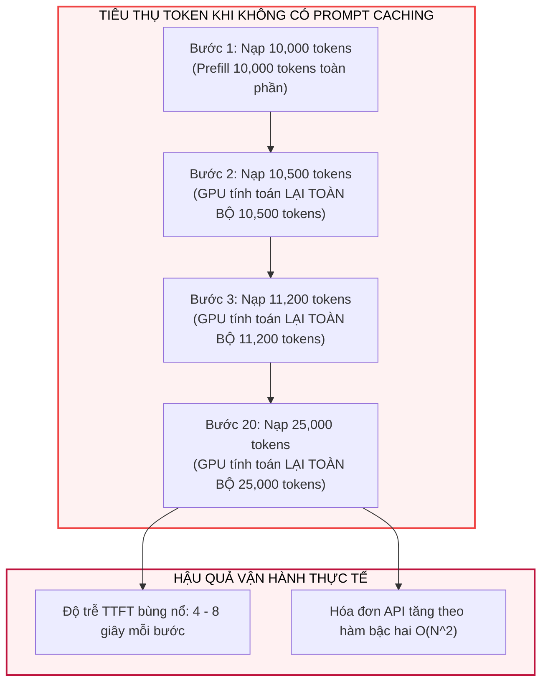
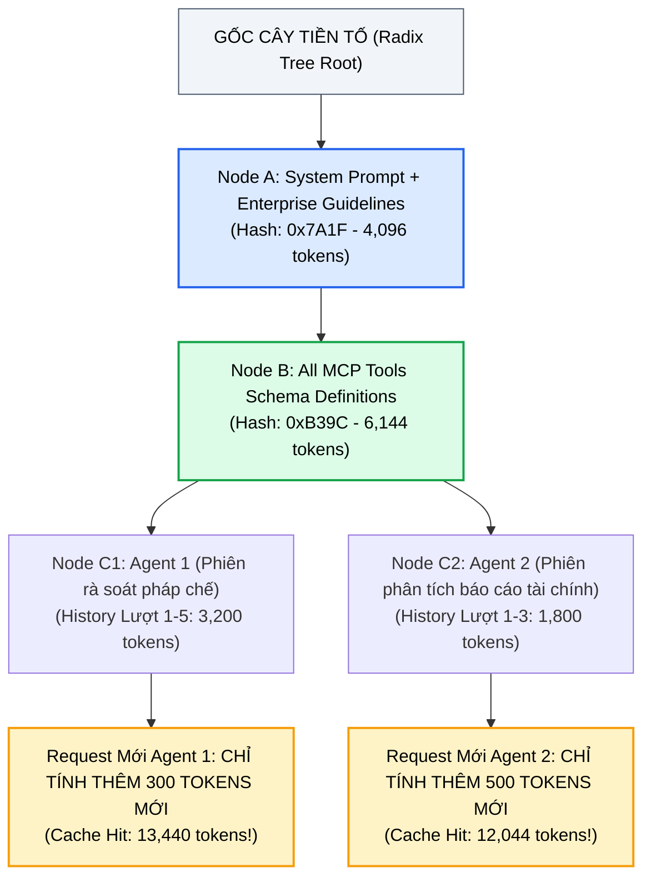
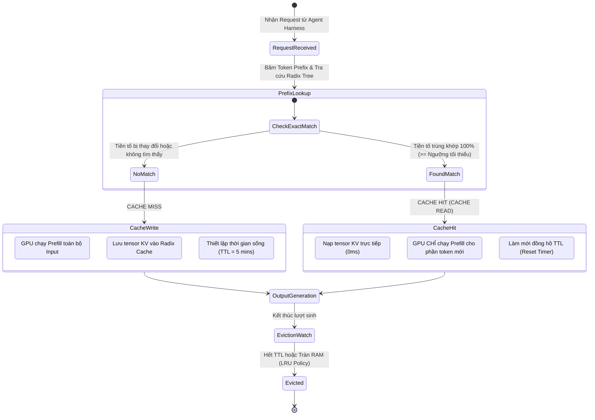
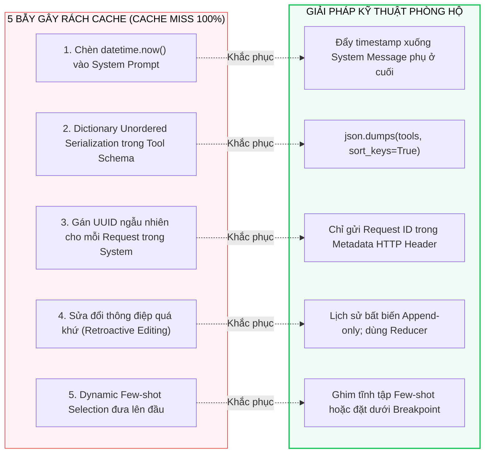
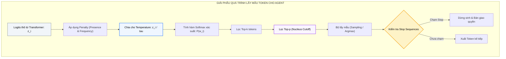

# AGENT RUNTIME PARAMETERS & PROMPT CACHING
## Làm Chủ Cơ Chế Prefix Caching, Tối Đa Hóa Cache Hit Rate, Kiểm Soát Độ Trễ TTFT & Thiết Lập Bộ Siêu Tham Số Suy Luận Cho Autonomous Agents

---

## MỤC LỤC
1. [Bản chất kinh tế & Khủng hoảng độ trễ trong Agentic Loop](#1-bản-chất-kinh-tế--khủng-hoảng-độ-trễ-trong-agentic-loop)
   - [Nghịch lý Prefill Computation trong vòng lặp đa bước](#nghịch-lý-prefill-computation-trong-vòng-lặp-đa-bước)
   - [Mô hình hóa sự bùng nổ chi phí tích lũy (Cumulative Cost Explosion)](#mô-hình-hóa-sự-bùng-nổ-chi-phí-tích-lũy-cumulative-cost-explosion)
2. [Cơ chế Giải phẫu Kỹ thuật: Prompt Caching & Prefix Caching](#2-cơ-chế-giải-phẫu-kỹ-thuật-prompt-caching--prefix-caching)
   - [Phân biệt Hardware KV-Cache và API-Level Prompt Caching](#phân-biệt-hardware-kv-cache-và-api-level-prompt-caching)
   - [Cấu trúc Cây Tiền Tố (Radix Tree / Prefix Caching) trong LLM Serving](#cấu-trúc-cây-tiền-tố-radix-tree--prefix-caching-trong-llm-serving)
   - [Vòng đời trạng thái Cache: Cache Write, Cache Hit, Cache Miss & Eviction](#vòng-đời-trạng-thái-cache-cache-write-cache-hit-cache-miss--eviction)
   - [Bảng đối chiếu định lượng kinh tế & độ trễ (Anthropic vs OpenAI vs DeepSeek)](#bảng-đối-chiếu-định-lượng-kinh-tế--độ-trễ-anthropic-vs-openai-vs-deepseek)
3. [Kỹ thuật Thiết kế Prompt Bất biến (Prefix Invariance Engineering)](#3-kỹ-thuật-thiết-kế-prompt-bất-biến-prefix-invariance-engineering)
   - [Nguyên lý "Static Prefix Invariance" — Bảo vệ chuỗi băm tiền tố](#nguyên-lý-static-prefix-invariance--bảo-vệ-chuỗi-băm-tiền-tố)
   - [Giải phẫu kiến trúc cấu trúc mảng tin nhắn tối ưu cho Agent](#giải-phẫu-kiến-trúc-cấu-trúc-mảng-tin-nhắn-tối-ưu-cho-agent)
   - [Năm sai lầm kinh điển làm rách Cache (Cache Invalidation Traps) và cách phòng chống](#năm-sai-lầm-kinh-điển-làm-rách-cache-cache-invalidation-traps-và-cách-phòng-chống)
4. [Giải phẫu Toàn tập Bộ Siêu Tham Số Suy Luận (Inference Parameters) Cho Agent](#4-giải-phẫu-toàn-tập-bộ-siêu-tham-số-suy-luận-inference-parameters-cho-agent)
   - [Temperature ($\tau$): Toán học Softmax Scaling & Ranh giới giữa Sáng tạo và Ảo giác](#temperature-tau-toán-học-softmax-scaling--ranh-giới-giữa-sáng-tạo-và-ảo-giác)
   - [Top-p (Nucleus Sampling) & Top-k](#top-p-nucleus-sampling--top-k)
   - [Max Tokens & Thảm họa Cắt Cụt Cú Pháp (Truncation Disaster)](#max-tokens--thảm-họa-cắt-cụt-cú-pháp-truncation-disaster)
   - [Stop Sequences: Ranh giới trao quyền cho Tool Dispatcher](#stop-sequences-ranh-giới-trao-quyền-cho-tool-dispatcher)
   - [Hiểm họa của Presence Penalty & Frequency Penalty đối với Agent](#hiểm-họa-của-presence-penalty--frequency-penalty-đối-với-agent)
   - [Seed & Tính Tái Lập Tất Định (Deterministic Reproducibility)](#seed--tính-tái-lập-tất-định-deterministic-reproducibility)
   - [Tool Choice: Điều phối hành vi `"auto"` vs `"required"`](#tool-choice-điều-phối-hành-vi-auto-vs-required)
5. [Hệ thống Đo lường Hiệu Năng & Chi Phí Vận Hành (Operational Metrics)](#5-hệ-thống-đo-lường-hiệu-năng--chi-phí-vận-hành-operational-metrics)
   - [TTFT (Time-To-First-Token) & Chẩn đoán Rách Cache](#ttft-time-to-first-token--chẩn-đoán-rách-cache)
   - [TPOT (Time-Per-Output-Token) & TPS (Tokens Per Second)](#tpot-time-per-output-token--tps-tokens-per-second)
   - [Công thức tính Cache Hit Rate ($H_{\text{rate}}$)](#công-thức-tính-cache-hit-rate-h_textrate)
   - [Latency Waterfall của một bước nhận thức Agent](#latency-waterfall-của-một-bước-nhận-thức-agent)
6. [Thực hành Triển khai End-to-End Bằng Python](#6-thực-hành-triển-khai-end-to-end-bằng-python)
   - [6.1. Triển khai Anthropic Prompt Caching với Ephemeral Breakpoints](#61-triển-khai-anthropic-prompt-caching-với-ephemeral-breakpoints)
   - [6.2. Triển khai OpenAI / vLLM Automatic Prefix Caching](#62-triển-khai-openai--vllm-automatic-prefix-caching)
   - [6.3. Xây dựng `ProductionAgentRuntimeEngine` với Dynamic Sampling & Cache Metrics](#63-xây-dựng-productionagentruntimeengine-với-dynamic-sampling--cache-metrics)
7. [Bảng ma trận tra cứu tham số & Best Practices cho các loại Agent](#7-bảng-ma-trận-tra-cứu-tham-số--best-practices-cho-các-loại-agent)
8. [Tài liệu nghiên cứu khoa học & Tài liệu kỹ thuật tham chiếu](#8-tài-liệu-nghiên-cứu-khoa-học--tài-liệu-kỹ-thuật-tham-chiếu)

---

## 1. BẢN CHẤT KINH TẾ & KHỦNG HOẢNG ĐỘ TRỄ TRONG AGENTIC LOOP

### Nghịch lý Prefill Computation trong vòng lặp đa bước

Một tác tử tự trị (Autonomous Agent) hoạt động dựa trên cơ chế vòng lặp phản hồi nhận thức ([[01_loop_fundamentals|Loop Fundamentals]] & [[02_react_and_planning|ReAct Loops]]):
$$\text{Thought}_t \longrightarrow \text{Action}_t \longrightarrow \text{Observation}_t \longrightarrow \text{Thought}_{t+1}$$

Mỗi khi vòng lặp chuyển sang bước $t+1$, toàn bộ ngữ cảnh từ bước $1$ đến $t$ phải được gửi lại vào mô hình ngôn ngữ lớn để làm tiền đề suy luận. Trong một ứng dụng doanh nghiệp thực tế:
* **System Prompt:** Quy tắc hành vi, Persona, Hướng dẫn bảo mật, Tri thức phòng ban $\approx 2{,}000 - 5{,}000$ tokens.
* **Tool Schemas (MCP / Function Definitions):** $20 - 50$ công cụ với đầy đủ mô tả JSON Schema $\approx 4{,}000 - 8{,}000$ tokens.
* **Few-shot Examples & Business Rules:** $\approx 2{,}000 - 4{,}000$ tokens.
* **Tổng ngữ cảnh tĩnh ban đầu:** $T_{\text{static}} \approx 8{,}000 - 17{,}000$ tokens.

Tại mỗi bước lặp, Agent chỉ sinh ra một hành động ngắn ($100 - 300$ tokens output) và nhận về kết quả công cụ ($200 - 1{,}000$ tokens observation). 



> [!note] Giải thích Khối:
> Nếu không có cơ chế Caching, mỗi bước lặp trong chu trình Agent là một lần GPU phải tính lại ma trận tích vô hướng Attention từ token đầu tiên. Với một tiến trình $20$ bước, mô hình phải tính toán lặp lại phần System Prompt và Tools Schema tới $20$ lần, biến một tác vụ đơn giản thành thảm họa chi phí và độ trễ.

---

### Mô hình hóa sự bùng nổ chi phí tích lũy (Cumulative Cost Explosion)

Giả sử một Agent chạy qua $K$ bước suy luận. Tại bước $k \in \{1, \dots, K\}$, độ dài prompt gửi vào là:
$$
L_k = T_{\text{static}} + \sum_{i=1}^{k-1} (\Delta_{\text{output}, i} + \Delta_{\text{obs}, i})
$$
Trong đó $T_{\text{static}}$ là phần ngữ cảnh cố định, $\Delta_{\text{output}, i}$ là số token Agent sinh ra ở bước $i$, và $\Delta_{\text{obs}, i}$ là số token quan sát trả về từ công cụ.

Tổng số token đầu vào tích lũy mà doanh nghiệp phải chi trả sau $K$ bước là:
$$
T_{\text{total\_input}} = \sum_{k=1}^K L_k = K \cdot T_{\text{static}} + \sum_{k=1}^K \sum_{i=1}^{k-1} (\Delta_{\text{output}, i} + \Delta_{\text{obs}, i})
$$
* Giả sử $T_{\text{static}} = 15{,}000$ tokens, trung bình mỗi bước sinh $200$ tokens và nhận $600$ tokens ($\Delta = 800$ tokens), chạy qua $K = 25$ bước:
$$
T_{\text{total\_input}} = 25 \times 15{,}000 + 800 \times \frac{24 \times 25}{2} = 375{,}000 + 240{,}000 = \mathbf{615{,}000 \text{ input tokens!}}
$$
Một tác vụ người dùng duy nhất nuốt trọn hơn **$600{,}000$ tokens**, trong đó **$375{,}000$ tokens ($61\%$)** là chi phí chi trả vô nghĩa cho việc đọc đi đọc lại cùng một đoạn System Prompt và Tool Definitions!

---

## 2. CƠ CHẾ GIẢI PHẪU KỸ THUẬT: PROMPT CACHING & PREFIX CACHING

### Phân biệt Hardware KV-Cache và API-Level Prompt Caching

Cần phân biệt rõ hai tầng Caching thường bị nhầm lẫn trong cộng đồng AI:

1. **Hardware KV-Cache (Tầng GPU Inference Engine):**
   * Được nghiên cứu chi tiết tại [[04_transformer_math_deep_dive|Giải Phẫu Toán Học Transformer]].
   * Là tensor chứa ma trận Key ($K$) và Value ($V$) lưu trực tiếp trong bộ nhớ VRAM của GPU trong suốt pha giải mã tuần tự (**Autoregressive Decode Phase**) của một request duy nhất để tránh tính lại các token vừa sinh ra.
   * Mang tính cục bộ (Ephemeral), gắn liền với vòng đời của một tiến trình sinh token và bị giải phóng ngay khi hoàn tất request.
2. **API-Level Prompt Caching / Prefix Caching (Tầng Serving / Multi-Turn):**
   * Là cơ chế lưu giữ trạng thái KV-Cache của các **chuỗi token đầu vào (Input Tokens)** trên bộ nhớ cụm máy chủ phục vụ (Host RAM hoặc GPU VRAM phân trang) **qua nhiều request HTTP độc lập khác nhau**.
   * Khi Agent gửi Request 2 có chuỗi token mở đầu trùng khớp với Request 1, Inference Engine (vLLM, SGLang, Anthropic Cluster, OpenAI Engine) sẽ "nhận diện" tiền tố đó và gắn trực tiếp tensor KV đã lưu sẵn vào bộ nhớ GPU mà **không cần chạy qua các tầng Transformer Attention**.

---

### Cấu trúc Cây Tiền Tố (Radix Tree / Prefix Caching) trong LLM Serving

Hạ tầng phục vụ suy luận hiện đại như **vLLM** (*Chunked-Prefill & PagedAttention*) hoặc **SGLang** (*RadixAttention*) tổ chức các khối KV-Cache dưới dạng một **Cây Tiền Tố Động (Radix Tree)**:



> [!note] Giải thích Khối:
> Cây RadixAttention chia sẻ các đoạn tiền tố chung giữa nhiều phiên Agent khác nhau. Tất cả Agent dùng chung một System Prompt và danh mục Tools đều chia sẻ chung một khối KV-Cache duy nhất trên GPU, giải phóng tài nguyên và cho phép tái sử dụng tức thì.

---

### Vòng đời trạng thái Cache: Cache Write, Cache Hit, Cache Miss & Eviction



> [!note] Giải thích Khối:
> Vòng đời của một khối Cache: Khi có Cache Hit, đồng hồ đếm ngược thời gian sống (TTL) được reset lại từ đầu. Nếu Agent tiếp tục gửi các bước suy luận kế tiếp trước khi TTL đếm về 0, toàn bộ chuỗi suy luận sẽ duy trì trạng thái Cache Hit liên tục.

---

### Bảng đối chiếu định lượng kinh tế & độ trễ (Anthropic vs OpenAI vs DeepSeek)

| Tiêu Chí So Sánh | Anthropic Claude 3.5 Sonnet | OpenAI (GPT-4o / GPT-4o-mini) | DeepSeek V3 / R1 |
| :--- | :--- | :--- | :--- |
| **Cơ chế kích hoạt Cache** | Khai báo điểm ngắt tường minh (`cache_control: {"type": "ephemeral"}`) | Tự động hoàn toàn cho các tiền tố $\ge 1024$ tokens | Tự động hoàn toàn (Radix Cache) |
| **Ngưỡng token tối thiểu** | $1{,}024$ tokens (Claude 3.5 Sonnet) / $2{,}048$ (Opus) | $1{,}024$ tokens (theo khối $128$ tokens tiếp theo) | $64$ tokens |
| **Đơn giá Input thường** | $\$3.00$ / 1M tokens | $\$2.50$ / 1M tokens | $\$0.14$ / 1M tokens |
| **Đơn giá Cache Write** | $\$3.75$ / 1M tokens ($+25\%$ phí lưu ban đầu) | $\$2.50$ / 1M tokens (Bằng giá thường) | $\$0.14$ / 1M tokens |
| **Đơn giá Cache Read (Hit)** | **$\$0.30$ / 1M tokens (Giảm $90\%$)** | **$\$1.25$ / 1M tokens (Giảm $50\%$)** | **$\$0.014$ / 1M tokens (Giảm $90\%$)** |
| **Thời gian sống (TTL)** | $5$ phút (Làm mới mỗi khi Hit) | $5 - 10$ phút (Quản lý tự động) | Động (LRU Cache dựa trên tải cụm) |
| **Tác động tới TTFT** | **Giảm $85\% - 95\%$** (từ $3.5\text{s} \to 0.25\text{s}$) | **Giảm $50\% - 70\%$** (từ $2.0\text{s} \to 0.6\text{s}$) | **Giảm $90\%$** (từ $1.8\text{s} \to 0.18\text{s}$) |

---

## 3. KỸ THUẬT THIẾT KẾ PROMPT BẤT BIẾN (PREFIX INVARIANCE ENGINEERING)

### Nguyên lý "Static Prefix Invariance" — Bảo vệ chuỗi băm tiền tố

Thuật toán Prefix Caching trên máy chủ kiểm tra sự trùng lặp bằng cách băm chuỗi token ID từ vị trí $0$ đến vị trí $M$:
$$
\text{Hash}(\text{Tokens}[0 \dots M])
$$
> [!important] Định Luật Rách Cache (Cache Invalidation Law):
> *"Nếu bạn thay đổi dù chỉ một khoảng trắng, một dấu câu, hoặc một ký tự ngẫu nhiên ở token thứ 10 của một System Prompt dài 10,000 tokens, toàn bộ 9,990 tokens phía sau lập tức bị Cache Miss hoàn toàn!"*

Để bảo đảm Cache Hit Rate đạt ngưỡng tối ưu ($> 90\%$), kiến trúc **AI Harness** ([[01_harness_architecture|Harness Architecture]]) bắt buộc phải tuân thủ nghiêm ngặt **Quy tắc Bất Biến Tiền Tố (Prefix Invariance)**.

---

### Giải phẫu kiến trúc cấu trúc mảng tin nhắn tối ưu cho Agent

```markdown
┌────────────────────────────────────────────────────────────────────────┐
│ [VÙNG 1: TĨNH BẤT BIẾN] - System Prompt Cốt Lõi                        │
│ - Persona tác tử, triết lý suy luận, giới hạn đạo đức                  │
│ - Chuỗi ký tự cố định 100%, không chứa bất kỳ biến số nào             │
├────────────────────────────────────────────────────────────────────────┤
│ [VÙNG 2: TĨNH BẤT BIẾN] - Toàn Bộ Định Nghĩa Công Cụ (MCP Tool Schemas)│
│ - Danh sách JSON Schemas của 30 tools hệ thống                         │
│ - Sắp xếp theo thứ tự bảng chữ cái cố định (Alphabetical Sort by Name) │
├────────────────────────────────────────────────────────────────────────┤
│ [VÙNG 3: TĨNH BẤT BIẾN] - Few-shot Demonstrations & Playbooks          │
│ - Các mẫu ví dụ hoàn hảo về chuỗi Thought -> Action -> Observation     │
│ ══════════════════════════════════════════════════════════════════════ │
│ 📍 [ĐIỂM NGẮT CACHE 1: ANTHROPIC CACHE_CONTROL EPHEMERAL]              │
│ ══════════════════════════════════════════════════════════════════════ │
├────────────────────────────────────────────────────────────────────────┤
│ [VÙNG 4: NỬA ĐỘNG - CHỈ GHI NỐI TIẾP (APPEND-ONLY HISTORY)]           │
│ - User Task ban đầu                                                    │
│ - Lượt 1: Assistant Thought + Action 1                                 │
│ - Lượt 1: Tool Observation 1                                           │
│ - Lượt 2: Assistant Thought + Action 2                                 │
│ - Lượt 2: Tool Observation 2                                           │
│ ══════════════════════════════════════════════════════════════════════ │
│ 📍 [ĐIỂM NGẮT CACHE 2: ĐẶT Ở TOOL OBSERVATION CỦA LƯỢT GẦN NHẤT]       │
│ ══════════════════════════════════════════════════════════════════════ │
├────────────────────────────────────────────────────────────────────────┤
│ [VÙNG 5: HOÀN TOÀN ĐỘNG - ĐẨY XUỐNG CUỐI CÙNG]                         │
│ - Timestamp hiện tại: datetime.now()                                   │
│ - Tải CPU/RAM hiện tại của sandbox                                     │
│ - Lời nhắc bổ sung (Dynamic Ephemeral Hints)                           │
└────────────────────────────────────────────────────────────────────────┘
```

---

### Năm sai lầm kinh điển làm rách Cache (Cache Invalidation Traps) và cách phòng chống



1. **Bẫy 1: Chèn Timestamp ở đầu System Prompt:**
   * *Sai:* `System: "Hôm nay là 2026-09-27 22:35:10. Bạn là một trợ lý tài chính..."` $\to$ Cứ sau 1 giây, giá trị chuỗi thay đổi, làm mất sạch Cache của mọi bước tiếp theo!
   * *Đúng:* Giữ nguyên System Prompt không có thời gian. Khi người dùng hỏi hoặc khi cần, đưa thời gian vào **tin nhắn cuối cùng** của lượt tương tác: `User: "[Context Time: 2026-09-27 22:35:10] Hãy phân tích giá cổ phiếu..."`.
2. **Bẫy 2: Tuần tự hóa JSON không cố định thứ tự khóa (Unordered Dict):**
   * Trong Python, dictionary trước phiên bản 3.7 không bảo toàn thứ tự, và một số serializer tuần tự hóa ngẫu nhiên: `{"name": "search", "params": {...}}` ở request 1 có thể bị đổi thành `{"params": {...}, "name": "search"}` ở request 2.
   * *Đúng:* Luôn sử dụng `json.dumps(schema, sort_keys=True)`.
3. **Bẫy 3: Tiêm UUID / Trace ID ngẫu nhiên vào nội dung Prompt:**
   * Không bao giờ chèn `Session-ID: 80ae627f` vào nội dung văn bản của System Prompt. Hãy chuyển toàn bộ thông tin quan trắc đó vào **HTTP Headers** (`X-Session-ID`, `X-Trace-ID`).
4. **Bẫy 4: Sửa đổi thông điệp trong quá khứ (Retroactive Mutation):**
   * Nếu ở bước 5, bạn muốn tóm tắt lại bước 1 và sửa nội dung `messages[1]`, toàn bộ cache từ bước 1 trở đi sẽ biến mất.
   * *Đúng:* Chỉ được phép thao tác **Append-Only (Chỉ thêm vào cuối)**. Nếu muốn nén ngữ cảnh, hãy dùng cơ chế tóm tắt có phân vùng (Context Quarantine) như trình bày tại [[02_context_management|Context Management]].

---

## 4. GIẢI PHẪU TOÀN TẬP BỘ SIÊU THAM SỐ SUY LUẬN (INFERENCE PARAMETERS) CHO AGENT

Vận hành một **Autonomous Agent** đòi hỏi tư duy thiết lập tham số hoàn toàn trái ngược với một **Chatbot đối thoại thông thường**. Một chatbot cần tính bất ngờ, văn phong đa dạng; trong khi một Agent yêu cầu **tính tất định, tuân thủ schema JSON và kiểm soát độ dài ngặt nghèo**.



> [!note] Giải thích Khối:
> Luồng xử lý phân phối xác suất từ Logits thô đến Token hoàn chỉnh: Mỗi tham số tác động vào một mắt xích xác định. Việc tinh chỉnh sai lệch ở bất kỳ mắt xích nào đều có thể làm vỡ cấu trúc JSON hoặc gây ra hiện tượng lặp từ vô tận.

---

### Temperature ($\tau$): Toán học Softmax Scaling & Ranh giới giữa Sáng tạo và Ảo giác

Xác suất của token $i$ trong từ vựng được tính bằng hàm Softmax có trọng số nhiệt độ $\tau$:
$$
P(w_i) = \frac{\exp(z_i / \tau)}{\sum_{j} \exp(z_j / \tau)}
$$
* **Khi $\tau \to 0$ (Greedy Decoding / Argmax):**
  $$
  \lim_{\tau \to 0} P(w_i) = \begin{cases} 1 & \text{if } z_i = \max_j z_j \\ 0 & \text{otherwise} \end{cases}
  $$
  Mô hình luôn luôn chọn token có xác suất cao nhất. Phân phối xác suất trở thành hàm Dirac Delta.
  * **Ứng dụng cho Agent:** Bắt buộc sử dụng $\tau = 0.0$ (hoặc $\le 0.1$) khi Agent thực hiện **Tool Calling, Sinh JSON có cấu trúc, Viết mã nguồn AST**, hoặc thực thi tính toán logic. Nó triệt tiêu hoàn toàn sự ngẫu nhiên, bảo đảm nếu schema đòi hỏi trường `"file_path"`, mô hình không bao giờ "ngẫu hứng" đổi thành `"filepath"`.
* **Khi $\tau \in [0.6, 0.8]$:**
  Làm phẳng nhẹ phân phối xác suất, cho phép các token tiềm năng bậc hai có cơ hội xuất hiện.
  * **Ứng dụng cho Agent:** Chỉ sử dụng trong giai đoạn **High-Level Planning, Brainstorming giải pháp kiến trúc** hoặc viết nội dung tổng hợp sáng tạo.

---

### Top-p (Nucleus Sampling) & Top-k

* **Top-p (Nucleus Sampling):** Cắt tỉa không gian từ vựng, chỉ giữ lại tập con nhỏ nhất các token $V^{(p)}$ có tổng xác suất tích lũy vượt qua ngưỡng $p$:
  $$
  \sum_{i \in V^{(p)}} P(w_i) \ge p
  $$
  Các token nằm ngoài tập này bị gán xác suất bằng $0$ trước khi lấy mẫu.
  * *Thiết lập cho Agent:* Thường để `top_p = 1.0` khi đã dùng `temperature = 0.0`. Nếu cần lấy mẫu có kiểm soát, chọn `top_p = 0.95`.
* **Top-k:** Giới hạn cứng số lượng ứng viên tối đa bằng một hằng số nguyên $k$ (ví dụ: $k = 40$ hoặc $k = 50$).

---

### Max Tokens & Thảm họa Cắt Cụt Cú Pháp (Truncation Disaster)

Tham số `max_tokens` (hoặc `max_completion_tokens`) xác định số token tối đa mà LLM được phép sinh ra trong một phản hồi duy nhất.
* **Sai lầm phổ biến:** Đặt `max_tokens` quá thấp (ví dụ: $512$ hoặc $1{,}024$ tokens) để tiết kiệm chi phí.
* **Thảm họa đối với Agent:** Khi Agent đang sinh một mảng JSON chứa $20$ tệp tin cần phân tích hoặc viết một hàm Python dài $100$ dòng, nếu chạm ngưỡng `max_tokens`, LLM sẽ bị máy chủ ngắt ngang lập tức:
  ```json
  {"tool": "modify_code", "arguments": {"file": "main.py", "patch": "def process():\n    data = load_data()\n    if data:
  ```
  *(Chuỗi bị đứt giữa chừng, thiếu dấu đóng ngoặc nhọn `}` và ngoặc kép `"`)*.
* **Hậu quả:** Hàm `json.loads()` ném ngoại lệ `JSONDecodeError: Unterminated string starting at line 1`. Tác tử lập tức bị sụp đổ tiến trình.
* **Best Practice:** Luôn thiết lập `max_tokens \ge 4{,}096` (hoặc $8{,}192$) để cung cấp đầy đủ "Headroom" cho Agent hoàn tất cú pháp.

---

### Stop Sequences: Ranh giới trao quyền cho Tool Dispatcher

Một trong những tính năng bị lãng quên nhiều nhất nhưng là cốt lõi của ReAct Loop ([[02_react_and_planning|ReAct Loops]]) là **Stop Sequences**:
* Trong các mô hình mã nguồn mở chạy cục bộ hoặc các mô hình không hỗ trợ Native Function Calling, Agent tự sinh văn bản theo cấu trúc:
  ```markdown
  Thought: Tôi cần kiểm tra tệp tin README.md.
  Action: read_file(path="README.md")
  Observation: [Nội dung tệp...]
  ```
* Nếu không có Stop Sequence, mô hình sẽ không chịu dừng lại mà tự biên tự diễn luôn cả phần `Observation:` giả tưởng (tự bịa ra nội dung file thay vì nhường quyền cho Python đọc file thật!).
* **Cấu hình chuẩn:** Cài đặt `stop = ["\nObservation:", "Observation:", "</tool_call>", "<|im_end|>"]`. Ngay khi sinh xong từ khóa này, mô hình bị khóa họng ngay lập tức, trả điều khiển về cho Harness.

---

### Hiểm họa của Presence Penalty & Frequency Penalty đối với Agent

Trong các Chatbot đàm thoại thông thường, hai tham số này được sử dụng để chống lặp từ:
* **Presence Penalty ($\alpha_p$):** Phạt $1$ lần nếu token đã xuất hiện ít nhất một lần trong văn bản đã sinh: $z_i \gets z_i - \alpha_p$.
* **Frequency Penalty ($\alpha_f$):** Phạt tăng dần tỷ lệ thuận với số lần token xuất hiện: $z_i \gets z_i - \alpha_f \cdot c_i$.

> [!caution] Cảnh Báo Sống Còn Cho Kỹ Sư Agent:
> **TUYỆT ĐỐI ĐẶT `presence_penalty = 0.0` VÀ `frequency_penalty = 0.0` KHI AGENT THỰC THI TOOL CALLING HOẶC LẬP TRÌNH!**

**Tại sao?**
Trong cú pháp lập trình và cấu trúc dữ liệu JSON:
* Từ khóa cú pháp bắt buộc phải lặp lại hàng trăm lần: `"type"`, `"string"`, `"id"`, `"return"`, `"self"`, `None`, dấu ngoặc nhọn `{`, `}`, dấu phẩy `,`.
* Nếu bật $\alpha_p > 0$ hoặc $\alpha_f > 0$, mô hình sẽ "sợ hãi" việc lặp lại các token này, dẫn đến:
  1. Tự ý đổi tên biến hoặc tên trường JSON (ví dụ: thay vì `"user_id"`, nó đổi thành `"user_identification"` hoặc `"account_num"`).
  2. Bỏ qua các dấu đóng ngoặc nhọn để tránh lặp token `}`, làm vỡ nát cấu trúc ngữ pháp AST!

---

### Seed & Tính Tái Lập Tất Định (Deterministic Reproducibility)

* Tham số `seed` (số nguyên, ví dụ: `seed = 42`) yêu cầu Inference Engine khởi tạo cùng một bộ sinh số ngẫu nhiên cho quá trình lấy mẫu.
* Kết hợp với `temperature = 0.0`, `seed` cho phép đạt được **Tính tất định tái lập (Deterministic Replayability)**:
  * Khi Agent gặp lỗi ở bước 18 trên môi trường kiểm thử, lập trình viên có thể nạp lại chính xác `seed` đó để tái hiện lại lỗi $100\%$ phục vụ cho **Time-Travel Debugging** ([[05_durable_execution_and_stateful_workflows|Durable Execution]]).

---

### Tool Choice: Điều phối hành vi `"auto"` vs `"required"`

Khi truyền danh mục công cụ vào API, tham số `tool_choice` quyết định thái độ nhận thức của Agent:
* `"auto"`: Mô hình tự cân nhắc: nếu thấy cần thì gọi tool, nếu không thì trả về văn bản tự nhiên. Thích hợp cho bước đàm thoại chung.
* `"required"` (hoặc `"any"`): **Bắt buộc mô hình phải phát sinh ít nhất một lời gọi công cụ**, cấm tuyệt đối việc trả lời bằng văn bản thông thường. Thích hợp cho các bước mà người dùng đã giao nhiệm vụ hành động rõ ràng (ví dụ: *"Hãy xóa nhánh git cũ"*).
* `{"type": "function", "function": {"name": "read_db"}}`: Ép buộc mô hình **phải gọi chính xác công cụ được chỉ định**.

---

## 5. HỆ THỐNG ĐO LƯỜNG HIỆU NĂNG & CHI PHÍ VẬN HÀNH (OPERATIONAL METRICS)

Để vận hành một hệ thống Agent quy mô lớn, kiến trúc sư hệ thống cần theo dõi bảng chỉ số sau thông qua các nền tảng Tracing như Langfuse hoặc OpenTelemetry ([[01_agent_evals_and_tracing|Agent Observability]]):

### TTFT (Time-To-First-Token) & Chẩn đoán Rách Cache

$$
\text{TTFT} = t_{\text{first\_token\_received}} - t_{\text{request\_sent}}
$$
* **Ý nghĩa:** Đo lường toàn bộ thời gian trễ mạng (Network RTT) cộng với thời gian GPU thực thi pha Prefill trên toàn bộ chuỗi Prompt đầu vào.
* **Nguyên tắc chẩn đoán:**
  * Nếu $\text{TTFT} < 300\text{ms}$ (với prompt $> 10\text{K}$ tokens): **Hệ thống đạt chuẩn Cache Hit.**
  * Nếu $\text{TTFT} > 3{,}000\text{ms}$: **Dấu hiệu cảnh báo Cache Miss.** Cần kiểm tra ngay xem có dòng log động hoặc timestamp nào bị chèn nhầm vào System Prompt hay không!

---

### TPOT (Time-Per-Output-Token) & TPS (Tokens Per Second)

$$
\text{TPOT} = \frac{t_{\text{stream\_end}} - t_{\text{first\_token\_received}}}{N_{\text{output\_tokens}} - 1} \quad (\text{seconds/token})
$$
$$
\text{TPS} = \frac{1}{\text{TPOT}} \quad (\text{tokens/second})
$$
* **Ý nghĩa:** Đo lường tốc độ suy luận thuần túy trong pha Decode của GPU.
* Với các tác vụ Agent điều khiển màn hình máy tính ([[01_multimodal_gui_and_computer_use|GUI Computer-Use]]), $\text{TPS}$ phải đạt tối thiểu $60 - 100\text{ tokens/s}$ để người dùng không cảm nhận thấy độ trễ giao diện.

---

### Công thức tính Cache Hit Rate ($H_{\text{rate}}$)

$$
H_{\text{rate}} = \frac{\sum_{k=1}^K T_{\text{cached\_tokens}}^{(k)}}{\sum_{k=1}^K T_{\text{prompt\_tokens}}^{(k)}} \times 100\%
$$
* Trong đó $T_{\text{cached\_tokens}}^{(k)}$ là số token được đọc từ cache (Cache Read) ở bước $k$, và $T_{\text{prompt\_tokens}}^{(k)}$ là tổng số token đầu vào của bước $k$.
* **Mục tiêu KPI sản xuất:** $H_{\text{rate}} \ge 85\%$.

---

### Latency Waterfall của một bước nhận thức Agent

```mermaid
gantt
    title Phân Rã Độ Trễ Của Một Bước Agent Lặp (Total: 2,150ms)
    dateFormat X
    axisFormat %s ms

    section Mạng & Hạ Tầng
    Network Ingress RTT (Client -> API)     :0, 50
    section LLM Prefill & Inference
    Cache Hit Read & Prefill (TTFT)         :50, 250
    Decode Phase (Sinh 150 tokens @ 50 TPS) :250, 1250
    section Thực Thi Công Cụ
    JSON Schema Validation & Dispatch       :1250, 1300
    Sandbox Execution (Docker / Tool Exec)  :1300, 2100
    section Cập Nhật Trạng Thái
    State Graph Checkpointing (SQLite/Postgres) :2100, 2150
```



> [!note] Giải thích Khối:
> Sơ đồ thác nước (Gantt Waterfall) mô tả thời gian tiêu tốn trong một bước ReAct. Nhờ có Cache Hit, giai đoạn Prefill chỉ chiếm $200\text{ms}$. Phần lớn thời gian được dành cho việc sinh token hành động ($1{,}000\text{ms}$) và thực thi công cụ trong Sandbox ($800\text{ms}$).

---

## 6. THỰC HÀNH TRIỂN KHAI END-TO-END BẰNG PYTHON

### 6.1. Triển khai Anthropic Prompt Caching với Ephemeral Breakpoints

```python
"""
anthropic_prompt_caching.py
Triển khai kỹ thuật ghim điểm ngắt Cache (Ephemeral Cache Control)
chuẩn công nghiệp cho Anthropic Claude 3.5 Sonnet.
"""

import os
from typing import List, Dict, Any
import anthropic

def run_cached_agent_step(
    client: anthropic.Anthropic,
    system_instruction: str,
    tools_definitions: List[Dict[str, Any]],
    conversation_history: List[Dict[str, Any]],
    current_user_query: str
) -> Dict[str, Any]:
    """
    Gửi request suy luận Agent với cấu trúc tối ưu Cache:
    - Điểm ngắt 1: Đặt ở cuối danh mục Tools Definitions
    - Điểm ngắt 2: Đặt ở cuối Lịch sử hội thoại (Message gần nhất)
    """
    
    # 1. Định hình System Prompt tĩnh với Cache Control
    system_blocks = [
        {
            "type": "text",
            "text": system_instruction,
            "cache_control": {"type": "ephemeral"} # Điểm ngắt ghim System Prompt
        }
    ]
    
    # 2. Định hình danh mục Tools với Cache Control ở Tool cuối cùng
    # Anthropic cho phép tối đa 4 điểm ngắt cache trong một request
    formatted_tools = []
    for idx, tool in enumerate(tools_definitions):
        tool_entry = dict(tool)
        if idx == len(tools_definitions) - 1:
            # Gán cache_control cho tool cuối cùng để cache toàn bộ danh mục công cụ
            tool_entry["cache_control"] = {"type": "ephemeral"}
        formatted_tools.append(tool_entry)
        
    # 3. Xây dựng mảng Messages
    messages = list(conversation_history)
    messages.append({
        "role": "user",
        "content": current_user_query
    })
    
    # Đặt cache breakpoint ở lượt hội thoại gần nhất để tái sử dụng cho bước tiếp theo
    if len(messages) >= 2:
        messages[-2]["content"][-1]["cache_control"] = {"type": "ephemeral"}
        
    # 4. Thực thi gọi API với bộ tham số chuẩn cho Agent
    response = client.messages.create(
        model="claude-3-5-sonnet-20241022",
        max_tokens=4096,
        temperature=0.0, # Greedy decoding cho Tool Calling
        system=system_blocks,
        tools=formatted_tools,
        messages=messages
    )
    
    # 5. Trích xuất chỉ số Caching từ API Usage Response
    usage = response.usage
    cache_creation = getattr(usage, "cache_creation_input_tokens", 0)
    cache_read = getattr(usage, "cache_read_input_tokens", 0)
    regular_input = usage.input_tokens
    
    print(f"📊 [Cache Telemetry] Thường: {regular_input} | Tạo mới (Write): {cache_creation} | Đọc đệm (HIT): {cache_read}")
    return response
```

---

### 6.2. Triển khai OpenAI / vLLM Automatic Prefix Caching

Đối với OpenAI (GPT-4o) và vLLM (Prefix Caching / RadixAttention), Caching hoạt động tự động khi phát hiện chuỗi token tiền tố $\ge 1{,}024$ tokens. Lập trình viên không cần gán cờ `cache_control` mà chỉ cần bảo đảm **Thứ tự mảng tĩnh bất biến**.

```python
"""
openai_prefix_caching.py
Thiết lập chuẩn hóa tuần tự để tối đa hóa Automatic Prefix Cache Hit trên OpenAI & vLLM.
"""

import json
from openai import OpenAI
from typing import List, Dict, Any

client = OpenAI()

def build_deterministic_agent_payload(
    static_system_prompt: str,
    raw_tools_list: List[Dict[str, Any]],
    conversation_history: List[Dict[str, Any]]
) -> Dict[str, Any]:
    """
    Sắp xếp các trường dữ liệu tĩnh để chuỗi byte sinh ra luôn đồng nhất 100%.
    """
    # BẮT BUỘC: Sắp xếp danh mục tools theo tên để bảo đảm thứ tự tuần tự hóa
    sorted_tools = sorted(raw_tools_list, key=lambda t: t["function"]["name"])
    
    # Đóng gói messages với System tĩnh ở đầu tiên
    messages = [{"role": "system", "content": static_system_prompt}]
    messages.extend(conversation_history)
    
    return {
        "model": "gpt-4o",
        "messages": messages,
        "tools": sorted_tools,
        "temperature": 0.0,
        "presence_penalty": 0.0,  # Tuyệt đối không bật penalty cho Agent
        "frequency_penalty": 0.0,
        "seed": 42,               # Đảm bảo tính tất định tái lập
        "max_tokens": 4096
    }

def execute_step(payload: Dict[str, Any]):
    response = client.chat.completions.create(**payload)
    
    # Kiểm tra số token được đọc từ cache (Cache Hit)
    usage = response.usage
    cached_tokens = 0
    if hasattr(usage, "prompt_tokens_details") and usage.prompt_tokens_details:
        cached_tokens = getattr(usage.prompt_tokens_details, "cached_tokens", 0)
        
    total_prompt = usage.prompt_tokens
    hit_rate = (cached_tokens / total_prompt * 100) if total_prompt > 0 else 0
    print(f"🎯 Total Tokens: {total_prompt} | Cached Tokens: {cached_tokens} | Hit Rate: {hit_rate:.1f}%")
    return response
```

---

### 6.3. Xây dựng `ProductionAgentRuntimeEngine` với Dynamic Sampling & Cache Metrics

Dưới đây là một lớp điều phối Runtime hoàn chỉnh:
* Tự động điều chỉnh `temperature` động: Khi lập kế hoạch (Planning) dùng `temperature = 0.6`, khi thực thi công cụ (Execution) dùng `temperature = 0.0`.
* Tự động đo lường và theo dõi tỷ lệ Cache Hit Rate tích lũy qua toàn bộ vòng lặp.

```python
"""
agent_runtime_engine.py
Động cơ điều phối Runtime chuyên nghiệp cho Autonomous Agent.
"""

import time
import json
from typing import List, Dict, Any, Optional

class ProductionAgentRuntimeEngine:
    def __init__(self, system_instruction: str, tools: List[Dict[str, Any]]):
        self.system_instruction = system_instruction
        # Chuẩn hóa tools với sort_keys để bảo vệ Cache Hash
        self.tools = sorted(tools, key=lambda x: x["function"]["name"])
        self.history: List[Dict[str, Any]] = []
        
        # Bộ đếm quan trắc tích lũy
        self.total_prompt_tokens = 0
        self.total_cached_tokens = 0
        self.total_output_tokens = 0
        self.step_latencies: List[float] = []

    def get_inference_parameters(self, phase: str) -> Dict[str, Any]:
        """
        Chiến lược Dynamic Sampling Parameters tùy theo pha nhận thức.
        """
        if phase == "planning":
            # Pha lập kế hoạch: Cho phép sáng tạo nhẹ, tìm kiếm phương án tối ưu
            return {
                "temperature": 0.6,
                "top_p": 0.95,
                "max_tokens": 3000,
                "presence_penalty": 0.0,
                "frequency_penalty": 0.0
            }
        elif phase in ["execution", "tool_calling"]:
            # Pha thực thi công cụ: Cực đoan về tính tất định và tuân thủ JSON
            return {
                "temperature": 0.0, # Greedy decoding
                "top_p": 1.0,
                "max_tokens": 4096,
                "presence_penalty": 0.0,
                "frequency_penalty": 0.0
            }
        else:
            return {"temperature": 0.2, "top_p": 1.0, "max_tokens": 2048}

    def record_step_telemetry(self, prompt_tokens: int, cached_tokens: int, output_tokens: int, duration_sec: float):
        self.total_prompt_tokens += prompt_tokens
        self.total_cached_tokens += cached_tokens
        self.total_output_tokens += output_tokens
        self.step_latencies.append(duration_sec)
        
        step_hit_rate = (cached_tokens / prompt_tokens * 100) if prompt_tokens > 0 else 0
        print(f"⏱️ Bước hoàn tất trong {duration_sec:.2f}s | Cache Hit: {step_hit_rate:.1f}% ({cached_tokens}/{prompt_tokens} tokens)")

    def get_cumulative_report(self) -> Dict[str, Any]:
        overall_hit_rate = (self.total_cached_tokens / self.total_prompt_tokens * 100) if self.total_prompt_tokens > 0 else 0
        avg_latency = sum(self.step_latencies) / len(self.step_latencies) if self.step_latencies else 0
        
        return {
            "total_prompt_tokens": self.total_prompt_tokens,
            "total_cached_tokens": self.total_cached_tokens,
            "total_output_tokens": self.total_output_tokens,
            "cumulative_cache_hit_rate": f"{overall_hit_rate:.2f}%",
            "average_step_latency_sec": f"{avg_latency:.2f}s",
            "total_steps": len(self.step_latencies)
        }

if __name__ == "__main__":
    mock_tools = [
        {"function": {"name": "query_db", "description": "Truy vấn cơ sở dữ liệu"}},
        {"function": {"name": "send_alert", "description": "Gửi thông báo cảnh báo"}}
    ]
    engine = ProductionAgentRuntimeEngine(
        system_instruction="Bạn là Tác tử Giám sát Hệ thống Tự hành.",
        tools=mock_tools
    )
    
    # Mô phỏng ghi nhận 3 bước lặp trong chu trình Agent
    engine.record_step_telemetry(prompt_tokens=10000, cached_tokens=0, output_tokens=250, duration_sec=3.2)     # Bước 1: Cache Write
    engine.record_step_telemetry(prompt_tokens=10500, cached_tokens=10000, output_tokens=180, duration_sec=0.6) # Bước 2: Cache Hit
    engine.record_step_telemetry(prompt_tokens=11200, cached_tokens=10500, output_tokens=320, duration_sec=0.7) # Bước 3: Cache Hit
    
    print("\n📈 BÁO CÁO HIỆU NĂNG TÍCH LŨY:", json.dumps(engine.get_cumulative_report(), indent=2))
```

---

## 7. BẢNG MA TRẬN TRA CỨU THAM SỐ & BEST PRACTICES CHO CÁC LOẠI AGENT

Dưới đây là ma trận tra cứu tham số chuẩn sản xuất cho các chuyên môn tác tử khác nhau:

| Chuyên Môn Tác Tử | Nhiệt Độ (`temperature`) | `top_p` | `max_tokens` | `stop_sequences` | Chiến Lược Caching Khuyến Nghị |
| :--- | :---: | :---: | :---: | :---: | :--- |
| **Code Generation & Self-Healing Agent** ([[04_ast_self_healing_code_agents|AST Agent]]) | `0.0` | `1.0` | $8{,}192$ | `["```\n", "\nObservation:"]` | Ghim toàn bộ Repo Map & AST Schemas vào Cache đầu |
| **SQL & Database Retrieval Agent** | `0.0` | `1.0` | $2{,}048$ | `[";", "\nObservation:"]` | Ghim Schema bảng DB (DDL) vào Static Prefix |
| **Long-Horizon Planner Agent** ([[02_react_and_planning|Plan-and-Execute]]) | `0.5 - 0.7` | `0.95` | $4{,}096$ | Không bắt buộc | Ghim mục tiêu tổng thể và danh sách ràng buộc nghiệp vụ |
| **Multi-Agent Orchestrator** ([[03_multi_agent_teams|Multi-Agent Teams]]) | `0.1` | `1.0` | $3{,}000$ | `["\nWorker:"]` | Ghim bảng phân quyền Subagents và JSON Dispatch Protocol |
| **GUI & OS Computer-Use Agent** ([[01_multimodal_gui_and_computer_use|GUI Agent]]) | `0.0` | `1.0` | $1{,}500$ | `["\nAction_Done"]` | Khó Cache hình ảnh màn hình liên tục; chỉ cache System & Tool Space |

---

## 8. TÀI LIỆU NGHIÊN CỨU KHOA HỌC & TÀI LIỆU KỸ THUẬT THAM CHIẾU

1. **RadixAttention & Dynamic Prefix Caching:**
   * Zheng, L., Yin, L., Xie, Z., Sun, C., Huang, H., Yu, C. H., ... & Stoica, I. (2023). *SGLang: Efficient Execution of Structured Language Model Programs*. arXiv preprint arXiv:2312.07104.
   * *Đóng góp cốt lõi:* Phát minh kiến trúc RadixAttention duy trì cây tiền tố tự động trên bộ nhớ GPU, làm nền tảng cho Prefix Caching hiện đại.
2. **PagedAttention & Chunked-Prefill:**
   * Kwon, W., Li, Z., Zhuang, S., Sheng, Y., Zheng, L., Yu, C. H., ... & Stoica, I. (2023). *Efficient Memory Management for Large Language Model Serving with PagedAttention*. SOSP 2023.
   * *Đóng góp cốt lõi:* Giải quyết phân mảnh bộ nhớ KV-Cache, mở đường cho phục vụ đa tác tử đồng thời.
3. **Anthropic Engineering Documentation:**
   * Anthropic Team (2024). *Prompt Caching with Claude: Reducing Latency and Costs for Repetitive Prompts*. Official Anthropic Technical Documentation.
   * *Đóng góp:* Chuẩn hóa cờ `cache_control: {"type": "ephemeral"}` và mô hình kinh tế giảm $90\%$ chi phí đọc prompt.
4. **Sampling Parameters & Decoding Mathematics:**
   * Holtzman, A., Chirkova, N., Wang, J., & Zettlemoyer, L. (2019). *The Curious Case of Neural Text Degeneration*. ICLR 2020.
   * *Đóng góp:* Khai sinh thuật toán Nucleus Sampling (`top_p`) và phân tích hiện tượng suy thoái phân phối khi điều chỉnh Temperature.

---

## 🔗 LIÊN KẾT ĐIỀU HƯỚNG BÀI HỌC
* Kiến trúc bộ khung tác tử: [[03-building-agents/01-harness-and-memory/01_harness_architecture|Giải Phẫu Kiến Trúc AI Harness]]
* Quản trị cửa sổ ngữ cảnh & Bệnh lý: [[03-building-agents/01-harness-and-memory/02_context_management|Quản Trị Cửa Sổ Ngữ Cảnh, Bệnh Lý & Cô Lập]]
* Bộ nhớ nhận thức đa tầng: [[03-building-agents/01-harness-and-memory/03_memory_systems|Kiến Trúc Bộ Nhớ Đa Tầng Cho AI Agents]]
* Vòng lặp tự trị & Điều kiện dừng: [[03-building-agents/03-loop-engineering/01_loop_fundamentals|Nền Tảng Loop Engineering & Circuit Breakers]]
* Các mô hình vòng lặp cốt lõi: [[03-building-agents/03-loop-engineering/02_react_and_planning|Các Mô Hình Vòng Lặp ReAct & Planning]]
* Đội ngũ đa tác tử phối hợp: [[03-building-agents/03-loop-engineering/03_multi_agent_teams|Kiến Trúc Đội Ngũ Đa Tác Tử]]
* Thực thi bền vững chống sụp đổ: [[03-building-agents/03-loop-engineering/05_durable_execution_and_stateful_workflows|Durable Agent Execution & Stateful Workflows]]
* Trở về mục lục chuyên đề: [[03-building-agents/01-harness-and-memory/README|🗄️ Harness & Memory MOC]]

