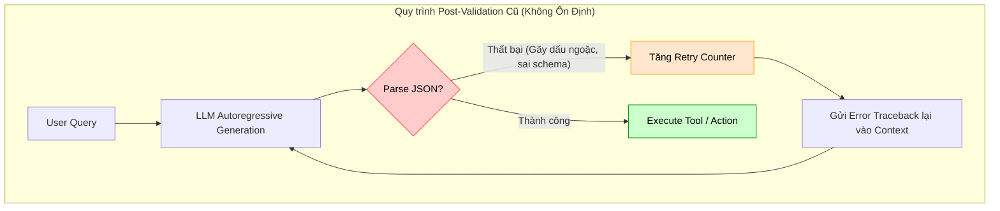
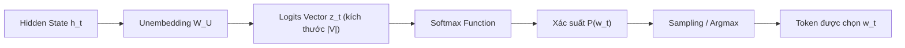
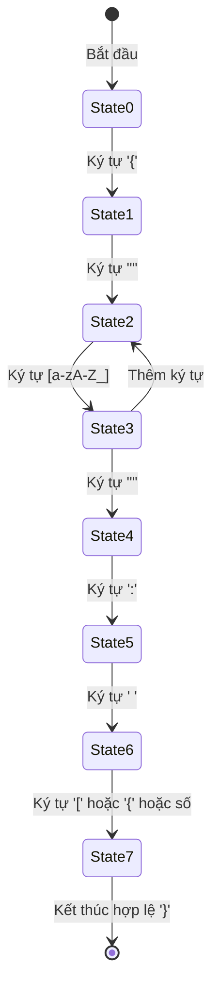
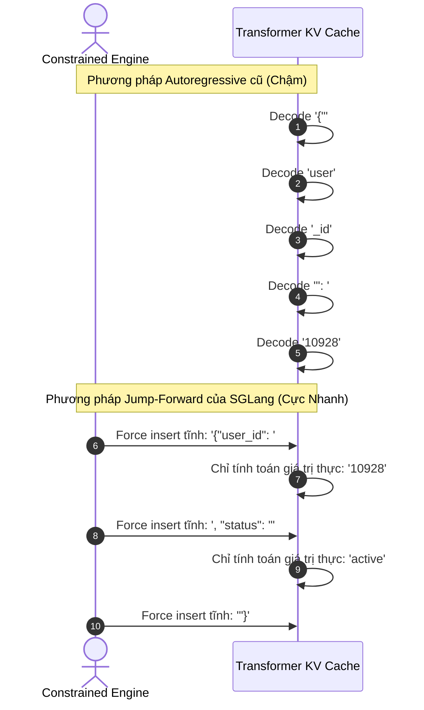

# CONSTRAINED DECODING & GRAMMAR-GUIDED STRUCTURED OUTPUTS
## Kỹ Thuật Bảo Đảm Cú Pháp Tuyệt Đối Ở Cấp Độ Logit: Finite State Machines (FSM), Context-Free Grammars (CFG), Logit Masking & Tăng Tốc Jump-Forward

---

## MỤC LỤC
1. [Khủng hoảng gãy vỡ Structured Output trong AI Agent](#1-khủng-hoảng-gãy-vỡ-structured-output-trong-ai-agent)
   - [Tại sao Prompting và Post-Validation Retry là giải pháp thất bại?](#tại-sao-prompting-và-post-validation-retry-là-giải-pháp-thất-bại)
   - [Hậu quả trong Mission-Critical Systems & Enterprise Tools](#hậu-quả-trong-mission-critical-systems--enterprise-tools)
2. [Giải phẫu tầng sinh Token của Transformer (Logit-Level Mechanics)](#2-giải-phẫu-tầng-sinh-token-của-transformer-logit-level-mechanics)
   - [Toán học từ Hidden State đến Xác suất Softmax](#toán-học-từ-hidden-state-đến-xác-suất-softmax)
   - [Cơ chế Logit Masking & Dynamic Bias](#cơ-chế-logit-masking--dynamic-bias)
3. [Các trường phái kiến trúc Constrained Decoding](#3-các-trường-phái-kiến-trúc-constrained-decoding)
   - [3.1. Finite State Machines (FSM) & Regex-Guided Decoding](#31-finite-state-machines-fsm--regex-guided-decoding)
   - [3.2. Context-Free Grammars (CFG) & Pushdown Automata (EBNF / GBNF)](#32-context-free-grammars-cfg--pushdown-automata-ebnf--gbnf)
   - [3.3. Pre-computed Vocabulary Indexing & Token Trie: Triệt tiêu Latency Overhead](#33-pre-computed-vocabulary-indexing--token-trie-triệt-tiêu-latency-overhead)
4. [Tăng tốc suy luận đột phá: Jump-Forward Decoding & SGLang](#4-tăng-tốc-suy-luận-đột-phá-jump-forward-decoding--sglang)
   - [Bản chất lãng phí của Autoregressive đối với JSON Schema cố định](#bản-chất-lãng-phí-của-autoregressive-đối-với-json-schema-cố-định)
   - [Cơ chế "Nhảy cóc" (Token Insertion) và suy luận song song](#cơ-chế-nhảy-cóc-token-insertion-và-suy-luận-song-song)
5. [So sánh hệ sinh thái công nghệ](#5-so-sánh-hệ-sinh-thái-công-nghệ)
   - [Outlines (dottxt) vs. Guidance (Microsoft) vs. llama.cpp GBNF vs. SGLang](#outlines-dottxt-vs-guidance-microsoft-vs-llamacpp-gbnf-vs-sglang)
   - [Giải phẫu cơ chế Structured Outputs API của OpenAI / Anthropic](#giải-phẫu-cơ-chế-structured-outputs-api-của-openai--anthropic)
6. [Thực hành End-to-End: Xây dựng Custom Constrained Decoder & Tool Dispatcher](#6-thực-hành-end-to-end-xây-dựng-custom-constrained-decoder--tool-dispatcher)
   - [6.1. Định nghĩa Tool Schema với Pydantic](#61-định-nghĩa-tool-schema-với-pydantic)
   - [6.2. Xây dựng FSM LogitsProcessor độc lập](#62-xây-dựng-fsm-logitsprocessor-độc-lập)
   - [6.3. Tích hợp Tool Execution Pipeline đảm bảo 100% Type-Safe](#63-tích-hợp-tool-execution-pipeline-đảm-bảo-100-type-safe)
7. [Bảng ma trận so sánh định lượng & Trade-offs](#7-bảng-ma-trận-so-sánh-định-lượng--trade-offs)
8. [Tài liệu nghiên cứu khoa học cốt lõi (Academic References)](#8-tài-liệu-nghiên-cứu-khoa-học-cốt-lõi-academic-references)

---

## 1. KHỦNG HOẢNG GÃY VỠ STRUCTURED OUTPUT TRONG AI AGENT

### Tại sao Prompting và Post-Validation Retry là giải pháp thất bại?

Trong mọi hệ thống AI Agent hiện đại—đặc biệt khi tương tác với công cụ qua [Model Context Protocol (MCP)](./01_mcp_architecture.md) hoặc REST API—mô hình ngôn ngữ lớn (LLM) không chỉ sinh văn bản tự do mà bắt buộc phải sinh ra các đối tượng dữ liệu có cấu trúc nghiêm ngặt (chủ yếu là **JSON**, **SQL**, hoặc các lời gọi hàm **Function Calls**).

Trong nhiều năm, ngành công nghiệp dựa vào phương pháp tiếp cận ngây thơ:
1. **Prompt Crafting:** Thêm vào System Prompt các chỉ thị khẩn thiết: *"You must respond ONLY with a valid JSON object matching this schema. Do not include markdown codeblocks or explanation."*
2. **Post-Validation & Retry Loops:** Nhận output từ LLM, dùng `json.loads()` hoặc `pydantic.ValidationError` để kiểm tra. Nếu parse thất bại, hệ thống gửi lại toàn bộ lịch sử kèm thông báo lỗi cho LLM để thử lại (retry 3–5 lần).



Phương pháp thử-sai này bộc lộ **3 thất bại chí mạng** trong môi trường doanh nghiệp:

1. **Xác suất lỗi không bao giờ bằng 0 (Non-zero Error Tail):** Dù model mạnh đến đâu (GPT-4o, Claude 3.5 Sonnet), với nhiệt độ suy luận $\tau > 0$, luôn tồn tại xác suất mô hình sinh ra một token vi phạm cú pháp: thiếu dấu phẩy `,`, quên đóng ngoặc nhọn `}`, đảo ngược thứ tự thuộc tính, hoặc sinh ra chuỗi markdown ` ```json ` bao quanh. Trong một pipeline Agent gồm 20 bước gọi công cụ nối tiếp, nếu mỗi bước có xác suất lỗi 5%, xác suất toàn bộ pipeline sụp đổ là:
   $$1 - (1 - 0.05)^{20} = 1 - (0.95)^{20} \approx 64.15\%$$
2. **Lãng phí chi phí và bùng nổ Latency:** Mỗi lần retry đòi hỏi gửi lại toàn bộ prompt dài, sinh lại từ đầu hàng trăm token. Điều này đẩy p99 latency từ $1.5\text{s}$ lên tới $10\text{s} - 15\text{s}$, làm tê liệt trải nghiệm người dùng.
3. **Hiện tượng "Ảo giác cuối chuỗi" (Late-Token Hallucination):** Mô hình có thể sinh đúng 99% cấu trúc JSON, nhưng ở token cuối cùng lại xuất thêm một lời giải thích: *"Hope this helps!"*, khiến toàn bộ parser chuẩn của hệ điều hành ném ra ngoại lệ cú pháp.

> [!important]
> **Quy tắc vàng về Độ tin cậy (Reliability Axiom):**  
> *"Không bao giờ sử dụng xác suất không kiểm soát để bảo đảm tính đúng đắn của cú pháp logic. Mọi ràng buộc cú pháp phải được cưỡng chế tiền nghiệm (a priori) ở cấp độ giải mã Token, chứ không phải hậu nghiệm (a posteriori) bằng các vòng lặp sửa sai."*

---

## 2. GIẢI PHẪU TẦNG SINH TOKEN CỦA TRANSFORMER (LOGIT-LEVEL MECHANICS)

Để hiểu cách cưỡng chế cú pháp tuyệt đối, ta cần giải phẫu bản chất toán học của quá trình giải mã (Decoding) trong Transformer autoregressive như đã giới thiệu tại [What Are Large Language Models?](../../01-research-and-foundations/02-llm-internals/what_are_large_language_models.md) và [Giải Phẫu Toán Học Của Transformer](../../01-research-and-foundations/02-llm-internals/04_transformer_math_deep_dive.md).

### Toán học từ Hidden State đến Xác suất Softmax

Tại mỗi bước giải mã $t$, mạng Transformer tiếp nhận chuỗi token trước đó $w_{<t} = (w_1, w_2, \dots, w_{t-1})$. Sau khi đi qua $L$ tầng Attention và Feed-Forward, đầu ra tại vị trí cuối cùng là một vector biểu diễn ẩn:

$$\mathbf{h}_t \in \mathbb{R}^{d_{\text{model}}}$$

Vector này được nhân với ma trận chiếu ngược từ vựng (Unembedding matrix / Language Model Head):

$$\mathbf{W}_U \in \mathbb{R}^{d_{\text{model}} \times |V|}$$

Trong đó $|V|$ là kích thước không gian từ vựng (Vocabulary size, thường từ 32,000 đến 128,000 tokens). Kết quả thu được là vector **Logits** biểu thị điểm số thô của mọi token khả dĩ trong từ vựng:

$$\mathbf{z}_t = \mathbf{h}_t \mathbf{W}_U \in \mathbb{R}^{|V|}$$

Trong chế độ sinh tự do (Unconstrained Sampling), phân phối xác suất trên toàn bộ từ vựng được tính bằng hàm Softmax với nhiệt độ $\tau$:

$$P(w_t = v_i \mid w_{<t}) = \frac{\exp(z_{t,i} / \tau)}{\sum_{j=1}^{|V|} \exp(z_{t,j} / \tau)}, \quad \forall v_i \in V$$



### Cơ chế Logit Masking & Dynamic Bias

**Constrained Decoding (Giải mã có ràng buộc)** can thiệp trực tiếp vào vector $\mathbf{z}_t$ trước khi đưa vào hàm Softmax. 

Tại bước $t$, dựa trên cú pháp định sẵn (JSON Schema, EBNF Grammar hoặc Regex) và chuỗi token đã sinh $w_{<t}$, ta xác định được một **tập hợp các token hợp lệ tiếp theo** $V_{\text{valid}}(w_{<t}) \subseteq V$. 

Từ tập hợp này, ta xây dựng một vector mặt nạ nhị phân (Logit Mask) $\mathbf{M}_t \in \{0, 1\}^{|V|}$:

$$
M_{t,i} = \begin{cases} 
1 & \text{if } v_i \in V_{\text{valid}}(w_{<t}) \\ 
0 & \text{if } v_i \notin V_{\text{valid}}(w_{<t}) 
\end{cases}
$$

Vector logits được điều chỉnh bằng cách cộng thêm giá trị phạt cực lớn (âm vô cực $-\infty$) vào tất cả các token vi phạm:

$$
\tilde{z}_{t,i} = z_{t,i} + \log(M_{t,i}) = \begin{cases} 
z_{t,i} & \text{if } M_{t,i} = 1 \\ 
-\infty & \text{if } M_{t,i} = 0 
\end{cases}
$$

Khi đưa vector logits đã lọc $\mathbf{\tilde{z}}_t$ qua Softmax:

$$
P_{\text{constrained}}(w_t = v_i \mid w_{<t}) = \frac{\exp(\tilde{z}_{t,i} / \tau)}{\sum_{j=1}^{|V|} \exp(\tilde{z}_{t,j} / \tau)}
$$

Vì $\exp(-\infty) = 0$, xác suất của mọi token vi phạm cú pháp lập tức bị triệt tiêu về đúng $0.0\%$. Mô hình bị bắt buộc phải phân phối toàn bộ khối lượng xác suất $100\%$ cho các token hợp lệ về mặt ngữ pháp:

$$
\sum_{v_i \in V_{\text{valid}}} P_{\text{constrained}}(w_t = v_i \mid w_{<t}) = 1.0
$$



```mermaid
flowchart TD
    subgraph GPUKernel["Kiến Trúc Bộ Lọc CUDA Logit Masking Trên VRAM"]
        H["Hidden State h_t (Batch, 1, d_model)"] --> Matmul["LM Head Matmul (W_U: d_model x |V|)"]
        Matmul --> RawLogits["Raw Logits Tensor z_t (kích thước |V| = 128,000)"]
        
        subgraph MaskingEngine["FSM / Grammar Engine"]
            State["Trạng thái hiện tại S_t"] --> Lookup["O(1) Bitmask Lookup Table"]
            Lookup --> Bitmask["Tensor Mặt Nạ Nhị Phân M_t [1, 0, 0, 1, ...]"]
        end
        
        RawLogits --> KernelOp["Custom PyTorch / Triton CUDA Kernel"]
        Bitmask --> KernelOp
        
        KernelOp --> BranchMask["z_tilde = torch.where(M_t == 1, z_t, -inf)"]
        BranchMask --> SM["Fused Softmax Kernel"]
        SM --> ProbDist["Xác Suất Hợp Lệ 100%"]
        ProbDist --> Sampler["Sampling (Temperature / Argmax)"]
        Sampler --> NextToken["Token Hợp Lệ Tiếp Theo w_t"]
    end
    
    style GPUKernel fill:#f9f9fb,stroke:#4a5568,stroke-width:1px,color:#000000
    style MaskingEngine fill:#edf2f7,stroke:#2b6cb0,stroke-width:2px,color:#000000
    style KernelOp fill:#feebc8,stroke:#dd6b20,stroke-width:2px,color:#000000
```

> [!note] Giải thích Khối: Bộ Lọc Tensor Logit (CUDA Logit Processor Block)
> * **Đầu vào (Input):** 
>   1. Tensor logits thô $\mathbf{z}_t \in \mathbb{R}^{|V|}$ sinh ra từ phép nhân ma trận giữa Hidden State tầng cuối và ma trận Unembedding $\mathbf{W}_U$.
>   2. Trạng thái hiện tại của đồ thị ngữ pháp $S_t \in Q$.
> * **Xử lý bên trong (Inner Mechanism):** 
>   - Động cơ tra cứu trước (Pre-computed Lookup Table) trích xuất một mảng bit (Bitmask) đại diện cho các token hợp lệ.
>   - Thực thi một thao tác phần tử hóa (Element-wise Operation) trực tiếp trong bộ nhớ GPU SRAM: cộng $-1e9$ (hoặc $-\infty$) vào mọi vị trí có bit bằng $0$.
>   - Đưa tensor đã lọc qua `fused_softmax_kernel`. Các giá trị $-\infty$ lập tức bị ánh xạ thành xác suất $0.0$, khiến bộ lấy mẫu (Sampler) hoàn toàn không có cơ hội chọn trúng token sai.
> * **Đầu ra (Output):** Token ID $w_t \in V_{\text{valid}}$ đảm bảo tuyệt đối không làm gãy cấu trúc cú pháp.
> * **Ngân sách trễ (Latency Budget):** Nhờ ánh xạ bitmask $O(1)$, thời gian xử lý của khối này chỉ tốn $< 0.1\text{ms}$ trên GPU hiện đại (NVIDIA A100 / H100), hoàn toàn không ảnh hưởng tới TTFT.

> [!tip]
> **Điểm ưu việt về mặt nhận thức của LLM:**  
> Khi các token vi phạm bị triệt tiêu, mô hình không bị "mất trí nhớ" hay suy giảm tư duy. Trái lại, trong số các token hợp lệ còn lại, mô hình vẫn lựa chọn token có điểm tương đồng ngữ nghĩa cao nhất dựa trên tri thức pre-training của nó.

---

## 3. CÁC TRƯỜNG PHÁI KIẾN TRÚC CONSTRAINED DECODING

Thách thức lớn nhất của Constrained Decoding không nằm ở công thức cộng trừ Logits, mà nằm ở: **Làm thế nào để tính toán tập $V_{\text{valid}}(w_{<t})$ trong vài mili-giây tại mỗi bước sinh token mà không làm suy giảm thông lượng (Throughput) của LLM?**

Hiện nay có 2 trường phái toán học và cấu trúc dữ liệu chính:

### 3.1. Finite State Machines (FSM) & Regex-Guided Decoding

Trường phái này được tiên phong bởi thư viện **Outlines** (Willard & Louf, 2023).

* **Nguyên lý:** Mọi biểu thức chính quy (Regular Expression - Regex) đều tương đương với một Máy trạng thái hữu hạn tiền định (**Deterministic Finite Automaton - DFA**).
* Một DFA được định nghĩa là một bộ 5 thành phần $A = (Q, \Sigma, \delta, q_0, F)$:
  * $Q$: Tập hữu hạn các trạng thái.
  * $\Sigma$: Bảng chữ cái (các ký tự UTF-8).
  * $\delta: Q \times \Sigma \to Q$: Hàm chuyển trạng thái.
  * $q_0 \in Q$: Trạng thái bắt đầu.
  * $F \subseteq Q$: Tập trạng thái kết thúc.



#### Ánh xạ từ Byte/Ký tự sang Token Vocabulary (The Vocabulary Projection Problem)
Trong NLP, Transformer không sinh từng ký tự mà sinh các **Subword Tokens** (ví dụ: token `" user"` gồm 5 bytes). 

Để giải bài toán này, Outlines xây dựng một hàm ánh xạ mở rộng từ trạng thái hiện tại $q \in Q$ sang tập token hợp lệ:

$$
V_{\text{valid}}(q) = \{ v \in V \mid \delta^*(q, v) \notin Q_{\text{dead}} \}
$$

Trong đó $\delta^*(q, v)$ là hàm duyệt liên tiếp tất cả các ký tự bên trong token $v$.

> [!example] Minh Họa Từng Bước: Vết Chuyển Trạng Thái FSM Khi Sinh JSON
> Giả sử mô hình cần sinh trường `{"role": "admin"}` dựa trên Regex `\{"role":\s*"(admin|user)"\}`:
>
> | Bước $t$ | Trạng Thái Hiện Tại | Tập Token Hợp Lệ $V_{\text{valid}}$ | Số Token Bị Mask ($-\infty$) | Token Được Model Chọn | Trạng Thái Kế Tiếp |
> | :---: | :---: | :---: | :---: | :---: | :---: |
> | **1** | $S_0$ (Start) | `{"` | 127,999 / 128,000 | `{"` | $S_1$ |
> | **2** | $S_1$ (Expect Key) | `role` | 127,999 / 128,000 | `role` | $S_2$ |
> | **3** | $S_2$ (Expect Colon) | `":`, `": "` | 127,998 / 128,000 | `": "` | $S_3$ |
> | **4** | $S_3$ (Expect Value) | `admin`, `user` | **127,998 / 128,000** | `admin` | $S_4$ |
> | **5** | $S_4$ (Expect Close) | `"}` | 127,999 / 128,000 | `"}` | $S_{\text{final}}$ (Dừng) |
>
> *Quan sát quan trọng:* Tại Bước 4, mô hình phân vân giữa `admin` và `user`. Dù nhiệt độ cao hay thấp, nó **tuyệt đối không thể sinh ra** các từ như `root`, `guest`, `None` hay `hacker` vì $100\%$ các token này đều mang logit $-\infty$!

> [!note] Giải thích Khối: Bộ Chiếu Từ Vựng FSM (FSM Vocabulary Projector)
> * **Chức năng:** Nối cầu giữa lý thuyết ngôn ngữ hình thức (hoạt động trên từng ký tự $\Sigma$) và kiến trúc sinh ngôn ngữ của LLM (hoạt động trên subword tokens).
> * **Giải thuật:** Với mỗi trạng thái $q$ của đồ thị FSM, duyệt qua từng token $v$ trong từ vựng $|V|$. Nếu toàn bộ chuỗi byte của token $v$ tạo thành một chuỗi chuyển dịch trạng thái hợp lệ trong DFA, bit đại diện cho $v$ được bật lên $1$.
> * **Lợi ích:** Được tiền tính toán (Pre-computed) một lần duy nhất lúc khởi động, biến tác vụ kiểm tra phức tạp thành một phép tra bảng bitmask có độ phức tạp $O(1)$.

### 3.2. Context-Free Grammars (CFG) & Pushdown Automata (EBNF / GBNF)

Biểu thức chính quy không thể biểu diễn được các cấu trúc lồng nhau đệ quy vô hạn (chẳng hạn như JSON với các object nằm trong object, hay biểu thức toán học lồng ngoặc $((a + b) \times (c - d))$) theo định lý Bơm (Pumping Lemma).

Để xử lý cấu trúc đệ quy, ta bắt buộc phải sử dụng **Ngữ pháp phi ngữ cảnh (Context-Free Grammar - CFG)** kết hợp với **Máy tự động đẩy xuống (Pushdown Automaton - PDA)** có bộ nhớ ngăn xếp (Stack).

* **Chuẩn GBNF (GGML BNF):** Được xây dựng trong dự án `llama.cpp` của Georgi Gerganov.
* Định nghĩa ngữ pháp JSON dưới dạng quy tắc EBNF:

```ebnf
root   ::= object
value  ::= object | array | string | number | ("true" | "false" | "null") ws

object ::=
  "{" ws (
            string ":" ws value
    ("," ws string ":" ws value)*
  )? "}" ws

string ::=
  "\"" (
    [^"\\\x7F\x00-\x1F] |
    "\\" (["\\bfnrt] | "u" [0-9a-fA-F]{4})
  )* "\"" ws

ws ::= [ \t\n\r]*
```

Tại mỗi bước giải mã, hệ thống Parser dựa vào đỉnh ngăn xếp (Top of Stack) để suy diễn tập ký tự hợp lệ, sau đó lọc từ vựng để tạo Logit Mask.

> [!note] Giải thích Khối: Bộ Điều Khiển Ngăn Xếp Pushdown (PDA Stack Controller)
> * **Đầu vào (Input):** Chuỗi token hiện tại và trạng thái đỉnh ngăn xếp (Top of Stack).
> * **Xử lý bên trong:** 
>   - Khi gặp dấu mở ngoặc `{` hoặc `[`, PDA đẩy (PUSH) một frame mong đợi dấu đóng tương ứng (`}` hoặc `]`) vào đỉnh stack.
>   - Khi gặp dấu đóng, PDA kéo (POP) frame ra khỏi stack.
>   - Chỉ khi ngăn xếp hoàn toàn rỗng và luật ngữ pháp chạm đích `root`, token kết thúc chuỗi `<|eot_id|>` mới được mở khóa để LLM dừng sinh.
> * **Điểm mạnh:** Giải quyết triệt để lỗi "quên đóng ngoặc JSON" muôn thuở của LLM.

### 3.3. Pre-computed Vocabulary Indexing & Token Trie: Triệt tiêu Latency Overhead

Nếu tại mỗi token, ta phải chạy thuật toán FSM/CFG để duyệt qua toàn bộ $128,000$ tokens trong từ vựng, độ trễ suy luận sẽ tăng vọt thêm $50\text{ms} - 100\text{ms}$ cho mỗi token.

Giải pháp đột phá là **Pre-computation (Tính toán trước bảng trạng thái)**:
1. **Offline Indexing:** Biên dịch Regex/FSM hoặc Grammar một lần duy nhất trước khi inference.
2. **State-to-Token Index:** Tạo một bảng băm (Hash Table) hoặc ma trận thưa:
   $$\text{Index}: \text{State ID} \to \text{Bitmask of Valid Tokens}$$
3. **Inference Time ($O(1)$ lookup):** Khi mô hình đang ở trạng thái $S_{current}$, ta chỉ mất $O(1)$ thời gian để trích xuất bitmask từ RAM và áp trực tiếp lên tensor Logits bằng thao tác CUDA kernel cực nhanh.

---

## 4. TĂNG TỐC SUY LUẬN ĐỘT PHÁ: JUMP-FORWARD DECODING & SGLANG

Một trong những đóng góp học thuật quan trọng nhất trong những năm gần đây về xử lý ngôn ngữ có cấu trúc là nghiên cứu của Zheng et al. (2023) từ UC Berkeley với dự án **SGLang (Structured Generation Language)**.

### Bản chất lãng phí của Autoregressive đối với JSON Schema cố định

Xét một JSON Schema yêu cầu Agent trả về thông tin người dùng:
```json
{
  "user_id": 10928,
  "status": "active"
}
```

Hãy nhìn vào các token được sinh ra:
* `{"user_id": ` $\rightarrow$ **100% Cố định (Static boilerplate)**
* `10928` $\rightarrow$ **Nội dung biến thiên do LLM tính toán**
* `, "status": "` $\rightarrow$ **100% Cố định (Static boilerplate)**
* `active` $\rightarrow$ **Nội dung biến thiên do LLM tính toán**
* `"}` $\rightarrow$ **100% Cố định (Static boilerplate)**

Trong chế độ sinh tuần tự tiêu chuẩn, mô hình phải thực hiện forward pass qua toàn bộ mạng nơ-ron sâu 80 tầng để sinh từng ký tự `"`, `u`, `s`, `e`, `r`, `_`, `i`, `d`, `"`... Đây là sự lãng phí tài nguyên GPU khủng khiếp!



### Cơ chế "Nhảy cóc" (Jump-Forward Token Insertion)

Khi FSM nhận thấy từ trạng thái $S_a$ đến trạng thái $S_b$ chỉ có **duy nhất một đường đi khả dĩ** (chuỗi ký tự tĩnh cố định):
1. Động cơ dừng ngay lập tức việc gọi Transformer forward pass.
2. Nối trực tiếp chuỗi token tĩnh đó vào Context và KV-Cache.
3. Chỉ đánh thức LLM khi trạng thái chạm đến vị trí có nhiều hơn một nhánh lựa chọn (tức là vị trí chứa dữ liệu động).

```mermaid
flowchart LR
    subgraph SGLangEngine["Động Cơ Jump-Forward Token Insertion"]
        FSM["FSM State Tracker"] --> Check{"Số đường chuyển dịch\ntừ State S_k?"}
        Check -- "Duy nhất 1 chuỗi tĩnh (Ví dụ: '\"transaction_id\": \"')" --> Inject["Khối Chèn Token Trực Tiếp\n(Zero GPU Forward Pass)"]
        Inject --> AppendKV["Ghi thẳng Token vào KV-Cache\n(Prompt-like Prefill)"]
        AppendKV --> AdvanceFSM["Cập nhật State FSM -> S_next"]
        AdvanceFSM --> Check
        Check -- "Nhiều hơn 1 nhánh (Dynamic Value)" --> WakeLLM["Đánh thức GPU Transformer Forward Pass"]
        WakeLLM --> LogitMask["Áp Mặt Nạ Logit & Sample Giá Trị Thực"]
    end

    style SGLangEngine fill:#f7fafc,stroke:#2d3748,color:#000000
    style Inject fill:#c6f6d5,stroke:#22543d,stroke-width:2px,color:#000000
    style WakeLLM fill:#fed7d7,stroke:#742a2a,stroke-width:2px,color:#000000
```

> [!note] Giải thích Khối: Động Cơ Nhảy Cóc (Jump-Forward Token Insertion Engine)
> * **Đầu vào:** Trạng thái FSM hiện tại $S_t$ và cây tiền tố ngữ pháp.
> * **Phân loại nhánh (Branch Analysis):** 
>   - Nếu bậc xuất out-degree của $S_t$ bằng 1 (chỉ có duy nhất 1 cạnh đi ra, ví dụ ký tự `:` theo sau tên thuộc tính), hệ thống chuyển sang chế độ **Bypass**.
>   - Hệ thống bỏ qua hoàn toàn việc tính toán Attention và Feed-Forward trên GPU cho token đó. Nó chỉ đơn giản coi token đó như một phần của prompt và cập nhật KV-Cache theo cơ chế tính gộp (Batched Prefill).
> * **Kết quả:** Giảm số lượt Forward Pass của GPU tới $40\% - 70\%$ trên các tài liệu JSON có nhiều trường cố định, giải phóng năng lực tính toán cho các yêu cầu khác trong cụm server.

> [!tip]
> **Hiệu quả thực nghiệm:**  
> Jump-Forward Decoding giúp tăng tốc độ sinh dữ liệu JSON có cấu trúc lên **từ 2x đến 5x**, đồng thời cắt giảm chi phí tính toán GPU tỷ lệ thuận với lượng boilerplate text trong schema!

---

## 5. SO SÁNH HỆ SINH THÁI CÔNG NGHỆ

### Outlines vs. Guidance vs. llama.cpp vs. SGLang

| Tiêu Chí | Outlines (dottxt) | Guidance (Microsoft) | llama.cpp (GBNF) | SGLang (UC Berkeley) |
| :--- | :--- | :--- | :--- | :--- |
| **Cơ chế cốt lõi** | Regex $\to$ FSM $\to$ Token Index | Interleaved Generation & Parsing | EBNF Grammar $\to$ Pushdown Automaton | RadixAttention + Jump-Forward FSM |
| **Hỗ trợ Schema** | Pydantic, JSON Schema, Regex | CFG, Regex, Handlebars templates | Tệp ngữ pháp `.gbnf` độc lập | Trình biên dịch DSL Python native |
| **Tốc độ Masking** | Cực nhanh (Zero-overhead index) | Trung bình (Interleaved parsing) | Nhanh (Viết bằng C/C++) | Siêu nhanh (Tối ưu hóa KV Cache) |
| **Môi trường phù hợp** | Python backend, vLLM engine | Python scripting, hybrid logic | On-device, edge computing, C++ | High-throughput GPU inference cluster |
| **Tự động điền tĩnh** | Có (Fast-forward) | Có | Không | Có (Đỉnh cao Jump-Forward) |

### Giải phẫu cơ chế Structured Outputs API của OpenAI / Anthropic

Kể từ tháng 8/2024, OpenAI chính thức ra mắt tính năng **Structured Outputs** (`response_format: { type: "json_schema", strict: true }`), cam kết 100% tuân thủ JSON Schema.

Về bản chất kiến trúc server-side:
1. **Schema Pre-compilation:** Khi developer gửi JSON Schema lần đầu, hệ thống của OpenAI biên dịch schema đó thành một CFG/FSM tối ưu hóa cao. Quá trình này có thể mất vài giây ở request đầu tiên.
2. **Cache FSM:** Cấu trúc FSM sau biên dịch được lưu vào bộ nhớ đệm phân tán gắn liền với hash của schema.
3. **Logit Masking tại vLLM/Triton:** Trong quá trình suy luận phân tán, mỗi instance GPU áp đặt logit mask trực tiếp trong CUDA decoding loop.

---

## 6. THỰC HÀNH END-TO-END: XÂY DỰNG CUSTOM CONSTRAINED DECODER & TOOL DISPATCHER

Dưới đây là mã nguồn Python hoàn chỉnh minh họa cách một AI Agent sử dụng **Outlines** kết hợp với **Pydantic** để bảo đảm 100% Type-Safe khi gọi công cụ thanh toán tài chính (Financial Payment Tool).

### 6.1. Định nghĩa Tool Schema với Pydantic

```python
from enum import Enum
from typing import List, Optional
from pydantic import BaseModel, Field, condecimal

class Currency(str, Enum):
    USD = "USD"
    EUR = "EUR"
    VND = "VND"
    SGD = "SGD"

class PaymentAction(str, Enum):
    WIRE_TRANSFER = "wire_transfer"
    ESCROW_RELEASE = "escrow_release"
    REFUND = "refund"

class ExecutePaymentPayload(BaseModel):
    """Schema đại diện cho tham số gọi công cụ thanh toán ngân hàng."""
    transaction_id: str = Field(
        ..., 
        regex=r"^TXN-[0-9]{8}-[A-Z]{4}$",
        description="Mã giao dịch chuẩn format: TXN-YYYYMMDD-XXXX"
    )
    action: PaymentAction = Field(..., description="Loại hành động tài chính")
    amount: float = Field(..., gt=0.0, description="Số tiền thanh toán, phải lớn hơn 0")
    currency: Currency = Field(..., description="Đơn vị tiền tệ chuẩn ISO")
    beneficiary_account: str = Field(
        ..., 
        regex=r"^[0-9]{10,16}$",
        description="Số tài khoản thụ hưởng gồm 10 đến 16 chữ số"
    )
    audit_notes: Optional[str] = Field(None, max_length=200, description="Ghi chú đối soát")
```

### 6.2. Thiết lập Inference Engine với Outlines

```python
import outlines
from transformers import AutoModelForCausalLM, AutoTokenizer
import torch

def setup_constrained_agent():
    model_id = "meta-llama/Meta-Llama-3-8B-Instruct"
    
    print(f"[*] Loading model and tokenizer: {model_id}...")
    tokenizer = AutoTokenizer.from_pretrained(model_id)
    model = AutoModelForCausalLM.from_pretrained(
        model_id,
        torch_dtype=torch.bfloat16,
        device_map="auto"
    )
    
    # Bọc Transformers model bằng Outlines Engine
    outlines_model = outlines.models.Transformers(model, tokenizer)
    
    # Xây dựng Generator có ràng buộc cấu trúc Pydantic
    # FSM được biên dịch tự động từ Pydantic Schema ở bước này!
    print("[*] Compiling JSON Schema into Finite State Machine (FSM)...")
    generator = outlines.generate.json(outlines_model, ExecutePaymentPayload)
    return generator

# Khởi tạo generator
# generator = setup_constrained_agent()
```

### 6.3. Tích hợp Tool Execution Pipeline đảm bảo 100% Type-Safe

```python
import json

class EnterpriseBankingDispatcher:
    def __init__(self, constrained_generator):
        self.generator = constrained_generator

    def process_natural_language_request(self, user_instruction: str) -> dict:
        prompt = (
            f"<|begin_of_text|><|start_header_id|>system<|end_header_id|>\n"
            f"You are an automated core banking payment agent. "
            f"Parse the user's intent into the strict transaction schema.\n"
            f"<|eot_id|><|start_header_id|>user<|end_header_id|>\n"
            f"{user_instruction}\n"
            f"<|eot_id|><|start_header_id|>assistant<|end_header_id|>\n"
        )
        
        print("\n[*] LLM Generating with Logit-Level Constrained Decoding...")
        # Kết quả trả về trực tiếp là 1 instance của ExecutePaymentPayload đã được validate!
        # Không cần json.loads(), không có bất kỳ rủi ro ValidationError nào!
        structured_payload: ExecutePaymentPayload = self.generator(prompt)
        
        return self._execute_transaction(structured_payload)

    def _execute_transaction(self, payload: ExecutePaymentPayload) -> dict:
        print("[*] Executing Core Banking Transaction safely:")
        print(f"    - Mã GD: {payload.transaction_id}")
        print(f"    - Loại GD: {payload.action.value}")
        print(f"    - Số tiền: {payload.amount:,.2f} {payload.currency.value}")
        print(f"    - STK thụ hưởng: {payload.beneficiary_account}")
        
        # Gọi xuống tầng Core Banking API / MCP Server
        return {
            "status": "SUCCESS",
            "receipt_code": f"REC-{payload.transaction_id}",
            "amount_settled": payload.amount,
            "currency": payload.currency.value
        }

# Mô phỏng thực thi thực tế:
user_prompt = "Hãy giải ngân 50000 USD từ tài khoản ký quỹ cho đối tác STK 882910394821, mã giao dịch nội bộ là TXN-20260927-ABCD."
# dispatcher = EnterpriseBankingDispatcher(generator)
# result = dispatcher.process_natural_language_request(user_prompt)
# print(result)
```

> [!example]
> **Điểm đột phá:** Cho dù prompt của người dùng có chứa các ký tự phá hoại, injection, hay cố tình gây nhiễu, mô hình **về mặt vật lý không thể sinh ra** bất kỳ token nào nằm ngoài định dạng `TXN-[0-9]{8}-[A-Z]{4}` và danh mục `Currency` đã quy định.

---

## 7. BẢNG MA TRẬN SO SÁNH ĐỊNH LƯỢNG & TRADE-OFFS

```mermaid
quadrantChart
    title Đánh giá các phương pháp bảo đảm cấu trúc cho Agent
    x-axis Độ an toàn cú pháp (Syntax Guarantee) --> Rất thấp : Tuyệt đối 100%
    y-axis Chi phí tài nguyên & Latency --> Rất cao : Tối ưu / Thấp
    quadrant-1 "Lý tưởng (Constrained Decoding + Jump-Forward)"
    quadrant-2 "Tiềm ẩn rủi ro cao"
    quadrant-3 "Ngõ cụt (Prompting + Retry nhiều lần)"
    quadrant-4 "An toàn nhưng chậm (Schema Parsing truyền thống)"
    "Prompt Only": [0.15, 0.4]
    "Post-Validation Retry": [0.45, 0.15]
    "Grammar PDA (llama.cpp)": [0.85, 0.6]
    "FSM Index (Outlines)": [0.95, 0.8]
    "SGLang Jump-Forward": [0.98, 0.92]
```

| Phương Pháp | Tỷ Lệ Lỗi Cú Pháp (Syntax Error Rate) | TTFT (Time to First Token) | Throughput (Tokens / Giây) | Mức Tiêu Hao Bộ Nhớ VRAM |
| :--- | :--- | :--- | :--- | :--- |
| **Prompting Đơn Thuần** | 5% – 18% (Tùy độ khó schema) | Thấp ($< 50\text{ms}$) | Chuẩn ($1.0\times$) | Thấp (Chỉ KV-Cache thông thường) |
| **Retry Loop (Pydantic Retry)** | 1% – 4% (Sau 3 lần thử) | Trung bình ($200\text{ms} - 1.5\text{s}$) | Kém ($0.3\times - 0.7\times$ do lãng phí) | Tăng do phình to Context History |
| **GBNF Grammar (`llama.cpp`)** | **0.00%** (Cưỡng chế 100%) | Trung bình | Tương đương chuẩn ($0.95\times$) | Tăng nhẹ (Ngăn xếp Pushdown) |
| **FSM Indexing (`Outlines`)** | **0.00%** (Cưỡng chế 100%) | Tăng ở lần đầu ($1\text{s} - 3\text{s}$ compile) | Rất cao ($1.2\times - 1.5\times$) | Cần $50\text{MB} - 200\text{MB}$ RAM lưu Index |
| **Jump-Forward (`SGLang`)** | **0.00%** (Cưỡng chế 100%) | Thấp sau khi cache Radix | **Đột phá ($2.5\times - 5.0\times$)** | Tối ưu hóa cao qua Memory Pool |

---

## 8. TÀI LIỆU NGHIÊN CỨU KHOA HỌC CỐT LÕI (ACADEMIC REFERENCES)

1. **Willard, B. T., & Louf, R. (2023).** *Efficient Guided Generation for Large Language Models.* arXiv preprint [arXiv:2307.09702](https://arxiv.org/abs/2307.09702). (Bài báo nền tảng đề xuất FSM Regex Indexing và thư viện Outlines).
2. **Zheng, L., Yin, L., Xie, Z., Huang, J., Sun, C., Yu, C. H., Cao, S., Christaballen, C., Gonzalez, J. E., & Stoica, I. (2023).** *SGLang: Efficient Execution of Structured Language Model Programs.* UC Berkeley, LMSYS Organization. [arXiv:2312.07104](https://arxiv.org/abs/2312.07104). (Đề xuất Jump-Forward Token Insertion và RadixAttention).
3. **Lundberg, S., et al. (2023).** *Guidance: A language for controlling large language models.* Microsoft Research. [GitHub Repository](https://github.com/guidance-ai/guidance).
4. **Poesia, F., Polozov, A., Le, V., Tiwari, A., Soares, G., Meek, C., & Singla, A. (2022).** *Synchromesh: Reliable code generation from pre-trained language models via constrained semantic decoding.* International Conference on Learning Representations (ICLR 2022). [arXiv:2201.11227](https://arxiv.org/abs/2201.11227).
5. **Gerganov, G., et al. (2023).** *GGML BNF Grammars (GBNF) for Llama.cpp.* [llama.cpp Grammars Documentation](https://github.com/ggerganov/llama.cpp/blob/master/grammars/README.md).
6. **OpenAI. (2024).** *Introducing Structured Outputs in the API.* OpenAI Engineering Blog. [Link](https://openai.com/index/introducing-structured-outputs-in-the-api/).

---

## 🔗 LIÊN KẾT ĐIỀU HƯỚNG NỘI BỘ
* **Giao thức công cụ chuẩn mở:** [Kiến Trúc Giao Thức Model Context Protocol (MCP)](./01_mcp_architecture.md)
* **Giải phẫu ngôn ngữ lớn & Tokenization:** [What Are Large Language Models?](../../01-research-and-foundations/02-llm-internals/what_are_large_language_models.md)
* **Nền tảng vi tích phân Transformer:** [Giải Phẫu Toán Học Của Transformer](../../01-research-and-foundations/02-llm-internals/04_transformer_math_deep_dive.md)
* **Vòng lặp tự trị trong Agent:** [Nền Tảng Loop Engineering & Stopping Criteria](../03-loop-engineering/01_loop_fundamentals.md)
* **Trang chủ Trụ Cột 3:** [🛠️ Trụ Cột 3: Building Agents](../README.md)
