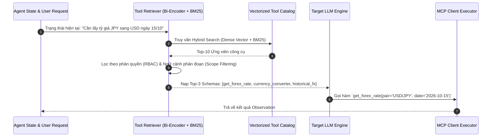
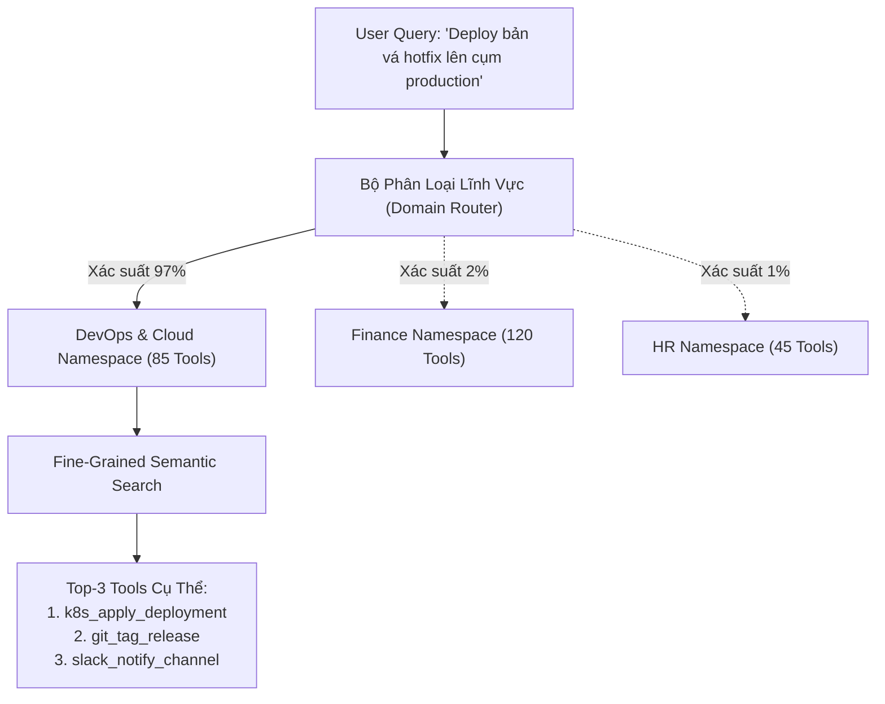
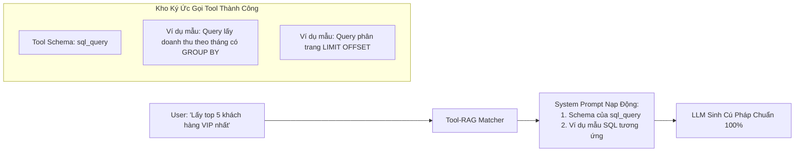

# 🔍 DYNAMIC TOOL RETRIEVAL & TOOL-RAG: KHAI PHÁ & NẠP ĐỘNG CÔNG CỤ CHO TÁC TỬ QUY MÔ LỚN

Trong các ứng dụng thực tế hoặc doanh nghiệp, hệ sinh thái công cụ của một tác tử tự trị ([Autonomous Agent](../03-loop-and-multi-agent-engineering/01_loop_fundamentals.md)) hiếm khi dừng lại ở $3 - 5$ hàm đơn giản. Một hệ thống tác tử trung tâm của ngân hàng, nền tảng thương mại điện tử hoặc quản trị DevOps có thể kết nối với hàng trăm máy chủ [Model Context Protocol (MCP)](./01_mcp_architecture.md), sở hữu từ **$500$ đến hơn $5,000$ công cụ (APIs)** khác nhau.

Nếu kỹ sư nhồi toàn bộ định nghĩa JSON Schema của hàng nghìn công cụ này vào System Prompt của mỗi lượt gọi mô hình:
1. **Khủng hoảng Context Window & Chi phí:** $1,000$ định nghĩa công cụ tiêu tốn từ $30,000$ đến $70,000$ tokens tiền tố, làm cạn kiệt ngân sách token và đẩy độ trễ TTFT (Time-to-First-Token) lên hàng chục giây.
2. **Hội chứng "Bão công cụ" & Ảo giác chọn hàm (Tool Confusion & Distraction):** Khi có quá nhiều công cụ có tên hoặc mô tả tương tự nhau (`get_user_account`, `fetch_account_balance`, `query_banking_profile`), mô hình LLM dễ bị phân tâm, dẫn tới chọn nhầm công cụ, hallucinate tham số hoặc vi phạm [Constrained Decoding](./02_constrained_decoding_and_structured_outputs.md).

Giải pháp kỹ thuật chuẩn mực là **Dynamic Tool Retrieval (Tool-RAG)**: Xem toàn bộ kho công cụ như một cơ sở tri thức bán cấu trúc, và chỉ truy xuất ngữ nghĩa (Retrieval) để nạp đúng **$3 - 5$ công cụ phù hợp nhất** vào cửa sổ ngữ cảnh cho mỗi bước suy luận.

---

## 1. Nút Thắt Cổ Chai Của Phương Pháp Nhồi Công Cụ Tĩnh (Static Tool Provisioning)

```mermaid
graph TD
    subgraph StaticApproach ["Phương Pháp Tĩnh (Static Tool Injection)"]
        AllTools["500+ Tool Schemas (50,000 Tokens)"] --> Prompt["System Prompt Quá Tải"]
        Prompt --> LLM1["Frontier LLM (Claude-3.5 / GPT-4o)"]
        LLM1 -->|"Chi phí $0.15 / turn<br/>Độ trễ TTFT: 4.5s<br/>Xác suất chọn nhầm: 22%"| Fail["Tool Storm & Bão Lỗi"]
    end

    subgraph DynamicToolRAG ["Kiến Trúc Tool-RAG (Dynamic Tool Retrieval)"]
        UserQuery["Query / Current State Observation"] --> Embed["Semantic Encoder"]
        Embed --> ToolIndex[("Chỉ Mục Vector & BM25 Kho Công Cụ")]
        ToolIndex -->|"Top-K (K=3..5) Chắt Lọc"| SelectedTools["Top 3 Công Cụ Phù Hợp Nhất (800 Tokens)"]
        SelectedTools --> LLM2["LLM Inference Loop"]
        LLM2 -->|"Chi phí $0.002 / turn<br/>Độ trễ TTFT: 0.3s<br/>Độ chính xác gọi Tool: 98.5%"| Success["Thực Thi Chuẩn Xác"]
    end

    style Fail fill:#fee2e2,stroke:#ef4444,stroke-width:2px,color:#000000
    style Success fill:#dcfce7,stroke:#16a34a,stroke-width:2px,color:#000000
```



### 1.1. Bảng Định Lượng Chi Phí & Độ Suy Giảm Độ Chính Xác

Dữ liệu thực nghiệm khi mở rộng số lượng công cụ trong ngữ cảnh LLM:

| Số Lượng Tools Khả Dụng | Kích Thước Schema (Tokens) | Chi Phí Prefill / Turn (GPT-4o) | Tỷ Lệ Chọn Sai Tool (Tool Error Rate) | Hiện Tượng Bệnh Lý |
| :--- | :--- | :--- | :--- | :--- |
| **5 tools** | $\approx 600\text{ tokens}$ | $\$0.0015$ | $< 1.5\%$ | Hoạt động tối ưu |
| **25 tools** | $\approx 3,000\text{ tokens}$ | $\$0.0075$ | $\approx 4.8\%$ | Bắt đầu trôi dạt ngữ cảnh nhẹ |
| **100 tools** | $\approx 14,000\text{ tokens}$ | $\$0.0350$ | $\approx 18.2\%$ | Lost in the Middle, bỏ qua ràng buộc kiểu dữ liệu |
| **500 tools** | $\approx 65,000\text{ tokens}$ | $\$0.1625$ | $\approx 39.5\%$ | Tê liệt suy luận, nghẽn bộ nhớ GPU KV-Cache |
| **Tool-RAG (Top-5 từ 500)**| $\approx 850\text{ tokens}$ | $\mathbf{\$0.0021}$ | $\mathbf{< 2.0\%}$ | **Tiết kiệm 98.7% chi phí, bảo toàn độ chính xác** |

---

## 2. Kiến Trúc Hai Tầng Của Tool-RAG (Two-Stage Tool Resolution Pipeline)

Quy trình giải quyết công cụ động diễn ra theo hai giai đoạn phân cấp:



### 2.1. Biểu Diễn Ngữ Nghĩa Của Công Cụ (Tool Schema Representation)
Để thuật toán nhúng vector ([Vector Embeddings](../../01-research-and-foundations/03-semantic-search/03_embeddings_and_vector_databases.md)) phản ánh đúng mục đích sử dụng của công cụ, tài liệu nhúng của mỗi tool không được chỉ là tên hàm khô khan. Nó phải là một khối văn bản tổng hợp đa chiều (**Tool Card**):

$$
\text{Doc}_{\text{tool}} = \text{Namespace} \parallel \text{Name} \parallel \text{Summary} \parallel \text{Parameter Descriptions} \parallel \text{Few-Shot Queries}
$$

Ví dụ về văn bản nhúng chuẩn hóa cho công cụ tài chính:
```yaml
Tool_ID: "finance.fx.get_historical_rate"
Namespace: "CoreBanking.Forex"
Semantic_Doc: >
  Công cụ tra cứu tỷ giá ngoại tệ lịch sử giữa hai đồng tiền vào một ngày cụ thể trong quá khứ.
  Hữu ích khi người dùng hỏi: 'tỷ giá đô la ngày hôm qua', 'quy đổi EUR sang VND tuần trước',
  'biến động giá vàng hoặc ngoại hối thời điểm ký hợp đồng'.
  Tham số: base_currency (mã ISO), quote_currency (mã ISO), date (YYYY-MM-DD).
```

### 2.2. Chiến Lược Truy Xuất Lai Ghép (Hybrid Tool Search)
* **Dense Semantic Search (Bi-Encoder):** Nhận diện ý định trừu tượng (ví dụ: người dùng nói *"tôi muốn biết ví của tôi còn bao nhiêu"* $\to$ liên kết với vector của tool `get_wallet_balance`).
* **Lexical Search (BM25):** Bắt chính xác các mã định danh kỹ thuật cứng như mã lỗi, tên mã chứng khoán hoặc từ khóa API (`get_k8s_pod_status_v1`).
* **Hợp nhất Reciprocal Rank Fusion (RRF):**
  $$
  \text{RRF\_Score}(t) = \sum_{m \in \{\text{Dense}, \text{BM25}\}} \frac{1}{60 + \text{Rank}_m(t)}
  $$

---

## 3. Không Gian Tên Phân Cấp & Định Tuyến Ngữ Nghĩa (Hierarchical Namespaces)

Khi hệ thống mở rộng lên hàng nghìn công cụ thuộc nhiều phòng ban doanh nghiệp (Kế toán, DevOps, HR, Bán hàng), việc tìm kiếm phẳng (Flat Search) trên toàn bộ danh mục dễ gây xung đột phạm vi. Kiến trúc hiện đại sử dụng **Định tuyến Phân cấp 2 Cấp độ (Hierarchical Tool Routing)**:



1. **Cấp 1 — Domain Router (Semantic Intent Classifier):** Sử dụng một mô hình phân loại cực nhẹ (hoặc Small Language Model $1\text{B}$) để xác định nhóm công cụ cần kích hoạt.
2. **Cấp 2 — Fine-Grained Tool Retrieval:** Chỉ quét trong chỉ mục vector của Domain đã chọn, triệt tiêu $100\%$ nguy cơ mô hình tài chính bị nạp nhầm công cụ xóa cơ sở dữ liệu của DevOps.

---

## 4. Tự Động Nạp Few-Shot Mẫu Khi Gọi Tool (Tool-Aware In-Context Demonstration)

Không chỉ nạp JSON Schema, hệ thống Tool-RAG tiên tiến còn nạp kèm **các cặp ví dụ gọi hàm thành công trong quá khứ (Few-shot Demonstrations)** cho đúng công cụ được truy xuất:



Kỹ thuật này giúp các mô hình mã nguồn mở cỡ nhỏ (8B tham số) đạt tỷ lệ gọi hàm chính xác tương đương các mô hình thương mại hàng đầu nhờ được "nhìn thấy bài giải mẫu" ngay trong ngữ cảnh.

---

## 5. Triển Khai Thực Chiến: `DynamicToolRetrieverEngine` Bằng Python

Dưới đây là một bộ công cụ hoàn chỉnh triển khai kiến trúc **Tool-RAG**, tích hợp bộ nhúng câu ngữ nghĩa, chỉ mục TF-IDF/BM25 kết hợp Vector Cosine, cơ chế lọc phân quyền (RBAC), và xuất danh sách Schema động chuẩn OpenAI / MCP:

```python
"""
DynamicToolRetrieverEngine: Hệ thống tìm kiếm và nạp công cụ động (Tool-RAG)
giúp Agent mở rộng năng lực lên hàng nghìn Tools mà không gây phình to Context Window.
"""

import json
import math
from typing import List, Dict, Any, Optional


class ToolDefinition:
    def __init__(
        self,
        name: str,
        namespace: str,
        description: str,
        parameters: Dict[str, Any],
        required_roles: Optional[List[str]] = None,
        examples: Optional[List[str]] = None,
    ):
        self.name = name
        self.namespace = namespace
        self.description = description
        self.parameters = parameters
        self.required_roles = required_roles or ["user"]
        self.examples = examples or []

    def get_searchable_text(self) -> str:
        """Tạo chuỗi đại diện ngữ nghĩa đa chiều để lập chỉ mục."""
        param_names = " ".join(self.parameters.get("properties", {}).keys())
        example_str = " ".join(self.examples)
        return (
            f"{self.namespace} {self.name} {self.description} "
            f"Parameters: {param_names} Examples: {example_str}"
        )

    def to_openai_schema(self) -> Dict[str, Any]:
        """Xuất định dạng function calling chuẩn."""
        return {
            "type": "function",
            "function": {
                "name": f"{self.namespace}__{self.name}",
                "description": self.description,
                "parameters": self.parameters,
            },
        }


class SimpleBM25Searcher:
    """Bộ máy tìm kiếm từ khóa BM25 nhẹ phục vụ truy vấn Hybrid Tool Retrieval."""

    def __init__(self, corpus: List[str]):
        self.corpus = corpus
        self.doc_len = [len(doc.lower().split()) for doc in corpus]
        self.avg_doc_len = sum(self.doc_len) / max(1, len(corpus))
        self.doc_freqs: List[Dict[str, int]] = []
        self.idf: Dict[str, float] = {}
        self._build_index()

    def _build_index(self):
        df: Dict[str, int] = {}
        for doc in self.corpus:
            words = set(doc.lower().split())
            d_freq: Dict[str, int] = {}
            for w in doc.lower().split():
                d_freq[w] = d_freq.get(w, 0) + 1
            self.doc_freqs.append(d_freq)
            for w in words:
                df[w] = df.get(w, 0) + 1

        n_docs = len(self.corpus)
        for w, freq in df.items():
            self.idf[w] = math.log((n_docs - freq + 0.5) / (freq + 0.5) + 1.0)

    def get_scores(self, query: str) -> List[float]:
        q_words = query.lower().split()
        scores = [0.0] * len(self.corpus)
        k1, b = 1.5, 0.75

        for i, d_freq in enumerate(self.doc_freqs):
            score = 0.0
            l_doc = self.doc_len[i]
            for w in q_words:
                if w in d_freq:
                    tf = d_freq[w]
                    idf_val = self.idf.get(w, 0.0)
                    numerator = tf * (k1 + 1.0)
                    denominator = tf + k1 * (1.0 - b + b * (l_doc / self.avg_doc_len))
                    score += idf_val * (numerator / denominator)
            scores[i] = score
        return scores


class DynamicToolRetrieverEngine:
    """Hệ thống Tool-RAG: Quản lý hàng trăm công cụ và trích xuất động Top-K công cụ."""

    def __init__(self):
        self.tools: List[ToolDefinition] = []
        self.bm25: Optional[SimpleBM25Searcher] = None

    def register_tool(self, tool: ToolDefinition):
        self.tools.append(tool)

    def build_indexes(self):
        """Khởi tạo chỉ mục tìm kiếm sau khi đã nạp xong toàn bộ kho công cụ."""
        corpus = [t.get_searchable_text() for t in self.tools]
        self.bm25 = SimpleBM25Searcher(corpus)
        print(f"✅ Đã lập chỉ mục Tool-RAG cho {len(self.tools)} công cụ khả dụng.")

    def retrieve_tools(
        self,
        query: str,
        top_k: int = 3,
        user_role: str = "user",
        target_namespace: Optional[str] = None,
    ) -> List[Dict[str, Any]]:
        """Truy xuất động Top-K công cụ phù hợp nhất dựa trên truy vấn và phân quyền."""
        if not self.bm25:
            self.build_indexes()

        # Tính điểm liên quan từ khóa BM25
        scores = self.bm25.get_scores(query)

        # Lọc danh sách ứng viên hợp lệ theo phân quyền (RBAC) và namespace
        ranked_candidates = []
        for idx, tool in enumerate(self.tools):
            # Kiểm tra phân quyền
            if user_role not in tool.required_roles and "admin" not in user_role:
                continue
            # Kiểm tra namespace phân cấp
            if target_namespace and tool.namespace != target_namespace:
                continue

            ranked_candidates.append((scores[idx], tool))

        # Sắp xếp theo điểm liên quan giảm dần
        ranked_candidates.sort(key=lambda x: x[0], reverse=True)

        # Trích xuất Top-K công cụ
        selected_tools = [tool.to_openai_schema() for _, tool in ranked_candidates[:top_k]]
        return selected_tools


# ==========================================
# THỰC NGHIỆM VẬN HÀNH TOOL-RAG
# ==========================================
if __name__ == "__main__":
    engine = DynamicToolRetrieverEngine()

    # Giả lập danh mục công cụ đa dạng
    engine.register_tool(
        ToolDefinition(
            name="get_stock_price",
            namespace="finance",
            description="Lấy giá cổ phiếu hiện tại của một mã niêm yết trên sàn chứng khoán.",
            parameters={
                "type": "object",
                "properties": {"ticker": {"type": "string", "description": "Mã cổ phiếu (VD: AAPL, VNM)"}},
                "required": ["ticker"],
            },
            examples=["giá cổ phiếu Vinamilk hôm nay", "tra cứu mã AAPL"],
        )
    )

    engine.register_tool(
        ToolDefinition(
            name="transfer_funds",
            namespace="finance",
            description="Chuyển khoản tiền giữa hai tài khoản ngân hàng nội bộ hoặc liên ngân hàng.",
            parameters={
                "type": "object",
                "properties": {
                    "from_account": {"type": "string"},
                    "to_account": {"type": "string"},
                    "amount": {"type": "number"},
                },
                "required": ["from_account", "to_account", "amount"],
            },
            required_roles=["admin", "teller"],
            examples=["chuyển tiền sang số tài khoản 12345", "chuyển khoản 5 triệu"],
        )
    )

    engine.register_tool(
        ToolDefinition(
            name="restart_k8s_pod",
            namespace="devops",
            description="Khởi động lại một Pod Kubernetes bị crashloop hoặc nghẽn tài nguyên.",
            parameters={
                "type": "object",
                "properties": {
                    "pod_name": {"type": "string"},
                    "namespace": {"type": "string", "default": "default"},
                },
                "required": ["pod_name"],
            },
            required_roles=["admin", "devops"],
            examples=["khởi động lại pod api-service", "restart deployment"],
        )
    )

    engine.register_tool(
        ToolDefinition(
            name="calculate_tax",
            namespace="finance",
            description="Tính toán số thuế thu nhập cá nhân hoặc doanh nghiệp dựa trên biểu thuế hiện hành.",
            parameters={
                "type": "object",
                "properties": {"gross_income": {"type": "number"}, "dependents": {"type": "integer"}},
                "required": ["gross_income"],
            },
            examples=["tính thuế lương 30 triệu", "giảm trừ gia cảnh cho 2 con"],
        )
    )

    engine.build_indexes()

    print("\n--- TEST CASE 1: Người dùng hỏi về tài chính (Quyền user thường) ---")
    query_1 = "Tôi muốn kiểm tra mã cổ phiếu Apple xem giá bao nhiêu"
    tools_1 = engine.retrieve_tools(query_1, top_k=2, user_role="user")
    print(f"Query: '{query_1}'")
    print(f"Tools nạp động ({len(tools_1)}):", json.dumps([t["function"]["name"] for t in tools_1]))

    print("\n--- TEST CASE 2: Kỹ sư DevOps hỏi về sự cố hạ tầng (Quyền devops) ---")
    query_2 = "Pod backend đang bị treo và cần khởi động lại ngay"
    tools_2 = engine.retrieve_tools(query_2, top_k=2, user_role="devops")
    print(f"Query: '{query_2}'")
    print(f"Tools nạp động ({len(tools_2)}):", json.dumps([t["function"]["name"] for t in tools_2]))

    print("\n--- TEST CASE 3: User thường cố gắng gọi thao tác nhạy cảm (Chuyển tiền) ---")
    query_3 = "Chuyển gấp 50 triệu sang tài khoản 0987654321"
    tools_3 = engine.retrieve_tools(query_3, top_k=2, user_role="user")
    print(f"Query: '{query_3}'")
    print("Tools nạp động (Bị lọc bởi RBAC):", json.dumps([t["function"]["name"] for t in tools_3]))
```

---

## 6. Tổng Kết & Bài Học Thực Chiến

1. **Nguyên tắc "Just-in-Time Tools":** Không bao giờ nhồi danh mục công cụ lớn hơn $10$ tools vào System Prompt nếu không có cơ chế Dynamic Retrieval.
2. **Ngăn chặn bão Context Drift:** Cắt giảm từ $50,000$ tokens xuống dưới $1,000$ tokens giúp tốc độ suy luận nhanh hơn gấp $10\times$, đồng thời triệt tiêu hiện tượng mô hình bị "lú lẫn" khi chọn hàm.
3. **Phân quyền tại cổng nạp (RBAC at Ingestion Gate):** Chặn các công cụ nhạy cảm ngay từ pha tìm kiếm Tool-RAG giúp loại trừ hoàn toàn nguy cơ kẻ tấn công lợi dụng [Indirect Prompt Injection](../06-governance-and-enterprise-delivery/02_agent_security_red_teaming_and_guardrails.md) để kích hoạt công cụ đặc quyền.
