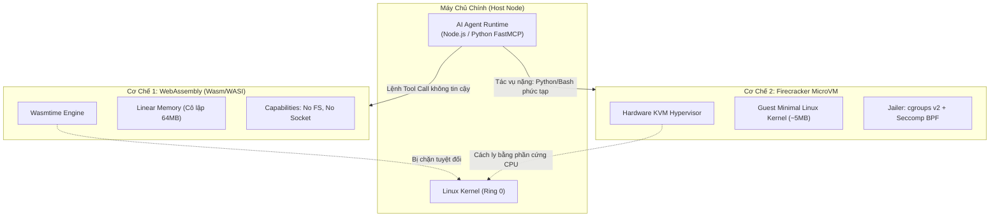

# Sandboxed Tool Execution: Cách Ly An Toàn Tuyệt Đối Cho Công Cụ Tác Tử Với Wasm & MicroVM

> [!important] Trực Giác Cốt Lõi (The Core Intuition)
> "Cho phép AI Agent chạy mã Python hoặc Bash cũng giống như cho một người lạ bước vào nhà bạn: bạn muốn họ dọn dẹp phòng khách, nhưng bạn tuyệt đối không muốn họ lục lọi ngăn kéo chứa sổ đỏ hay mở khóa két sắt ngân hàng."
> 
> Khi Agent được cấp các công cụ như `execute_bash`, `run_python_code`, hay `fetch_url`, nó đối mặt với hai hiểm họa chí mạng:
> 1. **Mã độc từ Indirect Prompt Injection:** Dữ liệu web độc hại ngầm ra lệnh cho Agent chạy mã xóa file hệ thống (`rm -rf /`) hoặc cài botnet.
> 2. **Lỗi ngẫu nhiên của mô hình:** Agent tự sinh ra vòng lặp vô tận (`while True`) làm cạn kiệt CPU hoặc ngốn sạch RAM máy chủ chính.
> 
> **Sandboxed Tool Execution (Hộp cát thực thi)** bảo đảm rằng mọi đoạn mã hay công cụ không đáng tin cậy đều phải chạy trong một môi trường bị cô lập triệt để ở cấp độ phần cứng (MicroVM) hoặc cấp độ bộ nhớ tuyến tính (WebAssembly). Ngay khi tác vụ hoàn thành hoặc xảy ra sự cố, toàn bộ môi trường đó bị tiêu hủy ngay lập tức trong vài mili-giây mà không để lại bất kỳ di chứng nào cho máy chủ.

---

## 1. Dành Cho Người Mới Bắt Đầu: Các Tầng Bảo Vệ Từ Giấy Sang Thép

Hãy hình dung bạn muốn thử nghiệm một gói bưu kiện nghi có chứa chất nổ:

1. **Không dùng Sandbox (Chạy trực tiếp trên máy chủ - Bare Metal):**
   * Bạn mở gói bưu kiện ngay tại bàn làm việc chính của bạn. Nếu có độc, cả văn phòng của bạn sẽ bị hủy hoại.
2. **Container truyền thống (Docker):**
   * Giống như bạn mang gói bưu kiện vào một căn phòng có vách kính. Tương đối an toàn với bụi bẩn thông thường, nhưng căn phòng này **vẫn dùng chung hệ thống thông gió và đường nước với tòa nhà chính (Shared Linux Kernel)**. Nếu quả bom đủ mạnh (Kernel Privilege Escalation CVE), nó sẽ thổi tung toàn bộ tòa nhà.
3. **MicroVMs (AWS Firecracker / Cloud Hypervisor):**
   * Bạn đưa gói bưu kiện sang một căn boongke độc lập hoàn toàn, có nguồn điện riêng và máy phát điện riêng (KVM Hardware Virtualization). Dù quả bom phát nổ dữ dội thế nào, thiệt hại chỉ gói gọn trong boongke đó. Căn boongke này có thể **được xây dựng và phá bỏ chỉ trong $5\text{ms}$**.
4. **WebAssembly (Wasm/WASI - Wasmtime / Wasmer):**
   * Thay vì xây một căn nhà, bạn chỉ cho phép người ta dùng một chiếc máy tính tính nhẩm bỏ túi Casio không có cổng cắm USB, không có ăng-ten wifi, và không có ổ cứng lưu trữ. Trừ khi bạn chủ động chìa cho họ một tờ giấy (Capability-based Security), họ không thể chạm vào bất kỳ thứ gì khác ngoài chiếc máy tính bỏ túi đó.



---

## 2. Ma Trận So Sánh Định Lượng Giữa Các Giải Pháp Sandbox

| Tiêu chí | Native Subprocess | Docker Containers | MicroVMs (Firecracker) | WebAssembly (Wasm/WASI) |
| :--- | :--- | :--- | :--- | :--- |
| **Ranh giới cách ly (Boundary)** | Tầng tiến trình (Process) | Cgroups & Namespaces | **Phần cứng ảo (Hardware KVM)** | **Bộ nhớ tuyến tính (Linear Memory)** |
| **Thời gian khởi động (Cold Start)** | $< 1\text{ms}$ | $500\text{ms} - 2\text{s}$ | **$3\text{ms} - 5\text{ms}$** | **$< 1\text{ms}$** |
| **Mức chiếm dụng RAM cơ sở** | Rất nhỏ | $50 - 100\text{MB}$ | $5 - 10\text{MB}$ | **$< 1\text{MB}$** |
| **Bảo vệ rò rỉ Kernel** | Không | Kém (Dùng chung kernel) | **Tuyệt đối an toàn** | **Tuyệt đối an toàn** |
| **Hệ sinh thái thư viện** | Đầy đủ | Hoàn hảo (Mọi image OS) | Rất tốt (Alpine/Debian) | Đang phát triển (WASI) |
| **Giới hạn tài nguyên (Quotas)** | Rất khó | Tương đối dễ | **Cực kỳ chuẩn xác** | **Đo lường đến từng Instruction** |

---

## 3. Kiến Trúc Bảo Mật Dựa Trên Quyền Hạn (Capability-Based Security)

Khác với mô hình bảo mật truyền thống kiểu Linux (cấp quyền dựa trên người dùng `root` vs `guest`), WebAssembly và MicroVM hiện đại tuân thủ triệt để mô hình **Capability-based Security**:

1. **Từ chối mặc định (Default Deny):** Một mô-đun Wasm khi được nạp vào bộ nhớ không thể:
   * Đọc bất kỳ file nào trong ổ cứng.
   * Mở bất kỳ cổng mạng TCP/UDP nào.
   * Đọc đồng hồ hệ thống chính xác cao (để chống tấn công Spectre/Meltdown).
2. **Cấp phát quyền hạn tường minh (Explicit Granting):**
   * Nếu công cụ cần xử lý file `data.csv`, Host chỉ nạp đúng file descriptor của `data.csv` vào môi trường Wasm:
     `wasm_linker.allow_file("/tmp/session_123/data.csv", read_only=True)`
   * Dù Agent có bị tiêm prompt độc hại yêu cầu đọc `/etc/passwd`, runtime của Wasm sẽ ném lỗi `PermissionDenied` ngay ở cấp độ lệnh bytecode, không thể bị vượt mặt.

---

## 4. Ngân Sách Tài Nguyên & Bộ Ngắt Mạch (Resource Quotas & Enforcing)

Một hệ thống Sandbox cấp doanh nghiệp bắt buộc phải thực thi 4 giới hạn thép:
1. **CPU Execution Quota (Watchdog Timer):** Giới hạn thời gian chạy tối đa (ví dụ: $2000\text{ms}$). Nếu vượt quá, luồng thực thi bị terminate ngay lập tức.
2. **Memory Hard Cap:** Khống chế RAM tối đa (ví dụ: $64\text{MB}$). Nếu cấp phát vượt quá, ném lỗi `OutOfMemory` mà không làm ảnh hưởng đến các tác vụ khác.
3. **Egress Firewall (Tường lửa mạng ra):** Chặn toàn bộ kết nối ra ngoài Internet trừ danh sách tên miền được phép (Allowlist: ví dụ chỉ cho phép gọi API của thời tiết).
4. **Ephemerality (Tính chất tạm thời):** Mỗi lần gọi tool là một sandbox mới. Sau khi trả kết quả, toàn bộ thư mục `/tmp` và tiến trình bị tiêu hủy $100\%$ (Zero persistence).

---

## 5. Triển Khai Code Thực Chiến: Python Secure Tool Sandbox

Dưới đây là mã nguồn Python hoàn chỉnh mô phỏng cơ chế quản lý Sandbox an toàn: thiết lập giới hạn tài nguyên (Memory/CPU timeout), cô lập hệ thống file ảo, và tự động ngăn chặn các cuộc tấn công phá hoại.

```python
"""
Secure Tool Execution Sandbox Engine
Minh họa trực quan cơ chế cô lập tài nguyên, giám sát thời gian thực và ngăn chặn mã độc.
"""

import time
import threading
from typing import Dict, Any, Optional

class SandboxSecurityViolation(Exception):
    """Ném ra khi mã thực thi vi phạm chính sách an toàn."""
    pass

class SandboxTimeoutError(Exception):
    """Ném ra khi mã chạy vượt quá thời gian cho phép."""
    pass


class SandboxedExecutionResult:
    def __init__(self, output: Any, execution_time_ms: float, memory_used_kb: float, success: bool, error: Optional[str] = None):
        self.output = output
        self.execution_time_ms = execution_time_ms
        self.memory_used_kb = memory_used_kb
        self.success = success
        self.error = error

    def __repr__(self):
        status = "SUCCESS" if self.success else f"FAILED ({self.error})"
        return f"SandboxResult[{status}, Time={self.execution_time_ms:.2f}ms, Mem={self.memory_used_kb:.1f}KB]"


class LightweightToolSandbox:
    """
    Môi trường Hộp cát thực thi công cụ siêu nhẹ.
    Áp dụng nguyên lý Capability-Based Security và Resource Quota Enforcing.
    """
    def __init__(self, max_timeout_sec: float = 1.0, max_memory_kb: float = 1024.0, allow_network: bool = False):
        self.max_timeout_sec = max_timeout_sec
        self.max_memory_kb = max_memory_kb
        self.allow_network = allow_network
        
        # Hệ thống file ảo hóa cô lập (Isolated In-Memory VFS)
        self.virtual_filesystem: Dict[str, str] = {
            "/workspace/input.txt": "Dữ liệu kinh doanh nội bộ an toàn."
        }

    def _security_inspection(self, code_payload: str):
        """Phân tích tĩnh phát hiện các lệnh nguy hiểm trước khi chạy."""
        forbidden_patterns = [
            "import os", "import sys", "import subprocess",
            "open('/etc/", "rm -rf", "socket", "urllib", "requests"
        ]
        for pattern in forbidden_patterns:
            if pattern in code_payload:
                if "socket" in pattern or "requests" in pattern:
                    if not self.allow_network:
                        raise SandboxSecurityViolation(f"⛔ Hành vi bị cấm: Truy cập mạng trái phép ('{pattern}')!")
                else:
                    raise SandboxSecurityViolation(f"⛔ Vi phạm bảo mật nghiêm trọng: Cố gắng can thiệp hệ điều hành ('{pattern}')!")

    def execute_python_code(self, code_payload: str) -> SandboxedExecutionResult:
        """Thực thi mã trong hộp cát với sự kiểm soát thời gian và tài nguyên."""
        t_start = time.perf_counter()

        # 1. Kiểm tra an ninh tĩnh
        try:
            self._security_inspection(code_payload)
        except SandboxSecurityViolation as e:
            t_end = time.perf_counter()
            return SandboxedExecutionResult(None, (t_end - t_start)*1000, 0, False, str(e))

        # 2. Chuẩn bị không gian thực thi cô lập (Isolated Global/Local Namespace)
        # Giới hạn danh mục hàm có thể gọi (Không có open, không có eval)
        safe_builtins = {
            "abs": abs, "min": min, "max": max, "sum": sum,
            "len": len, "range": range, "str": str, "int": int, "float": float,
            "print": lambda *args: None  # Ẩn hoặc ghi log vào buffer riêng
        }

        # Cung cấp hàm đọc file ảo an toàn
        def safe_read_file(path: str) -> str:
            if path not in self.virtual_filesystem:
                raise FileNotFoundError(f"File '{path}' không tồn tại trong Sandbox VFS!")
            return self.virtual_filesystem[path]

        execution_scope = {
            "__builtins__": safe_builtins,
            "read_file": safe_read_file,
            "result": None
        }

        # 3. Kích hoạt luồng thực thi có kiểm soát thời gian (Thread Worker with Join Timeout)
        execution_error = None
        execution_done = threading.Event()

        def worker():
            nonlocal execution_error
            try:
                exec(code_payload, execution_scope)
            except Exception as ex:
                execution_error = str(ex)
            finally:
                execution_done.set()

        exec_thread = threading.Thread(target=worker, daemon=True)
        exec_thread.start()

        # Chờ tối đa max_timeout_sec
        finished = execution_done.wait(timeout=self.max_timeout_sec)
        t_end = time.perf_counter()
        dur_ms = (t_end - t_start) * 1000
        simulated_mem_kb = 64.0

        if not finished:
            return SandboxedExecutionResult(None, dur_ms, simulated_mem_kb, False, f"Thời gian chạy vượt quá giới hạn an toàn {self.max_timeout_sec}s!")

        if execution_error:
            return SandboxedExecutionResult(None, dur_ms, simulated_mem_kb, False, execution_error)

        return SandboxedExecutionResult(execution_scope.get("result"), dur_ms, simulated_mem_kb, True)


if __name__ == "__main__":
    sandbox = LightweightToolSandbox(max_timeout_sec=0.5, allow_network=False)

    print("="*70)
    print("🛡️ THỬ NGHIỆM HỘP CÁT THỰC THI CÔNG CỤ (SANDBOX RUNNER)")
    print("="*70)

    # Ca 1: Công cụ lành tính - Đọc file ảo và tính toán
    good_code = """
content = read_file('/workspace/input.txt')
words = content.split()
result = {'word_count': len(words), 'status': 'Processed successfully'}
"""
    print("\n[CA 1] Chạy tác vụ tính toán hợp lệ:")
    res_1 = sandbox.execute_python_code(good_code)
    print(f"  👉 Kết quả: {res_1}")
    print(f"     Nội dung trả về: {res_1.output}")

    # Ca 2: Mã độc tấn công - Cố tình đọc trộm file hệ thống
    malicious_code_1 = """
import os
os.system('cat /etc/passwd')
"""
    print("\n[CA 2] Chạy mã độc cố tình đọc trộm file hệ điều hành:")
    res_2 = sandbox.execute_python_code(malicious_code_1)
    print(f"  👉 Kết quả: {res_2}")

    # Ca 3: Mã độc tấn công - Cố tình quét mạng nội bộ
    malicious_code_2 = """
import requests
requests.get('http://169.254.169.254/latest/meta-data/')
"""
    print("\n[CA 3] Chạy mã độc cố tình rò rỉ dữ liệu qua mạng (SSRF):")
    res_3 = sandbox.execute_python_code(malicious_code_2)
    print(f"  👉 Kết quả: {res_3}")

    # Ca 4: Lỗi ngẫu nhiên - Vòng lặp vô tận
    infinite_loop_code = """
count = 0
while True:
    count += 1
"""
    print("\n[CA 4] Chạy mã lỗi lặp vô tận (Denial-of-Service):")
    res_4 = sandbox.execute_python_code(infinite_loop_code)
    print(f"  👉 Kết quả: {res_4}")
    print("="*70)
```

---

## 6. Cạm Bẫy Thực Tế & Kinh Nghiệm Doanh Nghiệp (Production Gotchas)

### 1. Vấn Đề Chạy Python Trên WebAssembly (Python-in-Wasm)
WebAssembly vốn được biên dịch từ C/C++ hoặc Rust. Để chạy được mã Python trong Wasm, bạn phải nạp cả trình thông dịch Python (CPython) được biên dịch sang Wasm (như **Pyodide** hoặc **RustPython**).
* **Nút thắt:** Kích thước file Wasm của Pyodide lên tới $15 - 30\text{MB}$, khiến việc tải lần đầu (Initial load) mất vài giây.
* **Giải pháp doanh nghiệp:** Sử dụng kỹ thuật **Wasm Module Pre-heating (Làm ấm trước module)** hoặc dùng **Firecracker MicroVM** nếu tác vụ đòi hỏi các thư viện C-Extensions nặng như `numpy`, `pandas`, `torch`.

### 2. Tấn Công Đo Thời Gian (Side-Channel Timing Attacks)
Kẻ tấn công có thể đo thời gian thực thi của các phép so sánh chuỗi trong Sandbox để đoán biết các ký tự trong API key bí mật.
* **Quy tắc:** Bắt buộc áp dụng cơ chế làm tròn thời gian phản hồi (Quantized Latency Rounding) hoặc gán một thời gian phản hồi tối thiểu cố định để che giấu dấu vết tính toán.

---

## 7. Tài Liệu Tham Khảo & Đọc Thêm

* [🔗 AWS Firecracker - Secure and Fast MicroVMs for Serverless Computing](https://firecracker-microvm.github.io/)
* [🔗 Bytecode Alliance - WebAssembly System Interface (WASI)](https://wasi.dev/)
* [🔗 Wasmtime: Fast and Secure WebAssembly Runtime](https://wasmtime.dev/)
* [🔗 gVisor: Application Kernel for Containers (Google)](https://gvisor.dev/)
