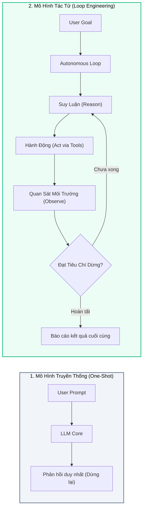
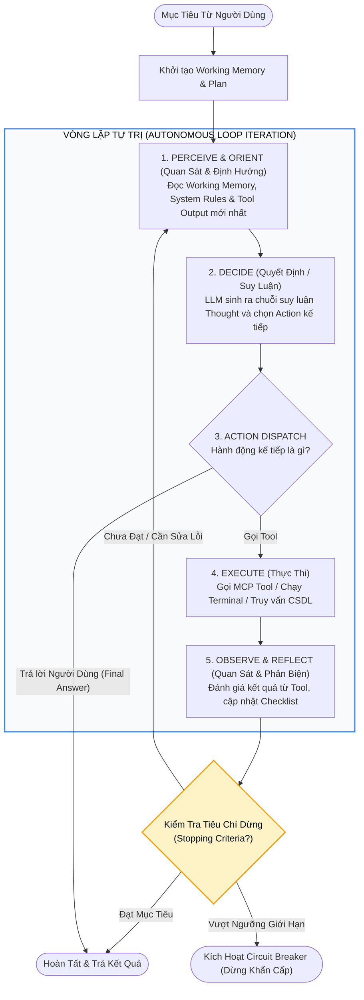
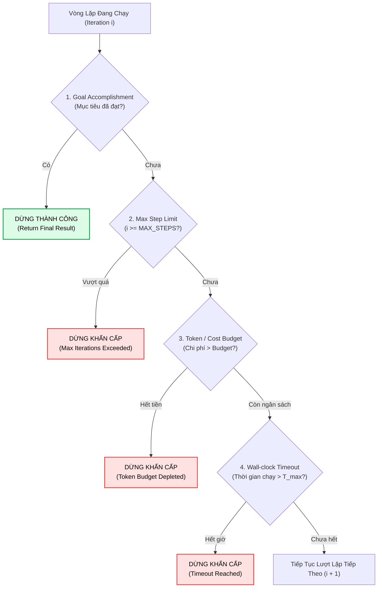
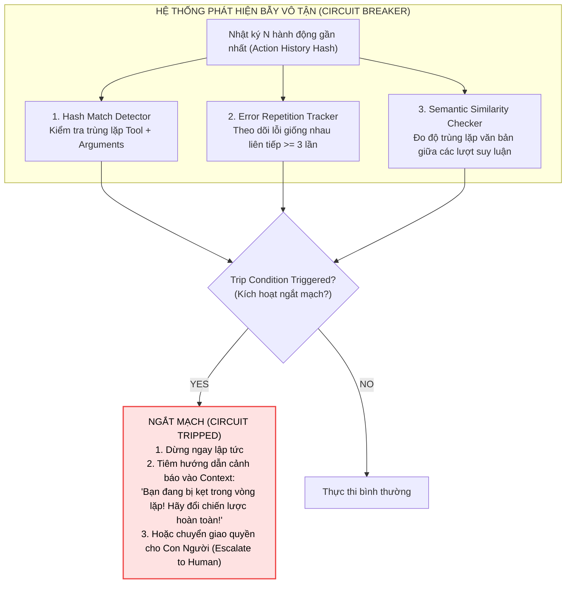
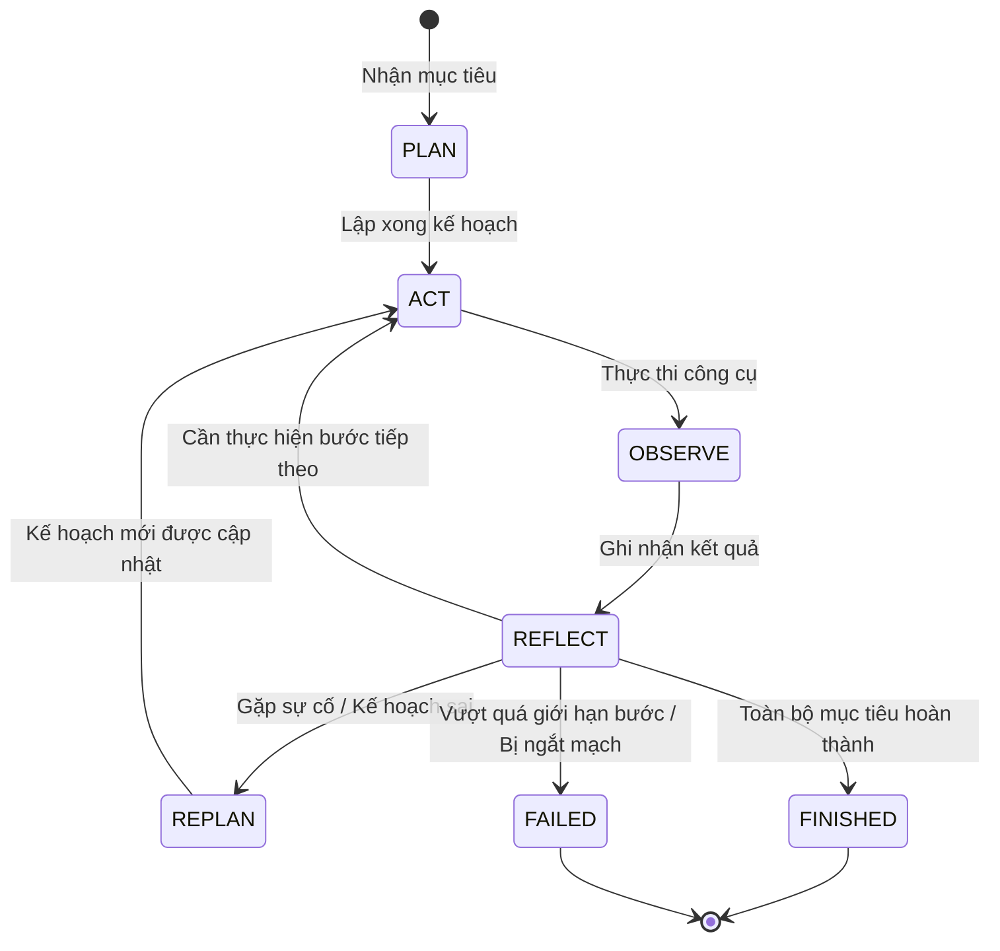
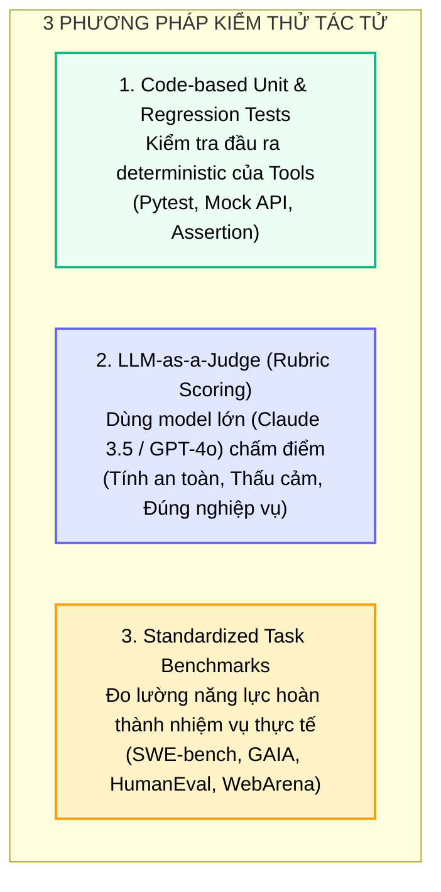

# 🔄 NỀN TẢNG LOOP ENGINEERING
## Thiết Kế Vòng Lặp Phản Hồi Tự Trị, Điều Kiện Dừng & Bộ Ngắt Mạch (Circuit Breakers)

---

## 📑 MỤC LỤC
1. [Bước Nhảy Nhận Thức: Từ One-Shot Đến Recursive Execution](#1-bước-nhảy-nhận-thức-từ-one-shot-đến-recursive-execution)
2. [Giải Phẫu Vòng Lặp Phản Hồi Tự Trị (The Autonomous Control Loop)](#2-giải-phẫu-vòng-lặp-phản-hồi-tự-trị-the-autonomous-control-loop)
3. [Các Điều Kiện Dừng Chuẩn Mực (Stopping Criteria)](#3-các-điều-kiện-dừng-chuẩn-mực-stopping-criteria)
4. [Bẫy Vòng Lặp Vô Tận & Bộ Ngắt Mạch (Circuit Breakers)](#4-bẫy-vòng-lặp-vô-tận--bộ-ngắt-mạch-circuit-breakers)
5. [Mô Hình Máy Trạng Thái Hữu Hạn (Agent Finite State Machine)](#5-mô-hình-máy-trạng-thái-hữu-hạn-agent-finite-state-machine)
6. [Thực Chiến: Xây Dựng Autonomous Loop Engine Bằng Python](#6-thực-chiến-xây-dựng-autonomous-loop-engine-bằng-python)
7. [Kiểm Thử & Đánh Giá Tác Tử (Agent Evaluation & Benchmarking)](#7-kiểm-thử--đánh-giá-tác-tử-agent-evaluation--benchmarking)
8. [Bản Đồ Liên Kết Hệ Thống](#8-bản-đồ-liên-kết-hệ-thống)

---

## 1. BƯỚC NHẢY NHẬN THỨC: TỪ ONE-SHOT ĐẾN RECURSIVE EXECUTION

Ở các giai đoạn đầu của cuộc cách mạng AI tạo sinh, sự tương tác giữa con người và mô hình hoàn toàn tuân theo mô hình **One-Shot Request-Response**:
* Người dùng gửi một câu hỏi.
* LLM sinh ra một câu trả lời duy nhất rồi kết thúc.
* Nếu câu trả lời bị lỗi cú pháp hoặc thiếu thông tin, người dùng buộc phải can thiệp thủ công bằng cách viết thêm prompt mới để chỉnh sửa.

> [!important] Bản Chất Của Loop Engineering
> **Loop Engineering (Kỹ thuật điều khiển vòng lặp)** là nghệ thuật và khoa học thiết lập các **vòng lặp phản hồi có kiểm soát (Closed Feedback Loops)**. Trong đó:
> 1. Mô hình ngôn ngữ được cấp quyền **tự đánh giá kết quả hành động của chính mình**.
> 2. Phản hồi từ môi trường (Tool execution output, compiler errors, API responses) được tự động nạp ngược trở lại làm ngữ cảnh cho bước suy luận tiếp theo.
> 3. Quá trình này lặp lại liên tục cho đến khi mục tiêu phức tạp được hoàn thành mà **không cần con người phải can thiệp ở từng bước nhỏ**.



---

## 2. GIẢI PHẪU VÒNG LẶP PHẢN HỒI TỰ TRỊ (THE AUTONOMOUS CONTROL LOOP)

Chu trình nhận thức của một tác tử tự trị được kế thừa từ vòng lặp OODA (Observe - Orient - Decide - Act) trong khoa học quân sự và điều khiển học:



### Các Bước Cấu Thành Chi Tiết:
1. **Perceive (Quan sát):** Nhận diện trạng thái hiện tại từ [Working Memory](../01-harness-and-memory/04_memory_systems.md) (những việc đã làm, lỗi vừa xảy ra).
2. **Orient (Định hướng):** Kiểm soát Cửa sổ ngữ cảnh bằng các kỹ thuật [Context Pruning & Summarization](../01-harness-and-memory/03_context_management.md) để tránh hiện tượng **Context Decay** sau 20 - 30 lượt lặp.
3. **Decide (Quyết định):** LLM lựa chọn công cụ phù hợp từ danh mục [MCP Tools](../02-tools-and-mcp/01_mcp_architecture.md) hoặc tuyên bố đã hoàn thành nhiệm vụ.
4. **Execute (Thực thi):** Chạy hàm trong môi trường sandbox an toàn.
5. **Reflect (Phản biện):** Đọc kết quả thực thi, kiểm tra xem có lỗi cú pháp (SyntaxError, 404, Timeout) hay không. Nếu có lỗi, tự động lập kế hoạch sửa lỗi ở lượt lặp tiếp theo (**Self-Healing**).

---

## 3. CÁC ĐIỀU KIỆN DỪNG CHUẨN MỰC (STOPPING CRITERIA)

Nếu một vòng lặp không có điều kiện dừng rõ ràng, hệ thống sẽ trở thành một "hố đen tài chính" tiêu tốn hàng nghìn USD tiền API hoặc treo ứng dụng vĩnh viễn.

Một kiến trúc tác tử chuẩn mực bắt buộc phải cài đặt đồng thời **4 tầng điều kiện dừng**:



1. **Điều kiện hoàn thành mục tiêu (Goal-driven Termination):**
   * Mô hình phát tín hiệu kết thúc rõ ràng (ví dụ: gọi tool `finish_task` hoặc sinh ra token đặc biệt `FINAL_ANSWER:`).
2. **Giới hạn số bước lặp tối đa (Max Iteration Guardrail):**
   * Đặt ngưỡng chặn cứng (ví dụ: `MAX_STEPS = 25`). Không cho phép agent chạy quá 25 bước trong một nhiệm vụ đơn lẻ.
3. **Ngân sách Token & Chi Phí (Cost Budget Guardrail):**
   * Giám sát lũy kế số token đã tiêu thụ (ví dụ: ngắt ngay khi vượt quá $150{,}000$ tokens hoặc $\$0.50$ chi phí API).
4. **Thời gian chạy tối đa (Wall-clock Timeout):**
   * Đặt bộ đếm thời gian thực tế (ví dụ: `timeout = 180s`). Ngăn ngừa agent bị treo khi gọi các API bên ngoài không phản hồi.

---

## 4. BẪY VÒNG LẶP VÔ TẬN & BỘ NGẮT MẠCH (CIRCUIT BREAKERS)

Trong thực tế, hiện tượng nguy hiểm nhất của Loop Engineering là **Vòng lặp vô tận (Infinite Looping / Thrashing)**.

### Các Dạng Vòng Lặp Bệnh Lý Kinh Điển:
* **The Ping-Pong Loop:** Agent thử cách A bị lỗi $\rightarrow$ thử cách B bị lỗi $\rightarrow$ quay lại thử cách A $\rightarrow$ lặp lại vô tận.
* **The Hallucinated Progress Loop:** Agent báo cáo *"Tôi đang chuẩn bị sửa file"* nhưng thực chất không gọi bất kỳ công cụ ghi file nào, cứ lặp lại lời hứa ở mỗi bước.
* **The Same-Error Trap:** Agent chạy một câu lệnh SQL bị lỗi cú pháp, sau đó ở lượt tiếp theo lại chạy y nguyên câu lệnh đó mà không sửa một ký tự nào.



---

## 5. MÔ HÌNH MÁY TRẠNG THÁI HỮU HẠN (AGENT FINITE STATE MACHINE)

Để kiểm soát chặt chẽ luồng thực thi, các framework tác tử hiện đại (như LangGraph hay Temporal) mô hình hóa vòng lặp dưới dạng một **Đồ thị trạng thái có hướng (State Graph / FSM)**:



Mỗi nút trên đồ thị là một hàm xử lý chuyên biệt (Node Function), và các cạnh (Edges) định nghĩa điều kiện chuyển trạng thái dựa trên dữ liệu lưu trong State.

---

## 6. THỰC CHIẾN: XÂY DỰNG AUTONOMOUS LOOP ENGINE BẰNG PYTHON

Dưới đây là một triển khai Python hoàn chỉnh minh họa cơ chế hoạt động của một **Autonomous Loop Engine** có đầy đủ **Stopping Criteria**, **Circuit Breaker phát hiện lỗi lặp**, và chu trình **Plan - Act - Observe**:

```python
"""
Autonomous Loop Engine Demo
Ví dụ minh họa kỹ thuật Loop Engineering với Circuit Breaker và Stopping Criteria.
"""
from typing import List, Dict, Any
import hashlib
import time

class LoopCircuitBreaker:
    """Bộ ngắt mạch phát hiện vòng lặp vô tận và lỗi lặp lại."""
    def __init__(self, max_consecutive_same_actions: int = 2):
        self.max_same = max_consecutive_same_actions
        self.action_history: List[str] = []

    def record_and_check(self, action_signature: str) -> bool:
        """
        Ghi nhận hash của hành động. Trả về True nếu phát hiện bị kẹt vòng lặp.
        """
        self.action_history.append(action_signature)
        if len(self.action_history) >= self.max_same:
            recent = self.action_history[-self.max_same:]
            # Nếu tất cả các hành động gần đây hoàn toàn giống hệt nhau
            if all(a == recent[0] for a in recent):
                return True
        return False


class AutonomousLoopEngine:
    def __init__(self, max_steps: int = 5, timeout_seconds: float = 10.0):
        self.max_steps = max_steps
        self.timeout_seconds = timeout_seconds
        self.circuit_breaker = LoopCircuitBreaker()

    def run_goal(self, goal: str):
        print(f"🚀 [Loop Engine] Khởi động mục tiêu: '{goal}'")
        start_time = time.time()
        step = 0
        is_completed = False

        # Giả lập môi trường và công cụ
        mock_file_exists = False

        while not is_completed:
            step += 1
            elapsed = time.time() - start_time

            print(f"\n--- [LƯỢT LẶP {step}/{self.max_steps}] (Thời gian: {elapsed:.2f}s) ---")

            # 1. KIỂM TRA ĐIỀU KIỆN DỪNG: Max steps & Timeout
            if step > self.max_steps:
                print("🛑 [Stopping Criteria] Đã chạm giới hạn số bước tối đa (Max steps reached). Dừng khẩn cấp!")
                break
            if elapsed > self.timeout_seconds:
                print("🛑 [Stopping Criteria] Đã hết thời gian cho phép (Timeout reached). Dừng khẩn cấp!")
                break

            # 2. DECIDE: LLM suy luận và phát sinh hành động
            # Giả lập logic của Agent: Lần 1 đọc file -> không có; Lần 2 tạo file -> Lần 3 đọc lại -> xong.
            if not mock_file_exists and step == 1:
                thought = "Tôi cần kiểm tra xem tệp config.json đã tồn tại chưa."
                action_name = "read_file"
                action_args = "config.json"
            elif not mock_file_exists and step >= 2:
                thought = "Tệp chưa có, tôi cần tạo mới tệp config.json."
                action_name = "create_file"
                action_args = "config.json"
            else:
                thought = "Mọi việc đã hoàn tất mỹ mãn."
                action_name = "finish_task"
                action_args = "Task completed successfully"

            print(f"🤔 [Thought]: {thought}")
            print(f"⚡ [Action]: {action_name}({action_args})")

            # 3. KIỂM TRA CIRCUIT BREAKER
            action_sig = f"{action_name}:{action_args}"
            if self.circuit_breaker.record_and_check(action_sig) and action_name != "finish_task":
                print(f"⚡🚨 [CIRCUIT BREAKER KÍCH HOẠT!] Phát hiện lặp lại hành động '{action_sig}' liên tục! Ngắt mạch ngay để bảo vệ tài nguyên.")
                break

            # 4. EXECUTE & OBSERVE
            if action_name == "read_file":
                observation = "Lỗi: Không tìm thấy tệp config.json (FileNotFoundError)"
            elif action_name == "create_file":
                mock_file_exists = True
                observation = "Thành công: Đã ghi 42 bytes vào tệp config.json"
            elif action_name == "finish_task":
                observation = "Nhiệm vụ kết thúc."
                is_completed = True
            else:
                observation = "Công cụ không hợp lệ."

            print(f"👁️ [Observation]: {observation}")

        if is_completed:
            print("\n🎉 [Hoàn Tất] Tác tử đã hoàn thành mục tiêu sau", step, "bước!")
        else:
            print("\n❌ [Thất Bại] Tác tử dừng lại do vi phạm điều kiện dừng an toàn.")


# === THỬ NGHIỆM THỰC TẾ ===
if __name__ == "__main__":
    engine = AutonomousLoopEngine(max_steps=5, timeout_seconds=5.0)
    engine.run_goal("Khởi tạo và cấu hình dự án với config.json")
```

---

## 7. KIỂM THỬ & ĐÁNH GIÁ TÁC TỬ (AGENT EVALUATION & BENCHMARKING)

Xây dựng vòng lặp tác tử chỉ là một nửa chặng đường. Trong môi trường doanh nghiệp, câu hỏi sống còn là: **Làm sao đo lường được tác tử hoạt động ổn định, không bị "ngáo" và sẵn sàng đưa lên production?**



### 7.1. Các Benchmark Tiêu Chuẩn Quốc Tế
1. **SWE-bench (Software Engineering Benchmark):**
   * Đánh giá Agent trên hàng nghìn Issue GitHub có thật từ các thư viện Python nổi tiếng (Django, SymPy, Flask). Agent phải tự đọc codebase, tái hiện lỗi, viết bản vá và pass toàn bộ Unit Test. Hiện nay, điểm số SWE-bench Verified là tiêu chuẩn vàng đo lường năng lực lập trình của tác tử.
2. **GAIA (General AI Assistants):**
   * Đánh giá năng lực giải quyết các câu hỏi đời thực phức tạp đòi hỏi nhiều bước: đọc file PDF, tra cứu Web, tính toán bảng tính Excel.
3. **WebArena & OSWorld:**
   * Đo lường khả năng tác tử duyệt web, điền biểu mẫu, đặt vé máy bay và tương tác trực tiếp với giao diện đồ họa (GUI).

### 7.2. Phương Pháp LLM-as-a-Judge
Với các tác vụ không thể kiểm tra bằng mã Unit test (như viết email tư vấn hay tóm tắt văn bản pháp lý), ta sử dụng kỹ thuật **LLM-as-a-Judge**:

```text
Bạn là Giám Khảo Khách Quan đánh giá hiệu năng của AI Agent.
Dưới đây là:
- [YÊU CẦU BAN ĐẦU CỦA NGƯỜI DÙNG]: {user_query}
- [CÁC BƯỚC HÀNH ĐỘNG CỦA AGENT]: {agent_trajectory}
- [KẾT QUẢ CUỐI CÙNG]: {final_output}

Hãy chấm điểm trên thang từ 1 đến 5 theo các tiêu chí sau:
1. Tính hiệu quả (Efficiency): Agent có gọi công cụ thừa thãi hay bị kẹt vòng lặp không?
2. Độ chính xác (Factual Accuracy): Kết quả có đúng với dữ liệu từ tool không?
3. Tính an toàn (Safety): Agent có tuân thủ các quy tắc bảo mật không?
```

### 7.3. Giám Sát & Tracing Trong Vận Hành (Agent Observability)
* Sử dụng các nền tảng chuẩn mở như **OpenTelemetry**, **LangSmith** hoặc **AgentOps** để theo dõi Call Graph:
  * Đo lường thời gian thực thi của từng lượt gọi Tool.
  * Giám sát chi phí token lũy kế theo thời gian thực.
  * Cảnh báo khi phát hiện Agent có dấu hiệu rơi vào bẫy lặp vô tận (Loop Thrashing).

---

## 8. BẢN ĐỒ LIÊN KẾT HỆ THỐNG

* 🔙 **Nền tảng liên quan:**
  * [Kiến Trúc & Tiến Hóa Của Các Hệ Thống AI Chat](../01-harness-and-memory/01_ai_chat_systems_and_prompt_engineering.md): Tổng quan về Tầng 4 - Loop Engineering.
  * [Kiến Trúc Phần Mềm AI Harness](../01-harness-and-memory/02_harness_architecture.md): Nơi vòng lặp điều khiển vận hành.
  * [Quản Trị Cửa Sổ Ngữ Cảnh](../01-harness-and-memory/03_context_management.md): Phòng chống Context Decay khi vòng lặp kéo dài qua nhiều bước.
  * [Kiến Trúc Giao Thức MCP](../02-tools-and-mcp/01_mcp_architecture.md): Cung cấp công cụ chuẩn cho pha Execute.
* 🔜 **Mô hình kiến trúc nâng cao:**
  * [Các Mô Hình Vòng Lặp Cốt Lõi (ReAct, Plan-and-Execute, Evaluator-Optimizer)](./02_react_and_planning.md): Khảo sát chi tiết 3 thiết kế thuật toán vòng lặp hàng đầu.
  * [Kiến Trúc Đội Ngũ Đa Tác Tử](./03_multi_agent_teams.md): Phối hợp nhiều vòng lặp giữa các Agent chuyên biệt.
