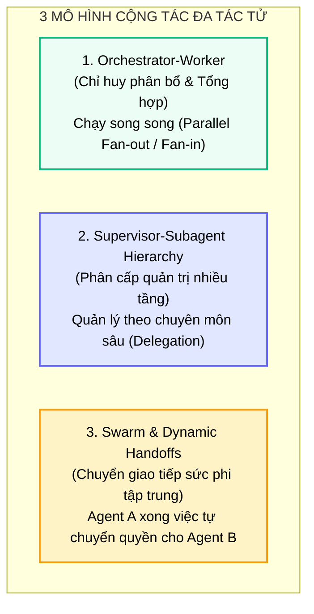
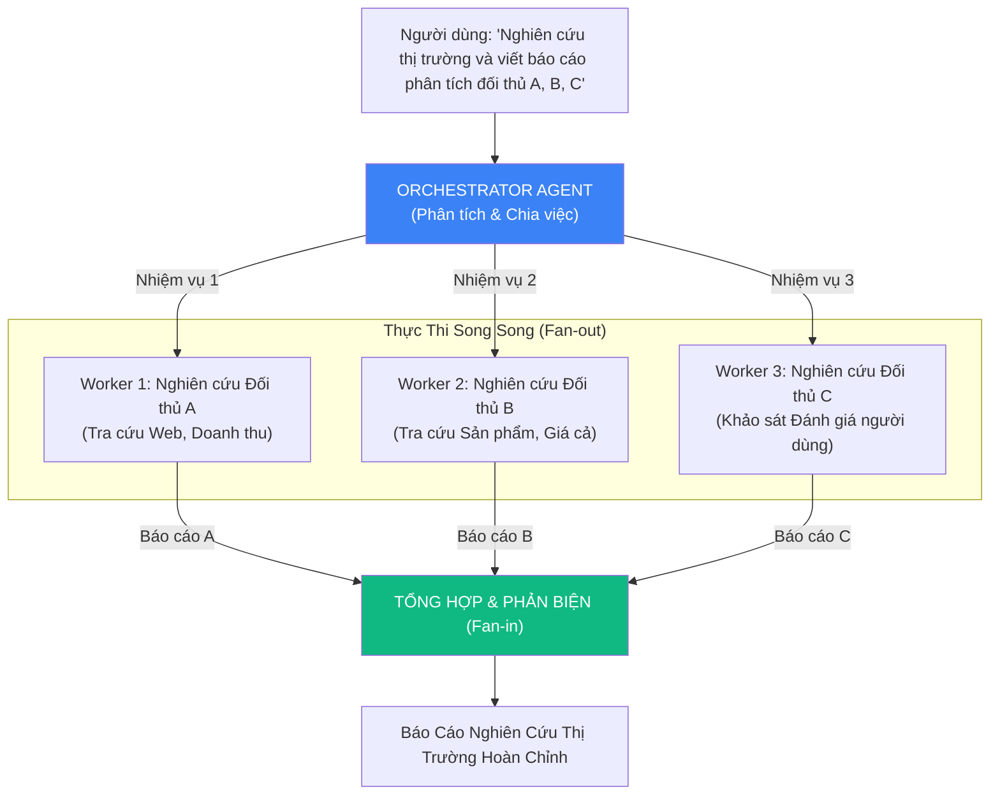
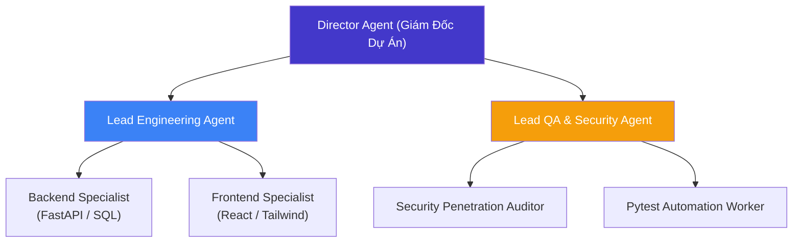
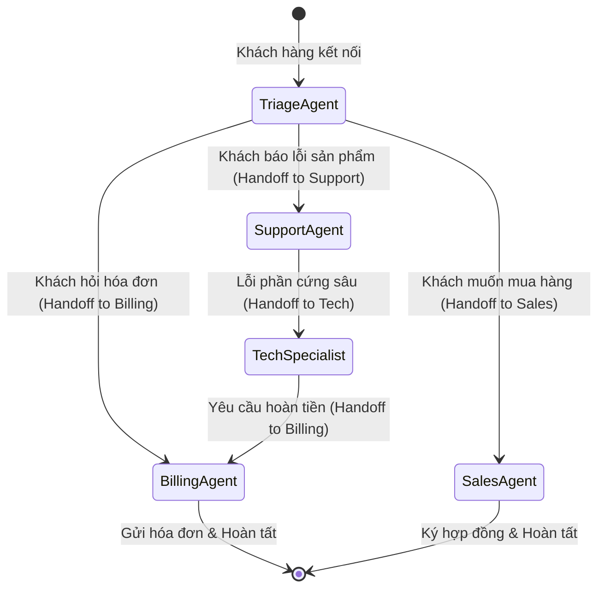
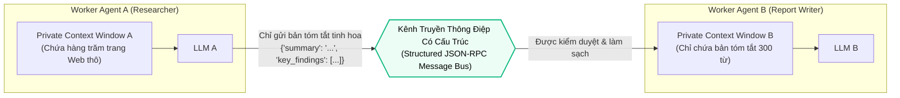

# 👥 KIẾN TRÚC ĐỘI NGŨ ĐA TÁC TỬ
## Orchestrator-Worker, Supervisor-Subagent & Swarm Handoffs: Phân Công Lao Động Nhận Thức

---

## 📑 MỤC LỤC
1. [Giới Hạn Nhận Thức Của Tác Tử Đơn Lẻ (Single Agent Bottleneck)](#1-giới-hạn-nhận-thức-của-tác-tử-đơn-lẻ-single-agent-bottleneck)
2. [Ba Mô Hình Phối Hợp Đa Tác Tử Thống Trị](#2-ba-mô-hình-phối-hợp-đa-tác-tử-thống-trị)
   * [2.1. Mô Hình 1: Orchestrator-Worker (Chỉ Huy - Công Nhân)](#21-mô-hình-1-orchestrator-worker-chỉ-huy---công-nhân)
   * [2.2. Mô Hình 2: Supervisor-Subagent Hierarchy (Phân Cấp Giám Sát)](#22-mô-hình-2-supervisor-subagent-hierarchy-phân-cấp-giám-sát)
   * [2.3. Mô Hình 3: Swarm & Dynamic Handoffs (Chuyển Giao Tiếp Sức)](#23-mô-hình-3-swarm--dynamic-handoffs-chuyển-giao-tiếp-sức)
3. [Cách Ly Ngữ Cảnh & Truyền Thông Điệp (Context Quarantine & Message Passing)](#3-cách-ly-ngữ-cảnh--truyền-thông-điệp-context-quarantine--message-passing)
4. [So Sánh Các Mô Hình Đa Tác Tử](#4-so-sánh-các-mô-hình-đa-tác-tử)
5. [Thực Chiến: Xây Dựng Hệ Thống Đa Tác Tử Mini Bằng Python](#5-thực-chiến-xây-dựng-hệ-thống-đa-tác-tử-mini-bằng-python)
6. [Bản Đồ Liên Kết Hệ Thống](#6-bản-đồ-liên-kết-hệ-thống)

---

## 1. GIỚI HẠN NHẬN THỨC CỦA TÁC TỬ ĐƠN LẺ (SINGLE AGENT BOTTLENECK)

Khi giải quyết các bài toán công nghệ thông tin quy mô lớn (như xây dựng toàn bộ một ứng dụng Web từ con số 0), một tác tử đơn lẻ (Single Agent) nhanh chóng rơi vào trạng thái tê liệt vì 3 lý do cốt tử:

1. **Quá Tải Nhận Thức (Cognitive Overload):**
   * Nếu bắt một Agent vừa phải làm kiến trúc sư hệ thống, vừa viết mã backend, vừa thiết kế giao diện frontend, vừa làm kiểm thử QA, System Prompt sẽ trở nên khổng lồ, khiến mô hình bị "loãng vai" (Persona Drift) và hành động thiếu nhất quán.
2. **Context Poisoning Lây Lan:**
   * Như đã nghiên cứu tại [Quản trị Ngữ cảnh & Bệnh lý](../01-harness-and-memory/03_context_management.md), nếu một đoạn code backend gặp lỗi debug kéo dài, toàn bộ các đoạn log rác đó sẽ đầu độc Cửa sổ ngữ cảnh, khiến Agent không còn sự sáng suốt khi chuyển sang viết code frontend.
3. **Mất Khả Năng Song Song Hóa (No Parallelism):**
   * Một tác tử đơn lẻ chỉ có thể thực thi tuần tự từng lệnh một, khiến thời gian hoàn thành nhiệm vụ kéo dài hàng tiếng đồng hồ.

> [!important] Nguyên Lý Phân Công Lao Động Nhận Thức (Division of Cognitive Labor)
> Thay vì cố gắng tạo ra một "Siêu Tác Tử Vạn Năng", giải pháp tối ưu của kỹ thuật phần mềm là: **Chia nhỏ bài toán thành các miền chuyên biệt (Domain Specialties), mỗi miền do một Tác Tử Chuyên Trách (Specialist Subagent) đảm nhiệm trong một môi trường ngữ cảnh hoàn toàn biệt lập.**

---

## 2. BA MÔ HÌNH PHỐI HỢP ĐA TÁC TỬ THỐNG TRỊ



---

### 2.1. Mô Hình 1: Orchestrator-Worker (Chỉ Huy - Công Nhân)

Trong mô hình này, có một **Orchestrator Agent (Chỉ huy)** giữ bức tranh tổng thể và một nhóm các **Worker Agents (Công nhân)** chạy song song.



* **Ưu điểm vượt trội:** Tận dụng tối đa khả năng chạy bất đồng bộ (Async/Concurrency). Thời gian hoàn thành giảm từ 15 phút xuống chỉ còn 2 phút.
* **Ngữ cảnh độc lập:** Worker 1 không biết và không bị ảnh hưởng bởi những khó khăn của Worker 2.

---

### 2.2. Mô Hình 2: Supervisor-Subagent Hierarchy (Phân Cấp Giám Sát)

Mô phỏng cơ cấu tổ chức doanh nghiệp truyền thống:



* **Cơ chế ủy quyền (Delegation):** Giám đốc dự án chỉ giao đầu việc cấp cao (*"Xây dựng tính năng thanh toán"*). Lead Engineering tự quyết định phân công cho Backend viết API và Frontend viết Form.
* **Cơ chế báo cáo vượt cấp (Escalation):** Nếu Backend Developer gặp sự cố vi phạm bảo mật, sự việc được báo cáo ngược lên Lead QA để xin chỉ đạo.

---

### 2.3. Mô Hình 3: Swarm & Dynamic Handoffs (Chuyển Giao Tiếp Sức)

Khác với hai mô hình phân cấp trên, mô hình **Swarm** (phổ biến qua OpenAI Swarm Framework và các quy trình phối hợp tự nhiên) hoạt động **phi tập trung**:



* **Cơ chế Handoff:** Mỗi Agent được trang bị một công cụ đặc biệt: `transfer_to_agent(target_agent_name, context_summary)`.
* Khi Agent A nhận thấy yêu cầu vượt quá phạm vi thẩm quyền của mình, nó gọi hàm `transfer_to_agent` để bàn giao quyền điều khiển cuộc trò chuyện cho Agent B và lui vào hậu trường.

---

## 3. CÁCH LY NGỮ CẢNH & TRUYỀN THÔNG ĐIỆP (CONTEXT QUARANTINE & MESSAGE PASSING)

Sai lầm nghiêm trọng nhất của các kỹ sư khi xây dựng hệ thống đa tác tử là **Chia sẻ chung một CSDL ngữ cảnh duy nhất (Shared Context Pool)**.

> [!danger] Nguy Cơ Sụp Đổ Hiệu Ứng Domino Khi Dùng Chung Context
> Nếu Agent A nghiên cứu web gặp phải một trang web độc hại (chứa Prompt Injection ngầm) hoặc thu nạp 50 đoạn log lỗi, việc nhét toàn bộ context đó vào Agent B sẽ khiến Agent B bị **Context Poisoning**. Toàn bộ bầy tác tử sẽ đồng loạt suy thoái chất lượng.

### Kiến Trúc Cách Ly Hoàn Hảo (Context Quarantine Architecture):



* **Nguyên tắc "Tường Lửa Cách Ly":** Áp dụng nguyên tắc [Context Quarantine](../01-harness-and-memory/03_context_management.md) (giữ thuốc xa thực phẩm). Mỗi Subagent sở hữu một không gian nhớ hoàn toàn biệt lập.
* **Giao tiếp qua Thông điệp (Message Passing):** Các tác tử chỉ trao đổi các bản tóm tắt có cấu trúc (Structured JSON Payload), triệt tiêu hoàn toàn nguy cơ lây lan rác ngữ cảnh.

---

## 4. SO SÁNH CÁC MÔ HÌNH ĐA TÁC TỬ

| Tiêu Chí So Sánh | Orchestrator-Worker | Supervisor Hierarchy | Swarm Handoffs |
| :--- | :--- | :--- | :--- |
| **Cơ chế điều khiển** | Tập trung (Centralized) | Đa tầng (Multi-tier Centralized) | Phi tập trung (Decentralized) |
| **Khả năng song song** | **Cực cao** (Fan-out đồng thời) | Trung bình (Tùy nhánh cây) | Thấp (Tuần tự chuyển giao) |
| **Độ phức tạp triển khai**| Đơn giản - Trung bình | Rất cao | Đơn giản, linh hoạt |
| **Bảo vệ ngữ cảnh** | Rất tốt (Mỗi worker độc lập) | Rất tốt (Phân cấp theo phòng ban) | Cần kiểm soát chặt qua Handoff |
| **Tình huống sử dụng** | Xử lý dữ liệu lớn, nghiên cứu tài liệu | Dự án phần mềm quy mô lớn, ERP | Hệ thống tổng đài CSKH, định tuyến tác vụ |

---

## 5. THỰC CHIẾN: XÂY DỰNG HỆ THỐNG ĐA TÁC TỬ MINI BẰNG PYTHON

Dưới đây là một hệ thống Multi-Agent mini hoàn chỉnh bằng Python theo mô hình **Orchestrator-Worker**:

```python
"""
Multi-Agent Orchestrator-Worker Demo
Ví dụ minh họa hệ thống đa tác tử cộng tác giải quyết bài toán lớn.
"""
from typing import List, Dict, Any

class ResearcherSubagent:
    """Subagent chuyên trách nghiên cứu (Researcher)."""
    def run(self, topic: str) -> Dict[str, Any]:
        print(f"  🔍 [Researcher Agent] Đang thu thập dữ liệu về: '{topic}'...")
        # Giả lập tra cứu dữ liệu (Chạy trong context riêng biệt)
        return {
            "topic": topic,
            "facts": [
                "FastAPI có hiệu năng tương đương NodeJS và Go nhờ Starlette & Pydantic.",
                "Hỗ trợ hoàn toàn lập trình bất đồng bộ (async/await).",
                "Tự động sinh tài liệu Swagger UI chuẩn OpenAPI."
            ]
        }

class WriterSubagent:
    """Subagent chuyên trách viết báo cáo (Writer)."""
    def run(self, research_data: Dict[str, Any]) -> str:
        print(f"  ✍️ [Writer Agent] Đang biên soạn báo cáo từ dữ liệu nghiên cứu...")
        # Hoàn toàn không bị ảnh hưởng bởi quá trình tìm kiếm thô của Researcher
        facts_bullet = "\n".join([f"  * {f}" for f in research_data['facts']])
        return f"# BÁO CÁO CÔNG NGHỆ: {research_data['topic'].upper()}\n\nCác đặc tính cốt lõi:\n{facts_bullet}\n\nKết luận: Lựa chọn tối ưu cho hệ thống microservices hiện đại."

class LeadOrchestrator:
    """Tác tử chỉ huy tổng thể (Lead Orchestrator)."""
    def __init__(self):
        self.researcher = ResearcherSubagent()
        self.writer = WriterSubagent()

    def execute_project(self, project_goal: str) -> str:
        print(f"🎯 [Orchestrator] Tiếp nhận dự án: '{project_goal}'")
        
        # 1. Phân rã nhiệm vụ và gọi Subagent Researcher
        print("➡️ [Bước 1]: Giao việc cho Researcher Subagent")
        research_result = self.researcher.run("Kiến trúc Framework FastAPI")

        # 2. Chuyển giao thông điệp (Message Passing) sang Writer Subagent
        print("\n➡️ [Bước 2]: Giao việc cho Writer Subagent biên soạn báo cáo")
        final_doc = self.writer.run(research_result)

        print("\n✅ [Orchestrator] Toàn bộ dự án đã hoàn thành thành công!")
        return final_doc


# === CHẠY THỬ NGHIỆM ĐỘI NGŨ ĐA TÁC TỬ ===
if __name__ == "__main__":
    orchestrator = LeadOrchestrator()
    report = orchestrator.execute_project("Nghiên cứu và viết tài liệu đánh giá FastAPI")
    print("\n" + "="*50)
    print(report)
```

---

## 6. BẢN ĐỒ LIÊN KẾT HỆ THỐNG

* 🔙 **Nền tảng liên quan:**
  * [Nền Tảng Loop Engineering](./01_loop_fundamentals.md): Nguyên lý vòng lặp điều khiển cơ sở cho từng Agent.
  * [Các Mô Hình Vòng Lặp Cốt Lõi](./02_react_and_planning.md): Cách từng Subagent ứng dụng ReAct hoặc Plan-and-Execute.
  * [Quản Trị Cửa Sổ Ngữ Cảnh](../01-harness-and-memory/03_context_management.md): Triết lý Context Quarantine bảo vệ các Subagents không làm nhiễm độc lẫn nhau.
  * [Kiến Trúc Giao Thức MCP](../02-tools-and-mcp/01_mcp_architecture.md): Cung cấp bộ công cụ chuyên biệt cho từng Worker Agent.
* 🏠 **Điều hướng:**
  * Trở về mục lục Trụ cột 3: [🛠️ Trụ Cột 3: Building Agents](../README.md)
  * Trở về trang chủ Vault: [🏠 Vault Home MOC](../../README.md)
