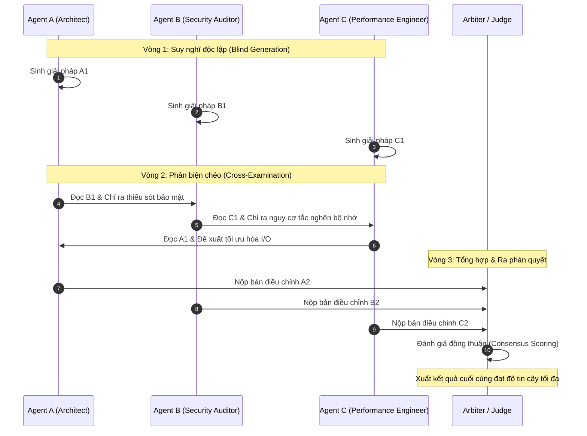

# Multi-Agent Debate & Consensus: Cơ Chế Tranh Biện, Bỏ Phiếu & Đồng Thuận Đa Tác Tử Trong Quyết Định Phức Tạp

---

## 🧭 TỔNG QUAN ĐỊNH VỊ KIẾN TRÚC

Khi một mô hình ngôn ngữ lớn (LLM) đơn lẻ đối mặt với một câu hỏi hóc búa, nó rất dễ rơi vào **Thiên Kiến Tự Củng Cố (Self-Confirmation Bias)**:
* Nếu ở bước suy luận đầu tiên, mô hình đưa ra một giả định sai (Hallucinated Premise), toàn bộ chuỗi lập luận phía sau (Chain-of-Thought) sẽ cố gắng biện minh cho giả định sai đó.
* Kỹ thuật tự sửa sai đơn lẻ (Self-Reflection / Self-Correction) thường bất lực trong trường hợp này, bởi vì chính "bộ não" đã sinh ra lỗi sẽ đóng vai trò là "người chấm điểm" cho lỗi đó.

Lấy cảm hứng từ cấu trúc xã hội loài người (Hội đồng thẩm phán, Tranh biện học thuật, Bỏ phiếu dân chủ) và lý thuyết *Society of Mind* của Marvin Minsky, mô hình **Tranh Biện & Đồng Thuận Đa Tác Tử (Multi-Agent Debate & Consensus)** ra đời:
> Nhiều tác tử độc lập với các góc nhìn (Personas), tri thức chuyên môn và lời nhắc hệ thống khác nhau sẽ cùng thảo luận, phản biện chéo, và bỏ phiếu theo các thuật toán lý thuyết lựa chọn xã hội (Social Choice Theory) để tìm ra chân lý khách quan nhất.

```
┌────────────────────────────────────────────────────────────────────────────────────────┐
│                      SINGLE-AGENT vs MULTI-AGENT CONSENSUS                             │
├──────────────────────────────────────────┬─────────────────────────────────────────────┤
│        SINGLE AGENT (ECHO CHAMBER)       │      MULTI-AGENT DEBATE & CONSENSUS         │
├──────────────────────────────────────────┼─────────────────────────────────────────────┤
│  Prompt ──► [ LLM ] ──► Giả định sai    │               ┌──► [ Agent A (Optimist) ] ─┐│
│               │             │            │  Prompt ─────┼──► [ Agent B (Skeptic)  ] ─┼┼─► Debate & Vote
│               ▼             ▼            │              └──► [ Agent C (Auditor)  ] ─┘│        │
│          Cố tình biện minh cho lỗi sai   │  Phản biện chéo, bóc trần giả định sai!     ▼
│          ==> ẢO GIÁC KHÔNG THỂ CỨU!      │  ==> ĐỒNG THUẬN VỮNG CHẮC (HIGH RELIABILITY)│
└──────────────────────────────────────────┴─────────────────────────────────────────────┘
```

---

## 1. NỀN TẢNG KHOA HỌC: HIỆU ỨNG TRÍ TUỆ ĐÁM ĐÔNG & ĐỊNH LÝ CONDORCET

### 1.1. Định Lý Bồi Thẩm Đoàn Condorcet (Condorcet's Jury Theorem)
Được phát biểu từ năm 1785 bởi nhà toán học Hầu tước xứ Condorcet:
* Giả sử có một nhóm gồm $N$ cá nhân độc lập cùng bỏ phiếu để chọn giữa 2 phương án (Đúng hoặc Sai).
* Nếu mỗi cá nhân có xác suất chọn đúng $p > 0.5$, thì khi số lượng người bỏ phiếu $N \to \infty$, xác suất để quyết định của đa số là đúng sẽ tiến dần tới $1$:

$$
P(\text{Majority is Correct}) = \sum_{k=\lfloor N/2 \rfloor + 1}^N \binom{N}{k} p^k (1-p)^{N-k} \xrightarrow{N \to \infty} 1
$$

> [!important] Ứng dụng vào AI Agents
> Nếu bạn tập hợp 3 đến 5 Agent độc lập có xác suất giải đúng một bài toán là $p = 0.70$, xác suất để quyết định bỏ phiếu đa số đạt kết quả đúng sẽ tăng vọt lên **$> 0.83$**. Nếu tranh biện qua nhiều vòng, con số này có thể vượt ngưỡng **$92\%$**.

### 1.2. Căn Bệnh Xu Nịnh (Sycophancy) & Hiện Tượng Groupthink
Tuy nhiên, nếu thiết kế không cẩn thận, các LLM sẽ mắc phải hội chứng **Sycophancy (Xu nịnh)**: Agent có xu hướng nhượng bộ và đồng ý một cách mù quáng với ý kiến của các Agent khác hoặc lời khen/chê của người dùng.
Để khắc phục, kiến trúc tranh biện bắt buộc phải có:
1. **Persona Diversity:** Ép buộc các Agent nhận các vai trò đối nghịch (Adversarial Roles).
2. **Blind First Round:** Vòng 1 độc lập hoàn toàn, không Agent nào nhìn thấy câu trả lời của Agent khác.

---

## 2. CÁC HÌNH THÁI ĐỒ THỊ TRANH BIỆN (DEBATE TOPOLOGIES)

### Topology 1: Peer-to-Peer Round-Robin Debate (Tranh Biện Ngang Hàng)
* **Cơ chế:** $M$ tác tử cùng nhận một đề bài ở vòng 0. Ở vòng $t$, mỗi tác tử $A_i$ được cung cấp toàn bộ câu trả lời của các tác tử khác ở vòng $t-1$:
  $$\text{Response}_i^{(t)} = \text{LLM}_i\left(\text{Query}, \{\text{Response}_j^{(t-1)}\}_{j \neq i}\right)$$
* **Ưu điểm:** Khám phá không gian lập luận đa chiều, tự bộc lộ các lỗ hổng toán học hoặc logic.
* **Nhược điểm:** Tốn kém token ($\mathcal{O}(M^2 \times R)$ với $R$ vòng tranh biện).



### Topology 2: Adversarial Courtroom (Mô Hình Tòa Án Phản Biện)
Mô phỏng quy trình xét xử pháp lý gồm 3 vai trò:
1. **Advocate (Người đề xuất / Biện hộ):** Đưa ra phương án tối ưu nhất theo hướng chức năng và trải nghiệm.
2. **Devil's Advocate / Prosecutor (Kẻ phản biện / Công tố viên):** Cố tình tìm kiếm mọi kịch bản lỗi, lỗ hổng bảo mật, lỗi tràn bộ nhớ, và các tình huống biên (Edge cases).
3. **Impartial Judge (Thẩm phán trung lập):** Đọc bản tranh tụng của cả 2 bên, cân nhắc các bằng chứng thực tế, và đưa ra phán quyết cuối cùng.

---

## 3. CÁC GIAO THỨC ĐỒNG THUẬN & LÝ THUYẾT BẦU CỬ (VOTING & SOCIAL CHOICE)

Sau khi tranh biện kết thúc, làm thế nào để chọn ra câu trả lời chiến thắng? Dưới đây là 4 giải thuật bỏ phiếu chuẩn mực:

### 3.1. Plurality & Majority Voting (Bỏ Phiếu Đa Số)
* Mỗi Agent bỏ 1 phiếu cho phương án nó tin là tốt nhất. Phương án nhận quá bán ($> 50\%$) sẽ chiến thắng.
* **Hạn chế:** Nếu có 3 phương án tương đương nhau, phiếu bầu có thể bị phân mảnh ($33\% - 33\% - 34\%$), dẫn đến chọn phương án không thực sự vượt trội.

### 3.2. Borda Count (Xếp Hạng Tính Điểm Ưu Tiên)
* Nếu có $K$ phương án lựa chọn, mỗi Agent sẽ xếp hạng các phương án từ tốt nhất đến kém nhất:
  * Phương án xếp hạng 1 nhận $K-1$ điểm.
  * Phương án xếp hạng 2 nhận $K-2$ điểm.
  * Phương án xếp bét nhận $0$ điểm.
* Tổng điểm của phương án $x$:
  $$S_{\text{Borda}}(x) = \sum_{i=1}^M \text{RankPoints}_i(x)$$
* **Ưu điểm:** Loại bỏ các phương án cực đoan (gây tranh cãi dữ dội) và tìm ra phương án được lòng toàn bộ tập thể nhất (Broad Consensus).

### 3.3. Logprob-Weighted Confidence Consensus (Đồng Thuận Trọng Số Tự Tin)
Không phải phiếu bầu nào cũng có giá trị ngang nhau. Một Agent đưa ra phương án với độ chắc chắn cao (Token Logprobs cao) cần có tiếng nói trọng lượng hơn một Agent đang lưỡng lự (Entropy cao):

$$
w_i = 1 - \frac{H_i}{\log |\mathcal{V}|}
$$

Trong đó $w_i \in [0, 1]$ là trọng số phiếu của Agent $i$, và $H_i$ là độ hỗn loạn entropy của câu trả lời. Phương án có tổng trọng số cao nhất sẽ thắng cuộc.

---

## 4. THUẬT TOÁN HỘI TỤ & ĐIỀU KIỆN DỪNG (CONVERGENCE & STOPPING CRITERIA)

Tranh biện liên tục sẽ làm bùng nổ chi phí token. Do đó, hệ thống cần một cơ chế đo lường **Độ Hội Tụ Ngữ Nghĩa (Semantic Convergence)** sau mỗi vòng:

$$
\text{Agreement}(t) = \frac{2}{M(M-1)} \sum_{i < j} \text{CosineSimilarity}\left(\mathbf{e}_i^{(t)}, \mathbf{e}_j^{(t)}\right)
$$

Trong đó $\mathbf{e}_i^{(t)}$ là vector embedding đại diện cho câu trả lời của Agent $i$ tại vòng $t$.

### Điều Kiện Dừng:
1. **Early Exit (Dừng sớm khi đạt đồng thuận):** $\text{Agreement}(t) \ge \tau_{\text{consensus}}$ (ví dụ: $\ge 0.92$).
2. **Stalemate Detection (Phát hiện bế tắc):** Nếu $|\text{Agreement}(t) - \text{Agreement}(t-1)| < \epsilon$ sau 2 vòng liên tiếp $\to$ Các Agent không chịu thay đổi quan điểm, chuyển ngay cho Thẩm phán (Judge) can thiệp.
3. **Hard Step Limit:** Tối đa $R_{\max} = 3$ vòng tranh biện.

---

## 5. MÃ NGUỒN THỰC CHIẾN: HỆ THỐNG TRANH BIỆN ĐA TÁC TỬ & BỎ PHIẾU BORDA COUNT

Dưới đây là một mô-đun Python hoàn chỉnh mô phỏng:
1. 3 Agent với các vai trò độc lập: **Architect (Kiến trúc sư)**, **Security Specialist (Chuyên gia bảo mật)**, **Performance Engineer (Kỹ sư hiệu năng)**.
2. Vòng lặp tranh biện 2 vòng (Round-Robin Debate).
3. Thuật toán tổng hợp điểm và xếp hạng bằng phương pháp **Borda Count**.

```python
"""
Mô-đun Tranh Biện và Đồng Thuận Đa Tác Tử (Multi-Agent Debate & Consensus Engine)
Yêu cầu thư viện: pip install pydantic
"""

from typing import List, Dict, Any, Tuple
from pydantic import BaseModel, Field
import collections


class AgentPersona(BaseModel):
    name: str
    role: str
    focus_area: str
    system_prompt: str


class Proposal(BaseModel):
    agent_name: str
    approach_name: str
    rationale: str
    strengths: List[str]
    weaknesses: List[str]


class VoteRanking(BaseModel):
    voter: str
    # Danh sách tên các phương án xếp theo thứ tự từ TỐT NHẤT đến KÉM NHẤT
    ranking: List[str]


# 1. Khởi tạo 3 Agent với góc nhìn đối lập
AGENT_ARCHITECT = AgentPersona(
    name="Architect_Alex",
    role="Software Architect",
    focus_area="Tính module hóa, khả năng bảo trì và Clean Architecture",
    system_prompt="Ưu tiên mã nguồn rõ ràng, dễ mở rộng, áp dụng triệt để SOLID và Microservices."
)

AGENT_SECURITY = AgentPersona(
    name="SecOps_Samantha",
    role="Cybersecurity Lead",
    focus_area="Bảo mật dữ liệu, Zero-Trust và Phòng thủ bề mặt tấn công",
    system_prompt="Luôn hoài nghi mọi thành phần. Không tin tưởng mạng nội bộ, yêu cầu mã hóa kép và xác thực nghiêm ngặt."
)

AGENT_PERFORMANCE = AgentPersona(
    name="Perf_Pete",
    role="High-Performance Systems Engineer",
    focus_area="Độ trễ thấp, thông lượng cao và tiết kiệm RAM/CPU",
    system_prompt="Tối ưu từng microsecond. Không thích abstraction rườm rà gây overhead, ưu tiên in-memory caching và batching."
)


class MultiAgentDebateEngine:
    """Điều phối quy trình tranh biện và tìm kiếm đồng thuận"""

    def __init__(self, participants: List[AgentPersona]):
        self.participants = participants
        self.debate_history: List[Dict[str, Any]] = []

    def round_1_independent_proposals(self, task: str) -> Dict[str, Proposal]:
        """Vòng 1: Mỗi Agent độc lập đưa ra đề xuất mà không bị ảnh hưởng bởi người khác"""
        print("\n" + "=" * 65)
        print("VÒNG 1: ĐỀ XUẤT ĐỘC LẬP (BLIND GENERATION)")
        print("=" * 65)
        
        proposals = {
            "Architect_Alex": Proposal(
                agent_name="Architect_Alex",
                approach_name="Microservices Architecture",
                rationale="Tách hệ thống thành 6 service độc lập giao tiếp qua REST/gRPC.",
                strengths=["Mở rộng linh hoạt", "Dễ quản lý theo team"],
                weaknesses=["Độ trễ mạng giữa các service", "Phức tạp khi triển khai"]
            ),
            "SecOps_Samantha": Proposal(
                agent_name="SecOps_Samantha",
                approach_name="Zero-Trust Enclave",
                rationale="Đóng gói hệ thống vào Trusted Execution Environment (TEE) kèm mã hóa mTLS toàn phần.",
                strengths=["Bảo mật tuyệt đối", "Ngăn chặn rò rỉ bộ nhớ"],
                weaknesses=["Chi phí hạ tầng đắt", "Giảm 15% hiệu năng CPU"]
            ),
            "Perf_Pete": Proposal(
                agent_name="Perf_Pete",
                approach_name="Modular Monolith with In-Memory Bus",
                rationale="Giữ nguyên 1 tiến trình duy nhất nhưng chia module nội bộ, dùng shared memory IPC.",
                strengths=["Độ trễ tiệm cận 0ms", "Chi phí server cực rẻ"],
                weaknesses=["Khó scale độc lập từng tính năng", "Một bug có thể sập cả khối"]
            )
        }

        for name, prop in proposals.items():
            print(f"[{name}] đề xuất: '{prop.approach_name}'")
            print(f"  -> Lý lẽ: {prop.rationale}")

        return proposals

    def round_2_cross_critique_and_ranking(
        self, 
        task: str, 
        proposals: Dict[str, Proposal]
    ) -> List[VoteRanking]:
        """Vòng 2: Phản biện chéo và xếp hạng bằng phương pháp Borda"""
        print("\n" + "=" * 65)
        print("VÒNG 2: PHẢN BIỆN CHÉO & BỎ PHIẾU XẾP HẠNG")
        print("=" * 65)

        # Mô phỏng quá trình mỗi Agent đọc đề xuất của 2 Agent còn lại và cho điểm xếp hạng
        votes = [
            VoteRanking(
                voter="Architect_Alex",
                # Alex thích phương án của mình nhất, nhưng công nhận tính thực tế của Modular Monolith
                ranking=["Microservices Architecture", "Modular Monolith with In-Memory Bus", "Zero-Trust Enclave"]
            ),
            VoteRanking(
                voter="SecOps_Samantha",
                # Samantha ghét Microservices vì bề mặt tấn công rộng, ưu tiên Zero-Trust rồi đến Modular Monolith
                ranking=["Zero-Trust Enclave", "Modular Monolith with In-Memory Bus", "Microservices Architecture"]
            ),
            VoteRanking(
                voter="Perf_Pete",
                # Pete phản đối kịch liệt Zero-Trust và Microservices vì chậm, chọn Modular Monolith số 1
                ranking=["Modular Monolith with In-Memory Bus", "Microservices Architecture", "Zero-Trust Enclave"]
            )
        ]

        for vote in votes:
            print(f"Bảng xếp hạng của [{vote.voter}]:")
            for rank, item in enumerate(vote.ranking, 1):
                print(f"   {rank}. {item}")

        return votes

    @staticmethod
    def calculate_borda_winner(
        proposals: Dict[str, Proposal], 
        votes: List[VoteRanking]
    ) -> Tuple[str, Dict[str, int]]:
        """Tính toán tổng điểm Borda Count để xác định phương án đồng thuận cao nhất"""
        all_options = list(proposals.keys())
        num_options = len(proposals)
        score_board: Dict[str, int] = collections.defaultdict(int)

        # Với N lựa chọn: Hạng 1 được N-1 điểm, Hạng 2 được N-2 điểm,... Hạng cuối được 0 điểm
        for vote in votes:
            for rank_idx, option_name in enumerate(vote.ranking):
                points = (num_options - 1) - rank_idx
                score_board[option_name] += points

        # Sắp xếp điểm số từ cao xuống thấp
        sorted_scores = dict(sorted(score_board.items(), key=lambda item: item[1], reverse=True))
        winner = list(sorted_scores.keys())[0]

        return winner, sorted_scores


# ==========================================
# CHẠY MÔ PHỎNG TRANH BIỆN VÀ ĐỒNG THUẬN
# ==========================================
def main():
    engine = MultiAgentDebateEngine(
        participants=[AGENT_ARCHITECT, AGENT_SECURITY, AGENT_PERFORMANCE]
    )

    task_description = "Thiết kế kiến trúc hệ thống giao dịch chứng khoán xử lý 50.000 lệnh/giây với yêu cầu bảo mật cao."
    print(f"BÀI TOÁN GIAO CHO HỘI ĐỒNG AGENT:\n\"{task_description}\"")

    # Vòng 1
    proposals = engine.round_1_independent_proposals(task_description)

    # Vòng 2
    votes = engine.round_2_cross_critique_and_ranking(task_description, proposals)

    # Tính điểm Borda Count
    winner, score_table = engine.calculate_borda_winner(proposals, votes)

    print("\n" + "=" * 65)
    print("KẾT QUẢ ĐỒNG THUẬN (BORDA COUNT SCORE BOARD):")
    print("=" * 65)
    for option, score in score_table.items():
        print(f"🏆 {score} điểm -> {option}")

    print(f"\n🎯 PHƯƠNG ÁN CHIẾN THẮNG CUỐI CÙNG: [{winner}]")
    print("Lý do: Đạt được sự thỏa hiệp tối ưu nhất giữa Hiệu năng (Pete) và Tính bảo trì (Alex),")
    print("không bị rơi vào thế bế tắc cực đoan như Zero-Trust hay Microservices phân tán.")
    print("=" * 65)


if __name__ == "__main__":
    main()
```

---

## 6. MA TRẬN SO SÁNH CÁC GIAO THỨC ĐỒNG THUẬN (VOTING PROTOCOLS COMPARISON)

| Giao Thức | Độ Phức Tạp Thuật Toán | Chi Phí Token | Khả Năng Ngăn Chặn Sai Lệch | Trường Hợp Ứng Dụng Tối Ưu |
| :--- | :--- | :--- | :--- | :--- |
| **Majority Voting (Đa số quá bán)** | $\mathcal{O}(M)$ | Rất thấp | Trung bình (Dễ bị phân mảnh nếu nhiều lựa chọn) | Đánh giá phân loại nhị phân (Đúng/Sai, Spam/Not Spam). |
| **Borda Count (Xếp hạng tính điểm)** | $\mathcal{O}(M \times K)$ | Trung bình | **Rất cao (Tìm kiếm sự thỏa hiệp tập thể tối ưu)** | Lựa chọn kiến trúc phần mềm, chọn chiến lược kinh doanh. |
| **Condorcet Pairwise (Đối đầu tay đôi)** | $\mathcal{O}(M \times K^2)$ | Cao | Tuyệt đối (Tìm phương án thắng trong mọi cặp đấu) | Các quyết định tài chính hoặc pháp lý có độ nhạy cảm cao. |
| **Debate with Neutral Arbiter** | $\mathcal{O}(M \times R)$ | Rất cao | Xuất sắc (Bóc trần lập luận sai lệch qua nhiều vòng) | Debug các lỗi code hóc búa, chứng minh định lý toán học phức tạp. |

---

## 🔗 LIÊN KẾT HỆ THỐNG
* Nền tảng Đa tác tử: [03_multi_agent_teams.md](./03_multi_agent_teams.md) - Kiến trúc đội ngũ đa tác tử, phân rã bối cảnh và message passing
* Vòng lặp phản hồi: [02_react_and_planning.md](./02_react_and_planning.md) - So sánh ReAct vs Plan-and-Execute vs Evaluator-Optimizer
* Quản trị chi phí: [01_token_economics_and_cost_optimization.md](../04-observability-evals-and-cost/03_token_economics_and_cost_optimization.md) - Tối ưu hóa chi phí token khi chạy nhiều Agent đồng thời
* Trở về mục lục chính: [README.md](../../README.md)
