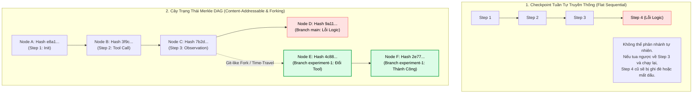
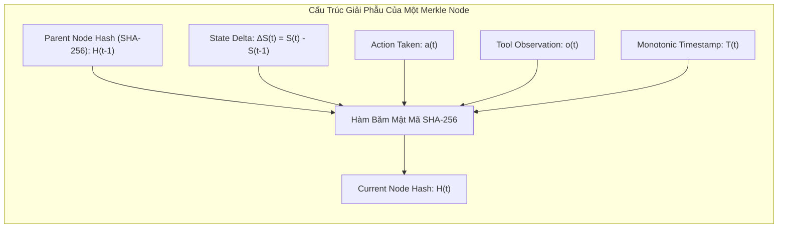
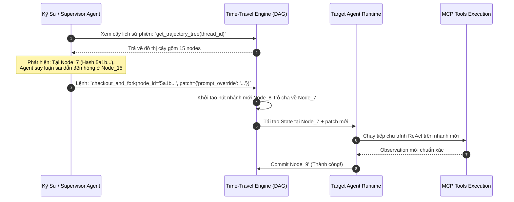

# 🌳 STATE MERKLE TREES & TIME-TRAVEL DEBUGGING: QUẢN TRỊ TRẠNG THÁI BẤT BIẾN & DU HÀNH THỜI GIAN CHO TÁC TỬ

Trong các quy trình thực thi bền vững ([Durable Stateful Workflows](./06_durable_execution_and_stateful_workflows.md)), việc lưu vết trạng thái của tác tử thường được giải quyết bằng các cơ sở dữ liệu nhật ký tuần tự (Sequential Event-Sourcing) với khóa tăng dần dạng `step = 1, 2, 3...`.

Tuy nhiên, khi bước vào thế giới của **Đa tác tử phân tán (Distributed Multi-Agent Systems)**, **Tìm kiếm cây quyết định (Tree Search / MCTS)**, hoặc khi kỹ sư cần thực hiện **sửa lỗi phân nhánh (Non-linear Branching & State Forking)**, mô hình số nguyên tuần tự bộc lộ những giới hạn nghiêm trọng:
1. **Xung đột phân nhánh (Branching Collision):** Nếu từ Bước 10, Agent muốn khám phá song song 3 giả thuyết khác nhau, hệ thống tuần tự không thể biểu diễn cấu trúc cây phả hệ mà không làm ghi đè hoặc phân mảnh dữ liệu.
2. **Không có tính toàn vẹn mật mã (Cryptographic Integrity):** Làm thế nào để chứng minh một chuỗi hành động của tác tử tài chính chưa từng bị sửa đổi lén lút trong cơ sở dữ liệu?
3. **Lãng phí bộ nhớ khi nhân bản (Snapshot Bloat):** Nếu mỗi checkpoint lưu toàn bộ ngữ cảnh $100\text{KB}$, một phiên chạy $50$ bước sẽ tiêu tốn megabytes dữ liệu trùng lặp.

Kiến trúc hiện đại áp dụng nguyên lý của **Git và Blockchain**: Tổ chức trạng thái tác tử dưới dạng **Cây Merkle có hướng không chu trình (State Merkle DAG - Directed Acyclic Graph)**, định danh bằng hàm băm mật mã (Content-Addressable Hashing) kết hợp với cấu trúc dữ liệu chia sẻ bất biến (Structural Sharing).

---

## 1. Giới Hạn Của Checkpoint Tuần Tự vs. Sức Mạnh Của Merkle DAG



### 1.1. So Sánh Hai Kiến Trúc Quản Trị Trạng Thái

| Tiêu Chí | Checkpoint Tuần Tự (Linear Log) | State Merkle DAG (Content-Addressable) |
| :--- | :--- | :--- |
| **Định danh trạng thái** | `thread_id` + `step_int` | **Mã băm mật mã SHA-256 (Node Hash)** |
| **Cơ chế phân nhánh (Forking)**| Phức tạp, dễ xung đột `step_id` | **Tự nhiên như tạo nhánh Git (`git checkout -b`)** |
| **Tính toàn vẹn (Tamper-evidence)**| Kém (Có thể sửa trực tiếp trong DB) | **Tuyệt đối (Bất kỳ thay đổi nhỏ nào đều đổi Merkle Root)** |
| **Dung lượng lưu trữ** | Bản copy đầy đủ gây phình to | **Chia sẻ cấu trúc vi phân (Structural Delta Sharing)** |
| **Du hành thời gian (Time-Travel)**| Chỉ tua ngược tuyến tính | **Nhảy tự do đến bất kỳ node nào trong lịch sử** |

---

## 2. Giải Phẫu Toán Học Của Cây Merkle Trạng Thái (State Merkle Tree Mathematics)

Mỗi nút (Node) trong Cây Trạng Thái Merkle đại diện cho một trạng thái nhận thức bất biến của Agent tại thời điểm $t$.



### 2.1. Công Thức Tính Toán Băm Trạng Thái
Mã định danh duy nhất của trạng thái $\mathcal{H}_t$ được tính toán đệ quy dựa trên toàn bộ lịch sử tiền nhiệm và biến thiên trạng thái cục bộ:

$$
\mathcal{H}_t = \text{SHA256}\Big(\mathcal{H}_{t-1} \;\mathbin{\Vert}\; \text{CanonicalJSON}(\Delta \mathcal{S}_t) \;\mathbin{\Vert}\; a_t \;\mathbin{\Vert}\; o_t \;\mathbin{\Vert}\; T_t\Big)
$$

Trong đó:
* $\mathcal{H}_{t-1}$: Hash của nút cha (Parent Hash). Nút gốc $\mathcal{H}_0$ trỏ tới `0000000000000000`.
* $\Delta \mathcal{S}_t$: Biến thiên trạng thái (State Delta) được chuẩn hóa theo chuẩn JSON bất biến (Canonical JSON).
* $a_t$: Hành động hoặc lệnh gọi công cụ mà tác tử phát ra tại bước $t$.
* $o_t$: Dữ liệu quan sát thu về từ thế giới bên ngoài.

> [!important] Tính Bất Biến Toán Học
> Bởi vì $\mathcal{H}_t$ phụ thuộc vào $\mathcal{H}_{t-1}$, một chuỗi hành động của Agent tạo thành một **Hash Chain** mật mã. Không một ai (kể cả quản trị viên hệ thống) có thể thay đổi dữ liệu của Bước 2 mà không làm thay đổi hoàn toàn giá trị băm từ Bước 3 đến Bước $N$.

### 2.2. Kỹ Thuật Chia Sẻ Cấu Trúc Bất Biến (Structural Sharing)
Để tránh sao chép toàn bộ bộ nhớ ngữ cảnh ở mỗi bước:
* Trạng thái $\mathcal{S}_t$ được lưu dưới dạng **Persistent Immutable Map** (mô hình tương tự Git Blob tree).
* Nếu chỉ có biến `scratchpad` thay đổi còn biến `system_prompt` và `user_profile` giữ nguyên, nút mới chỉ lưu delta của `scratchpad` và trỏ con trỏ (pointer) tới các khối dữ liệu cũ trong Content-Addressable Storage (CAS).
* **Kết quả:** Tiết kiệm hơn **$95\%$ dung lượng lưu trữ đĩa** so với snapshot truyền thống.

---

## 3. Cơ Chế Du Hành Thời Gian (Time-Travel Debugging Workflow)

Quy trình du hành thời gian giúp lập trình viên và hệ thống tự sửa lỗi hoạt động với 4 thao tác cốt lõi:



1. **`Inspect`:** Duyệt lại đồ thị trạng thái, kiểm tra giá trị của biến số tại bất kỳ thời điểm nào trong quá khứ mà không cần chạy lại chương trình.
2. **`Rewind (Time-Travel)`:** Đưa con trỏ trạng thái `HEAD` quay về bất kỳ nút băm $\mathcal{H}_k$ nào.
3. **`Patch & Fork`:** Chỉnh sửa System Instruction, vá lại câu trả lời ảo giác của một bước trung gian, và tạo ra một nhánh thực thi độc lập (Branch).
4. **`Speculative Replay`:** Cho phép Agent chạy thử nghiệm $3$ nhánh khác nhau song song từ cùng một nút quá khứ, sau đó dùng thuật toán đánh giá để chọn nhánh có kết quả tối ưu nhất nhập (Merge) vào nhánh chính.

---

## 4. Triển Khai Thực Chiến: `StateMerkleTreeEngine` Bằng Python

Dưới đây là một bộ thư viện hoàn chỉnh triển khai **State Merkle DAG**, tích hợp băm mật mã SHA-256, chia sẻ delta trạng thái, tạo nhánh phân nhánh (Forking), và tua ngược thời gian (Time-Travel Debugging):

```python
"""
StateMerkleTreeEngine: Hệ thống quản trị trạng thái tác tử bất biến dạng Merkle DAG.
Hỗ trợ: Content-addressable state, Cryptographic Hash Chain, Git-like Forking & Time-Travel.
"""

import hashlib
import json
import time
from typing import Dict, Any, List, Optional, Tuple


class MerkleNode:
    """Nút trạng thái bất biến trong Cây Merkle DAG."""

    def __init__(
        self,
        parent_hash: Optional[str],
        state_delta: Dict[str, Any],
        action: Optional[str] = None,
        observation: Optional[str] = None,
        branch_name: str = "main",
    ):
        self.parent_hash = parent_hash or "0" * 64
        self.state_delta = state_delta
        self.action = action
        self.observation = observation
        self.branch_name = branch_name
        self.timestamp = time.time()
        self.node_hash = self._calculate_hash()

    def _calculate_hash(self) -> str:
        """Tính mã băm SHA-256 định danh bất biến của nút."""
        payload = {
            "parent": self.parent_hash,
            "delta": self.state_delta,
            "action": self.action,
            "observation": self.observation,
            "branch": self.branch_name,
            "timestamp": self.timestamp,
        }
        raw_bytes = json.dumps(payload, sort_keys=True).encode("utf-8")
        return hashlib.sha256(raw_bytes).hexdigest()

    def __repr__(self) -> str:
        return f"<MerkleNode [{self.node_hash[:8]}] parent={self.parent_hash[:8]} branch={self.branch_name}>"


class StateMerkleTreeEngine:
    """Đồ thị Merkle DAG quản trị lịch sử tiến trình và du hành thời gian."""

    def __init__(self):
        self.nodes: Dict[str, MerkleNode] = {}
        self.branches: Dict[str, str] = {}  # branch_name -> head_node_hash
        self.current_branch = "main"

    def commit(
        self,
        state_delta: Dict[str, Any],
        action: Optional[str] = None,
        observation: Optional[str] = None,
    ) -> str:
        """Ghi nhận một bước chuyển trạng thái mới vào nhánh hiện tại."""
        parent_hash = self.branches.get(self.current_branch)
        new_node = MerkleNode(
            parent_hash=parent_hash,
            state_delta=state_delta,
            action=action,
            observation=observation,
            branch_name=self.current_branch,
        )

        self.nodes[new_node.node_hash] = new_node
        self.branches[self.current_branch] = new_node.node_hash
        return new_node.node_hash

    def time_travel_reconstruct_state(self, target_node_hash: str) -> Dict[str, Any]:
        """Tua ngược thời gian về một nút cụ thể và tái tạo toàn bộ trạng thái tại thời điểm đó."""
        if target_node_hash not in self.nodes:
            raise ValueError(f"Nút {target_node_hash} không tồn tại trong cây Merkle.")

        # Lần ngược từ nút mục tiêu về nút gốc theo chuỗi parent_hash
        lineage: List[MerkleNode] = []
        curr_hash = target_node_hash
        while curr_hash in self.nodes:
            node = self.nodes[curr_hash]
            lineage.append(node)
            if node.parent_hash == "0" * 64:
                break
            curr_hash = node.parent_hash

        # Tái tạo trạng thái tích lũy xuôi dòng từ Gốc -> Mục tiêu
        accumulated_state: Dict[str, Any] = {}
        for node in reversed(lineage):
            accumulated_state.update(node.state_delta)

        return accumulated_state

    def fork_branch(self, from_node_hash: str, new_branch_name: str) -> str:
        """Tạo nhánh mới từ một điểm bất kỳ trong quá khứ (Git-like Fork)."""
        if from_node_hash not in self.nodes:
            raise ValueError(f"Nút nguồn {from_node_hash} không tồn tại.")
        if new_branch_name in self.branches:
            raise ValueError(f"Nhánh {new_branch_name} đã tồn tại.")

        self.branches[new_branch_name] = from_node_hash
        self.current_branch = new_branch_name
        print(f"🔀 Đã tạo và chuyển sang nhánh mới: '{new_branch_name}' tách từ nút [{from_node_hash[:8]}].")
        return from_node_hash

    def render_tree(self):
        """Hiển thị cấu trúc cây phả hệ trạng thái."""
        print("\n--- SƠ ĐỒ CÂY MERKLE DAG HIỆN TẠI ---")
        for node_hash, node in self.nodes.items():
            head_marker = " (HEAD)" if any(h == node_hash for h in self.branches.values()) else ""
            print(
                f"[{node_hash[:8]}] -> Parent: [{node.parent_hash[:8]}] | "
                f"Branch: {node.branch_name:12s} | Delta: {node.state_delta} | Action: {node.action}{head_marker}"
            )


# ==========================================
# THỰC NGHIỆM DU HÀNH THỜI GIAN & PHÂN NHÁNH
# ==========================================
if __name__ == "__main__":
    engine = StateMerkleTreeEngine()

    print("--- 1. Agent thực thi chuỗi hành động trên nhánh 'main' ---")
    h1 = engine.commit({"goal": "Thanh toán hóa đơn điện 500k", "step": 1}, action="read_bill")
    h2 = engine.commit({"customer": "Nguyen Van A", "bill_amount": 500000, "step": 2}, action="query_balance")
    h3 = engine.commit({"account_balance": 2000000, "step": 3}, action="prepare_payment")

    # Giả sử bước 4 gặp lỗi: Agent chọn nhầm cổng thanh toán quốc tế phí cao!
    h4_bad = engine.commit(
        {"selected_gateway": "Stripe_USD", "fee": 50000, "step": 4},
        action="execute_stripe_payment",
        observation="ERROR: Phí quá cao và ngoại tệ không khớp!",
    )

    engine.render_tree()

    print("\n--- 2. Kỹ sư phát hiện lỗi ở Bước 4, quyết định tua ngược về Bước 3 ---")
    state_at_h3 = engine.time_travel_reconstruct_state(h3)
    print(f"Trạng thái phục hồi tại Bước 3 ({h3[:8]}):", json.dumps(state_at_h3, ensure_ascii=False))

    print("\n--- 3. Phân nhánh 'experiment-napovn' từ Bước 3 để sửa giải thuật ---")
    engine.fork_branch(from_node_hash=h3, new_branch_name="experiment-napovn")

    # Tiếp tục chạy suy luận trên nhánh mới
    h4_good = engine.commit(
        {"selected_gateway": "NAPAS_VND", "fee": 0, "step": 4},
        action="execute_napas_payment",
        observation="SUCCESS: Giao dịch 500k thành công qua NAPAS 24/7!",
    )
    h5_good = engine.commit({"status": "COMPLETED", "receipt_id": "REC_998877", "step": 5}, action="notify_user")

    engine.render_tree()

    print("\n--- 4. Kiểm tra trạng thái cuối cùng của 2 nhánh độc lập ---")
    print("Trạng thái nhánh HỎNG (main):", engine.time_travel_reconstruct_state(h4_bad))
    print("Trạng thái nhánh THÀNH CÔNG (experiment-napovn):", engine.time_travel_reconstruct_state(h5_good))
```

---

## 5. Tổng Kết & Ứng Dụng Trong Hệ Thống Production

1. **Kiểm toán bất khả xâm phạm (Tamper-evident Auditing):** Chuỗi hash mật mã Merkle DAG đảm bảo mọi quyết định tài chính hoặc y tế của tác tử đều có bằng chứng số (Cryptographic Proof) không thể làm sai lệch sau sự cố.
2. **Chiến lược "Thử Sai Không Rủi Ro" (Zero-risk Speculative Forking):** Tác tử có thể rẽ nhánh thực thi thử nghiệm, kiểm tra kết quả trong Sandbox; nếu kết quả tồi tệ, nó đơn giản vứt bỏ nhánh đó và quay lại nút cha để thử hướng đi khác.
3. **Nền tảng cho MCTS:** Cấu trúc Merkle DAG là hạ tầng dữ liệu hoàn hảo để triển khai các thuật toán tìm kiếm cây nhận thức Monte Carlo (MCTS), biến AI Agent thành những cỗ máy suy luận chiến lược sâu rộng.
