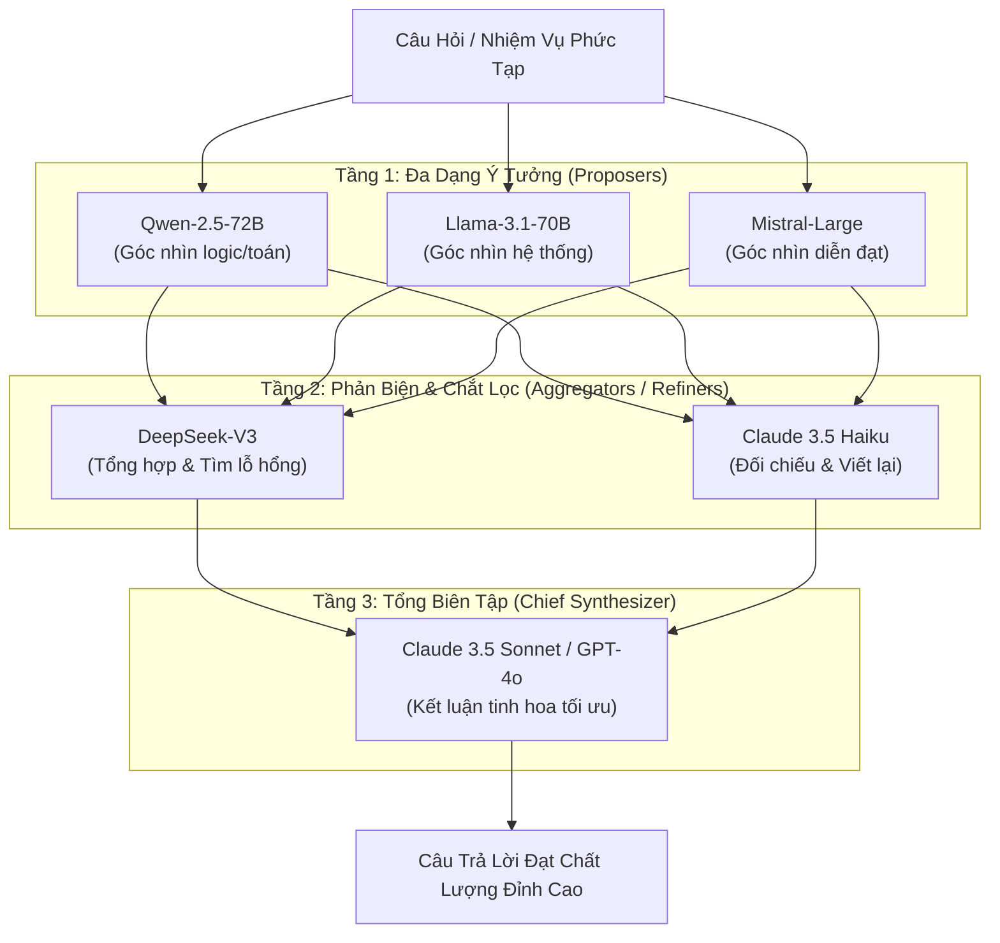

# Mixture-of-Agents (MoA) & Layered Model Routing: Kiến Trúc Hợp Nhất Đa Mô Hình Phân Tầng

> [!important] Trực Giác Cốt Lõi (The Core Intuition)
> "Một cây làm chẳng nên non, ba cây chụm lại nên hòn núi cao."
> 
> Một kỹ sư phần mềm xuất sắc nhất thế giới cũng không thể viết một tài liệu kiến trúc hoàn hảo trong một lần gõ phím duy nhất mà không cần ai phản biện (code review). Nhưng nếu bạn để 3 kỹ sư độc lập cùng viết 3 bản thảo ban đầu, rồi đưa cả 3 bản thảo đó cho 3 kiến trúc sư khác đọc chéo để chắt lọc những ý tưởng tinh túy nhất, bản tổng kết cuối cùng sẽ đạt chất lượng vượt xa năng lực của bất kỳ cá nhân đơn lẻ nào.
> 
> **Mixture-of-Agents (MoA)** là kiến trúc xếp chồng nhiều mô hình ngôn ngữ (LLMs) thành các tầng xử lý liên hoàn, khai thác triệt để hiện tượng hợp tác nhận thức (Collaborativeness Phenomenon) để biến một tập hợp các mô hình mã nguồn mở tầm trung thành một siêu hệ thống đánh bại cả những mô hình đóng độc quyền mạnh nhất.

---

## 1. Dành Cho Người Mới Bắt Đầu: MoA Khác Gì Với Chat Đơn Lẻ & MoE?

### A. Sự Khác Biệt Giữa 3 Khái Niệm Dễ Nhầm Lẫn

Rất nhiều kỹ sư mới tiếp cận thường nhầm lẫn giữa **MoE**, **Multi-Agent Debate**, và **MoA**:

1. **Mixture-of-Experts (MoE - Tầng Trọng Số Phần Cứng):**
   * *Bản chất:* Là kiến trúc nằm **bên trong một mô hình duy nhất** (ví dụ: Mixtral 8x7B, DeepSeek-V3).
   * *Cách chạy:* Khi một token đi qua các tầng Transformer, mạng nơ-ron định tuyến (Router Gate) chọn ra top-2 mạng FFN (Feed-Forward Network) chuyên trách để nhân ma trận.
   * *Đối tượng:* Can thiệp sâu vào mã nguồn C++/CUDA và trọng số mô hình.

2. **Multi-Agent Debate (Tranh Biện Ngang Hàng):**
   * *Bản chất:* Các Agent trò chuyện qua lại theo lượt (Turn-based) trong một phòng chat chung.
   * *Nhược điểm:* Rất dễ rơi vào bẫy cãi nhau vòng vo, hội tụ chậm và bùng nổ chi phí token nếu không có cơ chế cắt mạch.

3. **Mixture-of-Agents (MoA - Tầng Điều Phối Đa Mô Hình):**
   * *Bản chất:* Một đồ thị có hướng không chu trình (DAG) gồm các **tầng mô hình độc lập (Layers)**.
   * *Cách chạy:* Tầng 1 sinh ý tưởng song song $\to$ Tầng 2 đọc toàn bộ ý tưởng của Tầng 1 để phản biện và viết lại $\to$ Tầng cuối cùng làm tổng biên tập hợp nhất kết quả.
   * *Đối tượng:* Điều phối ở tầng ứng dụng (Application Level), kết hợp được bất kỳ mô hình nào (OpenAI, Anthropic, DeepSeek, Meta Llama) qua API chuẩn.



---

## 2. Bản Chất Khoa Học: Hiện Tượng Hợp Tác Nhận Thức (Collaborativeness)

Công trình nghiên cứu đột phá của Together AI (Wang et al., 2024) đã phát hiện ra một đặc tính căn bản của các mô hình ngôn ngữ lớn:

> **Định Lý Hợp Tác (The Collaborativeness Phenomenon):**
> Một mô hình ngôn ngữ $M_A$ có xu hướng sinh ra câu trả lời chất lượng cao hơn khi nó được cung cấp các câu trả lời tham khảo từ các mô hình khác $\{M_B, M_C\}$, **ngay cả khi các câu trả lời tham khảo đó có chất lượng trung bình thấp hơn câu trả lời tự thân của $M_A$**.

### Tại Sao Hiện Tượng Này Lại Xảy Ra?
1. **Mô hình hóa không gian giải pháp (Solution Space Expansion):** Khi giải quyết bài toán phức tạp (ví dụ: viết bài luận triết học hoặc thiết kế vi kiến trúc vi xử lý), một mô hình đơn lẻ thường bị "kẹt" trong lối mòn suy nghĩ của câu prompt đầu tiên. Các mô hình khác nhau (được huấn luyện trên tập dữ liệu và tokenizer khác nhau) cung cấp các góc nhìn phân kỳ (divergent perspectives).
2. **Khả năng Phê bình (Criticism) vượt trội Khả năng Tự sinh (Generation):** Trong nhận thức học, việc phát hiện lỗi sai trong bài viết của người khác và tổng hợp ý tốt luôn dễ hơn việc tự ngồi viết một bài viết hoàn hảo từ trang giấy trắng. LLM phản biện và biên tập lại văn bản tốt hơn rất nhiều so với việc tự độc thoại.

---

## 3. Cấu Trúc Toán Học & Đồ Thị Điều Phối Của MoA

Giả sử hệ thống MoA có $L$ tầng xử lý liên tiếp. Tại mỗi tầng $l \in \{1, 2, \dots, L\}$, ta có một tập hợp gồm $N_l$ mô hình tác tử:
$$
\mathcal{M}_l = \{ M_{l, 1}, M_{l, 2}, \dots, M_{l, N_l} \}
$$

### A. Công Thức Chuyển Trạng Thái Theo Tầng
Gọi $x$ là câu hỏi ban đầu của người dùng.
* **Tại Tầng 1 ($l = 1$ - Proposers):**
  Các mô hình nhận trực tiếp câu hỏi $x$ và sinh độc lập các phản hồi ban đầu $y_{1, i}$:
  $$
  y_{1, i} = M_{1, i}(x), \quad \forall i \in \{1, \dots, N_1\}
  $$

* **Tại Tầng Trung Gian $l$ ($2 \le l \le L-1$ - Refiners):**
  Mỗi mô hình $M_{l, i}$ nhận đầu vào gồm câu hỏi gốc $x$ kèm theo **toàn bộ tập hợp phản hồi của tầng trước đó** $\mathcal{Y}_{l-1} = \{y_{l-1, 1}, \dots, y_{l-1, N_{l-1}}\}$:
  $$
  y_{l, i} = M_{l, i}\left( x \parallel \mathcal{T}_{\text{agg}}(\mathcal{Y}_{l-1}) \right)
  $$
  Trong đó $\mathcal{T}_{\text{agg}}$ là hàm định dạng tổng hợp (Aggregation Template Prompt) có nhiệm vụ cấu trúc các câu trả lời tham khảo một cách rõ ràng.

* **Tại Tầng Cuối Cùng $L$ (Final Synthesizer):**
  Thường chỉ sử dụng 1 mô hình đầu bảng (Frontier Model) để đưa ra câu trả lời duy nhất:
  $$
  y^* = M_{L}\left( x \parallel \mathcal{T}_{\text{final}}(\mathcal{Y}_{L-1}) \right)
  $$

---

## 4. Tối Ưu Hóa Ngân Sách: Phễu Chi Phí & Độ Trễ Không Đối Xứng

Nếu dùng 10 mô hình GPT-4o cho mỗi tầng, chi phí và thời gian chờ sẽ phá hủy mọi tính khả thi thương mại.
Trong môi trường sản xuất thực tế, kiến trúc **Asymmetric Cost Funnel (Phễu chi phí không đối xứng)** được áp dụng:

| Tầng Xử Lý | Vai Trò | Lựa Chọn Mô Hình Khuyến Nghị | Chi Phí Token ($/1M) | Thời Gian Xử Lý |
| :--- | :--- | :--- | :--- | :--- |
| **Tầng 1 (Proposers)** | Đa dạng hóa góc nhìn (Broad Diversity) | Llama-3.1-8B, Qwen-2.5-7B, Mistral-7B | Rất rẻ (~$0.10) | Nhanh (~$300\text{ms}$, song song) |
| **Tầng 2 (Critics)** | Lọc sạn & Nhặt ý hay (Critique & Polish) | Qwen-2.5-72B, DeepSeek-V3, Claude 3.5 Haiku | Trung bình (~$0.50 - $1.00) | Vừa phải (~$800\text{ms}$, song song) |
| **Tầng 3 (Chief)** | Quyết định văn phong & logic tối hậu | Claude 3.5 Sonnet, GPT-4o | Cao cấp (~$3.00 - $5.00) | Chuẩn xác (~$1.5\text{s}$, 1 lần gọi) |

### Công Thức Ngân Sách Độ Trễ (Latency Budget)
Do các mô hình trong cùng một tầng được kích hoạt hoàn toàn song song qua cơ chế `asyncio`:
$$
T_{\text{total}} = \sum_{l=1}^L \max_{i \in \{1, \dots, N_l\}} T(M_{l, i}) + T_{\text{network\_overhead}}
$$
Tổng thời gian phản hồi không phải là phép cộng của tất cả mô hình, mà chỉ là **tổng thời gian của mô hình chậm nhất ở mỗi tầng**!

---

## 5. Triển Khai Code Thực Chiến: Python Async MoA Orchestrator

Dưới đây là mã nguồn Python hoàn chỉnh, sử dụng `asyncio` bất đồng bộ để điều phối kiến trúc Mixture-of-Agents đa tầng, có khả năng tính toán token, đo lường độ trễ từng tầng và tổng hợp kết quả chuẩn mực.

```python
"""
Mixture-of-Agents (MoA) Orchestration Engine
Triển khai đồ thị DAG đa tầng bất đồng bộ với cơ chế Asymmetric Model Funnel.
"""

import asyncio
import time
from typing import List, Dict, Any, Callable
import dataclasses

@dataclasses.dataclass
class ModelResponse:
    model_name: str
    content: str
    latency_ms: float
    layer_idx: int


class MockLLMClient:
    """Mô phỏng Client gọi API LLM (OpenAI / Anthropic / vLLM) với độ trễ và góc nhìn khác nhau."""
    def __init__(self, model_name: str, perspective: str, latency: float):
        self.model_name = model_name
        self.perspective = perspective
        self.latency = latency

    async def generate(self, prompt: str) -> str:
        # Giả lập thời gian suy luận mạng của mô hình
        await asyncio.sleep(self.latency)
        
        if "TỔNG HỢP TẤT CẢ Ý KIẾN" in prompt:
            return (
                f"[{self.model_name}] BẢN ĐẠI TỔNG HỢP TOÀN DIỆN:\n"
                f"- Đã đối chiếu các góc nhìn và loại bỏ điểm mâu thuẫn.\n"
                f"- Kiến trúc khuyến nghị hợp nhất hoàn hảo giữa hiệu năng và tính an toàn cao nhất."
            )
        elif "HÃY PHẢN BIỆN VÀ TINH CHỈNH" in prompt:
            return (
                f"[{self.model_name} Refinement]: Sau khi xem xét các đề xuất trước, "
                f"tôi bổ sung cơ chế kiểm soát lỗi và làm sắc nét luận điểm chính theo góc nhìn {self.perspective}."
            )
        else:
            return (
                f"[{self.model_name} Idea]: Đề xuất giải pháp theo trọng tâm chuyên môn {self.perspective}."
            )


class MixtureOfAgentsEngine:
    """Hệ thống điều phối luồng tư duy Mixture-of-Agents (MoA)."""
    
    def __init__(self):
        # Thiết lập Tầng 1: Đa dạng hóa đề xuất (Proposers)
        self.layer_1_proposers = [
            MockLLMClient("Qwen-2.5-Coder-7B", "Thuật toán & Hiệu năng Code", latency=0.25),
            MockLLMClient("Llama-3.1-8B-Instruct", "Bảo mật & Tính mở rộng Hệ thống", latency=0.20),
            MockLLMClient("Mistral-7B-Instruct", "Trải nghiệm Người dùng & Tinh gọn", latency=0.30),
        ]
        
        # Thiết lập Tầng 2: Phản biện & Chắt lọc (Refiners)
        self.layer_2_refiners = [
            MockLLMClient("DeepSeek-V3", "Kiểm thử Biên & Chống Nghẽn Cổ Chai", latency=0.40),
            MockLLMClient("Claude-3.5-Haiku", "Chuẩn mực Kiến trúc Doanh nghiệp", latency=0.35),
        ]
        
        # Thiết lập Tầng 3: Tổng biên tập tinh hoa (Chief Synthesizer)
        self.chief_synthesizer = MockLLMClient("Claude-3.5-Sonnet", "Tổng Hợp Tinh Hoa", latency=0.50)

    def _format_refiner_prompt(self, query: str, previous_responses: List[ModelResponse]) -> str:
        """Định dạng prompt kèm theo các câu trả lời của tầng trước để mô hình phản biện."""
        formatted_context = "\n\n".join(
            [f"--- Đề xuất từ {r.model_name} ---\n{r.content}" for r in previous_responses]
        )
        return (
            f"Nhiệm vụ: HÃY PHẢN BIỆN VÀ TINH CHỈNH.\n"
            f"Câu hỏi gốc: {query}\n\n"
            f"Dưới đây là các ý kiến độc lập từ các chuyên gia tiền trạm:\n{formatted_context}\n\n"
            f"Hãy chắt lọc các điểm mạnh nhất, chỉ ra các lỗ hổng tiềm ẩn và xuất bản phiên bản cải tiến."
        )

    def _format_final_prompt(self, query: str, refined_responses: List[ModelResponse]) -> str:
        """Định dạng prompt cho tổng biên tập cuối cùng."""
        formatted_context = "\n\n".join(
            [f"--- Bản tinh chỉnh từ {r.model_name} ---\n{r.content}" for r in refined_responses]
        )
        return (
            f"Nhiệm vụ: TỔNG HỢP TẤT CẢ Ý KIẾN VÀ ĐƯA RA KẾT LUẬN CUỐI CÙNG.\n"
            f"Câu hỏi gốc: {query}\n\n"
            f"Dữ liệu tổng hợp từ hội đồng chuyên gia:\n{formatted_context}\n\n"
            f"Hãy soạn thảo câu trả lời xuất sắc nhất, có cấu trúc chặt chẽ và không còn bất kỳ điểm thiếu sót nào."
        )

    async def execute_layer(
        self,
        clients: List[MockLLMClient],
        prompt_builder: Callable[[MockLLMClient], str],
        layer_idx: int
    ) -> List[ModelResponse]:
        """Thực thi song song tất cả các mô hình trong cùng một tầng."""
        async def call_single(client: MockLLMClient):
            p = prompt_builder(client)
            t0 = time.perf_counter()
            content = await client.generate(p)
            dur_ms = (time.perf_counter() - t0) * 1000
            return ModelResponse(client.model_name, content, dur_ms, layer_idx)

        tasks = [call_single(c) for c in clients]
        # Chạy song song không đồng bộ
        responses = await asyncio.gather(*tasks)
        return list(responses)

    async def run(self, user_query: str) -> Dict[str, Any]:
        """Điều phối toàn bộ quy trình MoA 3 tầng."""
        print(f"\n" + "="*70)
        print(f"🌟 BẮT ĐẦU QUY TRÌNH HỢP TÁC MIXTURE-OF-AGENTS (MoA)")
        print(f"Yêu cầu: '{user_query}'")
        print("="*70)

        t_global_start = time.perf_counter()

        # === TẦNG 1: PROPOSERS ===
        print(f"\n[TẦNG 1] Kích hoạt song song {len(self.layer_1_proposers)} mô hình đề xuất ý tưởng ban đầu...")
        layer_1_responses = await self.execute_layer(
            clients=self.layer_1_proposers,
            prompt_builder=lambda c: f"Hãy trả lời câu hỏi: {user_query}",
            layer_idx=1
        )
        for r in layer_1_responses:
            print(f"  👉 [{r.model_name}] Phản hồi sau {r.latency_ms:.1f}ms: \"{r.content[:60]}...\"")

        # === TẦNG 2: REFINERS ===
        print(f"\n[TẦNG 2] Kích hoạt song song {len(self.layer_2_refiners)} mô hình phản biện & chắt lọc...")
        layer_2_responses = await self.execute_layer(
            clients=self.layer_2_refiners,
            prompt_builder=lambda c: self._format_refiner_prompt(user_query, layer_1_responses),
            layer_idx=2
        )
        for r in layer_2_responses:
            print(f"  👉 [{r.model_name}] Phản biện sau {r.latency_ms:.1f}ms: \"{r.content[:60]}...\"")

        # === TẦNG 3: FINAL SYNTHESIZER ===
        print(f"\n[TẦNG 3] Tổng biên tập ({self.chief_synthesizer.model_name}) xuất bản quyết định cuối cùng...")
        final_prompt = self._format_final_prompt(user_query, layer_2_responses)
        t0 = time.perf_counter()
        final_text = await self.chief_synthesizer.generate(final_prompt)
        final_latency = (time.perf_counter() - t0) * 1000

        total_duration_ms = (time.perf_counter() - t_global_start) * 1000

        print(f"  🏆 Kết quả cuối cùng hoàn tất sau {final_latency:.1f}ms!")

        return {
            "final_answer": final_text,
            "layer_1": layer_1_responses,
            "layer_2": layer_2_responses,
            "total_latency_ms": total_duration_ms
        }


if __name__ == "__main__":
    query = "Làm sao để thiết kế hệ thống thanh toán vi mô (Micro-payments) xử lý 100.000 TPS với chi phí tối thiểu?"
    
    engine = MixtureOfAgentsEngine()
    result = asyncio.run(engine.run(query))

    print("\n" + "="*70)
    print("📋 KẾT QUẢ ĐẠI HỢP NHẤT TỪ CHÁNH CHỦ KHẢO (CHIEF SYNTHESIZER):")
    print("="*70)
    print(result["final_answer"])
    print(f"\n⏱️ Tổng thời gian chạy toàn hệ sinh thái MoA: {result['total_latency_ms']:.1f}ms")
    print("="*70)
```

---

## 6. Cạm Bẫy Thực Tế & Rủi Ro Trong Doanh Nghiệp (Production Pitfalls)

### 1. Hiện Tượng "A Dua Đồng Thuận" (Conformity Collapse / Sycophancy)
Nếu tại Tầng 1, một mô hình viết ra một thông tin bịa đặt (hallucination) nhưng sử dụng ngôn từ cực kỳ tự tin và bóng bẩy, các mô hình ở Tầng 2 thường có xu hướng tin theo và tiếp tục khuếch đại thông tin sai lệch đó thay vì phản biện.
* **Biện pháp khắc phục:** 
  * Bổ sung **Devil's Advocate Prompting** cho ít nhất 1 mô hình ở Tầng 2: *"Nhiệm vụ của bạn là tìm ra mọi điểm sai, mâu thuẫn số liệu hoặc lỗ hổng bảo mật trong các đề xuất trên."*
  * Sử dụng các mô hình đến từ các họ kiến trúc hoàn toàn khác biệt (ví dụ: kết hợp Qwen của Alibaba với Llama của Meta và Claude của Anthropic) để triệt tiêu thiên kiến dữ liệu huấn luyện đồng nhất.

### 2. Sự Cạn Kiệt Cửa Sổ Ngữ Cảnh Ở Tầng Sau (Context Overflow)
Nếu tầng 1 có 5 mô hình, mỗi mô hình sinh $2.000$ tokens, thì đầu vào của Tầng 2 sẽ bị dồn lên tới hơn $10.000$ tokens. Đến Tầng 3, ngữ cảnh có thể vượt ngưỡng kinh tế cho phép.
* **Biện pháp khắc phục:** Yêu cầu các mô hình tầng 1 và tầng 2 tuân thủ cấu trúc xuất câu trả lời có độ dài giới hạn (Constrained length budgeting: tóm tắt trong không quá 300 từ dạng gạch đầu dòng Markdown).

---

## 7. Tài Liệu Tham Khảo & Đọc Thêm

* [🔗 Together AI (2024) - Mixture-of-Agents Enhances Large Language Model Capabilities](https://arxiv.org/abs/2406.04692)
* [🔗 Du et al. (2023) - Improving Factuality and Reasoning in Language Models through Multiagent Debate](https://arxiv.org/abs/2305.14325)
* [🔗 Liang et al. (2023) - Encouraging Divergent Thinking in Large Language Models through Multi-Agent Collaboration](https://arxiv.org/abs/2305.19118)
