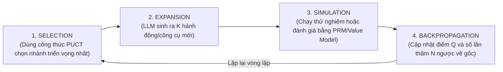

# Monte Carlo Tree Search (MCTS) Cho Tác Tử Tự Hành: Đột Phá Lập Kế Hoạch Chiến Lược

> [!important] Trực Giác Cốt Lõi (The Core Intuition)
> Hãy hình dung bạn đang điều khiển một xe tự hành tìm đường trong mê cung bí ẩn:
> 
> * **Linear ReAct (Vòng lặp tuyến tính):** Bạn cứ đi thẳng, đến ngã rẽ thì rẽ bừa theo cảm tính. Nếu đến bước thứ 20 bạn gặp ngõ cụt có tường đá chặn đứng, bạn hoàn toàn mất phương hướng vì không hề ghi nhớ các ngã rẽ trước đó, đành phải bỏ cuộc hoặc đâm đầu vào tường lặp đi lặp lại.
> * **Tree-of-Thoughts (ToT - Cây tư duy):** Bạn đứng ở mỗi ngã rẽ, nhìn quanh 3 hướng và chọn hướng sáng nhất. Bạn có thể quay lại 1 bước, nhưng tầm nhìn của bạn vẫn chỉ dừng lại ở bước kế tiếp (Myopic Horizon).
> * **Monte Carlo Tree Search (MCTS - Tư Duy Kiểu Cờ Vây AlphaGo):** Đứng trước ngã rẽ, bạn không vội bước đi. Bạn thả các thiết bị bay không người lái (Drones) bay thử nghiệm vào sâu trong các nhánh đường giả định (Simulations). Nhánh nào dẫn tới vực thẳm sẽ bị đánh dấu đỏ; nhánh nào dẫn tới đích sẽ được gửi tín hiệu xanh về bản đồ gốc. Sau khi cân bằng hoàn hảo giữa việc **khai thác đường quen (Exploitation)** và **thám hiểm đường lạ (Exploration)**, bạn tự tin bước đi trên lộ trình có xác suất thành công cao nhất.

---

## 1. Dành Cho Người Mới Bắt Đầu: Tại Sao Agent Cần Tìm Kiếm Cây?

Trong hầu hết các ứng dụng thông thường, vòng lặp **ReAct (Reason + Act)** là đủ tốt cho các tác vụ đơn giản (như tra cứu thời tiết, tìm kiếm web). Tuy nhiên, khi đối mặt với các bài toán có tính chiến lược cao:
1. **Lập trình phần mềm phức tạp (Software Engineering):** Một thay đổi trong file `database.py` có thể làm hỏng 15 hàm kiểm thử ở 3 thư mục khác sau 10 bước nữa.
2. **Quy hoạch chuỗi cung ứng & Tài chính:** Một quyết định đầu tư sai lầm ở bước 1 không thể sửa chữa nếu đã thực thi giao dịch.
3. **Chứng minh toán học & Khám phá khoa học:** Không gian giải pháp có tính phân nhánh bùng nổ (Combinatorial Explosion).

MCTS biến Agent từ một thực thể **"nghĩ đến đâu làm đến đó"** thành một nhà chiến lược có khả năng **"nhìn xa trông rộng trước 5-10 bước"** trong môi trường giả lập trước khi tác động vào thế giới thực.

---

## 2. Giải Phẫu 4 Giai Đoạn Kinh Điển Của MCTS Cho Agent

Một chu kỳ MCTS đầy đủ bao gồm 4 bước lặp đi lặp lại cho đến khi cạn kiệt ngân sách tính toán (Compute Budget):



### Bước 1: Lựa Chọn (Selection)
Bắt đầu từ nút gốc (trạng thái hiện tại $s_0$), thuật toán đi xuống cây bằng cách chọn nút con tối ưu hóa công thức **PUCT (Predictor Upper Confidence Bound applied to Trees)**:
$$
a^* = \arg\max_{a} \left[ Q(s, a) + U(s, a) \right]
$$
Trong đó:
* $Q(s, a)$: Giá trị chất lượng trung bình của hành động $a$ đã được kiểm chứng từ các lượt mô phỏng trước (Thành phần Khai thác - Exploitation).
* $U(s, a)$: Giá trị khích lệ khám phá các nhánh chưa được thử nghiệm nhiều (Thành phần Thám hiểm - Exploration):
  $$
  U(s, a) = c_{\text{puct}} \cdot P(s, a) \cdot \frac{\sqrt{N(s)}}{1 + N(s, a)}
  $$
  * $N(s)$: Tổng số lần nút cha $s$ được ghé thăm.
  * $N(s, a)$: Số lần nhánh hành động $a$ đã được thử nghiệm.
  * $P(s, a)$: Xác suất tiên nghiệm (Prior Probability) do LLM đánh giá ban đầu về độ hợp lý của hành động.
  * $c_{\text{puct}}$: Hằng số điều chỉnh mức độ liều lĩnh/khám phá (thường chọn $1.0 - 2.5$).

### Bước 2: Mở Rộng (Expansion)
Khi thuật toán chạm tới một nút lá chưa được khai phá hết:
* Agent gọi LLM yêu cầu liệt kê $K$ hành động khả dĩ tiếp theo (ví dụ: $K=3$ cách sửa đổi hàm bị lỗi, hoặc 3 công cụ MCP có thể gọi).
* Khởi tạo các nút con mới với $N(s') = 0$ và $Q(s') = 0$.

### Bước 3: Mô Phỏng / Đánh Giá Giá Trị (Simulation / Evaluation)
Làm sao để biết một nút lá mới mở rộng là "Tốt" hay "Xấu"? Có 2 phương pháp:
1. **Rollout Policy (Mô phỏng ngẫu nhiên):** Cho một mô hình nhỏ (SLM) chạy tiếp 3–5 bước giả định cho đến khi gặp điều kiện dừng (Pass kiểm thử hoặc Báo lỗi).
2. **Value Function / PRM Evaluator (Mô hình định giá):** Sử dụng Process Reward Model hoặc chính LLM làm giám khảo chấm điểm trực tiếp trạng thái đó: $V(s) \in [0, 1]$.

### Bước 4: Lan Truyền Ngược (Backpropagation)
Điểm số giá trị $V$ thu được từ bước 3 được truyền ngược lên toàn bộ các nút tổ tiên từ nút lá về tới nút gốc:
$$
N(s) \leftarrow N(s) + 1
$$
$$
Q(s, a) \leftarrow \frac{Q(s, a) \cdot (N(s, a) - 1) + V}{N(s, a)}
$$
Sau khi chạy $M$ vòng lặp mô phỏng, Agent chỉ việc chọn hành động có số lần ghé thăm cao nhất $N(s_0, a)$ (nước đi chắc chắn nhất) để thực thi ngoài đời thực.

---

## 3. Bảng So Sánh Các Mô Hình Lập Luận Tác Tử

| Cơ chế | ReAct Tuyến Tính | Reflexion (Self-Refine) | Tree-of-Thoughts (ToT) | MCTS Agent |
| :--- | :--- | :--- | :--- | :--- |
| **Cấu trúc tìm kiếm** | Tuyến tính ($O(T)$) | Tuyến tính có bộ nhớ lỗi | Phân nhánh BFS / DFS | Đồ thị cây ngẫu nhiên thông minh |
| **Khả năng nhìn xa** | $1$ bước | $1$ bước (dựa trên lỗi cũ) | $1-2$ bước tiếp theo | **Nhiều bước** (Rollout sâu) |
| **Cân bằng Thám hiểm** | Không có (Greedy) | Cải thiện cục bộ | Heuristic cảm tính | **Toán học tối ưu (PUCT)** |
| **Chi phí token** | Thấp nhất ($1\times$) | Thấp ($2-3\times$) | Cao ($5-10\times$) | Cao ($10-30\times$) |
| **Độ tin cậy bài toán khó** | Thấp (dễ bế tắc) | Trung bình | Tương đối tốt | **Cực cao (State-of-the-art)** |

---

## 4. Triển Khai Code Thực Chiến: Python MCTS Agent Engine

Dưới đây là một bộ khung MCTS Agent độc lập, đầy đủ logic toán học Selection (PUCT), Expansion, Evaluation, và Backpropagation viết bằng Python chuẩn.

```python
"""
Monte Carlo Tree Search (MCTS) Engine for Autonomous Agents
Minh họa trực quan cơ chế tìm kiếm cây PUCT và tối ưu hóa chuỗi hành động của Agent.
"""

from typing import List, Dict, Optional, Any, Tuple
import math
import random

class MCTSNode:
    """Nút biểu diễn trạng thái của tác tử trong cây tìm kiếm MCTS."""
    def __init__(
        self,
        state_description: str,
        parent: Optional['MCTSNode'] = None,
        action_taken: Optional[str] = None,
        prior_p: float = 1.0
    ):
        self.state_description = state_description
        self.parent = parent
        self.action_taken = action_taken
        self.prior_p = prior_p  # Xác suất tiên nghiệm từ LLM P(s, a)

        self.children: List['MCTSNode'] = []
        self.visit_count: int = 0
        self.total_value: float = 0.0

    @property
    def q_value(self) -> float:
        """Giá trị trung bình Q(s, a)."""
        if self.visit_count == 0:
            return 0.0
        return self.total_value / self.visit_count

    def is_fully_expanded(self) -> bool:
        return len(self.children) > 0

    def puct_score(self, c_puct: float = 1.414) -> float:
        """
        Tính điểm PUCT:
        Score = Q(s, a) + c_puct * P(s, a) * [sqrt(N(parent)) / (1 + N(s, a))]
        """
        if not self.parent:
            return 0.0
        
        exploitation = self.q_value
        exploration = (
            c_puct
            * self.prior_p
            * (math.sqrt(self.parent.visit_count) / (1 + self.visit_count))
        )
        return exploitation + exploration

    def best_child_puct(self, c_puct: float = 1.414) -> 'MCTSNode':
        """Chọn nút con có điểm PUCT cao nhất (Giai đoạn Selection)."""
        return max(self.children, key=lambda child: child.puct_score(c_puct))

    def most_visited_child(self) -> 'MCTSNode':
        """Chọn nút con có số lượt thăm nhiều nhất (Quyết định hành động cuối cùng)."""
        return max(self.children, key=lambda child: child.visit_count)


class MCTSAgentEngine:
    """Bộ điều phối tìm kiếm cây MCTS cho tác tử giải quyết vấn đề."""

    def __init__(self, c_puct: float = 1.5):
        self.c_puct = c_puct

    def simulate_llm_expansion(self, state: str) -> List[Tuple[str, str, float]]:
        """
        Mô phỏng LLM sinh ra các hành động tiếp theo kèm xác suất tiên nghiệm.
        Trả về danh sách các tuple: (Tên hành động, Trạng thái mới, Xác suất tiên nghiệm P).
        """
        if "Bắt đầu" in state:
            return [
                ("Gọi Tool Git Blame", "Đã tìm ra commit gây lỗi bảo mật ở module Auth", 0.60),
                ("Đọc file README", "Đọc xong tài liệu chung nhưng chưa rõ lỗi", 0.15),
                ("Chạy toàn bộ Test Suite", "Phát hiện 2 bài test thanh toán bị fail", 0.25)
            ]
        elif "module Auth" in state:
            return [
                ("Sửa biến JWT_SECRET", "Vá thành công lỗi mã hóa token, bài test xanh 100%", 0.85),
                ("Xóa module Auth", "Gây sập toàn bộ hệ thống đăng nhập", 0.05),
                ("Bỏ qua lỗi và Deploy", "Bị từ chối bởi Pipeline CI/CD", 0.10)
            ]
        elif "test thanh toán bị fail" in state:
            return [
                ("Kiểm tra kết nối Stripe Sandbox", "Phát hiện Webhook timeout do sai cổng", 0.70),
                ("Viết lại toàn bộ cổng thanh toán", "Gặp lỗi xung đột dependency mới", 0.30)
            ]
        else:
            # Trạng thái kết thúc (Terminal states)
            return []

    def evaluate_state_value(self, state: str) -> float:
        """
        Mô phỏng hàm định giá giá trị trạng thái V(s) in [0.0, 1.0].
        (Trong thực tế do PRM hoặc Test Execution Sandbox chấm điểm).
        """
        if "Vá thành công" in state:
            return 1.0  # Hoàn thành xuất sắc mục tiêu
        elif "Webhook timeout" in state:
            return 0.75  # Hướng đi rất tốt, gần ra đáp án
        elif "Gây sập" in state:
            return 0.0   # Thảm họa
        elif "Bị từ chối" in state:
            return 0.1   # Bế tắc
        elif "commit gây lỗi" in state:
            return 0.65  # Khởi đầu đúng hướng
        elif "test thanh toán" in state:
            return 0.50  # Có tiến triển
        else:
            return 0.30  # Bình thường

    def run_search(self, initial_goal: str, num_simulations: int = 25) -> List[str]:
        """Thực thi num_simulations chu kỳ MCTS."""
        root = MCTSNode(state_description=f"Bắt đầu: {initial_goal}")

        print(f"\n=======================================================")
        print(f"🌲 KHỞI ĐỘNG MCTS AGENT VỚI {num_simulations} LƯỢT MÔ PHỎNG:")
        print(f"   Mục tiêu: '{initial_goal}'")
        print(f"=======================================================")

        for sim in range(1, num_simulations + 1):
            # 1. SELECTION: Đi xuống cây đến khi gặp nút lá
            node = root
            while node.is_fully_expanded():
                node = node.best_child_puct(self.c_puct)

            # 2. EXPANSION: Nếu chưa phải trạng thái kết thúc, mở rộng các nút con
            possible_actions = self.simulate_llm_expansion(node.state_description)
            if possible_actions and node.visit_count > 0:
                for act_name, next_state, prior_p in possible_actions:
                    child_node = MCTSNode(
                        state_description=next_state,
                        parent=node,
                        action_taken=act_name,
                        prior_p=prior_p
                    )
                    node.children.append(child_node)
                # Di chuyển xuống nút con đầu tiên vừa tạo để mô phỏng
                node = node.children[0]

            # 3. EVALUATION: Chấm điểm giá trị của trạng thái hiện tại
            value = self.evaluate_state_value(node.state_description)

            # 4. BACKPROPAGATION: Cập nhật ngược lên tận nút gốc
            curr = node
            while curr is not None:
                curr.visit_count += 1
                curr.total_value += value
                curr = curr.parent

        # Trích xuất chuỗi hành động tối ưu nhất (Most Visited Path)
        optimal_path = []
        curr = root
        while curr.children:
            best_next = curr.most_visited_child()
            optimal_path.append(f"Hành động: '{best_next.action_taken}' -> {best_next.state_description} (Visits: {best_next.visit_count}, Q: {best_next.q_value:.3f})")
            curr = best_next

        return optimal_path


if __name__ == "__main__":
    random.seed(42)
    engine = MCTSAgentEngine(c_puct=1.4)
    goal = "Khắc phục sự cố sập cổng thanh toán và rò rỉ token người dùng"
    
    best_strategy = engine.run_search(initial_goal=goal, num_simulations=30)

    print("\n" + "="*70)
    print("🏆 LỘ TRÌNH HÀNH ĐỘNG CHIẾN LƯỢC TỐI ƯU ĐƯỢC MCTS LỰA CHỌN:")
    print("="*70)
    for step_no, step_desc in enumerate(best_strategy, 1):
        print(f"  Bước {step_no}: {step_desc}")
    print("="*70)
```

---

## 5. Cạm Bẫy Thực Tế & Kinh Nghiệm Vận Hành (Production Gotchas)

### 1. Bùng Nổ Không Gian Trạng Thái (Branching Factor Explosion)
Nếu mỗi bước LLM sinh ra 10 hành động ($K=10$), cây sẽ có $10^5$ trạng thái sau 5 bước. Không một hệ thống nào có đủ thời gian và tiền bạc để chạy MCTS trên quy mô đó.
* **Kỹ thuật Cắt tỉa thích ứng (Top-K Action Pruning):** Giới hạn tối đa $K \le 3$ hành động triển vọng nhất tại mỗi nút bằng cách áp dụng ngưỡng xác suất `top_p = 0.85`.

### 2. Sự Giả Lập Sai Lệch (Hallucinated Simulation Problem)
Nếu môi trường mô phỏng chỉ dùng LLM để tưởng tượng ra kết quả công cụ mà không có Sandbox thực thi mã thật, mô hình sẽ tự huyễn hoặc rằng bài test đã pass thành công (Self-deception).
* **Quy tắc vàng:** Luôn gắn liền bước Evaluation với **Sandbox thực thi thực tế (Docker/Wasm)**: nếu Agent sửa code, hãy thực sự chạy lệnh `pytest` trong 200ms để lấy kết quả nhị phân Pass/Fail chính xác tuyệt đối.

---

## 6. Tài Liệu Tham Khảo & Đọc Thêm

* [🔗 Silver et al. (2016) - Mastering the Game of Go with Deep Neural Networks and Tree Search (AlphaGo)](https://www.nature.com/articles/nature16961)
* [🔗 Yao et al. (2023) - Tree of Thoughts: Deliberate Problem Solving with Large Language Models](https://arxiv.org/abs/2305.10601)
* [🔗 Hao et al. (2023) - Reasoning with Language Model is Planning with World Model (RAP)](https://arxiv.org/abs/2305.14992)
* [🔗 Zhou et al. (2024) - Language Agent Tree Search Unifies Reasoning, Acting, and Planning in Language Models](https://arxiv.org/abs/2310.04406)
