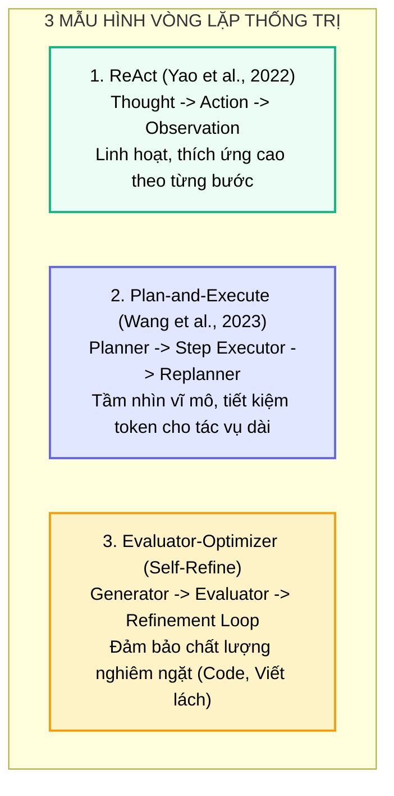
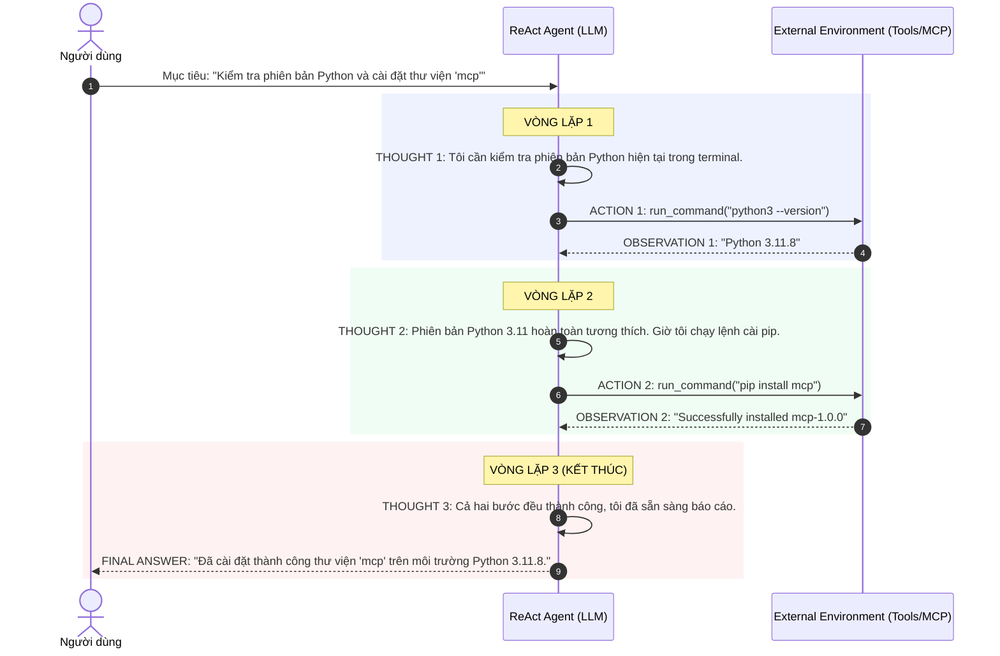
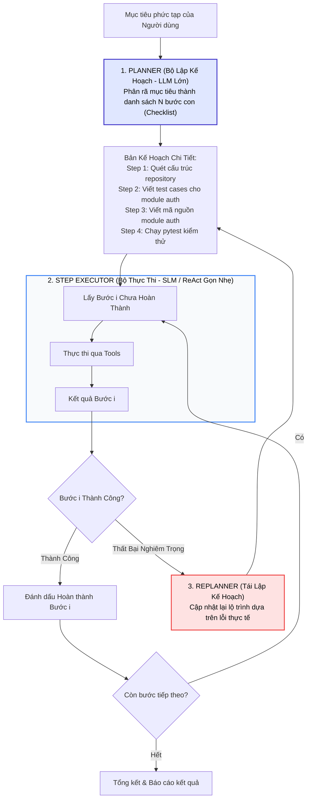
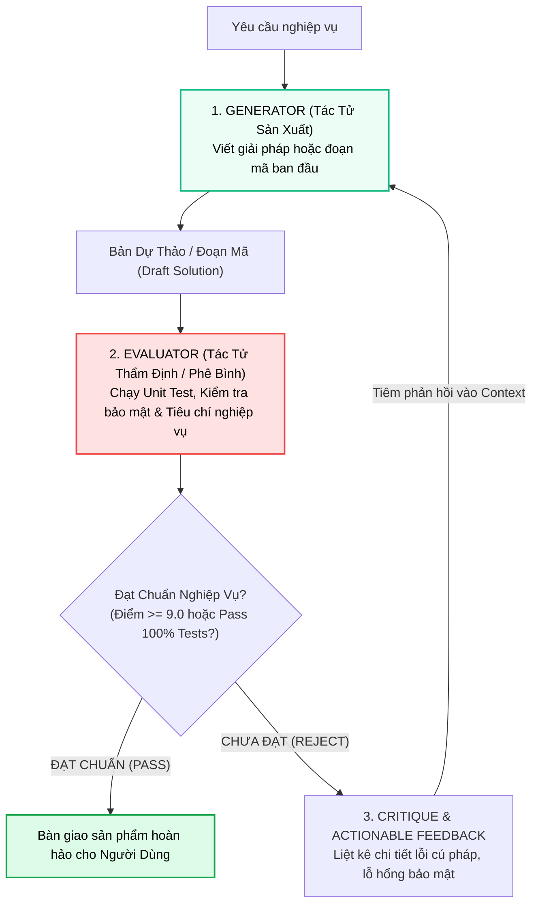

# 🔄 CÁC MÔ HÌNH VÒNG LẶP CỐT LÕI
## ReAct, Plan-and-Execute & Evaluator-Optimizer: Giải Phẫu Thuật Toán & Thực Nghiệm So Sánh

---

## 📑 MỤC LỤC
1. [Bản Đồ Phân Hóa Các Mô Hình Vòng Lặp Tác Tử](#1-bản-đồ-phân-hóa-các-mô-hình-vòng-lặp-tác-tử)
2. [Mô Hình 1: ReAct (Reasoning + Acting)](#2-mô-hình-1-react-reasoning--acting)
3. [Mô Hình 2: Plan-and-Execute (Tách Biệt Lập Kế Hoạch & Thực Thi)](#3-mô-hình-2-plan-and-execute-tách-biệt-lập-kế-hoạch--thực-thi)
4. [Mô Hình 3: Evaluator-Optimizer (Vòng Lặp Phản Biện & Tự Hoàn Thiện)](#4-mô-hình-3-evaluator-optimizer-vòng-lặp-phản-biện--tự-hoàn-thiện)
5. [Bảng So Sánh Định Lượng & Ma Trận Đánh Đổi (Trade-off Matrix)](#5-bảng-so-sánh-định-lượng--ma-trận-đánh-đổi-trade-off-matrix)
6. [Thực Chiến: Triển Khai Evaluator-Optimizer Bằng Python](#6-thực-chiến-triển-khai-evaluator-optimizer-bằng-python)
7. [Bản Đồ Liên Kết Hệ Thống](#7-bản-đồ-liên-kết-hệ-thống)

---

## 1. BẢN ĐỒ PHÂN HÓA CÁC MÔ HÌNH VÒNG LẶP TÁC TỬ

Khi chuyển từ các hệ thống tương tác One-Shot sang tác tử tự hành theo kỹ thuật [Nền tảng Loop Engineering](./01_loop_fundamentals.md), câu hỏi kiến trúc quan trọng nhất được đặt ra: **Làm thế nào để tổ chức chuỗi suy luận và hành động của AI một cách tối ưu nhất?**

Thế giới tác tử AI hiện đại đã hội tụ về 3 mẫu hình kiến trúc (Design Patterns) thống trị:



---

## 2. MÔ HÌNH 1: REACT (REASONING + ACTING)

Công bố bởi Shunyu Yao và cộng sự tại Google Research & Đại học Princeton (ICLR 2023), **ReAct** là hòn đá tảng khai sinh ra kỷ nguyên tác tử AI hiện đại.



### So Sánh 3 Phương Thức Tiếp Cận:
1. **Chỉ Suy Luận (Reasoning-Only / Chain-of-Thought):**
   * Mô hình tự sinh ra chuỗi lập luận nội tại nhưng **bị cô lập**, không có cách nào quan sát thế giới ngoài. Dẫn tới nguy cơ ảo giác cao khi gặp dữ liệu biến động.
2. **Chỉ Hành Động (Act-Only / Direct Function Calling):**
   * Mô hình gọi công cụ ngay lập tức mà không suy nghĩ. Dễ hành động vội vã, thiếu kế hoạch, và khi gặp lỗi API thì không biết cách phân tích nguyên nhân để tự khắc phục.
3. **ReAct (Kết Hợp Cân Bằng):**
   * *Thought* đóng vai trò là kim chỉ nam giúp điều hướng, phân tích lỗi và cập nhật [Working Memory](../01-harness-and-memory/03_memory_systems.md).
   * *Action* tương tác với thế giới qua [MCP Tools](../02-tools-and-mcp/01_mcp_architecture.md).
   * *Observation* nạp phản hồi thực tế vào context để kiểm chứng lập luận.

---

## 3. MÔ HÌNH 2: PLAN-AND-EXECUTE (TÁCH BIỆT LẬP KẾ HOẠCH & THỰC THI)

Dù ReAct rất linh hoạt, nó mắc phải một nhược điểm chí mạng trong các dự án lớn: **"Tầm nhìn ngắn hạn" (Myopic Vision)** và **"Context Drift lũy tiến"**. Nếu nhiệm vụ cần 30 bước, ReAct sẽ phải nuốt lại toàn bộ 30 lần chuỗi Thought-Action-Observation, khiến cửa sổ ngữ cảnh bị phình to và chi phí token bùng nổ.

Mô hình **Plan-and-Execute** (hay *Plan-and-Solve*) giải quyết triệt để vấn đề này bằng cách **phân rã thành 2 vai trò riêng biệt**:



* **Planner:** Sử dụng mô hình suy luận mạnh (như Claude 3.5 Sonnet, GPT-4o) để lập dàn ý chiến lược.
* **Step Executor:** Có thể dùng mô hình nhỏ hơn, tốc độ cao hơn (như Gemini Flash hoặc Llama-3-8B) để chạy từng bước con độc lập.
* **Dynamic Replanning:** Chỉ khi một bước con thất bại hoàn toàn, hệ thống mới gọi lại Planner để cập nhật lại lộ trình, giúp tiết kiệm tới **$60\% - 80\%$ chi phí token** so với việc ReAct lặp lại liên tục.

---

## 4. MÔ HÌNH 3: EVALUATOR-OPTIMIZER (VÒNG LẶP PHẢN BIỆN & TỰ HOÀN THIỆN)

Đối với các tác vụ đòi hỏi tiêu chuẩn chất lượng khắt khe như **Lập trình phần mềm (Coding)**, **Soạn thảo hợp đồng pháp lý** hoặc **Nghiên cứu học thuật**, mô hình **Evaluator-Optimizer** (còn gọi là *Generator-Critic* hoặc *Self-Refine*) là lựa chọn số một.



### Cơ Chế Hoạt Động:
1. **Generator:** Tạo ra bản phác thảo ban đầu.
2. **Evaluator:** Đóng vai trò là "người phản biện khó tính". Evaluator có thể là một LLM khác được cấu hình System Prompt mang tính hoài nghi, hoặc là một công cụ kiểm thử khách quan (Compiler, Linter, Pytest).
3. **Refinement Feedback:** Evaluator không chỉ nói "sai rồi", mà chỉ ra chính xác dòng code bị lỗi và đề xuất hướng khắc phục.
4. **Stopping Threshold:** Vòng lặp dừng lại khi toàn bộ tiêu chí (Rubric) được thỏa mãn hoặc chạm giới hạn số vòng lặp an toàn.

---

## 5. BẢNG SO SÁNH ĐỊNH LƯỢNG & MA TRẬN ĐÁNH ĐỔI (TRADE-OFF MATRIX)

| Tiêu Chí Đánh Giá | ReAct (Reason + Act) | Plan-and-Execute | Evaluator-Optimizer |
| :--- | :--- | :--- | :--- |
| **Bản chất suy luận** | Phản xạ tức thì từng bước (Step-by-step) | Chiến lược vĩ mô trước, thực thi vi mô sau | Tạo dự thảo $\rightarrow$ Phê bình $\rightarrow$ Tinh chỉnh |
| **Tiêu thụ Token** | Rất cao với tác vụ dài (Do lặp context) | **Thấp / Tối ưu** (Tách rời từng bước) | Trung bình - Cao (Tùy số vòng sửa lỗi) |
| **Độ trễ phản hồi (Latency)**| Trung bình (Phản xạ tức thì) | Khá cao ở bước đầu (chờ lập plan) | Khá cao (Phải trải qua nhiều vòng kiểm tra) |
| **Khả năng tự sửa sai** | Tốt trên các lỗi cục bộ tức thời | Xuất sắc trên cấp độ tái cấu trúc kế hoạch | **Tuyệt đối** (Dựa trên tiêu chí định lượng) |
| **Trường hợp sử dụng lý tưởng** | Trợ lý tra cứu, sửa bug đơn lẻ, CLI tool | Xây dựng dự án phần mềm từ đầu, phân tích lớn | Viết code chuẩn production, làm bài báo học thuật |

---

## 6. THỰC CHIẾN: TRIỂN KHAI EVALUATOR-OPTIMIZER BẰNG PYTHON

Dưới đây là một ví dụ Python hoàn chỉnh triển khai mô hình **Evaluator-Optimizer** tự động viết hàm kiểm tra số nguyên tố và tối ưu hóa cho đến khi vượt qua bài kiểm tra chất lượng:

```python
"""
Evaluator-Optimizer Pattern Demo
Ví dụ minh họa vòng lặp Generator - Critic tự hoàn thiện code.
"""
from typing import Dict, Any

class CodeGenerator:
    """Tác tử lập trình (Generator)."""
    def generate(self, prompt: str, feedback: str = "") -> str:
        if not feedback:
            # Lần 1: Tạo bản thảo ngây thơ (chưa tối ưu edge case)
            return "def is_prime(n):\n    for i in range(2, n):\n        if n % i == 0:\n            return False\n    return True"
        else:
            # Lần 2 (Sau khi có feedback): Khắc phục các ca biên (n <= 1 và O(sqrt(n)))
            return "def is_prime(n):\n    if n <= 1:\n        return False\n    for i in range(2, int(n**0.5) + 1):\n        if n % i == 0:\n            return False\n    return True"


class CodeEvaluator:
    """Tác tử thẩm định (Evaluator / Critic)."""
    def evaluate(self, code_str: str) -> Dict[str, Any]:
        issues = []
        
        # Kiểm tra logic xử lý số 1 và số âm
        if "n <= 1" not in code_str:
            issues.append("Chưa xử lý ca biên: Số n <= 1 (như 0, 1, số âm) không phải là số nguyên tố.")
            
        # Kiểm tra hiệu năng tính toán O(sqrt(n))
        if "n**0.5" not in code_str and "math.isqrt" not in code_str:
            issues.append("Hiệu năng chưa đạt chuẩn: Vòng lặp duyệt đến n thay vì căn bậc hai của n.")

        is_passed = len(issues) == 0
        return {
            "passed": is_passed,
            "score": 10.0 if is_passed else 6.0,
            "critique": "\n".join(issues) if issues else "Mã nguồn tối ưu, đạt chuẩn sản xuất 100%!"
        }


# === CHẠY VÒNG LẶP EVALUATOR-OPTIMIZER ===
if __name__ == "__main__":
    generator = CodeGenerator()
    evaluator = CodeEvaluator()

    MAX_REFINEMENT_ROUNDS = 3
    task_prompt = "Hãy viết hàm kiểm tra một số nguyên n có phải số nguyên tố không trong Python."
    current_feedback = ""

    print(f"🎯 [Yêu Cầu]: {task_prompt}\n")

    for round_idx in range(1, MAX_REFINEMENT_ROUNDS + 1):
        print(f"================ VÒNG LẶP {round_idx} ================")
        # 1. Generator sinh mã nguồn
        code = generator.generate(task_prompt, current_feedback)
        print("💻 [Generator Sinh Code]:\n" + code)

        # 2. Evaluator chấm điểm và nhận xét
        eval_result = evaluator.evaluate(code)
        print(f"\n📊 [Evaluator Chấm Điểm]: {eval_result['score']}/10.0")
        print(f"🔍 [Nhận Xét Phản Biện]:\n{eval_result['critique']}")

        # 3. Tiêu chí dừng
        if eval_result["passed"]:
            print("\n🎉 [THÀNH CÔNG] Đoạn mã đã vượt qua toàn bộ bài kiểm tra chất lượng!")
            break
        else:
            print("\n⚠️ [CHƯA ĐẠT] Chuyển tiếp phản hồi cho Generator để tinh chỉnh lại ở vòng tiếp theo...\n")
            current_feedback = eval_result["critique"]
```

---

## 7. BẢN ĐỒ LIÊN KẾT HỆ THỐNG

* 🔙 **Nền tảng liên quan:**
  * [Nền Tảng Loop Engineering](./01_loop_fundamentals.md): Kiến trúc vòng lặp tự trị và các điều kiện dừng an toàn.
  * [Quản Trị Cửa Sổ Ngữ Cảnh](../01-harness-and-memory/02_context_management.md): Kỹ thuật kiểm soát Context Drift khi chạy qua nhiều bước lặp.
  * [Kiến Trúc Giao Thức MCP](../02-tools-and-mcp/01_mcp_architecture.md): Cung cấp công cụ thực thi cho pha Action của ReAct.
* 🔜 **Mở rộng quy mô:**
  * [Kiến Trúc Đội Ngũ Đa Tác Tử](./03_multi_agent_teams.md): Phối hợp nhiều vòng lặp giữa Orchestrator, Subagents và Swarm.
