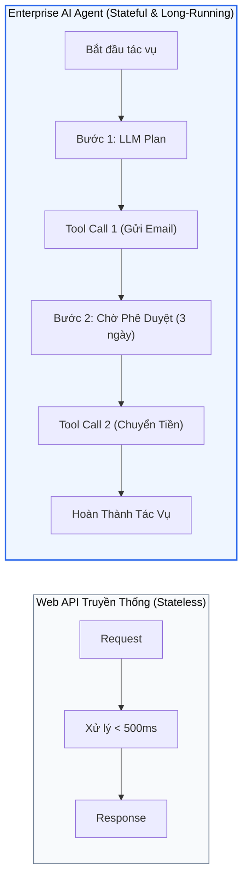
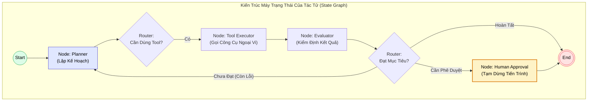
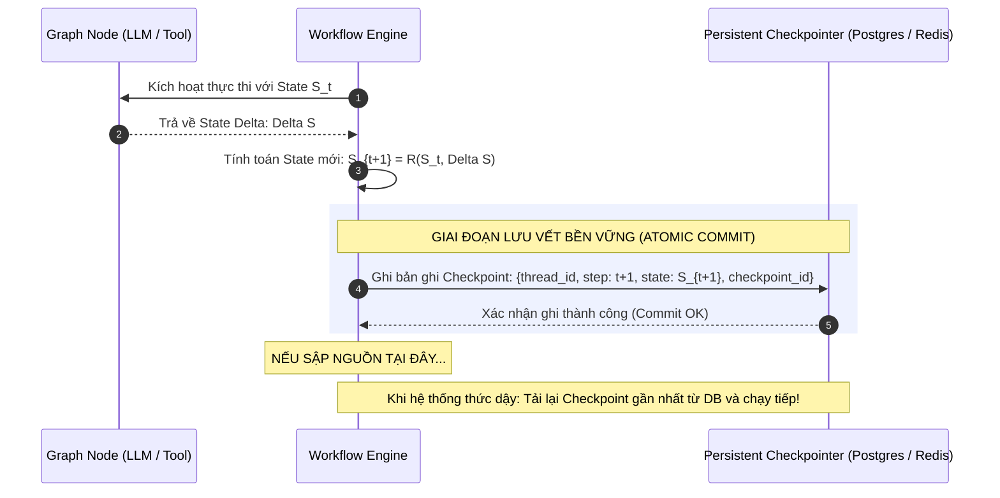
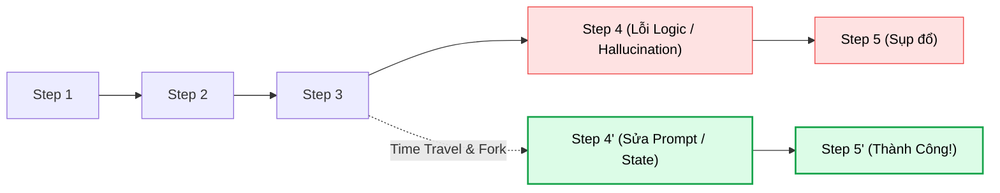

# DURABLE AGENT EXECUTION & STATEFUL WORKFLOWS
## Khắc Phục Tính Bất Định Bằng Máy Trạng Thái Bền Vững (Stateful State Graphs), Checkpointing Phân Tán, Cơ Chế Replay Determinism & Time-Travel Debugging

---

## MỤC LỤC
1. [Khủng hoảng tính bất định và độ tin cậy trong Enterprise Agents](#1-khủng-hoảng-tính-bất-định-và-độ-tin-cậy-trong-enterprise-agents)
   - [Sự khác biệt bản chất giữa Web Services truyền thống và Autonomous Agents](#sự-khác-biệt-bản-chất-giữa-web-services-truyền-thống-và-autonomous-agents)
   - [Hiểm họa "Bóng ma sụp đổ tiến trình" (The Process Crash Nightmare)](#hiểm-họa-bóng-ma-sụp-đổ-tiến-trình-the-process-crash-nightmare)
   - [Triết lý Thực thi Bền vững (Durable Execution Paradigm)](#triết-lý-thực-thi-bền-vững-durable-execution-paradigm)
2. [Giải phẫu Kiến trúc Máy Trạng Thái Phân Cấp (State Machines & State Graphs)](#2-giải-phẫu-kiến-trúc-máy-trạng-thái-phân-cấp-state-machines--state-graphs)
   - [Định nghĩa toán học của Trạng Thái Tác Tử (Agent State Schema)](#định-nghĩa-toán-học-của-trạng-thái-tác-tử-agent-state-schema)
   - [Hàm chuyển trạng thái thuần khiết (Pure Reducer Functions)](#hàm-chuyển-trạng-thái-thuần-khiết-pure-reducer-functions)
   - [Cạnh có điều kiện và Bộ định tuyến nhận thức (Conditional Routers)](#cạnh-có-điều-kiện-và-bộ-định-tuyến-nhận-thức-conditional-routers)
3. [Cơ chế Checkpointing Phân Tán & Replay Determinism](#3-cơ-chế-checkpointing-phân-tán--replay-determinism)
   - [Cơ chế ghi nhật ký trạng thái (Event-Sourcing Checkpointers)](#cơ-chế-ghi-nhật-ký-trạng-thái-event-sourcing-checkpointers)
   - [Tính tất định khi phục hồi (Replay Determinism & Observation Caching)](#tính-tất-định-khi-phục-hồi-replay-determinism--observation-caching)
   - [Phòng chống lặp tác vụ có tác dụng phụ (Idempotency in Tool Execution)](#phòng-chống-lặp-tác-vụ-có-tác-dụng-phụ-idempotency-in-tool-execution)
4. [Time-Travel Debugging & Can Thiệp Của Con Người (Human-in-the-Loop)](#4-time-travel-debugging--can-thiệp-của-con-người-human-in-the-loop)
   - [Cơ chế phân nhánh lịch sử (State Forking & Time Travel)](#cơ-chế-phân-nhánh-lịch-sử-state-forking--time-travel)
   - [Điểm ngắt phê duyệt (Human-in-the-Loop Interrupts & Resumes)](#điểm-ngắt-phê-duyệt-human-in-the-loop-interrupts--resumes)
5. [So sánh hệ sinh thái công nghệ: Temporal vs. LangGraph vs. Prefect](#5-so-sánh-hệ-sinh-thái-công-nghệ-temporal-vs-langgraph-vs-prefect)
6. [Thực hành End-to-End: Xây dựng `DurableWorkflowEngine` hoàn chỉnh bằng Python](#6-thực-hành-end-to-end-xây-dựng-durableworkflowengine-hoàn-chỉnh-bằng-python)
   - [6.1. Thiết lập State Schema và SQLite Checkpointer](#61-thiết-lập-state-schema-và-sqlite-checkpointer)
   - [6.2. Xây dựng Workflow Đồ thị với Conditional Routing](#62-xây-dựng-workflow-đồ-thị-với-conditional-routing)
   - [6.3. Mô phỏng sụp đổ hệ thống (Process Crash) và Phục hồi tức thì](#63-mô-phỏng-sụp-đổ-hệ-thống-process-crash-và-phục-hồi-tức-thì)
7. [Bảng ma trận so sánh định lượng & Trade-offs](#7-bảng-ma-trận-so-sánh-định-lượng--trade-offs)
8. [Tài liệu nghiên cứu khoa học cốt lõi (Academic References)](#8-tài-liệu-nghiên-cứu-khoa-học-cốt-lõi-academic-references)

---

## 1. KHỦNG HOẢNG TÍNH BẤT ĐỊNH VÀ ĐỘ TIN CẬY TRONG ENTERPRISE AGENTS

### Sự khác biệt bản chất giữa Web Services truyền thống và Autonomous Agents

Trong kỹ thuật phần mềm truyền thống, các dịch vụ web được thiết kế theo mô hình **Stateless Request-Response**:
* Một yêu cầu HTTP gửi đến API Gateway, máy chủ xử lý logic trong vòng $50\text{ms} - 500\text{ms}$, ghi nhận cơ sở dữ liệu và trả về kết quả.
* Nếu máy chủ gặp sự cố (OOM, restart), tải được tự động chuyển sang máy chủ khác, và client có thể retry ngay lập tức mà không gây tác dụng phụ nghiêm trọng.

Trái lại, một **AI Agent tự trị trong doanh nghiệp** (chẳng hạn như Agent rà soát pháp chế hợp đồng, Agent đối soát tài chính, hay Agent tự sửa lỗi mã nguồn theo paradigm [[04_ast_self_healing_code_agents|AST-Guided Self-Healing]]) mang đặc tính hoàn toàn trái ngược:
1. **Thời gian chạy kéo dài (Long-running processes):** Một tác vụ có thể bao gồm từ $10$ đến $100$ bước suy luận, kéo dài từ vài phút, vài giờ đến hàng tuần.
2. **Tính bất định cao (Non-deterministic Transitions):** Tại mỗi bước, kết quả đầu ra của LLM phụ thuộc vào xác suất lấy mẫu (Sampling $\tau > 0$), và các công cụ ngoài (Web Search, API bên thứ ba) có thể trả về dữ liệu biến động.
3. **Tác dụng phụ ngoại vi không thể đảo ngược (Irreversible Side Effects):** Agent có quyền gửi email thật cho đối tác, thực hiện thanh toán ngân hàng, xóa tệp tin hoặc ghi đè nhánh Git.



### Hiểm họa "Bóng ma sụp đổ tiến trình" (The Process Crash Nightmare)

Nếu chúng ta lập trình Agent bằng các vòng lặp trong bộ nhớ RAM thông thường (ví dụ: vòng lặp `while True:` trong Python như khảo sát tại [[01_loop_fundamentals|Nền tảng Loop Engineering]]):
* **Sự cố:** Tại bước thứ 18 của một tiến trình gồm 20 bước, Kubernetes container bị khởi động lại do chạm ngưỡng bộ nhớ, hoặc đường truyền mạng chập chờn gây timeout.
* **Hậu quả thảm khốc:**
  1. Toàn bộ chuỗi suy luận, các biến trạng thái trung gian, và lịch sử gọi công cụ lưu trong RAM bị **xóa sạch $100\%$**.
  2. Nếu hệ thống tự động chạy lại từ đầu: Doanh nghiệp bị mất thêm hàng triệu token chi phí vô ích, và tệ hại hơn, **các công cụ ở bước 1 đến bước 17 bị gọi lại lần thứ hai** (ví dụ: gửi 2 lần email xác nhận hợp đồng cho khách hàng, hoặc trừ tiền 2 lần trong tài khoản ngân hàng).

### Triết lý Thực thi Bền vững (Durable Execution Paradigm)

**Durable Execution (Thực thi bền vững)** là một mô thức kiến trúc phần mềm bảo đảm rằng: **Chương trình của bạn sẽ thực thi đến cùng như thể tiến trình máy tính không bao giờ bị sập, bất chấp mọi sự cố về hạ tầng phần cứng hay mạng!**

> [!important]
> **Định đề Thực thi Bền vững cho AI Agent:**  
> *"Nếu một Agent sập nguồn ở Bước 42, khi hệ thống khởi động lại, nó phải tiếp tục thực thi chính xác từ Bước 43 mà không được phép tính toán lại Bước 1 đến 42, và không được phép gọi lại bất kỳ công cụ nào đã hoàn tất trước đó."*

---

## 2. GIẢI PHẪU KIẾN TRÚC MÁY TRẠNG THÁI PHÂN CẤP (STATE MACHINES & STATE GRAPHS)

Để đạt được tính bền vững, mã nguồn của Agent không được phép viết dưới dạng các hàm thủ tục lồng nhau không kiểm soát. Nó bắt buộc phải được mô hình hóa thành một **Đồ thị Trạng thái có hướng (Directed State Graph)**.



### Định nghĩa toán học của Trạng Thái Tác Tử (Agent State Schema)

Trạng thái toàn cục của tác tử tại bước $t$ được định nghĩa là một cấu trúc dữ liệu tường minh $\mathcal{S}_t$:

$$\mathcal{S}_t = \left( \mathcal{M}_t, \mathcal{V}_t, \mathcal{K}_t, \mathcal{A}_t \right)$$

Trong đó:
* $\mathcal{M}_t = [m_1, m_2, \dots, m_k]$: Danh sách toàn bộ các thông điệp hội thoại (User, Assistant, Tool Messages).
* $\mathcal{V}_t = \{ \text{key}_i: \text{value}_i \}$: Không gian biến nghiệp vụ (ví dụ: `account_balance`, `contract_approved: bool`).
* $\mathcal{K}_t$: Kế hoạch hành động hiện tại và danh sách các task còn tồn đọng (Todo List).
* $\mathcal{A}_t$: Vết thực thi của các artifact được tạo ra (tệp tin đã ghi, transaction ID ngân hàng).

### Hàm chuyển trạng thái thuần khiết (Pure Reducer Functions)

Mỗi Node trong đồ thị là một hàm nhận vào trạng thái hiện tại $\mathcal{S}_t$ và chỉ trả về **phần cập nhật trạng thái (State Delta) $\Delta \mathcal{S}$**:

$$\Delta \mathcal{S} = \text{Node}_i(\mathcal{S}_t)$$

Cơ chế cập nhật trạng thái mới áp dụng nguyên lý hàm Reducer:

$$\mathcal{S}_{t+1} = \mathcal{R}(\mathcal{S}_t, \Delta \mathcal{S})$$

Ví dụ: Đối với danh sách tin nhắn $\mathcal{M}$, hàm Reducer thường là phép nối danh sách (Append / Concatenate), trong khi đối với các biến nghiệp vụ $\mathcal{V}$, hàm Reducer là phép ghi đè (Overwrite / Merge):

```python
from typing import Annotated, TypedDict, List
import operator

class AgentState(TypedDict):
    # Sử dụng operator.add làm Reducer: Tin nhắn mới sẽ tự động NỐI THÊM vào mảng cũ
    messages: Annotated[List[dict], operator.add]
    
    # Biến nghiệp vụ: Không dùng operator.add -> Giá trị mới sẽ GHI ĐÈ giá trị cũ
    current_step: int
    is_approved: bool
    final_output: str
```

> [!note] Giải thích Khối: Bộ Cập Nhật Trạng Thái Tác Tử (State Reducer Engine)
> * **Đầu vào (Input):** Snapshot trạng thái hiện thời $\mathcal{S}_t$ và mảng dữ liệu trả về từ Node vừa thực thi $\Delta \mathcal{S}$.
> * **Cơ chế xử lý:** Thực thi các quy tắc gộp dữ liệu định nghĩa trước trong Schema (Append đối với message logs, Overwrite đối với biến cờ trạng thái).
> * **Đầu ra (Output):** Trạng thái mới $\mathcal{S}_{t+1}$ mang tính bất biến (Immutable State Snapshot).

---

## 3. CƠ CHẾ CHECKPOINTING PHÂN TÁN & REPLAY DETERMINISM

Trọng tâm kỹ thuật giúp đồ thị trạng thái trở nên "bất tử" trước mọi sự cố sập nguồn là sự kết hợp giữa **Checkpointer phân tán** và **Kỹ thuật Replay tất định**.



### Cơ chế ghi nhật ký trạng thái (Event-Sourcing Checkpointers)

Thay vì chỉ lưu một bản copy duy nhất của trạng thái hiện tại (dễ dẫn đến xung đột ghi hoặc hỏng file nếu sập nguồn đúng lúc đang ghi đĩa), các framework bền vững như LangGraph hay Temporal sử dụng mô hình **Event Sourcing**:
* Mỗi bước thực thi sinh ra một bản ghi Checkpoint độc lập, gắn liền với một khóa phiên duy nhất (`thread_id`) và mã phiên bản (`checkpoint_id`):
  $$\text{Checkpoint Record} = \langle \text{thread\_id}, \text{step\_id}, \text{timestamp}, \mathcal{S}_t, \text{parent\_checkpoint\_id} \rangle$$
* Chuỗi các checkpoint này tạo thành một cây lịch sử có thể duyệt lại bất kỳ lúc nào.

### Tính tất định khi phục hồi (Replay Determinism & Observation Caching)

Khi một tiến trình sập và được phục hồi trên một worker mới:
1. Hệ thống nạp lại toàn bộ lịch sử sự kiện từ Checkpointer.
2. **Observation Caching (Memoization):** Đối với các bước gọi công cụ (Tool Calls) đã hoàn tất thành công trong quá khứ, Workflow Engine **không bao giờ thực thi lại hàm vật lý đó**. Hệ thống chỉ lấy lại giá trị kết quả đã ghi trong Checkpoint và trả về ngay lập tức!
3. **Idempotency (Tính bất biến của hành động):** Đảm bảo rằng việc gọi lại quy trình $N$ lần vẫn chỉ tạo ra đúng 1 lần tác động thực tế ra thế giới bên ngoài.

---

## 4. TIME-TRAVEL DEBUGGING & CAN THIỆP CỦA CON NGƯỜI (HUMAN-IN-THE-LOOP)

Khi toàn bộ vòng đời của tác tử được lưu lại dưới dạng các Checkpoint phân cấp, chúng ta có được hai năng lực mang tính cách mạng: **Time-Travel Debugging** và **Human-in-the-Loop Gateways**.

### Cơ chế phân nhánh lịch sử (State Forking & Time Travel)

Trong quá trình phát triển Agent, một lỗi phổ biến là Agent suy luận đúng ở 10 bước đầu, nhưng đến bước 11 lại chọn sai công cụ hoặc hiểu nhầm câu hỏi, dẫn đến trôi dạt ngữ cảnh ở các bước 12-20.
* **Cách sửa lỗi truyền thống:** Kỹ sư sửa prompt, sau đó chạy lại toàn bộ từ Bước 1 $\rightarrow$ Tốn hàng chục phút và tiêu tốn hàng tá tiền token vô ích.
* **Cách tiếp cận Time-Travel (Du hành thời gian):**
  1. Kỹ sư mở bảng điều khiển, xem lại danh sách Checkpoint của `thread_id`.
  2. Chọn quay ngược lại **Checkpoint của Bước 10** ($\mathcal{S}_{10}$).
  3. Can thiệp trực tiếp vào dữ liệu của Bước 10: sửa đổi System Prompt, chỉnh lại kết quả của Tool, hoặc loại bỏ một câu trả lời ảo giác.
  4. Bấm nút **Fork / Resume**: Tác tử bắt đầu suy luận tiếp từ Bước 11 trên nhánh mới (Branching State), giữ nguyên toàn bộ 10 bước lịch sử đã chạy trước đó!



### Điểm ngắt phê duyệt (Human-in-the-Loop Interrupts & Resumes)

Trong các nghiệp vụ có độ rủi ro cao (chuyển tiền, gửi email cho hàng nghìn người, cập nhật cơ sở dữ liệu sản xuất), Agent không được phép tự hành hoàn toàn mà bắt buộc phải có sự phê duyệt của con người.

Cơ chế thực thi bền vững giải quyết bài toán này một cách thanh lịch:
1. **Static Interrupt Configuration:** Đồ thị được cấu hình dừng trước một node cụ thể:
   `graph.compile(interrupt_before=["execute_wire_transfer"])`
2. **Deep Freeze (Ngủ sâu):** Khi luồng đi tới nút `execute_wire_transfer`, Workflow Engine tự động lưu lại toàn bộ trạng thái vào Checkpointer và **kết thúc tiến trình Python (Process Exit)**. Tài nguyên RAM và CPU được giải phóng hoàn toàn!
3. **Phê duyệt bất đồng bộ (Asynchronous Approval):**
   * Người quản lý có thể đang đi nghỉ mát và 3 ngày sau mới mở ứng dụng di động để xem đề xuất giao dịch của Agent.
   * Khi người quản lý bấm nút *"Chấp Thuận"*, hệ thống phát một tín hiệu API Resume kèm theo `thread_id`.
   * Hệ thống đánh thức Agent từ cơ sở dữ liệu và tiếp tục thực hiện hành động chuyển tiền một cách chuẩn xác mà không hề bị mất bối cảnh ban đầu!

---

## 5. SO SÁNH HỆ SINH THÁI CÔNG NGHỆ: TEMPORAL VS. LANGGRAPH VS. PREFECT

| Tiêu Chí | Temporal (Cadence Engine) | LangGraph (LangChain Ecosystem) | Prefect (Workflows Orchestration) |
| :--- | :--- | :--- | :--- |
| **Mô hình cốt lõi** | Workflow-as-Code (Event Sourcing) | Directed State Graph (State Reducers) | Task-DAG (Decorators) |
| **Tối ưu cho LLM** | Cần viết wrapper code thủ công | **Tối ưu hóa bản địa 100% cho AI Agents** | Trung bình (Thiên về Data Engineering) |
| **Hỗ trợ Time-Travel** | Có (Event History Replay) | **Cực mạnh (State Forking & Inspection)** | Khó thực hiện ở cấp độ biến ngữ nghĩa |
| **Human-in-the-Loop** | Hỗ trợ qua Signals / Queries | **Tích hợp sẵn qua Breakpoints & Interrupts** | Có (Manual Approval gates) |
| **Môi trường phù hợp** | Hệ thống Backend lớn đa ngôn ngữ | Đội ngũ xây dựng AI Agent chuyên sâu | Đội ngũ Data Science & Data Pipeline |

---

## 6. THỰC HÀNH END-TO-END: XÂY DỰNG `DurableWorkflowEngine` HOÀN CHỈNH BẰNG PYTHON

Dưới đây là một triển khai Python hoàn chỉnh minh họa cách xây dựng một **Durable Agent Workflow** cho quy trình thẩm định và giải ngân hồ sơ vay vốn ngân hàng, tích hợp **SQLite Checkpointer**, **Observation Caching**, và cơ chế **Human-in-the-Loop**:

```python
import sqlite3
import json
import time
import uuid
from typing import Dict, Any, Callable, List, Optional

class SQLiteCheckpointer:
    """Hệ thống lưu vết Checkpoint bền vững vào SQLite."""
    def __init__(self, db_path: str = ":memory:"):
        self.conn = sqlite3.connect(db_path)
        self._init_db()

    def _init_db(self):
        with self.conn:
            self.conn.execute("""
                CREATE TABLE IF NOT EXISTS checkpoints (
                    thread_id TEXT,
                    step INTEGER,
                    node_name TEXT,
                    state_json TEXT,
                    timestamp REAL,
                    PRIMARY KEY (thread_id, step)
                )
            """)

    def save_checkpoint(self, thread_id: str, step: int, node_name: str, state: Dict[str, Any]):
        with self.conn:
            self.conn.execute("""
                INSERT OR REPLACE INTO checkpoints (thread_id, step, node_name, state_json, timestamp)
                VALUES (?, ?, ?, ?, ?)
            """, (thread_id, step, node_name, json.dumps(state, ensure_ascii=False), time.time()))

    def get_latest_checkpoint(self, thread_id: str) -> Optional[Dict[str, Any]]:
        cursor = self.conn.execute("""
            SELECT step, node_name, state_json FROM checkpoints
            WHERE thread_id = ? ORDER BY step DESC LIMIT 1
        """, (thread_id,))
        row = cursor.fetchone()
        if row:
            return {
                "step": row[0],
                "node_name": row[1],
                "state": json.loads(row[2])
            }
        return None


class DurableStateGraph:
    """Máy trạng thái hữu hạn có khả năng phục hồi sau sụp đổ phần cứng."""
    def __init__(self, checkpointer: SQLiteCheckpointer):
        self.nodes: Dict[str, Callable[[Dict[str, Any]], Dict[str, Any]]] = {}
        self.routers: Dict[str, Callable[[Dict[str, Any]], str]] = {}
        self.checkpointer = checkpointer
        self.interrupt_nodes: set = set()

    def add_node(self, name: str, func: Callable[[Dict[str, Any]], Dict[str, Any]]):
        self.nodes[name] = func

    def add_conditional_edge(self, source_node: str, router_func: Callable[[Dict[str, Any]], str]):
        self.routers[source_node] = router_func

    def set_interrupt_before(self, node_names: List[str]):
        self.interrupt_nodes.update(node_names)

    def execute(self, thread_id: str, initial_state: Optional[Dict[str, Any]] = None) -> Dict[str, Any]:
        # Kiểm tra xem phiên làm việc đã có Checkpoint trước đó hay chưa
        latest = self.checkpointer.get_latest_checkpoint(thread_id)
        
        if latest:
            current_step = latest["step"]
            current_node = latest["node_name"]
            state = latest["state"]
            print(f"[RECOVERY] 🔄 Phát hiện Checkpoint cũ của thread '{thread_id}'. Phục hồi từ Bước {current_step} (Node: {current_node})!")
            # Tìm node kế tiếp thông qua Router
            if current_node in self.routers:
                current_node = self.routers[current_node](state)
            else:
                current_node = "__END__"
        else:
            current_step = 0
            current_node = "intake"
            state = initial_state or {}
            print(f"[START] 🚀 Khởi chạy Workflow mới cho thread '{thread_id}'...")

        while current_node != "__END__":
            # Kiểm tra xem Node hiện tại có bị chặn bởi Human-in-the-Loop không
            if current_node in self.interrupt_nodes and not state.get(f"{current_node}_approved", False):
                print(f"\n[⏸️ INTERRUPT] Tiến trình tạm dừng trước node '{current_node}' để chờ con người phê duyệt!")
                # Lưu checkpoint hiện tại trước khi thoát
                self.checkpointer.save_checkpoint(thread_id, current_step, f"waiting_{current_node}", state)
                return {
                    "status": "WAITING_FOR_HUMAN",
                    "paused_at_node": current_node,
                    "thread_id": thread_id,
                    "current_state": state
                }

            print(f"[*] [Step {current_step + 1}] Thực thi Node: '{current_node}'...")
            node_func = self.nodes[current_node]
            
            # Thực thi node và cập nhật state (Reducer)
            state_delta = node_func(state)
            state.update(state_delta)
            current_step += 1

            # Ghi Checkpoint Bền Vững Ngay Lập Tức!
            self.checkpointer.save_checkpoint(thread_id, current_step, current_node, state)

            # Xác định node tiếp theo
            if current_node in self.routers:
                current_node = self.routers[current_node](state)
            else:
                current_node = "__END__"

        print(f"[COMPLETE] 🎉 Workflow hoàn tất trọn vẹn cho thread '{thread_id}'!")
        return {"status": "COMPLETED", "final_state": state}


# ==========================================
# THỬ NGHIỆM THỰC TẾ: THẨM ĐỊNH VAY NGÂN HÀNG
# ==========================================

def node_intake(state: dict) -> dict:
    print(f"    -> [Intake] Tiếp nhận hồ sơ vay của khách hàng: {state.get('applicant_name')}")
    return {"intake_completed": True, "loan_amount": state.get("loan_amount", 0)}

def node_credit_score_check(state: dict) -> dict:
    print("    -> [Credit Check] Gọi API kiểm tra lịch sử tín dụng CIC...")
    # Giả lập kết quả tín dụng
    score = 720
    return {"credit_score": score, "credit_passed": score >= 650}

def router_after_credit(state: dict) -> str:
    if state.get("credit_passed"):
        return "human_approval"
    return "reject_application"

def node_human_approval(state: dict) -> dict:
    # Node này chỉ chạy khi con người đã duyệt
    print("    -> [Human Approval] Hồ sơ đã được Giám Đốc Tín Dụng phê duyệt thành công!")
    return {"approved_by_manager": True}

def node_disburse_funds(state: dict) -> dict:
    print(f"    -> [Disburse] 💰 ĐANG GIẢI NGÂN {state.get('loan_amount'):,.2f} VNĐ VÀO TÀI KHOẢN!")
    return {"disbursement_status": "SUCCESS", "transaction_ref": f"TXN-{uuid.uuid4().hex[:8].upper()}"}

def node_reject(state: dict) -> dict:
    print("    -> [Reject] Hồ sơ bị từ chối do điểm tín dụng không đạt chuẩn.")
    return {"rejection_reason": "Low credit score"}


if __name__ == "__main__":
    # Khởi tạo Checkpointer lưu ra đĩa (dùng file db SQLite)
    checkpointer = SQLiteCheckpointer("loan_workflow_checkpoints.db")
    graph = DurableStateGraph(checkpointer)

    # Đăng ký các Nodes
    graph.add_node("intake", node_intake)
    graph.add_node("credit_check", node_credit_score_check)
    graph.add_node("human_approval", node_human_approval)
    graph.add_node("disburse_funds", node_disburse_funds)
    graph.add_node("reject_application", node_reject)

    # Đăng ký các Routing Edges
    graph.add_conditional_edge("intake", lambda s: "credit_check")
    graph.add_conditional_edge("credit_check", router_after_credit)
    graph.add_conditional_edge("human_approval", lambda s: "disburse_funds")

    # Đặt điểm ngắt Human-in-the-Loop trước khi giải ngân
    graph.set_interrupt_before(["human_approval"])

    session_thread_id = "loan_app_2026_0927_001"

    print("=================== PHA 1: CHẠY TỰ ĐỘNG BAN ĐẦU ===================")
    initial_data = {"applicant_name": "Nguyễn Văn A", "loan_amount": 500000000}
    res1 = graph.execute(session_thread_id, initial_data)
    print("Kết quả Pha 1:", res1["status"])

    print("\n=================== PHA 2: GIẢ LẬP SẬP TIẾN TRÌNH / TẮT MÁY ===================")
    print("[Simulator] Server bị restart do cúp điện hoặc deploy code mới!")
    time.sleep(1)

    print("\n=================== PHA 3: CON NGƯỜI PHÊ DUYỆT & ĐÁNH THỨC AGENT ===================")
    # Lấy state hiện tại từ database và cập nhật cờ duyệt của con người
    saved_state = checkpointer.get_latest_checkpoint(session_thread_id)["state"]
    saved_state["human_approval_approved"] = True
    checkpointer.save_checkpoint(session_thread_id, 3, "human_approval", saved_state)

    # Gọi lại đúng thread_id đó: Agent tự động nhận ra điểm dừng và chạy tiếp đến khi giải ngân thành công!
    res2 = graph.execute(session_thread_id)
    print("Kết quả Pha 3:", res2["status"])
    print("Mã giao dịch giải ngân:", res2["final_state"]["transaction_ref"])
```

---

## 7. BẢNG MA TRẬN SO SÁNH ĐỊNH LƯỢNG & TRADE-OFFS

| Tiêu Chí Kỹ Thuật | In-Memory While Loop | Queue Worker (Celery / BullMQ) | Durable State Graph (LangGraph / Temporal) |
| :--- | :--- | :--- | :--- |
| **Khả năng sống sót sau crash** | **0%** (Mất trắng dữ liệu) | Tái kích hoạt lại từ đầu cả Task | **100%** (Tiếp tục đúng bước dở dang) |
| **Tránh trùng lặp Tool Side-Effects** | Không thể | Khó (Cần tự code Distributed Locks) | **Tự động qua Observation Caching** |
| **Hỗ trợ Human-in-the-Loop** | Không khả thi | Cần xây hệ thống Polling phức tạp | **Native qua Checkpointing & Breakpoints** |
| **Chi phí Token khi khôi phục lỗi** | Tốn $100\%$ token chạy lại | Tốn $100\%$ token chạy lại | **0 Token lãng phí** (Chỉ Replay State) |
| **Độ phức tạp kiến trúc** | Cực kỳ thấp (Vài dòng code) | Trung bình (Cần Redis / RabbitMQ) | Cần tư duy State Machine & Schemas |

---

## 8. TÀI LIỆU NGHIÊN CỨU KHOA HỌC CỐT LÕI (ACADEMIC REFERENCES)

1. **LangChain Team. (2024).** *LangGraph: Building Stateful, Multi-Actor Applications with LLMs.* [LangGraph Documentation & Architecture Guide](https://langchain-ai.github.io/langgraph/).
2. **Fatehi, M., et al. (Temporal Technologies). (2023).** *Durable Execution: An Architectural Paradigm for Reliable Distributed Systems.* IEEE Software / ACM Queue.
3. **Fowler, M. (2005).** *Event Sourcing Architectural Pattern.* [Martin Fowler Architecture Blog](https://martinfowler.com/eaaDev/EventSourcing.html).
4. **Kwon, W., et al. (2023).** *Efficient Memory Management for Large Language Model Serving with PagedAttention.* SOSP 2023. [arXiv:2309.06180](https://arxiv.org/abs/2309.06180).
5. **Packer, C., et al. (2023).** *MemGPT: Towards LLMs as Operating Systems.* UC Berkeley. [arXiv:2310.08560](https://arxiv.org/abs/2310.08560).

---

## 🔗 LIÊN KẾT ĐIỀU HƯỚNG NỘI BỘ
* **Nguyên lý vòng lặp cơ bản:** [[01_loop_fundamentals|Nền Tảng Loop Engineering & Stopping Criteria]]
* **Mô hình lập kế hoạch đa bước:** [[02_react_and_planning|Các Mô Hình Vòng Lặp Cốt Lõi: ReAct & Plan-and-Execute]]
* **Tác tử tự sửa lỗi qua AST:** [[04_ast_self_healing_code_agents|AST-Guided Self-Healing Code Agents]]
* **Bảo đảm cú pháp Tool Calling:** [[02_constrained_decoding_and_structured_outputs|Constrained Decoding & Structured Outputs]]
* **Trang chủ Trụ Cột 3:** [[03-building-agents/README|🛠️ Trụ Cột 3: Building Agents]]
