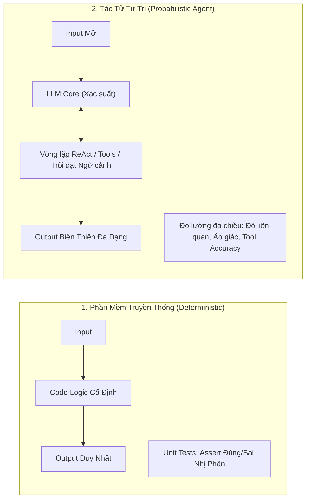
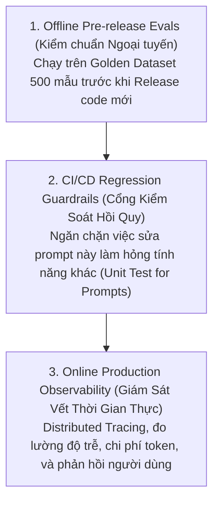
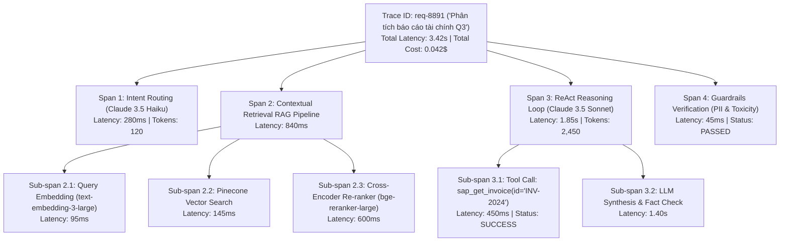
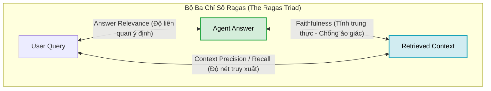
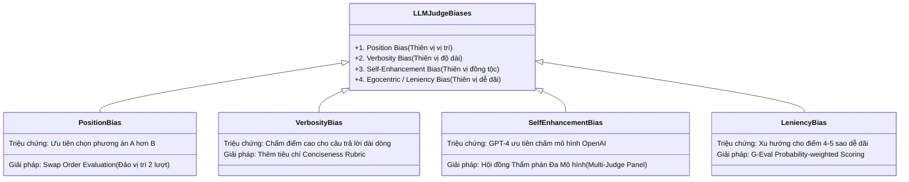
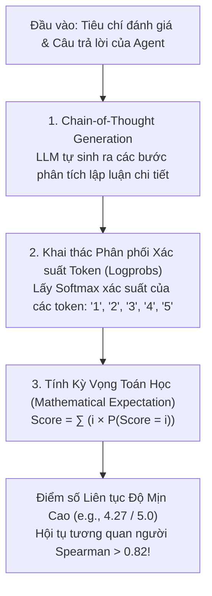
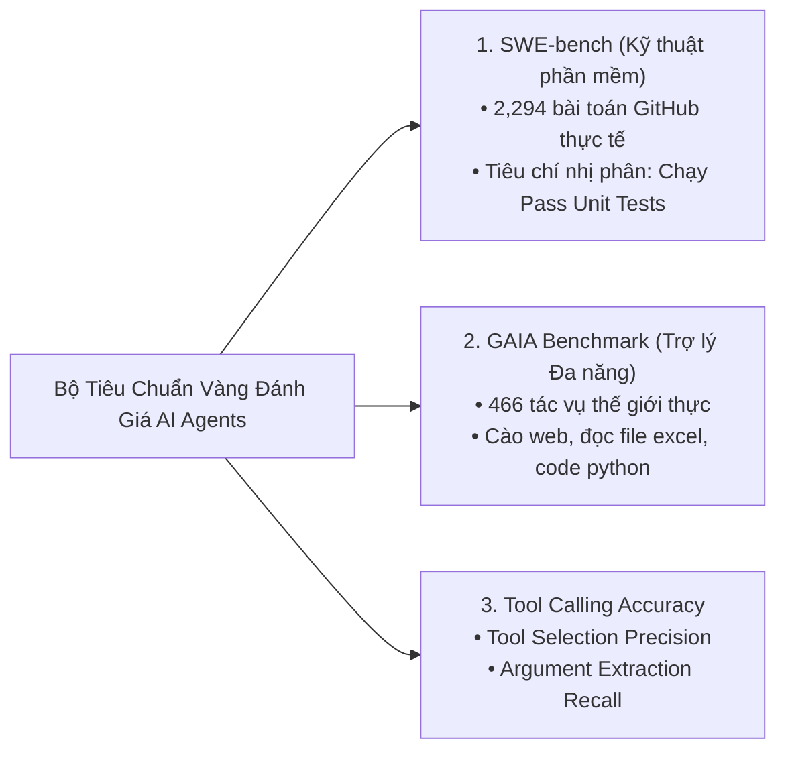
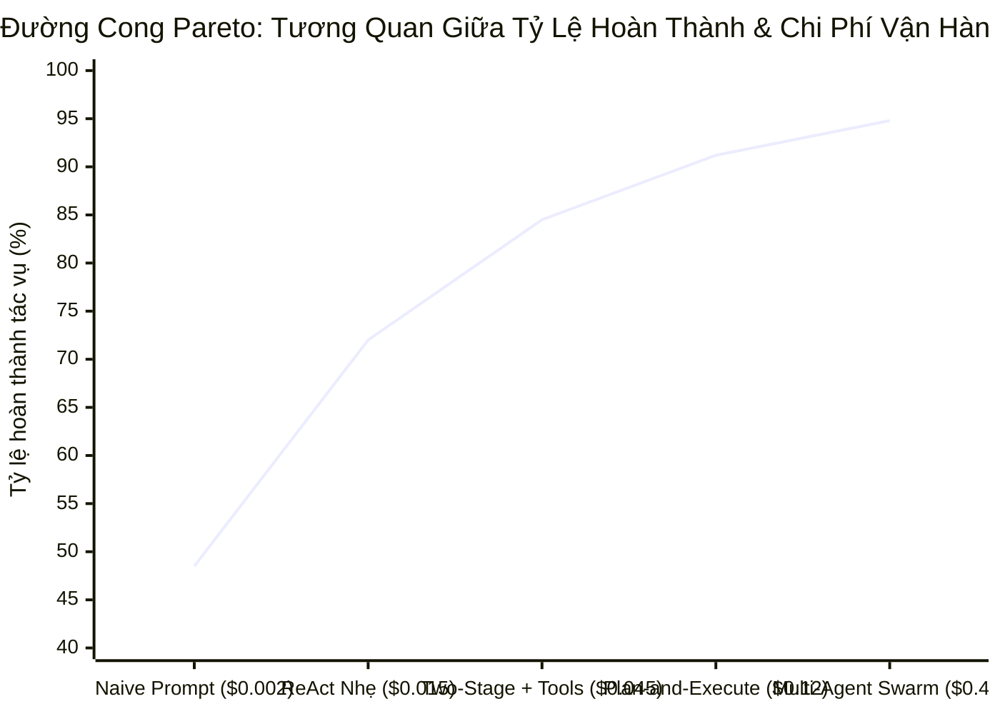
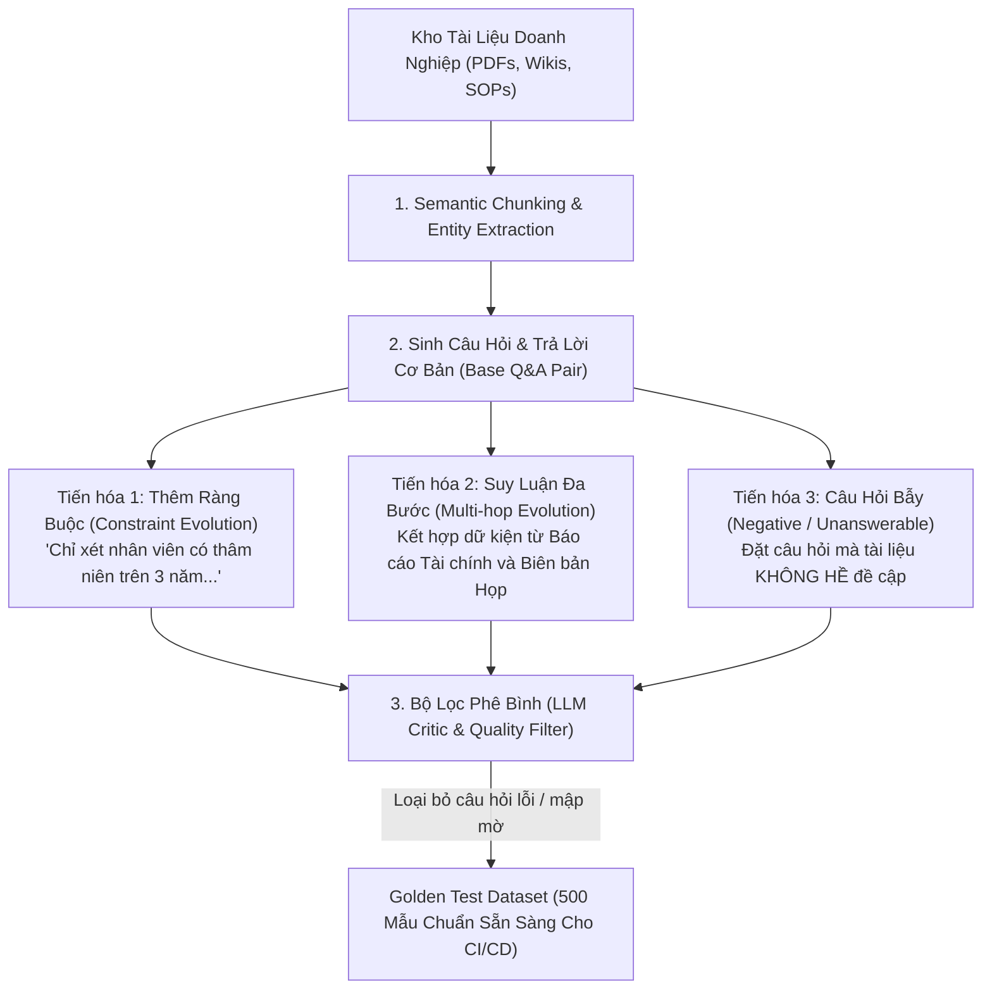
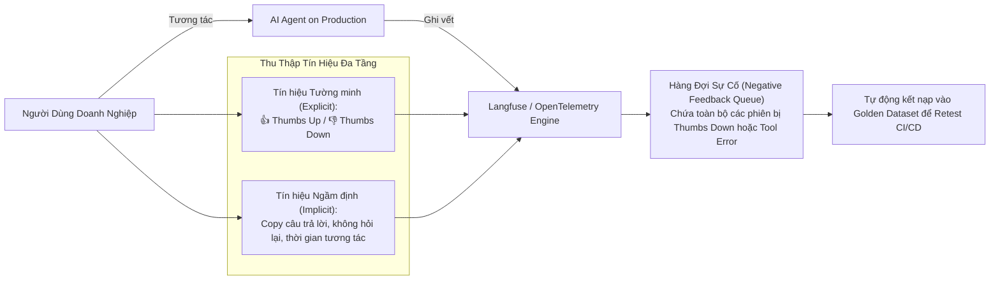

# HỆ THỐNG GIÁM SÁT, ĐO LƯỜNG & ĐÁNH GIÁ TÁC TỬ AI (AGENT OBSERVABILITY, TRACING & EVALS)
## Từ "Vibe-Checking" Sang Đo Lường Định Lượng: Distributed Tracing (OpenTelemetry / Langfuse), Khung Evals Ragas & DeepEval, Giải Phẫu LLM-as-a-Judge & Tạo Dữ Liệu Kiểm Thử Tổng Hợp

---

## MỤC LỤC
1. [Khởi nguyên: Nghịch lý hộp đen & Khoảng cách giữa Demo và Production](#1-khởi-nguyên-nghịch-lý-hộp-đen--khoảng-cách-giữa-demo-và-production)
2. [Hạ tầng Tracing phân tán cho AI Agents (Distributed Tracing Architecture)](#2-hạ-tầng-tracing-phân-tán-cho-ai-agents-distributed-tracing-architecture)
   - [2.1. Chuẩn ngữ nghĩa OpenTelemetry GenAI Semantic Conventions](#21-chuẩn-ngữ-nghĩa-opentelemetry-genai-semantic-conventions)
   - [2.2. Cấu trúc Cây Vết (Trace Tree): Trace, Spans và Events](#22-cấu-trúc-cây-vết-trace-tree-trace-spans-và-events)
   - [2.3. So sánh các nền tảng Tracing: Langfuse vs. Arize Phoenix vs. Helicone](#23-so-sánh-các-nền-tảng-tracing-langfuse-vs-arize-phoenix-vs-helicone)
   - [2.4. Code mẫu triển khai tích hợp Langfuse Tracing cho ReAct Agent](#24-code-mẫu-triển-khai-tích-hợp-langfuse-tracing-cho-react-agent)
3. [Khung đo lường chất lượng RAG & Truy xuất tri thức (RAG Evaluation Frameworks)](#3-khung-đo-lường-chất-lượng-rag--truy-xuất-tri-thức-rag-evaluation-frameworks)
   - [3.1. Bộ ba chỉ số Ragas (The Ragas Triad - Es et al., 2023)](#31-bộ-ba-chỉ-số-ragas-the-ragas-triad---es-et-al-2023)
   - [3.2. Khung DeepEval & Các chỉ số kiểm định ảo giác](#32-khung-deepeval--các-chỉ-số-kiểm-định-ảo-giác)
4. [Giải phẫu chuyên sâu LLM-as-a-Judge (Nghệ thuật & Khoa học thẩm định)](#4-giải-phẫu-chuyên-sâu-llm-as-a-judge-nghệ-thuật--khoa-học-thẩm-định)
   - [4.1. Cơ chế vận hành & Bốn thiên vị cố hữu (Four Inherent Biases)](#41-cơ-chế-vận-hành--bốn-thiên-vị-cố-hữu-four-inherent-biases)
   - [4.2. Kỹ thuật G-Eval: Đột phá chuỗi suy luận CoT kết hợp xác suất Token](#42-kỹ-thuật-g-eval-đột-phá-chuỗi-suy-luận-cot-kết-hợp-xác-suất-token)
   - [4.3. Đánh giá cặp (Pairwise Comparison) vs. Chấm điểm đơn lẻ (Single-Score Rubrics)](#43-đánh-giá-cặp-pairwise-comparison-vs-chấm-điểm-đơn-lẻ-single-score-rubrics)
5. [Đo lường năng lực Tác tử tự trị (Autonomous Agent Benchmarking)](#5-đo-lường-năng-lực-tác-tử-tự-trị-autonomous-agent-benchmarking)
   - [5.1. SWE-bench & GAIA Benchmark: Thước đo vàng của Agent thực chiến](#51-swe-bench--gaia-benchmark-thước-đo-vàng-của-agent-thực-chiến)
   - [5.2. Tool Calling Accuracy: Độ chính xác tham số & Lựa chọn công cụ](#52-tool-calling-accuracy-độ-chính-xác-tham-số--lựa-chọn-công-cụ)
   - [5.3. Task Completion Rate (TCR) vs. Đường cong Pareto Chi phí - Độ trễ](#53-task-completion-rate-tcr-vs-đường-cong-pareto-chi-phí---độ-trễ)
6. [Phương pháp tạo tập kiểm thử tổng hợp (Synthetic Testset Generation)](#6-phương-pháp-tạo-tập-kiểm-thử-tổng-hợp-synthetic-testset-generation)
7. [Hệ thống phản hồi trực tuyến & Giám sát liên tục trên Production](#7-hệ-thống-phản-hồi-trực-tuyến--giám-sát-liên-tục-trên-production)
8. [Bảng so sánh tổng hợp các công cụ & Frameworks](#8-bảng-so-sánh-tổng-hợp-các-công-cụ--frameworks)
9. [Tài liệu nghiên cứu khoa học & Báo cáo công nghiệp cốt lõi (Academic References)](#9-tài-liệu-nghiên-cứu-khoa-học--báo-cáo-công-nghiệp-cốt-lõi-academic-references)

---

## 1. KHỞI NGUYÊN: NGHỊCH LÝ HỘP ĐEN & KHOẢNG CÁCH GIỮA DEMO VÀ PRODUCTION

Trong kỹ thuật phần mềm truyền thống (Deterministic Software), việc kiểm thử là một bài toán nhị phân tất định:
```python
# Kiểm thử phần mềm truyền thống: Tuyệt đối, lặp lại 100% giống nhau
assert calculate_tax(salary=1000, rate=0.1) == 100.0
```

Ngược lại, khi chuyển sang **Mô hình Ngôn ngữ Lớn (LLMs)** và **Tác tử Tự trị (Autonomous AI Agents)**, hệ thống mang bản chất xác suất (**Probabilistic**), không tất định (**Non-deterministic**), có khả năng tự gọi công cụ và hành động nhiều bước không cố định:



### Cạm bẫy "Vibe-Checking" (Kiểm tra theo cảm tính)
Trong giai đoạn Proof-of-Concept (PoC), hầu hết kỹ sư mắc kẹt ở phương pháp **"Vibe-checking"**: chạy thử $5-10$ câu hỏi mẫu, đọc lướt thấy câu trả lời "có vẻ mượt mà, hợp lý" rồi vội vã đưa lên Production.
* **Hậu quả trên Production:** Khi đối mặt với hàng chục nghìn người dùng thực tế, Agent bắt đầu bộc lộ các góc khuất: ảo giác dữ kiện ngầm, gọi sai API tài chính, lặp vô tận khi gặp lỗi $404$, hoặc rò rỉ dữ liệu qua prompt injection.
* **Nguyên tắc kỹ thuật:** *"Không thể cải tiến điều bạn không thể đo lường" (You cannot improve what you cannot measure)*. Để đưa Agent vào vận hành doanh nghiệp sống còn, hệ thống bắt buộc phải sở hữu **Hạ tầng Đo lường 3 tầng (3-Tier Evaluation Architecture)**:



---

## 2. HẠ TẦNG TRACING PHÂN TÁN CHO AI AGENTS (DISTRIBUTED TRACING ARCHITECTURE)

Một tác vụ của AI Agent không phải là một lượt gọi API đơn lẻ, mà là một **Đồ thị Thực thi Đa bước (Multi-step Execution Graph)** gồm: gọi bộ định tuyến $\to$ truy xuất Vector DB $\to$ re-ranking $\to$ gọi LLM lần 1 $\to$ gọi Tool MCP $\to$ nhận kết quả $\to$ gọi LLM lần 2 $\to$ kiểm duyệt Guardrail.

Nếu không có hệ thống **Distributed Tracing (Vết phân tán)**, Agent hoàn toàn là một "hộp đen" bí hiểm: khi xảy ra lỗi hoặc độ trễ tăng vọt lên 10 giây, kỹ sư không thể biết nút thắt cổ chai nằm ở bước nào.



---

### 2.1. Chuẩn ngữ nghĩa OpenTelemetry GenAI Semantic Conventions

Để tránh việc bị phụ thuộc vào một nhà cung cấp duy nhất (Vendor Lock-in), cộng đồng OpenTelemetry đã chuẩn hóa các thuộc tính ngữ nghĩa dành riêng cho GenAI và AI Agents (**OpenTelemetry GenAI Semantic Conventions**):

| Thuộc tính OpenTelemetry | Định dạng / Ý nghĩa | Ví dụ thực tế |
| :--- | :--- | :--- |
| `gen_ai.system` | Nền tảng hoặc nhà cung cấp LLM | `"anthropic"`, `"openai"`, `"ollama"` |
| `gen_ai.request.model` | Tên mô hình được yêu cầu | `"claude-3-5-sonnet-20241022"`, `"gpt-4o"` |
| `gen_ai.response.model` | Mô hình thực tế trả lời | `"claude-3-5-sonnet-20241022"` |
| `gen_ai.request.temperature` | Nhiệt độ lấy mẫu suy luận | `0.2` |
| `gen_ai.usage.input_tokens` | Số lượng token đầu vào (Prompt) | `1420` |
| `gen_ai.usage.output_tokens`| Số lượng token sinh ra (Completion)| `385` |
| `gen_ai.tool.name` | Tên công cụ/hàm được triệu hồi | `"execute_sql_query"`, `"sap_create_po"` |
| `gen_ai.tool.arguments` | Tham số JSON được truyền vào Tool | `{"table": "revenue_q3", "limit": 10}` |

---

### 2.2. Cấu trúc Cây Vết (Trace Tree): Trace, Spans và Events

1. **Trace (Vết gốc):** Đại diện cho toàn bộ hành trình xử lý từ lúc người dùng gửi yêu cầu cho đến khi nhận được câu trả lời cuối cùng. Chứa mã định danh duy nhất (`trace_id`), phiên làm việc (`session_id`), và người dùng (`user_id`).
2. **Span (Đoạn thực thi):** Đại diện cho một đơn vị công việc độc lập bên trong Trace (ví dụ: một lần gọi API embedding, một truy vấn database, một lượt suy luận của LLM). Mỗi Span ghi lại:
   * Thời điểm bắt đầu và kết thúc (`start_time`, `end_time` $\to$ tính ra `duration`).
   * Trạng thái thực thi (`OK` hoặc `ERROR` kèm stack trace chi tiết).
3. **Events & Attributes:** Các mốc sự kiện gắn kèm bên trong Span (như token đầu tiên được stream về - *Time to First Token / TTFT*, hoặc lỗi timeout của một Tool).

---

### 2.3. So sánh các nền tảng Tracing: Langfuse vs. Arize Phoenix vs. Helicone

| Tiêu chí | **Langfuse (Khuyên Dùng)** | **Arize Phoenix** | **Helicone** |
| :--- | :--- | :--- | :--- |
| **Bản quyền** | Open-source (MIT / EE), Self-hosted hoặc Cloud | Open-source (Apache 2.0), Self-hosted | Open-source / Cloud Proxy |
| **Cơ chế tích hợp** | SDK Python/TypeScript, OpenTelemetry, Decorators | OpenInference, LlamaIndex/LangChain auto-trace | Proxy qua Base URL hoặc Async SDK |
| **Lõi cơ sở dữ liệu** | PostgreSQL + ClickHouse (Xử lý hàng triệu spans/giây) | SQLite / In-Memory (DuckDB) | ClickHouse Cloud |
| **Khả năng Evals** | Tích hợp sẵn LLM-as-a-Judge, Human Scores, Datasets | Chuyên sâu phân tích cụm Embedding (UMAP), Evals | Cơ bản (Prompt Experiments) |
| **Tính phù hợp doanh nghiệp**| **Cực cao:** Hỗ trợ RBAC, Audit Log, quản trị Dataset | Cao cho Data Science & Nghiên cứu Embeddings | Phù hợp cho API Gateway & Quản lý Chi phí |

---

### 2.4. Code mẫu triển khai tích hợp Langfuse Tracing cho ReAct Agent

Dưới đây là kiến trúc mã nguồn Python chuẩn mực triển khai Trace cây phân cấp cho một ReAct Agent hoàn chỉnh:

```python
import os
import time
from typing import Any, Dict
from langfuse import Langfuse
from langfuse.decorators import observe, langfuse_context

# Khởi tạo client Langfuse
langfuse = Langfuse(
    public_key=os.getenv("LANGFUSE_PUBLIC_KEY"),
    secret_key=os.getenv("LANGFUSE_SECRET_KEY"),
    host=os.getenv("LANGFUSE_HOST", "https://cloud.langfuse.com")
)

# 1. Đo lường tầng Tool Execution
@observe(as_type="generation")
def execute_mcp_tool(tool_name: str, arguments: Dict[str, Any]) -> str:
    """Span theo dõi việc gọi công cụ nghiệp vụ qua MCP."""
    start_time = time.time()
    try:
        # Giả lập thực thi tool (e.g. truy vấn SAP/Database)
        if tool_name == "sap_get_invoice":
            result = f"Invoice {arguments.get('id')}: Paid 50,000 USD on 2024-08-15"
        else:
            result = f"Unknown tool: {tool_name}"
        
        # Cập nhật metadata và token giả lập cho Tool
        langfuse_context.update_current_observation(
            name=f"Tool: {tool_name}",
            metadata={"arguments": arguments, "latency_ms": (time.time() - start_time) * 1000}
        )
        return result
    except Exception as e:
        langfuse_context.update_current_observation(level="ERROR", status_message=str(e))
        raise

# 2. Đo lường tầng Reasoning Step (LLM Generation)
@observe(as_type="generation")
def agent_reasoning_step(prompt: str, model: str = "gpt-4o") -> Dict[str, Any]:
    """Span theo dõi một bước suy luận và gọi tool của LLM."""
    # Giả lập gọi LLM API thực tế
    simulated_tool_call = {"name": "sap_get_invoice", "arguments": {"id": "INV-9901"}}
    input_tokens = 450
    output_tokens = 65
    
    # Cập nhật thông số tiêu thụ theo chuẩn OpenTelemetry
    langfuse_context.update_current_observation(
        name="LLM: ReAct Reasoning",
        model=model,
        usage={"input": input_tokens, "output": output_tokens, "unit": "TOKENS"},
        metadata={"temperature": 0.1}
    )
    return simulated_tool_call

# 3. Trace gốc bao trùm toàn bộ vòng đời Agent (Root Trace)
@observe()
def run_autonomous_agent(user_query: str, session_id: str, user_id: str) -> str:
    """Root Trace ghi nhận toàn bộ phiên làm việc của Tác tử."""
    # Cập nhật thông tin nhận dạng phiên nghiệp vụ
    langfuse_context.update_current_trace(
        name="Enterprise Financial Agent",
        session_id=session_id,
        user_id=user_id,
        tags=["production", "finance", "react-loop"]
    )
    
    # Bước 1: Suy luận
    tool_call = agent_reasoning_step(prompt=user_query)
    
    # Bước 2: Hành động
    tool_output = execute_mcp_tool(
        tool_name=tool_call["name"],
        arguments=tool_call["arguments"]
    )
    
    # Bước 3: Tổng hợp câu trả lời cuối cùng
    final_answer = f"Kết quả tra cứu hóa đơn: {tool_output}"
    return final_answer

# Thực thi thử nghiệm
if __name__ == "__main__":
    response = run_autonomous_agent(
        user_query="Kiểm tra trạng thái thanh toán của hóa đơn INV-9901",
        session_id="session-user-12345",
        user_id="accountant_01@enterprise.com"
    )
    print("Agent Response:", response)
    # Đảm bảo toàn bộ log được đẩy lên server
    langfuse.flush()
```

---

## 3. KHUNG ĐO LƯỜNG CHẤT LƯỢNG RAG & TRUY XUẤT TRI THỨC (RAG EVALUATION FRAMEWORKS)

Trong các hệ thống Agent sử dụng tri thức ngoài, **hơn 70% lỗi ảo giác bắt nguồn từ tầng truy xuất dữ liệu (Retrieval Failure)**. Để đánh giá khoa học một pipeline RAG mà không cần con người đọc từng đoạn văn bản, chuẩn công nghiệp hiện nay sử dụng **Bộ ba chỉ số Ragas (The Ragas Triad)** và **DeepEval**.



---

### 3.1. Bộ ba chỉ số Ragas (The Ragas Triad - Es et al., 2023)

Nghiên cứu của Shahul Es và cộng sự (Cardiff University & Exploding Gradients - [arXiv:2309.15217](https://arxiv.org/abs/2309.15217)) định nghĩa 4 chỉ số cốt lõi:

#### 1. Tính trung thực (Faithfulness)
* **Khái niệm:** Đo lường xem câu trả lời của mô hình có hoàn toàn được **chứng thực bởi ngữ cảnh trích xuất hay không**. Đây là chỉ số số một để triệt tiêu **Ảo giác (Hallucination)**.
* **Quy trình toán học:**
  1. Trích xuất toàn bộ danh sách các luận điểm đơn lẻ ($S = \{s_1, s_2, \dots, s_{|S|}\}$) từ câu trả lời của Agent.
  2. Với mỗi luận điểm $s_i$, yêu cầu LLM Thẩm định đối chiếu với Ngữ cảnh ($C$) để kiểm tra xem $s_i$ có thể suy diễn trực tiếp từ $C$ hay không ($v_i \in \{0, 1\}$).
  3. Công thức tính:
     $$
     \text{Faithfulness} = \frac{\sum_{i=1}^{|S|} v_i}{|S|}
     $$
* **Ý nghĩa:** Điểm số bằng $1.0$ tức là câu trả lời không có bất kỳ một chi tiết bịa đặt nào nằm ngoài tài liệu.

#### 2. Độ liên quan của câu trả lời (Answer Relevance)
* **Khái niệm:** Đánh giá xem câu trả lời có giải quyết trực tiếp và đầy đủ câu hỏi của người dùng hay không, bất kể câu trả lời đó có đúng sự thật hay không (không bị nói vòng vo, lạc đề).
* **Phương pháp tính toán (Reverse Engineering):**
  1. Yêu cầu một LLM đọc câu trả lời và tự **sinh ngược lại $N$ câu hỏi tiềm năng** ($q_i^{\text{gen}}$) mà câu trả lời này hướng tới.
  2. Tính toán độ tương đồng Cosine giữa vector của câu hỏi gốc ($q$) và các câu hỏi sinh ngược:
     $$
     \text{Answer Relevance} = \frac{1}{N} \sum_{i=1}^N \text{CosineSimilarity}\Big(\mathbf{f}_{\text{embed}}(q),\, \mathbf{f}_{\text{embed}}(q_i^{\text{gen}})\Big)
     $$

#### 3. Độ chuẩn xác của ngữ cảnh (Context Precision)
* **Khái niệm:** Đánh giá thuật toán xếp hạng của bộ máy tìm kiếm (Bi-Encoder / Re-ranker) có đẩy các đoạn văn chứa câu trả lời đúng lên **đầu danh sách (Top ranks)** hay không, giải quyết điểm mù *Lost in the Middle*.
* **Công thức toán học (Mean Average Precision - MAP):**
  $$
  \text{Context Precision@K} = \frac{\sum_{k=1}^K \Big(\text{Precision@}k \times v_k\Big)}{\text{Total Relevant Items in Top } K}
  $$
  Trong đó $v_k \in \{0, 1\}$ thể hiện đoạn văn bản ở vị trí thứ $k$ có chứa dữ kiện giải quyết câu hỏi hay không.

#### 4. Độ bao phủ của ngữ cảnh (Context Recall)
* **Khái niệm:** Đo lường tỷ lệ các dữ kiện cốt lõi trong câu trả lời chuẩn (Ground Truth) được **bắt trọn (retrieved)** bởi hệ thống tìm kiếm:
  $$
  \text{Context Recall} = \frac{|\text{Ground Truth Sentences Supported by Context}|}{|\text{Total Sentences in Ground Truth}|}
  $$

---

### 3.2. Khung DeepEval & Các chỉ số kiểm định ảo giác

Khung kiểm thử **DeepEval (Confident AI)** cung cấp các bộ đo chuẩn hóa (Unit Testing for LLMs) tích hợp trực tiếp vào lệnh chạy `pytest`:

```python
# Ví dụ kiểm thử tự động một đoạn phản hồi của RAG Agent bằng DeepEval
from deepeval.test_case import LLMTestCase
from deepeval.metrics import FaithfulnessMetric, AnswerRelevancyMetric

def test_financial_rag_quality():
    test_case = LLMTestCase(
        input="Doanh thu Q3 năm 2024 của VinFast là bao nhiêu?",
        actual_output="Doanh thu Q3/2024 của VinFast đạt 12,300 tỷ VNĐ, tăng 15% so với cùng kỳ.",
        retrieval_context=[
            "Báo cáo tài chính VinFast Q3/2024: Tổng doanh thu đạt 12,300 tỷ VNĐ (tương đương 510 triệu USD), ghi nhận mức tăng trưởng 15% so với Q3/2023."
        ]
    )
    
    # 1. Đánh giá tính trung thực (Không ảo giác)
    faithfulness = FaithfulnessMetric(threshold=0.9, model="gpt-4o")
    faithfulness.measure(test_case)
    assert faithfulness.is_successful(), f"Ảo giác dữ liệu! Score: {faithfulness.score}"
    
    # 2. Đánh giá độ liên quan
    relevance = AnswerRelevancyMetric(threshold=0.85, model="gpt-4o")
    relevance.measure(test_case)
    assert relevance.is_successful(), f"Trả lời lệch đề! Score: {relevance.score}"
```

---

## 4. GIẢI PHẪU CHUYÊN SÂU LLM-AS-A-JUDGE (NGHỆ THUẬT & KHOA HỌC THẨM ĐỊNH)

Phương pháp sử dụng một Mô hình Ngôn ngữ Lớn mạnh mẽ (như GPT-4o, Claude 3.5 Sonnet) để đóng vai trò làm **Thẩm phán Thẩm định (LLM-as-a-Judge)** được chuẩn hóa bởi nghiên cứu tiên phong của Lianmin Zheng và cộng sự tại UC Berkeley trong bài báo *Judging LLM-as-a-Judge with MT-Bench and Chatbot Arena* (NeurIPS 2023 - [arXiv:2306.05685](https://arxiv.org/abs/2306.05685)).

Nghiên cứu chứng minh rằng: Một LLM Thẩm phán được hướng dẫn bằng Rubric khắt khe có thể đạt mức độ đồng thuận với chuyên gia con người (**Human-Model Agreement Rate**) lên tới **$82\% - 85\%$**, tương đương với mức độ đồng thuận giữa hai chuyên gia con người với nhau ($81\%$).

---

### 4.1. Cơ chế vận hành & Bốn thiên vị cố hữu (Four Inherent Biases)

Mặc dù có năng lực vượt trội, LLM Thẩm phán không phải là một vị thần khách quan tuyệt đối. Nó mắc phải **4 thiên vị nhận thức mang tính hệ thống**:



#### 1. Thiên vị Vị trí (Position Bias)
* **Triệu chứng:** Khi yêu cầu LLM so sánh hai câu trả lời A và B (*Pairwise Comparison*), LLM có xu hướng chọn câu trả lời xuất hiện ở vị trí đầu tiên (hoặc vị trí thứ hai) với tỷ lệ chênh lệch lên tới $60\% - 70\%$, bất kể chất lượng thực sự.
* **Chiến lược hóa giải (Swap-Order Evaluation):** Bắt buộc đánh giá qua **2 lượt độc lập**:
  * Lượt 1: Chấm cặp `(A, B)` $\to$ Ra kết quả $R_1$.
  * Lượt 2: Đổi vị trí thành `(B, A)` $\to$ Ra kết quả $R_2$.
  * **Quy tắc phán quyết:** Chỉ công nhận $A$ thắng nếu $A$ chiến thắng ở cả hai lượt. Nếu kết quả mâu thuẫn ($A$ thắng ở lượt 1 nhưng $B$ lại thắng ở lượt 2), hệ thống tự động ghi nhận là **Hòa (Tie)** hoặc kích hoạt trọng tài thứ ba.

#### 2. Thiên vị Độ dài (Verbosity Bias)
* **Triệu chứng:** LLM có xu hướng mặc định rằng "viết dài hơn = hiểu biết hơn". Một câu trả lời ngắn gọn, chuẩn xác 100% thường bị chấm điểm thấp hơn một câu trả lời dài dòng, chứa nhiều từ ngữ hoa mỹ nhưng rỗng tuếch về dữ kiện.
* **Chiến lược hóa giải:** Trong Rubric chấm điểm, phải đưa tiêu chí **"Mật độ thông tin & Tính cô đọng" (Information Density & Conciseness)** thành một điều kiện tiên quyết: trừ $2$ điểm nếu văn bản chứa câu rườm rà không tăng thêm giá trị thông tin.

#### 3. Thiên vị Đồng tộc (Self-Enhancement Bias)
* **Triệu chứng:** Mô hình GPT-4 có xu hướng vô thức chấm điểm cao hơn cho các câu trả lời do chính nó (hoặc các mô hình cùng gia tộc OpenAI) sinh ra, tương tự Claude đối với Anthropic.
* **Chiến lược hóa giải (Multi-Model Panel of Judges):** Tuyệt đối không dùng một LLM duy nhất làm thẩm phán. Hãy thành lập một **Hội đồng Thẩm phán gồm 3 mô hình từ 3 nhà cung cấp khác nhau**:
  $$\text{Panel} = \{\text{GPT-4o},\, \text{Claude 3.5 Sonnet},\, \text{Gemini 1.5 Pro}\}$$
  Lấy điểm số trung vị (Median Score) hoặc điểm đồng thuận đa số để triệt tiêu thiên vị nhà cung cấp.

---

### 4.2. Kỹ thuật G-Eval: Đột phá chuỗi suy luận CoT kết hợp xác suất Token

Một trong những hạn chế lớn nhất của việc yêu cầu LLM chấm điểm theo thang số nguyên ($1, 2, 3, 4, 5$) là kết quả bị rời rạc hóa và thiếu độ mịn. 

Nghiên cứu mang tính đột phá của Yang Liu và cộng sự tại Microsoft Research mang tên *G-Eval: NLG Evaluation using GPT-4 with Better Human Alignment* (EMNLP 2023 - [arXiv:2303.16634](https://arxiv.org/abs/2303.16634)) đã giải quyết triệt để vấn đề này bằng cách kết hợp **Chain-of-Thought (CoT)** và **Xác suất Token (Token Probabilities)**:



#### Công thức toán học của G-Eval
Thay vì chỉ lấy token có xác suất cao nhất (Argmax), G-Eval chuẩn hóa xác suất của các token điểm số và tính giá trị kỳ vọng:

$$
\text{G-Eval Score} = \sum_{i=1}^N i \times \frac{P(\text{Token} = i)}{\sum_{j=1}^N P(\text{Token} = j)}
$$

* **Ưu điểm vượt trội:**
  * Điểm số là một số thực liên tục (ví dụ: $4.28$ thay vì nhảy cóc giữa $4$ và $5$).
  * Phản ánh chính xác mức độ "do dự" của mô hình: nếu mô hình phân vân $50\%$ giữa điểm $4$ và $50\%$ điểm $5$, điểm số sẽ là $4.5$.
  * Tương quan nghịch đảo với con người (Spearman Correlation) tăng từ $0.61$ lên mức kỷ lục **$0.82$**.

---

### 4.3. Đánh giá cặp (Pairwise Comparison) vs. Chấm điểm đơn lẻ (Single-Score Rubrics)

Tùy thuộc vào mục đích của vòng đời phát triển, kỹ sư lựa chọn phương pháp phù hợp:

| Tiêu chí | **Đánh giá Cặp (Pairwise Comparison)** | **Chấm điểm Đơn lẻ (Single-Score Rubric)** |
| :--- | :--- | :--- |
| **Bản chất** | Đặt 2 câu trả lời (A vs. B) cạnh nhau để LLM chọn bên nào tốt hơn | Đánh giá 1 câu trả lời duy nhất dựa trên bảng thang điểm 1-5 |
| **Độ nhạy phân biệt**| **Cực cao:** Phát hiện được các khác biệt tinh tế giữa hai phiên bản prompt | Trung bình: Dễ bị hiện tượng co cụm điểm số (Score Clumping ở mức 4) |
| **Độ phức tạp chi phí**| Tốn kém: Số lượt so sánh tăng theo cấp số nhân $\mathcal{O}(N^2)$ hoặc $\mathcal{O}(N \log N)$ | Tiết kiệm: Độ phức tạp tuyến tính $\mathcal{O}(N)$ |
| **Kịch bản tối ưu** | **A/B Testing khi đổi Model / Prompt mới** trong CI/CD | **Giám sát liên tục trên Production** cho mọi request người dùng |

---

## 5. ĐO LƯỜNG NĂNG LỰC TÁC TỬ TỰ TRỊ (AUTONOMOUS AGENT BENCHMARKING)

Khác với các bài kiểm tra trắc nghiệm lý thuyết (như MMLU), tác tử tự trị phải được đo lường dựa trên **năng lực giải quyết vấn đề thực tế trong môi trường phức tạp**.



---

### 5.1. SWE-bench & GAIA Benchmark: Thước đo vàng của Agent thực chiến

#### 1. SWE-bench (Jimenez et al., ICLR 2024)
* **Quy mô bài toán:** Tuyển chọn $2,294$ bài toán GitHub Issues thực tế từ 12 kho mã nguồn mở Python phổ biến nhất (Django, SymPy, scikit-learn, v.v.).
* **Cơ chế đánh giá tuyệt đối (Zero Human-Subjectivity):**
  * Agent được cung cấp: Mô tả Issue của người dùng + Toàn bộ Codebase.
  * Agent phải tự khám phá, sửa file mã nguồn và tạo file Git Patch (`.diff`).
  * Hệ thống nạp Patch vào Docker container cô lập và kích hoạt bộ kiểm thử tự động của chính dự án đó (`pytest`).
  * **Chỉ số:** Tính bằng tỷ lệ giải quyết thành công (**Resolved Rate %**). Không có chỗ cho sự phỏng đoán hay ảo giác!

#### 2. GAIA Benchmark (Mialon et al., ICLR 2024 - Meta & HuggingFace)
* **Thiết kế:** Bộ $466$ câu hỏi phức tạp mà con người mất từ 5 đến 30 phút để giải quyết, đòi hỏi Agent phải kết hợp: duyệt web thời gian thực, đọc bảng tính Excel 10,000 dòng, phân tích file PDF và chạy code Python tính toán.
* **Tính chất:** Câu hỏi ngắn gọn nhưng câu trả lời là một dữ kiện duy nhất (ví dụ: một con số, một ngày tháng cụ thể), giúp việc đánh giá hoàn toàn tự động và không gây tranh cãi.

---

### 5.2. Tool Calling Accuracy: Độ chính xác tham số & Lựa chọn công cụ

Để đo lường hiệu năng của tầng kết nối công cụ qua MCP, hệ thống tính toán 2 chỉ số:

1. **Tool Selection Precision (Độ chuẩn xác chọn Tool):**
   $$
   \text{Tool Precision} = \frac{\text{Correct Tool Calls}}{\text{Total Tool Calls}}
   $$
2. **Argument Extraction F1-Score (Độ chính xác tham số):**
   Đối chiếu từng trường dữ liệu trong JSON Arguments do LLM sinh ra so với Ground Truth (đo lường độ chuẩn xác về kiểu dữ liệu, định dạng ngày tháng và giá trị chuỗi).

---

### 5.3. Task Completion Rate (TCR) vs. Đường cong Pareto Chi phí - Độ trễ

Trong triển khai thực tế, một Agent đạt tỷ lệ thành công $95\%$ nhưng mất $45$ giây và tiêu tốn $1.50\$$ cho mỗi câu hỏi sẽ hoàn toàn thất bại về mặt kinh tế trước một Agent đạt $90\%$ thành công nhưng chỉ mất $2$ giây và tốn $0.01\$$.



* **Vùng Tối ưu Hóa Kinh Doanh (Sweet Spot):** Thường nằm ở mô hình **Two-Stage ReAct hoặc Plan-and-Execute tinh gọn**, nơi tỷ lệ hoàn thành đạt ngưỡng $85\% - 91\%$ với chi phí nằm trong ngân sách cho phép của doanh nghiệp.

---

## 6. PHƯƠNG PHÁP TẠO TẬP KIỂM THỬ TỔNG HỢP (SYNTHETIC TESTSET GENERATION)

Một trong những rào cản lớn nhất khi xây dựng hệ thống Evals trong doanh nghiệp là **vấn đề khởi đầu lạnh (Cold Start Problem)**: doanh nghiệp không có sẵn hàng nghìn câu hỏi mẫu được gán nhãn thủ công bởi con người.

Giải pháp chuẩn mực hiện nay là sử dụng **Kỹ thuật Tiến hóa Đề bài (Evol-Instruct Methodology - Xu et al., 2023)** để tự động sinh tập dữ liệu kiểm chuẩn từ chính kho tài liệu nội bộ:



---

## 7. HỆ THỐNG PHẢN HỒI TRỰC TUYẾN & GIÁM SÁT LIÊN TỤC TRÊN PRODUCTION

Khi Agent đã được đưa lên Production, hệ thống Observability phải duy trì **vòng lặp phản hồi đóng (Closed Feedback Loop)**:



* **Phát hiện Trôi dạt Ngữ nghĩa (Semantic Drift Detection):** Sử dụng thuật toán phân cụm không gian vector trên các câu truy vấn thực tế của người dùng. Nếu xuất hiện một cụm truy vấn mới nằm xa các cụm dữ liệu huấn luyện ban đầu, hệ thống lập tức phát cảnh báo: *Doanh nghiệp vừa phát sinh nhu cầu nghiệp vụ mới chưa có tài liệu RAG tương ứng!*
* **Cảnh báo Bùng nổ Chi phí (Cost Spike Alerting):** Ngắt phiên tự động và bắn cảnh báo Slack cho đội ngũ kỹ thuật nếu phát hiện một người dùng tiêu tốn token tăng đột biến gấp $5\times$ so với mức trung bình.

---

## 8. BẢNG SO SÁNH TỔNG HỢP CÁC CÔNG CỤ & FRAMEWORKS

| Công cụ / Nền tảng | Phân khúc chuyên môn | Điểm mạnh cốt lõi | Chi phí & Bản quyền |
| :--- | :--- | :--- | :--- |
| **Langfuse** | Production Tracing & Evals | Giao diện xuất sắc, hỗ trợ PostgreSQL/ClickHouse tự host, SDK mạnh mẽ | Open Source (MIT) / Cloud |
| **Arize Phoenix** | Tracing & RAG Embedding Analysis | Trực quan hóa không gian nhúng UMAP, tích hợp sâu LlamaIndex | Open Source (Apache 2.0) |
| **Ragas** | Khung đo lường chất lượng RAG | Bộ ba chỉ số Ragas Triad tiêu chuẩn công nghiệp | Open Source |
| **DeepEval** | Unit Testing cho LLM trong CI/CD | Tích hợp trực tiếp vào lệnh chạy `pytest`, đo lường G-Eval | Open Source |
| **SWE-bench** | Benchmark Kỹ thuật Phần mềm | Đo lường năng lực giải quyết issue GitHub thực tế trong Docker | Open Source (Academic) |
| **OpenTelemetry** | Chuẩn viễn trắc phân tán toàn cầu | Triệt tiêu nguy cơ Vendor Lock-in, chuẩn ngữ nghĩa GenAI | Open Standard |

---

## 9. TÀI LIỆU NGHIÊN CỨU KHOA HỌC & BÁO CÁO CÔNG NGHIỆP CỐT LÕI (ACADEMIC REFERENCES)

1. **LLM-as-a-Judge (MT-Bench & Chatbot Arena):**
   * *Tác giả:* Zheng, L., Chiang, W. L., Sheng, Y., Zhuang, S., Wu, Z., Zhuang, Y., Lin, Z., Li, Z., Xing, E. P., Hao, J., Stoica, I., & Zhang, H. (2023).
   * *Bài báo:* **"Judging LLM-as-a-Judge with MT-Bench and Chatbot Arena"**. *Advances in Neural Information Processing Systems (NeurIPS 2023)*.
   * *Liên kết:* [arXiv:2306.05685](https://arxiv.org/abs/2306.05685)
   * *Ý nghĩa:* Công trình kinh điển chứng minh mức độ tương quan $85\%$ giữa LLM Thẩm phán và con người, phát hiện 4 thiên vị cố hữu.
2. **RAGAS: Automated Evaluation of Retrieval Augmented Generation:**
   * *Tác giả:* Es, S., James, J., Espinosa-Anke, L., & Schockaert, S. (2023).
   * *Bài báo:* **"Ragas: Automated Evaluation of Retrieval Augmented Generation"**. *arXiv preprint*.
   * *Liên kết:* [arXiv:2309.15217](https://arxiv.org/abs/2309.15217)
   * *Ý nghĩa:* Thiết lập chuẩn mực đo lường chất lượng hệ thống RAG không cần dữ liệu nhãn người với bộ ba chỉ số Faithfulness, Answer Relevance, và Context Precision.
3. **G-Eval: NLG Evaluation using GPT-4 with Better Human Alignment:**
   * *Tác giả:* Liu, Y., Iter, D., Xu, Y., Wang, S., Xu, R., & Zhu, C. (2023).
   * *Bài báo:* **"G-Eval: NLG Evaluation using GPT-4 with Better Human Alignment"**. *Proceedings of EMNLP 2023*, 2511–2522.
   * *Liên kết:* [arXiv:2303.16634](https://arxiv.org/abs/2303.16634)
   * *Ý nghĩa:* Đột phá sử dụng chuỗi tư duy CoT kết hợp xác suất Token để tính kỳ vọng toán học, đưa tương quan Spearman lên mức kỷ lục $0.82$.
4. **SWE-bench: Can Language Models Resolve Real-World GitHub Issues?:**
   * *Tác giả:* Jimenez, C. E., Yang, J., Wettig, A., Yao, S., Pei, K., Press, O., & Narasimhan, K. (2023).
   * *Bài báo:* **"SWE-bench: Can Language Models Resolve Real-World GitHub Issues?"**. *ICLR 2024*.
   * *Liên kết:* [arXiv:2310.06770](https://arxiv.org/abs/2310.06770)
   * *Ý nghĩa:* Chuẩn mực kiểm chuẩn năng lực giải quyết vấn đề kỹ thuật phần mềm thực tế trong repo lớn.
5. **GAIA: A Benchmark for General AI Assistants:**
   * *Tác giả:* Mialon, G., Fourrier, C., Swift, C., Wolf, T., LeCun, Y., & Scialom, T. (2023).
   * *Bài báo:* **"GAIA: A Benchmark for General AI Assistants"**. *ICLR 2024 Oral*.
   * *Liên kết:* [arXiv:2311.12983](https://arxiv.org/abs/2311.12983)
   * *Ý nghĩa:* Đánh giá năng lực tác tử đa phương thức, gọi công cụ, đọc file và duyệt web với các câu hỏi phức tạp.
6. **OpenTelemetry Semantic Conventions for Generative AI:**
   * *Tổ chức:* Cloud Native Computing Foundation (CNCF). (2024).
   * *Tài liệu kỹ thuật:* **"OpenTelemetry GenAI Semantic Conventions Specification"**.
   * *Liên kết:* [opentelemetry.io/docs/specs/semconv/gen-ai/](https://opentelemetry.io/docs/specs/semconv/gen-ai/)
   * *Ý nghĩa:* Tiêu chuẩn công nghiệp mở cho việc thu thập viễn trắc (Spans, Tokens, Latency) của các ứng dụng LLM.

---

## 🔗 LIÊN KẾT ĐIỀU HƯỚNG TRONG VAULT

* [[how_to_build_enterprise_ai_agents|Cẩm Nang Toàn Tập Xây Dựng AI Agent Doanh Nghiệp]]: Bản thiết kế kiến trúc khối 6 tầng và thích ứng từng phòng ban.
* [[01_loop_fundamentals|Nền Tảng Loop Engineering & Circuit Breakers]]: Vòng lặp phản hồi, điều kiện dừng và các bộ ngắt mạch.
* [[02_react_and_planning|Các Mô Hình Vòng Lặp ReAct & Planning]]: Phân tích sâu ReAct, Plan-and-Execute, Evaluator-Optimizer.
* [[03_memory_systems|Kiến Trúc Bộ Nhớ Đa Tầng Cho AI Agents]]: Quản trị bộ nhớ ngắn hạn và dài hạn.
* [[semantic_search_and_reranking|Tìm Kiếm Ngữ Nghĩa & Cẩm Nang RAG Tiên Tiến]]: Đánh giá tầng truy xuất và đo lường Re-ranking.
* Trở về mục lục Trụ cột 3: [[03-building-agents/README|🛠️ Trụ Cột 3: Building Agents]]
* Trở về trang chủ Vault: [[README|🏠 Vault Home MOC]]
