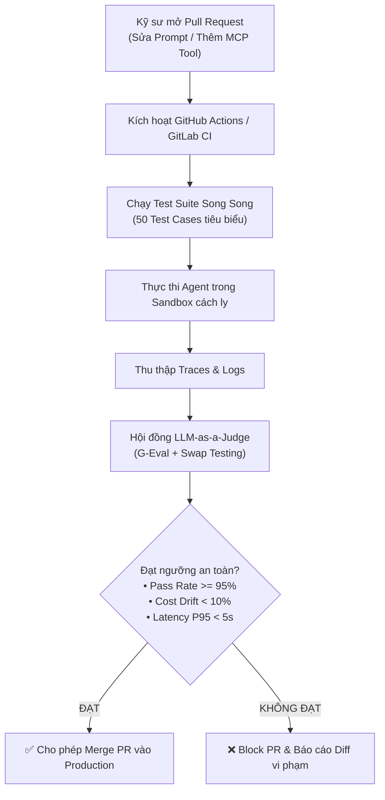

# Synthetic Benchmarks & LLM-as-a-Judge: Đánh Giá Tự Động, Khắc Phục Thiên Vị & Kiểm Thử Hồi Quy CI/CD Cho AI Agent

---

## 🧭 TỔNG QUAN ĐỊNH VỊ KIẾN TRÚC

Trong công nghệ phần mềm truyền thống, kiểm thử hồi quy (Regression Testing) dựa trên tính xác định: cùng một đầu vào thì mã lệnh phải trả về cùng một đầu ra (`assert result == expected`).

Tuy nhiên, với **Hệ thống Tác tử Tự trị (Autonomous Agents)**:
1. **Tính bất định (Non-deterministic):** Cùng một mục tiêu, Agent có thể chọn các lộ trình gọi công cụ (Tool trajectories) khác nhau tùy thuộc vào nhiệt độ (`temperature`) và thời điểm.
2. **Nút thắt cổ chai nhân lực (Human Evaluation Bottleneck):** Không một đội ngũ chuyên gia nào có thể đọc và chấm điểm thủ công hàng trăm ngàn lượt tương tác đa bước mỗi ngày.
3. **Hiện tượng thoái lui âm thầm (Silent Capability Regression):** Một thay đổi nhỏ trong System Prompt hoặc tinh chỉnh một công cụ MCP có thể sửa được lỗi này nhưng vô tình làm gãy đổ 10 kỹ năng phức tạp khác mà không ai hay biết.

Để giải quyết bài toán này, các hệ thống AI Agent hiện đại xây dựng một **Hạ tầng Đánh giá Tự động Khép kín (Automated Eval Loop)**: sử dụng LLM để tự động sinh hàng ngàn kịch bản kiểm thử tổng hợp (Synthetic Testsets), kết hợp mô hình trọng tài thông minh (**LLM-as-a-Judge**) đã được triệt tiêu thiên vị, và tích hợp trực tiếp vào đường ống CI/CD.

```
┌──────────────────────────────────────────────────────────────────────────────────┐
│                   CONTINUOUS AGENT EVALUATION PIPELINE (CI/CD)                  │
├──────────────────────────────────────────────────────────────────────────────────┤
│ 1. Synthetic Generator ──► Tạo 500 bài toán biên phức tạp (Edge Cases)           │
│ 2. Agent Execution     ──► Chạy song song trong Docker/E2B Sandboxes             │
│ 3. Trajectory Logging  ──► Thu thập Trace Tree, Tool Calls, Tokens tiêu thụ      │
│ 4. Debiased Judge      ──► Chấm điểm G-Eval (Swap testing, triệt tiêu 4 thiên vị)│
│ 5. CI/CD Gate          ──► Pass Rate >= 95%? -> Tự động Merge PR / Fail -> Chặn  │
└──────────────────────────────────────────────────────────────────────────────────┘
```

---

## 1. TỰ ĐỘNG SINH TẬP KIỂM THỬ TỔNG HỢP (SYNTHETIC TESTSET GENERATION)

Dữ liệu thực tế từ người dùng (Production Logs) thường có 2 nhược điểm:
* Chứa dữ liệu nhạy cảm (PII), khó chia sẻ nội bộ.
* Phân bổ lệch: $90\%$ là các câu hỏi đơn giản, thiếu các trường hợp kiểm thử biên (Edge Cases) và các tình huống bẫy (Adversarial Traps).

### 1.1. Giải Thuật Tiến Hóa Độ Phức Tạp (Evol-Instruct for Agents)
Lấy một kịch bản cơ sở và tiến hóa theo 4 hướng đột biến để thử thách khả năng chịu đựng của Agent:

```
[ Kịch bản gốc: "Tìm kiếm các file log trong thư mục /var/log" ]
                      │
     ┌────────────────┼────────────────┬────────────────┐
     ▼                ▼                ▼                ▼
[ Tăng chiều sâu ] [ Thêm ràng buộc ] [ Tạo tình huống ] [ Tiêm nhiễu ]
"Tìm file log có   "Chỉ tìm file >    bẫy (Trap)       "Thư mục chứa
kích thước lớn    50MB, sửa đổi trong "Tên file chứa ký  symlink vòng lặp
nhất, nén lại và   24h qua, loại trừ  tự đặc biệt, file  vô tận và file bị
gửi email"        file .gz"          bị khóa quyền"   hỏng header"
```

### 1.2. Ba Chiều Không Gian Kiểm Thử Bắt Buộc
Một bộ đề kiểm thử Agent đạt chuẩn phải kiểm tra được 3 chiều năng lực:
1. **Tool Selection Accuracy:** Khả năng chọn đúng công cụ trong số 50 công cụ MCP khả dụng mà không bị nhầm lẫn giữa các công cụ có tên tương tự nhau.
2. **Argument Schema Adherence:** Sinh đúng định dạng tham số theo Pydantic schema mà không bỏ sót trường bắt buộc.
3. **Resilience to Failure (Khả năng chịu lỗi):** Khi một công cụ trả về lỗi $500$ hoặc `Permission Denied`, Agent có biết tự động thử phương án thay thế hay đầu hàng ngay lập tức?

---

## 2. GIẢI PHÃU 4 THIÊN VỊ CỐ HỮU CỦA LLM-AS-A-JUDGE & KỸ THUẬT TRIỆT TIÊU

Khi sử dụng một LLM mạnh (như GPT-4o hoặc Claude 3.5 Sonnet) để chấm điểm chất lượng câu trả lời của Agent khác, mô hình trọng tài mắc phải **4 thiên vị nhận thức nghiêm trọng**:

### 2.1. Bốn Thiên Vị Cố Hữu
1. **Position Bias (Thiên vị vị trí):** Khi so sánh đối đầu 2 câu trả lời A và B, mô hình trọng tài có xu hướng ưu tiên chọn câu trả lời đứng ở vị trí A hơn vị trí B (chiếm tỷ lệ lệch tới $60\% - 65\%$).
2. **Verbosity Bias (Thiên vị độ dài):** Mô hình có xu hướng cho điểm cao hơn đối với các câu trả lời dài dòng, dùng nhiều từ ngữ hoa mỹ, dù nội dung cốt lõi có thể chứa lỗi logic hoặc lan man.
3. **Self-Enhancement Bias (Thiên vị họ hàng):** GPT-4o khi làm trọng tài có xu hướng chấm điểm cao hơn cho các câu trả lời do chính GPT sinh ra so với câu trả lời của Claude hoặc Llama.
4. **Tone / Authority Bias (Thiên vị giọng điệu):** Agent trả lời tự tin khẳng định *"Chắc chắn 100% kết quả là X"* sẽ nhận điểm cao hơn Agent trả lời thận trọng *"Theo tài liệu, khả năng cao là X"*, ngay cả khi kết quả X là hoàn toàn bịa đặt (Hallucination).

### 2.2. Kỹ Thuật Triệt Tiêu Thiên Vị (Debiasing Tactics)

#### Kỹ thuật 1: Hoán Đổi Vị Trí (Swap Testing / Pairwise Invariance)
Để triệt tiêu Position Bias, mỗi cặp câu trả lời $(A, B)$ bắt buộc phải được chấm điểm 2 lần độc lập:
* Lần 1: Đưa vào prompt theo thứ tự `(A, B)`.
* Lần 2: Đưa vào prompt theo thứ tự `(B, A)`.
* **Quy tắc phán quyết:**
  * Nếu cả 2 lần đều chọn cùng một phương án $\to$ Công nhận kết quả.
  * Nếu đảo vị trí mà kết quả đảo theo (lần 1 chọn A, lần 2 chọn B) $\to$ Đánh dấu là **Hòa (Tie)** hoặc bất định, loại bỏ khỏi chỉ số đánh giá.

#### Kỹ thuật 2: Đo Lường Logit Xác Suất (G-Eval Framework)
Thay vì yêu cầu LLM sinh ra văn bản điểm số (`"Score: 4"`), ta cưỡng chế mô hình trả về một token điểm số duy nhất từ $1$ đến $5$, sau đó trích xuất **xác suất Softmax (Normalized Logprobs)** của các token này để tính điểm kỳ vọng toán học:

$$
\mathbb{E}[\text{Score}] = \sum_{s=1}^5 s \cdot P(\text{token} = s)
$$

Trong đó $P(\text{token} = s) = \frac{\exp(\ell_s)}{\sum_{j=1}^5 \exp(\ell_j)}$, với $\ell_s$ là logit của token số nguyên $s$.
Phương pháp này loại bỏ hoàn toàn tính rời rạc và biến điểm số đánh giá thành một hàm liên tục có độ nhạy cực cao.

---

## 3. THIẾT KẾ ĐƯỜNG ỐNG KIỂM THỬ HỒI QUY TRONG CI/CD (REGRESSION PIPELINE)

Một hệ thống AI Agent chuyên nghiệp không được phép triển khai code mới nếu chưa vượt qua cổng kiểm định tự động (CI/CD Quality Gate):



---

## 4. MÃ NGUỒN THỰC CHIẾN: HỆ THỐNG G-EVAL TRỌNG TÀI TRIỆT TIÊU THIÊN VỊ

Dưới đây là một mô-đun Python hoàn chỉnh triển khai:
1. `DebiasedPairwiseJudge`: Thực hiện kiểm thử hoán đổi vị trí (Swap Testing).
2. `GEvalScoreCalculator`: Tính điểm kỳ vọng dựa trên phân bổ xác suất Softmax.

```python
"""
Mô-đun Đánh giá Tác tử Tự động: Debiased LLM-as-a-Judge & G-Eval
Yêu cầu thư viện: pip install pydantic
"""

from typing import Dict, Any, Tuple, Optional
from pydantic import BaseModel
import math


class EvaluationCriteria(BaseModel):
    name: str
    description: str
    rubric: Dict[int, str] # Hướng dẫn chấm điểm từ 1 đến 5


ACCURACY_CRITERIA = EvaluationCriteria(
    name="Tool Call Precision & Faithfulness",
    description="Đánh giá tính chuẩn xác của công cụ được gọi và sự trung thực với dữ liệu.",
    rubric={
        1: "Chọn sai hoàn toàn công cụ hoặc bịa đặt tham số nguy hiểm.",
        2: "Chọn đúng công cụ nhưng tham số bị thiếu hoặc sai kiểu dữ liệu.",
        3: "Thực hiện được tác vụ nhưng thừa thãi bước gọi công cụ không cần thiết.",
        4: "Chọn đúng công cụ, tham số chính xác, đạt được mục tiêu.",
        5: "Tối ưu tuyệt đối: chọn đúng công cụ tối thiểu, tham số chuẩn xác và xử lý lỗi hoàn hảo."
    }
)


class MockLLMJudgeEngine:
    """Giả lập bộ máy LLM Judge trả về Logits xác suất cho các token điểm số 1-5"""

    @staticmethod
    def compute_logits(prompt: str) -> Dict[str, float]:
        # Giả lập giá trị logit thô trả về từ API (ví dụ OpenAI logprobs)
        if "cách tiếp cận tối ưu" in prompt.lower():
            return {"1": -4.5, "2": -3.2, "3": -1.1, "4": 2.5, "5": 3.8}
        return {"1": -1.5, "2": 1.2, "3": 2.8, "4": 0.5, "5": -2.0}


class GEvalScorer:
    """Tính điểm G-Eval kỳ vọng liên tục dựa trên phân phối Softmax của Logits"""

    @classmethod
    def calculate_continuous_score(cls, logits: Dict[str, float]) -> Tuple[float, Dict[str, float]]:
        # 1. Tính Softmax
        max_logit = max(logits.values())
        exp_vals = {k: math.exp(v - max_logit) for k, v in logits.items()}
        sum_exp = sum(exp_vals.values())
        probabilities = {k: v / sum_exp for k, v in exp_vals.items()}

        # 2. Tính kỳ vọng toán học E[Score] = sum(score * P(score))
        expected_score = sum(int(score) * prob for score, prob in probabilities.items())

        return expected_score, probabilities


class DebiasedPairwiseJudge:
    """Bộ trọng tài đối đầu triệt tiêu Position Bias qua kỹ thuật Swap Testing"""

    @classmethod
    def evaluate_pairwise(
        cls, 
        task: str, 
        response_a: str, 
        response_b: str
    ) -> Dict[str, Any]:
        print("\n" + "=" * 65)
        print("BẮT ĐẦU ĐÁNH GIÁ ĐỐI ĐẦU ĐÔI (SWAP TESTING DEBIASING)")
        print("=" * 65)

        # Lần 1: Thứ tự gốc (A đứng trước, B đứng sau)
        prompt_1 = f"Task: {task}\nOption 1: {response_a}\nOption 2: {response_b}\nĐâu là cách tiếp cận tối ưu?"
        logits_1 = MockLLMJudgeEngine.compute_logits(prompt_1)
        score_1, _ = GEvalScorer.calculate_continuous_score(logits_1)
        winner_1 = "Option A" if score_1 >= 3.5 else "Option B"
        print(f"Lần 1 (Order A-B): Điểm {score_1:.2f} -> Trọng tài chọn: [{winner_1}]")

        # Lần 2: Hoán đổi vị trí (B đứng trước, A đứng sau)
        prompt_2 = f"Task: {task}\nOption 1: {response_b}\nOption 2: {response_a}\nĐâu là cách tiếp cận tối ưu?"
        logits_2 = MockLLMJudgeEngine.compute_logits(prompt_2)
        score_2, _ = GEvalScorer.calculate_continuous_score(logits_2)
        # Chú ý: Ở lần 2, Option 1 chính là B, Option 2 chính là A
        winner_2 = "Option B" if score_2 >= 3.5 else "Option A"
        print(f"Lần 2 (Order B-A): Điểm {score_2:.2f} -> Trọng tài chọn: [{winner_2}]")

        # Phán quyết triệt tiêu thiên vị
        if winner_1 == winner_2:
            final_winner = winner_1
            status = "STABLE_CONSENSUS"
            print(f"🎯 KẾT LUẬN: [{final_winner}] chiến thắng thuyết phục (Độc lập với vị trí)!")
        else:
            final_winner = "TIE / INCONCLUSIVE"
            status = "POSITION_BIAS_DETECTED"
            print("⚠️ CẢNH BÁO: Phát hiện Position Bias! Quyết định phụ thuộc vào vị trí hiển thị -> Tính là HÒA.")

        return {
            "status": status,
            "winner": final_winner,
            "round_1_score": score_1,
            "round_2_score": score_2
        }


# ==========================================
# MÔ PHỎNG KIỂM ĐỊNH HỒI QUY
# ==========================================
def main():
    task = "Truy vấn 100 giao dịch gian lận gần nhất từ Database có 50 triệu bản ghi."
    
    agent_a_trajectory = (
        "1. Gọi tool sql_query('SELECT * FROM transactions WHERE is_fraud=true ORDER BY date DESC LIMIT 100')\n"
        "2. Nén kết quả thành JSON tinh gọn."
    )
    
    agent_b_trajectory = (
        "1. Gọi tool sql_query('SELECT * FROM transactions') mà không có LIMIT\n"
        "2. Đổ 50 triệu dòng vào bộ nhớ và dùng Python filter lọc bằng tay."
    )

    print(f"ĐỀ BÀI KIỂM THỬ: {task}")
    print(f"\n[Agent A Trajectory]:\n{agent_a_trajectory}")
    print(f"\n[Agent B Trajectory]:\n{agent_b_trajectory}")

    result = DebiasedPairwiseJudge.evaluate_pairwise(task, agent_a_trajectory, agent_b_trajectory)
    print("\nKết quả kiểm tra CI/CD Gate:", result["status"])


if __name__ == "__main__":
    main()
```

---

## 5. BẢNG SO SÁNH CÁC PHƯƠNG PHÁP ĐÁNH GIÁ AGENT

| Phương Pháp | Chi Phí Vận Hành | Tốc Độ Kiểm Thử | Khả Năng Mở Rộng | Độ Tin Cậy Khách Quan |
| :--- | :--- | :--- | :--- | :--- |
| **Human Expert Evaluation** | Cực kỳ đắt đỏ ($50\$ - 100\$/\text{giờ}$) | Rất chậm (vài ngày) | Không thể scale | Rất cao nhưng chủ quan theo từng cá nhân. |
| **Deterministic Unit Tests (`pytest`)** | Bằng $0$ | Siêu nhanh ($< 1\text{s}$) | Vô hạn | Chỉ đo được cú pháp, không đo được chất lượng lập luận. |
| **Naive LLM-as-a-Judge** | Rẻ ($\sim 0.01\$/\text{test}$) | Nhanh ($1 - 3\text{s}$) | Rất cao | Thấp; dễ bị lừa bởi Verbosity Bias và Position Bias. |
| **Debiased G-Eval + Swap Testing** | Vừa phải ($\sim 0.02\$/\text{test}$) | Nhanh ($2 - 5\text{s}$) | Rất cao | **Xuất sắc (Tương quan $> 85\%$ với chuyên gia con người).** |

---

## 🔗 LIÊN KẾT HỆ THỐNG
* Nền tảng Tracing: [01_agent_evals_and_tracing.md](01_agent_evals_and_tracing.md) - Thu thập cây vết OpenTelemetry làm dữ liệu đầu vào cho Judge
* Quản trị chi phí: [03_token_economics_and_cost_optimization.md](03_token_economics_and_cost_optimization.md) - Tối ưu hóa chi phí token khi chạy bộ đề kiểm thử quy mô lớn
* Trở về mục lục chính: [README.md](../../README.md)
