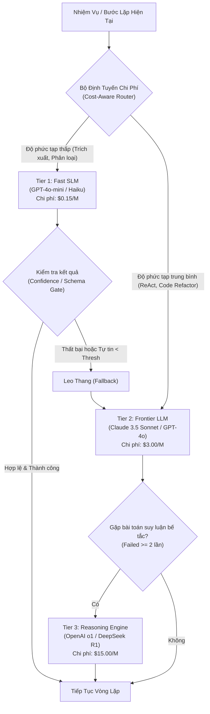

# Token Economics & Cost Optimization: Tối Ưu Hóa Chi Phí Vận Hành & Mô Hình Định Tuyến Đa Tầng Cho AI Agent

---

## 🧭 TỔNG QUAN ĐỊNH VỊ KIẾN TRÚC

Trong các ứng dụng trò chuyện đơn lẻ (Single-turn Chatbots), chi phí token là bài toán tuyến tính: người dùng hỏi một câu 100 tokens, bot trả lời 300 tokens, tổng chi phí chỉ vài phần trăm xu.

Tuy nhiên, khi bước vào thế giới của **Tác tử tự trị (Autonomous Agents)**, ta đối mặt với **Hiệu Ứng Cấp Số Nhân Của Vòng Lặp (The Loop Multiplier Effect)**:
* Một tác tử giải quyết một bug phần mềm hoặc thực hiện nghiên cứu thị trường thường chạy từ $15$ đến $30$ bước lặp (ReAct steps).
* Tại mỗi bước $t$, toàn bộ lịch sử trò chuyện, tài liệu RAG, và kết quả gọi công cụ (Observation) của các bước trước $1, \dots, t-1$ lại được nhồi ngược trở lại Context Window.
* Nếu không có chiến lược kiểm soát, một tác vụ đơn lẻ có thể tiêu tốn hàng triệu tokens và hàng chục USD chỉ trong vài phút, khiến dự án sụp đổ về mặt hiệu quả kinh tế (Negative ROI).

Chuyên đề này cung cấp toàn bộ nền tảng toán học, kỹ thuật định tuyến mô hình đa tầng (Model Cascading & Routing), nén ngữ cảnh (Context Pruning), và thiết lập bộ ngắt mạch ngân sách (Budget Circuit Breakers) để giảm tới **$70\% - 85\%$** hóa đơn API mà không suy giảm chất lượng đầu ra.

```
┌──────────────────────────────────────────────────────────────────────────────────┐
│                     TOKEN COST EXPLOSION IN AGENTIC LOOPS                        │
├──────────────────────────────────────────────────────────────────────────────────┤
│ Step 1: System Prompt (2k) + Task (500)                              =   2,500 t │
│ Step 2: ... + Thought 1 + Action 1 + Observation (Tool Output 8k)    =  10,500 t │
│ Step 3: ... + Thought 2 + Action 2 + Observation (HTML page 15k)     =  25,500 t │
│ Step 4: ... + Thought 3 + Action 3 + Observation (Error log 20k)     =  45,500 t │
│ Step N: Context tích lũy lũy tiến O(N^2) token!                      = 200,000+ t│
├──────────────────────────────────────────────────────────────────────────────────┤
│ TỔNG TOKEN TIÊU THỤ = TỔNG DÃY SỐ CỘNG DỒN -> CHI PHÍ BÙNG NỔ CỰC KỲ NGUY HIỂM! │
└──────────────────────────────────────────────────────────────────────────────────┘
```

---

## 1. GIẢI PHÃU CƠ CẤU CHI PHÍ TOKEN & CÔNG THỨC TÍCH LŨY

### 1.1. Bất Đối Xứng Giá Cả (Input vs Output vs Cached Tokens)
Các nhà cung cấp mô hình ngôn ngữ lớn (OpenAI, Anthropic, Google) áp dụng cơ cấu định giá phân cấp rõ rệt:

| Loại Token | Trọng Số Chi Phí Tương Đối | Bản Chất Kỹ Thuật |
| :--- | :--- | :--- |
| **Standard Input Token** | $1\times$ (Cơ sở) | Đọc ngữ cảnh một lần qua ma trận Transformer. |
| **Output (Generation) Token** | $3\times \to 5\times$ so với Input | Đòi hỏi tính toán tự hồi quy (Autoregressive), giữ khóa KV-Cache trên GPU VRAM. |
| **Cached Input Token (Prompt Caching)** | $0.1\times \to 0.25\times$ (Giảm $75\% - 90\%$) | Đã được tính sẵn tiền tố (Prefix KV-Cache) trên bộ nhớ GPU, không cần tính lại. |

### 1.2. Mô Hình Toán Học Tích Lũy Chi Phí Vòng Lặp
Xét một tác tử chạy $N$ bước lặp. Tại bước $i$, độ dài ngữ cảnh đầu vào là $L_i$ và độ dài sinh ra là $O_i$.
Giả sử chi phí đơn vị cho input là $P_{\text{in}}$ và output là $P_{\text{out}}$.

Nếu ngữ cảnh không được nén hay cắt tỉa, độ dài input tại bước $k$ là:

$$
L_k = L_0 + \sum_{i=1}^{k-1} (O_i + \text{Obs}_i)
$$

Trong đó $L_0$ là System Instructions + User Prompt, và $\text{Obs}_i$ là kích thước đầu ra của Tool tại bước $i$.
Tổng chi phí của toàn bộ phiên làm việc là:

$$
\text{Total Cost} = P_{\text{in}} \sum_{k=1}^N L_k + P_{\text{out}} \sum_{k=1}^N O_k
$$

Nếu mỗi bước trung bình sinh thêm một lượng token cố định $\Delta$, tổng chi phí input tăng theo quy luật cấp số cộng có độ phức tạp bậc hai:

$$
\sum_{k=1}^N L_k \approx N \cdot L_0 + \frac{N(N-1)}{2} \cdot \Delta = \mathcal{O}(N^2)
$$

> [!important] Kết luận kỹ thuật
> Tác tử lặp $20$ bước không chỉ tốn gấp $20$ lần một câu prompt đơn lẻ, mà tốn gấp **hơn $100$ đến $200$ lần** nếu để nguyên lịch sử tích lũy! Đây là lý do sống còn vì sao tối ưu hóa kinh tế token là bắt buộc.

---

## 2. KIẾN TRÚC ĐỊNH TUYẾN MÔ HÌNH ĐA TẦNG (MODEL CASCADING & ROUTING)

Không phải bước nào trong vòng lặp tác tử cũng đòi hỏi trí thông minh của các siêu mô hình đắt đỏ (như Claude 3.5 Sonnet, GPT-4o, hay OpenAI o1).

### 2.1. Phân Tầng Khả Năng Mô Hình (Model Capability Tiers)
Trong một hệ thống cấp doanh nghiệp, ta chia các mô hình thành 3 tầng:

1. **Tier 1: Fast / Edge SLMs (Mô hình nhỏ/rẻ):**
   * *Đại diện:* GPT-4o-mini, Claude 3.5 Haiku, Llama-3.1-8B, Qwen-2.5-Coder-7B.
   * *Chi phí:* $\sim 0.15\$ / 1\text{M input tokens}$.
   * *Nhiệm vụ phù hợp:* Phân loại ý định (Intent Routing), trích xuất thực thể, kiểm tra cú pháp JSON, tóm tắt quan sát ngắn, lọc kết quả tìm kiếm thô.
2. **Tier 2: Standard Frontier Models (Mô hình chủ lực):**
   * *Đại diện:* GPT-4o, Claude 3.5 Sonnet, Gemini 1.5 Pro.
   * *Chi phí:* $\sim 3.00\$ / 1\text{M input tokens}$ (đắt gấp $20$ lần Tier 1).
   * *Nhiệm vụ phù hợp:* Lập kế hoạch nhiều bước (ReAct planning), viết mã nguồn phức tạp, giải quyết mâu thuẫn dữ liệu, gọi công cụ có điều kiện.
3. **Tier 3: Reasoning / Heavyweight Models (Mô hình suy luận sâu):**
   * *Đại diện:* OpenAI o1 / o3-mini, DeepSeek-R1.
   * *Chi phí:* Rất cao ($15\$ - 60\$ / 1\text{M tokens}$).
   * *Nhiệm vụ phù hợp:* Kiến trúc hệ thống phức tạp, chứng minh logic toán học, gỡ lỗi đa luồng (Deadlock / Concurrency) mà Tier 2 thất bại sau 2 lần thử.

### 2.2. Cơ Chế Định Tuyến Động (Dynamic Model Router Architecture)



### 2.3. Thuật Toán FrugalGPT & Entropy-based Fallback
Nguyên lý: Luôn thử mô hình rẻ nhất có khả năng giải quyết tác vụ. Chỉ nâng cấp lên mô hình đắt tiền hơn khi:
1. **Schema Validation Failure:** Model Tier 1 không sinh được JSON hợp lệ theo Pydantic schema sau 1 lần retry.
2. **Logprob / Uncertainty Threshold:** Điểm bất định (Token Entropy) của câu trả lời vượt ngưỡng:
   $$H(X) = - \sum_{i} P(x_i) \log P(x_i) > \tau_{\text{uncertainty}}$$
3. **Execution Verification Failure:** Mã nguồn do Tier 1 sinh ra không vượt qua được unit test trong sandbox.

---

## 3. KỸ THUẬT NÉN NGỮ CẢNH & TỐI ƯU HÓA QUAN SÁT (OBSERVATION PRUNING)

Thủ phạm lớn nhất gây "cháy ngân sách" trong các Agent không phải là suy nghĩ của LLM, mà là **Dữ liệu trả về từ công cụ (Tool Observations)**:
* Một lệnh `curl https://example.com` trả về 1 trang HTML rác chứa đầy CSS, JavaScript và tracking tags tiêu tốn $40.000$ tokens.
* Một lệnh `git diff` trên repo lớn trả về $30.000$ dòng code không liên quan.

### 3.1. Kỹ Thuật Lọc Ngay Tại Adapter Công Cụ (At-the-Boundary Distillation)
Không bao giờ cho phép Tool đẩy trực tiếp kết quả thô vào Working Memory của Agent. Mọi kết quả công cụ phải đi qua một bộ lọc:

```
[ Kết quả thô từ Tool ] (40.000 tokens HTML)
          │
          ▼
[ Boundary Filter / Defuddle / Parser ] (Loại bỏ <script>, <style>, SVG)
          │
          ▼
[ Trích xuất Markdown ngữ nghĩa ] (1.500 tokens văn bản sạch)
          │
          ▼
[ Inject vào Context Window của Agent ] -> Tiết kiệm 96% token!
```

### 3.2. Cắt Tỉa Lịch Sử Có Chọn Lọc (Selective Semantic Pruning)
Thay vì lưu lại toàn bộ các bước lặp từ đầu, áp dụng chiến lược **Sliding Window with Semantic Anchors**:
* **Ghim cố định (Pinned Anchors):** System Prompt ban đầu, Mục tiêu tối thượng của User, và Danh sách công cụ.
* **Tóm tắt động (Rolling Summary):** Các bước từ $1$ đến $t-4$ được gom lại thành 1 đoạn văn bản cô đọng 200 từ:
  *"Ở bước 1-3, Agent đã quét cổng mạng và xác định server chạy Nginx 1.18, phát hiện file auth.py chứa lỗ hổng SQLi."*
* **Giữ nguyên vẹn (Full Fidelity):** Chỉ giữ đầy đủ chi tiết của 3 bước gần nhất ($t-2, t-1, t$).

---

## 4. TỐI ƯU HÓA GPU PREFIX PROMPT CACHING

Cả Anthropic (Prompt Caching) và OpenAI (Prompt Caching) đều cho phép giảm giá đến **$80\% - 90\%$** và giảm độ trễ Time-to-First-Token (TTFT) tới **$85\%$** nếu các token ở phần đầu của context (Prefix) giữ nguyên không đổi giữa các request liên tiếp.

### 4.1. Quy Tắc Vàng Thiết Kế Context Đạt Tỷ Lệ Cache Hit > 85%
Để tận dụng tối đa Prompt Caching, thứ tự sắp xếp thông điệp trong Context Window phải tuân thủ nguyên tắc: **Tĩnh ở đầu, Động ở cuối**:

```
┌─────────────────────────────────────────────────────────────┐
│ 1. SYSTEM INSTRUCTIONS & CORE TOOLS (TĨNH 100%)             │ -> CACHE HIT!
├─────────────────────────────────────────────────────────────┤
│ 2. FEW-SHOT EXAMPLES & DOCUMENTATION (TĨNH 100%)            │ -> CACHE HIT!
├─────────────────────────────────────────────────────────────┤
│ 3. PROJECT CONTEXT & FILE REPO MAP (RẤT ÍT ĐỔI)             │ -> CACHE HIT!
├─────────────────────────────────────────────────────────────┤
│ 4. Lịch sử hội thoại & Các bước ReAct (ĐỘNG - Tăng dần)     │ -> Cache Write mới
├─────────────────────────────────────────────────────────────┤
│ 5. Câu hỏi của người dùng & Tool Call hiện tại (ĐỘNG)       │ -> Không Cache
└─────────────────────────────────────────────────────────────┘
```

> [!caution] Sai lầm phá vỡ Cache Prefix
> Nếu bạn chèn thời gian hiện tại (`Current Time: 2026-10-18 20:25:01`) hoặc Session ID ngẫu nhiên vào dòng đầu tiên của System Prompt, **toàn bộ cơ chế Prompt Caching của Anthropic/OpenAI sẽ bị vô hiệu hóa $100\%$**, khiến bạn phải trả đầy đủ tiền cho mọi token phía sau!

---

## 5. MÔ HÌNH TOÁN HỌC ROI & BỘ NGẮT MẠCH NGÂN SÁCH (BUDGET CIRCUIT BREAKERS)

### 5.1. Định Luật Lợi Ích Cận Biên Giảm Dần (Diminishing Marginal Utility)
Trong vòng lặp Agent, mỗi bước suy luận bổ sung đều tiêu tốn thêm chi phí nhưng xác suất cải thiện kết quả sẽ giảm dần theo thời gian:

$$
U(t) = P_{\text{success}}(t) \cdot V_{\text{task}} - \sum_{i=1}^t C_i
$$

Trong đó:
* $V_{\text{task}}$: Giá trị kinh tế của tác vụ khi hoàn thành thành công.
* $P_{\text{success}}(t)$: Xác suất tác vụ hoàn thành đúng sau bước $t$ (hàm sigmoid tiệm cận $1$).
* $C_i$: Chi phí thực tế tại bước $i$.

Khi $\frac{\Delta U}{\Delta t} \le 0$, Agent nên dừng lại hoặc xin ý kiến con người thay vì tiếp tục "đốt tiền" vô ích.

### 5.2. Ba Cấp Độ Của Budget Circuit Breaker
1. **Soft Limit (Cảnh báo & Chuyển chế độ tiết kiệm):** Khi chi phí đạt $70\%$ ngân sách tối đa của task $\to$ Tự động hạ cấp mọi lệnh gọi từ Tier 2 xuống Tier 1, kích hoạt nén ngữ cảnh mạnh (Heavy Compression).
2. **Hard Limit (Ngắt cứng luồng chạy):** Khi chi phí chạm $100\%$ ngân sách (ví dụ: $\$0.50$/task) $\to$ Ngắt lập tức vòng lặp, lưu checkpoint và trả về thông báo lỗi kèm trạng thái hiện tại.
3. **Loop Velocity Breaker (Ngắt tốc độ tiêu thụ):** Nếu trong vòng 60 giây mà Agent tiêu thụ quá $100.000$ tokens $\to$ Phát hiện nguy cơ lặp vô tận (Infinite Loop / Tool Storm), ngắt tiến trình khẩn cấp.

---

## 6. MÃ NGUỒN THỰC CHIẾN: HỆ THỐNG COST-AWARE MODEL ROUTER & BUDGET ENFORCER

Dưới đây là một bộ điều phối hoàn chỉnh bằng Python hiện thực hóa:
1. `CostAwareRouter`: Định tuyến câu hỏi theo độ phức tạp ngữ nghĩa.
2. `BudgetManager`: Theo dõi chi phí token theo thời gian thực và tự động kích hoạt Circuit Breaker.
3. Tích hợp Prompt Caching Discount.

```python
"""
Mô-đun Tối ưu hóa Kinh tế Token và Chi phí Tác tử (Token Economics Engine)
Yêu cầu thư viện: pip install pydantic
"""

from typing import Dict, Any, Optional, List
from pydantic import BaseModel, Field
import time


class ModelTier(BaseModel):
    name: str
    input_price_per_m: float       # Giá trên 1 triệu input tokens ($)
    output_price_per_m: float      # Giá trên 1 triệu output tokens ($)
    cached_input_price_per_m: float # Giá input khi trúng Cache ($)
    max_context_window: int


# Bảng giá chuẩn hóa công nghiệp
TIER_1_FAST = ModelTier(
    name="gpt-4o-mini",
    input_price_per_m=0.15,
    output_price_per_m=0.60,
    cached_input_price_per_m=0.075,
    max_context_window=128000
)

TIER_2_FRONTIER = ModelTier(
    name="claude-3-5-sonnet",
    input_price_per_m=3.00,
    output_price_per_m=15.00,
    cached_input_price_per_m=0.30,
    max_context_window=200000
)


class BudgetExceededException(Exception):
    """Ném ra khi phiên làm việc vượt quá ngân sách cho phép"""
    pass


class TokenUsageTracker:
    """Theo dõi chi phí token theo thời gian thực và quản trị ngân sách"""

    def __init__(self, hard_limit_usd: float = 0.20, soft_limit_usd: float = 0.14):
        self.hard_limit_usd = hard_limit_usd
        self.soft_limit_usd = soft_limit_usd
        self.total_cost_usd: float = 0.0
        self.total_input_tokens: int = 0
        self.total_cached_tokens: int = 0
        self.total_output_tokens: int = 0
        self.step_history: List[Dict[str, Any]] = []

    def record_usage(
        self, 
        tier: ModelTier, 
        input_tokens: int, 
        output_tokens: int, 
        cached_tokens: int = 0
    ) -> float:
        # Tính toán chi phí từng thành phần
        uncached_input = max(0, input_tokens - cached_tokens)
        cost_uncached = (uncached_input / 1_000_000) * tier.input_price_per_m
        cost_cached = (cached_tokens / 1_000_000) * tier.cached_input_price_per_m
        cost_output = (output_tokens / 1_000_000) * tier.output_price_per_m
        
        step_cost = cost_uncached + cost_cached + cost_output
        self.total_cost_usd += step_cost
        self.total_input_tokens += input_tokens
        self.total_cached_tokens += cached_tokens
        self.total_output_tokens += output_tokens

        self.step_history.append({
            "model": tier.name,
            "step_cost": step_cost,
            "accumulated_cost": self.total_cost_usd
        })

        # Kiểm tra ngưỡng ngắt mạch
        if self.total_cost_usd >= self.hard_limit_usd:
            raise BudgetExceededException(
                f"🛑 HARD BUDGET EXCEEDED: Chi phí hiện tại (${self.total_cost_usd:.4f}) "
                f"đã vượt quá hạn mức tối đa (${self.hard_limit_usd:.4f})!"
            )

        return step_cost

    def is_in_economy_mode(self) -> bool:
        """Kiểm tra xem có cần chuyển sang chế độ tiết kiệm khẩn cấp không"""
        return self.total_cost_usd >= self.soft_limit_usd


class CostAwareRouter:
    """Bộ định tuyến mô hình thông minh dựa trên độ phức tạp và ngân sách"""

    def __init__(self, budget_tracker: TokenUsageTracker):
        self.tracker = budget_tracker

    def select_model(self, task_type: str, prompt_length: int) -> ModelTier:
        # 1. Nếu ngân sách đã chạm ngưỡng Soft Limit -> ÉP BUỘC dùng Tier 1
        if self.tracker.is_in_economy_mode():
            print("  ⚠️ [ECONOMY MODE ACTIVE] Đã chạm 70% ngân sách. Hạ cấp bắt buộc sang Tier 1!")
            return TIER_1_FAST

        # 2. Phân loại theo bản chất tác vụ
        # Các tác vụ nhẹ: trích xuất, phân loại, format JSON, tóm tắt quan sát
        lightweight_tasks = {"extraction", "classification", "json_formatting", "observation_summary"}
        if task_type in lightweight_tasks:
            return TIER_1_FAST

        # Các tác vụ nặng: lập trình, lập kế hoạch ReAct phức tạp, phân tích kiến trúc
        return TIER_2_FRONTIER


# ==========================================
# MÔ PHỎNG VẬN HÀNH TIẾT KIỆM CHI PHÍ
# ==========================================
def simulate_agent_run():
    print("=" * 65)
    print("KHỞI TẠO TÁC TỬ TỰ TRỊ VỚI HỆ THỐNG QUẢN TRỊ TOKEN ECONOMICS")
    print("=" * 65)

    # Ngân sách trần cứng cho 1 task là $0.05
    budget = TokenUsageTracker(hard_limit_usd=0.05, soft_limit_usd=0.035)
    router = CostAwareRouter(budget)

    steps = [
        {"type": "classification", "desc": "Phân loại câu hỏi của người dùng", "in": 1500, "out": 100, "cache": 1200},
        {"type": "react_planning", "desc": "Lập kế hoạch 5 bước giải quyết sự cố", "in": 4000, "out": 800, "cache": 3500},
        {"type": "observation_summary", "desc": "Nén kết quả 15.000 dòng log server", "in": 8000, "out": 300, "cache": 7000},
        {"type": "code_refactor", "desc": "Viết lại logic xác thực bảo mật", "in": 6000, "out": 1200, "cache": 5000},
        {"type": "react_planning", "desc": "Kiểm tra lại toàn bộ quy trình", "in": 9000, "out": 600, "cache": 8000},
    ]

    try:
        for idx, step in enumerate(steps, 1):
            tier = router.select_model(step["type"], step["in"])
            step_cost = budget.record_usage(
                tier=tier,
                input_tokens=step["in"],
                output_tokens=step["out"],
                cached_tokens=step["cache"]
            )
            print(f"Bước {idx}: [{tier.name}] - {step['desc']}")
            print(f"       Chi phí bước: ${step_cost:.5f} | Tổng lũy kế: ${budget.total_cost_usd:.5f}")

    except BudgetExceededException as e:
        print(f"\n{e}")

    print("\n" + "=" * 65)
    print("TỔNG KẾT KINH TẾ PHIÊN LÀM VIỆC:")
    print(f"• Tổng tokens đầu vào: {budget.total_input_tokens:,}")
    print(f"• Token trúng Cache:   {budget.total_cached_tokens:,} ({budget.total_cached_tokens/budget.total_input_tokens*100:.1f}%)")
    print(f"• Tổng tokens đầu ra:  {budget.total_output_tokens:,}")
    print(f"• TỔNG HÓA ĐƠN:        ${budget.total_cost_usd:.5f}")
    
    # Tính chi phí nếu không tối ưu (Dùng 100% Tier 2 và Không có Cache)
    worst_case_cost = (
        (budget.total_input_tokens / 1_000_000) * TIER_2_FRONTIER.input_price_per_m +
        (budget.total_output_tokens / 1_000_000) * TIER_2_FRONTIER.output_price_per_m
    )
    savings = (worst_case_cost - budget.total_cost_usd) / worst_case_cost * 100
    print(f"• Chi phí nếu KHÔNG tối ưu: ${worst_case_cost:.5f}")
    print(f"• TIẾT KIỆM ĐƯỢC:      {savings:.1f}%")
    print("=" * 65)


if __name__ == "__main__":
    simulate_agent_run()
```

---

## 7. BẢNG MA TRẬN ĐÁNH ĐỔI KỸ THUẬT (TRADE-OFF ANALYSIS)

| Phương Pháp Tối Ưu | Mức Tiết Kiệm Chi Phí | Tác Động Độ Trễ | Rủi Ro Kỹ Thuật | Giải Pháp Khắc Phục |
| :--- | :--- | :--- | :--- | :--- |
| **Model Cascading (Định tuyến Tier 1 $\to$ Tier 2)** | **$50\% - 70\%$** | Giảm đáng kể (SLM phản hồi nhanh gấp $3\times$). | Tier 1 có thể sinh sai schema hoặc hiểu sai sắc thái ngữ cảnh. | Dùng Pydantic Constrained Decoding và Fallback Gate tự động. |
| **GPU Prefix Prompt Caching** | **$40\% - 75\%$** | Giảm TTFT tới $80\%$. | Dễ bị mất cache nếu chèn timestamp hoặc random ID ở đầu prompt. | Đóng băng System Prompt và công cụ thành khối tĩnh ở đầu. |
| **Observation Distillation / Pruning** | **$60\% - 85\%$** | Tốn thêm vài chục ms để parse văn bản thô. | Có thể vô tình cắt nhầm dòng thông tin quan trọng. | Giữ lại bản tóm tắt trích xuất và cung cấp tool để xem lại raw log khi cần. |
| **Budget Circuit Breakers** | **Ngăn ngừa tổn thất vô hạn** | Không ảnh hưởng. | Task có thể bị dừng giữa chừng khi sắp hoàn thành. | Thiết lập Soft Limit để cảnh báo và nén ngữ cảnh trước khi ngắt cứng. |

---

## 🔗 LIÊN KẾT HỆ THỐNG
* Tiếp nối từ: [01_agent_evals_and_tracing.md](./01_agent_evals_and_tracing.md) - Đo lường định lượng và Tracing chi phí trong OpenTelemetry / Langfuse
* Tối ưu hóa bộ nhớ: [02_context_management.md](../01-harness-and-memory/03_context_management.md) - Kỹ thuật quản trị cửa sổ ngữ cảnh và nén lịch sử
* Nền tảng Caching: [04_agent_runtime_parameters_and_prompt_caching.md](../01-harness-and-memory/05_agent_runtime_parameters_and_prompt_caching.md) - Cơ chế RadixTree và Prompt Caching cấp độ GPU
* Trở về mục lục chính: [README.md](../../README.md)
