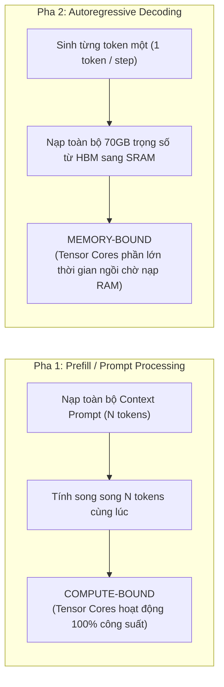
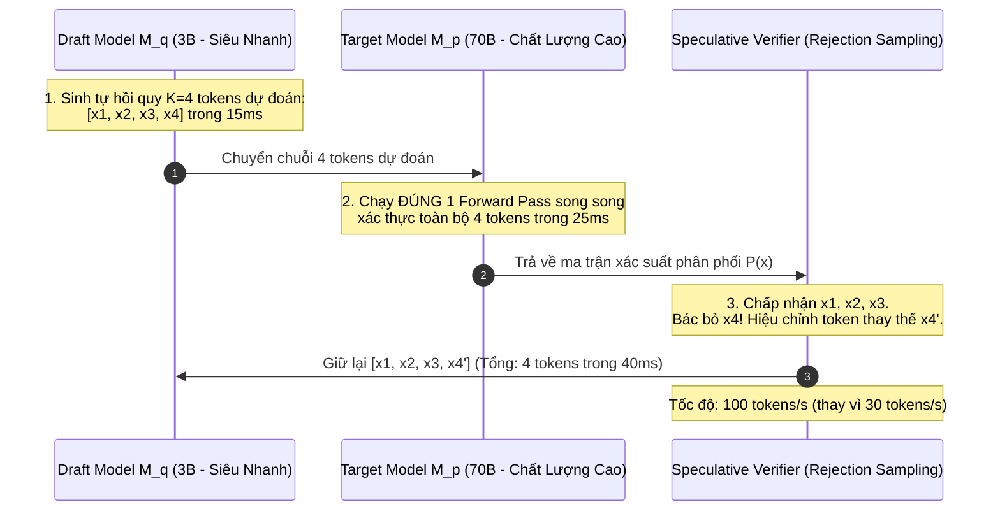
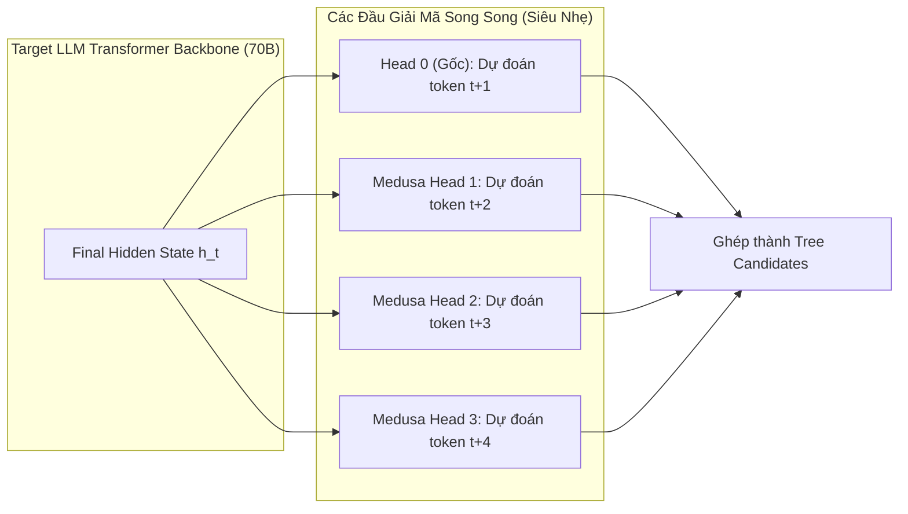
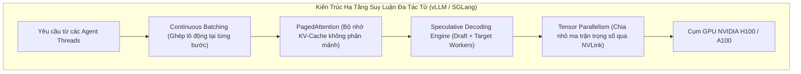

# ⚡ SPECULATIVE DECODING & INFERENCE ACCELERATION: TĂNG TỐC SUY LUẬN VÒNG LẶP TÁC TỬ

Trong các hệ thống tác tử tự trị ([Autonomous Agent Loops](../03-loop-and-multi-agent-engineering/01_loop_fundamentals.md)), một tác vụ phức tạp thường đòi hỏi từ $10$ đến $30$ lượt tương tác liên tục: lập kế hoạch, gọi công cụ, phân tích quan sát và tự sửa lỗi. Nếu mỗi bước suy luận phải chờ mô hình lớn (như LLaMA-3-70B hoặc Qwen-2.5-72B) sinh từng token một với tốc độ thông thường ($25 - 40\text{ tokens/s}$), tổng thời gian hoàn thành tác vụ có thể kéo dài tới vài phút.

Rào cản lớn nhất của pha sinh token tự hồi quy (Autoregressive Generation) không nằm ở năng lực tính toán của chip bán dẫn, mà nằm ở **nghẽn cổ chai băng thông bộ nhớ (Memory Bandwidth Bottleneck)**.

Tài liệu này phân tích chi tiết cơ chế toán học và kiến trúc hệ thống của **Speculative Decoding (Giải mã suy đoán)**, các biến thể mở rộng **Tree-based Attention**, kiến trúc không cần Draft model (**Medusa / Eagle**), và giải pháp tăng tốc hạ tầng suy luận đa GPU (vLLM / SGLang) giúp đẩy tốc độ sinh token của Agent lên gấp $2\times - 4\times$ mà **hoàn toàn không làm suy giảm chất lượng hay độ chính xác logic**.

---

## 1. Nút Thắt Cổ Chai Của Vòng Lặp Tác Tử: Memory-Bound vs Compute-Bound

Để hiểu tại sao LLM sinh token chậm, ta cần giải phẫu hai pha tính toán riêng biệt của kiến trúc Transformer:



### 1.1. Cường Độ Số Học (Arithmetic Intensity)
Khái niệm cốt lõi của khoa học tính toán hiệu năng cao (HPC) là **Arithmetic Intensity ($AI$)**:

$$
AI = \frac{\text{Số phép tính dấu phẩy động (FLOPs)}}{\text{Số bytes dữ liệu nạp từ bộ nhớ (Bytes)}}
$$

* **Trong pha Prefill:** Tính toán ma trận Attention giữa $N$ tokens với nhau $\to$ $AI \gg 100\text{ FLOPs/Byte}$. GPU đạt hiệu suất khai thác tối đa (Compute-Bound).
* **Trong pha Decode:** Để sinh ra **chỉ 1 token duy nhất**, GPU phải quét và nạp **toàn bộ trọng số của mô hình** từ bộ nhớ ngoài (HBM - High Bandwidth Memory) vào bộ nhớ đệm tính toán nội bộ (SRAM):
  $$
  AI_{\text{decode}} = \frac{2 \times P \text{ FLOPs}}{2 \times P \text{ Bytes}} \approx 1\text{ FLOP/Byte}
  $$
  (với $P$ là số lượng tham số mô hình ở định dạng FP16).

Một GPU NVIDIA H100 có năng lực tính toán $989\text{ TFLOPs}$ (FP16) nhưng băng thông bộ nhớ chỉ đạt $3.35\text{ TB/s}$. Khi $AI = 1$, GPU chỉ có thể thực hiện $3.35\text{ TFLOPs}$ tính toán mỗi giây — tức **lãng phí hơn $99.6\%$ công suất tính toán của phần cứng cao cấp!**

---

## 2. Nguyên Lý Toán Học Của Speculative Decoding

Kỹ thuật **Speculative Decoding** (được khởi xướng độc lập bởi Leviathan et al. và Chen et al., 2023) phá vỡ nghịch lý Memory-Bound bằng nguyên lý: **"Dùng mô hình nhỏ suy đoán trước, dùng mô hình lớn kiểm chứng song song"**.



### 2.1. Phân Tách Hai Mô Hình:
1. **Draft Model ($M_q$):** Một mô hình nhỏ cùng họ từ điển (ví dụ: LLaMA-3.2-1B hoặc 3B). Kích thước nhỏ cho phép nạp trọng số siêu nhanh, sinh ra $K$ tokens phỏng đoán: $\hat{x}_1, \hat{x}_2, \dots, \hat{x}_K$.
2. **Target Model ($M_p$):** Mô hình tác tử chính (LLaMA-3-70B). Thay vì sinh từng token, Target Model nhận một batch gồm toàn bộ $K$ tokens và chạy tính toán song song trong **đúng 1 lượt Forward Pass** (tận dụng công suất dư thừa của Tensor Cores).

### 2.2. Thuật Toán Lấy Mẫu Chấp Nhận / Bác Bỏ (Speculative Sampling)

Để đảm bảo kết quả đầu ra **không bị suy giảm chất lượng so với khi chỉ chạy Target Model**, thuật toán áp dụng quy tắc chấp nhận có điều chỉnh phân phối (Modified Rejection Sampling):

Tại mỗi vị trí bước $i \in \{1, \dots, K\}$, token dự đoán $\hat{x}_i$ được chấp nhận với xác suất:

$$
\alpha_i = \min\left(1, \frac{P(\hat{x}_i \mid x_{<i})}{Q(\hat{x}_i \mid x_{<i})}\right)
$$

Trong đó:
* $P(\cdot)$ là phân phối xác suất sinh ra bởi Target Model $M_p$.
* $Q(\cdot)$ là phân phối xác suất sinh ra bởi Draft Model $M_q$.

#### Xử Lý Khi Token Bị Bác Bỏ:
Nếu tại vị trí $i = k$, token $\hat{x}_k$ bị từ chối (xác suất $1 - \alpha_k$), toàn bộ các token phía sau $\hat{x}_{k+1}, \dots, \hat{x}_K$ lập tức bị loại bỏ. Ta tiến hành lấy mẫu token thay thế $x_k'$ trực tiếp từ phân phối hiệu chỉnh phần dư (Residual Distribution):

$$
P'(x) = \frac{\max(0, P(x) - Q(x))}{\sum_{x'} \max(0, P(x') - Q(x'))}
$$

> [!important] Định Lý Bất Biến Phân Phối (Lossless Distribution Invariance)
> Phân phối xác suất tổng thể của các tokens sinh ra bởi Speculative Sampling **hoàn toàn trùng khớp 100% với phân phối xác suất thuần túy của Target Model $M_p$**:
> $$
> P_{\text{speculative}}(X) \equiv P_{\text{target}}(X)
> $$
> Điều này đồng nghĩa: Agent **không bị ngu đi, không bị lệch logic, không sinh sai cú pháp JSON hay code** so với khi chạy độc lập Target Model!

### 2.3. Công Thức Hệ Số Tăng Tốc (Speedup Ratio)

Gọi $\beta$ là Tỷ lệ chấp nhận trung bình (Average Acceptance Rate): $\beta = \mathbb{E}[\alpha]$.
Số tokens được chấp nhận trung bình sau mỗi chu kỳ dự đoán $K$ bước là:

$$
\mathbb{E}[\text{Accepted Tokens}] = \sum_{i=1}^K \beta^i + 1 = \frac{1 - \beta^{K+1}}{1 - \beta}
$$

Hệ số tăng tốc thực tế (Wall-clock Speedup $\gamma$) được tính bằng:

$$
\gamma = \frac{\mathbb{E}[\text{Accepted Tokens}] \cdot t_{\text{target}}}{K \cdot t_{\text{draft}} + t_{\text{target}}}
$$

Với các tác vụ Agent có tính khuôn mẫu cao (như sinh JSON, viết code cú pháp chuẩn, lập kế hoạch ReAct theo format cố định), tỷ lệ chấp nhận $\beta$ thường đạt từ $0.75$ đến $0.88$, mang lại hệ số tăng tốc thực tế từ **$2.2\times$ đến $3.4\times$**.

---

## 3. Các Biến Thể Nâng Cao: Tree-Attention, Medusa & Eagle

### 3.1. Tree-based Speculative Decoding (SpecExec & Sequoia)
Thay vì chỉ sinh một chuỗi tuyến tính duy nhất ($K$ tokens thẳng hàng), Draft Model sinh ra một **Cây phân nhánh dự đoán (Draft Tree)** chứa nhiều kịch bản tokens khả dĩ:

```mermaid
graph TD
    Root["Token Gốc x_t"] --> A["def (p=0.8)"]
    Root --> B["class (p=0.2)"]
    A --> A1["calculate (p=0.6)"]
    A --> A2["process (p=0.4)"]
    B --> B1["UserHandler (p=0.9)"]

    style Root fill:#2c3e50,stroke:#34495e,stroke-width:2px;
    style A fill:#1b4d3e,stroke:#2ecc71,stroke-width:2px;
    style A1 fill:#1b4d3e,stroke:#2ecc71,stroke-width:2px;
```



Target Model kiểm định đồng thời toàn bộ cây phân nhánh này trong một lần tính toán duy nhất thông qua ma trận **Tree Attention Mask 2D**. Bất kỳ nhánh nào có chuỗi xác suất cao nhất sẽ được giữ lại, nâng tỷ lệ chấp nhận $\beta$ từ $70\%$ lên trên $85\%$.

### 3.2. Medusa & Eagle: Speculative Decoding Không Cần Draft Model
Việc duy trì một Draft Model độc lập có nhược điểm: tốn thêm VRAM để nạp weights của mô hình nhỏ và phức tạp hóa khâu phân bổ tài nguyên GPU.

Kiến trúc **Medusa** (Chun et al., 2024) và **Eagle** giải quyết vấn đề này bằng cách gắn thêm nhiều "Đầu giải mã" (**Medusa Heads**) trực tiếp vào tầng ẩn cuối cùng (Final Hidden State) của chính Target Model:



Mỗi Medusa Head chỉ là một tầng nơ-ron hồi quy đơn giản (1 block MLP). Chúng dự đoán đồng thời các token tương lai mà không tốn thêm bộ nhớ nạp mô hình riêng.

---

## 4. Tối Ưu Hóa Hạ Tầng Cho Vòng Lặp Agent Trên vLLM & SGLang

Trong môi trường phục vụ đa tác tử đồng thời (Multi-Agent Swarms), việc triển khai suy luận cần kết hợp các kỹ thuật hạ tầng sâu:



### 4.1. Continuous Batching (Ghép Lô Động Liên Tục)
Khác với chatbot truyền thống nơi người dùng trò chuyện tuần tự, một hệ thống Multi-Agent có thể kích hoạt 10 subagent song song. 
* **Static Batching cũ:** Phải đợi request dài nhất sinh xong mới giải phóng batch $\to$ Lãng phí tài nguyên khổng lồ.
* **Continuous Batching (vLLM):** Đưa request mới vào và rút request hoàn thành ra tại **từng bước sinh token riêng lẻ (Iteration-level)**, duy trì GPU luôn hoạt động ở trạng thái bão hòa tối ưu.

### 4.2. Tensor Parallelism (TP) vs Pipeline Parallelism (PP)
Đối với mô hình 70B hoặc 405B dùng làm não bộ Agent:
* **Tensor Parallelism (TP=4 hoặc TP=8):** Cắt từng ma trận trọng số (Attention QKV, MLP) thành các lát cắt phân bổ lên nhiều GPU giao tiếp siêu tốc qua NVLink ($900\text{ GB/s}$). Đây là cấu hình **bắt buộc** để đạt độ trễ cực thấp cho Agent Loop.
* **Pipeline Parallelism (PP):** Cắt các tầng Transformer theo chiều dọc. Phù hợp cho huấn luyện phân tán nhưng tạo ra khoảng chết (Pipeline Bubble Latency) không có lợi cho các vòng lặp phản hồi nhanh của Agent.

---

## 5. Triển Khai Thực Chiến: Mô Phỏng Thuật Toán Speculative Sampling Bằng Python

Dưới đây là mã nguồn minh họa nguyên lý toán học cốt lõi của Speculative Sampling với Rejection Sampling chuẩn xác:

```python
"""
SpeculativeSamplingEngine: Mô phỏng thuật toán Speculative Decoding
chứng minh tính bảo toàn phân phối xác suất và đo lường hệ số tăng tốc.
"""

import numpy as np
from typing import List, Tuple


class SpeculativeSamplingEngine:
    def __init__(self, vocab_size: int = 1000):
        self.vocab_size = vocab_size

    def softmax(self, logits: np.ndarray, temperature: float = 1.0) -> np.ndarray:
        scaled = logits / max(temperature, 1e-5)
        exp_vals = np.exp(scaled - np.max(scaled))
        return exp_vals / np.sum(exp_vals)

    def sample_from_dist(self, probs: np.ndarray) -> int:
        return int(np.random.choice(len(probs), p=probs))

    def run_speculative_step(
        self,
        draft_probs_seq: List[np.ndarray],   # Phân phối xác suất từ Draft Model (K bước)
        target_probs_seq: List[np.ndarray],  # Phân phối xác suất từ Target Model (K+1 bước)
        K: int
    ) -> Tuple[List[int], int]:
        """
        Thực hiện một chu kỳ Speculative Step K bước.
        Trả về: (danh_sách_tokens_được_chấp_nhận, số_token_chấp_nhận)
        """
        # 1. Draft model tự hồi quy sinh K tokens
        draft_tokens = []
        for i in range(K):
            token = self.sample_from_dist(draft_probs_seq[i])
            draft_tokens.append(token)

        accepted_tokens = []
        rejected_idx = -1

        # 2. Target model kiểm định song song K tokens thông qua Rejection Sampling
        for i in range(K):
            token = draft_tokens[i]
            p_val = target_probs_seq[i][token]
            q_val = draft_probs_seq[i][token]

            # Ngưỡng chấp nhận alpha = min(1, P(x) / Q(x))
            alpha = min(1.0, p_val / max(q_val, 1e-9))
            r = np.random.uniform(0.0, 1.0)

            if r < alpha:
                accepted_tokens.append(token)
            else:
                # Bị bác bỏ tại token thứ i
                rejected_idx = i
                # Lấy mẫu token thay thế từ phân phối hiệu chỉnh max(0, P - Q)
                residual = np.maximum(0.0, target_probs_seq[i] - draft_probs_seq[i])
                residual_sum = np.sum(residual)
                if residual_sum > 0:
                    corrected_dist = residual / residual_sum
                else:
                    corrected_dist = target_probs_seq[i]
                
                corrected_token = self.sample_from_dist(corrected_dist)
                accepted_tokens.append(corrected_token)
                break

        # Nếu toàn bộ K tokens được chấp nhận, Target model sinh thêm 1 token thưởng tại vị trí K+1
        if rejected_idx == -1:
            bonus_token = self.sample_from_dist(target_probs_seq[K])
            accepted_tokens.append(bonus_token)

        return accepted_tokens, len(accepted_tokens)


# --- MINH HỌA THỰC NGHIỆM ĐỊNH LƯỢNG ---
if __name__ == "__main__":
    np.random.seed(42)
    engine = SpeculativeSamplingEngine(vocab_size=500)

    K = 4  # Dự đoán 4 tokens mỗi chu kỳ
    num_cycles = 1000
    total_tokens_generated = 0

    # Giả lập Draft Model có độ tương đồng cao với Target Model (Similarity ~ 80%)
    for _ in range(num_cycles):
        draft_probs = []
        target_probs = []
        for step in range(K + 1):
            base_logits = np.random.randn(500)
            target_p = engine.softmax(base_logits, temperature=0.7)
            
            # Draft model là phiên bản thêm nhiễu nhẹ của Target
            draft_noise = base_logits + np.random.normal(0, 0.4, size=500)
            draft_p = engine.softmax(draft_noise, temperature=0.7)

            target_probs.append(target_p)
            if step < K:
                draft_probs.append(draft_p)

        tokens, count = engine.run_speculative_step(draft_probs, target_probs, K)
        total_tokens_generated += count

    avg_tokens_per_target_call = total_tokens_generated / num_cycles
    
    # Giả sử Target Model 70B tốn 30ms/call, Draft Model 3B tốn 3ms/token (K*3ms = 12ms)
    t_target = 30.0  # ms
    t_draft = 3.0    # ms
    cost_spec = (K * t_draft) + t_target  # 42ms per cycle
    cost_naive = avg_tokens_per_target_call * t_target

    speedup = cost_naive / cost_spec

    print("=== KẾT QUẢ THỰC NGHIỆM SPECULATIVE SAMPLING ===")
    print(f"Số bước suy đoán (K): {K}")
    print(f"Số tokens trung bình sinh ra trên mỗi lượt gọi Target Model: {avg_tokens_per_target_call:.2f} tokens")
    print(f"Hệ số tăng tốc thời gian thực (Estimated Wall-clock Speedup): {speedup:.2f}x")
```

---

## 6. Ma Trận Đánh Đổi & Hướng Dẫn Cấu Hình Sản Xuất

| Kỹ Thuật Tăng Tốc | Hệ Số Tăng Tốc | Chi Phí VRAM Thêm | Độ Khó Triển Khai | Bảo Toàn Chất Lượng 100% |
| :--- | :---: | :---: | :---: | :---: |
| **Vanilla Speculative (Draft Model)** | $2.0\times - 3.0\times$ | Cần thêm VRAM cho Draft Model ($2\text{GB} - 6\text{GB}$) | Trung bình | **Tuyệt đối 100% (Chứng minh toán học)** |
| **Tree-based Speculative (Sequoia)** | $2.5\times - 3.8\times$ | Tương tự Vanilla + Buffer Tree Attention | Cao | **Tuyệt đối 100%** |
| **Medusa / Eagle (Self-Speculative)** | $2.2\times - 3.2\times$ | Cực nhỏ ($< 500\text{MB}$ cho các Heads) | Trung bình - Cao | Gần như 100% (Nếu đã train heads) |
| **Weight Quantization (FP8 / INT4)** | $1.5\times - 2.0\times$ | Giảm VRAM $50\% - 75\%$ | Thấp | Có thể suy hao nhẹ ở các tác vụ code sâu |

---

## 7. Tóm Tắt & Checklist Triển Khai Cho Kỹ Sư AI Agent

1. **Nhận diện đúng điểm nghẽn:** Đừng cố tối ưu prompt nếu vòng lặp của bạn đang bị nghẽn bởi tốc độ sinh token của GPU ($AI_{\text{decode}} \approx 1$).
2. **Triển khai Speculative Decoding đầu tiên:** Đây là kỹ thuật duy nhất giúp tăng tốc $2\times - 3\times$ mà bảo đảm toán học không làm giảm chất lượng reasoning của mô hình 70B.
3. **Cấu hình vLLM trong Production:**
   * Sử dụng cờ `--speculative-model` để chỉ định Draft Model cùng vocabulary.
   * Đặt $K \in [3, 5]$ (vượt quá 5 tokens tỷ lệ chấp nhận giảm mạnh, làm tăng độ trễ ròng).
   * Kích hoạt `PagedAttention` và `Continuous Batching` để xử lý song song các luồng Multi-Agent.

---

## 🔗 Liên Kết Chuyên Sâu
* [Prompt Compression & Cache Engineering](./04_prompt_compression_and_cache_engineering.md): Cơ chế KV-Cache PagedAttention và nén ngữ cảnh Entropy.
* [Token Economics & Cost Optimization](./03_token_economics_and_cost_optimization.md): Chiến lược định tuyến Model Cascading và kiểm soát ngân sách.
* [Loop Fundamentals & Circuit Breakers](../03-loop-and-multi-agent-engineering/01_loop_fundamentals.md): Quản lý chu trình vòng lặp nhận thức tự trị.
* [Agent Runtime Parameters & Prompt Caching](../01-harness-and-memory/05_agent_runtime_parameters_and_prompt_caching.md): Tối ưu hóa Static Prefix Invariance trên phần cứng.
