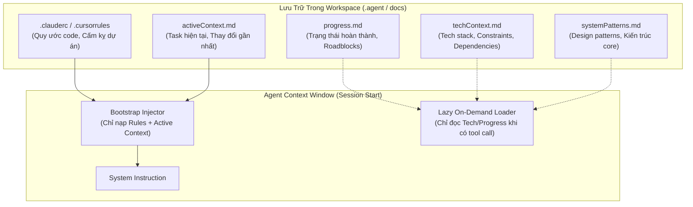
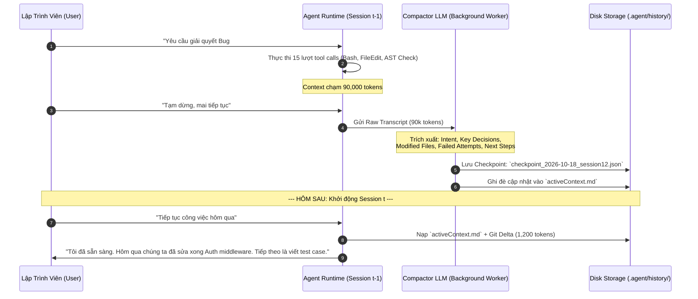
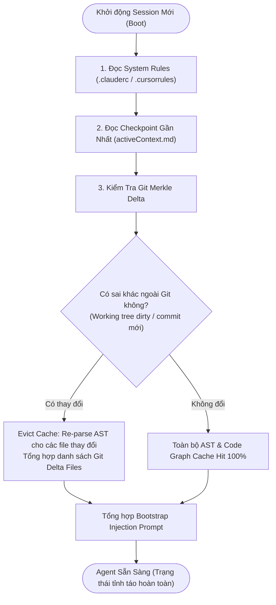

# 🧠 CROSS-SESSION MEMORY, GIT DELTA CACHING & STATE RECONSTRUCTION

Trong kỹ nghệ xây dựng các AI Coding Agents (như Cursor, Claude Code, Aider, Devin, Windsurf), một trong những thách thức kỹ thuật sống còn là **sự đứt gãy ngữ cảnh giữa các phiên làm việc (Session Boundary Problem)**. 

Khi một session kết thúc (do người dùng tắt máy, context window chạm ngưỡng 128k/200k token, hoặc khởi tạo tác vụ mới), toàn bộ trạng thái trong RAM của Agent biến mất. Nếu Agent bắt đầu phiên mới bằng cách đọc lại toàn bộ mã nguồn hoặc re-index toàn bộ repository, chi phí token sẽ bùng nổ, độ trễ khởi động kéo dài hàng chục giây và bộ nhớ ngắn hạn bị ô nhiễm bởi thông tin dư thừa.

Tài liệu này đi sâu vào kiến trúc kỹ thuật cấp độ hệ thống của **Cross-Session Memory**, cơ chế **Git Merkle Delta Caching** và quy trình **State Reconstruction Protocol** giúp Agent duy trì dòng chảy nhận thức liên tục qua nhiều ngày làm việc mà không làm phình context window.

---

## 1. Bản Chất Bài Toán Session Boundary

### 1.1. Sự Suy Giảm Nhận Thức Khi Đổi Phiên

Một tác vụ kỹ thuật phần mềm phức tạp (như refactor kiến trúc microservices hoặc vá lỗi phân tán) thường kéo dài qua nhiều phiên làm việc. Tại biên giới giữa hai phiên ($S_{t-1} \to S_t$), Agent đối mặt với 3 đánh đổi nan giải (The Session Trilemma):

```
                        TỐC ĐỘ KHỞI TẠO (Boot Latency)
                                    /\
                                   /  \
                                  /    \
                                 /      \
                                /   ★    \
                               /  Lý tưởng\
                              /____________\
ĐỘ CHÍNH XÁC NGỮ CẢNH                    HIỆU QUẢ TOKEN
(Context Fidelity)                       (Cost Efficiency)
```

1. **Naïve Re-dumping (Độ chính xác cao, Chi phí tệ, Tốc độ chậm):** Nạp toàn bộ conversation history và codebase map vào prompt khởi tạo. Hậu quả: Chi phí token $O(N)$ tăng phi mã, chạm trần context window chỉ sau 2-3 lượt chat.
2. **Tabula Rasa / Clean Slate (Tốc độ cao, Chi phí thấp, Độ chính xác bằng không):** Khởi động session mới hoàn toàn trống rỗng. Hậu quả: Lập trình viên phải liên tục nhắc lại bối cảnh: *"Dự án dùng FastAPI, đang refactor module auth, nhớ không được sửa file config.py..."*
3. **Structured Cross-Session Memory & Delta Reconstruction (Giải pháp tối ưu):** Duy trì bộ nhớ bán bền vững (Semi-persistent Memory Banks) kết hợp với kỹ thuật kiểm tra sai khác cây băm Git (Git Merkle Hash Delta), chỉ tái tạo đúng phần ngữ cảnh đã thay đổi.

---

## 2. Kiến Trúc Bộ Nhớ Bán Bền Vững (Memory Banks & Project Rules)

Để Agent không bị mất trí nhớ dài hạn (Amnesia) mà không phụ thuộc vào Vector Database cồng kềnh, các hệ thống coding agent hàng đầu chuẩn hóa kiến trúc **Hierarchical Memory Bank** lưu trực tiếp trong repository dưới dạng Markdown.



### 2.1. Phân Tầng Bộ Nhớ Ngoại Vi (Memory Bank Taxonomy)

Mỗi file trong Memory Bank đảm nhiệm một chức năng nhận thức chuyên biệt:

| Tên File | Vòng Đời Cập Nhật | Nội Dung Cốt Lõi | Cơ Chế Nạp Vào Context |
| :--- | :--- | :--- | :--- |
| `.cursorrules` / `CLAUDE.md` | Tĩnh (Thủ công / Hiếm khi đổi) | Style guides, linter rules, command build/test, cấm kỵ kiến trúc. | **Eager Load:** Nạp trực tiếp vào System Prompt của mọi session. |
| `activeContext.md` | Động (Cập nhật sau mỗi Subtask) | Mục tiêu hiện tại, các quyết định vừa đưa ra trong session trước, bước tiếp theo cần làm. | **Eager Load:** Nạp vào System Prompt để Agent nắm bắt trạng thái tức thì. |
| `progress.md` | Bán động (Cập nhật theo Milestone) | Danh sách tính năng: Hoàn thành / Đang làm / Tồn đọng, Known Bugs. | **Lazy Load:** Agent chỉ truy vấn khi cần lập kế hoạch tổng thể. |
| `techContext.md` | Bán tĩnh (Cập nhật khi đổi thư viện) | Runtime version, CLI toolings, cơ sở dữ liệu, external APIs. | **Lazy Load:** Agent đọc khi gặp lỗi dependency hoặc setup môi trường. |
| `systemPatterns.md` | Bán tĩnh (Cập nhật khi đổi kiến trúc) | Sơ đồ component, luồng dữ liệu, mẫu thiết kế đặc thù (Repository pattern, CQRS...). | **Lazy Load:** Agent đọc khi thiết kế module mới. |

> [!important] Nguyên Tắc Single Source of Truth
> Bộ nhớ dài hạn dạng Markdown nằm trực tiếp trong Git workspace cho phép cả **Human Developer** và **AI Agent** cùng đọc, chỉnh sửa và review thông qua git pull request chuẩn mực, loại bỏ hiện tượng "hộp đen" của Vector DB độc quyền.

---

## 3. Git Merkle Tree Delta Caching

Điểm đột phá của các hệ thống Coding Agent chuyên nghiệp so với Chatbot thông thường là khả năng tận dụng cấu trúc **Merkle DAG (Directed Acyclic Graph)** của chính Git engine để tối ưu hóa bộ nhớ đệm.

### 3.1. Cấu Trúc Băm Của Git và Sự Tái Sử Dụng AST

Trong Git, mỗi thư mục là một `tree object`, mỗi tệp là một `blob object` được định danh bằng mã băm cryptographic SHA-1 (hoặc SHA-256):

$$
H(\text{blob}) = \text{SHA1}(\text{"blob " } + \text{size} + \text{"\0"} + \text{content})
$$

Một commit trỏ tới một Root Tree. Nếu một tệp $f$ trong sub-folder không thay đổi giữa hai commit $C_{t-1}$ và $C_t$, mã băm $H(f)$ được giữ nguyên hoàn toàn.

```mermaid
graph TD
    subgraph Commit_Old ["Commit C(t-1) - Session Cũ"]
        R1["Root Tree: a1b2c3"]
        T1["src/ Tree: d4e5f6"]
        B1["auth.py Blob: 111111 (Đã index AST)"]
        B2["utils.py Blob: 222222 (Đã index AST)"]
        R1 --> T1
        T1 --> B1
        T1 --> B2
    end

    subgraph Commit_New ["Commit C(t) - Session Mới (Sửa auth.py)"]
        R2["Root Tree: f9e8d7 (Đổi)"]
        T2["src/ Tree: c8b7a6 (Đổi)"]
        B1_new["auth.py Blob: 333333 (MỚI: Cần re-parse)"]
        B2_reuse["utils.py Blob: 222222 (TRÙNG: Cache Hit!)"]
        R2 --> T2
        T2 --> B1_new
        T2 --> B2_reuse
    end

    style B2_reuse fill:#1b4d3e,stroke:#2ecc71,stroke-width:2px;
    style B1_new fill:#641e16,stroke:#e74c3c,stroke-width:2px;
```



### 3.2. Thuật Toán Delta Caching Cho Code Intelligence

Khi Agent thức dậy trong một session mới:
1. Agent đọc mã commit đã ghi nhận tại cuối session trước: $C_{\text{last\_session}}$.
2. Agent truy vấn Git engine để xác định tập hợp tệp biến thiên (Dirty Files / Changed Files):
   
$$
\Delta F = \text{git diff-tree --no-commit-id --name-only -r } C_{\text{last\_session}} \dots \text{HEAD} \cup \text{git status --porcelain}
$$

3. **Cơ chế Cache Invalidation:**
   * Đối với mọi $f \notin \Delta F$: Giữ nguyên toàn bộ bảng ký hiệu (Symbol Table), đồ thị phụ thuộc (Code Graph Call Hierarchy) và Vector Embeddings đã lưu trữ ở local disk cache (`.agent/cache/code_intel.db`).
   * Đối với $f \in \Delta F$: Thực hiện vô hiệu hóa bộ đệm (Cache Eviction), chạy lại Tree-sitter parser để trích xuất AST mới, cập nhật các cạnh đồ thị liên quan đến $f$, và tính toán lại embedding.

### 3.3. Hiệu Quả Toán Học Của Delta Caching

Giả sử repository có tổng cộng $|F|$ tệp, với trung bình $K$ token/tệp.
Tỷ lệ tệp thay đổi giữa hai session là $\alpha = \frac{|\Delta F|}{|F|}$ (thông thường trong thực tế kỹ thuật phần mềm, $\alpha < 0.03$, tức dưới 3% repository bị sửa đổi mỗi session).

Chi phí Token & Thời gian Parse không áp dụng Delta Cache:
$$
\text{Cost}_{\text{naive}} = O(|F| \cdot K)
$$

Chi phí khi áp dụng Git Merkle Delta Cache:
$$
\text{Cost}_{\text{delta}} = O(\alpha \cdot |F| \cdot K) + O(\text{TreeTraversal}_{\text{git}})
$$

Tỷ lệ tiết kiệm tài nguyên (Resource Reduction Ratio):
$$
\eta = 1 - \frac{\text{Cost}_{\text{delta}}}{\text{Cost}_{\text{naive}}} \approx 1 - \alpha \ge 97\%
$$

---

## 4. Session Compaction: Nén Cuộc Trò Chuyện Thành Semantic Checkpoints

Bên cạnh mã nguồn, lịch sử tương tác (Conversation History) từ các session trước cũng cần được nén để chuyển tiếp mà không làm vỡ context window.



### 4.1. Cấu Trúc Dữ Liệu Checkpoint Của Một Session

Một bản tóm tắt nén (Session Checkpoint) đạt chuẩn kỹ thuật phải có cấu trúc JSON định dạng nghiêm ngặt:

```json
{
  "session_id": "sess_20261018_092144",
  "parent_session_id": "sess_20261017_184510",
  "timestamp": "2026-10-18T20:45:00Z",
  "git_commit_anchor": "7f8b9c2a1e",
  "active_goal": "Refactor JWT authentication middleware to support RS256 asymmetric keys",
  "completed_subtasks": [
    "Generated RSA 4096-bit test keypairs in tests/fixtures/",
    "Implemented RS256 token validator in src/auth/jwt.py",
    "Verified backwards compatibility with HS256 tokens"
  ],
  "in_progress_subtask": "Updating integration tests in tests/test_auth_api.py",
  "critical_decisions": [
    {
      "decision": "Use PyJWT with cryptography backend instead of authlib",
      "rationale": "Avoided 12MB additional binary dependencies in Docker build."
    }
  ],
  "failed_hypotheses": [
    "Tried parsing PEM keys using native OpenSSL CLI via bash tool, failed due to alpine missing openssl-dev package."
  ],
  "modified_files": [
    "src/auth/jwt.py",
    "tests/fixtures/keys.py",
    "pyproject.toml"
  ],
  "next_recommended_action": "Run `pytest tests/test_auth_api.py` and inspect mocking of JWKS endpoint."
}
```

> [!tip] Giá Trị Của Failed Hypotheses (Giả Thuyết Thất Bại)
> Phần lớn các Agent thất bại khi bắt đầu phiên mới vì lặp lại đúng những sai lầm mà phiên trước đã thử và thất bại. Việc lưu trữ `failed_hypotheses` hoạt động như một bộ lọc âm (Negative Constraint), ngăn chặn Agent lãng phí token vào những ngõ cụt đã biết.

---

## 5. Quy Trình Khởi Động & Tái Cấu Trúc Trạng Thái (State Reconstruction Protocol)

Khi một session mới được khởi tạo, Agent thực thi chu trình tái cấu trúc trạng thái 4 bước:



### 5.1. Phân Tích Chi Tiết 4 Bước

1. **Rule Anchor Injection:** Đọc các quy ước phát triển phần mềm cơ bản. Kích thước thông thường: $500 - 1,500$ tokens.
2. **Episodic State Injection:** Đọc `activeContext.md` và `failed_hypotheses` từ checkpoint JSON. Kích thước: $800 - 2,000$ tokens.
3. **Delta Merkle Verification:** Chạy `git diff` giữa commit neo (Anchor Commit) và `HEAD`. Nếu lập trình viên đã tự sửa file bên ngoài khi tắt Agent, Agent sẽ phát hiện ngay: *"Nhận thấy bạn đã chỉnh sửa `src/auth/jwt.py` 15 phút trước, cập nhật lại trạng thái..."*.
4. **Lazy Graph Binding:** Không nạp toàn bộ Repo Map vào context. Chỉ nạp sơ đồ high-level (Module Outline). Khi người dùng nhắc đến một class cụ thể, công cụ Tool Use sẽ kích hoạt truy vấn AST cache cục bộ.

---

## 6. Triển Khai Thực Chiến: `CrossSessionMemoryManager` Bằng Python

Dưới đây là mã nguồn hoàn chỉnh của một bộ quản lý bộ nhớ đa phiên và delta caching, sẵn sàng nhúng vào bất kỳ hệ thống AI Coding Agent nào:

```python
"""
CrossSessionMemoryManager: Quản trị bộ nhớ đa phiên và Git Delta Caching cho Coding Agent.
Yêu cầu: git CLI sẵn có trong PATH.
"""

import json
import os
import subprocess
from dataclasses import asdict, dataclass, field
from datetime import datetime
from pathlib import Path
from typing import Any, Dict, List, Optional


@dataclass
class SessionState:
    session_id: str
    timestamp: str
    git_commit_anchor: str
    active_goal: str
    completed_subtasks: List[str] = field(default_factory=list)
    in_progress_subtask: Optional[str] = None
    critical_decisions: List[Dict[str, str]] = field(default_factory=list)
    failed_hypotheses: List[str] = field(default_factory=list)
    modified_files: List[str] = field(default_factory=list)


class CrossSessionMemoryManager:
    def __init__(self, workspace_root: str):
        self.workspace = Path(workspace_root).resolve()
        self.memory_dir = self.workspace / ".agent" / "memory"
        self.checkpoints_dir = self.memory_dir / "checkpoints"
        self.active_context_file = self.memory_dir / "activeContext.md"
        self.rules_file = self.workspace / ".agent_rules.md"

        self.memory_dir.mkdir(parents=True, exist_ok=True)
        self.checkpoints_dir.mkdir(parents=True, exist_ok=True)

    def _run_git(self, args: List[str]) -> str:
        """Thực thi lệnh git an toàn và trả về output stripped."""
        try:
            res = subprocess.run(
                ["git"] + args,
                cwd=str(self.workspace),
                capture_output=True,
                text=True,
                check=True,
            )
            return res.stdout.strip()
        except subprocess.CalledProcessError as e:
            return ""

    def get_current_git_commit(self) -> str:
        """Lấy commit hash HEAD hiện tại."""
        return self._run_git(["rev-parse", "--short", "HEAD"]) or "UNKNOWN_COMMIT"

    def compute_git_delta(self, anchor_commit: str) -> Dict[str, List[str]]:
        """Tính toán danh sách file thay đổi giữa anchor_commit và trạng thái working tree hiện tại."""
        delta = {"committed_changes": [], "uncommitted_changes": []}

        if anchor_commit and anchor_commit != "UNKNOWN_COMMIT":
            diff_committed = self._run_git(
                ["diff-tree", "--no-commit-id", "--name-only", "-r", f"{anchor_commit}..HEAD"]
            )
            if diff_committed:
                delta["committed_changes"] = [f for f in diff_committed.splitlines() if f]

        # Kiểm tra file unstaged / staged chưa commit
        status_porcelain = self._run_git(["status", "--porcelain"])
        if status_porcelain:
            delta["uncommitted_changes"] = [
                line[3:].strip() for line in status_porcelain.splitlines() if line[3:].strip()
            ]

        return delta

    def save_session_checkpoint(self, state: SessionState) -> Path:
        """Lưu checkpoint JSON và đồng bộ file activeContext.md."""
        checkpoint_path = self.checkpoints_dir / f"{state.session_id}.json"
        with open(checkpoint_path, "w", encoding="utf-8") as f:
            json.dump(asdict(state), f, indent=2, ensure_ascii=False)

        # Cập nhật markdown tóm tắt để người dùng và agent cùng đọc
        md_content = f"""# Active Context
**Session Anchor:** `{state.session_id}` (Commit: `{state.git_commit_anchor}`)
**Last Updated:** {state.timestamp}

## 🎯 Active Goal
{state.active_goal}

## ⏳ In Progress
- {state.in_progress_subtask or 'None'}

## ✅ Completed Subtasks
{chr(10).join(f"- {task}" for task in state.completed_subtasks)}

## ⚠️ Critical Decisions & Constraints
{chr(10).join(f"- **{d['decision']}**: {d['rationale']}" for d in state.critical_decisions)}

## 🚫 Failed Hypotheses (Do Not Repeat!)
{chr(10).join(f"- {h}" for h in state.failed_hypotheses)}
"""
        with open(self.active_context_file, "w", encoding="utf-8") as f:
            f.write(md_content)

        return checkpoint_path

    def load_latest_checkpoint(self) -> Optional[SessionState]:
        """Nạp checkpoint JSON mới nhất theo thời gian."""
        checkpoints = sorted(self.checkpoints_dir.glob("*.json"), key=os.path.getmtime)
        if not checkpoints:
            return None

        latest = checkpoints[-1]
        with open(latest, "r", encoding="utf-8") as f:
            data = json.load(f)
            return SessionState(**data)

    def bootstrap_session_prompt(self) -> str:
        """
        Tạo prompt tái cấu trúc ngữ cảnh siêu tinh gọn nạp vào đầu session mới.
        Chi phí token thông thường: < 1500 tokens.
        """
        latest_state = self.load_latest_checkpoint()
        current_commit = self.get_current_git_commit()

        prompt_parts = ["=== RECONSTRUCTED AGENT SESSION STATE ==="]

        # 1. Rules dự án nếu có
        if self.rules_file.exists():
            with open(self.rules_file, "r", encoding="utf-8") as f:
                prompt_parts.append(f"### Project Guidelines:\n{f.read().strip()}")

        if not latest_state:
            prompt_parts.append("\n[No prior session state detected. Initializing fresh workspace context.]")
            prompt_parts.append(f"Current Git Commit: {current_commit}")
            return "\n\n".join(prompt_parts)

        # 2. Ngữ cảnh phiên trước
        prompt_parts.append(f"### Previous Session: {latest_state.session_id}")
        prompt_parts.append(f"Current Task Goal: {latest_state.active_goal}")
        if latest_state.in_progress_subtask:
            prompt_parts.append(f"Pending Action: {latest_state.in_progress_subtask}")

        if latest_state.failed_hypotheses:
            prompt_parts.append("### Known Dead-Ends (Avoid Repeating!):")
            for fh in latest_state.failed_hypotheses:
                prompt_parts.append(f"- ❌ {fh}")

        # 3. Tính toán Git Delta
        delta = self.compute_git_delta(latest_state.git_commit_anchor)
        all_changes = set(delta["committed_changes"] + delta["uncommitted_changes"])

        prompt_parts.append(f"\n### Environment Delta Sync (Anchor: {latest_state.git_commit_anchor} -> Now: {current_commit})")
        if all_changes:
            prompt_parts.append(f"Detected {len(all_changes)} modified files since last session:")
            for cf in sorted(all_changes)[:10]:  # Giới hạn hiển thị 10 file
                prompt_parts.append(f"  * {cf}")
            if len(all_changes) > 10:
                prompt_parts.append(f"  * ... và {len(all_changes) - 10} tệp khác.")
            prompt_parts.append("Action Note: Inspect or re-parse these files if their symbols are required.")
        else:
            prompt_parts.append("Working tree clean & identical to previous session anchor. Zero AST invalidation needed.")

        prompt_parts.append("==========================================")
        return "\n".join(prompt_parts)


# --- MINH HỌA SỬ DỤNG ---
if __name__ == "__main__":
    import tempfile

    with tempfile.TemporaryDirectory() as tmp_dir:
        # Khởi tạo repo git giả lập
        subprocess.run(["git", "init"], cwd=tmp_dir, capture_output=True)
        subprocess.run(["git", "config", "user.name", "AgentTest"], cwd=tmp_dir)
        subprocess.run(["git", "config", "user.email", "agent@test.local"], cwd=tmp_dir)
        
        test_file = Path(tmp_dir) / "app.py"
        test_file.write_text("print('v1')")
        subprocess.run(["git", "add", "."], cwd=tmp_dir)
        subprocess.run(["git", "commit", "-m", "feat: initial commit"], cwd=tmp_dir)

        mgr = CrossSessionMemoryManager(tmp_dir)

        # 1. Giả lập kết thúc Session 1
        s1 = SessionState(
            session_id="session_001",
            timestamp=datetime.now().isoformat(),
            git_commit_anchor=mgr.get_current_git_commit(),
            active_goal="Refactor authentication layer",
            completed_subtasks=["Audit current token format"],
            in_progress_subtask="Write test fixtures for RSA tokens",
            critical_decisions=[{"decision": "Use Ed25519", "rationale": "Better performance than RSA"}],
            failed_hypotheses=["Do not use PyCrypto, deprecated library"],
            modified_files=["app.py"]
        )
        mgr.save_session_checkpoint(s1)

        # 2. Giả lập Human sửa file khi Agent vắng mặt
        test_file.write_text("print('v2 modified by human')")

        # 3. Giả lập Khởi động Session 2
        bootstrap_prompt = mgr.bootstrap_session_prompt()
        print(bootstrap_prompt)
```

---

## 7. Đánh Giá Hiệu Năng & Ma Trận Đánh Đổi

| Chỉ Số So Sánh | Naïve Full Re-indexing | Vector-Only RAG Retrieval | Git Delta + Memory Bank (Bài Viết Này) |
| :--- | :--- | :--- | :--- |
| **Token Ingestion Khởi Động** | Cực cao ($50k - 200k$ tokens) | Thấp ($2k - 5k$ tokens) | **Tối ưu nhất ($800 - 1.5k$ tokens)** |
| **Độ Trễ Khởi Động (Boot Latency)** | $10 - 45\text{s}$ | $2 - 4\text{s}$ | **$< 500\text{ms}$** |
| **Nhận Thức Về Thay Đổi Ngoài Git** | Kém (Phải quét toàn bộ đĩa) | Rất kém (Chậm cập nhật vector index) | **Chính xác 100% (qua `git status` delta)** |
| **Bảo Lưu Giả Thuyết Thất Bại** | Dễ bị trôi do context quá dài | Kém (RAG chỉ match câu hỏi tương tự) | **Tuyệt đối (Explicit Negative Constraints)** |
| **Tính Minh Bạch Với Con Người** | Kém (Ẩn trong prompt khổng lồ) | Hộp đen (Vector chunks không đoán trước) | **Minh bạch (Markdown file nằm trong Git PR)** |

---

## 8. Tóm Tắt & Hướng Dẫn Thực Hành

1. **Không bao giờ nạp toàn bộ repo vào session mới:** Hãy để Git Merkle DAG làm nhiệm vụ phát hiện thay đổi thay vì tốn token của LLM.
2. **Duy trì Memory Bank trong Git:** Tạo thư mục `.agent/` chứa `activeContext.md` và `checkpoints/` để đồng hành cùng workflow của lập trình viên.
3. **Ghi lại `failed_hypotheses`:** Tiết kiệm hàng ngàn token bằng cách dặn trước Agent không được lặp lại các ngõ cụt đã thử.
4. **Kết hợp với Code Graph:** Chỉ kích hoạt phân tích cú pháp AST cho tập hợp con $\Delta F$ tệp bị thay đổi, giữ nguyên bộ đệm đồ thị của 97% repository còn lại.

---

## 🔗 Liên Kết Chuyên Sâu
* [Code Graphs & Repository Intelligence](./01_code_graphs_and_repository_intelligence.md): Phân tích cú pháp AST và đồ thị phụ thuộc mã nguồn.
* [Durable Execution & Stateful Workflows](../03-loop-and-multi-agent-engineering/06_durable_execution_and_stateful_workflows.md): Quản lý máy trạng thái và điểm ngắt bền vững.
* [Token Economics & Cost Optimization](../04-observability-evals-and-cost/03_token_economics_and_cost_optimization.md): Chiến lược tối ưu hóa ngân sách và giảm thiểu token lãng phí.
* [Prompt Compression & Cache Engineering](../04-observability-evals-and-cost/04_prompt_compression_and_cache_engineering.md): Cơ chế PagedAttention KV-Cache và nén prompt tự động.
