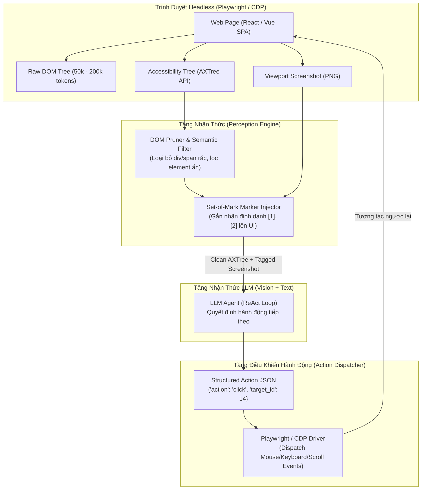
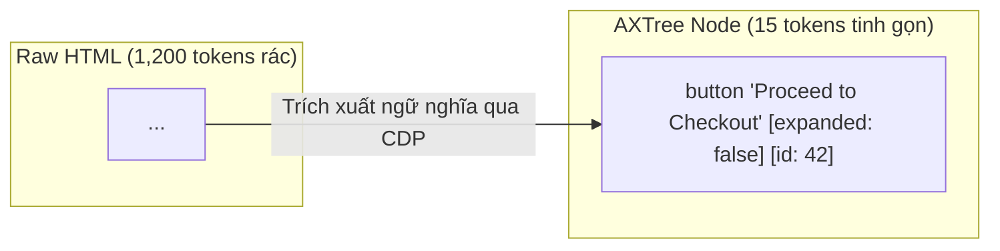
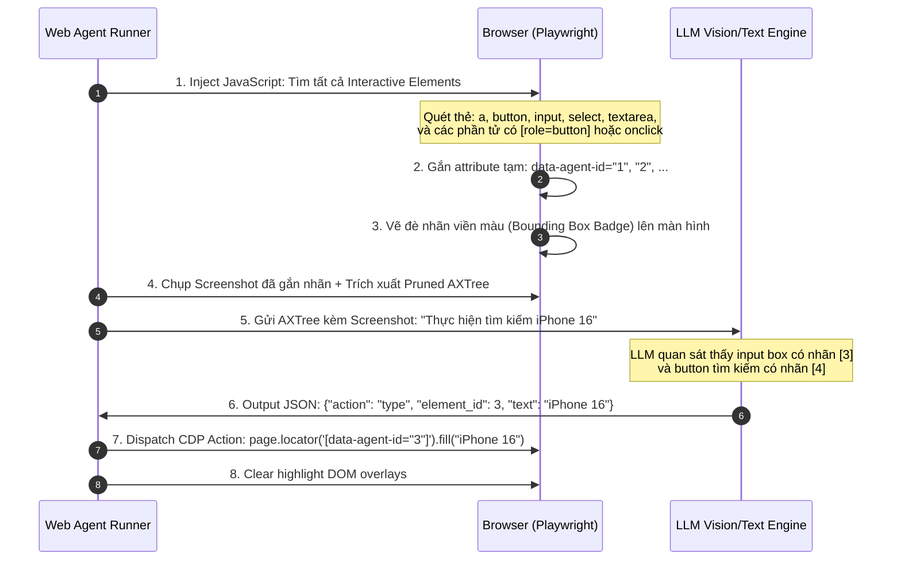

# 🌐 BROWSER AUTOMATION & WEB AGENTS: TỰ ĐỘNG HÓA TRÌNH DUYỆT & TƯƠNG TÁC DOM

Trong khi các tác tử điều khiển máy tính tổng quát ([Multimodal GUI & Computer Use](./03_multimodal_gui_and_computer_use.md)) tương tác với màn hình hệ điều hành thông qua ảnh chụp pixels và tọa độ chuột $(x, y)$, **Web Agents (Tác tử Web)** sở hữu một lợi thế vượt trội: **khả năng truy cập trực tiếp vào cấu trúc nội tại của trình duyệt** thông qua Chrome DevTools Protocol (CDP), Document Object Model (DOM) và Accessibility Tree (AXTree).

Tuy nhiên, việc xây dựng một Web Agent vận hành ổn định trong môi trường thực tế (production) là một bài toán kỹ thuật phức tạp: các trang web hiện đại (Single Page Applications - SPAs) có kích thước DOM khổng lồ (vượt quá 100,000 tokens), render bất đồng bộ, sử dụng canvas phức tạp và được trang bị các rào cản chống bot (Cloudflare, CAPTCHA, bot fingerprinting).

Tài liệu này phân tích chi tiết kiến trúc kỹ thuật của Web Agents: từ kỹ thuật nén DOM bằng **Accessibility Tree (AXTree)**, cơ chế định vị phần tử **Set-of-Mark (SoM) Web Grounding**, cho đến chiến lược xử lý tính bất định của trình duyệt và vượt qua rào cản phòng vệ tự động.

---

## 1. Phân Tầng Kiến Trúc Của Một Web Agent

Một Web Agent hiện đại không bao giờ gửi nguyên mẫu mã nguồn HTML thô (Raw HTML) cho LLM. Thay vào đó, kiến trúc được chia làm 4 tầng độc lập:



---

## 2. Bài Toán Bùng Nổ DOM và Giải Pháp Accessibility Tree (AXTree)

### 2.1. Nghịch Lý Của Raw HTML

Nếu trích xuất trực tiếp `document.documentElement.outerHTML` của một trang thương mại điện tử như Amazon hoặc Shopee:
* Số lượng tokens thô: $80,000 - 250,000$ tokens.
* Tỷ lệ thông tin rác (Noise Ratio): $> 92\%$ (chứa thẻ `<script>`, `<style>`, `data-v-` attributes, các lớp Tailwind CSS/CSS-in-JS dài hàng trăm ký tự, và hàng ngàn thẻ `<div>` lồng nhau chỉ phục vụ mục đích dựng layout).
* Chi phí token: Mỗi bước suy luận tốn từ $\$0.50$ đến $\$1.50$ nếu dùng GPT-4o hoặc Claude 3.5 Sonnet.

### 2.2. Accessibility Tree (Cây Trợ Năng) Là Gì?

Trình duyệt web hiện đại tự động duy trì một cấu trúc dữ liệu song song với DOM phục vụ các thiết bị đọc màn hình cho người khiếm thị (Screen Readers): **Accessibility Tree (AXTree)**.
AXTree loại bỏ toàn bộ định dạng hiển thị và chỉ giữ lại:
1. **Role:** Vai trò ngữ nghĩa của phần tử (`button`, `link`, `textbox`, `combobox`, `checkbox`, `heading`, `dialog`).
2. **Name / Label:** Tên hiển thị mà người dùng cảm nhận được (Accessible Name, ARIA label, alt text).
3. **Value / State:** Trạng thái hiện tại (`focused`, `checked`, `disabled`, `expanded`).



### 2.3. Bảng So Sánh Tiêu Hao Token Thực Tế

| Định Dạng Dữ Liệu | Kích Thước Token (Amazon Product Page) | Thời Gian Suy Luận LLM | Tỷ Lệ Nhiễu Ngữ Nghĩa |
| :--- | :--- | :--- | :--- |
| **Raw HTML** | $145,000$ tokens | Chậm ($12 - 25\text{s}$) | Cực cao ($95\%$) |
| **Stripped HTML (Bỏ Script/Style)** | $42,000$ tokens | Trung bình ($5 - 8\text{s}$) | Cao ($70\%$) |
| **AXTree (Pruned & Scoped)** | **$1,800 - 3,500$ tokens** | **Siêu nhanh ($0.8 - 1.8\text{s}$)** | **Cực thấp ($< 5\%$)** |

---

## 3. Grounding Nhận Thức: Set-of-Mark (SoM) Web Grounding

Khi LLM muốn tương tác với một phần tử (ví dụ: click vào nút "Search"), việc yêu cầu LLM tự sinh chuỗi XPath hoặc CSS Selector mang lại tỷ lệ lỗi rất cao (lên tới $40\%$) do CSS class trên web hiện đại thường bị hash ngẫu nhiên (như `btn_a8x9f`).

Giải pháp chuẩn công nghiệp hiện nay (được sử dụng bởi WebArena, Browserbase, Stagehand, Playwright Agent) là kỹ thuật **Set-of-Mark (SoM) Web Injection**:



### 3.1. Thuật Toán Lọc Interactive Elements

Không phải mọi thẻ `<a>` hay `<button>` đều có thể tương tác. Agent cần lọc qua 3 bộ lọc kiểm tra:
1. **Visibility Check (Kiểm tra hiển thị):**
   $$
   \text{isVisible}(E) = (\text{width} > 0) \land (\text{height} > 0) \land (\text{style.visibility} \neq \text{'hidden'}) \land (\text{style.display} \neq \text{'none'})
   $$
2. **Viewport Clipping (Nằm trong tầm nhìn):** Tọa độ bounding box $(x, y)$ phải giao cắt với khung nhìn hiện tại (Viewport: $0 \le x \le W_{\text{vp}}$, $0 \le y \le H_{\text{vp}}$).
3. **Occlusion Check (Kiểm tra che khuất):** Sử dụng `document.elementFromPoint(cx, cy)` để đảm bảo phần tử không bị modal dialog, cookie banner hoặc overlay che phủ.

---

## 4. Không Gian Hành Động Chuẩn (Web Action Space)

Để đảm bảo an toàn và tính tất định (Determinism), Web Agent cần được đóng gói trong một không gian hành động hữu hạn (Constrained Action Space) thông qua JSON Schema:

```typescript
// Định nghĩa chuẩn của Web Action Space
type WebAction = 
  | { action: "click"; element_id: number; button?: "left" | "right" | "middle" }
  | { action: "type"; element_id: number; text: string; clear_before?: boolean; press_enter?: boolean }
  | { action: "select_option"; element_id: number; value: string }
  | { action: "scroll"; direction: "up" | "down"; amount_pixels?: number }
  | { action: "hover"; element_id: number }
  | { action: "press_key"; key: "Enter" | "Escape" | "Tab" | "Backspace" | "ArrowDown" }
  | { action: "navigate"; url: string }
  | { action: "wait"; duration_seconds: number }
  | { action: "complete"; summary: string; extracted_data?: any }
  | { action: "fail"; error_reason: string };
```

---

## 5. Thách Thức Thực Tế: Xử Lý Tính Bất Định & Anti-Bot

### 5.1. Bẫy Bất Đồng Bộ SPA (Dynamic Hydration & AJAX)

Trình duyệt web không chạy đồng bộ. Khi Agent click vào nút *"Submit"*, DOM không cập nhật tức thì. Nếu Agent chụp ảnh ngay sau $50\text{ms}$, nó sẽ quan sát thấy trạng thái cũ.

* **Anti-Pattern:** Dùng `time.sleep(3)` ngây thơ. Gây lãng phí thời gian và dễ vỡ khi mạng chậm.
* **Production Pattern:** Kết hợp **MutationObserver** và **CDP Lifecycle Events**:
  1. Lắng nghe sự kiện `networkidle` (không còn request HTTP nào đang mở trong vòng $500\text{ms}$).
  2. Lắng nghe `DOMNodeInserted` / `DOMNodeRemoved` thông qua `MutationObserver`.
  3. Cài đặt cơ chế Polling Heuristic có timeout (tối đa $5\text{s}$) chờ phần tử mục tiêu xuất hiện.

### 5.2. Chống Phát Hiện Headless (Stealth & Anti-Fingerprinting)

Các dịch vụ chống bot như Cloudflare Turnstile, DataDome hay Akamai phát hiện Web Agent thông qua các dấu hiệu nhận biết (Browser Fingerprints):

| Dấu Hiệu Nhận Biết | Mặc Định Khi Dùng Puppeteer/Playwright | Kỹ Thuật Ngụy Trang Stealth |
| :--- | :--- | :--- |
| `navigator.webdriver` | `true` | Ghi đè thành `undefined` qua preload script |
| `window.chrome` | Bị thiếu hoặc trống | Giả lập object runtime của Google Chrome thật |
| WebGL Vendor / Renderer | `Google SwiftShader` (Software render) | Giả lập `Intel Inc.` / `Apple M-series GPU` |
| Bounding Box Mouse Trajectory | Di chuyển chuột tức thì bằng 1 bước ($0\text{ms}$) | Mô phỏng đường cong Bezier ngẫu nhiên có gia tốc vật lý |
| Tốc Độ Gõ Phím (Typing Cadence) | Nạp toàn bộ text trong 1 frame | Gõ từng ký tự với độ trễ ngẫu nhiên $50 - 180\text{ms}$ |

---

## 6. Triển Khai Thực Chiến: `PlaywrightWebAgent` Bằng Python

Dưới đây là mã nguồn hoàn chỉnh của một khung tác tử Web Agent tích hợp trích xuất Accessibility Tree, đánh dấu SoM Marker trực quan và thực thi hành động bất đồng bộ:

```python
"""
PlaywrightWebAgent: Khung tác tử tự động hóa trình duyệt thông qua AXTree và Set-of-Mark.
Yêu cầu: pip install playwright
Chạy: playwright install chromium
"""

import asyncio
import json
import logging
from dataclasses import dataclass
from typing import Any, Dict, List, Optional, Tuple
from playwright.async_api import async_playwright, Page, Browser, ElementHandle

logging.basicConfig(level=logging.INFO)
logger = logging.getLogger("WebAgent")


@dataclass
class InteractiveElement:
    id: int
    tag: str
    role: str
    text: str
    selector: str
    bounds: Dict[str, float]


class PlaywrightWebAgent:
    def __init__(self, headless: bool = True):
        self.headless = headless
        self.playwright = None
        self.browser: Optional[Browser] = None
        self.page: Optional[Page] = None
        self.elements_cache: Dict[int, InteractiveElement] = {}

    async def initialize(self):
        """Khởi động trình duyệt Chromium với cấu hình stealth chống bot."""
        self.playwright = await async_playwright().start()
        self.browser = await self.playwright.chromium.launch(
            headless=self.headless,
            args=[
                "--disable-blink-features=AutomationControlled",
                "--no-sandbox",
                "--disable-setuid-sandbox",
            ],
        )
        context = await self.browser.new_context(
            viewport={"width": 1280, "height": 800},
            user_agent=(
                "Mozilla/5.0 (Macintosh; Intel Mac OS X 10_15_7) "
                "AppleWebKit/537.36 (KHTML, like Gecko) Chrome/126.0.0.0 Safari/537.36"
            ),
        )
        self.page = await context.new_page()
        
        # Tiêm script xóa cờ navigator.webdriver
        await self.page.add_init_script(
            "Object.defineProperty(navigator, 'webdriver', {get: () => undefined})"
        )
        logger.info("Browser initialized successfully in stealth mode.")

    async def navigate(self, url: str):
        """Điều hướng tới URL và chờ DOM sẵn sàng."""
        if not self.page:
            raise RuntimeError("Browser not initialized.")
        logger.info(f"Navigating to {url}...")
        await self.page.goto(url, wait_until="domcontentloaded", timeout=30000)
        await self.page.wait_for_timeout(1500)  # Chờ hydrate động

    async def extract_interactive_elements_and_mark(self) -> Tuple[str, List[InteractiveElement]]:
        """
        Quét DOM, lọc các phần tử có thể tương tác, gán ID duy nhất và 
        vẽ bounding box trực quan (Set-of-Mark) trực tiếp vào giao diện.
        """
        if not self.page:
            raise RuntimeError("Browser not initialized.")

        # Script JS chạy nội bộ trên context của trình duyệt
        js_script = """
        () => {
            // Xóa các marker cũ nếu có
            document.querySelectorAll('.agent-som-marker').forEach(el => el.remove());

            const interactiveTags = ['A', 'BUTTON', 'INPUT', 'SELECT', 'TEXTAREA'];
            const elements = [];
            let counter = 1;

            const allNodes = document.querySelectorAll('*');
            for (let el of allNodes) {
                const rect = el.getBoundingClientRect();
                const isVisible = rect.width > 5 && rect.height > 5 && 
                                  window.getComputedStyle(el).visibility !== 'hidden' &&
                                  window.getComputedStyle(el).display !== 'none';

                if (!isVisible) continue;

                // Kiểm tra xem có nằm trong viewport không
                if (rect.bottom < 0 || rect.top > window.innerHeight ||
                    rect.right < 0 || rect.left > window.innerWidth) continue;

                const isClickable = interactiveTags.includes(el.tagName) ||
                                    el.getAttribute('role') === 'button' ||
                                    el.onclick !== null ||
                                    window.getComputedStyle(el).cursor === 'pointer';

                if (isClickable) {
                    const currentId = counter++;
                    el.setAttribute('data-agent-id', currentId.toString());

                    // Tạo badge đánh dấu trực quan (Set-of-Mark overlay)
                    const marker = document.createElement('div');
                    marker.className = 'agent-som-marker';
                    marker.innerText = currentId.toString();
                    marker.style.position = 'absolute';
                    marker.style.left = `${rect.left + window.scrollX}px`;
                    marker.style.top = `${rect.top + window.scrollY}px`;
                    marker.style.backgroundColor = '#e74c3c';
                    marker.style.color = 'white';
                    marker.style.fontSize = '11px';
                    marker.style.fontWeight = 'bold';
                    marker.style.padding = '1px 4px';
                    marker.style.borderRadius = '3px';
                    marker.style.zIndex = '999999';
                    marker.style.pointerEvents = 'none';
                    document.body.appendChild(marker);

                    elements.append({
                        id: currentId,
                        tag: el.tagName.toLowerCase(),
                        role: el.getAttribute('role') || el.tagName.toLowerCase(),
                        text: (el.innerText || el.getAttribute('placeholder') || el.getAttribute('aria-label') || '').trim().slice(0, 80),
                        bounds: {x: rect.x, y: rect.y, width: rect.width, height: rect.height}
                    });
                }
            }
            return elements;
        }
        """
        raw_elements = await self.page.evaluate(js_script)
        self.elements_cache.clear()

        # Tạo bản tóm tắt AXTree văn bản cho LLM đọc
        axtree_lines = ["=== ACCESSIBILITY & INTERACTIVE NODES (CURRENT VIEWPORT) ==="]
        parsed_elements = []

        for item in raw_elements:
            elem = InteractiveElement(
                id=item["id"],
                tag=item["tag"],
                role=item["role"],
                text=item["text"],
                selector=f'[data-agent-id="{item["id"]}"]',
                bounds=item["bounds"],
            )
            self.elements_cache[elem.id] = elem
            parsed_elements.append(elem)

            label = f'"{elem.text}"' if elem.text else "NO_LABEL"
            axtree_lines.append(f"[{elem.id}] {elem.role.upper()} | Label: {label}")

        axtree_representation = "\n".join(axtree_lines)
        return axtree_representation, parsed_elements

    async def execute_action(self, action: Dict[str, Any]) -> str:
        """Thực thi action có cấu trúc được sinh ra từ LLM."""
        if not self.page:
            raise RuntimeError("Browser not initialized.")

        act_type = action.get("action")
        elem_id = action.get("element_id")

        logger.info(f"Executing Action: {action}")

        if act_type == "click":
            if elem_id not in self.elements_cache:
                return f"Error: Element ID {elem_id} not found in current viewport."
            selector = self.elements_cache[elem_id].selector
            await self.page.locator(selector).click(timeout=5000)
            await self.page.wait_for_timeout(1000)  # Chờ UI phản hồi
            return f"Success: Clicked element [{elem_id}]."

        elif act_type == "type":
            if elem_id not in self.elements_cache:
                return f"Error: Element ID {elem_id} not found."
            selector = self.elements_cache[elem_id].selector
            text = action.get("text", "")
            locator = self.page.locator(selector)
            if action.get("clear_before", True):
                await locator.fill("")
            await locator.type(text, delay=80)  # Gõ có độ trễ chống bot
            if action.get("press_enter", False):
                await self.page.keyboard.press("Enter")
            await self.page.wait_for_timeout(1000)
            return f"Success: Typed '{text}' into element [{elem_id}]."

        elif act_type == "scroll":
            direction = action.get("direction", "down")
            pixels = action.get("amount_pixels", 500)
            delta_y = pixels if direction == "down" else -pixels
            await self.page.mouse.wheel(0, delta_y)
            await self.page.wait_for_timeout(800)
            return f"Success: Scrolled {direction} by {pixels}px."

        elif act_type == "complete":
            return f"Goal Completed: {action.get('summary', 'Done')}"

        else:
            return f"Error: Unsupported action type '{act_type}'."

    async def close(self):
        """Dọn dẹp tài nguyên."""
        if self.browser:
            await self.browser.close()
        if self.playwright:
            await self.playwright.stop()
        logger.info("Browser session closed cleanly.")


# --- VÍ DỤ MINH HỌA VÒNG LẶP SUY LUẬN TỰ ĐỘNG ---
async def demo_web_agent():
    agent = PlaywrightWebAgent(headless=True)
    try:
        await agent.initialize()
        await agent.navigate("https://news.ycombinator.com")

        # 1. Quét giao diện và trích xuất AXTree tinh gọn
        axtree_text, elements = await agent.extract_interactive_elements_and_mark()
        print(axtree_text[:1200])  # In ra 1200 ký tự đầu của cây tương tác
        print(f"\n[Total interactive elements found: {len(elements)}]")

        # 2. Giả lập LLM quan sát và sinh ra Action
        # (Ví dụ: Click vào bài viết đầu tiên)
        simulated_llm_action = {"action": "click", "element_id": 1}
        result = await agent.execute_action(simulated_llm_action)
        print(f"Action Result: {result}")

    finally:
        await agent.close()

if __name__ == "__main__":
    asyncio.run(demo_web_agent())
```

---

## 7. Ma Trận Đánh Đổi: AXTree vs. DOM vs. Visual Screenshot

| Đặc Tính Kỹ Thuật | Raw HTML Parsing | Pruned AXTree (Khuyên dùng) | Pure Visual Pixel (Computer Use) |
| :--- | :--- | :--- | :--- |
| **Tiêu Hao Token** | $50,000 - 200,000$ | **$1,500 - 4,000$ (Thấp nhất)** | $1,000 - 2,500$ (Token hình ảnh) |
| **Độ Chính Xác Click** | Kém (Dễ trúng thẻ cha/thẻ con) | **Tuyệt đối (Xác định bằng DOM ID)** | Kém hơn (Sai số tọa độ vài pixels) |
| **Xử Lý Phần Tử Canvas/WebCL** | Thất bại hoàn toàn (Canvas chỉ là thẻ `<canvas>`) | Thất bại | **Xuất sắc (Nhìn thấy nội dung canvas)** |
| **Thời Gian Phản Hồi** | Rất chậm ($> 15\text{s}$) | **Siêu nhanh ($1 - 2\text{s}$)** | Trung bình ($3 - 5\text{s}$) |
| **Khả Năng Chống Bot** | Không ảnh hưởng | Cần ẩn cờ webdriver | Phải mô phỏng đường chuột Bezier |

---

## 8. Tóm Tắt & Lộ Trình Triển Khai Thực Tế

1. **Không bao giờ gửi Raw HTML vào LLM:** Luôn chuyển đổi sang Accessibility Tree hoặc Pruned Interactive Elements để giảm chi phí token xuống hơn 90%.
2. **Sử dụng Set-of-Mark (SoM):** Đánh số các phần tử tương tác trực tiếp trên giao diện để biến bài toán sinh selector phức tạp thành bài toán chọn số nguyên đơn giản `element_id`.
3. **Phòng thủ chống bot đa tầng:** Loại bỏ `navigator.webdriver`, mô phỏng độ trễ gõ phím ngẫu nhiên của con người, và dùng proxy luân phiên (Residential Proxies) cho các tác vụ quy mô lớn.
4. **Kết hợp Hybrid (Vision + Text):** Gửi đồng thời AXTree ngắn gọn kèm ảnh chụp màn hình đánh số nhãn để LLM vừa nắm bắt cấu trúc phân tầng vừa hiểu được ngữ cảnh trực quan của trang web.

---

## 🔗 Liên Kết Chuyên Sâu
* [Multimodal GUI & Computer Use](./03_multimodal_gui_and_computer_use.md): Tương tác trực tiếp trên màn hình hệ điều hành desktop.
* [ReAct & Planning Loops](../03-loop-and-multi-agent-engineering/02_react_and_planning.md): Chu trình suy luận Thought - Action - Observation.
* [Constrained Decoding & Structured Outputs](../02-tools-and-mcp/02_constrained_decoding_and_structured_outputs.md): Ép cấu trúc JSON schema cho các hành động của tác tử.
* [Token Economics & Cost Optimization](../04-observability-evals-and-cost/03_token_economics_and_cost_optimization.md): Tối ưu hóa chi phí token trong các vòng lặp tương tác dài hạn.
