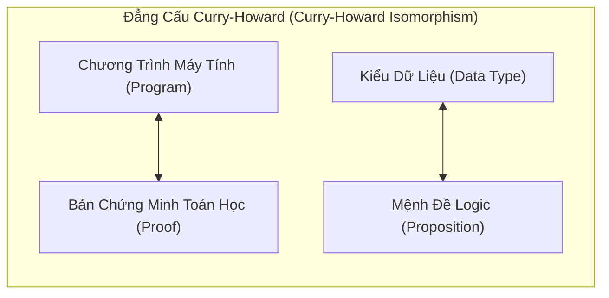

# 📐 SYMBOLIC AI & FORMAL VERIFICATION: GHÉP NỐI LLM VỚI BỘ GIẢI Z3 SMT & LEAN 4

Trong khi các mô hình ngôn ngữ lớn (LLM) xuất sắc trong suy luận ngôn ngữ tự nhiên và tổng hợp thông tin (Inductive Reasoning), bản chất của chúng là **bộ máy thống kê xác suất (Probabilistic Predictors)**. Khi đối mặt với các bài toán đòi hỏi tính chính xác tuyệt đối $100\%$ — như tối ưu hóa ràng buộc tài nguyên đa chiều, kiểm tra an toàn hợp đồng thông minh, hay xác thực phần mềm điều khiển hàng không/y tế — LLM thường xuyên mắc phải bẫy **ảo giác logic (Logical Hallucinations)** và ngộ nhận ràng buộc.

Giải pháp tối thượng trong kỹ nghệ tác tử hiện đại là kiến trúc **Neuro-Symbolic (Nơ-ron kết hợp Ký hiệu)**: sử dụng LLM như một bộ biên dịch ngôn ngữ tự nhiên thành đặc tả hình thức (Formal Specification), và ủy thác khâu giải toán/xác thực cho các **Hệ thống suy luận ký hiệu tất định (Deterministic Symbolic Engines)** như **Z3 SMT Solver** và **Lean 4 Interactive Theorem Prover**.

Tài liệu này đi sâu vào kiến trúc kết hợp Neuro-Symbolic, nguyên lý hoạt động của bộ giải SMT (Satisfiability Modulo Theories), vòng lặp phản hồi phản ví dụ (**CEGIS - Counterexample-Guided Inductive Synthesis**), và ứng dụng Lean 4 để xây dựng các tác tử có độ tin cậy toán học tuyệt đối.

---

## 1. Bản Chất Xung Đột: Xác Suất Thống Kê vs. Tính Đúng Đắn Hình Thức

```
       MÔ HÌNH HỌC SÂU (LLM)                   HỆ THỐNG KÝ HIỆU (Z3 / LEAN 4)
  ┌───────────────────────────────┐           ┌───────────────────────────────┐
  │ • Suy luận quy nạp (Inductive)│           │ • Suy luận diễn dịch (Deductive)
  │ • Hiểu ngôn ngữ tự nhiên mờ   │    VS     │ • Yêu cầu cú pháp toán học cứng
  │ • Xác suất thống kê (Soft P)  │           │ • Tính đúng đắn tuyệt đối (0/1)
  │ • Dễ sinh ảo giác logic      │           │ • Chứng minh bằng chứng từ (Proof)
  └───────────────────────────────┘           └───────────────────────────────┘
```

Một câu prompt dù được tối ưu qua Chain-of-Thought hay Tree-of-Thoughts vẫn có xác suất sai sót từ $5\% - 15\%$ trong các bài toán logic tổ hợp. Trong các lĩnh vực sinh mạng hoặc tài chính (Safety-Critical & Mission-Critical), sai số $0.1\%$ cũng là điều không thể chấp nhận.

Hệ thống kết hợp **Neuro-Symbolic** khai thác thế mạnh bù trừ hoàn hảo của hai trường phái:
* **LLM (Trí tuệ trực giác - Fast System 1):** Chịu trách nhiệm thấu hiểu đề bài, trích xuất thực thể, sinh giả thuyết và chuyển ngữ sang code hình thức.
* **Symbolic Solver (Trí tuệ logic chặt chẽ - Strict System 2):** Kiểm chứng tính khả thi, phát hiện xung đột và đảm bảo không có bất kỳ phản ví dụ nào tồn tại.

---

## 2. Kiến Trúc Vòng Lặp CEGIS (Counterexample-Guided Inductive Synthesis)

Vòng lặp tiêu chuẩn vàng kết nối Agent với Symbolic Engine là chu trình **CEGIS**:

```mermaid
flowchart TD
    UserGoal(["🎯 Yêu cầu bài toán (Tự nhiên: Lập lịch / Smart Contract)"]) --> LLM["LLM Agent (Semantic Translator & Generator)"]
    
    LLM --> FormalSpec["Sinh Đặc Tả Hình Thức (Z3 SMT-LIB / Lean 4 Code)"]
    FormalSpec --> Engine{"Bộ Giải Ký Hiệu<br/>(Z3 Solver / Lean Kernel)"}
    
    Engine -- "SAT / Q.E.D (Hợp Lệ)" --> Solution["✅ Nghiệm Chuẩn Xác 100% (Chứng minh toán học)"]
    
    Engine -- "UNSAT / Lỗi Ràng Buộc" --> ExtractConflict["Trích Xuất Phản Ví Dụ Cụ Thể (Counterexample / Unsat Core)"]
    ExtractConflict --> Feeback["Tiêm Phản Ví Dụ Ngược Lại Prompt:<br/>'Giải pháp của bạn thất bại khi: CPU=100%, RAM=2GB'"]
    Feeback --> LLM

    style Solution fill:#1b4d3e,stroke:#2ecc71,stroke-width:2px;
    style ExtractConflict fill:#641e16,stroke:#e74c3c,stroke-width:2px;
```



### 2.1. Phân Tích Cơ Chế Hoạt Động:
1. **Dịch Thuật Ngữ Nghĩa:** LLM đọc văn bản yêu cầu và chuyển đổi thành hệ phương trình ràng buộc hình thức.
2. **Kiểm Định Ký Hiệu:** Bộ giải Z3 nhận bài toán và áp dụng các thuật toán giải quyết lý thuyết (Theories).
3. **Phản Hồi Bằng Phản Ví Dụ (Counterexample Feedback):** Nếu giải pháp của Agent không tối ưu hoặc vi phạm điều kiện biên, Symbolic Engine không chỉ báo lỗi chung chung, mà trả về **chính xác bộ tham số làm sập hệ thống** (ví dụ: *"Khi biến $x = 0$ và $y = 2^{31}-1$, hàm bị tràn số nguyên"*).
4. **Tự Sửa Lỗi Có Định Hướng:** LLM sử dụng phản ví dụ cụ thể này làm dữ liệu đầu vào để sửa lại đặc tả trong vòng lặp tiếp theo, loại trừ hoàn toàn việc đoán mò vô định.

---

## 3. Giải Phẫu Bộ Giải Z3 SMT (Satisfiability Modulo Theories)

Z3 là bộ giải định lý SMT mã nguồn mở tiên tiến nhất thế giới do Microsoft Research phát triển.

### 3.1. SMT Là Gì?
Bài toán SAT kinh điển chỉ kiểm tra xem một biểu thức Boolean có thể nhận giá trị `True` hay không ($A \land (\neg B \lor C)$). 
**SMT (Satisfiability Modulo Theories)** nâng tầm SAT bằng cách nhúng thêm các lý thuyết toán học bậc một (First-Order Theories):

| Lý Thuyết Toán Học (Theory) | Ứng Dụng Trong Tác Tử AI | Ví Dụ Ràng Buộc |
| :--- | :--- | :--- |
| **Bit-Vectors (BV)** | Mô phỏng chính xác vi xử lý phần cứng, tràn số nhị phân (Integer Overflow). | $\text{BitVecVal}(x, 32) + 1 < x$ |
| **Linear Integer Arithmetic (LIA)** | Lập lịch tài nguyên, phân bổ ngân sách, tối ưu hóa chuỗi cung ứng. | $2x + 3y \le 100 \land x \ge 0$ |
| **Arrays & Uninterpreted Functions** | Kiểm thử phần mềm, xác thực bộ nhớ heap/stack của chương trình. | $A[i] = v \implies \text{read}(A, i) = v$ |
| **Non-linear Real Arithmetic (NRA)** | Điều khiển robot, động lực học vật lý, quỹ đạo bay. | $x^2 + y^2 \le R^2 \land \sin(\theta) \ge 0.5$ |

### 3.2. Ngôn Ngữ SMT-LIB Chuẩn Quốc Tế
Z3 giao tiếp thông qua chuẩn văn bản SMT-LIB 2.0. Ví dụ một đặc tả ràng buộc tìm 2 số nguyên $x, y$ sao cho $x > 2$, $y < 10$ và $x + 2y = 7$:

```smt2
(declare-const x Int)
(declare-const y Int)
(assert (> x 2))
(assert (< y 10))
(assert (= (+ x (* 2 y)) 7))
(check-sat)
(get-model)
```

Khi Agent gửi đoạn code này qua giao thức Tool Call, Z3 trả về trạng thái `sat` cùng nghiệm duy nhất: `x = 3, y = 2`.

---

## 4. Chứng Minh Hình Thức Với Lean 4 (Interactive Theorem Proving)

Nếu Z3 chuyên về tìm nghiệm và giải bất đẳng thức, thì **Lean 4** là ngôn ngữ lập trình thuần hàm và hệ thống hỗ trợ chứng minh định lý (Interactive Theorem Prover) được sử dụng để giải quyết các bài toán toán học đỉnh cao (như dự án Formalizing IMO của DeepMind / OpenAI).



### 4.1. Nguyên Lý "Proofs as Programs"
Trong Lean 4:
* Một mệnh đề toán học được mô tả như một **Kiểu dữ liệu (Type)**: `def FermatLastTheorem : Prop := ...`
* Một chứng minh toán học chính là một **Hàm máy tính (Function)** nhận đầu vào và trả về kiểu dữ liệu đó.
* Trình biên dịch của Lean (Lean Kernel) hoạt động như một quan tòa tối cao: Nếu code biên dịch thành công mà không có lỗi (`type-checks`), định lý đó **được chứng minh đúng đắn 100% không thể bàn cãi**.

### 4.2. Vai Trò Của Agent Trong Lean 4 REPL
Agent hoạt động như một nhà toán học tự động (Automated Mathematician):
1. Nhận bài toán toán học hoặc kiểm chứng thuật toán.
2. Viết mã Lean 4 áp dụng các chiến thuật chứng minh (`tactics`: `induction`, `simp`, `omega`, `linarith`).
3. Gửi sang môi trường thực thi `lean4` CLI qua Server REPL.
4. Nếu Lean Kernel báo lỗi `unsolved goals`, Agent đọc thông báo lỗi ngữ cảnh để tiếp tục suy luận chiến thuật tiếp theo.

---

## 5. Triển Khai Thực Chiến: `NeuroSymbolicZ3Agent` Bằng Python

Dưới đây là một hệ thống Agent hoàn chỉnh kết hợp LLM với thư viện `z3-solver` để giải quyết bài toán: **Phân bổ tài nguyên máy chủ đám mây phức tạp có điều kiện loại trừ bảo mật và ràng buộc ngân sách**:

```python
"""
NeuroSymbolicZ3Agent: Tác tử nơ-ron kết hợp bộ giải ký hiệu Z3.
Tự động mô hình hóa bài toán ngôn ngữ tự nhiên thành biểu thức ràng buộc Z3
và giải nghiệm tất định không ảo giác.
Yêu cầu: pip install z3-solver
"""

import re
from typing import Any, Dict, List, Optional, Tuple
from z3 import Int, Solver, sat, unsat, And, Or


class CloudResourceOptimizationAgent:
    def __init__(self):
        self.solver = Solver()

    def translate_nl_to_z3_constraints(self, requirements: str) -> Tuple[Solver, Dict[str, Any]]:
        """
        Giả lập LLM trích xuất các ràng buộc logic từ văn bản tự nhiên của người dùng:
        Yêu cầu:
        1. Có 3 loại máy chủ: Web (W), Database (D), Worker (K).
        2. Mỗi máy Web cần 2 vCPU, 4GB RAM, chi phí $10/ngày.
        3. Mỗi máy Database cần 8 vCPU, 32GB RAM, chi phí $50/ngày.
        4. Mỗi máy Worker cần 4 vCPU, 8GB RAM, chi phí $20/ngày.
        5. Ràng buộc: Tổng CPU <= 64, Tổng RAM <= 256GB, Ngân sách <= $350/ngày.
        6. Ràng buộc bảo mật: Số máy Web phải ít nhất gấp đôi số máy DB (W >= 2*D).
        7. Phải có ít nhất 2 máy Database và ít nhất 3 máy Worker.
        """
        # Khởi tạo các biến ký hiệu nguyên (Integer Symbols)
        W = Int('num_web')
        D = Int('num_db')
        K = Int('num_worker')

        solver = Solver()

        # Ràng buộc không âm
        solver.add(W >= 0, D >= 0, K >= 0)

        # Ràng buộc nghiệp vụ tối thiểu
        solver.add(D >= 2)
        solver.add(K >= 3)
        solver.add(W >= 2 * D)

        # Ràng buộc phần cứng vật lý
        # Tổng vCPU: 2*W + 8*D + 4*K <= 64
        solver.add(2 * W + 8 * D + 4 * K <= 64)

        # Tổng RAM: 4*W + 32*D + 8*K <= 256
        solver.add(4 * W + 32 * D + 8 * K <= 256)

        # Ràng buộc ngân sách: 10*W + 50*D + 20*K <= 350
        solver.add(10 * W + 50 * D + 20 * K <= 350)

        variables = {"Web": W, "Database": D, "Worker": K}
        return solver, variables

    def solve_and_explain(self, solver: Solver, variables: Dict[str, Any]) -> str:
        """Thực thi bộ giải SMT và sinh lời giải thích rõ ràng."""
        check_result = solver.check()

        if check_result == sat:
            model = solver.model()
            w_val = model[variables["Web"]].as_long()
            d_val = model[variables["Database"]].as_long()
            k_val = model[variables["Worker"]].as_long()

            # Tính toán các chỉ số thực tế
            total_cpu = 2 * w_val + 8 * d_val + 4 * k_val
            total_ram = 4 * w_val + 32 * d_val + 8 * k_val
            total_cost = 10 * w_val + 50 * d_val + 20 * k_val

            report = (
                f"✅ BỘ GIẢI Z3 ĐÃ TÌM THẤY NGHIỆM KHẢ THI (TẤT ĐỊNH 100%):\n"
                f"--------------------------------------------------\n"
                f"• Số máy chủ Web (W):       {w_val} nodes\n"
                f"• Số máy chủ Database (D):  {d_val} nodes\n"
                f"• Số máy chủ Worker (K):    {k_val} nodes\n"
                f"--------------------------------------------------\n"
                f"📊 TỔNG HỢP TIÊU HAO TÀI NGUYÊN:\n"
                f"• Tổng CPU sử dụng:  {total_cpu}/64 vCPU (Còn dư {64 - total_cpu})\n"
                f"• Tổng RAM sử dụng:  {total_ram}/256 GB (Còn dư {256 - total_ram} GB)\n"
                f"• Chi phí vận hành:  ${total_cost}/$350 mỗi ngày (Tiết kiệm ${350 - total_cost})\n"
                f"--------------------------------------------------\n"
                f"Xác nhận: Mọi điều kiện bảo mật (W >= 2*D) và giới hạn ngân sách đều thỏa mãn tuyệt đối."
            )
            return report
        else:
            return (
                "❌ KHÔNG TỒN TẠI NGHIỆM (UNSAT):\n"
                "Hệ thống ràng buộc có xung đột logic toán học. Không có bất kỳ cấu hình nào "
                "thỏa mãn đồng thời giới hạn ngân sách, CPU/RAM và tỷ lệ bảo mật W >= 2*D."
            )


# --- MINH HỌA VÒNG LẶP SỬA LỖI CEGIS ---
if __name__ == "__main__":
    agent = CloudResourceOptimizationAgent()
    
    print("=== TEST CASE 1: BÀI TOÁN HỢP LỆ VỚI CÁC RÀNG BUỘC PHỨC TẠP ===")
    user_prompt = "Lập kế hoạch phân bổ hạ tầng đám mây an toàn với ngân sách $350..."
    solver, vars_dict = agent.translate_nl_to_z3_constraints(user_prompt)
    result = agent.solve_and_explain(solver, vars_dict)
    print(result)

    print("\n=== TEST CASE 2: THỬ THÁCH XUNG ĐỘT (NGÂN SÁCH BỊ THẮT CHẶT QUÁ MỨC) ===")
    # Thêm ràng buộc bất khả thi: Ngân sách bị giảm xuống chỉ còn $120
    # Trong khi tối thiểu: 2 DB ($100) + 4 Web ($40) + 3 Worker ($60) = $200
    solver.add(10 * vars_dict["Web"] + 50 * vars_dict["Database"] + 20 * vars_dict["Worker"] <= 120)
    conflict_result = agent.solve_and_explain(solver, vars_dict)
    print(conflict_result)
```

---

## 6. Ma Trận So Sánh Các Trường Phái Giải Quyết Logic

| Tiêu Chí | LLM Thuần Túy (CoT / ToT) | Code Interpreter (Python Eval) | Neuro-Symbolic (Z3 / Lean 4) |
| :--- | :--- | :--- | :--- |
| **Bản Chất Cơ Bản** | Đoán xác suất token tiếp theo | Chạy code thủ công lặp | Tìm kiếm nghiệm không gian thỏa mãn (SMT) |
| **Xác Suất Ảo Giác Logic** | Cao ($5\% - 25\%$) | Trung bình (Code do LLM viết có thể sai logic) | **$0\%$ (Bảo đảm bằng chứng minh toán học)** |
| **Khả Năng Xử Lý Ràng Buộc Đa Chiều** | Kém (Dễ vi phạm điều kiện biên) | Phải viết thuật toán duyệt vét cạn (Brute-force) | **Siêu việt (Giải hệ hàng ngàn biến trong vài mili-giây)** |
| **Giải Thích Xung Đột (UNSAT)** | Ảo giác ra lý do giả | Lỗi Runtime Exception | **Trích xuất chính xác Unsat Core & Counterexample** |
| **Lĩnh Vực Bắt Buộc** | Viết email, tóm tắt văn bản | Xử lý dữ liệu Pandas cơ bản | **An toàn hàng không, Smart Contracts, Lập lịch phân tán** |

---

## 7. Tóm Tắt & Lộ Trình Ứng Dụng Thực Tế

1. **Không tin tưởng LLM trong các phép toán logic nghiêm ngặt:** Luôn dùng LLM làm **Semantic Parser** để trích xuất ý định người dùng thành hệ phương trình logic, sau đó chuyển cho Z3 Solver.
2. **Áp dụng quy trình CEGIS:** Khi bộ giải ký hiệu báo lỗi hoặc không khả thi, trích xuất Counterexample cụ thể để đưa ngược lại context của Agent giúp vòng lặp tự sửa lỗi chuẩn xác.
3. **Phân định rõ ranh giới công nghệ:**
   * Cần giải quyết bài toán tối ưu hóa, lập lịch, thỏa mãn ràng buộc $\to$ Sử dụng **Z3 SMT Solver**.
   * Cần kiểm chứng thuật toán không có lỗi phần mềm (Zero-bug guarantees) hoặc chứng minh định lý $\to$ Sử dụng **Lean 4**.

---

## 🔗 Liên Kết Chuyên Sâu
* [Code Graphs & Repository Intelligence](./01_code_graphs_and_repository_intelligence.md): Phân tích cú pháp AST và đồ thị phụ thuộc mã nguồn.
* [AST Self-Healing Code Agents](../03-loop-and-multi-agent-engineering/05_ast_self_healing_code_agents.md): Tác tử tự sửa lỗi cú pháp qua Abstract Syntax Trees.
* [Agent Security, Red Teaming & Guardrails](../06-governance-and-enterprise-delivery/02_agent_security_red_teaming_and_guardrails.md): Bảo vệ tác tử trước các hành vi tấn công và rò rỉ dữ liệu.
* [Constrained Decoding & Structured Outputs](../02-tools-and-mcp/02_constrained_decoding_and_structured_outputs.md): Cưỡng chế cú pháp đầu ra bằng Finite State Machines.
