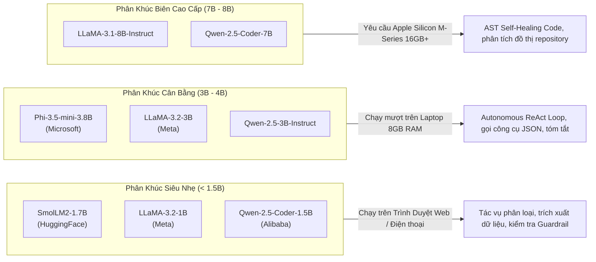
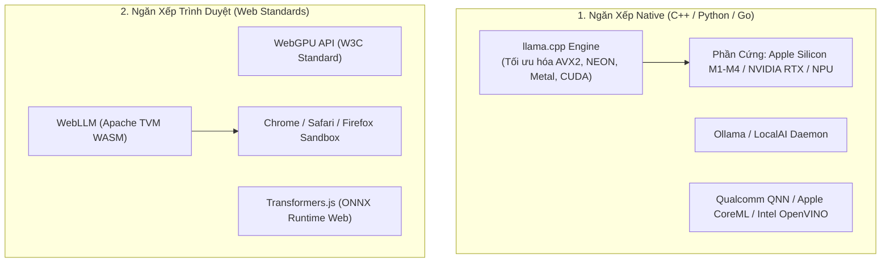
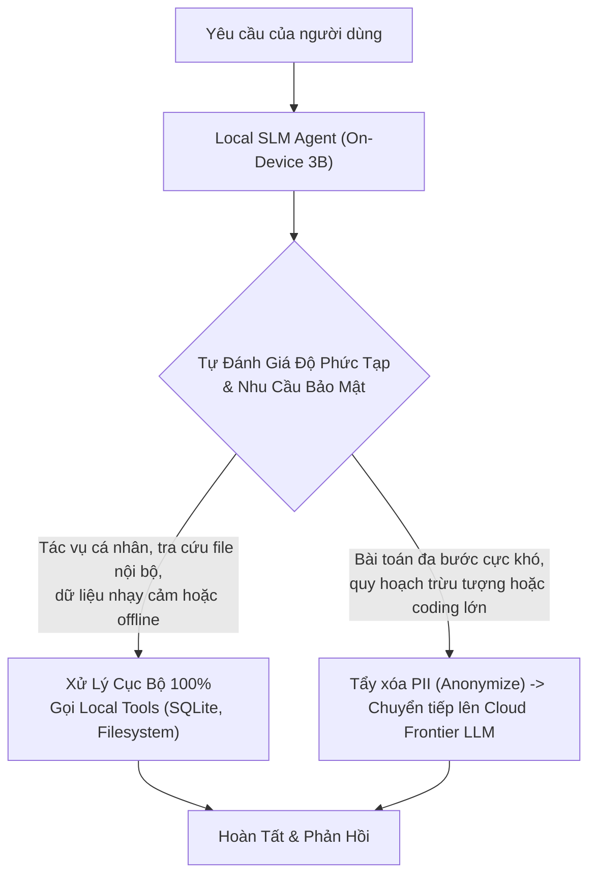

# 📱 ON-DEVICE & EDGE SMALL AGENTS: TÁC TỬ CỤC BỘ VỚI SLMs, WebGPU & NPU ACCELERATION

Phần lớn các kiến trúc tác tử tự trị hiện nay phụ thuộc hoàn toàn vào các mô hình ngôn ngữ khổng lồ (Frontier LLMs: GPT-4o, Claude-3.5 Sonnet) chạy trên các cụm siêu máy tính đám mây (Cloud Datacenters). Tuy nhiên, trong nhiều kịch bản thực tế, kiến trúc Cloud-Only bộc lộ những rào cản chí mạng:
1. **Quyền riêng tư & Bí mật kinh doanh (Zero Cloud Egress):** Dữ liệu mật trong y tế (bệnh án), tài chính cá nhân, hoặc mã nguồn phần mềm nhạy cảm không thể gửi qua API ra ngoài máy chủ nội bộ.
2. **Yêu cầu độ trễ cực thấp & Hoạt động ngoại tuyến (Offline Availability):** Thiết bị điều khiển công nghiệp, máy bay không người lái (UAV), hoặc tác tử chạy trên smartphone/laptop khi ở chế độ máy bay cần phản hồi tức thì mà không phụ thuộc vào kết nối internet.
3. **Chi phí vận hành theo Token:** Việc duy trì hàng triệu người dùng cùng chạy các [vòng lặp ReAct](../03-loop-and-multi-agent-engineering/02_react_and_planning.md) trên Frontier LLMs sẽ dẫn đến bão hóa đơn API hàng tháng.

Sự trỗi dậy của các **Mô hình Ngôn ngữ Nhỏ (Small Language Models - SLMs)** có quy mô từ $1\text{B}$ đến $7\text{B}$ tham số (như SmolLM2, LLaMA-3.2, Qwen-2.5-Coder, Phi-3.5) kết hợp với các công nghệ tăng tốc phần cứng biên (**WebGPU, Apple Metal MPS, và NPU - Neural Processing Unit**) mở ra kỷ nguyên mới: **Tác tử chạy hoàn toàn cục bộ trên thiết bị người dùng (On-Device Local Agents)**.

---

## 1. So Sánh Kiến Trúc: Cloud Agent vs. On-Device Edge Agent

```mermaid
graph TD
    subgraph CloudArchitecture ["Kiến Trúc Cloud-Centric Truyền Thống"]
        Device1["Thiết Bị Người Dùng (Client)"] -->|"Gửi Raw Data & Audio qua Internet"| CloudGW["Cloud API Gateway"]
        CloudGW --> FrontierLLM["Frontier LLM (70B - 405B Parameters)"]
        FrontierLLM -->|"Độ trễ mạng: 800ms - 2s<br/>Rủi ro bảo mật dữ liệu<br/>Chi phí: $5 - $15 / 1M tokens"| CloudGW
        CloudGW --> Device1
    end

    subgraph EdgeArchitecture ["Kiến Trúc On-Device Local-First"]
        Device2["Thiết Bị Người Dùng (MacBook / Laptop / Phone)"]
        subgraph HardwareChip ["Hardware Silicons (NPU / GPU / RAM)"]
            UnifiedRAM["Bộ nhớ hợp nhất (Unified RAM: 8GB - 16GB)"]
            Engine["Hạ tầng tăng tốc (llama.cpp / WebGPU / CoreML)"]
            SLM["Small Language Model (1B - 3B Q4_K_M)"]
            LocalTools["Local MCP Tools (File, Shell, SQLite, Sensors)"]
        end
        Device2 --- HardwareChip
        SLM <--> LocalTools
        Note over Device2: Dữ liệu ở lại thiết bị 100%<br/>Độ trễ mạng: 0ms<br/>Chi phí Token: $0.00
    end

    style CloudArchitecture fill:#f8fafc,stroke:#64748b,stroke-width:1px,color:#000000
    style EdgeArchitecture fill:#eff6ff,stroke:#2563eb,stroke-width:2px,color:#000000
```

### 1.1. Ma Trận Đánh Giá Đánh Đổi Kỹ Thuật (Trade-Off Matrix)

| Tiêu Chí | Cloud Frontier Agent (GPT-4o / Claude-3.5) | On-Device SLM Agent (LLaMA-3.2 3B / Qwen-2.5 1.5B) |
| :--- | :--- | :--- |
| **Bảo mật dữ liệu** | Phụ thuộc vào chính sách SLA của bên thứ ba | **Bảo mật tuyệt đối (Zero Data Egress, 100% On-device)** |
| **Độ trễ mạng (Network Latency)** | $200\text{ms} - 800\text{ms}$ (Round-trip RTT) | **$0\text{ms}$ (Xử lý trực tiếp trong RAM/VRAM)** |
| **Khả năng chạy offline** | Không thể ($0\%$) | **Hoạt động $100\%$ không cần internet** |
| **Năng lực suy luận đa bước** | Rất cao (Lập kế hoạch $20 - 50$ bước) | Trung bình khá ($3 - 7$ bước suy luận có hướng dẫn) |
| **Kỹ năng gọi công cụ (Tool Calling)**| Rất linh hoạt, tự sửa cú pháp | Cần [Constrained Decoding](../02-tools-and-mcp/02_constrained_decoding_and_structured_outputs.md) cưỡng chế schema |
| **Chi phí biên (Marginal Cost)** | Tính theo token tiêu thụ | **$\$0.00$ trên mỗi lượt truy vấn** |

---

## 2. Các Dòng Mô Hình Ngôn Ngữ Nhỏ (SLMs) Tối Ưu Cho Tác Tử

Không phải mọi mô hình nhỏ đều có thể đóng vai trò tác tử. Để làm tác tử hiệu quả, mô hình phải được căn chỉnh đặc biệt (Fine-tuned Alignment) với dữ liệu Function Calling và ReAct trajectories:



1. **SmolLM2 (1.7B):** Tối ưu hóa cực mạnh cho việc chạy trong WebAssembly/WebGPU, tiêu tốn chưa đến $1.2\text{GB}$ VRAM ở định dạng 4-bit, phù hợp làm bộ lọc an ninh [Guardrail Gate](../06-governance-and-enterprise-delivery/02_agent_security_red_teaming_and_guardrails.md).
2. **Qwen-2.5-Coder (1.5B & 7B):** Tỷ lệ sinh cú pháp JSON chuẩn xác vượt trội trong các mô hình mã nguồn mở, hỗ trợ gọi công cụ chính xác ngay cả khi chỉ có tài nguyên khiêm tốn.
3. **Phi-3.5-mini (3.8B):** Nổi bật về khả năng suy luận logic và toán học nhờ tập dữ liệu huấn luyện "Textbooks Are All You Need".

---

## 3. Ngăn Xếp Công Nghệ Thực Thi Cục Bộ (Execution Stacks)

Hệ sinh thái chạy mô hình cục bộ phân hóa thành hai nhánh chính: **Native Runtime** và **Browser-Based Runtime**.



### 3.1. Kỹ Thuật Lượng Tử Hóa GGUF (Quantization on Edge)
Bộ nhớ RAM của thiết bị di động và laptop bị giới hạn nghiêm ngặt. Để đưa mô hình 3B vào thiết bị 8GB RAM mà không bị hệ điều hành tắt ứng dụng (OOM Crash):
* **Q4_K_M (4-bit Medium):** Trọng số được nén xuống $4.5\text{ bits/parameter}$. Mô hình 3B chỉ chiếm $\approx 2.0\text{GB}$ RAM, tốc độ sinh đạt $45 - 80\text{ tokens/s}$ trên chip Apple M2/M3.
* **Paged KV-Cache trên bộ nhớ hợp nhất:** Giới hạn context window ở mức $4,096 - 8,192\text{ tokens}$ để kích thước KV-cache không vượt quá $500\text{MB}$.

### 3.2. Chạy Trực Tiếp Trong Trình Duyệt Qua WebGPU (In-Browser Agents)
Nhờ API tiêu chuẩn **WebGPU** và công nghệ **WebAssembly (WASM)**, tác tử có thể tải trọng số mô hình đã được nén về Cache API của trình duyệt và chạy hoàn toàn trong tab duyệt web của người dùng:
* Người dùng chỉ cần truy cập trang web; mô hình tải một lần duy nhất vào bộ nhớ đệm ổ cứng.
* Toàn bộ mã nguồn trang web, dữ liệu người dùng nhập vào form, hoặc file đính kèm được tác tử phân tích ngay trong máy khách (Client-Side), không một byte dữ liệu nào rời khỏi thiết bị.

---

## 4. Kiến Trúc Định Tuyến Lai (Hybrid Local-First Agent Routing)

Trong môi trường doanh nghiệp, cách tiếp cận thông minh nhất không phải là "loại bỏ hoàn toàn Cloud", mà là **Mô hình Phân Cấp Nhiệm Vụ (Local-First Escalation)**:



* **80% tác vụ thông thường:** Trích xuất thông tin, tóm tắt cuộc họp, lọc email, gõ code phụ trợ $\to$ Xử lý hoàn toàn tại Edge, tiết kiệm $80\%$ chi phí API.
* **20% tác vụ phức tạp:** Lập luận toán học cao cấp, kiến trúc hệ thống lớn $\to$ Khử dữ liệu định danh (Sanitize PII) rồi chuyển lên Cloud Frontier Model.

---

## 5. Triển Khai Thực Chiến: `OnDeviceEdgeAgent` Bằng Python

Dưới đây là một triển khai Python hoàn chỉnh minh họa cách xây dựng một **Local Edge Agent** độc lập, sử dụng mô hình nhỏ kết hợp với [Constrained Decoding](../02-tools-and-mcp/02_constrained_decoding_and_structured_outputs.md) để gọi các công cụ phần cứng cục bộ (đọc pin, kiểm tra tài nguyên hệ thống, thao tác file an toàn):

```python
"""
OnDeviceEdgeAgent: Tác tử tự hành hoạt động hoàn toàn cục bộ trên thiết bị biên.
Sử dụng mô hình nhỏ (SLM) với cơ chế bọc công cụ phần cứng máy khách và giới hạn tài nguyên nghiêm ngặt.
"""

import json
import os
import platform
import psutil
from typing import Dict, Any, List, Optional


class LocalHardwareTools:
    """Tập hợp các công cụ giao tiếp phần cứng và hệ điều hành cục bộ."""

    @staticmethod
    def get_system_metrics() -> Dict[str, Any]:
        """Đọc thông số tài nguyên phần cứng máy chủ cục bộ."""
        cpu_percent = psutil.cpu_percent(interval=0.1)
        ram = psutil.virtual_memory()
        battery = psutil.sensors_battery()

        return {
            "os": f"{platform.system()} {platform.release()}",
            "cpu_usage_percent": cpu_percent,
            "ram_used_gb": round((ram.total - ram.available) / (1024**3), 2),
            "ram_total_gb": round(ram.total / (1024**3), 2),
            "ram_free_percent": round((ram.available / ram.total) * 100, 1),
            "battery_percent": battery.percent if battery else "N/A (Cắm sạc liên tục)",
            "power_plugged": battery.power_plugged if battery else True,
        }

    @staticmethod
    def inspect_local_directory(path: str = ".") -> Dict[str, Any]:
        """Liệt kê các tệp tin trong thư mục làm việc cục bộ."""
        try:
            entries = os.listdir(path)
            files = [f for f in entries if os.path.isfile(os.path.join(path, f))]
            dirs = [d for d in entries if os.path.isdir(os.path.join(path, d))]
            return {"status": "success", "total_files": len(files), "sample_files": files[:5], "dirs": dirs[:5]}
        except Exception as e:
            return {"status": "error", "message": str(e)}


class MockOnDeviceSLM:
    """
    Giả lập bộ suy luận mô hình nhỏ (SLM 1.5B/3B) có khả năng sinh cú pháp Tool Call
    thông qua Constrained JSON Masking mà không cần kết nối mạng bên ngoài.
    """

    def generate_response(self, prompt: str) -> str:
        prompt_lower = prompt.lower()

        # Giả lập logic phân loại ý định (Intent Recognition) nội bộ của SLM
        if any(w in prompt_lower for w in ["pin", "ram", "cpu", "hệ điều hành", "tài nguyên", "máy tính"]):
            return json.dumps({
                "thought": "Người dùng yêu cầu kiểm tra tình trạng tài nguyên phần cứng của máy khách. Tôi sẽ gọi tool get_system_metrics.",
                "action": "get_system_metrics",
                "arguments": {}
            })
        elif any(w in prompt_lower for w in ["tệp", "file", "thư mục", "danh sách"]):
            return json.dumps({
                "thought": "Người dùng muốn kiểm tra danh sách file trong thư mục hiện tại. Tôi sẽ gọi tool inspect_local_directory.",
                "action": "inspect_local_directory",
                "arguments": {"path": "."}
            })
        else:
            return json.dumps({
                "thought": "Yêu cầu nằm ngoài phạm vi các công cụ cục bộ hoặc quá phức tạp.",
                "action": "final_response",
                "arguments": {"message": "Tôi là On-Device Agent cục bộ. Tôi có thể giúp bạn kiểm tra tài nguyên phần cứng hoặc quản lý file offline an toàn."}
            })


class OnDeviceEdgeAgent:
    """Agent điều phối chạy tại biên với bộ nhớ RAM giới hạn và bảo mật 100%."""

    def __init__(self):
        self.slm = MockOnDeviceSLM()
        self.tools = LocalHardwareTools()
        self.max_context_turns = 3  # Giới hạn cửa sổ trượt để bảo vệ RAM thiết bị

    def run_step(self, user_query: str) -> str:
        print(f"\n[USER QUERY (OFFLINE)]: '{user_query}'")

        # 1. SLM cục bộ suy luận (Inference trong SRAM/Unified RAM)
        raw_output = self.slm.generate_response(user_query)
        decision = json.loads(raw_output)

        print(f"  └─> [SLM THOUGHT]: {decision.get('thought')}")
        action = decision.get("action")
        args = decision.get("arguments", {})

        # 2. Thực thi công cụ cục bộ (Local Tool Execution)
        if action == "get_system_metrics":
            obs = self.tools.get_system_metrics()
            print(f"  └─> [LOCAL TOOL EXECUTED]: get_system_metrics()")
            print(f"      Observation: {obs}")
            return f"Báo cáo phần cứng: CPU {obs['cpu_usage_percent']}%, RAM khả dụng {obs['ram_free_percent']}%, Pin: {obs['battery_percent']}."

        elif action == "inspect_local_directory":
            obs = self.tools.inspect_local_directory(args.get("path", "."))
            print(f"  └─> [LOCAL TOOL EXECUTED]: inspect_local_directory({args})")
            return f"Thư mục hiện tại có {obs.get('total_files')} files. Ví dụ: {obs.get('sample_files')}."

        else:
            return args.get("message", "Đã hoàn thành tác vụ.")


# ==========================================
# CHẠY THỬ NGHIỆM TÁC TỬ TẠI BIÊN (OFFLINE)
# ==========================================
if __name__ == "__main__":
    agent = OnDeviceEdgeAgent()

    # Thử nghiệm 1: Kiểm tra phần cứng máy tính thật
    res1 = agent.run_step("Kiểm tra xem máy tính của tôi còn bao nhiêu phần trăm RAM và CPU?")
    print(f"==> Phản hồi cuối: {res1}\n")

    # Thử nghiệm 2: Kiểm tra tệp tin thư mục hiện tại
    res2 = agent.run_step("Xem trong thư mục này đang có những tệp tin nào?")
    print(f"==> Phản hồi cuối: {res2}\n")
```

---

## 6. Tổng Kết & Tương Lai Của On-Device Agents

1. **Kỷ nguyên Local-First:** Tác tử không còn là độc quyền của các trung tâm dữ liệu nghìn tỷ đô. Một chiếc laptop M-series hoặc điện thoại với chip NPU có thể tự vận hành một trợ lý số thông minh, bảo mật và hoàn toàn miễn phí token.
2. **Nguyên tắc "Small Model + Strict Tools":** Mô hình nhỏ không cần phải biết làm thơ hay giải triết học; nó chỉ cần được huấn luyện thật sâu về cú pháp [Constrained Decoding](../02-tools-and-mcp/02_constrained_decoding_and_structured_outputs.md) để kích hoạt đúng công cụ phần cứng.
3. **Phối hợp Biên - Mây (Edge-Cloud Symphony):** Xu hướng tương lai là các tác tử biên đảm nhận vai trò bảo vệ quyền riêng tư, lọc dữ liệu thô, và chỉ kích hoạt các tác tử đám mây cho các bài toán chiến lược mang tầm vĩ mô.
