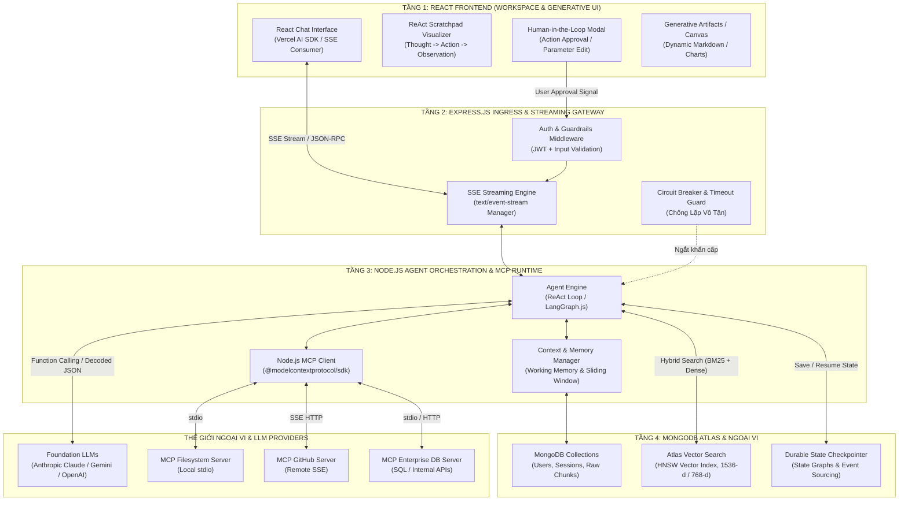
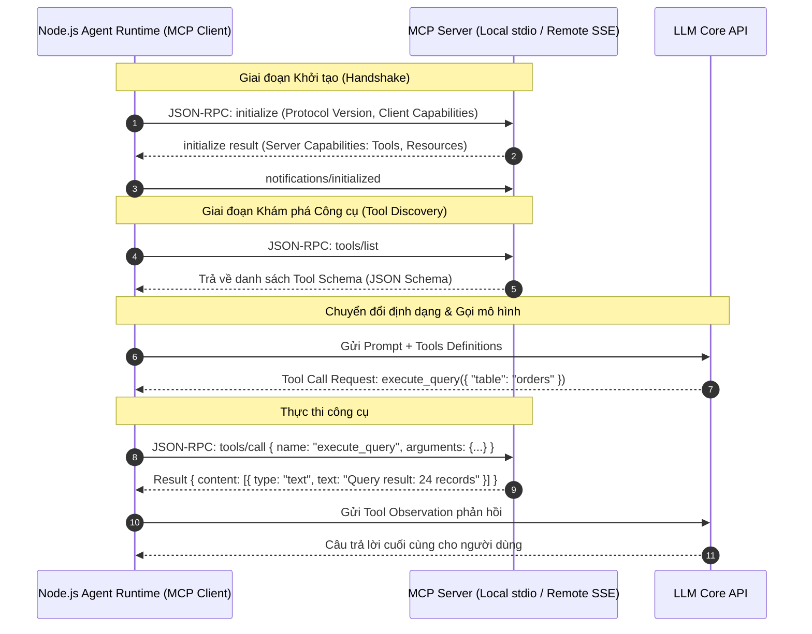

# 🌐 KIẾN TRÚC ỨNG DỤNG TÁC TỬ TOÀN DIỆN VỚI MERN STACK
## Tích Hợp MongoDB Atlas Vector Search, Express Ingress Gateway, React Generative UI & Node.js MCP Orchestrator Trong Phát Triển Full-Stack AI Agents

---

## 📑 MỤC LỤC
1. [Khởi Nguyên: Sự Tiến Hóa Của MERN Stack Trong Kỷ Nguyên Agentic AI](#1-khởi-nguyên-sự-tiến-hóa-của-mern-stack-trong-kỷ-nguyên-agentic-ai)
2. [Sơ Đồ Khối Kiến Trúc Tổng Thể (End-to-End MERN Agent Architecture)](#2-sơ-đồ-khối-kiến-trúc-tổng-thể-end-to-end-mern-agent-architecture)
3. [MongoDB: Lưu Trữ Kép (Document Store, Atlas Vector Search & State Checkpointing)](#3-mongodb-lưu-trữ-kép-document-store-atlas-vector-search--state-checkpointing)
   - [3.1. Thiết Kế Vector Index & Toán Tử `$vectorSearch`](#31-thiết-kế-vector-index--toán-tử-vectorsearch)
   - [3.2. Hybrid Search Kết Hợp BM25 & Dense Vectors Với Reciprocal Rank Fusion (RRF)](#32-hybrid-search-kết-hợp-bm25--dense-vectors-với-reciprocal-rank-fusion-rrf)
   - [3.3. Checkpoint Store Cho Máy Trạng Thái Bền Vững (Durable State)](#33-checkpoint-store-cho-máy-trạng-thái-bền-vững-durable-state)
4. [Node.js & Express: Tầng Điều Phối Lõi & Tích Hợp Model Context Protocol (MCP)](#4-nodejs--express-tầng-điều-phối-lõi--tích-hợp-model-context-protocol-mcp)
   - [4.1. Kiến Trúc Node.js MCP Client Với `@modelcontextprotocol/sdk`](#41-kiến-trúc-nodejs-mcp-client-với-modelcontextprotocolsdk)
   - [4.2. Xây Dựng Streaming SSE Endpoint Cho Agent Thought Traces & Tool Events](#42-xây-dựng-streaming-sse-endpoint-cho-agent-thought-traces--tool-events)
   - [4.3. Quản Trị Vòng Lặp ReAct & Ngắt Mạch Circuit Breakers Trên Node.js](#43-quản-trị-vòng-lặp-react--ngắt-mạch-circuit-breakers-trên-nodejs)
5. [React: Giao Diện Tác Tử Thời Gian Thực, Generative UI & Human-in-the-Loop](#5-react-giao-diện-tác-tử-thời-gian-thực-generative-ui--human-in-the-loop)
   - [5.1. Mô Hình Truyền Phát Dòng Trạng Thái & Visualization Của Chuỗi Suy Luận (Scratchpad)](#51-mô-hình-truyền-phát-dòng-trạng-thái--visualization-của-chuỗi-suy-luận-scratchpad)
   - [5.2. Cơ Chế Phê Duyệt Hành Động Nguy Hiểm (Human-in-the-Loop Modals)](#52-cơ-chế-phê-duyệt-hành-động-nguy-hiểm-human-in-the-loop-modals)
   - [5.3. Generative Artifacts & Dynamic UI Components](#53-generative-artifacts--dynamic-ui-components)
6. [Mã Nguồn Thực Chiến Hoàn Chỉnh (Production TypeScript Blueprint)](#6-mã-nguồn-thực-chiến-hoàn-chỉnh-production-typescript-blueprint)
   - [6.1. Schema MongoDB Mongoose & Vector Pipeline](#61-schema-mongodb-mongoose--vector-pipeline)
   - [6.2. Express SSE Controller & MCP Agent Runtime](#62-express-sse-controller--mcp-agent-runtime)
   - [6.3. React Agent Chat Component Với Streaming & Tool Confirmation](#63-react-agent-chat-component-với-streaming--tool-confirmation)
7. [Các Thách Thức Vận Hành, Bảo Mật & Best Practices](#7-các-thách-thức-vận-hành-bảo-mật--best-practices)
8. [Bản Đồ Liên Kết Kiến Thức (Knowledge Graph Links)](#8-bản-đồ-liên-kết-kiến-thức-knowledge-graph-links)

---

## 1. KHỞI NGUYÊN: SỰ TIẾN HÓA CỦA MERN STACK TRONG KỶ NGUYÊN AGENTIC AI

### 1.1. Tại Sao Lại Là MERN Khi Python Thống Trị Nghiên Cứu AI?
Trong nghiên cứu học thuật và tiền huấn luyện mô hình, Python giữ vị thế độc tôn nhờ PyTorch, Transformers và vLLM. Tuy nhiên, khi một hệ thống tác tử AI cần bước ra thế giới thực và phục vụ hàng triệu người dùng cuối (User-Facing Production Applications), kiến trúc kỹ thuật phần mềm đòi hỏi:
1. **Khả năng phản hồi phi phong tỏa (Non-blocking I/O Concurrency):** Hệ thống Agent thực hiện hàng chục cuộc gọi API ngoại vi đồng thời (I/O-bound tasks): gọi LLM API, truy vấn Vector DB, kích hoạt MCP Tools. Event Loop của Node.js xử lý các luồng I/O bất đồng bộ với chi phí tài nguyên (memory footprint) thấp hơn đáng kể so với mô hình đa luồng/đa tiến trình nặng nề.
2. **Giao diện thời gian thực & Truyền phát dòng (Streaming UI):** Trải nghiệm người dùng AI hiện đại không còn là Request-Response tĩnh mà là **Tokens Streaming**, **Live Thought Traces** (suy ngẫm từng bước của ReAct) và **Generative UI**. Hệ sinh thái React với các thư viện như `@ai-sdk/react`, React Server Components (RSC) và Zustand mang lại khả năng render giao diện động linh hoạt nhất hiện nay.
3. **Thống nhất ngôn ngữ toàn trình (Universal TypeScript/JavaScript):** Chia sẻ Types và Schemas (Pydantic $\leftrightarrow$ Zod) giữa Frontend và Backend, loại bỏ hoàn toàn hiện tượng lệch kiểu (Schema Drift) khi xử lý các cuộc gọi Tool Parameters.

### 1.2. Chuyển Dịch Từ CRUD Truyền Thống Sang Agentic MERN
Bảng so sánh vai trò của từng thành phần trong ngăn xếp MERN:

| Thành phần | MERN Cổ Điển (Web 2.0 / CRUD) | Modern Agentic MERN (AI Era) |
| :--- | :--- | :--- |
| **MongoDB** | Lưu trữ Document JSON, quan hệ bảng đơn giản, index B-Tree. | **Lưu trữ Kép (Hybrid Store):** Lưu văn bản gốc + Embedding Vector (HNSW) qua Atlas Vector Search; lưu Checkpoints trạng thái máy tác tử (`langgraph-checkpoint-mongodb`). |
| **Express.js** | Routing RESTful API, chứng thực người dùng qua JWT/Session. | **Ingress Gateway & Event Streamer:** Kiểm soát luồng SSE/WebSocket, Rate Limiting, xác thực RBAC trước khi ủy quyền chạy công cụ, điều phối Circuit Breakers. |
| **React** | Render SPA, form nhập liệu, bảng hiển thị dữ liệu tĩnh. | **Generative UI & Agentic Workspace:** Hiển thị trực quan ReAct Scratchpad (Thought $\to$ Action $\to$ Observation), giao diện phê duyệt Human-in-the-Loop, canvas sinh tác phẩm linh hoạt. |
| **Node.js** | Backend runtime chạy logic CRUD nghiệp vụ. | **Agent Runtime & MCP Host/Client:** Tích hợp `@modelcontextprotocol/sdk` để kết nối MCP Servers, điều phối LangGraph.js / AI SDK, quản lý bộ nhớ đệm và vòng lặp tự trị. |

---

## 2. SƠ ĐỒ KHỐI KIẾN TRÚC TỔNG THỂ (END-TO-END MERN AGENT ARCHITECTURE)

Một ứng dụng Agentic hoàn chỉnh dựa trên MERN Stack được phân tách thành 4 tầng ranh giới rõ ràng:



---

## 3. MONGODB: LƯU TRỮ KÉP (DOCUMENT STORE, ATLAS VECTOR SEARCH & STATE CHECKPOINTING)

Trong kiến trúc RAG và Agent truyền thống, các nhóm phát triển thường mắc bẫy chia cắt hạ tầng: sử dụng một cơ sở dữ liệu Document riêng (PostgreSQL/MongoDB) và một Vector Database độc lập (Pinecone/Milvus/Qdrant). Điều này gây ra:
* Hiện tượng **Trôi dạt đồng bộ dữ liệu (Data Sync Latency)** giữa bản ghi chính và vector embedding.
* Sự phức tạp trong giao dịch phân tán (Distributed Transactions) và sao lưu phục hồi thảm họa.

Với **MongoDB Atlas Vector Search**, MongoDB biến thành một giải pháp lưu trữ hợp nhất đáp ứng trọn vẹn 3 nhu cầu của Agent:

### 3.1. Thiết Kế Vector Index & Toán Tử `$vectorSearch`
MongoDB triển khai thuật toán đồ thị xấp xỉ lân cận phân tầng **HNSW (Hierarchical Navigable Small World)** trực tiếp trên các phân vùng dữ liệu.

Cấu hình Vector Search Index trên Atlas:
```json
{
  "fields": [
    {
      "type": "vector",
      "path": "embedding",
      "numDimensions": 1536,
      "similarity": "cosine"
    },
    {
      "type": "filter",
      "path": "metadata.tenantId"
    },
    {
      "type": "filter",
      "path": "metadata.source"
    }
  ]
}
```

Toán tử `$vectorSearch` trong MongoDB Aggregation Pipeline được đặt ở giai đoạn đầu tiên:

```javascript
const results = await db.collection("knowledge_chunks").aggregate([
  {
    $vectorSearch: {
      index: "vector_index_default",
      path: "embedding",
      queryVector: queryEmbedding, // Mảng float [0.012, -0.045, ...]
      numCandidates: 150,          // Kích thước tập ứng viên HNSW efSearch
      limit: 10,                   // Số lượng kết quả thu hồi
      filter: {
        "metadata.tenantId": { $eq: userTenantId } // Cô lập dữ liệu đa người thuê
      }
    }
  },
  {
    $project: {
      _id: 1,
      text: 1,
      metadata: 1,
      score: { $meta: "vectorSearchScore" } // Trả về độ tương đồng Cosine
    }
  }
]).toArray();
```

### 3.2. Hybrid Search Kết Hợp BM25 & Dense Vectors Với Reciprocal Rank Fusion (RRF)
Như đã khảo sát trong [Tìm Kiếm Ngữ Nghĩa & Tái Xếp Hạng](../../01-research-and-foundations/03-semantic-search/01_semantic_search_and_reranking.md), tìm kiếm vector thuần túy thường thất bại trước các từ khóa kỹ thuật hiếm (mã lỗi `ERR_502`, số hiệu SKU, tên biến). Trong MERN, chúng ta kết hợp **Atlas Full-Text Search ($BM25$)** và **Vector Search** thông qua thuật toán Reciprocal Rank Fusion (RRF):

Điểm số tổng hợp được tính theo công thức:

$$
\text{Score}_{\text{RRF}}(d) = \sum_{m \in M} \frac{1}{k + r_m(d)}
$$

Trong đó:
* $M$: Tập hợp các hệ thống xếp hạng ($M = \{\text{TextSearch}, \text{VectorSearch}\}$).
* $r_m(d)$: Thứ hạng (Rank vị trí $1, 2, 3\dots$) của tài liệu $d$ trong danh sách trả về của phương thức $m$.
* $k$: Hằng số làm mịn thực nghiệm (thường đặt $k = 60$).

```typescript
// Triển khai Reciprocal Rank Fusion trong Node.js
export function reciprocalRankFusion(
  vectorResults: Array<{ id: string; doc: any }>,
  textResults: Array<{ id: string; doc: any }>,
  k = 60
) {
  const scores: Record<string, { doc: any; score: number }> = {};

  // Xử lý rank từ Vector Search
  vectorResults.forEach((item, rank) => {
    if (!scores[item.id]) scores[item.id] = { doc: item.doc, score: 0 };
    scores[item.id].score += 1 / (k + (rank + 1));
  });

  // Xử lý rank từ Text Search (Lexical BM25)
  textResults.forEach((item, rank) => {
    if (!scores[item.id]) scores[item.id] = { doc: item.doc, score: 0 };
    scores[item.id].score += 1 / (k + (rank + 1));
  });

  // Sắp xếp giảm dần theo điểm RRF
  return Object.values(scores).sort((a, b) => b.score - a.score);
}
```

### 3.3. Checkpoint Store Cho Máy Trạng Thái Bền Vững (Durable State)
Khi Agent vận hành các chuỗi công việc dài hạn hoặc cần dừng lại chờ người dùng phê duyệt theo mô hình [Thực Thi Bền Vững](../03-loop-and-multi-agent-engineering/06_durable_execution_and_stateful_workflows.md), trạng thái của Agent State Graph cần được lưu lại một cách bền vững. MongoDB đóng vai trò là Checkpoint Store lý tưởng nhờ định dạng Document BSON tương thích hoàn toàn với State Dictionary.

```typescript
import { MongoDBSaver } from "@langchain/langgraph-checkpoint-mongodb";
import { MongoClient } from "mongodb";

const client = new MongoClient(process.env.MONGODB_URI!);
await client.connect();

// Tạo Checkpointer lưu trữ trạng thái đồ thị tự trị vào MongoDB
export const checkpointer = new MongoDBSaver({
  client,
  dbName: "agent_orchestrator",
  checkpointCollectionName: "graph_checkpoints",
  writesCollectionName: "graph_writes",
});
```

---

## 4. NODE.JS & EXPRESS: TẦNG ĐIỀU PHỐI LÕI & TÍCH HỢP MODEL CONTEXT PROTOCOL (MCP)

### 4.1. Kiến Trúc Node.js MCP Client Với `@modelcontextprotocol/sdk`
Giao thức Model Context Protocol (đã khảo sát tại [Kiến Trúc Giao Thức Model Context Protocol](../02-tools-and-mcp/01_mcp_architecture.md)) do Anthropic công bố cung cấp SDK chính thức cho TypeScript: `@modelcontextprotocol/sdk`. Node.js đóng vai trò **MCP Host/Client**, tự động kết nối và lấy danh sách công cụ từ các MCP Servers độc lập:



### 4.2. Xây Dựng Streaming SSE Endpoint Cho Agent Thought Traces & Tool Events
Chuẩn giao tiếp Server-Sent Events (SSE) qua HTTP cho phép Express duy trì một kết nối một chiều có độ trễ cực thấp để truyền các sự kiện trung gian của Agent về client:

```typescript
import { Request, Response } from "express";

export function setupSSEHeaders(res: Response) {
  res.writeHead(200, {
    "Content-Type": "text/event-stream",
    "Cache-Control": "no-cache, no-transform",
    "Connection": "keep-alive",
    "X-Accel-Buffering": "no", // Chống Nginx buffer dòng dữ liệu
  });
  res.flushHeaders();
}

export function sendSSEEvent(res: Response, event: string, data: any) {
  res.write(`event: ${event}\n`);
  res.write(`data: ${JSON.stringify(data)}\n\n`);
}
```

Các kiểu sự kiện chuẩn mực phát ra trong vòng lặp Agent:
* `thought`: Dòng token suy ngẫm nội tâm của mô hình.
* `tool_call_start`: Thông báo bắt đầu gọi tool, chứa tên hàm và tham số.
* `tool_approval_required`: Tạm dừng luồng và yêu cầu người dùng xác nhận hành động.
* `tool_result`: Kết quả trả về sau khi tool thực thi hoàn tất.
* `final_token`: Token nội dung văn bản cuối cùng trả cho người dùng.
* `done`: Báo hiệu phiên tác tử đã hoàn thành.

### 4.3. Quản Trị Vòng Lặp ReAct & Ngắt Mạch Circuit Breakers Trên Node.js
Như đã cảnh báo trong [Nền Tảng Loop Engineering](../03-loop-and-multi-agent-engineering/01_loop_fundamentals.md), các Agent có thể rơi vào bẫy lặp vô tận (Infinite Loops) hoặc bão gọi công cụ (Tool Storms). Express middleware cần bọc cơ chế Circuit Breaker:

```typescript
export class AgentCircuitBreaker {
  private maxSteps: number;
  private maxConsecutiveToolFailures: number;
  private currentStep = 0;
  private failureCount = 0;

  constructor(maxSteps = 15, maxFailures = 3) {
    this.maxSteps = maxSteps;
    this.maxConsecutiveToolFailures = maxFailures;
  }

  public registerStep() {
    this.currentStep++;
    if (this.currentStep > this.maxSteps) {
      throw new Error(`[CircuitBreaker] Vượt quá giới hạn số bước thực thi tối đa (${this.maxSteps})!`);
    }
  }

  public registerToolResult(success: boolean) {
    if (!success) {
      this.failureCount++;
      if (this.failureCount >= this.maxConsecutiveToolFailures) {
        throw new Error(`[CircuitBreaker] Công cụ thất bại liên tiếp ${this.failureCount} lần. Ngắt khẩn cấp để bảo toàn hệ thống!`);
      }
    } else {
      this.failureCount = 0; // Reset khi có một hành động thành công
    }
  }
}
```

---

## 5. REACT: GIAO DIỆN TÁC TỬ THỜI GIAN THỰC, GENERATIVE UI & HUMAN-IN-THE-LOOP

### 5.1. Mô Hình Truyền Phát Dòng Trạng Thái & Visualization Của Chuỗi Suy Luận (Scratchpad)
Người dùng doanh nghiệp không chấp nhận một chiếc hộp đen quay tròn trong 20 giây. Giao diện React cần bóc tách các giai đoạn tư duy của Agent:
* **Accordion / Collapsible Thought Block:** Cho phép xem quá trình reasoning mà không làm vỡ bố cục giao diện chính.
* **Live Activity Indicators:** Hiển thị trạng thái đang kết nối cơ sở dữ liệu hoặc chờ phản hồi từ MCP Server.

| Khối Giao Diện React | Dữ Liệu Hiển Thị Thời Gian Thực | Trạng Thái / Thời Gian |
| :--- | :--- | :-: |
| **💭 Thought Trace** | • Phân tích yêu cầu: Tìm kiếm hợp đồng mã `#HD-2026-X`<br>• Nhận định: Cần tra cứu metadata trong MongoDB Atlas<br>• Quyết định: Gọi công cụ `mongo_contract_search` | `0.84s (Hoàn tất)` |
| **🔧 Tool Invocation**| `mongo_contract_search({ id: "HD-2026-X" })` | `Đang gọi MCP` |
| **✔ Tool Output** | Trích xuất thành công tài liệu hợp đồng (1,420 tokens) | `Thành công` |
| **🤖 Phản Hồi Cuối** | *"Hợp đồng số #HD-2026-X đã được ký kết vào ngày 12/03/2026 giữa Công ty Alpha và Tập đoàn Beta với các điều khoản bảo mật sau..."* | `Streaming` |

### 5.2. Cơ Chế Phê Duyệt Hành Động Nguy Hiểm (Human-in-the-Loop Modals)
Khi Agent phát hiện hành động có mức độ ảnh hưởng lớn (xóa dữ liệu, gửi email, chuyển tiền, thực thi shell command), backend phát sự kiện `tool_approval_required`. 

React Component lập tức hiển thị Modal chặn:
1. Hiển thị chính xác tên công cụ và tham số JSON Agent dự định chạy.
2. Cho phép người dùng chọn: **Approve (Đồng ý)**, **Reject (Từ chối)**, hoặc **Edit Arguments (Chỉnh sửa trực tiếp tham số)**.
3. Khi người dùng bấm xác nhận, React gửi tín hiệu POST `/api/agent/resume` kèm `threadId` và `decision`.

### 5.3. Generative Artifacts & Dynamic UI Components
Thay vì chỉ in văn bản Markdown thô sơ, React có thể render trực tiếp các Dynamic UI Components dựa trên cấu trúc JSON mà Agent xuất ra:
* Nếu Agent phân tích danh mục tài chính: Render Component `<StockPortfolioChart data={...} />`.
* Nếu Agent trích xuất dữ liệu bán hàng: Render Component `<InteractiveDataTable columns={...} rows={...} />`.

---

## 6. MÃ NGUỒN THỰC CHIẾN HOÀN CHỈNH (PRODUCTION TYPESCRIPT BLUEPRINT)

Dưới đây là mã nguồn kiến trúc chuẩn mực mẫu cho cả Backend (Express + MongoDB) và Frontend (React) để xây dựng ứng dụng Agentic MERN hoàn chỉnh.

### 6.1. Schema MongoDB Mongoose & Vector Pipeline
Tệp: `server/src/models/KnowledgeChunk.ts`

```typescript
import mongoose, { Schema, Document } from "mongoose";

export interface IKnowledgeChunk extends Document {
  text: string;
  embedding: number[];
  metadata: {
    documentId: string;
    title: string;
    tenantId: string;
    chunkIndex: number;
    tags: string[];
  };
  createdAt: Date;
}

const KnowledgeChunkSchema = new Schema<IKnowledgeChunk>({
  text: { type: String, required: true },
  embedding: { type: [Number], required: true, index: false }, // Được quản lý bởi Atlas Vector Index
  metadata: {
    documentId: { type: String, required: true },
    title: { type: String, required: true },
    tenantId: { type: String, required: true, index: true },
    chunkIndex: { type: Number, required: true },
    tags: { type: [String], default: [] },
  },
  createdAt: { type: Date, default: Date.now },
});

export const KnowledgeChunk = mongoose.model<IKnowledgeChunk>(
  "KnowledgeChunk",
  KnowledgeChunkSchema
);
```

Tệp: `server/src/services/vectorSearch.service.ts`

```typescript
import { KnowledgeChunk } from "../models/KnowledgeChunk";

export async function searchSimilarChunks(
  queryVector: number[],
  tenantId: string,
  limit = 5
) {
  return await KnowledgeChunk.aggregate([
    {
      $vectorSearch: {
        index: "vector_index_default",
        path: "embedding",
        queryVector: queryVector,
        numCandidates: 100,
        limit: limit,
        filter: {
          "metadata.tenantId": { $eq: tenantId },
        },
      },
    },
    {
      $project: {
        _id: 1,
        text: 1,
        metadata: 1,
        score: { $meta: "vectorSearchScore" },
      },
    },
  ]);
}
```

### 6.2. Express SSE Controller & MCP Agent Runtime
Tệp: `server/src/controllers/agent.controller.ts`

```typescript
import { Request, Response } from "express";
import { setupSSEHeaders, sendSSEEvent } from "../utils/sse";
import { Client } from "@modelcontextprotocol/sdk/client/index.js";
import { StdioClientTransport } from "@modelcontextprotocol/sdk/client/stdio.js";
import { AgentCircuitBreaker } from "../utils/circuitBreaker";

// Khởi tạo MCP Client kết nối đến Local Filesystem / DB Server
async function createMCPClient() {
  const transport = new StdioClientTransport({
    command: "npx",
    args: ["-y", "@modelcontextprotocol/server-filesystem", "/home/workspace"],
  });
  const client = new Client({ name: "MERN-Agent-Backend", version: "1.0.0" }, { capabilities: {} });
  await client.connect(transport);
  return client;
}

export async function handleAgentChatStream(req: Request, res: Response) {
  const { prompt, threadId, tenantId } = req.body;
  setupSSEHeaders(res);

  const breaker = new AgentCircuitBreaker(12, 3);
  let mcpClient: Client | null = null;

  try {
    sendSSEEvent(res, "status", { message: "Đang kết nối MCP Tool Servers..." });
    mcpClient = await createMCPClient();

    // 1. Khám phá công cụ sẵn có từ MCP Server
    const toolsResult = await mcpClient.listTools();
    const availableTools = toolsResult.tools;

    sendSSEEvent(res, "thought", {
      step: 1,
      content: `Đã kết nối thành công với ${availableTools.length} công cụ MCP. Đang phân tích prompt của người dùng...`,
    });

    // 2. Vòng lặp điều phối tác tử (Mô phỏng ReAct Step)
    breaker.registerStep();

    // Giả định logic phân tích yêu cầu cần đọc file
    if (prompt.includes("đọc cấu hình") || prompt.includes("config")) {
      sendSSEEvent(res, "tool_call_start", {
        toolName: "read_file",
        args: { path: "/home/workspace/config.json" },
      });

      // Thực thi công cụ qua MCP SDK
      const toolCallResult = await mcpClient.callTool({
        name: "read_file",
        arguments: { path: "/home/workspace/config.json" },
      });

      breaker.registerToolResult(true);

      sendSSEEvent(res, "tool_result", {
        toolName: "read_file",
        result: toolCallResult.content,
      });

      // Sinh câu trả lời cuối cùng
      sendSSEEvent(res, "final_token", {
        text: `Đã đọc thành công tệp cấu hình hệ thống: Nội dung tìm thấy có chứa các thông số môi trường quan trọng.`,
      });
    } else {
      // Trường hợp phản hồi trực tiếp
      sendSSEEvent(res, "final_token", {
        text: `Yêu cầu "${prompt}" đã được ghi nhận. Không cần kích hoạt công cụ ngoại vi.`,
      });
    }

    sendSSEEvent(res, "done", { threadId, status: "completed" });
  } catch (error: any) {
    sendSSEEvent(res, "error", { message: error.message || "Lỗi xử lý tác tử!" });
  } finally {
    if (mcpClient) {
      await mcpClient.close();
    }
    res.end();
  }
}
```

### 6.3. React Agent Chat Component Với Streaming & Tool Confirmation
Tệp: `client/src/components/AgentChatWorkspace.tsx`

```tsx
import React, { useState } from "react";

interface StepTrace {
  type: "thought" | "tool_call" | "tool_result";
  content: any;
}

export const AgentChatWorkspace: React.FC = () => {
  const [input, setInput] = useState("");
  const [traces, setTraces] = useState<StepTrace[]>([]);
  const [responseTokens, setResponseTokens] = useState("");
  const [pendingApproval, setPendingApproval] = useState<any | null>(null);
  const [isRunning, setIsRunning] = useState(false);

  const handleSubmit = async (e: React.FormEvent) => {
    e.preventDefault();
    if (!input.trim() || isRunning) return;

    setIsRunning(true);
    setTraces([]);
    setResponseTokens("");

    const response = await fetch("/api/agent/stream", {
      method: "POST",
      headers: { "Content-Type": "application/json" },
      body: JSON.stringify({
        prompt: input,
        threadId: "session_" + Date.now(),
        tenantId: "tenant_default",
      }),
    });

    if (!response.body) return;
    const reader = response.body.getReader();
    const decoder = new TextDecoder();
    let buffer = "";

    while (true) {
      const { done, value } = await reader.read();
      if (done) break;

      buffer += decoder.decode(value, { stream: true });
      const lines = buffer.split("\n\n");
      buffer = lines.pop() || "";

      for (const line of lines) {
        if (!line.trim()) continue;
        const eventMatch = line.match(/^event: (.*)$/m);
        const dataMatch = line.match(/^data: (.*)$/m);

        if (eventMatch && dataMatch) {
          const eventType = eventMatch[1].trim();
          const eventData = JSON.parse(dataMatch[1].trim());

          if (eventType === "thought") {
            setTraces((prev) => [...prev, { type: "thought", content: eventData.content }]);
          } else if (eventType === "tool_call_start") {
            setTraces((prev) => [...prev, { type: "tool_call", content: eventData }]);
          } else if (eventType === "tool_approval_required") {
            setPendingApproval(eventData);
          } else if (eventType === "tool_result") {
            setTraces((prev) => [...prev, { type: "tool_result", content: eventData.result }]);
          } else if (eventType === "final_token") {
            setResponseTokens((prev) => prev + eventData.text);
          } else if (eventType === "done") {
            setIsRunning(false);
          }
        }
      }
    }
  };

  return (
    <div className="flex flex-col h-screen max-w-4xl mx-auto p-4 font-sans">
      {/* Vùng hiển thị lịch sử & Traces */}
      <div className="flex-1 overflow-y-auto space-y-4 pb-4">
        {traces.length > 0 && (
          <div className="bg-slate-900 border border-slate-800 rounded-lg p-3 text-xs font-mono text-slate-300">
            <div className="font-semibold text-slate-400 mb-2">⚡ Quá Trình Suy Luận Của Tác Tử (ReAct Scratchpad):</div>
            {traces.map((trace, idx) => (
              <div key={idx} className="my-1 pl-2 border-l-2 border-blue-500">
                {trace.type === "thought" && <span className="text-yellow-400">💭 {trace.content}</span>}
                {trace.type === "tool_call" && (
                  <span className="text-cyan-400">
                    🔧 Kích hoạt công cụ: <b>{trace.content.toolName}</b> với {JSON.stringify(trace.content.args)}
                  </span>
                )}
                {trace.type === "tool_result" && <span className="text-green-400">✔ Kết quả: {JSON.stringify(trace.content)}</span>}
              </div>
            ))}
          </div>
        )}

        {responseTokens && (
          <div className="bg-white border rounded-lg p-4 shadow-sm text-gray-800 leading-relaxed">
            <h4 className="font-bold text-gray-700 text-sm mb-1">🤖 Phản Hồi Từ Tác Tử:</h4>
            <p>{responseTokens}</p>
          </div>
        )}
      </div>

      {/* Human-in-the-Loop Confirmation Modal */}
      {pendingApproval && (
        <div className="fixed inset-0 bg-black/60 flex items-center justify-center p-4 z-50">
          <div className="bg-white rounded-xl max-w-md w-full p-6 shadow-2xl">
            <h3 className="text-lg font-bold text-red-600 mb-2">⚠️ Yêu Cầu Phê Duyệt Hành Động</h3>
            <p className="text-sm text-gray-600 mb-4">
              Agent muốn thực thi công cụ có tác động hệ thống: <b>{pendingApproval.toolName}</b>
            </p>
            <pre className="bg-gray-100 p-3 rounded text-xs overflow-x-auto mb-4">
              {JSON.stringify(pendingApproval.args, null, 2)}
            </pre>
            <div className="flex justify-end gap-2">
              <button
                onClick={() => setPendingApproval(null)}
                className="px-4 py-2 border rounded text-sm hover:bg-gray-50"
              >
                Từ chối
              </button>
              <button
                onClick={() => setPendingApproval(null)}
                className="px-4 py-2 bg-blue-600 text-white rounded text-sm hover:bg-blue-700 font-semibold"
              >
                Chấp thuận thực thi
              </button>
            </div>
          </div>
        </div>
      )}

      {/* Form Nhập Liệu */}
      <form onSubmit={handleSubmit} className="flex gap-2 pt-2 border-t">
        <input
          type="text"
          value={input}
          onChange={(e) => setInput(e.target.value)}
          placeholder="Nhập nhiệm vụ cho Agent (Ví dụ: Tra cứu cấu hình hệ thống)..."
          disabled={isRunning}
          className="flex-1 px-4 py-2 border rounded-lg focus:outline-none focus:ring-2 focus:ring-blue-500 text-sm"
        />
        <button
          type="submit"
          disabled={isRunning}
          className="px-6 py-2 bg-blue-600 text-white font-medium rounded-lg hover:bg-blue-700 disabled:opacity-50 text-sm"
        >
          {isRunning ? "Đang chạy..." : "Gửi lệnh"}
        </button>
      </form>
    </div>
  );
};
```

---

## 7. CÁC THÁCH THỨC VẬN HÀNH, BẢO MẬT & BEST PRACTICES

### 7.1. Quản Trị Kết Nối SSE Khi Scale Ngang (Horizontal Scaling)
* **Vấn đề:** Các tiến trình Express phía sau Load Balancer (AWS ALB, Nginx) cần duy trì kết nối SSE dài hạn. Nếu một request Human-in-the-Loop được gửi tới một server instance khác với instance đang giữ luồng SSE, thông điệp sẽ bị mất.
* **Giải pháp:** Sử dụng **Redis Pub/Sub** làm Message Bus trung gian phân tán giữa các Node.js instances:
  ```text
  Instance A (Đang giữ kết nối SSE với React Client)
      ▲
      │ Redis SUBSCRIBE channel:thread_123
  Redis Cluster (Pub/Sub Event Bus)
      ▲
      │ Redis PUBLISH channel:thread_123 { event: "tool_approved" }
  Instance B (Nhận được POST request xác nhận từ người dùng)
  ```

### 7.2. Phòng Ngừa Rủi Ro Bảo Mật Trong MERN Agent
1. **Kiểm Soát Quyền Hạn Thực Thi (RBAC Enforcement):** Không bao giờ tin tưởng mù quáng vào quyết định gọi tool của LLM. Trước khi Node.js MCP Client gọi `tools/call`, kiểm tra quyền hạn của `tenantId` và `userId` gắn với session JWT hiện tại.
2. **Ngăn Chặn SSRF & Local File Inclusion (LFI):** Khi MCP Server là Filesystem hoặc HTTP Fetcher, phải áp đặt danh sách trắng (Root Paths Whitelisting) tuyệt đối, cấm đường dẫn tương đối `../../etc/passwd`.
3. **Giới Hạn Tốc Độ (Rate Limiting) & Budgeting:** LLM API có chi phí cao. Express Gateway phải tích hợp token bucket limit trên từng user session để chặn nguy cơ cạn kiệt ngân sách do người dùng cố tình kích hoạt vòng lặp vô tận.

---

## 8. BẢN ĐỒ LIÊN KẾT KIẾN THỨC (KNOWLEDGE GRAPH LINKS)

* **Nền Tảng Tìm Kiếm & RAG:**
  * [Tìm Kiếm Ngữ Nghĩa & Kỹ Thuật Tái Xếp Hạng](../../01-research-and-foundations/03-semantic-search/01_semantic_search_and_reranking.md): Nền tảng toán học Vector, Bi-Encoder và RRF.
  * [Thực Chiến Xây Dựng RAG](../../01-research-and-foundations/03-semantic-search/05_theory_to_practice_making_rag_work.md): 4 thế hệ kỹ thuật Chunking (Gen 1 đến Gen 4 Contextual Retrieval).
  * [Cơ Sở Dữ Liệu Vector](../../01-research-and-foundations/03-semantic-search/03_embeddings_and_vector_databases.md): So sánh cơ chế chỉ mục Flat, IVF, HNSW và PQ.

* **Kiến Trúc Tác Tử & Giao Thức MCP:**
  * [Kiến Trúc Giao Thức Model Context Protocol (MCP)](../02-tools-and-mcp/01_mcp_architecture.md): Khảo sát chi tiết đặc tả Anthropic MCP, JSON-RPC 2.0 và Stdio/SSE Transports.
  * [Giải Phẫu Kiến Trúc AI Harness](../01-harness-and-memory/02_harness_architecture.md): Phân tách Lõi tĩnh vs Khung có trạng thái.
  * [Nền Tảng Loop Engineering](../03-loop-and-multi-agent-engineering/01_loop_fundamentals.md): Thiết kế Circuit Breakers và Stopping Criteria.
  * [Các Mô Hình Vòng Lặp ReAct & Planning](../03-loop-and-multi-agent-engineering/02_react_and_planning.md): Cơ chế Reason-Act-Observe.
  * [Thực Thi Bền Vững & Stateful Workflows](../03-loop-and-multi-agent-engineering/06_durable_execution_and_stateful_workflows.md): Checkpointing và máy trạng thái Event-sourcing.
  * [Cẩm Nang Toàn Tập Xây Dựng AI Agent Doanh Nghiệp](./03_how_to_build_enterprise_ai_agents.md): Bản thiết kế tổng thể 6 phân hệ sản xuất.
