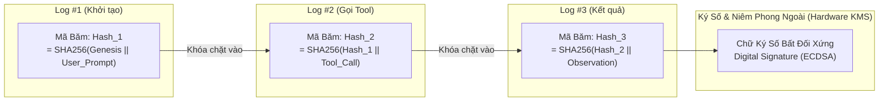

# Cryptographic Audit Trails & Enterprise Compliance: Sổ Cái Mật Mã Bất Biến Cho Tác Tử Tự Hành

> [!important] Trực Giác Cốt Lõi (The Core Intuition)
> "Khi một chiếc máy bay gặp sự cố trên không, các nhà điều tra không tin vào lời khai của bất kỳ ai; họ tìm kiếm chiếc Hộp Đen (Flight Data Recorder) được niêm phong chống va đập, chống cháy và chống làm giả."
> 
> Trong kỷ nguyên tác tử tự hành ra quyết định thay con người (duyệt khoản vay ngân hàng, phát hành toa thuốc y tế, tự động chạy mã lệnh sửa chữa hạ tầng đám mây), các file nhật ký thông thường (`app.log` hoặc CSDL MongoDB) **hoàn toàn vô giá trị trước tòa án và các tổ chức kiểm toán độc lập**. Bất kỳ kỹ sư có quyền quản trị máy chủ (root/admin) hay hacker nào cũng có thể mở file ra sửa chữa, xóa bỏ các hành vi sai trái của Agent để phi tang chứng cứ.
> 
> **Cryptographic Audit Trails (Sổ cái kiểm toán mật mã)** biến nhật ký hoạt động của Agent thành một chuỗi xích mật mã không thể chối cãi (Tamper-Evident Hash Chain). Bất kỳ nỗ lực can thiệp, xóa sửa hay chèn ép dù chỉ một dấu chấm trong quá khứ sẽ ngay lập tức làm gãy chuỗi xích và bị phát hiện tức thì.

---

## 1. Dành Cho Người Mới Bắt Đầu: Nhật Ký Bút Chì vs. Niêm Phong Mật Mã

### A. Sự Vô Dụng Của Nhật Ký Thông Thường (Plaintext Logs)
* **Tình huống:** Một Agent giao dịch chứng khoán tự động bán nhầm danh mục cổ phiếu trị giá $5\text{ triệu USD}$ do bị ảo giác.
* **Hậu quả:** Một kỹ sư lo sợ bị quy trách nhiệm, truy cập vào máy chủ xóa sạch 3 dòng log ghi nhận lệnh gọi công cụ `execute_trade(SELL)` và sửa prompt thành lỗi do người dùng nhập sai.
* **Kết luận pháp lý:** Doanh nghiệp không thể chứng minh trước cơ quan quản lý (SEC/Ủy ban Chứng khoán) điều gì đã thực sự xảy ra. Hậu quả là bị phạt tiền hàng chục triệu USD và tước giấy phép hoạt động!

### B. Cơ Chế Hoạt Động Của Hộp Đen Mật Mã (Cryptographic Chain)
* Mỗi hành vi của Agent (Nhận prompt, Suy nghĩ, Gọi tool, Nhận kết quả) được đóng gói thành một bản ghi nhật ký.
* **Khóa Chặt Quá Khứ:** Mã băm (Hash) của dòng log số $10$ được tính bằng cách gộp toàn bộ dữ liệu của nó với **mã băm của dòng log số $9$**:
  $$\text{Hash}_{10} = \text{SHA256}(\text{Hash}_9 \parallel \text{Thời gian} \parallel \text{Hành động})$$
* **Hiệu ứng Đổ Domino:** Nếu kẻ xấu cố tình sửa dòng số $9$, mã $\text{Hash}_9$ sẽ thay đổi $\to$ Kéo theo $\text{Hash}_{10}, \text{Hash}_{11}, \dots$ đều bị sai lệch. Trình kiểm tra chỉ mất $1\text{ms}$ để chỉ ra đích danh: *"Dòng số 9 đã bị sửa đổi trái phép!"*.



---

## 2. Các Tiêu Chuẩn Pháp Lý & Tuân Thủ Doanh Nghiệp Bắt Buộc

Khi triển khai AI Agent trong môi trường doanh nghiệp quy mô lớn, Cryptographic Audit Trail là yêu cầu bắt buộc của các đạo luật quốc tế:

1. **EU AI Act - Điều 12 (Automatic Logging & Record-Keeping):**
   * Các hệ thống AI rủi ro cao (High-Risk AI) bắt buộc phải tự động ghi nhật ký trong suốt vòng đời.
   * Bản ghi phải bảo đảm khả năng truy vết (Traceability) để kiểm tra: nguồn dữ liệu huấn luyện, chuỗi lập luận trung gian, và sự can thiệp của con người (HITL).
2. **SOC 2 Type II - Trust Services Criteria (Common Criteria 6 & 7):**
   * Yêu cầu tính toàn vẹn (Integrity) và khả năng không thể chối bỏ (Non-repudiation) của các hành vi can thiệp hệ thống.
3. **HIPAA (Y tế) & PCI-DSS (Thanh toán tài chính):**
   * Dữ liệu định danh cá nhân (PII/PHI) phải được làm mờ (Masked/Redacted) trước khi ghi log, nhưng chữ ký xác thực toàn vẹn vẫn phải được duy trì.

---

## 3. Kiến Trúc Sổ Cái Kiểm Toán Mật Mã Toàn Trình

Một hệ thống kiểm toán cấp công nghiệp gồm 4 mắt xích liên hoàn:

### 1. Khử Định Danh & Làm Mờ Dữ Liệu (PII Redaction Pipeline)
Trước khi ghi log, dữ liệu thô đi qua bộ lọc Regex và mô hình NER (Named Entity Recognition):
* Số thẻ tín dụng: `4111 2222 3333 4444` $\to$ `4111 **** **** 4444`
* Mật khẩu/Token: `Bearer eyJhbGc...` $\to$ `[REDACTED_API_KEY]`

### 2. Chuỗi Băm Liên Hoàn (Hash-Chained Append-Only Log)
Mỗi sự kiện $\mathcal{E}_i$ chứa payload $P_i$. Mã băm của sự kiện được tính theo công thức:
$$
\mathcal{H}_i = \text{SHA256}\left( \mathcal{H}_{i-1} \parallel T_i \parallel \text{Event\_Type}_i \parallel \text{Actor} \parallel P_i \right)
$$
Với $\mathcal{H}_0 = \text{SHA256}(\text{"GENESIS\_SEED"})$.

### 3. Cây Merkle & Bằng Chứng Tồn Tại (Merkle Inclusion Proofs)
Cuối mỗi giờ hoặc mỗi ngày, toàn bộ hàng triệu mã băm sự kiện $\{\mathcal{H}_1, \dots, \mathcal{H}_M\}$ được gom lại thành một **Cây Merkle (Merkle Tree)** để tính ra một mã băm gốc duy nhất (**Merkle Root**):
* Merkle Root được chốt lên một dịch vụ Timestamp Authority (TSA) hoặc dịch vụ lưu trữ bất biến (AWS QLDB / Cloud Object Lock).
* Khi cần chứng minh một sự kiện $\mathcal{E}_k$ cụ thể có thực sự xảy ra trong quá khứ mà không cần chia sẻ toàn bộ CSDL nhạy cảm, hệ thống chỉ cần trích xuất **Bằng chứng Merkle (Inclusion Proof)** có kích thước $\mathcal{O}(\log M)$.

---

## 4. Bảng So Sánh Các Cấp Độ Ghi Nhật Ký

| Tiêu chí | Plaintext File (`.log`) | Hệ Thống SIEM (Elastic/Datadog) | Cryptographic Audit Trail |
| :--- | :--- | :--- | :--- |
| **Bảo vệ chống sửa đổi** | Không (Dễ dàng sửa bằng `nano/vim`) | Trung bình (Role-based permissions) | **Tuyệt đối (Bảo vệ bằng Mật mã học)** |
| **Phát hiện gian lận** | Không thể | Khó phát hiện nếu admin sửa | **Phát hiện tức thì sau 1ms** |
| **Giá trị chứng cứ pháp lý** | Bị từ chối trước tòa | Có thể bị tranh chấp | **Giá trị chứng cứ không thể chối cãi** |
| **Khả năng làm mờ PII** | Thủ công | Cấu hình qua pipeline ingestion | **Tự động tích hợp trong hàm băm** |
| **Bằng chứng độc lập (Proof)** | Không có | Xuất file CSV/PDF dễ bị sửa | **Bằng chứng toán học Merkle Proof** |

---

## 5. Triển Khai Code Thực Chiến: Python Cryptographic Audit Engine

Dưới đây là một hệ thống Cryptographic Audit Trail độc lập hoàn chỉnh, bao gồm bộ lọc làm mờ dữ liệu PII, thuật toán chuỗi băm liên hoàn SHA-256, và cơ chế phát hiện gian lận tự động (Tamper Detection).

```python
"""
Cryptographic Audit Trail Engine for AI Agents
Minh họa trực quan cơ chế tạo chuỗi băm bất biến, làm mờ dữ liệu PII và phát hiện xâm nhập trái phép.
"""

import hashlib
import time
import json
import re
from typing import List, Dict, Any, Optional, Tuple

class CryptographicAuditLog:
    """Đại diện cho một bản ghi nhật ký mật mã bất biến."""
    def __init__(
        self,
        event_index: int,
        timestamp: float,
        event_type: str,
        actor: str,
        payload: Dict[str, Any],
        prev_hash: str
    ):
        self.event_index = event_index
        self.timestamp = timestamp
        self.event_type = event_type
        self.actor = actor
        self.payload = payload
        self.prev_hash = prev_hash
        self.current_hash = self.compute_hash()

    def compute_hash(self) -> str:
        """Tính mã băm SHA-256 của toàn bộ bản ghi kết hợp với mã băm trước đó."""
        # Chuẩn hóa payload thành chuỗi JSON sắp xếp theo key để bảo đảm tính tiền định
        payload_str = json.dumps(self.payload, sort_keys=True)
        raw_string = f"{self.event_index}|{self.timestamp:.4f}|{self.event_type}|{self.actor}|{payload_str}|{self.prev_hash}"
        return hashlib.sha256(raw_string.encode("utf-8")).hexdigest()

    def to_dict(self) -> Dict[str, Any]:
        return {
            "index": self.event_index,
            "timestamp": self.timestamp,
            "event_type": self.event_type,
            "actor": self.actor,
            "payload": self.payload,
            "prev_hash": self.prev_hash,
            "hash": self.current_hash
        }


class CryptographicAuditTrailEngine:
    """Bộ máy quản lý chuỗi sổ cái kiểm toán mật mã cho Agent."""
    
    GENESIS_HASH = "0000000000000000000000000000000000000000000000000000000000000000"

    def __init__(self):
        self.chain: List[CryptographicAuditLog] = []

    def _sanitize_pii(self, payload: Dict[str, Any]) -> Dict[str, Any]:
        """Làm mờ thông tin cá nhân nhạy cảm (Số thẻ, mật khẩu, CCCD)."""
        sanitized = json.loads(json.dumps(payload))  # Deep copy
        
        # Regex phát hiện số thẻ tín dụng 16 số
        cc_pattern = re.compile(r'\b(?:\d{4}[ -]?){3}\d{4}\b')
        # Regex phát hiện token/key
        key_pattern = re.compile(r'(sk-[a-zA-Z0-9]{20,}|Bearer\s+[a-zA-Z0-9\._\-]+)')

        def mask_string(val: str) -> str:
            val = cc_pattern.sub("****-****-****-XXXX", val)
            val = key_pattern.sub("[REDACTED_API_KEY]", val)
            return val

        def recursive_mask(obj: Any) -> Any:
            if isinstance(obj, dict):
                return {k: recursive_mask(v) for k, v in obj.items()}
            elif isinstance(obj, list):
                return [recursive_mask(elem) for elem in obj]
            elif isinstance(obj, str):
                return mask_string(obj)
            return obj

        return recursive_mask(sanitized)

    def append_event(self, event_type: str, actor: str, payload: Dict[str, Any]) -> CryptographicAuditLog:
        """Ghi nhận một sự kiện mới vào chuỗi xích mật mã."""
        sanitized_payload = self._sanitize_pii(payload)
        prev_hash = self.chain[-1].current_hash if self.chain else self.GENESIS_HASH
        idx = len(self.chain) + 1
        now = time.time()

        record = CryptographicAuditLog(
            event_index=idx,
            timestamp=now,
            event_type=event_type,
            actor=actor,
            payload=sanitized_payload,
            prev_hash=prev_hash
        )
        self.chain.append(record)
        return record

    def verify_integrity(self) -> Tuple[bool, Optional[str]]:
        """
        Kiểm tra tính toàn vẹn của toàn bộ sổ cái.
        Trả về: (Hợp lệ hay không, Mô tả lỗi nếu có).
        """
        if not self.chain:
            return True, None

        for i, record in enumerate(self.chain):
            # 1. Kiểm tra tính toàn vẹn nội tại của bản ghi
            expected_hash = record.compute_hash()
            if record.current_hash != expected_hash:
                return False, f"🚨 PHÁT HIỆN GIAN LẬN: Bản ghi #{record.event_index} đã bị sửa đổi nội dung! (Hash thực tế: {record.current_hash[:10]}... != Kỳ vọng: {expected_hash[:10]}...)"

            # 2. Kiểm tra tính liên kết với bản ghi trước
            expected_prev_hash = self.chain[i-1].current_hash if i > 0 else self.GENESIS_HASH
            if record.prev_hash != expected_prev_hash:
                return False, f"🚨 ĐỨT GÃY CHUỖI XÍCH: Bản ghi #{record.event_index} có prev_hash không khớp với bản ghi trước!"

        return True, "✅ Toàn bộ sổ cái kiểm toán đạt tính toàn vẹn mật mã tuyệt đối 100%."


if __name__ == "__main__":
    audit_engine = CryptographicAuditTrailEngine()

    print("="*70)
    print("📜 KHỞI TẠO SỔ CÁI KIỂM TOÁN MẬT MÃ (CRYPTOGRAPHIC AUDIT TRAIL)")
    print("="*70)

    # 1. Ghi nhận lượt Prompt từ người dùng (Có chứa PII nhạy cảm)
    audit_engine.append_event(
        event_type="USER_PROMPT",
        actor="user_nguyen_van_a",
        payload={
            "prompt": "Hãy thanh toán phí dịch vụ bằng thẻ 4111-2222-3333-4444 với API Key sk-proj1234567890abcdefghijklmn",
            "ip_address": "14.162.12.89"
        }
    )

    # 2. Ghi nhận lượt gọi Tool thanh toán
    audit_engine.append_event(
        event_type="TOOL_CALL",
        actor="Financial_Agent_Worker",
        payload={
            "tool_name": "process_stripe_payment",
            "amount_usd": 250.0,
            "currency": "USD"
        }
    )

    # 3. Ghi nhận kết quả trả về từ thế giới ngoài
    audit_engine.append_event(
        event_type="TOOL_OBSERVATION",
        actor="Stripe_MCP_Server",
        payload={
            "transaction_id": "txn_99482810",
            "status": "APPROVED"
        }
    )

    print(f"\n✅ Đã ghi nhận {len(audit_engine.chain)} sự kiện vào chuỗi xích mật mã:")
    for rec in audit_engine.chain:
        print(f"  [Log #{rec.event_index}] ({rec.event_type}) Hash: {rec.current_hash[:16]}... | Prev: {rec.prev_hash[:16]}...")
        print(f"    Payload đã làm mờ: {rec.payload}")

    # 4. Kiểm tra tính toàn vẹn lần 1 (Bình thường)
    is_valid, msg = audit_engine.verify_integrity()
    print(f"\n[KIỂM TOÁN LẦN 1 - TRƯỚC KHI CAN THIỆP]:\n  👉 {msg}")

    # 5. GIẢ LẬP KẺ XÂM NHẬP CỐ TÌNH SỬA DỮ LIỆU ĐỂ GIAN LẬN TIỀN
    print("\n" + "-"*70)
    print("⚠️ KỊCH BẢN TẤN CÔNG: Kẻ xấu mở file log ra sửa số tiền từ $250 thành $250,000...")
    print("-"*70)
    audit_engine.chain[1].payload["amount_usd"] = 250000.0  # Cố tình sửa dữ liệu

    # 6. Kiểm tra tính toàn vẹn lần 2 (Hệ thống phát hiện ngay lập tức)
    is_valid_after, msg_after = audit_engine.verify_integrity()
    print(f"[KIỂM TOÁN LẦN 2 - SAU KHI BỊ SỬA TRÁI PHÉP]:\n  👉 {msg_after}")
    print("="*70)
```

---

## 6. Cạm Bẫy Thực Tế & Kinh Nghiệm Vận Hành (Production Gotchas)

### 1. Quản Lý Khóa Bí Mật Ký Số (Key Management Lifecycle)
Nếu khóa riêng (Private Key) dùng để ký log được lưu trữ trực tiếp trong biến môi trường `.env` trên máy chủ, một khi máy chủ bị root, kẻ tấn công có thể lấy trộm khóa và ký lại toàn bộ chuỗi log giả mạo.
* **Quy tắc bắt buộc:** Bắt buộc sử dụng các dịch vụ phần cứng an toàn chuyên trách như **AWS KMS / Cloud HSM** với chính sách IAM nghiêm ngặt: chỉ cho phép quyền `Sign` (Ký số), không bao giờ cho phép xuất khóa ra ngoài (`ExportKey: Deny`).

### 2. Sự Cồng Kềnh Của Dữ Liệu Log Đa Lượt (Storage Cost Explosion)
Nếu mỗi bước suy luận trung gian (Scratchpad thoughts) của Agent đều được lưu vĩnh viễn, dung lượng đĩa sẽ phình to hàng trăm gigabytes mỗi tháng.
* **Chiến lược phân tầng lưu trữ:**
  * **Hot Storage (30 ngày):** Lưu trữ toàn bộ payload chi tiết để gỡ lỗi thời gian thực.
  * **Cold Storage (7 năm theo luật định):** Nén toàn bộ log vào AWS S3 Glacier với cờ `Object Lock (WORM - Write Once, Read Many)`. Chi phí lưu trữ giảm hơn $90\%$ mà vẫn bảo toàn tính toàn vẹn mật mã trọn đời.

---

## 7. Tài Liệu Tham Khảo & Đọc Thêm

* [🔗 European Union - EU Artificial Intelligence Act (Article 12: Record-Keeping)](https://artificialintelligenceact.eu/article/12/)
* [🔗 AICPA - SOC 2 Trust Services Criteria for Security, Availability, and Confidentiality](https://www.aicpa.org/)
* [🔗 Google Trillian: Open-Source Verifiable Log Architecture](https://github.com/google/trillian)
* [🔗 RFC 6962: Certificate Transparency and Merkle Tree Logging](https://datatracker.ietf.org/doc/html/rfc6962)
