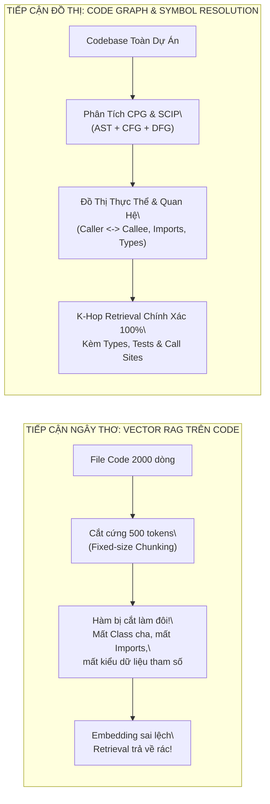
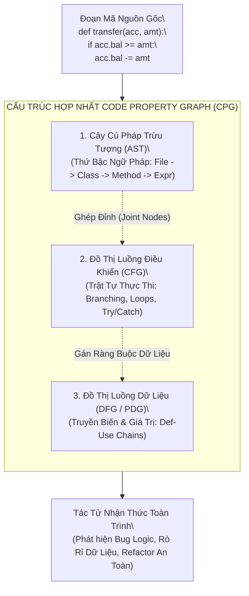
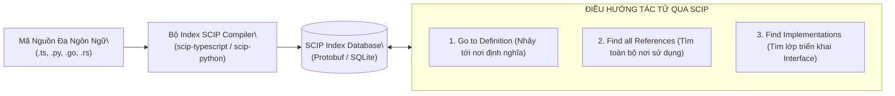
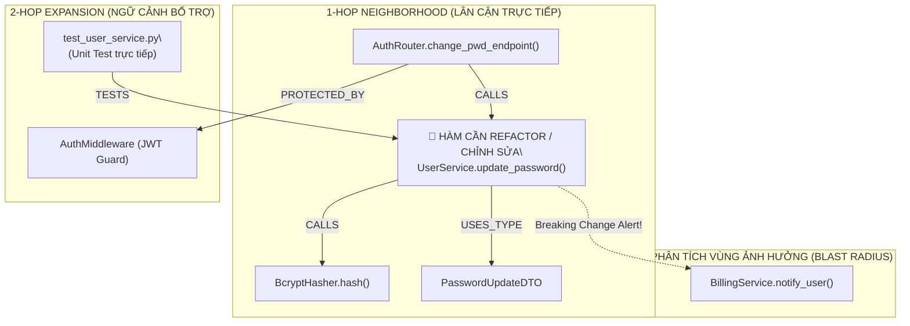
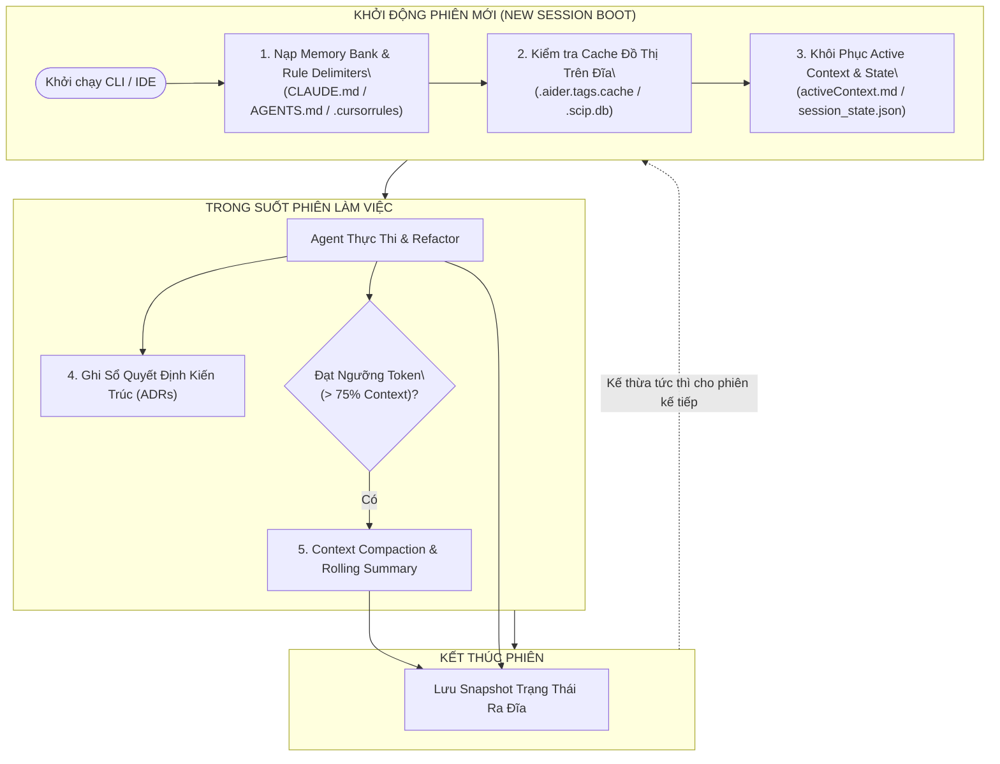

# 🕸️ CODE GRAPHS & REPOSITORY INTELLIGENCE
## Kiến Trúc Đồ Thị Mã Nguồn (Code Property Graph), Giao Thức SCIP/LSIF, Graph-RAG Cho Codebase & Chiến Lược Quản Trị Ngữ Cảnh Dự Án Liên Phiên (Cross-Session Project Memory)

---

## 📑 MỤC LỤC
1. [Khởi Nguyên: Vì Sao Vector RAG & Cửa Sổ Ngữ Cảnh Thất Bại Trước Codebase Doanh Nghiệp?](#1-khởi-nguyên-vì-sao-vector-rag--cửa-sổ-ngữ-cảnh-thất-bại-trước-codebase-doanh-nghiệp)
2. [Giải Phẫu Code Property Graph (CPG): Hợp Nhất 3 Chiều Không Gian Mã Nguồn](#2-giải-phẫu-code-property-graph-cpg-hợp-nhất-3-chiều-không-gian-mã-nguồn)
   - [2.1. Cây Cú Pháp Trừu Tượng (AST - Abstract Syntax Tree)](#21-cây-cú-pháp-trừu-tượng-ast---abstract-syntax-tree)
   - [2.2. Đồ Thị Luồng Điều Khiển (CFG - Control Flow Graph)](#22-đồ-thị-luồng-điều-khiển-cfg---control-flow-graph)
   - [2.3. Đồ Thị Phụ Thuộc Dữ Liệu (DFG / PDG - Data Flow Graph)](#23-đồ-thị-phụ-thuộc-dữ-liệu-dfg--pdg---data-flow-graph)
3. [Giao Thức Chỉ Mục Biểu Tượng Chuẩn Công Nghiệp: SCIP, LSIF & LSP](#3-giao-thức-chỉ-mục-biểu-tượng-chuẩn-công-nghiệp-scip-lsif--lsp)
   - [3.1. Cấu Trúc Định Tuyến Symbol Của SCIP](#31-cấu-trúc-định-tuyến-symbol-của-scip)
   - [3.2. Cơ Chế Phân Giải Tham Chiếu Chéo Tệp (Cross-File Symbol Resolution)](#32-cơ-chế-phân-giải-tham-chiếu-chéo-tệp-cross-file-symbol-resolution)
4. [Kỹ Thuật Graph-RAG Cho Codebase & Thuật Toán Lan Truyền K-Hop](#4-kỹ-thuật-graph-rag-cho-codebase--thuật-toán-lan-truyền-k-hop)
   - [4.1. Lược Đồ Đồ Thị Tri Thức Mã Nguồn (Code Knowledge Graph Schema)](#41-lược-đồ-đồ-thị-tri-thức-mã-nguồn-code-knowledge-graph-schema)
   - [4.2. Thuật Toán K-Hop Neighborhood Expansion](#42-thuật-toán-k-hop-neighborhood-expansion)
   - [4.3. Phân Tích Vùng Ảnh Hưởng (Blast Radius & Impact Analysis)](#43-phân-tích-vùng-ảnh-hưởng-blast-radius--impact-analysis)
5. [Chiến Lược Quản Trị Ngữ Cảnh Dự Án Liên Phiên (Cross-Session Project Memory)](#5-chiến-lược-quản-trị-ngữ-cảnh-dự-án-liên-phiên-cross-session-project-memory)
   - [5.1. File Chỉ Thị Dự Án & Mô Hình Memory Bank (`CLAUDE.md`, `AGENTS.md`, `.cursorrules`)](#51-file-chỉ-thị-dự-án--mô-hình-memory-bank-claudemd-agentsmd-cursorrules)
   - [5.2. Bộ Nhớ Đệm Chỉ Mục Cục Bộ (Persistent On-Disk Index Caching)](#52-bộ-nhớ-đệm-chỉ-mục-cục-bộ-persistent-on-disk-index-caching)
   - [5.3. Nén Phiên & Khôi Phục Trạng Thái (Session Compaction & Resumption)](#53-nén-phiên--khôi-phục-trạng-thái-session-compaction--resumption)
   - [5.4. Sổ Nhật Ký Quyết Định Kiến Trúc (Architectural Decision Records - ADR)](#54-sổ-nhật-ký-quyết-định-kiến-trúc-architectural-decision-records---adr)
6. [Mã Nguồn Thực Chiến: Xây Dựng Mini Code Graph & Persistent Memory Cache](#6-mã-nguồn-thực-chiến-xây-dựng-mini-code-graph--persistent-memory-cache)
7. [Ma Trận So Sánh Các Công Cụ Code Intelligence Hàng Đầu](#7-ma-trận-so-sánh-các-công-cụ-code-intelligence-hàng-đầu)
8. [Bản Đồ Liên Kết Hệ Thống (System Integration Links)](#8-bản-đồ-liên-kết-hệ-thống-system-integration-links)

---

## 1. KHỞI NGUYÊN: VÌ SAO VECTOR RAG & CỬA SỔ NGỮ CẢNH THẤT BẠI TRƯỚC CODEBASE DOANH NGHIỆP?

Trong các tác vụ thông thường (hỏi đáp tài liệu, tóm tắt văn bản), kỹ thuật Vector RAG truyền thống chia nhỏ văn bản (chunking $500$ tokens) và nhúng (embedding) hoạt động rất tốt. Tuy nhiên, khi áp dụng trực tiếp mô hình này vào **kỹ thuật phần mềm (AI Software Engineering)**, hệ thống lập tức sụp đổ vì **khoảng cách cú pháp - ngữ nghĩa (Syntax-Semantic Gap)**:



### 3 Nút Thắt Cổ Chai Chí Mạng Của Vector RAG Trên Mã Nguồn:

1. **Phá Vỡ Ranh Giới Phạm Vi Ngữ Pháp (Scope & Syntax Fragmentation):**
   * Code không phải ngôn ngữ tự nhiên; một hàm phụ thuộc chặt chẽ vào: `class` bao bọc nó, các lệnh `import` ở đầu file, các `type definitions` ở tệp interface chung, và các decorator cấu hình.
   * Cắt chunk theo độ dài ký tự sẽ chặt đôi một thuật toán hoặc tách rời định nghĩa hàm khỏi docstring và kiểu dữ liệu của nó.
2. **Ảo Giác Về Quan Hệ Gọi Hàm (Lack of Call Graph Awareness):**
   * Vector Embeddings chỉ đo lường **độ tương đồng ngữ nghĩa bề mặt (Surface Semantic Similarity)**. Hai hàm cùng xử lý thanh toán `process_stripe_webhook()` và `process_paypal_webhook()` có vector rất gần nhau, nhưng trong luồng logic chúng có thể nằm ở hai microservice hoàn toàn độc lập và không bao giờ gọi nhau.
   * Vector RAG không thể trả lời câu hỏi cơ bản của lập trình viên: *"Hàm này được gọi từ những Controller nào?"* hay *"Nếu tôi đổi chữ ký hàm này, những Unit Test nào sẽ bị hỏng?"*.
3. **Hiện Tượng "Lạc Lối Ở Giữa" (Lost in the Middle) & Chi Phí Token Bùng Nổ:**
   * Ngay cả với các LLM có Context Window $1 - 2\text{ triệu tokens}$, việc nhồi toàn bộ kho code vào ngữ cảnh khiến thời gian sinh token đầu tiên (TTFT) tăng vọt lên hàng chục giây, chi phí API tăng lũy tiến, và mô hình bắt đầu bỏ quên các chi tiết kỹ thuật cốt lõi nằm ở giữa cửa sổ ngữ cảnh.

---

## 2. GIẢI PHẪU CODE PROPERTY GRAPH (CPG): HỢP NHẤT 3 CHIỀU KHÔNG GIAN MÃ NGUỒN

Được công bố lần đầu bởi Fabian Yamaguchi và cộng sự (IEEE S&P 2014), **Code Property Graph (CPG)** là cấu trúc dữ liệu đồ thị mang tính cách mạng, hợp nhất 3 biểu diễn kinh điển của lý thuyết trình biên dịch thành một đồ thị có hướng, đa quan hệ (**Directed Multi-relational Property Graph**):

$$\mathcal{G}_{\text{CPG}} = \langle \mathcal{V}, \mathcal{E}, \lambda, \mu \rangle$$

Trong đó:
* $\mathcal{V}$ là tập hợp các đỉnh (Nodes) đại diện cho các cấu trúc mã nguồn (Methods, Variables, AST Elements, Basic Blocks).
* $\mathcal{E}$ là tập hợp các cạnh đa hình thức (AST Edges, Control Flow Edges, Data Flow Edges).
* $\lambda: \mathcal{E} \to \{\text{AST}, \text{CFG}, \text{PDG}\}$ gán nhãn kiểu quan hệ cho từng cạnh.
* $\mu$ gán thuộc tính (Tên biến, Số dòng, Kiểu dữ liệu, Giá trị khởi tạo) cho đỉnh và cạnh.



---

### 2.1. Cây Cú Pháp Trừu Tượng (AST - Abstract Syntax Tree)
* **Bản chất:** Biểu diễn phân cấp hình cây của cú pháp mã nguồn theo ngữ pháp hình thức (Grammar).
* **Đặc tính:** Các node cha chứa node con (ví dụ: `FunctionDeclaration` chứa `Parameters` và `BlockStatement`).
* **Công cụ trích xuất hiện đại:** Thư viện **Tree-sitter** (bộ parser đa ngôn ngữ dựa trên giải thuật GLR) cho phép tạo cây cú pháp ở tốc độ micro-giây, hỗ trợ phân tích cục bộ mà không cần build toàn bộ dự án.

### 2.2. Đồ Thị Luồng Điều Khiển (CFG - Control Flow Graph)
* **Bản chất:** Đồ thị có hướng mô tả tất cả các lộ trình (paths) mà tiến trình thực thi của CPU có thể đi qua trong một hàm.
* **Cấu trúc:** Mỗi đỉnh là một **Khối Cơ Bản (Basic Block)** — chuỗi câu lệnh thực thi tuần tự không có rẽ nhánh ở giữa. Các cạnh biểu diễn bước nhảy (`conditional jump`, `fallthrough`, `exception unwinding`).
* **Ứng dụng cho Agent:** Giúp tác tử nhận biết các khối mã không bao giờ chạm tới (Dead Code) hoặc các điều kiện biên (Edge Cases) chưa được bao phủ bởi Unit Test.

### 2.3. Đồ Thị Phụ Thuộc Dữ Liệu (DFG / PDG - Data Flow Graph)
* **Bản chất:** Theo dõi hành trình di chuyển của dữ liệu từ điểm khởi tạo (**Definition - Def**) đến điểm sử dụng (**Usage - Use**).
* **Ý nghĩa:** Cho Agent biết một giá trị nhạy cảm (như mật khẩu hoặc SQL input) có bị can thiệp hay rò rỉ khi đi qua hàng chục hàm trung gian hay không (**Taint Analysis**).

---

## 3. GIAO THỨC CHỈ MỤC BIỂU TƯỢNG CHUẨN CÔNG NGHIỆP: SCIP, LSIF & LSP

Để các tác tử AI có thể điều hướng trong một kho mã nguồn hàng triệu dòng nhanh như một kỹ sư kỳ cựu sử dụng VS Code, chúng ta cần chuẩn hóa giao thức lập chỉ mục biểu tượng (Symbol Indexing).



### 3.1. Cấu Trúc Định Tuyến Symbol Của SCIP (Sourcegraph Code Intelligence Protocol)
Được phát triển bởi Sourcegraph để thay thế chuẩn LSIF cũ kỹ của Microsoft, **SCIP** sử dụng định dạng Protobuf siêu tinh gọn với URI định danh duy nhất cho từng định danh trong vũ trụ mã nguồn:

$$\text{SCIP Symbol} = \langle \text{scheme}, \text{package}, \text{version}, \text{descriptor} \rangle$$

*Ví dụ một chuỗi định danh SCIP chuẩn mực:*
```text
scip-python npm @types/node 18.0.0 auth/services/UserService#login().
```
Chuỗi này cho phép Agent phân biệt rạch ròi giữa hàm `login()` của module Auth nội bộ với hàm `login()` của thư viện bên thứ ba, loại bỏ hoàn toàn hiện tượng lẫn lộn tên hàm (Name Collisions).

### 3.2. Cơ Chế Phân Giải Tham Chiếu Chéo Tệp (Cross-File Symbol Resolution)
Khi Agent đang phân tích file `api/routes.py` và gặp dòng:
```python
user = user_service.authenticate(credentials)
```
Không cần nạp toàn bộ file `services/user_service.py` vào context, Agent chỉ cần gửi một truy vấn SCIP:
1. Xác định vị trí con trỏ của `authenticate`.
2. SCIP trả về tọa độ chính xác: `uri: "services/user_service.py", line: 42, col: 8`.
3. Agent chỉ trích xuất đúng 15 dòng xung quanh hàm `authenticate` và nạp vào Working Memory. Cơ chế này giúp **tiết kiệm tới $90\%$ ngân sách token**.

---

## 4. KỸ THUẬT GRAPH-RAG CHO CODEBASE & THUẬT TOÁN LAN TRUYỀN K-HOP

**Graph-RAG cho Codebase** là kỹ thuật sử dụng Đồ thị Tri thức Mã Nguồn (Code Knowledge Graph) làm bộ điều hướng truy xuất trước khi sinh phản hồi.



---

### 4.1. Lược Đồ Đồ Thị Tri Thức Mã Nguồn (Code Knowledge Graph Schema)

Hệ thống biểu diễn cấu trúc dự án dưới dạng đồ thị tri thức với các thực thể và quan hệ chuẩn hóa:

| Kiểu Đỉnh (Node Type) | Đại Diện Thực Tế | Thuộc Tính Đi Kèm |
| :--- | :--- | :--- |
| **`FILE`** | Tệp mã nguồn vật lý | `path`, `language`, `lines_of_code`, `git_hash` |
| **`MODULE`** | Gói / Namespace | `name`, `export_symbols` |
| **`CLASS / STRUCT`**| Định nghĩa lớp, cấu trúc dữ liệu | `name`, `visibility`, `docstring` |
| **`FUNCTION`** | Hàm, phương thức | `signature`, `return_type`, `cyclomatic_complexity` |
| **`VARIABLE`** | Hằng số, biến toàn cục | `name`, `type`, `scope` |
| **`TEST_CASE`** | Bài kiểm thử tự động | `test_framework`, `target_symbol` |

| Kiểu Cạnh (Edge Type) | Ý Nghĩa Ngữ Nghĩa | Chiều Quan Hệ |
| :--- | :--- | :--- |
| **`DEFINES`** | File/Class chứa Function/Variable | `FILE/CLASS -> FUNCTION/VARIABLE` |
| **`IMPORTS`** | File nạp biểu tượng từ File/Module khác | `FILE -> MODULE/SYMBOL` |
| **`CALLS`** | Hàm A gọi thực thi hàm B | `FUNCTION -> FUNCTION` |
| **`INHERITS_FROM`** | Kế thừa hướng đối tượng | `CLASS -> CLASS` |
| **`IMPLEMENTS`** | Triển khai giao diện (Interface/Protocol) | `CLASS -> INTERFACE` |
| **`TESTS`** | Test case kiểm tra tính đúng đắn | `TEST_CASE -> FUNCTION/CLASS` |

---

### 4.2. Thuật Toán K-Hop Neighborhood Expansion
Khi Agent được giao nhiệm vụ sửa lỗi tại hàm $V_{\text{target}}$:
1. **$0$-Hop:** Lấy mã nguồn của chính $V_{\text{target}}$.
2. **$1$-Hop In-degree (Callers):** Tìm tất cả các hàm đang gọi trực tiếp $V_{\text{target}}$ để đảm bảo code sửa xong không làm thay đổi kỳ vọng đầu vào.
3. **$1$-Hop Out-degree (Callees & Types):** Kéo toàn bộ chữ ký các hàm con mà $V_{\text{target}}$ sử dụng cùng định nghĩa kiểu dữ liệu (DTO / Interface).
4. **$2$-Hop Tests:** Tìm các node `TEST_CASE` có liên kết `TESTS` tới $V_{\text{target}}$ hoặc tới các Callers cấp 1.
5. **Đóng gói Subgraph Context:** Gom toàn bộ lát cắt đồ thị này thành một tài liệu Markdown tinh gọn (~$3{,}000$ tokens) tiêm thẳng vào Context của Agent.

### 4.3. Phân Tích Vùng Ảnh Hưởng (Blast Radius & Impact Analysis)
Trước khi Agent quyết định chỉnh sửa chữ ký của một hàm (ví dụ thêm tham số bắt buộc `timeout: int`), hệ thống tính toán **Bán kính vụ nổ (Blast Radius)** bằng giải thuật duyệt theo chiều rộng (BFS):

$$\text{BlastRadius}(V) = \{ u \in \mathcal{V} \mid \text{dist}(u, V) \le K \ \land \ \text{rel}(u, V) \in \{\text{CALLS}, \text{IMPORTS}, \text{INHERITS}\} \}$$

* Nếu $\text{BlastRadius} > 20$ files $\rightarrow$ Agent tự động dừng lại, kích hoạt **Circuit Breaker** hoặc cảnh báo Human-in-the-Loop để hỏi ý kiến lập trình viên trước khi tạo ra một đợt đổ vỡ diện rộng (**Cascading Breakage**).

---

## 5. CHIẾN LƯỢC QUẢN TRỊ NGỮ CẢNH DỰ ÁN LIÊN PHIÊN (CROSS-SESSION PROJECT MEMORY)

Một trong những ức chế lớn nhất của lập trình viên khi làm việc với AI Agent: **Mỗi lần mở một terminal mới hoặc khởi động phiên làm việc mới, Agent lại trở về trạng thái "mất trí nhớ hoàn toàn" (Amnesia)**, buộc người dùng phải gõ lại từ đầu kiến trúc dự án, các quy ước code, và tiến độ đang làm dở.

Dưới đây là bộ **5 kỹ thuật chuẩn công nghiệp** giúp duy trì ngữ cảnh dự án xuyên suốt mọi phiên làm việc:



---

### 5.1. File Chỉ Thị Dự Án & Mô Hình Memory Bank (`CLAUDE.md`, `AGENTS.md`, `.cursorrules`)
* **Nguyên lý:** Đặt các tệp Markdown chuẩn hóa ngay tại thư mục gốc của repository. Khi Agent khởi chạy, Harness tự động đọc các file này và tiêm vào phần đầu của System Prompt trước khi nhận lệnh người dùng.
* **Mô hình Memory Bank (Chuẩn hóa từ Claude Code & Roo Code):** Thay vì một file cấu hình duy nhất, hệ thống phân tách thành thư mục `.context/` hoặc `.memory/` gồm 6 file chuyên biệt:

```text
.project_memory/
├── projectbrief.md     # Mục tiêu cốt lõi, phạm vi và tiêu chí thành công của dự án
├── productContext.md   # Bài toán nghiệp vụ, chân dung người dùng, các luồng trải nghiệm
├── activeContext.md    # [QUAN TRỌNG NHẤT] Công việc đang làm dở, quyết định kỹ thuật vừa đưa ra
├── systemPatterns.md   # Kiến trúc hệ thống, design patterns, nguyên tắc bất biến (Invariants)
├── techContext.md      # Tech stack, phiên bản thư viện, lệnh build/test/lint
└── progress.md         # Danh sách tính năng: Đã hoàn thành, Đang làm, Lộ trình tiếp theo
```

> [!tip] Sức mạnh của `activeContext.md`
> Cuối mỗi phiên làm việc, Agent được chỉ thị tự động cập nhật file `activeContext.md` ghi rõ: *"Vừa sửa xong module Auth nhưng chưa viết test cho Refresh Token. Bước tiếp theo cần viết file test_auth.py"*. Khi bạn mở phiên làm việc vào ngày hôm sau, Agent chỉ cần đọc file này là lập tức bắt tay vào viết test mà không cần bất kỳ lời nhắc nhở nào!

---

### 5.2. Bộ Nhớ Đệm Chỉ Mục Cục Bộ (Persistent On-Disk Index Caching)
* **Vấn đề:** Quét toàn bộ AST và xây dựng Code Graph cho một dự án 500,000 dòng code có thể mất $30 - 60\text{ giây}$. Nếu phiên nào cũng quét lại, trải nghiệm người dùng sẽ bị tê liệt.
* **Giải pháp:** Lưu trữ đồ thị và vector embeddings xuống thư mục cache cục bộ (như `.aider.tags.cache.v3`, `.cursor/index/` hoặc file SQLite `.scip.db`).
* **Cơ chế cập nhật vi sai (Incremental Delta Updates):**
  * Lưu mã băm `git_hash` hoặc `mtime` của từng tệp tại thời điểm lập chỉ mục.
  * Khi mở session mới: So sánh nhanh mã băm của Git trong $<100\text{ms}$. Chỉ phân tích lại đúng 3 file vừa bị sửa đổi và chắp vá vào đồ thị có sẵn.

---

### 5.3. Nén Phiên & Khôi Phục Trạng Thái (Session Compaction & Resumption)
* Khi một phiên chat kéo dài đến 40-50 lượt tương tác, cửa sổ ngữ cảnh bị đầy.
* **Context Compaction:** Tác tử kích hoạt tiến trình tóm tắt rolling:
  * Loại bỏ các đoạn code tạm thời, output dòng lệnh dài (như log npm install hoặc traceback dài).
  * Giữ lại: Danh sách các file đã sửa đổi, các quyết định kiến trúc đã thống nhất, và trạng thái hiện tại của bài toán.
  * Lưu bản snapshot này vào `.agent/sessions/<session_id>.json`.

---

### 5.4. Sổ Nhật Ký Quyết Định Kiến Trúc (Architectural Decision Records - ADR)
* Lập trình viên AI thường mắc lỗi: Ở session 1 chọn dùng Redis để cache, nhưng sang session 2 lại tự ý đề xuất viết lại bằng Memcached vì không biết lý do phiên trước chọn Redis.
* **Kỹ thuật ADR Logging:** Yêu cầu Agent lưu các quyết định quan trọng vào thư mục `docs/adr/` theo cấu trúc:
  * `0001-use-redis-for-distributed-locks.md`
  * `0002-isolate-auth-context-quarantine.md`
* Trước khi Agent thực hiện một thay đổi cấu trúc lớn, nó bắt buộc phải duyệt qua thư mục ADR để thấu hiểu các lý do lịch sử (**Historical Context Awareness**).

---

## 6. MÃ NGUỒN THỰC CHIẾN: XÂY DỰNG MINI CODE GRAPH & PERSISTENT MEMORY CACHE

Dưới đây là đoạn mã Python hoàn chỉnh triển khai một hệ thống **Mini Code Graph** (sử dụng `networkx`) kết hợp cơ chế **Persistent Project Memory** lưu ra đĩa:

```python
"""
Mini Code Graph & Persistent Project Memory Engine
Minh họa cơ chế phân tích phụ thuộc mã nguồn và ghi nhớ ngữ cảnh liên phiên.
"""
import os
import json
import ast
import hashlib
from typing import Dict, List, Set, Any
import networkx as nx

class CodeGraphEngine:
    """Động cơ xây dựng đồ thị quan hệ mã nguồn (Call & Import Graph)."""
    def __init__(self):
        self.graph = nx.DiGraph()

    def parse_python_file(self, file_path: str, code_content: str):
        """Phân tích AST của file Python để trích xuất hàm và các lời gọi hàm."""
        try:
            tree = ast.parse(code_content)
        except SyntaxError:
            return

        current_file_node = f"FILE:{file_path}"
        self.graph.add_node(current_file_node, type="FILE", path=file_path)

        for node in ast.walk(tree):
            # 1. Trích xuất định nghĩa hàm
            if isinstance(node, (ast.FunctionDef, ast.AsyncFunctionDef)):
                func_id = f"FUNC:{file_path}::{node.name}"
                self.graph.add_node(func_id, type="FUNCTION", name=node.name, line=node.lineno)
                self.graph.add_edge(current_file_node, func_id, relation="DEFINES")

            # 2. Trích xuất import
            elif isinstance(node, ast.ImportFrom):
                module = node.module or ""
                for alias in node.names:
                    dep_node = f"SYMBOL:{module}.{alias.name}"
                    self.graph.add_node(dep_node, type="IMPORT")
                    self.graph.add_edge(current_file_node, dep_node, relation="IMPORTS")

    def get_k_hop_context(self, target_func_name: str, k: int = 1) -> Dict[str, Any]:
        """Truy xuất lân cận k-bước (K-hop) xung quanh một hàm cần chỉnh sửa."""
        target_nodes = [n for n in self.graph.nodes if n.endswith(f"::{target_func_name}")]
        if not target_nodes:
            return {"error": f"Symbol {target_func_name} not found in Code Graph"}

        root = target_nodes[0]
        # Lấy đồ thị con lân cận trong bán kính k
        subgraph_nodes = nx.single_source_shortest_path_length(
            self.graph.to_undirected(), root, cutoff=k
        ).keys()

        subgraph = self.graph.subgraph(subgraph_nodes)
        
        callers = list(self.graph.predecessors(root))
        callees = list(self.graph.successors(root))

        return {
            "target": root,
            "callers": callers,
            "callees": callees,
            "total_nodes_in_k_hop": len(subgraph_nodes),
            "edges": list(subgraph.edges(data=True))
        }

class CrossSessionMemoryManager:
    """Quản trị ngữ cảnh dự án liên phiên làm việc (Persistent Session Memory)."""
    def __init__(self, memory_file_path: str = ".project_memory.json"):
        self.memory_file = memory_file_path
        self.state = {
            "project_name": "Agent Course Enterprise",
            "active_context": "Chưa có tác vụ dở dang.",
            "tech_stack": ["Python 3.11", "NetworkX", "Tree-sitter", "FastAPI"],
            "recent_decisions": [],
            "file_hashes": {}
        }
        self.load_from_disk()

    def load_from_disk(self):
        """Tự động khôi phục ngữ cảnh khi bắt đầu phiên mới."""
        if os.path.exists(self.memory_file):
            try:
                with open(self.memory_file, "r", encoding="utf-8") as f:
                    self.state = json.load(f)
                print(f"✅ [Session Boot]: Đã nạp thành công ngữ cảnh từ {self.memory_file}")
            except Exception as e:
                print(f"⚠️ Không thể đọc file memory: {e}")

    def save_to_disk(self):
        """Lưu lại trạng thái dự án khi kết thúc phiên."""
        with open(self.memory_file, "w", encoding="utf-8") as f:
            json.dump(self.state, f, indent=2, ensure_ascii=False)
        print(f"💾 [Session Shutdown]: Đã ghi nhớ trạng thái dự án vào {self.memory_file}")

    def update_active_task(self, task_description: str, next_step: str):
        """Cập nhật việc đang làm dở để phiên sau không phải nhắc lại."""
        self.state["active_context"] = {
            "current_task": task_description,
            "next_step": next_step
        }
        self.save_to_disk()

# ==================== DEMO THỰC THI ====================
if __name__ == "__main__":
    print("=== 1. KHỞI CHẠY CODE GRAPH ENGINE ===")
    engine = CodeGraphEngine()

    mock_auth_service = """
from database.connection import get_db

def authenticate_user(username, password):
    db = get_db()
    return True

def verify_token(token):
    return True
"""
    engine.parse_python_file("services/auth.py", mock_auth_service)
    
    # Truy vấn lân cận k-hop của hàm authenticate_user
    ctx = engine.get_k_hop_context("authenticate_user", k=1)
    print("Graph Context Cho Agent:", json.dumps(ctx, indent=2))

    print("\n=== 2. QUẢN TRỊ NGỮ CẢNH DỰ ÁN LIÊN PHIÊN ===")
    mem = CrossSessionMemoryManager()
    
    # Giả lập Agent hoàn thành một phần việc và tắt máy
    mem.update_active_task(
        task_description="Đã cấu hình xong module authenticate_user()",
        next_step="Phiên tiếp theo cần viết file test_auth.py với 5 test cases pytest"
    )

    # Giả lập mở một terminal mới (Session 2)
    print("\n--- Giả Lập Mở Terminal Mới (Ngày Hôm Sau) ---")
    new_session_mem = CrossSessionMemoryManager()
    print("Trạng thái Agent đọc được ngay khi khởi động:")
    print(json.dumps(new_session_mem.state["active_context"], indent=2, ensure_ascii=False))
```

---

## 7. MA TRẬN SO SÁNH CÁC CÔNG CỤ CODE INTELLIGENCE HÀNG ĐẦU

| Tiêu Chí Kỹ Thuật | Aider (Terminal Pair Programmer) | Cursor (AI Code Editor) | Sourcegraph Cody | Claude Code / Roo Code |
| :--- | :--- | :--- | :--- | :--- |
| **Cơ Chế Lập Chỉ Mục** | Tree-sitter AST + PageRank | Shadow Workspace + AST Embeddings | **SCIP / LSIF Graph Indexing** | Memory Bank + LSP Tools |
| **Độ Chính Xác Điều Hướng** | ⭐⭐⭐ (Mức độ sườn Skeleton) | ⭐⭐⭐⭐ (Chính xác cao nhờ IDE) | **⭐⭐⭐⭐⭐ (Tuyệt đối $100\%$ qua SCIP)** | ⭐⭐⭐⭐ (Dựa trên LSP) |
| **Lưu Trữ Ngữ Cảnh Liên Phiên** | File `.aider.tags.cache.v3` + Git History | Cloud Index Cache + Prompt Rules | Sourcegraph Code Graph DB | **Memory Bank (`.context/`) & ADRs** |
| **Khả Năng Phân Tích Vùng Ảnh Hưởng** | Hạn chế (Dựa trên Call Graph 1 tầng) | Trung bình (Dựa trên Embeddings) | **Xuất sắc (Deep Call/Dependency Graph)**| Tốt (Dựa trên kiểm tra lỗi linter/test) |
| **Môi Trường Hoạt Động** | CLI Terminal | IDE Forked VS Code | Web, IDE Plugins & Enterprise | CLI & VS Code Extension |

---

## 8. BẢN ĐỒ LIÊN KẾT HỆ THỐNG (SYSTEM INTEGRATION LINKS)

* 🔙 **Nền tảng cú pháp & Tự sửa lỗi:**
  * [Tác Tử Lập Trình Tự Sửa Lỗi Qua AST (Tree-sitter)](./03-loop-engineering/04_ast_self_healing_code_agents.md): Nền tảng AST Syntax Gate và kiểm thử khép kín.
  * [Quản Trị Cửa Sổ Ngữ Cảnh & Pruning](./01-harness-and-memory/02_context_management.md): Kỹ thuật cách ly và tỉa nhánh ngữ cảnh dự án dài.
* 🔄 **Lưu trữ trạng thái & Ký ức:**
  * [Kiến Trúc Bộ Nhớ Đa Tầng (Working, Episodic & Temporal Graph)](./01-harness-and-memory/03_memory_systems.md): Tích hợp đồ thị tri thức thời gian vào bộ nhớ tác tử.
  * [Máy Trạng Thái Bền Vững & Checkpointing](./03-loop-engineering/05_durable_execution_and_stateful_workflows.md): Cơ chế Event-Sourcing lưu vết trạng thái để phục hồi sau sập nguồn.
* 🏛️ **Bản thiết kế kiến trúc toàn cảnh:**
  * [Bản Đồ Kiến Trúc Toàn Cảnh AI Agent](../MASTER_ARCHITECTURE_AND_COMPONENTS.md): Mắt xích kết nối giữa Code Graph và 7 tầng kiến trúc tác tử.
