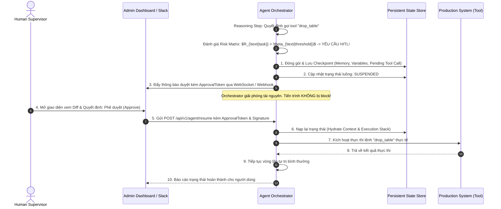

# 09. Human-in-the-Loop (HITL) & Human-on-the-Loop (HOTL): Mô Hình Tương Tác Người - Tác Tử & Quản Trị Rủi Ro Cấp Doanh Nghiệp

---

## 🧭 TỔNG QUAN ĐỊNH VỊ KIẾN TRÚC

Trong hành trình xây dựng hệ thống tác tử tự trị (Autonomous Agents), rào cản lớn nhất ngăn cách một bản thử nghiệm (Proof of Concept - PoC) và một hệ thống cấp doanh nghiệp (Enterprise Production) không nằm ở khả năng sinh suy luận của LLM, mà nằm ở **Độ tin cậy và Khả năng kiểm soát rủi ro (Safety, Governance & Risk Mitigation)**.

Khi tác tử được trao quyền thực thi công cụ ngoại vi (Tool Use) như truy cập cơ sở dữ liệu, ghi sổ kế toán, gửi email khách hàng, hoặc triển khai mã nguồn lên máy chủ production, một sai số nhỏ trong lập luận (Reasoning Hallucination) có thể dẫn đến thảm họa phá hủy dữ liệu hoặc tổn thất tài chính không thể cứu vãn.

Hai mô hình then chốt để giải quyết bài toán này là:
* **Human-in-the-Loop (HITL):** Con người đóng vai trò là chốt chặn đồng bộ bắt buộc (Synchronous Gatekeeper). Agent bị đóng băng trạng thái và không thể tiếp tục nếu chưa có sự phê duyệt tường minh từ con người.
* **Human-on-the-Loop (HOTL):** Con người đóng vai trò là người giám sát bất đồng bộ (Asynchronous Supervisor). Agent tự do vận hành liên tục nhưng dưới sự theo dõi trực quan của con người, đi kèm các chốt dừng khẩn cấp (Emergency Kill Switch) và cơ chế can thiệp nắn chỉnh luồng bay (Course Correction / Steerability).

```
┌────────────────────────────────────────────────────────────────────────────────────────┐
│                               THE AUTONOMY SPECTRUM                                    │
├──────────────────────────┬──────────────────────────┬──────────────────────────────────┤
│ HUMAN-IN-THE-LOOP (HITL) │ HUMAN-ON-THE-LOOP (HOTL) │  HUMAN-OUT-OF-THE-LOOP (HOOTL)   │
├──────────────────────────┼──────────────────────────┼──────────────────────────────────┤
│ • Chốt chặn đồng bộ      │ • Giám sát bất đồng bộ   │ • Tự trị hoàn toàn 100%          │
│ • Agent đóng băng (Wait) │ • Agent tự chạy liên tục │ • Không cần con người can thiệp  │
│ • Người duyệt / Sửa tham số│ • Người theo dõi metrics│ • Phù hợp tác vụ rủi ro cực thấp │
│ • Độ trễ cao, rủi ro ~ 0 │ • Độ trễ thấp, can thiệp │ • Tối đa hóa throughput,         │
│                          │   khi có Anomaly Alert   │   nguy cơ thảm họa nếu trôi dạt  │
└──────────────────────────┴──────────────────────────┴──────────────────────────────────┘
```

---

## 1. PHỔ TỰ TRỊ (THE AUTONOMY SPECTRUM) & ĐỊNH NGHĨA KỸ THUẬT

Để thiết kế hệ thống tương tác người - máy chính xác, ta cần phân định rạch ròi 3 trạng thái trên thang đo tự trị:

### 1.1. Human-in-the-Loop (HITL) - Chốt Chặn Bắt Buộc
* **Cơ chế vận hành:** Luồng thực thi của Agent chuyển từ trạng thái `RUNNING` sang trạng thái `SUSPENDED` (Tạm dừng/Đóng băng). Toàn bộ ngữ cảnh (Context, Stack, Working Memory, Tool Call Arguments) được lưu vết (Checkpoint). Một tín hiệu yêu cầu phê duyệt (Approval Request) được bắn tới người dùng (qua UI Modal, Slack Interactive Button, hoặc Email Approval Link).
* **Đặc tính kỹ thuật:**
  * **Tính đồng bộ logic (Logically Synchronous):** Hành động tiếp theo chỉ xảy ra *sau khi* nhận được phản hồi của con người.
  * **Khả năng can thiệp:** Con người có thể:
    1. **Approve (Chấp thuận):** Giữ nguyên tham số và kích hoạt thực thi.
    2. **Reject (Bác bỏ):** Hủy lệnh thực thi và phản hồi lý do để Agent lập kế hoạch khác.
    3. **Edit / Override (Chỉnh sửa tham số):** Thay đổi giá trị tham số do Agent sinh ra trước khi gọi Tool thực tế (Parameter Editing).
* **Ứng dụng tiêu biểu:** Chuyển tiền ngân hàng $> 5.000\$$, xóa bảng trong Database, gửi email marketing tới toàn bộ tập khách hàng, merge code vào nhánh `main` production.

### 1.2. Human-on-the-Loop (HOTL) - Giám Sát Bất Đồng Bộ
* **Cơ chế vận hành:** Agent chạy hoàn toàn tự động ở chế độ nền (Background Worker / Autonomous Daemon). Con người không tham gia vào từng quyết định riêng lẻ mà đứng ở tầng trên quan sát qua:
  * Bảng điều khiển thời gian thực (Real-time Telemetry Dashboard).
  * Hệ thống phát hiện bất thường (Anomaly Detection Alerts): Tỷ lệ lỗi tăng đột biến, token tiêu thụ vượt ngưỡng, phát hiện chu kỳ lặp vô tận (Loop Detection).
* **Đặc tính kỹ thuật:**
  * **Tính bất đồng bộ (Asynchronous):** Hệ thống không chờ đợi con người để hoàn thành từng bước tác vụ.
  * **Cơ chế can thiệp (Intervention Capabilities):**
    1. **Emergency Kill Switch:** Ngắt lập tức toàn bộ tiến trình khi phát hiện hành vi sai lệch nguy hiểm.
    2. **Mid-flight Steering:** Tiêm trực tiếp chỉ thị bổ sung (Prompt Injection / System Guidance) vào bộ nhớ của Agent mà không làm sụp đổ tiến trình.
    3. **Rollback to Checkpoint:** Hoàn tác trạng thái về một điểm kiểm tra an toàn trong quá khứ.
* **Ứng dụng tiêu biểu:** Tác tử tự động rà quét và phân tích lỗ hổng mã nguồn ban đêm, bot tự động tổng hợp báo cáo tin tức thị trường, hệ thống chăm sóc khách hàng tự động cấp 1.

### 1.3. Human-out-of-the-Loop (HOOTL) - Tự Trị Tuyệt Đối
* Toàn bộ vòng lặp từ nhận thức, lập luận đến hành động diễn ra khép kín không có bất kỳ sự can thiệp nào của con người. Con người chỉ đóng vai trò người xem báo cáo định kỳ (Post-facto Audit Log).
* Chỉ áp dụng cho các tác vụ mang tính chất đọc (`Read-only`), cô lập hoàn toàn (`Sandbox`), hoặc tác vụ nếu thất bại thì chi phí khắc phục tiệm cận 0 (như tóm tắt một đoạn văn bản thô, phân loại tag cho bài viết).

---

## 2. MA TRẬN PHÂN LOẠI QUYẾT ĐỊNH & ĐỘNG LỰC LEO THANG (ESCALATION DYNAMICS)

Lỗi phổ biến nhất của các kỹ sư khi tích hợp tương tác người - tác tử là áp dụng bừa bãi: hoặc bắt con người duyệt mọi thứ (gây ra **Approval Fatigue - Mệt mỏi vì phê duyệt**), hoặc thả nổi cho tác tử chạy tự do (gây rủi ro an toàn).

Để định lượng chính xác khi nào kích hoạt HITL, HOTL hay HOOTL, ta sử dụng **Ma trận Rủi ro - Tự tin (Risk vs. Confidence Matrix)**.

```
Mức Độ Rủi Ro
(Risk Level)
     ▲
 Cao │   [ VÙNG 1: HITL ]          [ VÙNG 2: HITL CÓ ĐIỀU KIỆN ]
     │   Bắt buộc con người duyệt  Xác nhận 1 chạm (1-click)
     │   kèm giải trình chi tiết   hoặc Two-person rule
     ├─────────────────────────────┼─────────────────────────────
     │   [ VÙNG 3: HOTL ]          [ VÙNG 4: HOOTL ]
     │   Tự chạy ngầm, gửi cảnh    Tự trị hoàn toàn 100%,
     │   báo nếu vượt ngưỡng       chỉ lưu Audit Log định kỳ
 Thấp│
     └─────────────────────────────┴─────────────────────────────►
         Thấp                      Cao             Mức Độ Tự Tin
                                                  (Confidence Score)
```

### 2.1. Định Lượng Chỉ Số Rủi Ro Tác Vụ (Task Risk Index)
Mức độ rủi ro của một hành động được tính toán dựa trên tính khả nghịch (Reversibility) và phạm vi tác động (Blast Radius):

$$
R_{\text{task}} = \omega_1 \cdot \text{BlastRadius} + \omega_2 \cdot (1 - \text{Reversibility}) + \omega_3 \cdot \text{FinancialImpact}
$$

Trong đó:
* $\text{BlastRadius} \in [0, 1]$: Đo lường số lượng thực thể bị ảnh hưởng (số dòng code bị sửa, số bản ghi DB bị tác động, số user nhận email).
* $\text{Reversibility} \in [0, 1]$: $1$ nếu có thể hoàn tác ngay lập tức bằng `git revert` hoặc Database Transaction Rollback; $0$ nếu là hành vi vĩnh viễn (gửi tiền, xóa phân vùng đĩa cứng, gửi tin nhắn SMS ra ngoài).
* $\text{FinancialImpact} \in [0, 1]$: Trọng số tài chính quy đổi tương ứng với giá trị tiền tệ có nguy cơ tổn thất.

### 2.2. Định Lượng Chỉ Số Tự Tin Của Tác Tử (Agent Confidence Score)
Độ tự tin của LLM trong bước hành động hiện tại không thể chỉ dựa vào lời nói suông của mô hình ("Tôi chắc chắn 100%"). Nó được tổng hợp từ 3 chiều thông tin:

$$
C_{\text{agent}} = \alpha \cdot (1 - \text{LogprobEntropy}) + \beta \cdot \text{SelfEvalConsistency} + \gamma \cdot \text{HistoricalSuccessRate}
$$

* $\text{LogprobEntropy}$: Độ hỗn loạn xác suất token của mô hình tại các bước sinh tham số công cụ.
* $\text{SelfEvalConsistency}$: Điểm số nhất quán khi kiểm tra chéo qua một mô hình Critic/Evaluator độc lập.
* $\text{HistoricalSuccessRate}$: Tỷ lệ thành công trong quá khứ của loại công cụ đó trong môi trường tương đương.

### 2.3. Quy Tắc Leo Thang Động (Dynamic Escalation Protocol)
Một tác tử có thể khởi đầu ở chế độ **HOTL**, nhưng khi runtime phát hiện các điều kiện suy giảm an toàn sau đây, hệ thống lập tức kích hoạt ngắt quãng và **leo thang lên HITL**:
1. **Confidence Drift:** Điểm $C_{\text{agent}} < \theta_{\text{safe}}$ (ví dụ: $< 0.75$).
2. **Repeated Failure:** Gọi Tool thất bại quá 2 lần liên tiếp với cùng một lỗi logic.
3. **Unexpected Tool Arguments:** Tham số đầu vào vượt quá ngưỡng phân bổ an toàn (ví dụ: bình thường chỉ xóa 1 file, lần này Agent sinh lệnh xóa 45 files).
4. **Policy Violation Warning:** Hệ thống Guardrails (Llama-Guard hoặc Regex Detector) cảnh báo có dấu hiệu Prompt Injection hoặc vi phạm chính sách dữ liệu PII.

---

## 3. CÁC PATTERN KIẾN TRÚC KỸ THUẬT (ENGINEERING INTERACTION PATTERNS)

Làm thế nào để hiện thực hóa HITL và HOTL trong kiến trúc phần mềm mà không làm tắc nghẽn hạ tầng hoặc gây sập tiến trình? Dưới đây là 4 mẫu thiết kế tiêu chuẩn công nghiệp:

### Pattern 1: Interrupt-Resume với Thực Thi Bền Vững (Durable State Machine)

> [!important] Vấn đề thời gian chết (Timeout Problem)
> Một cuộc gọi API từ Agent không thể giữ một kết nối HTTP mở (Keep-alive) để chờ người dùng duyệt, bởi vì con người có thể đi ăn trưa, họp hoặc mất 3 tiếng mới mở máy tính bấm duyệt. Nếu giữ kết nối, server sẽ bị tràn socket và connection pool, gây chết hệ thống.

**Giải pháp:** Áp dụng mô hình **Hydration / Dehydration** kết hợp State Checkpointing (như kiến trúc của Temporal, Cadence hoặc LangGraph State Machine):

```
       CHẠY TỰ ĐỘNG                               CHỜ DUYỆT (OFFLINE)
┌─────────────────────────┐               ┌─────────────────────────────────┐
│ Agent Loop: Step N      │               │ Server giải phóng hoàn toàn     │
│ Sinh Tool Call rủi ro   │               │ CPU / Memory / HTTP Connection! │
└────────────┬────────────┘               └────────────────┬────────────────┘
             │                                             │
             ▼                                             │
┌─────────────────────────┐                                │
│ Bắt gặp HITL Condition  │                                │
│ Đóng băng trạng thái:   │                                │
│ • Lưu SessionState      ├──────────┐                     │
│ • Status = "SUSPENDED"  │          │ Ghi xuống DB        │
│ • Sinh ApprovalToken    │          ▼                     │
└─────────────────────────┘     ┌──────────────┐           │
                                │   Database   │           │
                                │ State Check  │           │
                                └──────┬───────┘           │
                                       │                   │
                                       ▼                   │
                                ┌──────────────┐           │
                                │ Bắn Webhook /│           │
                                │ Slack/Email  │           │
                                └──────┬───────┘           │
                                       │                   │
                                       ▼                   │
                                ┌──────────────┐           │
                                │ Con người    │           │
                                │ bấm APPROVE  │───────────┘
                                └──────┬───────┘
                                       │ Tải lại State từ DB
                                       ▼
                         ┌───────────────────────────┐
                         │ Agent Loop: Resume Step N │
                         │ Thực thi Tool và tiếp tục │
                         └───────────────────────────┘
```



### Pattern 2: Parameter Overriding & Shadow Execution (Sửa Đổi Tham Số Thời Gian Thực)
Trong nhiều tình huống, con người không muốn từ chối hoàn toàn kế hoạch của Agent mà chỉ muốn tinh chỉnh một vài tham số bị sai lệch:
* **Ví dụ:** Agent đề xuất chạy lệnh refactor code:
  * Đề xuất của Agent: `apply_patch(file="auth.py", lines=[10, 85], strict_mode=False)`
  * Người duyệt phát hiện rủi ro: Đổi `strict_mode=True` và thu hẹp phạm vi `lines=[10, 45]` ngay trên giao diện trước khi bấm nút xác nhận.
* **Cơ chế:** Engine nhận payload phản hồi chứa cờ `override_args`. Giá trị này sẽ ghi đè lên giá trị do LLM sinh ra trước khi chuyển xuống adapter của Tool.

### Pattern 3: Progressive Autonomy (Cấp Bậc Tự Trị Tăng Dần Theo Niềm Tin)
Không có hệ thống nào nên bắt đầu bằng HOOTL. Một quy trình triển khai Agent an toàn phải tuân theo lộ trình 4 bước:

```
[ Giai đoạn 1: 100% HITL ]
Mọi Tool Call đều phải qua người duyệt. Thu thập dữ liệu phản hồi của người dùng làm Ground Truth.
             │
             ▼ Sau N lần duyệt liên tiếp đạt 99% không bị chỉnh sửa
[ Giai đoạn 2: HITL Chọn Lọc (Sampled HITL) ]
Chỉ yêu cầu duyệt các tác vụ rủi ro cao. Các tác vụ rủi ro trung bình được chọn ngẫu nhiên 20% để kiểm tra.
             │
             ▼ Tỷ lệ lỗi duy trì dưới 0.1% trong 30 ngày
[ Giai đoạn 3: Chuyển Sang HOTL (Human-on-the-Loop) ]
Hệ thống tự động thực thi 100%. Con người theo dõi qua Anomaly Alerts và Dashboard.
             │
             ▼ Hệ thống vận hành ổn định trên 99.9% tác vụ an toàn
[ Giai đoạn 4: Autonomous with Kill Switch ]
Tác tự chạy nền hoàn toàn, chỉ kích hoạt HITL khi điểm Confidence Score tụt dốc bất thường.
```

### Pattern 4: Steerability & Mid-Flight Course Correction trong HOTL
Trong chế độ **HOTL**, Agent đang chạy một tác vụ dài hơi (Long-running Autonomous Workflow gồm 20 bước). Người giám sát nhìn thấy trên màn hình luồng tư duy (Thought Stream) rằng Agent đang hiểu nhầm một yêu cầu ở bước số 5:
* **Không tối ưu:** Bấm nút hủy toàn bộ (Abort) $\to$ Tốn sạch chi phí token và thời gian từ bước 1 đến bước 5.
* **Thiết kế tối ưu (Steerable Agent):** Người giám sát bấm nút **"Inject Guidance"** (Tiêm định hướng).
  * Hệ thống tạm ngưng bước hiện tại.
  * Tiêm một thông điệp hệ thống ưu tiên cao (`System Message: "Lưu ý: Không dùng thư viện axios, hãy dùng fetch native của Node 18"`).
  * Buộc Agent quay lui lại bước lập kế hoạch (Re-plan) dựa trên hướng dẫn mới mà không mất toàn bộ công việc đã hoàn thành.

---

## 4. TỐI ƯU HÓA TRẢI NGHIỆM NGƯỜI DÙNG & CHỐNG HỘI CHỨNG MỆT MỎI PHÊ DUYỆT (APPROVAL FATIGUE)

> [!warning] Mối nguy hiểm chết người của Approval Fatigue
> Nếu bạn thiết kế hệ thống mà cứ mỗi 2 phút lại bắn một thông báo bắt người dùng bấm "Approve", chỉ sau nửa ngày làm việc, người dùng sẽ phát triển phản xạ có điều kiện: **Bấm Approve liên tục mà không hề đọc nội dung!** 
> Lúc này, cổng bảo vệ HITL trở thành "vật trang trí vô dụng" và mang lại cảm giác an toàn giả tạo.

Để chống lại hội chứng mệt mỏi phê duyệt, cần tuân thủ 3 nguyên tắc giao diện tương tác:

### 1. Phân Tách Bối Cảnh (Context Distillation)
Không bao giờ ném cho người duyệt một cục JSON thô 5.000 dòng hoặc toàn bộ log trò chuyện. Giao diện phê duyệt phải hiển thị dưới dạng **Tóm tắt tác động (Impact Card)**:
* **Mục tiêu:** Agent đang cố gắng đạt được điều gì?
* **Hành động cụ thể:** Tên công cụ và tham số chuẩn bị gọi.
* **Bản xem trước thay đổi (Diff View):** Trực quan hóa Before vs After (màu đỏ/xanh chuẩn Git Diff).
* **Vùng ảnh hưởng (Blast Radius):** Báo cáo rõ ràng: *"Sẽ ảnh hưởng đến 1 file, 0 database records, chi phí ước tính $0.02$"*.

### 2. Phê Duyệt Gom Cụm (Batch Approval with Atomic Transactions)
Thay vì bắt người dùng duyệt 20 thao tác ghi file riêng lẻ, Agent lập danh sách toàn bộ các file dự kiến thay đổi và xin phép duyệt **1 lần duy nhất theo cơ chế giao dịch nguyên tử (Atomic Transaction)**: nếu người dùng duyệt, toàn bộ 20 file được cập nhật; nếu từ chối, không file nào bị thay đổi.

### 3. Phân Cấp Quyền Phê Duyệt (Role-Based Escalation)
Không phải ai cũng có quyền bấm duyệt cho mọi hành động:
* Thao tác gửi email nội bộ: Bất kỳ nhân viên nào trong team đều duyệt được.
* Thao tác chi ngân sách: Bắt buộc gửi thông báo đến Manager.
* Thao tác hạ tầng Production: Bắt buộc quy tắc kiểm soát kép (**Two-Person Rule** - cần chữ ký của 2 kỹ sư DevOps cấp cao).

---

## 5. MÃ NGUỒN THỰC CHIẾN: HỆ THỐNG QUẢN TRỊ HITL & HOTL ENGINE

Dưới đây là một bộ khung hoàn chỉnh bằng Python hiện thực hóa:
1. Bộ đánh giá rủi ro động (`RiskEvaluator`).
2. Quản lý trạng thái bền vững với khả năng Tạm dừng/Tiếp tục (`DurableExecutionEngine`).
3. Cổng phê duyệt HITL đồng bộ logic nhưng bất đồng bộ hạ tầng.
4. Cơ chế giám sát HOTL với chốt dừng khẩn cấp (`EmergencyKillSwitch`).

```python
"""
Mô-đun Quản trị Tương tác Người - Tác tử: HITL & HOTL Enterprise Engine
Yêu cầu thư viện: pip install pydantic
"""

from typing import Dict, Any, Optional, List, Callable
from pydantic import BaseModel, Field
import uuid
import time
import asyncio
from enum import Enum


class ActionRiskLevel(str, Enum):
    LOW = "LOW"          # Chạy tự động hoàn toàn (HOOTL)
    MEDIUM = "MEDIUM"    # HOTL: Chạy ngầm, gửi thông báo & cho phép can thiệp
    HIGH = "HIGH"        # HITL: Bắt buộc dừng lại xin duyệt


class ExecutionStatus(str, Enum):
    RUNNING = "RUNNING"
    SUSPENDED = "SUSPENDED"  # Đang chờ con người phê duyệt
    COMPLETED = "COMPLETED"
    REJECTED = "REJECTED"
    TERMINATED = "TERMINATED" # Bị dừng khẩn cấp bởi HOTL Kill Switch


class ToolCallProposal(BaseModel):
    call_id: str = Field(default_factory=lambda: str(uuid.uuid4()))
    tool_name: str
    arguments: Dict[str, Any]
    reasoning: str
    is_reversible: bool
    estimated_blast_radius: int # Số đối tượng/bản ghi bị tác động


class ApprovalDecision(BaseModel):
    decision_id: str = Field(default_factory=lambda: str(uuid.uuid4()))
    call_id: str
    approved: bool
    reviewer: str
    rejection_reason: Optional[str] = None
    override_arguments: Optional[Dict[str, Any]] = None


class RiskEvaluator:
    """Đánh giá mức độ rủi ro của đề xuất hành động từ Agent"""
    
    CRITICAL_TOOLS = {"drop_table", "delete_database", "refund_payment", "deploy_production", "send_mass_email"}
    
    @classmethod
    def evaluate(cls, proposal: ToolCallProposal) -> ActionRiskLevel:
        # 1. Rủi ro cực cao nếu thuộc danh sách công cụ nhạy cảm
        if proposal.tool_name in cls.CRITICAL_TOOLS:
            return ActionRiskLevel.HIGH
        
        # 2. Rủi ro cao nếu không thể hoàn tác và phạm vi ảnh hưởng lớn
        if not proposal.is_reversible and proposal.estimated_blast_radius > 5:
            return ActionRiskLevel.HIGH
        
        # 3. Rủi ro trung bình nếu có thể hoàn tác nhưng ảnh hưởng rộng
        if proposal.estimated_blast_radius > 10:
            return ActionRiskLevel.MEDIUM
            
        return ActionRiskLevel.LOW


class DurableAgentHarness:
    """Hệ thống điều phối Agent tích hợp HITL Checkpoint và HOTL Supervisor"""
    
    def __init__(self):
        # Bộ nhớ lưu vết trạng thái trên đĩa/DB (giả lập bằng bộ nhớ RAM)
        self.state_store: Dict[str, Dict[str, Any]] = {}
        self.pending_approvals: Dict[str, ToolCallProposal] = {}
        # Cờ ngắt khẩn cấp cho HOTL
        self.emergency_kill_flags: Dict[str, bool] = {}

    def start_session(self, session_id: str) -> None:
        self.state_store[session_id] = {
            "status": ExecutionStatus.RUNNING,
            "step_count": 0,
            "history": [],
            "variables": {}
        }
        self.emergency_kill_flags[session_id] = False
        print(f"🚀 [Session {session_id}] Khởi tạo phiên làm việc của Agent.")

    # ==========================
    # PHẦN 1: CƠ CHẾ HITL
    # ==========================
    async def process_tool_proposal(self, session_id: str, proposal: ToolCallProposal) -> Dict[str, Any]:
        """Xử lý đề xuất gọi công cụ từ Agent qua phễu rủi ro"""
        
        # Kiểm tra cờ dừng khẩn cấp HOTL trước
        if self.emergency_kill_flags.get(session_id, False):
            print(f"🛑 [HOTL ALERT] Phiên {session_id} đã bị ngắt bởi Emergency Kill Switch!")
            self.state_store[session_id]["status"] = ExecutionStatus.TERMINATED
            return {"status": "error", "message": "Execution terminated by supervisor."}

        risk = RiskEvaluator.evaluate(proposal)
        print(f"\n🔍 [Risk Assessment] Tool: '{proposal.tool_name}' | Rủi ro: {risk.value} | Khả nghịch: {proposal.is_reversible}")

        # Trường hợp 1: Tác vụ rủi ro thấp -> Chạy tự động (HOOTL)
        if risk == ActionRiskLevel.LOW:
            print("  ⚡ Phê duyệt tự động (HOOTL). Thực thi ngay lập tức...")
            return self._execute_tool_internals(proposal.tool_name, proposal.arguments)

        # Trường hợp 2: Tác vụ rủi ro trung bình -> HOTL (Chạy ngầm & bắn cảnh báo)
        elif risk == ActionRiskLevel.MEDIUM:
            print(f"  📡 [HOTL Notification] Đang thực thi ngầm tác vụ nhạy cảm: {proposal.tool_name}. Giám sát viên có quyền can thiệp.")
            return self._execute_tool_internals(proposal.tool_name, proposal.arguments)

        # Trường hợp 3: Tác vụ rủi ro cao -> KÍCH HOẠT HITL ĐÓNG BĂNG TRẠNG THÁI!
        else:
            print("  🚨 [HITL ACTIVATED] Tác vụ rủi ro cao! Đang đóng băng trạng thái chờ phê duyệt...")
            return await self._suspend_for_human_approval(session_id, proposal)

    async def _suspend_for_human_approval(self, session_id: str, proposal: ToolCallProposal) -> Dict[str, Any]:
        """Đóng băng ngữ cảnh và lưu checkpoint xuống DB"""
        
        self.state_store[session_id]["status"] = ExecutionStatus.SUSPENDED
        self.state_store[session_id]["suspended_at"] = time.time()
        self.pending_approvals[proposal.call_id] = proposal

        print(f"  💾 [Checkpoint Saved] Trạng thái phiên {session_id} đã được lưu. Server giải phóng tài nguyên.")
        print(f"  🔔 [Approval Portal] Tạo Ticket phê duyệt: ID={proposal.call_id}")
        print(f"     Nội dung: Gọi '{proposal.tool_name}' với tham số {proposal.arguments}")
        
        return {
            "status": "SUSPENDED",
            "approval_ticket_id": proposal.call_id,
            "message": "Action suspended. Awaiting human authorization."
        }

    def submit_human_decision(self, decision: ApprovalDecision) -> Dict[str, Any]:
        """Cổng tiếp nhận quyết định từ người dùng (Web UI / Slack Webhook)"""
        
        if decision.call_id not in self.pending_approvals:
            raise ValueError(f"Không tìm thấy yêu cầu phê duyệt có ID {decision.call_id}")

        proposal = self.pending_approvals.pop(decision.call_id)
        
        # Tìm session tương ứng
        session_id = None
        for s_id, state in self.state_store.items():
            if state["status"] == ExecutionStatus.SUSPENDED:
                session_id = s_id
                break

        if not decision.approved:
            print(f"\n❌ [HITL REJECTED] Người kiểm duyệt '{decision.reviewer}' đã bác bỏ yêu cầu.")
            print(f"   Lý do: {decision.rejection_reason}")
            if session_id:
                self.state_store[session_id]["status"] = ExecutionStatus.RUNNING
            return {"status": "rejected", "reason": decision.rejection_reason}

        # Nếu được duyệt kèm tham số ghi đè (Override arguments)
        final_args = decision.override_arguments if decision.override_arguments is not None else proposal.arguments
        print(f"\n✅ [HITL APPROVED] Người kiểm duyệt '{decision.reviewer}' đã CHẤP THUẬN!")
        if decision.override_arguments:
            print(f"   🛠️ [Parameter Overridden] Tham số mới: {final_args}")

        # Tiếp tục thực thi (Resume)
        result = self._execute_tool_internals(proposal.tool_name, final_args)
        if session_id:
            self.state_store[session_id]["status"] = ExecutionStatus.RUNNING
        return {"status": "resumed_and_executed", "result": result}

    # ==========================
    # PHẦN 2: CƠ CHẾ HOTL
    # ==========================
    def trigger_emergency_kill_switch(self, session_id: str, supervisor_name: str, reason: str) -> None:
        """Chốt dừng khẩn cấp dành cho người giám sát HOTL"""
        print(f"\n💥 [EMERGENCY KILL SWITCH TRIGGERED BY {supervisor_name}]!")
        print(f"   Lý do ngắt: {reason}")
        self.emergency_kill_flags[session_id] = True
        if session_id in self.state_store:
            self.state_store[session_id]["status"] = ExecutionStatus.TERMINATED

    def _execute_tool_internals(self, tool_name: str, args: Dict[str, Any]) -> Dict[str, Any]:
        """Giả lập việc gọi Tool thực tế xuống hạ tầng"""
        return {"tool": tool_name, "executed_with": args, "timestamp": time.time(), "outcome": "SUCCESS"}


# ==========================================
# KỊCH BẢN MÔ PHỎNG VẬN HÀNH THỰC TẾ
# ==========================================
async def main():
    engine = DurableAgentHarness()
    session_id = "agent-session-999"
    engine.start_session(session_id)

    # 1. Tác vụ 1: Đọc file (Rủi ro thấp -> Chạy tự động)
    task1 = ToolCallProposal(
        tool_name="read_file",
        arguments={"path": "src/config.py"},
        reasoning="Cần kiểm tra thiết lập môi trường.",
        is_reversible=True,
        estimated_blast_radius=0
    )
    res1 = await engine.process_tool_proposal(session_id, task1)
    print(f"-> Kết quả: {res1['outcome']}")

    # 2. Tác vụ 2: Xóa cơ sở dữ liệu khách hàng (Rủi ro cực cao -> Kích hoạt HITL)
    task2 = ToolCallProposal(
        tool_name="drop_table",
        arguments={"table_name": "users_backup_2025", "cascade": True},
        reasoning="Dọn dẹp dung lượng đĩa cứng định kỳ.",
        is_reversible=False,
        estimated_blast_radius=100000
    )
    suspend_res = await engine.process_tool_proposal(session_id, task2)
    ticket_id = suspend_res.get("approval_ticket_id")

    # Giả lập: Người dùng nhận được thông báo qua giao diện và quyết định sửa tham số trước khi duyệt
    print("\n... [Thời gian trôi qua: Quản trị viên hệ thống vào xem xét ticket] ...")
    human_decision = ApprovalDecision(
        call_id=ticket_id,
        approved=True,
        reviewer="DevOps_Lead_Alice",
        # Không cho cascade xóa dây chuyền, chỉ cho xóa bảng cô lập
        override_arguments={"table_name": "users_backup_2025", "cascade": False}
    )
    resume_res = engine.submit_human_decision(human_decision)
    print(f"-> Kết quả sau duyệt: {resume_res}")

    # 3. Tác vụ 3: Giám sát HOTL - Kích hoạt Kill Switch khi phát hiện Agent bị lỗi lặp
    print("\n-----------------------------------------------------------")
    print("MÔ PHỎNG HOTL: Agent chạy tác vụ nền nhưng bị can thiệp khẩn cấp")
    engine.trigger_emergency_kill_switch(
        session_id=session_id, 
        supervisor_name="SecOps_Bob", 
        reason="Phát hiện Agent gửi request bất thường tới địa chỉ IP lạ."
    )
    
    task3 = ToolCallProposal(
        tool_name="send_external_http",
        arguments={"url": "https://unknown-site.xyz"},
        reasoning="Tải thêm dữ liệu bổ sung.",
        is_reversible=True,
        estimated_blast_radius=1
    )
    res3 = await engine.process_tool_proposal(session_id, task3)
    print(f"-> Kết quả: {res3}")


if __name__ == "__main__":
    asyncio.run(main())
```

---

## 6. MA TRẬN SO SÁNH TỔNG HỢP: HITL vs HOTL vs HOOTL

| Tiêu Chí Đánh Giá | Human-in-the-Loop (HITL) | Human-on-the-Loop (HOTL) | Human-out-of-the-Loop (HOOTL) |
| :--- | :--- | :--- | :--- |
| **Bản chất tương tác** | **Đồng bộ bắt buộc:** Agent đóng băng chờ lệnh. | **Bất đồng bộ:** Agent chạy liên tục, người đứng ngoài quan sát. | **Tự trị hoàn toàn:** Khép kín $100\%$, không có sự hiện diện của người. |
| **Điểm nghẽn độ trễ (Latency Bottleneck)** | Phụ thuộc hoàn toàn vào tốc độ phản hồi của con người (phút $\to$ giờ). | Không có độ trễ trong luồng chạy chính; can thiệp mất vài giây. | Tối thiểu (chỉ phụ thuộc thời gian suy luận của LLM & Tool). |
| **Mức độ rủi ro hệ thống (Blast Radius)** | Gần như bằng $0$ nếu người duyệt cẩn trọng. | Rủi ro trung bình; phụ thuộc vào tốc độ phát hiện bất thường. | Rủi ro rất cao nếu không có Sandbox và Guardrails nghiêm ngặt. |
| **Gánh nặng nhận thức (Cognitive Load)** | Cao. Dễ gây ra **Approval Fatigue** nếu tần suất quá dày đặc. | Trung bình - Thấp. Chỉ can thiệp khi có cảnh báo Anomaly. | Bằng $0$. Con người không cần chú ý trong lúc tác tử chạy. |
| **Yêu cầu hạ tầng kỹ thuật** | Cần **Durable Execution Engine**, State Checkpointing, Resume Webhooks. | Cần **Real-time Telemetry Dashboard**, Kill Switch, Event Stream. | Chỉ cần Agent Loop cơ bản kèm cấu trúc Sandbox cách ly. |
| **Chi phí nhân sự vận hành** | Tỷ lệ thuận với số lượng tác vụ cần xử lý. | Tối ưu; 1 người có thể giám sát hàng chục Agent cùng lúc. | Bằng $0$. Tối đa hóa hiệu suất tự động hóa quy mô lớn. |

---

## 7. 10 CÂU HỎI TỰ KIỂM ĐỊNH (SELF-ASSESSMENT CHECKLIST)

Trước khi quyết định lựa chọn HITL, HOTL hay HOOTL cho một tính năng trong hệ sinh thái Agent của doanh nghiệp, hãy trả lời 10 câu hỏi sau:

- [ ] **1. Tính khả nghịch (Reversibility):** Nếu Agent đưa ra quyết định sai lầm, ta có thể hoàn tác trong vòng 10 giây bằng mã lệnh không? *(Nếu KHÔNG $\to$ Bắt buộc HITL)*.
- [ ] **2. Thiệt hại tài chính:** Sai sót của bước này có trực tiếp làm thất thoát tiền bạc hoặc vi phạm pháp lý/hợp đồng không? *(Nếu CÓ $\to$ Bắt buộc HITL)*.
- [ ] **3. Giới hạn độ trễ (SLA):** Tác vụ này có đòi hỏi phản hồi dưới 2 giây cho người dùng cuối không? *(Nếu CÓ $\to$ Không thể dùng HITL; phải dùng HOTL hoặc HOOTL kèm Guardrails)*.
- [ ] **4. Tần suất phê duyệt:** Trung bình một nhân viên phải bấm duyệt bao nhiêu lần mỗi ngày? *(Nếu $> 30$ lần $\to$ Thiết kế lại để chuyển bớt sang HOTL hoặc Batch Approval)*.
- [ ] **5. Khả năng giải thích (Explainability):** Giao diện có hiển thị rõ ràng bản tóm tắt Before/After và rủi ro để người duyệt hiểu ngay trong 5 giây không?
- [ ] **6. Hạ tầng bền vững (Durability):** Hệ thống của bạn có lưu vết Checkpoint xuống DB khi chờ duyệt không, hay đang dùng `time.sleep()` hoặc treo kết nối HTTP?
- [ ] **7. Quyền chỉnh sửa tham số:** Người duyệt có thể sửa trực tiếp tham số bị sai lệch của Agent không, hay chỉ có 2 lựa chọn Yes/No cứng nhắc?
- [ ] **8. Chốt dừng khẩn cấp (Kill Switch):** Hệ thống HOTL của bạn có nút bấm ngắt tiến trình tức thì trong vòng dưới $500\text{ms}$ khi phát hiện lỗi không?
- [ ] **9. Cơ chế tự động leo thang (Escalation):** Agent có tự động chuyển từ HOTL sang HITL khi phát hiện điểm số tự tin (Confidence Score) bị suy giảm không?
- [ ] **10. Lộ trình tự trị tăng dần:** Bạn đã có lộ trình chuyển dịch dần từ HITL sang HOTL sau khi tích lũy đủ $1.000$ mẫu dữ liệu thực tế đạt chuẩn chưa?

---

## 🔗 LIÊN KẾT HỆ THỐNG
* Tiếp nối từ: [06_how_to_build_enterprise_ai_agents.md](06_how_to_build_enterprise_ai_agents.md) - Cẩm nang xây dựng tác tử doanh nghiệp toàn tập
* Hạ tầng Fullstack: [07_fullstack_agent_mern_architecture.md](07_fullstack_agent_mern_architecture.md) - Tích hợp UI Human-in-the-Loop Confirmation Modals & SSE Stream
* Quản trị vòng lặp: [05_durable_execution_and_stateful_workflows.md](03-loop-engineering/05_durable_execution_and_stateful_workflows.md) - Cơ chế ngắt quãng và phục hồi trạng thái (Durable Execution)
* Trở về mục lục chính: [README.md](../README.md)
