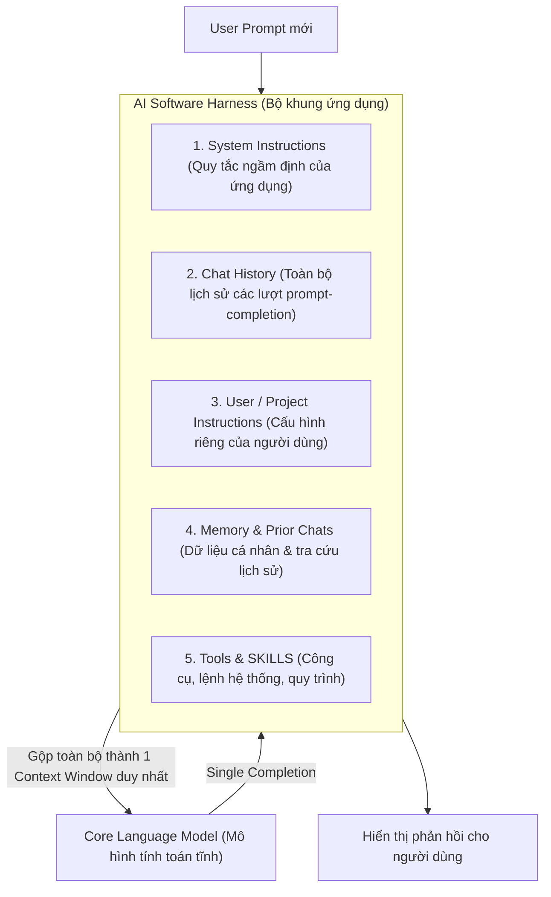
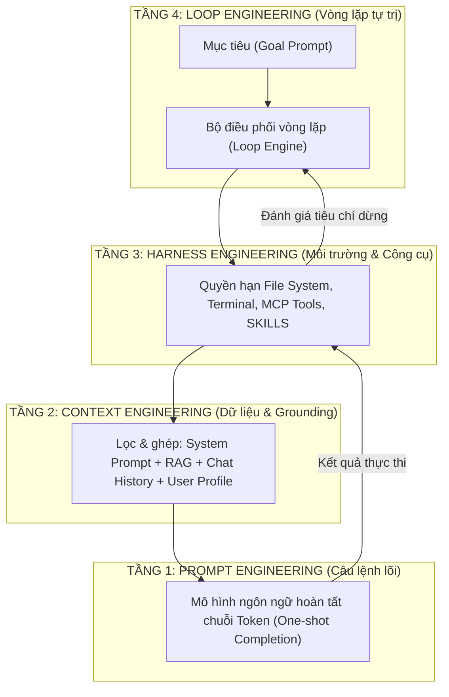

# KIẾN TRÚC & TIẾN HÓA CỦA CÁC HỆ THỐNG AI CHAT
## Từ Prompting, Context, Harness đến Loop Engineering

---

## MỤC LỤC
1. [Bản Chất Cốt Lõi Của Mô Hình Ngôn Ngữ (LLM)](#1-bản-chất-cốt-lõi-của-mô-hình-ngôn-ngữ-llm)
2. [Giải Phẫu Một "AI Harness" (Bộ Khung Điều Khiển)](#2-giải-phẫu-một-ai-harness-bộ-khung-điều-khiển)
3. [Cơ Chế "Bộ Nhớ" (Memory) & Kỹ Thuật Kiểm Soát](#3-cơ-chế-bộ-nhớ-memory--kỹ-thuật-kiểm-soát)
4. [Kỷ Nguyên Agentic AI: SKILLS, Tools & Connectors](#4-kỷ-nguyên-agentic-ai-skills-tools--connectors)
5. [Bóc Trần Thuật Ngữ: 4 Cấp Độ Tiến Hóa Của Prompt Engineering](#5-bóc-trần-thuật-ngữ-4-cấp-độ-tiến-hóa-của-prompt-engineering)
6. [Sơ Đồ Hệ Thống & Tổng Kết Thực Chiến](#6-sơ-đồ-hệ-thống--tổng-kết-thực-chiến)

---

## 1. BẢN CHẤT CỐT LÕI CỦA MÔ HÌNH NGÔN NGỮ (LLM)

Khi trò chuyện với AI, bạn đang gửi câu lệnh (prompt) tới một **Language Model** – một mô hình toán học đa chiều biểu diễn ngôn ngữ con người, được thiết kế để hoàn thành chuỗi ký tự theo các quy luật xác suất thống kê.

### Nguyên lý "Bổ sung từ" (Completion)
* Khi bạn gửi: *"roses are red,..."*
* Hệ thống chuyển prompt thành các **tokens** (biểu diễn toán học của từ hoặc phần của từ).
* Mô hình sử dụng toán học xác suất để tìm các token kế tiếp có khả năng xuất hiện cao nhất: *"violets"*, *"are"*, *"blue"*.
* **Bản chất:** Phản hồi của AI không phải là câu trả lời có ý thức, mà là một **phần bổ sung (completion)** cho prompt ban đầu sao cho khớp với mẫu hình ngôn ngữ tự nhiên.

### Đặc tính: Tĩnh và One-Shot (Static & One-Shot)
* **Static (Tĩnh):** Khi đã hoàn tất huấn luyện, mô hình bị "đóng băng". Nó không thể tự thay đổi, không thể tự học thêm điều gì mới từ người dùng.
* **One-Shot:** Mỗi khi nhận một prompt, mô hình tạo ra bản completion cho duy nhất prompt đó. Đến lượt kế tiếp, mô hình hoàn toàn **không nhớ gì** về những gì vừa diễn ra trước đó.
* **Ảo ảnh hội thoại:** Cảm giác bạn đang trò chuyện liên tục với ChatGPT hay Claude thực chất là một "ảo giác thiết kế tinh vi" được xây dựng bằng phần mềm bọc ngoài (**AI Harness**) thông qua kỹ thuật **Prompt Engineering nâng cao ở tầng ứng dụng**.

---

## 2. GIẢI PHẪU MỘT "AI HARNESS" (BỘ KHUNG ĐIỀU KHIỂN)

Khi sử dụng ứng dụng AI Chat, bạn không bao giờ tương tác trực diện với LLM. Thay vào đó, bạn tương tác với một **Harness** (bộ khung phần mềm) bao bọc lấy mô hình.

### Các thành phần cấu thành:
1. **Core (Language Model):**
   * Lõi tính toán có thể là các mô hình Frontier quy mô lớn hoặc Small Language Model (SLM) chuyên biệt.
   * *Đặc tính hoán đổi (Interchangeable):* Cuộc trò chuyện nằm trong Harness, không nằm trong Model. Do đó bạn có thể đổi model (ví dụ từ GPT sang Claude) ngay giữa phiên chat mà không làm mất ngữ cảnh.
2. **System Instructions (Chỉ dẫn hệ thống):**
   * Là một prompt khổng lồ đứng đầu mọi phiên làm việc do nhà phát triển cài đặt bí mật. Nó quy định hành vi, phong cách, giới hạn an toàn và logic vận hành của ứng dụng.
3. **Chat History (Lịch sử hội thoại):**
   * Mỗi khi bạn gửi một tin nhắn mới, hệ thống sẽ **gom toàn bộ lịch sử** (các cặp prompt-completion từ đầu tới giờ) gửi kèm theo tin nhắn mới. Mô hình phải đọc lại từ đầu đến cuối trước khi sinh ra từ tiếp theo.
   * *Cảnh báo suy thoái ngữ cảnh (Context Drift):* Với những đoạn chat quá dài (đặc biệt là lập trình), LLM phải nuốt lại toàn bộ các đoạn code lỗi, các bước debug sai phía trước. Điều này khiến chất lượng phản hồi ngày càng giảm sút và dễ đi chệch hướng.
4. **User Instructions (Chỉ dẫn người dùng & Dự án):**
   * Cho phép người dùng quy định phong cách cố định (ví dụ: *"Luôn trả lời ngắn gọn", "Luôn giải thích bằng tiếng Việt"*).
   * Mô hình hiện đại bổ sung tính năng **Projects (Dự án)**: Cho phép mỗi dự án có bộ System Instructions và tài liệu context riêng biệt, tránh xung đột giữa các công việc khác nhau.

### Kỹ thuật Prompting tương ứng ở tầng này:
* **Vệ sinh ngữ cảnh (Context Hygiene):** Hãy giữ đoạn chat ngắn gọn, đúng trọng tâm. Khi làm việc với văn bản dài hoặc code, sau khi đạt được một mốc kết quả tốt, hãy copy bản tốt nhất đó, **mở một đoạn chat hoàn toàn mới** và dán vào làm ngữ cảnh ban đầu.
* **Tận dụng Project Instructions:** Thay vì gõ lặp đi lặp lại *"Bạn là chuyên gia kế toán..."* trong mỗi tin nhắn, hãy cấu hình sẵn trong phần Project Settings.

---

## 3. CƠ CHẾ "BỘ NHỚ" (MEMORY) & KỸ THUẬT KIỂM SOÁT

Mô hình nền tảng không có ký ức sinh học. Khả năng "nhớ" của ứng dụng AI Chat là sự mở rộng của các kỹ thuật nạp ngữ cảnh tự động.

### 3 Cấu phần của hệ thống Memory:
1. **User Profile Data (Thông tin người dùng):** Các trường thông tin về tên, chức danh, sở thích được bạn khai báo trong profile sẽ tự động được đính kèm vào đầu mọi prompt.
2. **Dynamic Memory (Bộ nhớ động):** Ứng dụng tự động quét hội thoại để trích xuất các sự kiện/thông tin nó cho là quan trọng và lưu vào CSDL riêng. Lần sau, nó tự chèn các ghi nhớ này vào prompt.
3. **Prior Chats as Reference (Tra cứu hội thoại cũ):** Ứng dụng tích hợp công cụ tìm kiếm ngữ nghĩa (semantic search). Khi bạn hỏi một chủ đề, hệ thống ngầm tìm các tin nhắn cũ liên quan và đắp vào ngữ cảnh hiện tại.

### Kỹ thuật kiểm soát Memory (Memory Prompt Engineering):
* **Chắt lọc User Profile:** Chỉ đưa vào profile những thông tin thật sự có giá trị làm ngữ cảnh cho công việc; tránh nạp quá nhiều thông tin rác.
* **Chủ động quản lý và dọn dẹp:** Hãy định kỳ vào trang quản lý Memory của ứng dụng (ChatGPT/Claude) để xóa bỏ các ghi nhớ sai lệch hoặc lỗi thời. Nên chủ động ra lệnh *"Hãy ghi nhớ thông tin này:..."* thay vì để AI tự đoán.
* **Bảo vệ ranh giới dự án:** Nếu phải xử lý các chủ đề đối nghịch nhau, hãy tắt Memory tạm thời hoặc sử dụng **Chế độ ẩn danh (Temporary/Anonymous Chat)** để cách ly hoàn toàn dữ liệu.

---

## 4. KỶ NGUYÊN AGENTIC AI: SKILLS, TOOLS & CONNECTORS

Bước nhảy vọt từ **AI Chat** (chỉ biết trả lời văn bản) sang **Agentic AI** (tác tử biết tự hành động) diễn ra khi AI Harness được trang bị thêm công cụ và quyền thực thi.

### 1. SKILLS (Kỹ năng)
* **Định nghĩa:** Là các tài liệu Markdown, kịch bản, quy chuẩn từng bước (step-by-step workflows) mô tả chính xác cách thực hiện một tác vụ nghiệp vụ.
* **Bản chất:** SKILLS được viết hoàn toàn bằng ngôn ngữ tự nhiên và được xem là **phiên bản tinh tế, hoàn thiện nhất của Advanced Prompt Engineering**. Mô hình đọc các tài liệu này và tự suy luận thời điểm cần kích hoạt quy trình chuẩn.

### 2. Tools & Connectors (Công cụ & Kết nối qua MCP)
* Harness cung cấp cho mô hình các khả năng: Tìm kiếm web, tạo ảnh, truy vấn database, gọi REST API.
* Chuẩn **MCP (Model Context Protocol)** đang trở thành chuẩn công nghiệp mở giúp kết nối LLM với hàng nghìn công cụ ngoài.
* Các công cụ này có thể do người dùng bấm chọn hoặc do môi trường/LLM tự động quyết định gọi (Function Calling).

### 3. Quyền truy cập tệp & Thực thi mã lệnh cục bộ
* Sức mạnh thực sự của các công cụ lập trình như *Claude Code, GitHub Copilot CLI* hay *Claude Cowork* đến từ việc Harness có quyền **đọc/ghi trực tiếp vào hệ thống tệp cục bộ và chạy lệnh terminal trên máy tính**.
* AI có thể tự viết code $\rightarrow$ tự chạy code $\rightarrow$ tự đọc lỗi (nếu có) $\rightarrow$ tự sửa lỗi mà không cần con người can thiệp thủ công từng bước.

### Kỹ thuật tương tác với Agent:
* **Tư duy Harness (Harness Mindset):** Hãy xem AI như một ứng dụng máy tính tinh vi thay vì một thực thể có tri giác. Nó không có cảm xúc, không có suy nghĩ độc lập và sẵn sàng được "reset" làm lại bất kỳ lúc nào nếu kết quả không đạt.
* **Nắm rõ danh mục công cụ:** Một prompt dài dòng hướng dẫn tính toán sẽ trở nên thừa thãi nếu hệ thống đã có sẵn công cụ chạy Python hoặc máy tính chuyên dụng.
* **Đóng gói quy trình thành SKILL:** Khi hoàn thành một luồng xử lý phức tạp, hãy yêu cầu chính AI chuẩn hóa các bước đó thành một file `SKILL.md` để tái sử dụng lâu dài.

---

## 5. BÓC TRẦN THUẬT NGỮ: 4 CẤP ĐỘ TIẾN HÓA CỦA PROMPT ENGINEERING

Các khẩu hiệu thời thượng như *"Prompt Engineering đã chết"* hay *"Bây giờ chỉ làm Loop Engineering"* chỉ là chiêu trò thu hút tương tác (hype). Thực chất, bạn không thể ra lệnh cho LLM mà không dùng ngôn ngữ tự nhiên. 

Mọi sự phát triển đều quy về việc **Prompt Engineering được áp dụng ở các tầng trừu tượng cao hơn**:

| Cấp độ | Tên gọi | Bản chất kỹ thuật | Insight cốt lõi |
| :---: | :--- | :--- | :--- |
| **Tầng 1** | **Prompt Engineering** | Tinh chỉnh từ ngữ, cấu trúc câu lệnh gửi trực tiếp cho mô hình (Few-shot, Chain-of-Thought, Step-by-Step). | Phát hiện và chuẩn hóa các mẫu câu kích hoạt khả năng suy luận mong muốn trong mô hình. |
| **Tầng 2** | **Context Engineering** | Thiết kế hệ thống cấp đúng tài liệu tham chiếu (Grounding) vào đúng thời điểm (RAG, Web Search, Files). | **Chất lượng vào = Chất lượng ra.** LLM chỉ mô phỏng mẫu hình trong dữ liệu nạp vào. Cung cấp dữ liệu chuẩn là cách duy nhất triệt tiêu hiện tượng ảo giác (hallucination). |
| **Tầng 3** | **Harness Engineering** | Xây dựng, cấu hình ứng dụng bọc ngoài LLM (CLI, IDE extension, quyền truy cập thư mục, kết nối MCP). | Trao cho người dùng toàn quyền kiểm soát môi trường làm việc, danh mục mô hình và công cụ mà AI được phép sử dụng. |
| **Tầng 4** | **Loop Engineering** | Thiết lập vòng lặp để AI tự prompt chính nó, tự hành động cho đến khi hoàn thành mục tiêu cụ thể. | **Bản chất vẫn là Prompt Engineering:** Thay vì prompt từng câu hỏi lẻ, bạn prompt cho bộ khung phần mềm duy trì vòng lặp tự trị hướng mục tiêu (*Goal-oriented loop*). |

---

## 6. SƠ ĐỒ HỆ THỐNG & TỔNG KẾT THỰC CHIẾN

### 3 Nguyên tắc vàng cần ghi nhớ:
1. **Prompt đúng tầng (Prompt the right layer):**
   * AI trả lời sai sự thật? $\rightarrow$ Kiểm tra lại tầng **Context** (Thiếu tài liệu tham chiếu).
   * AI không thao tác được file? $\rightarrow$ Kiểm tra lại tầng **Harness** (Chưa cấp quyền hoặc thiếu Tool).
   * AI chạy vòng vo không dứt? $\rightarrow$ Kiểm tra lại tầng **Loop** (Tiêu chí dừng chưa rõ ràng).
   * Văn phong chưa chuẩn? $\rightarrow$ Tinh chỉnh lại tầng **Prompt / Instructions**.
2. **Không có "phép màu", chỉ có kiến trúc hệ thống:** AI không thông minh lên nhờ ma thuật, mà nhờ các kỹ sư biết cách xây dựng bộ Harness vững chắc và cung cấp dữ liệu sạch cho mô hình.
3. **Nâng cấp từ "Người chat" thành "Kỹ sư kiến trúc Agent":** Chuyển dịch từ việc ngồi gõ từng câu lệnh đối thoại sang việc thiết kế System Instructions, đóng gói tài liệu SKILLS và thiết lập các vòng lặp tự động hướng tới mục tiêu cuối cùng.
