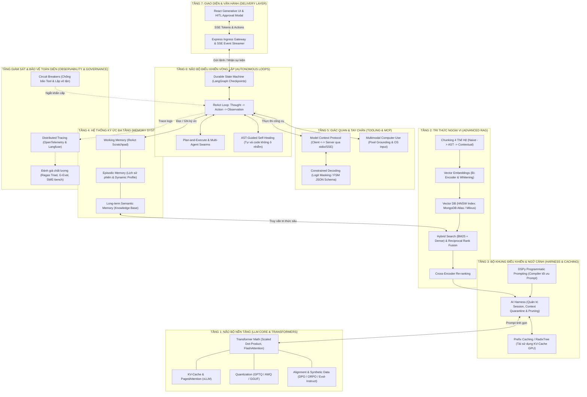

# 🏛️ BẢN ĐỒ KIẾN TRÚC TOÀN CẢNH: MỐI LIÊN HỆ GIỮA TOÀN BỘ CÁC THÀNH PHẦN TRONG AI AGENT
## Cẩm Nang Hệ Thống Hóa Toàn Diện: Giải Phẫu Bản Chất, Cơ Chế Hoạt Động Ngầm, Đầu Vào/Đầu Ra & Dòng Chảy Dữ Liệu Xuyên Suốt Tất Cả Các Kỹ Thuật

---

## 📑 MỤC LỤC
1. [Khái Lược Vĩ Mô: Tư Duy Hệ Điều Hành Tác Tử (The Agent Operating System)](#1-khái-lược-vĩ-mô-tư-duy-hệ-điều-hành-tác-tử-the-agent-operating-system)
2. [Sơ Đồ Dòng Chảy Kiến Trúc 7 Tầng (End-to-End 7-Layer Architecture)](#2-sơ-đồ-dòng-chảy-kiến-trúc-7-tầng-end-to-end-7-layer-architecture)
3. [Giải Phẫu Chi Tiết Từng Hệ Thống: Bản Chất, Cách Hoạt Động & Mắt Xích Kết Nối](#3-giải-phẫu-chi-tiết-từng-hệ-thống-bản-chất-cách-hoạt-động--mắt-xích-kết-nối)
   - [Hệ Thống 1: Lõi Nhận Thức & Nền Tảng Vật Lý (LLM Core & Transformer Internals)](#hệ-thống-1-lõi-nhận-thức--nền-tảng-vật-lý-llm-core--transformer-internals)
   - [Hệ Thống 2: Tri Thức Ngoại Vi & Khai Thác Dữ Liệu (Advanced RAG & Semantic Retrieval)](#hệ-thống-2-tri-thức-ngoại-vi--khai-thác-dữ-liệu-advanced-rag--semantic-retrieval)
   - [Hệ Thống 3: Hệ Thần Kinh Điều Khiển & Cửa Sổ Ngữ Cảnh (Prompting, DSPy & Harness)](#hệ-thống-3-hệ-thần-kinh-điều-khiển--cửa-sổ-ngữ-cảnh-prompting-dspy--harness)
   - [Hệ Thống 4: Hệ Thống Ký Ức Đa Tầng (Cognitive Memory Systems)](#hệ-thống-4-hệ-thống-ký-ức-đa-tầng-cognitive-memory-systems)
   - [Hệ Thống 5: Giác Quan, Công Cụ & Giao Thức Kết Nối (Tools, MCP & Constrained Decoding)](#hệ-thống-5-giác-quan-công-cụ--giao-thức-kết-nối-tools-mcp--constrained-decoding)
   - [Hệ Thống 6: Não Bộ Vận Hành Vòng Lặp Tự Trị (Loop Engineering & Multi-Agent)](#hệ-thống-6-não-bộ-vận-hành-vòng-lặp-tự-trị-loop-engineering--multi-agent)
   - [Hệ Thống 7: Hệ Miễn Dịch, Đo Lường & Phân Phối Người Dùng (Evals, Tracing & MERN Stack)](#hệ-thống-7-hệ-miễn-dịch-đo-lường--phân-phối-người-dùng-evals-tracing--mern-stack)
4. [Bảng Ma Trận Hợp Nhất: Input $\to$ Processing $\to$ Output $\to$ Next Component](#4-bảng-ma-trận-hợp-nhất-input-to-processing-to-output-to-next-component)
5. [Điển Cứu Toàn Trình (The Master End-to-End Walkthrough): Từ Bấm Phím Đến Hành Động Thực Tế](#5-điển-cứu-toàn-trình-the-master-end-to-end-walkthrough-từ-bấm-phím-đến-hành-động-thực-tế)

---

## 1. KHÁI LƯỢC VĨ MÔ: TƯ DUY HỆ ĐIỀU HÀNH TÁC TỬ (THE AGENT OPERATING SYSTEM)

Khi tiếp cận từng bài học độc lập, bạn dễ cảm thấy bị ngợp bởi số lượng khái niệm: *Backpropagation, KV-Cache, Chunking, HNSW, DSPy, Prefix Caching, MCP, ReAct, AST Self-Healing, Checkpointing, Langfuse, MERN*.

Nhưng trong thực tế kỹ thuật phần mềm, **một AI Agent chính là một Máy Tính Nhận Thức (Cognitive Computer)**, với sự tương đồng 1:1 với kiến trúc máy tính Von Neumann cổ điển:

| STT | Thành Phần Máy Tính Truyền Thống | Thành Phần Tương Đương Trong AI Agent | Kỹ Thuật & Khái Niệm Cốt Lõi |
| :-: | :--- | :--- | :--- |
| **1** | **CPU** (Bộ vi xử lý tính toán) | **LLM Core** | Transformer Math, Self-Attention, KV-Cache, Decoders |
| **2** | **RAM** (Bộ nhớ truy xuất nhanh) | **Context Window & Working Memory** | ReAct Scratchpad, Context Quarantine & Pruning |
| **3** | **Ổ cứng SSD** (Lưu trữ lâu dài) | **Vector DB & Document Store** | MongoDB Atlas HNSW Index, Long-term Profile Store |
| **4** | **Bus & Cổng kết nối** (USB/PCI) | **Model Context Protocol (MCP)** | JSON-RPC 2.0 Tools, Stdio / HTTP SSE Transports |
| **5** | **Trình biên dịch** (Compiler) | **DSPy & Constrained Decoding** | Logit Masking (FSM), Tự động hóa Prompt Optimization |
| **6** | **Tiến trình** (Process / Loop) | **Autonomous Loop Engineering** | ReAct Loops, Plan-and-Execute, Multi-Agent Swarms |
| **7** | **Kernel & Checkpoint** | **Harness & Durable State Machine** | Event-sourcing Checkpointing, Session Lifecycle |
| **8** | **Task Manager & Firewall** | **Circuit Breakers & Observability** | OpenTelemetry, Langfuse Tracing, RBAC Gate |
| **9** | **Màn hình & Bàn phím** (I/O) | **Delivery UI & Multimodal GUI** | React Generative UI, SSE Stream, Computer-Use |

Mỗi kỹ thuật bạn học **không tồn tại độc lập**; nó xuất hiện để giải quyết đúng một **nút thắt cổ chai vật lý hoặc logic** của thành phần nằm ngay trước nó.

---

## 2. SƠ ĐỒ DÒNG CHẢY KIẾN TRÚC 7 TẦNG (END-TO-END 7-LAYER ARCHITECTURE)

Dưới đây là bản đồ tuần hoàn dữ liệu và điều phối của toàn bộ hệ sinh thái kỹ thuật trong khóa học:



---

## 3. GIẢI PHẪU CHI TIẾT TỪNG HỆ THỐNG: BẢN CHẤT, CÁCH HOẠT ĐỘNG & MẮT XÍCH KẾT NỐI

---

### HỆ THỐNG 1: LÕI NHẬN THỨC & NỀN TẢNG VẬT LÝ (LLM CORE & TRANSFORMER INTERNALS)

> **Tài liệu liên quan trong Vault:**
> * [neural_networks_and_classifications.md](./01-research-and-foundations/01-neural-networks/neural_networks_and_classifications.md)
> * [what_are_large_language_models.md](./01-research-and-foundations/02-llm-internals/what_are_large_language_models.md)
> * [04_transformer_math_deep_dive.md](./01-research-and-foundations/02-llm-internals/04_transformer_math_deep_dive.md)
> * [05_scaling_laws_and_quantization.md](./01-research-and-foundations/02-llm-internals/05_scaling_laws_and_quantization.md)
> * [06_synthetic_data_and_agent_alignment.md](./01-research-and-foundations/02-llm-internals/06_synthetic_data_and_agent_alignment.md)

#### 1. Bản chất & Nút thắt cổ chai nó đối mặt:
Mô hình ngôn ngữ lớn (LLM) bản chất là một **hàm xác suất thống kê điều kiện** $P(w_t \mid w_1, \dots, w_{t-1})$. Trọng số của nó bị **đóng băng (frozen)** sau huấn luyện, nó hoàn toàn **tĩnh (stateless)** và tiêu tốn tài nguyên GPU khổng lồ trong pha sinh token tự hồi quy (Autoregressive Generation).

#### 2. Cơ chế hoạt động ngầm (How it works behind the scenes):
1. **Scaled Dot-Product Attention:** Tính toán ma trận trọng số tương quan giữa các token $\text{Attention}(Q,K,V) = \text{softmax}\left(\frac{QK^T}{\sqrt{d_k}}\right)V$.
2. **FlashAttention (Tiling & Online Softmax):** Chia ma trận chú ý thành các khối nhỏ (Tiles) nạp vào bộ nhớ nhanh SRAM của GPU, tránh việc ghi tràn ra bộ nhớ chậm HBM, giảm độ phức tạp bộ nhớ từ $\mathcal{O}(N^2)$ xuống $\mathcal{O}(N)$.
3. **KV-Cache & PagedAttention:** Khi sinh token thứ $t$, mô hình không tính toán lại toàn bộ vector Key/Value của các token trước mà lưu vào bộ nhớ cache. PagedAttention phân mảnh bộ nhớ RAM GPU thành các trang (Pages) tương tự Virtual Memory của OS để triệt tiêu phân mảnh bộ nhớ.
4. **Quantization (Lượng tử hóa):** Nén trọng số từ FP16 (16-bit) xuống INT4 (4-bit) bằng thuật toán GPTQ hoặc AWQ giúp mô hình 70B tham số có thể chạy vừa trên 1 chiếc GPU thông thường.

#### 3. Đầu Vào $\to$ Đầu Ra:
* **Input:** Mảng số nguyên `input_ids` biểu diễn các tokens ngữ cảnh.
* **Output:** Phân phối xác suất (Logits) cho token tiếp theo qua tầng Unembedding $\mathbf{W}_U$.

#### 4. Mắt xích kết nối:
* Vì trọng số LLM bị đóng băng tại thời điểm huấn luyện và không có tri thức nghiệp vụ nội bộ $\to$ Bắt buộc phải kết nối với **Tầng 2 (RAG)** để nạp dữ liệu ngoài.
* Vì pha tính toán Prefill tốn kém chi phí $\mathcal{O}(N^2)$ mỗi lượt $\to$ Cần **Tầng 3 (Prefix Caching)** để duy trì hiệu năng vòng lặp.

---

### HỆ THỐNG 2: TRI THỨC NGOẠI VI & KHAI THÁC DỮ LIỆU (ADVANCED RAG & SEMANTIC RETRIEVAL)

> **Tài liệu liên quan trong Vault:**
> * [01_semantic_search_and_reranking.md](./01-research-and-foundations/03-semantic-search/01_semantic_search_and_reranking.md)
> * [02_rag_architecture_and_components.md](./01-research-and-foundations/03-semantic-search/02_rag_architecture_and_components.md)
> * [03_embeddings_and_vector_databases.md](./01-research-and-foundations/03-semantic-search/03_embeddings_and_vector_databases.md)
> * [04_how_database_and_embedding_choices_affect_rag.md](./01-research-and-foundations/03-semantic-search/04_how_database_and_embedding_choices_affect_rag.md)
> * [05_theory_to_practice_making_rag_work.md](./01-research-and-foundations/03-semantic-search/05_theory_to_practice_making_rag_work.md)
> * [08_advanced_retrieval_tactics_for_rag.md](./01-research-and-foundations/03-semantic-search/08_advanced_retrieval_tactics_for_rag.md)

#### 1. Bản chất & Nút thắt cổ chai nó đối mặt:
LLM chỉ có thể xử lý ngữ cảnh giới hạn và dễ bị **ảo giác (hallucination)** khi được hỏi về dữ liệu riêng tư hoặc cập nhật theo thời gian thực. RAG cung cấp cơ chế "kỳ thi mở sách" (Open-Book Exam) cho AI.

#### 2. Cơ chế hoạt động ngầm (How it works behind the scenes):
1. **Chunking 4 thế hệ:**
   * *Gen 1 (Fixed):* Cắt cứng 500 ký tự $\to$ Gãy câu, đứt ý nghĩa.
   * *Gen 2 (Recursive/Sentence):* Cắt theo đoạn văn, dấu chấm câu.
   * *Gen 3 (Structure/AST-Aware):* Dùng bộ phân tích cú pháp cắt trọn vẹn từng hàm code hoặc bảng biểu dữ liệu.
   * *Gen 4 (Contextual / Agentic):* Dùng một mô hình LLM phụ tóm tắt ngữ cảnh tài liệu cha vào đầu mỗi đoạn chunk trước khi nhúng (chuẩn Anthropic Contextual Retrieval).
2. **Embedding & Hiện tượng Dị hướng (Anisotropy):** Mô hình Bi-Encoder chuyển văn bản thành vector $d$-chiều. Áp dụng kỹ thuật BERT-Whitening để kéo dãn các vector ra khỏi "hình nón hẹp" (Narrow Cone), tối ưu độ phân biệt tương đồng Cosine.
3. **Indexing (Chỉ mục HNSW):** Xây dựng mạng đồ thị phân tầng thế giới nhỏ (Hierarchical Navigable Small World), cho phép tìm kiếm lân cận gần đúng $k$-NN với độ phức tạp $\mathcal{O}(\log N)$.
4. **Hybrid Search & Reciprocal Rank Fusion (RRF):** Kết hợp kết quả từ tìm kiếm từ khóa $BM25$ và Dense Vector Search để đảm bảo không bỏ sót mã lỗi hay số hiệu đặc biệt:
   $$
   \text{Score}_{\text{RRF}}(d) = \sum_{m \in M} \frac{1}{60 + r_m(d)}
   $$
5. **Cross-Encoder Re-ranking:** Lấy Top-50 ứng viên từ tìm kiếm lai, đưa qua mô hình Cross-Attention phân tích ngữ nghĩa sâu để chọn lọc ra Top-3 đoạn văn chuẩn xác nhất.

#### 3. Đầu Vào $\to$ Đầu Ra:
* **Input:** Câu truy vấn tự nhiên của người dùng (Query).
* **Output:** Danh sách các đoạn văn bản sạch (Chunks) kèm điểm tin cậy (Relevance Score) và Metadata nguồn.

#### 4. Mắt xích kết nối:
* Các Chunks chất lượng cao này được gửi tới **Tầng 3 (Harness)** để nạp vào Context Window mà không làm ô nhiễm bộ nhớ.

---

### HỆ THỐNG 3: HỆ THẦN KINH ĐIỀU KHIỂN & CỬA SỔ NGỮ CẢNH (PROMPTING, DSPY & HARNESS)

> **Tài liệu liên quan trong Vault:**
> * [advanced_prompt_engineering_techniques.md](./02-prompt-and-context/01-prompt-engineering/advanced_prompt_engineering_techniques.md)
> * [02_dspy_and_programmatic_prompting.md](./02-prompt-and-context/01-prompt-engineering/02_dspy_and_programmatic_prompting.md)
> * [01_harness_architecture.md](./03-building-agents/01-harness-and-memory/01_harness_architecture.md)
> * [02_context_management.md](./03-building-agents/01-harness-and-memory/02_context_management.md)
> * [04_agent_runtime_parameters_and_prompt_caching.md](./03-building-agents/01-harness-and-memory/04_agent_runtime_parameters_and_prompt_caching.md)

#### 1. Bản chất & Nút thắt cổ chai nó đối mặt:
Viết prompt thủ công rất mong manh (dễ gãy khi đổi model). Đồng thời, khi phiên trò chuyện kéo dài, hệ thống gặp phải 3 căn bệnh: **Context Poisoning** (nhiễm độc rác), **Context Decay** (quên thông tin ở giữa - Lost in the Middle), và **Bùng nổ chi phí tính toán Prefill**.

#### 2. Cơ chế hoạt động ngầm (How it works behind the scenes):
1. **DSPy (Trình biên dịch Prompt tự động):** Thay vì viết chuỗi prompt bằng tay, lập trình viên định nghĩa các Module (`Predict`, `ChainOfThought`, `ReAct`). Thuật toán tối ưu hóa Bayes (`MIPROv2`) tự động thử nghiệm hàng trăm biến thể câu lệnh và ví dụ mẫu Few-shot để chọn ra bộ prompt có điểm đánh giá cao nhất.
2. **AI Harness:** Lớp vỏ bọc phần mềm quản lý vòng đời phiên (Session Lifecycle), kiểm soát ranh giới bảo mật, và thực thi kỹ thuật **Context Quarantine** (cô lập dữ liệu không tin cậy vào sandbox riêng để chặn Prompt Injection).
3. **Prefix Caching & RadixTree:** GPU duy trì một cây tiền tố (Prefix Tree) các token đã tính toán. Nếu phần đầu của System Prompt và Tool Definitions được giữ cố định bất biến (**Static Prefix Invariance**), GPU chỉ mất $0.2\text{s}$ để đọc lại cache thay vì tính toán lại từ đầu mất $3.5\text{s}$, giảm 90% chi phí.

#### 3. Đầu Vào $\to$ Đầu Ra:
* **Input:** Raw User Query + Tri thức từ RAG + Lịch sử hội thoại.
* **Output:** Khung Prompt chuẩn hóa (XML tags, Few-shots tối ưu) đã được tối ưu hóa bộ đệm Cache.

#### 4. Mắt xích kết nối:
* Harness chuyển giao Prompt đã tinh gọn này cho **Tầng 4 (Memory)** và **Tầng 6 (Loop)** để kích hoạt quá trình suy luận.

---

### HỆ THỐNG 4: HỆ THỐNG KÝ ỨC ĐA TẦNG (COGNITIVE MEMORY SYSTEMS)

> **Tài liệu liên quan trong Vault:**
> * [03_memory_systems.md](./03-building-agents/01-harness-and-memory/03_memory_systems.md)

#### 1. Bản chất & Nút thắt cổ chai nó đối mặt:
Context Window của LLM chỉ là bộ nhớ RAM tạm thời; khi phiên kết thúc hoặc cửa sổ đầy, Agent sẽ bị "mất trí nhớ hoàn toàn" (Amnesia). Một Agent thông minh cần khả năng tích lũy kinh nghiệm qua thời gian.

#### 2. Cơ chế hoạt động ngầm (How it works behind the scenes):
Hệ thống tổ chức trí nhớ theo mô hình nhận thức 4 tầng:
1. **Short-term Memory:** Cửa sổ trượt lưu giữ 5-10 lượt chat gần nhất.
2. **Working Memory (Scratchpad):** Vùng nháp tạm thời lưu trữ kế hoạch hiện tại, các quan sát trung gian và biến số đang xử lý của chu kỳ ReAct.
3. **Episodic Memory (Ký ức sự kiện):** Ghi lại các nhiệm vụ đã từng làm trong quá khứ, giải pháp thành công/thất bại để không lặp lại sai lầm cũ.
4. **Long-term Semantic Memory & User Profile:** Dùng Vector DB hoặc Đồ thị tri thức có nhận thức thời gian (Bi-temporal Knowledge Graph như Zep/Mem0) để lưu sở thích, vai trò và quy tắc bất biến của người dùng.
5. **Cơ chế Củng cố Ký ức (Memory Consolidation):** Định kỳ chạy một tiến trình ngầm (chạy đêm hoặc sau mỗi phiên) để tóm tắt các cuộc hội thoại dài thành các khẳng định tri thức ngắn gọn (Facts Extraction) và đẩy vào Long-term store.

#### 3. Đầu Vào $\to$ Đầu Ra:
* **Input:** Toàn bộ lịch sử phiên đàm thoại hiện tại và các hành động vừa thực hiện.
* **Output:** Hồ sơ người dùng được cập nhật + Bộ nhớ làm việc (Scratchpad) sẵn sàng cho chu kỳ suy luận kế tiếp.

#### 4. Mắt xích kết nối:
* Bộ nhớ làm việc (Scratchpad) là nhiên liệu trực tiếp điều khiển các bước nhảy của **Tầng 6 (ReAct Loop)**.

---

### HỆ THỐNG 5: GIÁC QUAN, CÔNG CỤ & GIAO THỨC KẾT NỐI (TOOLS, MCP & CONSTRAINED DECODING)

> **Tài liệu liên quan trong Vault:**
> * [01_mcp_architecture.md](./03-building-agents/02-tools-and-mcp/01_mcp_architecture.md)
> * [02_constrained_decoding_and_structured_outputs.md](./03-building-agents/02-tools-and-mcp/02_constrained_decoding_and_structured_outputs.md)
> * [01_multimodal_gui_and_computer_use.md](./03-building-agents/05-multimodal-gui-agents/01_multimodal_gui_and_computer_use.md)

#### 1. Bản chất & Nút thắt cổ chai nó đối mặt:
LLM chỉ có thể sinh văn bản; nó không thể tự bấm chuột, chạy lệnh bash hay đọc database. Đồng thời, khi xuất lệnh gọi hàm, LLM rất hay sinh sai cú pháp JSON (thiếu ngoặc `}`, sai kiểu dữ liệu) làm sập hệ thống điều phối.

#### 2. Cơ chế hoạt động ngầm (How it works behind the scenes):
1. **Model Context Protocol (MCP) — Quy trình 4 bước:**
   * *Bước 1 (Register Tools):* Server định nghĩa hàm, mô tả ngữ nghĩa và `inputSchema` chuẩn JSON Schema.
   * *Bước 2 (Set up Transport):* Thiết lập kênh kết nối qua `stdio` (tiến trình cục bộ an toàn) hoặc `HTTP SSE` (mạng từ xa, có hoặc không có session).
   * *Bước 3 (Handle Requests & Pattern Matching):* Nhận gói tin JSON-RPC `tools/call`, thực thi logic ngoài đời, và bọc kết quả vào mảng `content: [{type: "text", text: ...}]` chuẩn mực.
   * *Bước 4 (UI Integration):* Trả kết quả về Frontend (React/Angular) để hiển thị tự nhiên hoặc kích hoạt Generative UI widget.
2. **Constrained Decoding (Logit Masking):** Can thiệp trực tiếp vào tầng Unembedding $\mathbf{W}_U$ của LLM. Sử dụng Máy trạng thái hữu hạn (FSM) để áp đặt mặt nạ nhị phân $\mathbf{M}_t$: bất kỳ token nào vi phạm ngữ pháp JSON Schema bị gán xác suất $-\infty$, bảo đảm **$100\%$ tính đúng đắn cú pháp ngay tại thời điểm sinh token**.
3. **Multimodal GUI (Computer-Use):** Với phần mềm không có API, Agent chụp ảnh màn hình, dùng **Set-of-Mark (SoM)** hoặc **OmniParser** đánh số các nút bấm trên màn hình, ánh xạ tọa độ chuẩn hóa $[0, 1000] \times [0, 1000]$ và phát sinh lệnh di chuột/gõ phím ảo như người thật.

#### 3. Đầu Vào $\to$ Đầu Ra:
* **Input:** Yêu cầu hành động từ LLM (Tool Call name & Arguments).
* **Output:** Dữ liệu thực thi thực tế từ thế giới ngoài (Observation Data) đã được định dạng chuẩn.

#### 4. Mắt xích kết nối:
* Dữ liệu quan sát (Observation) này được trả ngược lại làm đầu vào cho **Tầng 6 (Vòng lặp ReAct)** để quyết định bước đi tiếp theo.

---

### HỆ THỐNG 6: NÃO BỘ VẬN HÀNH VÒNG LẶP TỰ TRỊ (LOOP ENGINEERING & MULTI-AGENT)

> **Tài liệu liên quan trong Vault:**
> * [01_loop_fundamentals.md](./03-building-agents/03-loop-engineering/01_loop_fundamentals.md)
> * [02_react_and_planning.md](./03-building-agents/03-loop-engineering/02_react_and_planning.md)
> * [03_multi_agent_teams.md](./03-building-agents/03-loop-engineering/03_multi_agent_teams.md)
> * [04_ast_self_healing_code_agents.md](./03-building-agents/03-loop-engineering/04_ast_self_healing_code_agents.md)
> * [05_durable_execution_and_stateful_workflows.md](./03-building-agents/03-loop-engineering/05_durable_execution_and_stateful_workflows.md)

#### 1. Bản chất & Nút thắt cổ chai nó đối mặt:
Một câu prompt đơn lẻ (One-shot) không thể giải quyết bài toán phức tạp đòi hỏi 20 bước suy luận và thử sai. Nhưng nếu thả cho Agent tự chạy vòng lặp tự do, nó dễ rơi vào bẫy lặp vô tận, bão công cụ (Tool Storm), và mất sạch trạng thái khi gặp sự cố crash.

#### 2. Cơ chế hoạt động ngầm (How it works behind the scenes):
1. **ReAct Pattern:** Vòng lặp nhận thức khép kín:
   $$\text{Thought} \longrightarrow \text{Action (Gọi Tool)} \longrightarrow \text{Observation (Kết quả Tool)} \longrightarrow \text{Thought}$$
2. **Plan-and-Execute:** Tách biệt bộ não lập chiến lược tổng thể (**Planner**) và các tay chân thực thi (**Execution Workers**) để tiết kiệm token và tránh bị lệch mục tiêu ban đầu.
3. **AST Self-Healing Code Agents:** Khi Agent viết mã bị lỗi kiểm thử, thay vì viết lại cả file gây hỏng lây sang các hàm khác, hệ thống dùng **Cây cú pháp trừu tượng (AST)** cắt đúng nút hàm bị lỗi ra, yêu cầu mô hình vá lỗi cục bộ, chạy kiểm thử trong sandbox và ráp ngược lại cây AST an toàn.
4. **Multi-Agent Teams & Context Quarantine:** Phân rã nhiệm vụ cho các chuyên gia nhỏ (Coder, Reviewer, Tester) theo mô hình Supervisor. Ngữ cảnh được phân vùng độc lập (Quarantine) để Agent này không bị quá tải bởi suy nghĩ của Agent khác.
5. **Durable Execution & Checkpointing:** Triết lý chạy bền vững mượn từ Temporal/LangGraph. Mỗi bước chuyển trạng thái trong đồ thị State Graph $\mathcal{S}_t$ được lưu (persist) thành snapshot vào cơ sở dữ liệu (MongoDB). Nếu server sập ở bước 15, khi khởi động lại, Agent phục hồi chính xác từ bước 15 mà không tốn 1 đồng token chạy lại từ đầu.

#### 3. Đầu Vào $\to$ Đầu Ra:
* **Input:** Mục tiêu vĩ mô của người dùng (Goal) + Danh mục công cụ khả dụng.
* **Output:** Trạng thái hoàn thành cuối cùng (Final Result) hoặc bản vá lỗi đã được kiểm định $100\%$.

#### 4. Mắt xích kết nối:
* Vòng lặp liên tục phát các sự kiện tiến trình (Traces & Steps) tới **Tầng 7 (MERN Frontend)** và được kiểm soát an toàn bởi **Tầng 0 (Circuit Breakers)**.

---

### HỆ THỐNG 7: HỆ MIỄN DỊCH, ĐO LƯỜNG & PHÂN PHỐI NGƯỜI DÙNG (EVALS, TRACING & MERN STACK)

> **Tài liệu liên quan trong Vault:**
> * [01_agent_evals_and_tracing.md](./03-building-agents/04-observability-and-evals/01_agent_evals_and_tracing.md)
> * [06_how_to_build_enterprise_ai_agents.md](./03-building-agents/06_how_to_build_enterprise_ai_agents.md)
> * [07_fullstack_agent_mern_architecture.md](./03-building-agents/07_fullstack_agent_mern_architecture.md)

#### 1. Bản chất & Nút thắt cổ chai nó đối mặt:
Một hệ sinh thái backend mạnh mẽ vô nghĩa nếu không có cách chuyển tải đến người dùng cuối một cách an toàn, minh bạch và có thể giám sát kiểm thử tự động trên môi trường sản xuất (Production).

#### 2. Cơ chế hoạt động ngầm (How it works behind the scenes):
1. **Circuit Breakers (Bộ ngắt mạch bảo vệ):** Đếm số bước lặp và số lần tool thất bại liên tiếp. Nếu vượt quá ngưỡng (ví dụ: $> 15$ bước hoặc 3 lần lỗi liên tiếp), hệ thống lập tức ngắt khẩn cấp, chặn đứng nguy cơ cạn kiệt tài khoản ngân hàng do bão API.
2. **Distributed Tracing (OpenTelemetry / Langfuse):** Ghi lại cây vết (Trace Tree) của từng request: thời gian phản hồi từng bước, chi phí token của từng lần gọi LLM, độ trễ mạng của từng MCP Server.
3. **Đánh giá tự động (Evals & Ragas Triad):** Chấm điểm định lượng không qua cảm tính (Vibe checking) dựa trên bộ 3 chỉ số: *Faithfulness* (Độ trung thực, không bịa đặt), *Answer Relevance* (Độ liên quan câu trả lời), và *Context Precision* (Độ chuẩn xác của dữ liệu RAG thu hồi).
4. **MERN Full-stack Delivery Layer:**
   * **Express.js Ingress:** Mở kênh truyền phát **Server-Sent Events (SSE)** truyền tải token thời gian thực và sự kiện suy luận `thought`.
   * **MongoDB Atlas:** Đảm nhiệm vai trò lưu trữ hợp nhất: Dữ liệu Document + Vector Search Index HNSW + Checkpoint Store của State Graph.
   * **React Generative UI & Human-in-the-Loop:** Hiển thị trực quan quá trình tư duy (Scratchpad Visualizer) và bật Popup cảnh báo chặn các hành động nhạy cảm (xóa file, chuyển khoản), chờ người dùng click phê duyệt mới tiếp tục luồng thực thi.

#### 3. Đầu Vào $\to$ Đầu Ra:
* **Input:** Toàn bộ trạng thái thực thi và dữ liệu luồng từ Agent.
* **Output:** Giao diện người dùng tương tác thời gian thực + Bảng số liệu giám sát SLA & Chi phí token.

---

## 4. BẢNG MA TRẬN HỢP NHẤT: INPUT $\to$ PROCESSING $\to$ OUTPUT $\to$ NEXT COMPONENT

Bảng dưới đây tóm tắt chính xác "Ai nhận cái gì, làm gì, và chuyển giao cho ai":

| Thành phần | Đầu vào (Input) | Xử lý cốt lõi (Processing Behind The Scenes) | Đầu ra (Output) | Chuyển giao tiếp theo cho |
| :--- | :--- | :--- | :--- | :--- |
| **1. Chunking** | Tài liệu thô (PDF, Code, Doc) | Phân tích cú pháp AST / thêm ngữ cảnh Contextual | Danh sách các đoạn văn bản sạch | **Embedding Model** |
| **2. Embeddings & Vector DB** | Văn bản chunks từ bước 1 | Chiếu vào không gian vector $d$-chiều; dựng chỉ mục HNSW | Đồ thị vector chỉ mục hóa | **Hybrid Search Engine** |
| **3. Hybrid Search & Rerank** | Query người dùng | Tìm kiếm $BM25$ + Vector, hợp nhất RRF, chấm điểm Cross-Encoder | Top-3 Chunks tinh túy nhất | **Agent Harness / Context** |
| **4. DSPy & Prefix Cache** | System Rules + Top Chunks | Biên dịch prompt tối ưu; ghim tiền tố bất biến vào RadixTree GPU | Prompt tối ưu hóa Cache | **LLM Core (Transformer)** |
| **5. LLM Core** | Tokenized Prompt IDs | Scaled Dot-Product, FlashAttention, sinh Logits | Token tiếp theo hoặc Tool Call Request | **Constrained Decoding / FSM** |
| **6. Constrained Decoding** | Logits thô từ LLM | Áp mặt nạ Logit Masking theo FSM Grammar | JSON Arguments đúng $100\%$ cú pháp | **Node.js MCP Client** |
| **7. MCP Server** | JSON-RPC `tools/call` | Thực thi logic nghiệp vụ ngoài (API, DB, Shell) | Dữ liệu Observation chuẩn mực | **ReAct Loop Engine** |
| **8. ReAct Loop Engine** | Observation từ MCP | Đánh giá tiến độ; quyết định gọi tool tiếp hay kết luận | Trạng thái máy $\mathcal{S}_{t+1}$ | **Durable Checkpointer** |
| **9. Durable Checkpointer**| Trạng thái máy $\mathcal{S}_{t+1}$ | Event-sourcing snapshot lưu vào MongoDB | Checkpoint ID an toàn | **Express SSE Gateway** |
| **10. Express SSE Gateway**| Dòng sự kiện từ Agent | Định dạng `text/event-stream`, kiểm tra Circuit Breaker | HTTP Stream liên tục | **React Frontend** |
| **11. React Generative UI**| SSE Event Stream | Render live Thought Accordion, bắt HITL Modal | Giao diện tương tác trực quan | **Người dùng cuối (User)** |
| **12. Tracing & Evals** | Bản ghi toàn bộ quá trình | Tính toán Ragas score, vẽ Trace Tree lên Langfuse | Dashboard chất lượng & chi phí | **Kỹ sư vận hành (DevOps/AI Eng)**|

---

## 5. ĐIỂN CỨU TOÀN TRÌNH (THE MASTER END-TO-END WALKTHROUGH)

Hãy theo dõi hành trình của một yêu cầu thực tế:
> **"Kiểm tra doanh số tháng 10 của khách hàng Alpha trong CSDL, so khớp với điều khoản chiết khấu trong hợp đồng PDF đã ký, nếu chiết khấu thực tế sai lệch quá 5% thì cập nhật lại hóa đơn và thông báo kế toán trưởng."**

```text
[BƯỚC 1: KHỞI TẠO & INGRESS]
Người dùng nhập yêu cầu trên React UI.
  └─> Express Gateway nhận request, xác thực JWT, mở kết nối SSE: `text/event-stream`.
  └─> Khởi tạo Durable State Graph với threadId="txn_1092".

[BƯỚC 2: TRA CỨU TRI THỨC HỢP ĐỒNG - ADVANCED RAG]
Agent cần biết điều khoản chiết khấu của hợp đồng PDF:
  └─> Truy vấn Hybrid Search trong MongoDB Atlas:
      ├─ Lexical BM25: Tìm từ khóa "Alpha", "Chiết khấu", "Tháng 10"
      ├─ Dense Vector Search: Tìm ngữ nghĩa điều khoản giảm giá
      └─ Reciprocal Rank Fusion (RRF) + Cross-Encoder Re-ranker:
         => Trích xuất đúng Điều khoản 4.2: "Khách hàng Alpha được chiết khấu 12% nếu doanh số vượt $50,000".

[BƯỚC 3: TỐI ƯU HÓA NGỮ CẢNH & SUY LUẬN BƯỚC 1]
AI Harness nạp Điều khoản 4.2 + System Prompt + MCP Tool Schemas vào Context Window.
  └─> Nhờ Prefix Caching (RadixTree), 8,000 tokens tiền tố đã được Cache Hit: TTFT chỉ mất 180ms!
  └─> LLM Core (FlashAttention) thực hiện suy luận ReAct:
      Thought: "Tôi đã có điều khoản hợp đồng (12%). Bây giờ tôi cần tra cứu doanh số thực tế của Alpha trong tháng 10."
      Action: database_query({ "customer": "Alpha", "month": 10 })

[BƯỚC 4: THỰC THI CÔNG CỤ QUA GIAO THỨC MCP]
Lệnh gọi hàm được kiểm soát bởi Constrained Decoding (loại trừ 100% lỗi cú pháp JSON).
  └─> Node.js MCP Client gửi JSON-RPC `tools/call` qua kênh `stdio` đến Postgres/MongoDB MCP Server.
  └─> MCP Server thực thi query và trả về Observation:
      Observation: { "sales": 65000, "applied_discount": "8%" }

[BƯỚC 5: SUY LUẬN BƯỚC 2 & PHÁT HIỆN SAI LỆCH]
Dữ liệu Observation được nạp lại vào ReAct Scratchpad:
  └─> LLM Core suy luận:
      Thought: "Doanh số là $65,000 (> $50,000). Chiết khấu đúng phải là 12%, nhưng hóa đơn hiện tại chỉ áp dụng 8%. Độ lệch là 4% (< 5%). Tuy nhiên người dùng yêu cầu kiểm tra sai lệch: độ lệch 4% nằm trong ngưỡng cho phép? Không, 12% vs 8% là lệch 4 điểm phần trăm, tỷ lệ sai lệch là (12-8)/12 = 33.3% (> 5%). Cần cập nhật lại hóa đơn!"
      Action: update_invoice({ "customer": "Alpha", "new_discount": "12%" })

[BƯỚC 6: CHẶN AN TOÀN HUMAN-IN-THE-LOOP & DURABLE CHECKPOINTING]
Công cụ `update_invoice` có Side-Effect tài chính (nguy hiểm!):
  └─> Durable State Machine dừng lại tại checkpoint `interrupt_before: ['update_invoice']`.
  └─> Lưu toàn bộ State Graph vào MongoDB Checkpoint Collection.
  └─> Express Gateway phát sự kiện SSE `tool_approval_required`.
  └─> React UI lập tức bật Modal cảnh báo màu đỏ:
      "⚠️ Agent đề xuất cập nhật chiết khấu hóa đơn cho Alpha từ 8% lên 12%. Bạn có phê duyệt không?"

[BƯỚC 7: NGƯỜI DÙNG DUYỆT & HOÀN TẤT]
Kế toán bấm nút "PHÊ DUYỆT" trên giao diện React.
  └─> React gửi POST `/api/agent/resume` kèm threadId="txn_1092".
  └─> State Machine nạp lại trạng thái từ MongoDB và tiếp tục thực thi qua MCP Server.
  └─> Hóa đơn được cập nhật thành công.
  └─> LLM sinh câu trả lời tự nhiên cuối cùng:
      "Đã kiểm tra đối chiếu: Hợp đồng quy định 12%, hóa đơn cũ áp dụng 8% (sai lệch 33.3%). Sau khi được bạn phê duyệt, tôi đã cập nhật hóa đơn lên mức 12% thành công!"
  └─> React Chat hiển thị kết quả kèm Widget hóa đơn mới.

[BƯỚC 8: GIÁM SÁT & ĐÁNH GIÁ (OBSERVABILITY)]
Toàn bộ hành trình 8 bước được đóng gói thành một Trace Tree gửi lên Langfuse:
  └─> Tổng độ trễ: 2.4s (không tính thời gian người dùng suy nghĩ bấm nút duyệt).
  └─> Chi phí token: $0.0031.
  └─> Điểm Faithfulness: 1.0 (Không bịa đặt số liệu).
```

---

## 🔗 ĐIỀU HƯỚNG BẢN ĐỒ & KHUYẾN NGHỊ THỨ TỰ HỌC TẬP

Để làm chủ trọn vẹn cỗ máy này, hãy học theo thứ tự dòng chảy từ lõi ra vỏ:
1. **Nắm vững bản chất tính toán:** Đọc [Transformer Math](./01-research-and-foundations/02-llm-internals/04_transformer_math_deep_dive.md) & [LLM Internals](./01-research-and-foundations/02-llm-internals/what_are_large_language_models.md).
2. **Làm chủ tri thức ngoài:** Đọc [Advanced RAG](./01-research-and-foundations/03-semantic-search/01_semantic_search_and_reranking.md) & [Kỹ thuật Chunking](./01-research-and-foundations/03-semantic-search/05_theory_to_practice_making_rag_work.md).
3. **Điều khiển ngữ cảnh:** Đọc [DSPy](./02-prompt-and-context/01-prompt-engineering/02_dspy_and_programmatic_prompting.md) & [Prefix Caching](./03-building-agents/01-harness-and-memory/04_agent_runtime_parameters_and_prompt_caching.md).
4. **Kết nối công cụ:** Đọc [MCP Architecture](./03-building-agents/02-tools-and-mcp/01_mcp_architecture.md) & [Constrained Decoding](./03-building-agents/02-tools-and-mcp/02_constrained_decoding_and_structured_outputs.md).
5. **Vận hành tự trị:** Đọc [ReAct Loops](./03-building-agents/03-loop-engineering/02_react_and_planning.md), [AST Self-Healing](./03-building-agents/03-loop-engineering/04_ast_self_healing_code_agents.md) & [Durable Workflows](./03-building-agents/03-loop-engineering/05_durable_execution_and_stateful_workflows.md).
6. **Đóng gói sản phẩm:** Đọc [MERN Full-stack Agent](./03-building-agents/07_fullstack_agent_mern_architecture.md) & [Enterprise Blueprint](./03-building-agents/06_how_to_build_enterprise_ai_agents.md).
